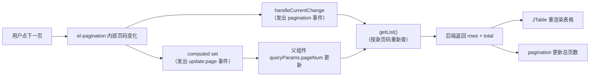

# 第 4 章 · 组件化与组件通信

> **这一章解决什么问题**：页面不是一整块写出来的，而是由很多组件拼起来的。这一章讲清楚「组件怎么定义、怎么注册、父子之间怎么传数据、怎么互相通知」，把项目里 `props`、`$emit`、`.sync`、`slot-scope`、`ref` 这些高频符号一次性打通。
>
> **学完标准**：看到一个页面，你能画出它的组件树；能说清每个 `props` 从哪来、每个 `$emit` 被谁接住；能自己写一个「父组件传数据、子组件通知父组件」的小组件。

---

## 一、为什么要拆组件

先看 `position/index.vue` 这个页面。它的界面上有：

- 左侧组织树；
- 右侧搜索框、下拉框、按钮；
- 表格；
- 分页条；
- 新增/修改弹窗；
- 岗位成员选择弹窗。

如果全部写在一个文件里，模板会非常长，逻辑全缠在一起。所以项目把它拆成了：

| 部分 | 文件 | 职责 |
|---|---|---|
| 页面主体 | `src/views/system/position/index.vue` | 组织树、搜索、表格、分页 |
| 新增/修改弹窗 | `src/views/system/position/Form.vue` | 表单、校验、提交 |
| 岗位成员弹窗 | `src/views/system/position/Selector.vue` | 选人 |
| 分页条 | `src/components/Pagination/index.vue` | 页码、每页条数 |
| 字典标签 | `src/components/DictTag/index.vue` | 把值翻译成中文标签 |
| 表格 | `src/components/JTable` | 通用表格封装 |

组件化的收益：

1. **每个文件只关心一件事**，好读、好改；
2. **可以复用**：分页条被几十个页面使用；
3. **边界清晰**：子组件只通过 `props` 拿数据、通过 `$emit` 通知父组件，不会偷偷改别人的状态。

---

## 二、一个组件到底是什么

一个 `.vue` 文件就是一个**单文件组件（SFC，Single File Component）**：

```vue
<template>
  <!-- 结构 -->
</template>

<script>
export default {
  name: 'MyComponent',
  // 数据、方法、生命周期……
}
</script>

<style scoped>
/* 样式，只作用于当前组件 */
</style>
```

`export default { ... }` 导出的对象，就是组件的「说明书」（第 3 章）。别人 `import` 它以后，就可以在模板里当标签用：

```js
import MyComponent from './MyComponent.vue'
```

```html
<my-component />
```

> 标签名从 `MyComponent` 变成 `my-component`，是 Vue 的命名习惯：**组件用 PascalCase 定义，模板里可以用 PascalCase 或 kebab-case**。项目里两种都有，比如 `<Form>`、`<DictTag>`、`<el-button>`。

### 2.1 `name` 选项有什么用

`src/components/Pagination/index.vue:22`：

```js
name: 'Pagination'
```

`name` 有三个常见用途：

1. **调试**：Vue Devtools 里显示组件名，报错信息也更好定位；
2. **`keep-alive` 的 `include`/`exclude` 按名字匹配**（第 3 章 §7.6）；
3. **递归组件**：组件在自身模板里调用自己。

> 前面提过：`position/index.vue` 没写 `name`，所以它不会被 `keep-alive` 缓存。这就是一个真实的小缺口。

---

## 三、注册组件：局部注册 vs 全局注册

### 3.1 局部注册：谁用谁注册

`src/views/system/position/index.vue:159`：

```js
import Form from './Form'
import Selector from './Selector'

export default {
  components: { Form, Selector }
}
```

`components` 里的键是模板里用的标签名，值是导入的组件对象。这样注册后，**只有当前组件**能使用 `<Form>`、`<Selector>`。

`src/views/system/position/Form.vue:75-79`：

```js
import Treeselect from '@riophae/vue-treeselect'

export default {
  components: { Treeselect }
}
```

第三方组件同样是「导入 + 局部注册」。

### 3.2 全局注册：一次注册，处处可用

`src/main.js:151-164`：

```js
Vue.component("DictTag", DictTag);
Vue.component("Pagination", Pagination);
Vue.component("RightToolbar", RightToolbar);
Vue.component("Editor", Editor);
Vue.component("FileUpload", FileUpload);
Vue.component("JTable", JTable);
// ...
```

全局注册后，任何组件的模板里都能直接写 `<pagination>`、`<dict-tag>`，**不需要再 import 和注册**。

这就是为什么 `position/index.vue` 里直接用了 `<pagination>`（`:139`）却没有 import——它在 `main.js` 里已经全局注册过了。

### 3.3 两种注册怎么选

| | 局部注册 | 全局注册 |
|---|---|---|
| 使用范围 | 仅当前组件 | 全项目 |
| 是否要 import | 要 | 不要 |
| 打包体积 | 没用到就不会进包 | 无论用不用都会进主包 |
| 适合 | 页面私有的子组件（Form、Selector） | 跨大量页面复用的基础组件（Pagination、DictTag） |

**建议**：业务子组件用局部注册；只有真的到处都在用的基础组件才全局注册。

> 全局注册的代价：它会被打进首次加载的 JS 里。项目全局注册了十几个组件（含富文本编辑器、文件上传等），这是首屏体积偏大的原因之一。

### 3.4 全局组件清单（读代码时对号入座）

| 标签 | 组件文件 | 用途 |
|---|---|---|
| `<dict-tag>` | `src/components/DictTag` | 字典值转标签 |
| `<pagination>` | `src/components/Pagination` | 分页条 |
| `<right-toolbar>` | `src/components/RightToolbar` | 搜索显隐、刷新、列显隐 |
| `<editor>` | `src/components/Editor` | 富文本 |
| `<file-upload>` 系列 | `src/components/FileUpload` | 文件上传 |
| `<image-upload>` 系列 | `src/components/ImageUpload` | 图片上传 |
| `<j-table>` | `src/components/JTable` | 表格封装 |
| `<money-input>` | `src/components/MoneyInput` | 金额输入 |

---

## 四、`props`：父组件把数据传给子组件

### 4.1 基本用法

子组件先声明「我需要哪些外部数据」：

```js
export default {
  props: {
    total: {
      required: true,
      type: Number
    },
    page: {
      type: Number,
      default: 1
    }
  }
}
```

父组件在标签上把值绑进去：

```html
<pagination :total="total" :page="params.pageNum" />
```

- `:total="total"`：把父组件 `data` 里的 `total` 传给子组件的 `total`；
- 模板里 `:page` 是 kebab-case，子组件里声明的是 `page`；如果 prop 是 `pageSizes`，模板写 `:page-sizes`。

> **单向数据流**：数据从父流向子。子组件**不能直接修改** `props`。想改，只能 `$emit` 通知父组件，让父组件去改（§5、§6）。

### 4.2 项目例子：Pagination 的 props

`src/components/Pagination/index.vue:23-63`：

```js
props: {
  total: {
    required: true,
    type: Number
  },
  page: {
    type: Number,
    default: 1
  },
  limit: {
    type: Number,
    default: 20
  },
  pageSizes: {
    type: Array,
    default() {
      return [10, 20, 30, 50]
    }
  },
  // ...
  background: {
    type: Boolean,
    default: true
  },
  hidden: {
    type: Boolean,
    default: false
  }
}
```

三个要点：

1. `required: true`：父组件不传 `total` 会警告；
2. `type`：类型不对会警告；
3. **对象/数组的默认值必须用函数返回**。因为如果直接写 `default: [10, 20]`，所有分页组件实例会共享同一个数组，一个改了全变。这和组件 `data` 必须是函数是同一个道理。

### 4.3 项目例子：不同类型的 props

`src/components/DictTag/index.vue:32-38`：

```js
props: {
  options: {
    type: Array,
    default: null
  },
  value: [Number, String, Array]
}
```

`value` 允许三种类型：后端返回的字典值可能是数字、字符串，也可能是数组。

`src/components/RightToolbar/index.vue:27-35`：

```js
props: {
  showSearch: {
    type: Boolean,
    default: true
  },
  columns: {
    type: Array
  }
}
```

`columns` 没写默认值，所以是 `undefined`。模板里用 `v-if="columns"` 判断有没有传，没传就不显示「显隐列」按钮（`:10`）。

### 4.4 父组件怎么传

`src/views/system/position/index.vue:139-144`：

```html
<pagination
  :total="total"
  :page.sync="params.pageNum"
  :limit.sync="params.pageSize"
  @pagination="initData"
/>
```

`total` 是普通传值；`page`、`limit` 加了 `.sync`（§6）；`@pagination` 是监听子组件事件（§5）。

---

## 五、`$emit`：子组件通知父组件

### 5.1 基本用法

子组件里：

```js
this.$emit('事件名', 参数1, 参数2)
```

父组件模板里：

```html
<child @事件名="处理函数" />
```

`$emit` 不会直接改父组件的数据。它只是**发布一个事件**：事件名 + 数据；父组件通过 `@事件名` **订阅**，拿到数据后自己决定怎么改。这是典型的「发布/订阅」模式。

```js
// 子组件：发布
this.$emit('add', payload)
```

```html
<!-- 父组件：订阅 -->
<child @add="handle" />
```

```js
// 父组件：处理
handle(payload) {
  // payload 就是子组件 $emit 的第二个参数
}
```

模板里写 `@add="handle($event)"` 时，`$event` 就是这个 `payload`。

| 事件来源 | `$event` 是什么 |
|---|---|
| 原生 `@click` / `@input` | 浏览器事件对象（`MouseEvent` / `InputEvent`） |
| 组件自定义 `@change` / `@add` | 子组件 `$emit` 传出来的值，可能是对象、字符串、数字、数组 |

所以不要背「`$event` 一定是事件对象」；先看这个事件是谁发的。详细对照见第 2 章 §4.4。

### 5.2 项目例子一：表单提交后通知父页面刷新

`src/views/system/position/Form.vue:174-182`：

```js
this.$message({
  message: res.msg,
  type: 'success',
  duration: 1500,
  onClose: () => {
    this.visible = false
    this.btnLoading = false
    this.$emit('refreshDataList')
  }
})
```

父页面 `src/views/system/position/index.vue:147`：

```html
<Form v-if="formVisible" ref="Form" @refreshDataList="initData" />
```

链路：

```
Form 提交成功
  → $emit('refreshDataList')
  → 父页面执行 initData()
  → 重新请求列表
  → 表格显示最新数据
```

### 5.3 项目例子二：刷新按钮

`src/components/RightToolbar/index.vue:59-62`：

```js
// 刷新
refresh() {
  this.$emit('queryTable')
}
```

父页面 `src/views/contract/contractDraftFiles/index.vue:83`：

```html
<right-toolbar :show-search.sync="showSearch" @queryTable="getList" />
```

子组件只管「按钮被点了」，具体刷新什么由父页面的 `getList` 决定。

### 5.4 项目例子三：分页变化

`src/components/Pagination/index.vue:87-101`：

```js
handleSizeChange(val) {
  if (this.currentPage * val > this.total) {
    this.currentPage = 1
  }
  this.$emit('pagination', { page: this.currentPage, limit: val })
  // ...
},
handleCurrentChange(val) {
  this.$emit('pagination', { page: val, limit: this.pageSize })
  // ...
}
```

父页面 `position/index.vue:143`：

```html
@pagination="initData"
```

子组件把新的页码和每页条数作为参数传出去，父组件用新参数重新请求。

### 5.5 事件名的大小写（容易踩坑）

**Vue 2 的事件名不做自动大小写转换**，`$emit` 的名字必须和 `@` 监听的名字**完全一致**。

```js
// 子组件
this.$emit('refreshDataList')
```

```html
<!-- 能匹配：大小写完全一致 -->
<Form @refreshDataList="initData" />

<!-- 不能匹配：Vue 2 不会把 kebab-case 转成 camelCase -->
<Form @refresh-data-list="initData" />
```

项目里 `position/index.vue:147` 写的是 `@refreshDataList`，能工作，是因为它和 `$emit('refreshDataList')` 完全一致，并且 `.vue` 单文件组件的模板编译保留大小写。

**但官方推荐用 kebab-case**，原因有两个：

1. 事件名不是 JS 变量，没有理由用 camelCase；
2. 如果模板写在 HTML 里（不是 `.vue`），浏览器会把属性名转小写，`@refreshDataList` 可能变成 `@refreshdatalist`，导致监听不到。

所以新写代码建议：

```js
this.$emit('refresh-data-list')
```

```html
<Form @refresh-data-list="initData" />
```

读项目时，看到 `@refreshDataList` 就照抄；自己新增事件时，优先用 kebab-case。

**延伸阅读**（按 社交媒体 → 社区 → GitHub → 官方文档）：

1. **社交媒体 / 中文社区**：[掘金 · Vue 2 组件通信总结](https://juejin.cn/post/7282733743910486073)、[掘金 · vue-$event 的使用场景](https://juejin.cn/post/7365827944310276159)
2. **社区**：[Stack Overflow · 把 event.target 传给 $emit](https://stackoverflow.com/questions/47875017/how-to-pass-the-event-target-as-emit-argument-in-vuejs2)、[javascript.info · 事件介绍](https://zh.javascript.info/events)
3. **GitHub**：[Vue 2 `$emit` 源码](https://github.com/vuejs/vue/blob/dev/src/core/instance/events.js)
4. **官方文档**：[Vue 2 自定义事件](https://v2.vuejs.org/v2/guide/components-custom-events.html)（事件名大小写的权威说明）

> 社媒/社区可能过时或有错；和源码、官方文档冲突时，以源码和官方文档为准。

---

## 六、`.sync`：父子双向同步的语法糖

### 6.1 它展开成什么

父组件写：

```html
<right-toolbar :show-search.sync="showSearch" />
```

Vue 编译时把它展开成两件事：

```html
<right-toolbar
  :show-search="showSearch"
  @update:showSearch="showSearch = $event"
/>
```

即：

1. 把 `showSearch` 作为 prop 传给子组件；
2. 监听子组件的 `update:showSearch` 事件，把事件参数赋回父组件的 `showSearch`。

> 事件名是 `update:` + **驼峰化后的 prop 名**。`:show-search.sync` 对应 `update:showSearch`；`:page.sync` 对应 `update:page`。

### 6.2 子组件要配合做什么

子组件不能直接改 prop，而是发出对应的 `update:` 事件：

`src/components/RightToolbar/index.vue:56-58`：

```js
toggleSearch() {
  this.$emit('update:showSearch', !this.showSearch)
}
```

父组件 `.sync` 监听到后，自动把 `showSearch` 改成相反值，再传回子组件。界面就更新了。

### 6.3 项目例子：Pagination 的 `.sync`

`position/index.vue:141-142`：

```html
:page.sync="params.pageNum"
:limit.sync="params.pageSize"
```

对应的子组件事件，正是第 3 章看过的计算属性 setter：

`src/components/Pagination/index.vue:73-75`：

```js
set(val) {
  this.$emit('update:page', val)
}
```

`src/components/Pagination/index.vue:81-83`：

```js
set(val) {
  this.$emit('update:limit', val)
}
```

整条链路（以页码为例）：

```
用户点第 2 页
  → Element UI 更新内部状态
  → 触发 Pagination 的 :current-page.sync，执行 currentPage 的 set(2)
  → $emit('update:page', 2)
  → 父组件 :page.sync 把 params.pageNum 改成 2
  → 父组件 get() 读到新值，传回子组件
  → 子组件分页条显示第 2 页
```

### 6.4 `.sync` 不是真正的双向绑定

它仍然是「**prop 向下、事件向上**」，只是语法上省掉了手写事件监听。子组件并没有直接改父组件的数据。

### 6.5 `.sync` 和 `v-model` 的区别

| | `v-model` | `.sync` |
|---|---|---|
| 绑定几个值 | 一个 | 可以多个 |
| 默认 prop | `value` | 你自己指定的 prop 名 |
| 默认事件 | `input` | `update:propName` |
| 典型场景 | 输入框、单值组件 | 一个组件同时同步多个值（页码 + 每页条数） |

---

## 七、组件上的 `v-model`

### 7.1 默认约定

在**自定义组件**上写：

```html
<my-input v-model="name" />
```

等价于：

```html
<my-input :value="name" @input="name = $event" />
```

所以一个组件只要：

1. 声明一个 `value` prop；
2. 在值变化时 `$emit('input', 新值)`；

就能支持 `v-model`。

### 7.2 项目例子

`src/views/system/position/Form.vue:19-24`：

```html
<treeselect
  v-model="dataForm.organizeId"
  :options="treeData"
  :show-count="true"
  placeholder="请选择归属部门"
/>
```

`treeselect` 是第三方组件，它内部就是按 `value` prop + `input` 事件实现的，所以能直接用 `v-model`。

### 7.3 修改默认 prop 和事件

如果组件想用别的名字，可以加 `model` 选项：

```js
export default {
  model: {
    prop: 'checked',
    event: 'change'
  },
  props: {
    checked: Boolean
  },
  methods: {
    toggle() {
      this.$emit('change', !this.checked)
    }
  }
}
```

之后 `v-model` 就等价于 `:checked` + `@change`。

> 项目里绝大多数 `v-model` 用在 Element UI 的表单组件上（`el-input`、`el-select`、`el-tabs` 等），它们都是按这个约定实现的。

### 7.4 完整案例：父传子、子传父、`.sync` 与 `v-model`

> 目标：用一个「搜索 + 列表 + 分页」的小页面，把 `props`、`$emit`、`:page.sync`、组件上的 `v-model` 一次跑通。  
> 用法：新建 `component-demo.html`，整段复制后用浏览器打开。

```html
<!DOCTYPE html>
<html lang="zh-CN">
<head>
  <meta charset="UTF-8">
  <title>组件通信完整案例</title>
  <style>
    body { font-family: system-ui, sans-serif; margin: 24px; max-width: 720px; }
    input, select, button { padding: 6px 10px; margin: 4px 4px 4px 0; }
    li { cursor: pointer; padding: 6px 8px; border-bottom: 1px solid #eee; }
    li:hover { background: #f5f5f5; }
    .pager { margin-top: 12px; padding: 10px; background: #fafafa; border-radius: 6px; }
    .tip { color: #888; font-size: 13px; }
  </style>
</head>
<body>
  <div id="app">
    <!-- ① v-model 用在自定义组件上：等价于 :value + @input -->
    <my-input v-model="keyword" placeholder="输入关键字搜索" />
    <span class="tip">父组件的 keyword = "{{ keyword }}"</span>

    <!-- ② 子组件把点击事件抛给父组件 -->
    <ul>
      <li v-for="item in pageData" :key="item.id" @click="select(item)">
        {{ item.name }} <span class="tip">#{{ item.id }}</span>
      </li>
    </ul>
    <p>当前选中：<b>{{ selected ? selected.name : '无' }}</b></p>

    <!-- ③ .sync：父组件监听 update:page / update:limit -->
    <pager
      :total="filtered.length"
      :page.sync="page"
      :limit.sync="limit"
      @pagination="onPageChange"
    />
  </div>

  <script src="https://cdn.jsdelivr.net/npm/vue@2.6.12/dist/vue.js"></script>
  <script>
    // ---------- 子组件 1：支持 v-model 的输入框 ----------
    Vue.component('my-input', {
      // v-model 默认要求 prop 叫 value、事件叫 input
      props: {
        value: { type: String, default: '' },
        placeholder: { type: String, default: '' }
      },
      template: `
        <input
          :value="value"
          :placeholder="placeholder"
          @input="$emit('input', $event.target.value)"
        />
      `
    })

    // ---------- 子组件 2：分页器（对应项目里的 Pagination） ----------
    Vue.component('pager', {
      props: {
        total: { type: Number, required: true },   // 必填
        page: { type: Number, default: 1 },
        limit: { type: Number, default: 4 }
      },
      template: `
        <div class="pager">
          <button :disabled="page <= 1" @click="go(page - 1)">上一页</button>
          <span>第 {{ page }} / {{ totalPages }} 页</span>
          <button :disabled="page >= totalPages" @click="go(page + 1)">下一页</button>

          <select :value="limit" @change="changeLimit">
            <option v-for="n in [2, 4, 6]" :key="n" :value="n">每页 {{ n }} 条</option>
          </select>
        </div>
      `,
      computed: {
        totalPages() {
          return Math.max(1, Math.ceil(this.total / this.limit))
        }
      },
      methods: {
        go(next) {
          if (next < 1 || next > this.totalPages) return
          // .sync 的本质：父组件写 :page.sync，这里就必须发 update:page
          this.$emit('update:page', next)
          // 自定义事件：通知父组件“分页变了，去重新查数据”
          this.$emit('pagination', { page: next, limit: this.limit })
        },
        changeLimit(event) {
          const nextLimit = Number(event.target.value)
          this.$emit('update:limit', nextLimit)
          this.$emit('update:page', 1)
          this.$emit('pagination', { page: 1, limit: nextLimit })
        }
      }
    })

    // ---------- 父组件 ----------
    new Vue({
      el: '#app',
      data: {
        keyword: '',
        page: 1,
        limit: 4,
        selected: null,
        list: [
          { id: 1, name: '合同草拟' },
          { id: 2, name: '合同审批' },
          { id: 3, name: '用印申请' },
          { id: 4, name: '合同归档' },
          { id: 5, name: '模板发布' },
          { id: 6, name: '编号规则' },
          { id: 7, name: '签约主体' },
          { id: 8, name: '合作方管理' }
        ]
      },
      computed: {
        // 父组件算出过滤后的完整列表，传给子组件的只是 total
        filtered() {
          return this.list.filter(item => item.name.includes(this.keyword))
        },
        // 当前页要显示的那几条
        pageData() {
          const start = (this.page - 1) * this.limit
          return this.filtered.slice(start, start + this.limit)
        }
      },
      watch: {
        // 搜索条件一变，回到第 1 页（否则可能停在超出范围的页码）
        keyword() {
          this.page = 1
        }
      },
      methods: {
        select(item) {
          this.selected = item
        },
        onPageChange({ page, limit }) {
          console.log('父组件收到 pagination：', page, limit)
          // 真实项目里这里会调 getList() 重新请求后端
        }
      }
    })
  </script>
</body>
</html>
```

**四条通信线分别看哪里**：

| 方向 | 写法 | 在案例里 |
|---|---|---|
| 父 → 子（数据） | `props` | `<pager :total="filtered.length" :limit="limit">` |
| 子 → 父（事件） | `$emit('pagination', ...)` | 点「上一页/下一页」时触发 |
| 双向（`.sync`） | `:page.sync` ↔ `$emit('update:page')` | 子组件不直接改 `this.page`，而是发事件让父组件改 |
| 双向（`v-model`） | `:value` + `@input` | `<my-input v-model="keyword">` |

**一个必须记住的点**：子组件**不能直接改 props**。`this.page = 2` 在 Vue 2 里会报警告（「Avoid mutating a prop directly」），而且父组件的数据不会变。正确做法就是案例里的 `this.$emit('update:page', next)`。

**回到项目**：

| 案例里的东西 | 项目真实代码 |
|---|---|
| 子组件声明 `props` | `src/components/Pagination/index.vue:23-63`（`total` / `page` / `limit` / `pageSizes` / `layout` / `hidden`） |
| 子组件通过 `update:xxx` 同步回父组件 | 同文件 `:68-85`（`currentPage` / `pageSize` 的 `get` / `set`，`set` 里 `$emit('update:page', val)`） |
| 父组件用 `.sync` 接收 | `src/views/system/position/index.vue:139-144`（`:page.sync` / `:limit.sync`） |
| 子组件发自定义事件 | `src/components/RightToolbar/index.vue:59-62`（`refresh()` 里 `$emit('queryTable')`）；`src/views/system/position/Form.vue:181`（保存成功后 `$emit('refreshDataList')`） |
| `v-model` 用在组件上 | `src/views/system/position/Form.vue:19-24`（`<treeselect v-model="dataForm.organizeId">`） |

> 对比一下就明白了：`Pagination` 组件内部**没有** `data` 存页码，页码始终由父组件（`position/index.vue` 的 `params.pageNum`）持有，子组件只负责「显示 + 发事件」。这就是「**数据往下传、变化往上报**」的标准组件设计。

**动手验证**：

1. 在搜索框输入「合同」，列表立刻过滤，页码自动回到 1；
2. 点「下一页」，观察 `pager` 组件没有自己改 `page`，而是发了 `update:page`；
3. 在 Console 里能看到父组件收到的 `pagination` 事件；
4. 把父组件的 `:page.sync` 改成 `:page`，再点下一页——页码不再变化，因为父组件没人监听 `update:page` 了。

---

## 八、插槽 `slot`：父组件决定子组件里放什么

### 8.1 默认插槽

子组件模板里写：

```html
<div class="card">
  <slot></slot>
</div>
```

父组件写：

```html
<card>
  <p>这段内容会出现在 slot 的位置</p>
</card>
```

`<slot>` 是一个「占位坑」，父组件写在标签中间的内容会填进去。

### 8.2 具名插槽

子组件：

```html
<div class="dialog">
  <slot name="header"></slot>
  <slot></slot>
  <slot name="footer"></slot>
</div>
```

父组件（Vue 2 旧写法）：

```html
<dialog>
  <h3 slot="header">标题</h3>
  <p>正文</p>
  <div slot="footer">按钮</div>
</dialog>
```

按 `slot` 名字对号入座。

项目里很常见：

`src/views/system/position/Form.vue:57`：

```html
<span slot="footer" class="dialog-footer">
  <el-button @click="visible = false">取消</el-button>
  <el-button type="primary" @click="dataFormSubmit()">确认</el-button>
</span>
```

这段按钮被塞进 `el-dialog` 的 `footer` 插槽，显示在弹窗底部。

`src/views/system/position/index.vue:126`：

```html
<el-dropdown-menu slot="dropdown">
```

下拉菜单内容被放进 `el-dropdown` 的 `dropdown` 插槽。

### 8.3 作用域插槽：本项目表格里最常见的 `slot-scope`

`src/views/system/position/index.vue:90-95`：

```html
<el-table-column prop="type" label="岗位类型">
  <template slot-scope="scope">
    <dict-tag
      :options="dict.type.PO_TYPE"
      :value="scope.row.flowCode"
    />
  </template>
</el-table-column>
```

拆开看：

- `<el-table-column>` 是表格的一列；
- 默认它只显示 `prop` 指定字段的原始值；
- 但这一列想显示**自定义内容**（字典标签），于是用 `<template slot-scope="scope">` 接管这一列的渲染；
- `scope` 是 `el-table-column` **回传**给父组件的内容，里面包含 `row`（当前行数据）、`column`、`$index` 等；
- `scope.row.flowCode` 就是当前行的流程编码。

**为什么叫「作用域」插槽**：普通插槽是父组件单向塞内容；作用域插槽是**子组件把自己的数据交给父组件写的内容使用**。数据从子组件流向父组件写的那段模板。

操作列也一样（`position/index.vue:108-137`）：

```html
<template slot-scope="scope">
  <el-button @click="handleAddEdit(scope.row.id)">修改</el-button>
  <el-button @click="handleDel(scope.row.id)">删除</el-button>
</template>
```

口诀：**「这一格里，当前行叫 `scope.row`」**。

### 8.4 新写法对照（Vue 2.6+）

项目全部使用旧写法。你在网上看到的 Vue 2.6/2.7 教程可能用新写法：

```html
<!-- 默认插槽 -->
<template v-slot:default="scope"></template>
<!-- 具名插槽简写 -->
<template #footer></template>
```

含义完全一样，**只是写法不同**。读本项目时认准 `slot="名字"` 和 `slot-scope="scope"`。

---

## 九、`ref`：父组件直接调用子组件的方法

### 9.1 用法

子组件标签上写 `ref="名字"`：

`src/views/system/position/index.vue:147`：

```html
<Form v-if="formVisible" ref="Form" @refreshDataList="initData" />
```

父组件里：

`src/views/system/position/index.vue:233-241`：

```js
handleAddEdit(id) {
  this.formVisible = true
  this.$nextTick(() => {
    this.$refs.Form.init(id, this.params.organizeId)
  })
}
```

`this.$refs.Form` 拿到的是 **Form 组件实例**，可以直接调用它 `methods` 里的 `init`：

`src/views/system/position/Form.vue:144`：

```js
init(id, organizeId) { ... }
```

### 9.2 什么时候用 `ref`，什么时候用 `$emit`

| | `$emit`（事件） | `ref`（引用） |
|---|---|---|
| 方向 | 子 → 父 | 父 → 子 |
| 语义 | 通知「发生了什么」 | 命令「你去做某件事」 |
| 典型场景 | 提交成功、分页变化、刷新 | 打开弹窗并初始化表单、重置表单、调用图表实例 |
| 耦合度 | 低 | 较高（父组件要知道子组件的方法名） |

`position` 页面的做法很典型：

- **打开并初始化弹窗**用 `ref`（父命令子）；
- **保存成功后刷新列表**用 `$emit`（子通知父）。

### 9.3 `ref` 的两个注意点

1. `ref` 必须在组件**渲染出来之后**才有值。`v-if="formVisible"` 为假时，`$refs.Form` 是 `undefined`，所以父组件里先改 `formVisible = true`，再 `$nextTick`；
2. 同一个 `ref` 用在 `v-for` 里时，`$refs.xxx` 会变成数组。

---

## 十、实战：JTable + pagination 怎么配合

> 前面学的 `props` / `$emit` / `.sync` / `slot` / `$attrs`，在这一对组件里全用上了。它们不是 Element UI 的标签，而是项目自己的包装组件。

### 10.1 它们从哪来

| 组件 | 文件 | 全局注册 |
|---|---|---|
| `JTable` | `src/components/JTable/index.vue` | `main.js:104` 引入，`:163` 注册 |
| `Pagination` | `src/components/Pagination/index.vue` | `main.js:80` 引入，`:154` 注册 |

因为 `Vue.component(...)` 全局注册（§3.2），页面里可以直接写 `<JTable>` / `<pagination>`，不用 import。

### 10.2 `JTable`：给 `el-table` 套一层项目默认值

```html
<el-table
  :data="data"
  :height="height"
  v-bind="$attrs"
  v-on="$listeners"
>
  <el-table-column v-if="hasC" type="selection" />
  <el-table-column v-if="hasNO" type="index" label="序号" />
  <slot />
</el-table>
```

它多做了四件事：

1. **默认序号列**：`hasNO` 默认 `true`；
2. **可选多选列**：`:has-c="true"` 才显示；
3. **高度默认 100%**：填满父容器；
4. **数据变化后修复布局**：`watch data` → 等 100ms → 调 `el-table.doLayout()`，解决「表格列错位 / 宽度不对」。

`v-bind="$attrs"` 和 `v-on="$listeners"` 是关键：页面写的 `v-loading`、`@selection-change` 这些 **JTable 没有声明的属性和事件，会原样传给内部的 `el-table`**。页面自己写的 `<el-table-column>` 则通过 `<slot />` 塞进去。

### 10.3 `pagination`：把页码/每页条数同步回父组件

props 清单见 §4.2，这里只看它怎么把变化传回去：

```js
computed: {
  currentPage: {
    get() { return this.page },
    set(val) { this.$emit('update:page', val) }
  },
  pageSize: {
    get() { return this.limit },
    set(val) { this.$emit('update:limit', val) }
  }
}
```

`handleSizeChange` 还会处理「改每页条数后页码越界」：当前页 × 新条数 > 总数时，页码回 1。`.sync` 的展开机制见 §6.3。

### 10.4 两者怎么配合

```html
<JTable :data="signingSubjectList" @selection-change="handleSelectionChange">
  <el-table-column label="签约主体名称" prop="signingSubjectName" />
</JTable>

<pagination
  :total="total"
  :page.sync="queryParams.pageNum"
  :limit.sync="queryParams.pageSize"
  @pagination="getList"
/>
```



> **怎么看**：`JTable` 只负责「把 rows 画成表格」，`pagination` 只负责「改页码 + 通知重新查」；两者不直接通信，都通过父组件的 `queryParams` 和 `total` 串起来。

### 10.5 动手验证

1. 把每页条数从 10 改成 20：Network 里 `pageSize=20`，`pageNum` 回到 1；
2. 点下一页：`pageNum=2`；
3. 给 `<JTable>` 加 `v-loading="loading"`：确认表格出现加载遮罩（`$attrs` 透传）。

## 十一、其它通信方式

### 11.1 `$parent` / `$children`

组件实例上有 `$parent`（父实例）和 `$children`（子实例数组），可以直接访问。

**不推荐**：层级一变就断，父子关系不明确，代码难维护。项目里基本不用，知道有这回事即可。

### 11.2 事件总线 `$EventBus`

`src/main.js:137`：

```js
Vue.prototype.$EventBus = new Vue(); // 全局事件总线
```

原理：`new Vue()` 实例自带 `$on` / `$emit` / `$off`。把它挂到 `Vue.prototype` 上，**任何组件**都能用同一个实例收发事件，从而绕过父子层级。

典型用法：

**监听方** `src/layout/components/Sidebar/index.vue:86`：

```js
this.$EventBus.$on("updateTipCount", (data) => {
  // 收到通知，更新角标
})
```

**销毁时解绑** `:95`：

```js
this.$EventBus.$off("updateTipCount")
```

**发送方** `:126`：

```js
this.$EventBus.$emit("updateTipCount");
```

另一个例子是工作流待办页 `src/views/workflow/todoItem/todo/index.vue:291-302`：监听 `reloadPage`、`listUpdate`，在 `beforeDestroy` 里统一 `$off`。

**注意**：

1. 必须成对 `$on` / `$off`，否则组件销毁后事件还挂着，造成内存泄漏；
2. 事件名是全局的，容易冲突；
3. 项目里只在少数「跨层级、偶发」的场景用。**能用 `props`/`$emit` 解决的，不要上事件总线。**

### 11.3 Vuex

多个不相关页面共享登录用户、权限、字典、标签页状态，用 Vuex（第 6 章）。

### 11.4 `provide` / `inject`

祖先组件 `provide` 一个值，后代组件 `inject` 拿到，可以跨多层。

**本项目业务代码基本没用**（只在第三方库 `src/lib/vue-form-making` 内部出现）。面试可能问，知道「跨层级注入、不是响应式（Vue 2 中如果注入的是对象本身，对象属性变化可以响应；直接替换整个值不响应）」即可。

### 11.5 通信方式选择表

| 场景 | 推荐方式 |
|---|---|
| 父传子 | `props` |
| 子通知父 | `$emit` |
| 父子双向同步一个或多个值 | `.sync` / 组件 `v-model` |
| 父组件命令子组件做事 | `ref` + 子组件方法 |
| 父组件决定子组件的内容 | 插槽 `slot` / 作用域插槽 |
| 跨层级、跨页面的偶发通知 | `$EventBus`（记得 `$off`） |
| 多页面共享状态 | Vuex |
| 深层嵌套但只读的配置 | `provide/inject`（本项目少用） |

---

## 十二、把组件树画出来：position 页面

### 12.1 组件树

```
Position（position/index.vue，页面）
├── el-tree                    组织树
├── el-input / el-select       搜索区
├── JTable                     表格
│   └── el-table-column
│       └── <template slot-scope="scope">
│           └── DictTag        字典标签
├── Pagination                 分页（全局注册）
├── Form                       新增/修改弹窗（局部注册）
│   └── el-form
│       └── Treeselect         组织选择（第三方组件）
└── Selector                   岗位成员弹窗（局部注册）
```

### 12.2 数据流

```
父 Position
  │  props: total / page / limit
  ▼
子 Pagination
  │  $emit('pagination', {page, limit})
  │  $emit('update:page', val)  ← 由 :page.sync 接收
  ▼
父 Position 更新 params → 重新请求 → tableData 更新

父 Position
  │  ref="Form" + $refs.Form.init(id, organizeId)
  ▼
子 Form 打开弹窗、拉详情、校验、提交
  │  $emit('refreshDataList')
  ▼
父 Position 执行 initData() 刷新列表
```

一句话总结这一页的通信设计：

> **数据往下传（`props`），结果往上报（`$emit`），需要命令子组件做事就 `ref`，需要双向同步就 `.sync`。**

---

## 十三、动手练习

### 练习 1：写一对父子组件

不用项目环境，用一个 HTML 文件：

```html
<div id="app">
  <my-counter :start="10" @change="onChange" />
  <p>父组件收到：{{ lastValue }}</p>
</div>

<script src="https://cdn.jsdelivr.net/npm/vue@2.6.12/dist/vue.js"></script>
<script>
Vue.component('my-counter', {
  props: {
    start: {
      type: Number,
      default: 0
    }
  },
  data() {
    return { count: this.start }
  },
  template: `
    <div>
      <button @click="decrease">-1</button>
      {{ count }}
      <button @click="increase">+1</button>
    </div>
  `,
  methods: {
    increase() {
      this.count++
      this.$emit('change', this.count)
    },
    decrease() {
      this.count--
      this.$emit('change', this.count)
    }
  }
})

new Vue({
  el: '#app',
  data: { lastValue: null },
  methods: {
    onChange(val) {
      this.lastValue = val
    }
  }
})
</script>
```

要求：

1. 说清 `start` 是怎么从父传到子的；
2. 说清 `change` 事件是怎么从子传到父的；
3. 把 `my-counter` 改成支持 `v-model`（提示：`value` prop + `input` 事件）。

### 练习 2：拆一个页面

打开 `src/views/system/position/index.vue`，不看本章的组件树，自己列出：

1. 页面直接使用了哪些全局组件？
2. 哪些是局部注册的？
3. `Pagination` 收了哪些 props？发了哪些事件？
4. `Form` 和父页面之间有哪两种通信方式？

### 练习 3：读懂 `.sync`

`src/components/RightToolbar/index.vue` 里：

1. 找到 `$emit('update:showSearch', ...)`；
2. 找到项目里任意一个 `:show-search.sync="showSearch"`；
3. 把 `.sync` 展开成「一个 prop + 一个事件」；
4. 口述一遍「点搜索按钮 → 搜索区隐藏/显示」的完整链路。

### 练习 4：加一个 prop

在 `position/Form.vue` 里给弹窗加一个 prop `width`，默认 `"600px"`，把模板里写死的 `width="600px"` 改成 `:width="width"`。

改完在父页面传 `width="800px"`，观察弹窗变宽。做完改回去。

### 练习 5：用作用域插槽

在一个小例子里写一个 `my-list` 组件：

- 子组件接收 `items` 数组，用 `v-for` 渲染；
- 通过作用域插槽把 `item` 和 `index` 交给父组件；
- 父组件决定每一项显示成「序号 + 名称 + 删除按钮」。

验收：删掉某一项后列表正确更新。

---

## 十四、本章自测清单

- [ ] 局部注册和全局注册有什么区别？项目里哪些组件是全局注册的？
- [ ] `props` 为什么不能被子组件直接修改？想改怎么办？
- [ ] 对象/数组类型的 prop 默认值为什么必须用函数？
- [ ] `:page-sizes` 和子组件的 `pageSizes` 是什么关系？
- [ ] `$emit('事件名', 参数)` 在父组件里怎么接收？
- [ ] `.sync` 展开后是哪两行代码？事件名怎么拼？
- [ ] `.sync` 是真正的双向绑定吗？
- [ ] 组件上的 `v-model` 默认等价于哪两个东西？
- [ ] 默认插槽、具名插槽、作用域插槽分别解决什么问题？
- [ ] `slot-scope="scope"` 里的 `scope.row` 是什么？数据是谁传给谁的？
- [ ] `ref` 和 `$emit` 分别适合什么场景？
- [ ] `$EventBus` 使用时为什么必须 `$off`？
- [ ] 为什么 `ref` 要和 `$nextTick` 一起用？
- [ ] 画出 position 页面的组件树和数据流。

---

## 十五、下一章前瞻

组件解决「页面内部怎么拆」，但用户点菜单时，页面是怎么被换出来的？第 5 章讲 Vue Router：

- `<router-view />` 为什么能显示不同页面；
- `hash` 和 `history` 两种模式的区别；
- 路由表 `constantRoutes`、`dynamicRoutes` 怎么写；
- 为什么菜单是后端返回的，前端怎么把它们变成路由（`addRoutes`）；
- 路由守卫 `beforeEach` 如何拦住未登录用户；
- `params`、`query` 怎么传参。

> 这一章最重要的一句话：**组件之间只有两种基本动作——「数据往下传（props）」和「事情往上报（$emit）」；`.sync`、`v-model`、`ref` 都是在它们之上的便利写法。**
