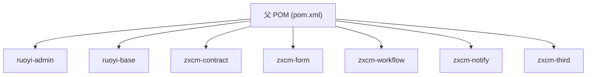
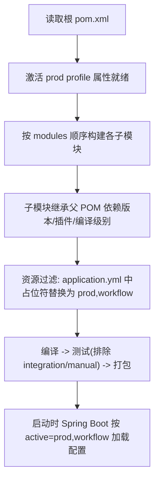

# Maven 父 POM 配置讲解（根目录 pom.xml）

> 位置：`E:\Develop\project\zxcm-learn\pom.xml`
> 适合读者：忘记 Maven 配置细节、需要快速回顾的开发同学

## 一、整体定位

这是整个项目的**父 POM（Parent POM）**，同时承担两个角色：

| 角色 | 实现方式 | 作用 |
|---|---|---|
| 聚合（Aggregation） | `<modules>` | 根目录执行一次命令，构建全部 7 个子模块 |
| 继承（Inheritance） | 子模块 `<parent>` 标签 | 子模块共享父 POM 的版本、依赖管理、插件配置 |



子模块引用父 POM 的写法（以 `ruoyi-admin/pom.xml` 为例）：

```xml
<parent>
    <artifactId>ruoyi-vue-plus</artifactId>
    <groupId>com.ruoyi</groupId>
    <version>4.0.1s</version>
</parent>
<artifactId>ruoyi-admin</artifactId>
```

---

## 二、文件头与坐标（第 1~11 行）

```xml
<?xml version="1.0" encoding="UTF-8"?>
<project xmlns="http://maven.apache.org/POM/4.0.0" ...>
    <modelVersion>4.0.0</modelVersion>
    <groupId>com.ruoyi</groupId>
    <artifactId>ruoyi-vue-plus</artifactId>
    <version>4.0.1s</version>
    <description>后台管理系统</description>
```

| 元素 | 作用 | 举例 |
|---|---|---|
| `<?xml ... ?>` | XML 声明，指定用 UTF-8 解析 | 固定首行 |
| `<project>` + `xmlns` | POM 根标签，指向 Maven 官方 4.0.0 schema（"语法说明书"） | 所有 pom.xml 都这么写 |
| `<modelVersion>4.0.0` | 声明使用的 POM 模型版本 | 固定值，不要改 |
| `groupId`/`artifactId`/`version` | **GAV 坐标**，全世界唯一标识一个构件 | 别人靠 `com.ruoyi` + `ruoyi-system` + `4.0.1s` 找到本项目模块 |
| `<description>` | 项目描述，给人看的 | 无实际构建功能 |

> 版本号 `4.0.1s` 的 s 是公司定制标识（基于 RuoYi-Vue-Plus 4.0.1 改造），属于命名习惯，Maven 不关心。

---

## 三、`<properties>`：全局变量表（第 13~59 行）

**作用**：定义变量，其他地方用 `${变量名}` 引用。**核心价值是集中管理版本号**。

```xml
<properties>
    <spring-boot.version>2.6.4</spring-boot.version>
    <java.version>11</java.version>
    <!-- ... -->
</properties>
```

**用法举例**：Spring Boot 从 2.6.4 升到 2.6.6，只改一行：

```xml
<spring-boot.version>2.6.6</spring-boot.version>
```

所有引用 `${spring-boot.version}` 的地方（含子模块）自动生效。

属性分组：

- **技术组件版本**：druid、mybatis-plus、satoken、redisson、xxl-job 等
- **编码/编译**：`project.build.sourceEncoding=UTF-8`、`java.version=11`
- **docker 配置**：镜像仓库地址、命名空间（打镜像推送时用）
- **OSS/SMS 配置**：AWS S3、阿里/腾讯短信 SDK 版本

---

## 四、`<dependencyManagement>`：依赖"定价表"（第 62~321 行）⭐ 最重要

**一句话原理**：

> `<dependencyManagement>` 只**声明版本**，不真正下载依赖；子模块写 `<dependency>` 时可**省略 `<version>`**，自动继承这里的版本。

### 用法对比

父 POM 统一定价：

```xml
<dependencyManagement>
    <dependencies>
        <dependency>
            <groupId>com.alibaba</groupId>
            <artifactId>druid-spring-boot-starter</artifactId>
            <version>${druid.version}</version>
        </dependency>
    </dependencies>
</dependencyManagement>
```

子模块直接引用，不写版本：

```xml
<dependencies>
    <dependency>
        <groupId>com.alibaba</groupId>
        <artifactId>druid-spring-boot-starter</artifactId>
        <!-- 自动使用父 POM 声明的 1.2.8 -->
    </dependency>
</dependencies>
```

> 注意：子模块若自己写了 `<version>`，会**覆盖**父 POM 版本，破坏统一管理，不推荐。

### 三类声明的解读

**① BOM 导入（`<type>pom</type>` + `<scope>import</scope>`）**

```xml
<dependency>
    <groupId>org.springframework.boot</groupId>
    <artifactId>spring-boot-dependencies</artifactId>
    <version>${spring-boot.version}</version>
    <type>pom</type>
    <scope>import</scope>
</dependency>
```

把 Spring Boot 官方整理好的**几百个依赖版本表一次性导入**。所以子模块引 `mysql-connector-java`、`spring-boot-starter-test` 都不用写版本。hutool-bom 同理。

**② 普通声明 + `<exclusions>` 排除传递依赖**

```xml
<dependency>
    <groupId>com.github.xiaoymin</groupId>
    <artifactId>knife4j-spring-boot-starter</artifactId>
    <version>${knife4j.version}</version>
    <exclusions>
        <exclusion>
            <artifactId>swagger-annotations</artifactId>
            <groupId>io.swagger</groupId>
        </exclusion>
    </exclusions>
</dependency>
```

knife4j 会传递带入旧版 `swagger-annotations`，项目不想要（下面单独声明了 1.5.22 版本），手动**排除**避免依赖冲突。easyexcel 排除 poi 同理（统一使用 4.1.1 的 poi）。

**③ 本项目模块间的版本声明**

```xml
<dependency>
    <groupId>com.ruoyi</groupId>
    <artifactId>ruoyi-system</artifactId>
    <version>${ruoyi-vue-plus.version}</version>
</dependency>
<dependency>
    <groupId>com.zhaoxinms</groupId>
    <artifactId>zxcm-workflow</artifactId>
    <version>${zxcm.version}</version>
</dependency>
```

告诉 Maven "自家模块的版本是多少"，供子模块互相引用时继承。

### 从这段读出的项目技术清单

| 分类 | 依赖 |
|---|---|
| 数据库 | druid 连接池、dynamic-datasource 多数据源、p6spy（SQL 性能分析）、ojdbc6（Oracle 驱动） |
| ORM | mybatis-plus 3.5.2 |
| 认证 | Sa-Token + Sa-Token-JWT + JAXB（JDK 11 缺失依赖） |
| 接口文档 | knife4j 3.0.3 + swagger-annotations |
| Excel | poi 4.1.1 + easyexcel 3.0.5 |
| 缓存/锁 | redisson + lock4j（分布式锁） |
| 日志 | tlog（链路追踪日志） |
| 任务调度 | xxl-job 2.3.0 |
| 对象存储 | aws-java-sdk-s3（兼容 S3 协议） |
| 短信 | 阿里 dysmsapi、腾讯 tencentcloud-sdk-java |
| 工具库 | hutool、commons-io、commons-fileupload、fastjson、cglib、velocity（代码生成模板） |
| 监控 | spring-boot-admin（server + client） |

---

## 五、`<modules>`：聚合模块（第 323~336 行）

```xml
<modules>
    <module>ruoyi-admin</module>
    <module>ruoyi-base</module>
    <module>zxcm-contract</module>
    <module>zxcm-form</module>
    <module>zxcm-workflow</module>
    <module>zxcm-notify</module>
    <module>zxcm-third</module>
</modules>
```

**作用**：声明这是多模块项目，根目录执行 `mvn clean install` 会依次构建这 7 个模块。

**构建顺序不用操心**：Maven 自动分析模块间依赖（如 `ruoyi-admin` 依赖 `zxcm-contract`），先构建被依赖者。

---

## 六、`<packaging>pom</packaging>`（第 337 行）

声明本项目**不产出 jar/war**，仅用于聚合与配置继承。

- 普通模块默认 `jar`
- 无主类的"管理型"项目必须写 `pom`，否则打包报错

---

## 七、`<build>`：构建配置（第 339~378 行）

### 7.1 插件部分

```xml
<!-- 编译插件：控制 JDK 版本 -->
<plugin>
    <artifactId>maven-compiler-plugin</artifactId>
    <configuration>
        <source>${java.version}</source>   <!-- 源码按 Java 11 编译 -->
        <target>${java.version}</target>   <!-- 生成 Java 11 字节码 -->
    </configuration>
</plugin>

<!-- 测试插件：排除集成/手工测试分组 -->
<plugin>
    <artifactId>maven-surefire-plugin</artifactId>
    <configuration>
        <excludedGroups>integration,manual</excludedGroups>
    </configuration>
</plugin>
```

- 编译插件：不配置可能拿环境默认 JDK 编译，出问题
- surefire：跳过标记为 `integration`、`manual` 分组（慢或依赖环境）的测试

### 7.2 资源过滤（resources）——环境切换的开关

```xml
<resources>
    <!-- 规则1：全目录原样复制，不替换变量 -->
    <resource>
        <directory>src/main/resources</directory>
        <filtering>false</filtering>
    </resource>
    <!-- 规则2：仅这些文件开启变量替换 -->
    <resource>
        <directory>src/main/resources</directory>
        <includes>
            <include>application*</include>
            <include>bootstrap*</include>
            <include>banner*</include>
        </includes>
        <filtering>true</filtering>
    </resource>
</resources>
```

`filtering=true` 表示打包时把文件里的 `${xxx}` 占位符**替换成 Maven 属性值**。

**举例**：`application.yml` 中：

```yaml
spring:
  profiles:
    active: ${profiles.active}   # 打包时被替换
```

用 `dev` profile 构建 → 替换为 `dev,workflow`；用 `prod` → 替换为 `prod,workflow`。

**为什么要设 `filtering=false` 的第一条规则**：并非所有文件都希望被替换（有些模板自身含 `${}` 字样），只对配置文件精准过滤更安全。

---

## 八、`<repositories>` 与 `<pluginRepositories>`（第 380~408 行）

告诉 Maven 去哪些"商店"下载 jar 包和插件：

```xml
<repository>
    <id>public</id>
    <url>https://maven.aliyun.com/repository/public/</url>   <!-- 阿里云镜像，国内加速 -->
</repository>
<repository>
    <id>com.e-iceblue</id>
    <url>https://repo.e-iceblue.cn/repository/maven-public/</url>  <!-- Spire.Office 专用仓库 -->
</repository>
```

- 阿里云镜像：替代国外中央仓库，下载快
- e-iceblue：**Spire.Office 文档转换组件**不在中央仓库，只在厂商仓库
- `<pluginRepositories>` 单独配置：Maven 中**依赖与插件分开管理**，插件默认也走中央仓库，这里同样换成阿里云加速

---

## 九、`<profiles>`：多环境配置（第 410~447 行）

定义多套"环境参数包"，构建时选一套，属性注入到资源过滤中。

| profile | 生效条件 | profiles.active | 日志级别 | knife4j 文档 | 监控端点 |
|---|---|---|---|---|---|
| `local` | `-P local` | local | debug | 开 | 全开 |
| `dev` ✅默认 | 不指定时自动选中 | dev,workflow | debug | 开 | 全开 |
| `prod` | `-P prod` | prod,workflow | warn | 关（production=true） | health/info/logfile |

```xml
<profile>
    <id>dev</id>
    <properties>
        <profiles.active>dev,workflow</profiles.active>
        <logging.level>debug</logging.level>
        <knife4j.production>false</knife4j.production>
        <endpoints.include>'*'</endpoints.include>
    </properties>
    <activation>
        <activeByDefault>true</activeByDefault>  <!-- 默认环境 -->
    </activation>
</profile>
```

**用法举例**：

```bash
mvn clean package -P prod      # 生产打包：日志 warn、关闭接口文档
mvn clean package              # 不写 -P，默认走 dev
```

`profiles.active=dev,workflow` 会替换进 `application.yml` 的 `${profiles.active}`，Spring Boot 随之加载 `application-dev.yml` 和 `application-workflow.yml` —— **Maven 环境选择就这样传导给 Spring Boot**。

---

## 十、完整构建流程串联

以 `mvn clean package -P prod` 为例：



---

## 十一、常用命令小抄

```bash
mvn clean                          # 清理 target
mvn clean compile                  # 编译全部模块
mvn clean install                  # 编译 + 测试 + 安装到本地仓库
mvn clean package -DskipTests      # 跳过测试打包（产出 ruoyi-admin/target/zxcm-admin.jar）
mvn clean package -P prod          # 用生产环境配置打包
mvn -pl ruoyi-admin -am package    # 只构建某模块(-pl)及其依赖(-am)，开发提速
```

---

## 十二、一句话总结

父 POM 干四件事：

1. `<properties>` + `<dependencyManagement>` —— 统一"定版本"
2. `<modules>` —— 串联模块一起构建
3. `<build>` —— 定编译规则，资源过滤打通环境切换
4. `<profiles>` —— 提供 local/dev/prod 三套环境参数

> 子模块只声明"我要什么"，"什么版本、怎么编译"由父 POM 说了算。
