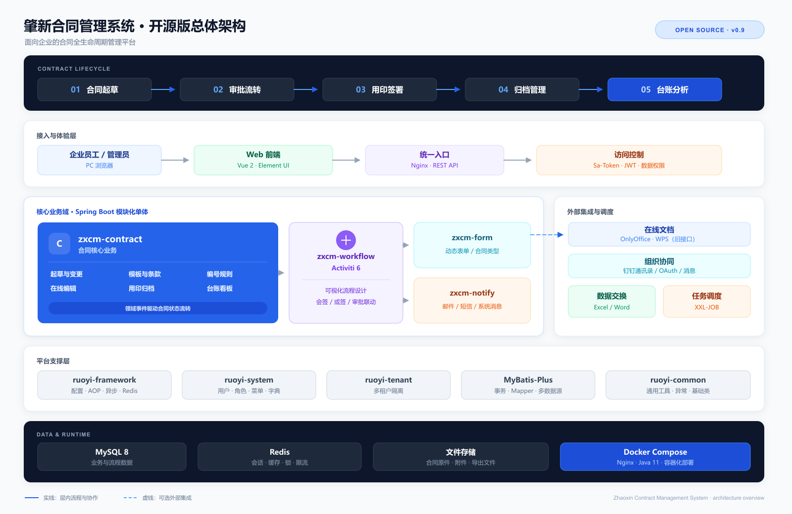

# 第 0 章 · 总纲：业务全景与代码分层

> 这是整套「后端重塑版」的第一章。它的作用不是讲某个功能，而是先给你两样东西：
> **① 一张地图**——这个系统到底在干什么、有多少个模块、一条合同要走完哪几步；
> **② 一套样板**——后面每一章都会反复用的「分层写法」和「请求怎么从页面走到数据库再走回来」。
>
> 读完这一章，你后面每读一个功能章节，脑子里都有一个固定的框子可以往里装。

> **零基础先补概念（本章只建立印象，后面遇到再回来看）**
>
> - **Controller / Service / Mapper 三层**：Controller 像「前台接待」，只接请求、转给 Service；Service 像「办业务的柜员」，写业务规则、管事务；Mapper 像「仓库管理员」，只跟数据库打交道。本项目例子：`zxcm-contract/src/main/java/com/ruoyi/conf/controller/TSigningSubjectController.java:86` 只调用 Service，真正拼 SQL 的是 `zxcm-contract/src/main/java/com/ruoyi/conf/mapper/TSigningSubjectMapper.java:30` 这一层。
> - **Entity / BO / VO**：Entity 是「数据库里一行数据的样子」；BO 是「前端提交上来的表单」；VO 是「后端准备给前端看的数据」。三者字段长得像，但职责不同，见 §4.2。
> - **Wrapper（条件构造器）**：MyBatis-Plus 提供的「用 Java 拼 where 条件」的工具，比如 `eq`、`like`、`orderByDesc`，可以理解成「不用手写 SQL 的查询积木」，例子见 `zxcm-contract/src/main/java/com/ruoyi/conf/service/impl/TSigningSubjectServiceImpl.java:112-126`。
> - **事务（Transaction）**：把多步数据库操作打包成「要么全成功、要么全回滚」的一次执行。比如「保存合同 + 保存明细」必须一起成功。本章的 CRUD 大多是单条 SQL，暂时不用操心；第 3 章会讲 `REQUIRES_NEW` 这种特殊事务。

---

## 写在最前：这套文档怎么用（花 3 分钟，很重要）

### 1. 每章都是同一个 7 段结构

从本章开始，**每一章都按固定 7 段来写**，顺序永远不变。你读任何一章，都能预判下一段要讲什么：

| 段 | 标题 | 它在回答什么问题 |
|---|---|---|
| 一 | **这部分是做什么的？** | 用人话说清这个功能对业务、对用户意味着什么 |
| 二 | **架构师视角：为什么这么设计？** | 这个功能背后的设计取舍，面试官最爱问的「为什么」 |
| 三 | **需要哪些技术？** | 这个功能碰到哪些技术点，**每个技术点精确定位在哪个文件/哪一节** |
| 四 | **功能怎么实现（带着你复制）** | 从建表到写完代码的完整步骤，你可以照着敲 |
| 五 | **接口全链路** | 挑本功能的真实接口，走一遍「前端按钮 → 后端 → 数据库 → 回显」 |
| 六 | **面试官高频问题 + 答案** | 站在企业级开发者角度，把这一章的问答题备好 |
| 七 | **选型对比** | 为什么用现在这套，**为什么不用别的那套** |

> 第 6、7 段是你答辩的弹药库；第 4、5 段是你照着开发的施工图；第 1、2、3 段是你理解「为什么」的地基。

### 2. 定位约定（本章帮你养成的第一个习惯）

文档里如果出现找不到的编号或章节，说明写法不合格。**这套文档里，凡是提到一个技术、一个文件、一个章节，都会写成「能直接找到」的形式**：

- 提**文件** → 写全路径 + 行号，例如 `zxcm-contract/src/main/java/com/ruoyi/conf/controller/TSigningSubjectController.java:77`
- 提**章节** → 写「第 X 章 §Y.Z」，例如「第 1 章 §1.3」
- 提**表** → 写表名 + 「谁建的」，例如 `conf_signing_subject`（肇新原作者建的）

你在后面任何一章看到不认识的缩写，先回来本章 §三 的**技术全景表**查一下，它告诉你去哪一章看详解。

### 3. 阅读顺序

- **第一次读**：按 第 0 章 → 第 1 章 → 第 2 章 …… 顺序读。每章的「新概念」只在**第一次出现的那一章讲透**，其它章只给一句回顾 + 指路。
- **开发时**：直接跳到对应功能章，从「四、功能怎么实现」开始照着敲；卡住了回看「三、需要哪些技术」找技术定位。
- **面试前**：只翻每章的「六、面试高频问题」和「七、选型对比」。

---

## 一、这部分是做什么的？（业务全景）

### 1.1 一句话说清这个系统

**合同管理系统**，干的事就是：把一家公司从「想签一份合同」到「合同归档入库」的全过程搬进系统，做到**可配置、可审批、可追溯、可统计**。

现实里，法务/业务员签一份合同大致要经历这些事：找到公司主体 → 找到对方公司 → 定合同类型 → 起稿 → 走审批 → 盖章 → 存台账 → 后续借用/续签/归档。这个系统就是把这 10 步都做成了页面和接口。



> **图注**：官方 README 的总体架构图（演示数据）。看三件事：合同生命周期的纵向链路、平台支撑（权限/流程/文件/消息）、以及可选的外部集成。

### 1.2 一条合同的完整生命周期（= 全书章节划分依据）

**这套文档就是按这条生命线来分章的**，一步一章：

```
① 签约主体（我方是谁）      → 第 1 章
② 合作方（对方是谁）         → 第 2 章
③ 编号规则（合同怎么编号）   → 第 3 章
④ 合同类型配置（签哪种合同） → 第 4 章
⑤ 合同草拟（起稿、传附件）   → 第 5 章
⑥ 审批流 + 事件状态机（谁批、批到哪）→ 第 6 章
⑦ 模板体系（用模板生成合同） → 第 7 章
⑧ 文档生成与在线编辑（在浏览器里改合同）→ 第 8 章
⑨ 用印 · 作废 · 续签 · 归档（合同的收尾）→ 第 9 章
⑩ 报表与看板（统计给了老板看）→ 第 10 章
```

> 注意这个顺序**不是随便排的**：它就是你实际开发时要按的顺序，也是数据表依赖的顺序——不先有「签约主体」，就没法「起稿合同」。第 5 章会讲到「下游表引用上游表」。

### 1.3 全书章节地图

| 章 | 主题 | 这一章会**第一次讲透**的新概念（后面章节会反复用到） |
|---|---|---|
| **0** | **总纲：业务全景 + 分层架构** | 三层分层、统一返回 `R`、`BaseEntity` 公共字段 |
| 1 | 签约主体管理 | Sa-Token 鉴权（`@SaCheckPermission`）、逻辑删除、雪花 ID、标准 CRUD 套路 |
| 2 | 合作方管理 | 数据权限（`@DataPermission` + `sys_role` 角色列，**数据权限开关不在业务表里**） |
| 3 | 编号规则 | Redis 缓存（预览编号）、`synchronized` 与集群重号 |
| 4 | 合同类型配置 | 公共字典、跨模块依赖边界 |
| 5 | 合同草拟 | 文件存储组件、缓存、版本表设计（宽表 + 版本表） |
| 6 | 审批流 + 事件状态机 | Activiti 引擎、Spring 事件、状态机 |
| 7 | 模板体系 | 版本化、发布态 |
| 8 | 文档生成与在线编辑 | OnlyOffice / WPS 集成、回调协议 |
| 9 | 用印 · 作废 · 续签 · 归档 | 历史不可变原则 |
| 10 | 报表与看板 | 读写分离的报表 Mapper（绕开通用 CRUD） |
| 附录 | 横切能力索引 | 一页速查：鉴权/数据权限/存储缓存 各自在哪章哪节 |

> **横切概念的处理原则**（你特别强调过）：像「鉴权」「数据权限」「文件存储」这种**每章都会用到**的能力，**不在结尾单开一章**，而是**在它第一次出现的那一章就地讲透**，后面章节只留一句「回顾 + 指路」。这样你读到第 5 章时，需要的鉴权知识在第 1 章已经讲过了，不会「用到的时候看不懂」。

---

## 二、站在架构师 / 开发经理角度：为什么这么设计？

这一段是本章的「灵魂」。你先搞懂这三个「为什么」，后面所有代码都变得顺理成章。

### 2.1 为什么要把代码分成 Controller / Service / Mapper 三层？

想象一下不分层会怎样：所有逻辑塞进一个类，接收请求、算业务、拼 SQL 全在一起。结果是——改一个 SQL 要重读整个类，两个人改同一个文件天天冲突，测试时没法只测业务逻辑。

分层的本质是**「按变化的频率切割」**：

| 层 | 只负责 | 变化频率 | 例子 |
|---|---|---|---|
| **Controller** | 接收 HTTP 请求、校验参数、调 Service、返回结果 | 低（接口一旦定了一般不改） | 收 `/conf/signingSubject/add` 请求 |
| **Service** | 业务规则、事务、编排多个 Mapper | 中（业务规则会调整） | 「同名主体不能重复添加」 |
| **Mapper** | 只跟数据库打交道（增删改查 SQL） | 低 | `insert into conf_signing_subject ...` |

**一句话**：接口协议和数据库结构都相对稳定，真正天天变的是「业务规则」。所以把业务规则单独抽成 Service 一层，它变了不影响别人，别人变了也不影响它。

**用一次改动检验分层**：

| 需求变化 | 只需要改哪层 | 为什么 |
|---|---|---|
| 接口路径从 `/add` 改成 `/create` | Controller | 只是协议变化 |
| 「同名主体不能重复」改成「同名且信用代码相同」 | Service | 只是业务规则变化 |
| 表加一个字段、查询多一个条件 | Entity / Mapper | 只是数据结构变化 |

如果三层混在一起，上面三种改动都会落在同一个类里，改一处要重读整个类，也更容易误伤别的逻辑。

> **边界**：层不是越多越好。简单 CRUD 硬拆成 5 层，会增加无意义的跳转；本项目用「Controller / Service / Mapper 三层 + 公共基类」，够用。

> 面试官如果问「你们项目怎么分层的、为什么」——上面这张「按变化频率切割」的表，就是比「我们分了 Controller/Service/Mapper」高一个档次的回答。

### 2.2 为什么还要在纵向分层之外，横向抽「公共能力」？

三层是**纵向**的（请求从上往下走）。但有些东西是**每一层都能用、每个功能都要用**的，比如：

- **统一返回格式**：所有接口都返回 `{code, msg, data}`（§四会讲）
- **公共字段**：每张表都要 `create_by / create_time / update_by / update_time`（§四会讲）
- **鉴权**：每个接口都要判断「这个人有没有权限」（第 1 章讲）
- **数据权限**：每个列表查询都要过滤「你只能看你部门的数据」（第 2 章讲）

如果每写一个接口都重写一遍这些，代码会重复到爆炸。所以架构师把它们抽成**「基类 + 注解 + AOP 切面」**：

- `BaseController` / `BaseEntity` / `BaseMapperPlus` —— 用**继承**共享
- `@SaCheckPermission` / `@DataPermission` / `@Log` —— 用**注解 + 切面**自动生效

**这就是你在代码里会看到的那些奇怪注解的由来**。本章 §四 先讲最基础的三个基类，注解类的在第 1、2 章逐个讲透。

**不抽公共能力会怎样**（伪代码）：

```java
// 每个 Controller 方法都要重复一遍
if (!StpUtil.hasPermission("conf:signingSubject:add")) {
    return R.fail(403, "没有权限");
}
Long userId = LoginHelper.getUserId();
// ...再写业务
```

抽成注解后：

```java
@SaCheckPermission("conf:signingSubject:add")
public R<Void> add(@Validated(AddGroup.class) @RequestBody TSigningSubjectBo bo) {
    // 只写业务
}
```

**代价**：注解是「隐式生效」的——新人看方法体不知道为什么有权限校验，调试时要记得看拦截器/切面。这也是为什么第 1、2 章要把 `@SaCheckPermission` 和 `@DataPermission` 单独讲透。

### 2.3 为什么后端要拆成这么多个 Maven 模块？

顶层 `pom.xml` 里定义了 7 个后端模块（+ 1 个前端），不是为了好看，是为了**「边界」**：

```
ruoyi-admin     ← 启动入口，把下面所有模块"拼装"成一个可运行的程序
ruoyi-base      ← 框架层（RuoYi 原作者写的公共能力：ruoyi-common/framework/system/generator）
zxcm-contract   ← 【合同业务核心】conf / contract / template / wps 四大包都在这里
zxcm-form       ← 表单模块（自定义表单）
zxcm-workflow   ← 工作流模块（Activiti 审批引擎单独一个模块）
zxcm-notify     ← 消息通知模块（站内信、公告）
zxcm-third      ← 第三方集成（钉钉同步等）
zxcm-ui         ← 前端（Vue），独立目录
```

**为什么把工作流单独拆一个模块？** 因为审批引擎（Activiti）是个「重型依赖」，只有需要审批的功能才用它。单独成模块，将来这个模块可以整个禁用/替换而不动合同核心。这就是「**按依赖边界切模块**」。

> 你开发时**90% 的时间只碰 `zxcm-contract` 这一个模块**。记住这一点，后面找代码就不慌了。

---

## 三、需要哪些技术？（技术全景 + 精确定位）

这是一张「**查字典**」用的表。你在后面任何一章看到不认识的技术，回来这里查它是什么、在哪、去第几章看详解。

| 技术 | 是什么（一句话） | 在本项目的实际位置 | 详解在哪 |
|---|---|---|---|
| **Spring Boot 2.6.4** | 把 Java 后端「组装」起来的地基框架 | 启动类 `ruoyi-admin/src/main/java/com/ruoyi/RuoYiApplication.java:40` | 本章 §四 |
| **Spring MVC** | 处理 HTTP 请求（`@RestController`/`@GetMapping` 那套注解） | 所有 `*/controller/*.java` | 本章 §五 |
| **MyBatis-Plus 3.5.2** | 跟数据库打交道，能自动生成增删改查 SQL | `ruoyi-base/ruoyi-common/src/main/java/com/ruoyi/common/core/mapper/BaseMapperPlus.java:49` | 本章 §四 |
| **Sa-Token 1.29.0** | 登录鉴权框架（判断"你是谁、你能不能干这事"） | 注解 `@SaCheckPermission`，见 `TSigningSubjectController.java:134` | **第 1 章** |
| **Activiti 7** | 工作流引擎（画审批流程图、驱动审批流转） | `zxcm-workflow` 模块 | **第 6 章** |
| **Redis** | 内存数据库，用来做缓存（比如编号预览、防重复提交） | 配置见 `ruoyi-admin/src/main/resources/application-dev.yml:182-196` | **第 3 章** |
| **MySQL 8** | 主数据库，初始化脚本里共 91 个 `CREATE TABLE` | 连接配置见 `ruoyi-admin/src/main/resources/application-dev.yml:124` | 表清单见本卷[附录 §三](附录-横切能力索引.md)；表来源分类见本章 §4.7 |
| **Vue 2 + Element-UI** | 前端框架 | `zxcm-ui/src/views/` 下各业务页面 | 各章 §五 |
| **axios** | 前端发 HTTP 请求的库 | `zxcm-ui/src/utils/request.js:19` | 本章 §五 |
| **雪花 ID** | 分布式唯一主键生成算法（不靠数据库自增） | 配置 `application.yml:248`（`idType: ASSIGN_ID`） | 本章 §四 |
| **逻辑删除** | 「删除」其实是打标记，数据还在库里 | 配置 `application.yml:254`（删=2，未删=0） | 本章 §四 |

> 📌 **这些配置在哪个文件**：MyBatis-Plus 全局配置在 `ruoyi-admin/src/main/resources/application.yml` 的 `mybatis-plus` 节点下（第 206~263 行），其中 `idType: ASSIGN_ID` 在第 248 行、逻辑删除值在第 254~256 行。
>
> 📌 **表数量的口径**：以当前源码为准，`script/sql/zxcm_init.sql` 里有 91 个 `CREATE TABLE`（含 Activiti、XXL-Job 等未全部导入的表）。核对命令：`grep -c "^CREATE TABLE" script/sql/zxcm_init.sql`。表来源分类见本章 §4.7。

---

## 四、功能具体怎么实现（带着你复制）：三层分层的落地样板

这一段不是让你现在就敲代码，而是让你**认识这套「五件套」的文件骨架**。后面每一章实现一个功能，都是照这个骨架填肉。

### 4.1 一个功能 = 一组「五件套」文件

以「签约主体」为例，它一共由这 5 类文件组成（**位置全在 `zxcm-contract` 模块的 `conf` 包下**）：

| 角色 | 文件 | 全路径 | 职责 |
|---|---|---|---|
| **Controller** | `TSigningSubjectController` | `zxcm-contract/src/main/java/com/ruoyi/conf/controller/TSigningSubjectController.java:77` | 暴露 HTTP 接口 |
| **Service 接口** | `ITSigningSubjectService` | `zxcm-contract/src/main/java/com/ruoyi/conf/service/ITSigningSubjectService.java:30` | 定义业务方法签名 |
| **Service 实现** | `TSigningSubjectServiceImpl` | `zxcm-contract/src/main/java/com/ruoyi/conf/service/impl/TSigningSubjectServiceImpl.java:55` | 写业务逻辑 |
| **Mapper** | `TSigningSubjectMapper` | `zxcm-contract/src/main/java/com/ruoyi/conf/mapper/TSigningSubjectMapper.java:30` | 数据库操作 |
| **Entity** | `TSigningSubject` | `zxcm-contract/src/main/java/com/ruoyi/conf/domain/TSigningSubject.java:37` | 对应数据库表 `conf_signing_subject` |

> 为什么 Service 要拆成「接口 + 实现」两个文件？这是企业里 Spring 项目的惯例：接口定义「能做什么」，实现类定义「怎么做」。好处是将来换实现（比如加个缓存版实现）不影响调用方。面试可能问到，先记住这个说法。

### 4.2 还有一个「三件套」：BO / VO / Entity 到底啥区别

新手最容易晕的就是这三个「长得差不多」的类。记住一句话：**它们传输的是同一份数据，但面向的对象不同**。

| 类 | 全称 | 谁在用它 | 为什么需要它 |
|---|---|---|---|
| **Entity** | 实体 | **数据库 ↔ 代码** | 字段严格对应表字段，`@TableName("conf_signing_subject")` 标注它对应哪张表 |
| **BO** | Business Object，业务对象 | **前端 → 后端**（接收参数） | 前端传上来的参数可能比表字段多/少，且要分批校验 |
| **VO** | View Object，视图对象 | **后端 → 前端**（返回数据） | 返回给前端的字段可以比表多（比如拼上"联系人名字"），也可以藏掉敏感字段 |

以签约主体为例：
- `zxcm-contract/src/main/java/com/ruoyi/conf/domain/TSigningSubject.java:37`（Entity）—— 对应表 `conf_signing_subject`
- `zxcm-contract/src/main/java/com/ruoyi/conf/domain/bo/TSigningSubjectBo.java:40`（BO）—— 前端提交表单时用
- `zxcm-contract/src/main/java/com/ruoyi/conf/domain/vo/TSigningSubjectVo.java:37`（VO）—— 列表/详情返回给前端时用

**为什么非得分三个？** 因为前端传的参数、数据库存的字段、返回给前端的数据，这三者**经常不一样**。用同一个类会互相绑架：数据库加个字段前端就跟着暴露，前端表单改个名字后端就报错。拆开之后各自独立演进。

> 这两组「五件套 + 三件套」是**全书每个 CRUD 功能共用的骨架**。第 1 章会用签约主体把它完整走一遍（带复制）。本章你先认识它们，别急着记细节。

### 4.3 公共设施一：统一返回 `R`

**它解决什么问题**：如果每个接口返回的格式都不一样，前端就没法统一处理（比如没法统一判断"这次请求成不成功"）。

所以本项目所有接口统一返回 `R`，它的定义在：
`ruoyi-base/ruoyi-common/src/main/java/com/ruoyi/common/core/domain/R.java:31`

结构就三个字段（见 `R.java:45-51`）：

```java
public class R<T> {
    private int code;     // 状态码：200=成功，500=失败
    private String msg;   // 提示信息
    private T data;       // 真正返回的数据
}
```

用它极其简单，代码里到处都是这两个写法：

```java
R.ok(data)        // 成功，带数据
R.fail("提示")     // 失败，带原因
```

比如 `TSigningSubjectController.java:137`：

```java
public R<TSigningSubjectVo> getInfo(...) {
    return R.ok(iTSigningSubjectService.queryById(id));   // 查到的主体信息 → 包进 R
}
```

**分页返回**用的是另一个类 `TableDataInfo`（定义在 `ruoyi-base/ruoyi-common/src/main/java/com/ruoyi/common/core/page/TableDataInfo.java:36`），它比 `R` 多带了 `total`（总条数，`ruoyi-base/ruoyi-common/src/main/java/com/ruoyi/common/core/page/TableDataInfo.java:43`）和 `rows`（当前页数据，`TableDataInfo.java:49`）等分页信息，见 `TSigningSubjectController.java:86`。

### 4.4 公共设施二：`BaseEntity` 公共字段

**它解决什么问题**：几乎每张表都有「谁建的、什么时候建的、谁改的、什么时候改的」这些字段。写在每个 Entity 里太啰嗦，抽成一个基类共享。

定义在 `ruoyi-base/ruoyi-common/src/main/java/com/ruoyi/common/core/domain/BaseEntity.java:33`，它包含：

| 字段 | 含义 | 关键注解 |
|---|---|---|
| `createBy` | 创建者 | `@TableField(fill = FieldFill.INSERT)` —— **插入时自动填** |
| `createTime` | 创建时间 | `@TableField(fill = FieldFill.INSERT)` |
| `updateBy` | 更新者 | `@TableField(fill = FieldFill.INSERT_UPDATE)` —— 插入和更新都自动填 |
| `updateTime` | 更新时间 | `@TableField(fill = FieldFill.INSERT_UPDATE)` |
| `params` | 扩展查询参数 | `@TableField(exist = false)` —— **不是数据库字段** |

怎么用？所有业务 Entity 都 `extends BaseEntity`，看 `TSigningSubject.java:37`：

```java 
//显式指定实体类映射到数据库表。修正实体类与数据库表名不一致的问题。避免 MyBatis-Plus 按默认驼峰转下划线规则找不到表而报错。
@TableName("conf_signing_subject") 
public class TSigningSubject extends BaseEntity {   // ← 继承，白得 4 个公共字段
    @TableId(value = "id")
    private String id;
    // ... 各个业务字段
}
```

**注意 `@TableField(fill = ...)` 那句**：它表示「这些字段不用你手动赋值，插入/更新时框架自动帮你填创建人和时间」。这就是为什么你在 Service 里插入数据时**从来不写** `setCreateTime(new Date())` —— 框架替你做了。

> ⚠️ 有意思的小细节：`TSigningSubjectServiceImpl.java:138` 里却**手动**写了 `add.setCreateBy("admin")`。这说明这个项目在个别地方没走自动填充，是硬编码的（面试时如果被问「创建人怎么来的」，你可以诚实说「大部分靠 MyBatis-Plus 自动填充，个别历史代码硬编码了 admin」——这种「知道缺口在哪」的回答比假装完美更得分）。

### 4.5 公共设施三：`BaseController`

定义在 `ruoyi-base/ruoyi-common/src/main/java/com/ruoyi/common/core/controller/BaseController.java:26`，它是个「工具箱」，所有 Controller 都 `extends BaseController`，白得几个方法：

| 方法 | 作用 | 代码位置 |
|---|---|---|
| `toAjax(rows)` | 「影响行数 > 0 就算成功」套成 `R` | `BaseController.java:34` |
| `toAjax(result)` | 布尔值套成 `R` | `BaseController.java:44` |
| `getLoginUser()` | 拿当前登录用户 | `BaseController.java:58` |
| `getUserId()` | 拿当前登录用户 ID | `BaseController.java:65` |

用法见 `TSigningSubjectController.java:149`：

```java
return toAjax(iTSigningSubjectService.insertByBo(bo) ? 1 : 0);
//     ↑ 插入成功(影响1行) → toAjax(1) → R.ok()；失败 → toAjax(0) → R.fail()
```

### 4.6 知识点：雪花 ID 和逻辑删除

这两个全局配置都在 `application.yml:245-256`，但**「配置即生效」只对雪花 ID 成立，对逻辑删除不成立**——逻辑删除还需要在 Entity 上指认字段。

- **雪花 ID**（`idType: ASSIGN_ID`，第 248 行）：主键不用数据库自增，而是 MyBatis-Plus 在插入时生成一个**全局唯一的 18~19 位数字**。好处是「不用等数据库分配 ID、分布式环境下也不会撞号」。
- **逻辑删除**（删=2，未删=0，第 253~256 行）：配置只定义了「值」，没有定义「哪个字段是删除标记」。字段指认之后，调 `delete` 才**不是真的 `DELETE`**，而是把 `del_flag` 改成 `2`；查询才自动加 `where del_flag = 0`。**所以数据其实还在库里，只是"看不见"了**——这是为了可追溯、可恢复。

**为什么光配 `logicDeleteValue` 不够？**

```yaml
# application.yml:253-256
logicDeleteValue: 2       # 只是定义「已删除」用哪个值
logicNotDeleteValue: 0    # 只是定义「未删除」用哪个值
```

这两行只定义值，没定义字段。没有字段标记时：

- `deleteById` 仍然执行物理 `DELETE`；
- `select` 不会自动加 `where del_flag = 0`；
- 上面这两个值配置**不作用于任何 SQL**。

指认字段有两种方式：

| 方式 | 写法 | 特点 |
|---|---|---|
| **注解（本项目）** | 字段上标 `@TableLogic` | 精确到实体/字段；字段名不统一也能用 |
| 全局字段名 | `logicDeleteField: delFlag` | 按名字全局匹配，所有叫 `delFlag` 的字段都生效 |

一句话：**`@TableLogic` 负责「哪个字段」，`logicDeleteValue` / `logicNotDeleteValue` 负责「用什么值」**。本项目只在字段上标注解、不写值，值就取自全局配置（2/0）。

怎么给一个 Entity 开逻辑删除？看 `TSigningSubject.java:65`：

```java
@TableLogic          // ← 指认「这个字段是逻辑删除标记」；值仍取全局的 2/0
private String delFlag;
```

### 4.7 全项目的表分几类、各自由谁建

看到一张表先别急着查字段，先判断**它是哪一类**——这决定了你该去哪找它的定义、能不能改、升级时会不会被覆盖：

| 类别            | 典型表                                                                                                                                                                                                               | 谁建的                 | 你怎么对待               |
| ------------- | ----------------------------------------------------------------------------------------------------------------------------------------------------------------------------------------------------------------- | ------------------- | ------------------- |
| **框架表**       | `sys_user`、`sys_role`、`sys_menu`、`sys_role_menu`、`sys_dict_type`、`sys_dict_data`、`sys_config`、`sys_oper_log`、`sys_logininfor`、`gen_table`                                                                         | RuoYi-Vue-Plus 框架自带 | 直接用；加字段要评估升级兼容性     |
| **业务表**       | `conf_signing_subject`、`conf_contract_counterpart`、`conf_bill_rule`、`form`、`contract_draft`、`contract_draft_files`、`contract_audit_form`、`template_contract`、`template_element`、`work_handover`、`notify_template` | 肇新原作者设计             | 本卷各业务章逐张讲；这是你答辩的主战场 |
| **中间件表**      | `act_*`（Activiti 引擎）、`xxl_job_*`（调度中心）                                                                                                                                                                            | 中间件启动/初始化时自动建       | 一般不改，改坏了中间件起不来      |
| **学习版补充表/脚本** | 你在 `zxcm-learn` 里跑建库脚本、业务脚本时产生的表                                                                                                                                                                                  | 学习项目脚本              | 只影响你自己的库，不污染答案册     |
|               |                                                                                                                                                                                                                   |                     |                     |

**怎么快速确认一张表属于哪类？**

1. 看前缀：`sys_`/`gen_` → 框架；`act_`/`xxl_job_` → 中间件；`conf_`/`contract_`/`template_`/`notify_`/`work_` → 业务。
2. 看建表位置：在 `script/sql/zxcm_init.sql` 里的，是框架 + 业务 + 部分中间件；Activiti 的 `act_*` 多数由引擎运行时建。
3. 看有没有 Entity：业务表通常有对应的 `domain/` 类；中间件表通常没有（框架用 SDK 访问）。

> 📌 **表数量口径**：`script/sql/zxcm_init.sql` 里有 **91 个 `CREATE TABLE`**（含 Activiti、XXL-Job 等未全部导入的表）。核对命令：`grep -c "^CREATE TABLE" script/sql/zxcm_init.sql`。**不要拿某个历史数字硬套**，以你当前库的 `information_schema` 或脚本为准。

---

## 五、接口全链路：从前端按钮到数据库再走回来

这一段是**全书最重要的一段**。后面每一章的第 5 段，都会挑本功能的真实接口，把这条链路走一遍。现在你先用最简单的「**查询签约主体列表**」把整条路走通、走熟。

### 5.1 全链路一图：从点按钮到看见数据

> **怎么读**：下面按「起点 + ①~⑫」走一遍。每一跳先写**发生了什么**，紧接着贴**真实代码**和行内注释。建议打开 IDE，按标注的行号对照。
>
> **一句话版**：`queryParams` → `getList` → `api` → `axios` → `Controller` → `Service` → `SQL` → `MySQL` → `VO` → `TableDataInfo` → `响应拦截器` → `表格/分页`。

#### 起点：用户点【查询】按钮

用户点的是这个按钮（`zxcm-ui/src/views/conf/signingSubject/index.vue:78-83`）：

```html
<el-button
  type="primary"
  icon="el-icon-search"
  size="mini"
  @click="handleQuery"        <!-- 点下去执行 handleQuery -->
>搜索</el-button>
```

`handleQuery` 只做两件事（同文件 `:748-751`）：

```js
handleQuery() {
  this.queryParams.pageNum = 1   // ① 条件变了，页码回第 1 页
  this.getList()                 // ② 真正发请求
},
```

`getList` 拿结果、填表格（同文件 `:712-719`）：

```js
getList() {
  this.loading = true
  listSigningSubject(this.queryParams).then((response) => {
    this.signingSubjectList = response.rows   // 表格数据
    this.total = response.total               // 分页总数
    this.loading = false
  })
},
```

那 `this.queryParams` 里的值从哪来？页面 `data()` 里先声明（同文件 `:629-645`）：

```js
total: 0,                      // 总条数（分页组件要用）
signingSubjectList: [],        // 表格数据
queryParams: {                 // 查询条件 + 分页参数
  pageNum: 1,                  // 当前第几页
  pageSize: 10,                // 每页几条
  signingSubjectCode: undefined,   // 用户没填 → undefined
  signingSubjectName: undefined,
  businessStatus: undefined,
  uscc: undefined,
  remarks: undefined
},
```

输入框用 `v-model` 直接写进 `queryParams`（同文件 `:19-26`）：

```html
<el-input
  v-model="queryParams.signingSubjectCode"   <!-- 输入即写入 queryParams -->
  placeholder="请输入签约主体编号"
  clearable
  maxlength="20"
  show-word-limit
  @keyup.enter.native="handleQuery"          <!-- 回车也能搜索 -->
/>
```

> 页面首次进入也会走一次：`created() { this.getList() }`（同文件 `:707-709`）。

⬇️ 带着 `queryParams` 进入下一跳

#### ① 调 api 方法：`listSigningSubject(queryParams)`

`zxcm-ui/src/api/conf/signingSubject.js:1-10`：

```js
import request from '@/utils/request'      // 统一封装好的 axios 实例

// 查询签约主体列表
export function listSigningSubject(query) {
  return request({
    url: '/conf/signingSubject/list',      // 只写后端路径，不写 /dev-api
    method: 'get',
    params: query                          // GET 参数：整个 queryParams
  })
}
```

> `params` 拼在 URL 上；换成 `data` 就进请求体（POST/PUT 用）。

⬇️ `request(...)` 就是下面这个 axios 实例

#### ② 走 axios：实例 + 请求拦截器

**创建实例**（`zxcm-ui/src/utils/request.js:19-24`）：

```js
const service = axios.create({
  baseURL: process.env.VUE_APP_BASE_API,   // 开发环境 = '/dev-api'
  timeout: 10000                           // 10 秒超时
})
```

**请求拦截器**（同文件 `:27-41`）：

```js
service.interceptors.request.use(config => {
  // ① 只有显式写 isToken:false 才不带 token
  const isToken = (config.headers || {}).isToken === false

  // ② 默认带 token：从 Cookie 读，拼成 "Bearer xxx"
  if (getToken() && !isToken) {
    config.headers['token'] = 'Bearer ' + getToken()
  }

  // ③ GET 参数拼到 URL 上（支持嵌套对象参数）
  if (config.method === 'get' && config.params) {
    let url = config.url + '?' + tansParams(config.params);
    url = url.slice(0, -1);       // 去掉末尾多余的 &
    config.params = {};           // 清空，防止 axios 再拼一次
    config.url = url;
  }

  return config;                  // ④ 必须 return，否则请求不会发出
}, error => {
  return Promise.reject(error)
})
```

**先弄清：`config` 和 `config.headers` 是什么**

`config` 是 axios 为**这一次请求**准备的「配置单」，不是请求本身。它是「全局默认 + 实例配置 + 这次请求参数」合并后的结果：

```js
{
  url: '/conf/signingSubject/list',
  method: 'get',              // 拦截器里已经是小写
  baseURL: '/dev-api',
  params: { pageNum: 1, pageSize: 10 },
  data: undefined,
  headers: { ... },
  timeout: 10000
}
```

| 字段 | 作用 |
|---|---|
| `url` / `baseURL` | 接口路径和公共前缀，发送时拼起来 |
| `method` | 请求方法（小写） |
| `params` | GET 参数，最终拼成 `?a=1&b=2` |
| `data` | POST/PUT 的请求体 |
| `headers` | 请求头键值表 |
| `timeout` | 超时时间 |

`config.headers` 就是这张配置单里的**请求头表**。拦截器执行前可能是：

```js
{ 'Content-Type': 'application/json;charset=utf-8', 'Content-Language': 'zh_CN' }
```

执行 `config.headers['token'] = 'Bearer ' + getToken()` 之后多了一项：

```js
{ ..., token: 'Bearer 3f2a1c9e-....' }
```

发请求时，这一项就变成 HTTP 头 `token: Bearer 3f2a1c9e-....`。

**逐行对应**：

- `(config.headers || {}).isToken`：读项目自定义的「跳过 token」开关（登录接口会写 `headers: { isToken: false }`）；`|| {}` 是防止 `headers` 为 `undefined` 时报错。
- `config.method === 'get'`：axios 已把方法统一转成小写。
- `config.params`：GET 的查询参数对象；如果写 `config.data`，那才是请求体。
- `return config`：拦截器是 Promise 链，必须把改好的配置交回去；不 return，下一环拿到 `undefined`，请求发不出去。

> 想看真实对象：在拦截器第一行加 `console.log('请求配置：', config)`，刷新页面后 F12 Console 里就是这次请求的完整 `config`。

**这句话怎么验证（4 层证据）**

不是靠记忆，按这四层查：

| 层 | 看哪里 | 结论 |
|---|---|---|
| 1. 类型定义 | `node_modules/axios/index.d.ts:62-95` 的 `AxiosRequestConfig`；`:173` 的 `request: AxiosInterceptorManager<AxiosRequestConfig>` | 拦截器回调的参数类型就是它 |
| 2. 源码入口 | `axios/lib/core/Axios.js:39` 的 `mergeConfig(this.defaults, config)`；`:41-48` 方法转小写；`:108` `dispatchRequest(newConfig)` | `config` 由「默认配置 + 本次请求参数」合并而来 |
| 3. 消费方 | `axios/lib/core/dispatchRequest.js:28` 接收 `config`；`:32` 确保 `headers`；`:43-47` 拍平 headers；`:56` `adapter(config)` | 真正发请求靠它 |
| 4. 运行时 | 拦截器里 `console.log(config)` / F12 Network | 打印出的字段与类型定义吻合 |

> 结论：`config` 的官方名字是 **`AxiosRequestConfig`**，「配置单」只是意译。完整的「怎么读第三方库」方法见 [vue2 第 7 章 §7.9](../../vue2/第7章-工程化与请求层.md)。

⬇️ 这时才真正发出 HTTP 请求

#### ③ HTTP 请求真正发出的样子

开发环境下，浏览器实际发的是：

```http
GET /dev-api/conf/signingSubject/list?pageNum=1&pageSize=10&signingSubjectName=肇新 HTTP/1.1
Host: localhost
token: Bearer 3f2a1c9e-....
```

`/dev-api` 由 devServer 代理到后端（`vue.config.js:35-40`），转发后变成：

```http
GET http://localhost:8080/conf/signingSubject/list?pageNum=1&pageSize=10&signingSubjectName=肇新
```

⬇️ 请求进入后端

#### ④ Controller：接请求、转交给 Service

`zxcm-contract/src/main/java/com/ruoyi/conf/controller/TSigningSubjectController.java:75-88`：

```java
@RestController                          // 返回 JSON
@RequestMapping("/conf/signingSubject")  // 类级前缀
public class TSigningSubjectController extends BaseController {

    private final ITSigningSubjectService iTSigningSubjectService;  // 构造器注入

    @ApiOperation("查询签约主体列表")
    @GetMapping("/list")                 // 最终路径 = /conf/signingSubject/list
    public TableDataInfo<TSigningSubjectVo> list(TSigningSubjectBo bo, PageQuery pageQuery) {
        // Controller 不写业务，只转发
        return iTSigningSubjectService.queryPageList(bo, pageQuery);
    }
```

**参数怎么从 URL 变成 `bo`**：

| 前端传来 | 后端接住 | 靠什么 |
|---|---|---|
| `?signingSubjectName=xx&pageNum=1&pageSize=10` | `TSigningSubjectBo bo` + `PageQuery pageQuery` | Spring MVC 按**参数名**绑定到对象字段 |
| POST 的 JSON body | 方法参数加 `@RequestBody` | 本方法没有 |
| 路径里的 `{id}` | 方法参数加 `@PathVariable` | 本方法没有 |

⬇️ 进入 Service

#### ⑤ Service：开始处理

`zxcm-contract/src/main/java/com/ruoyi/conf/service/impl/TSigningSubjectServiceImpl.java:79-81`：

```java
@Override
public TableDataInfo<TSigningSubjectVo> queryPageList(TSigningSubjectBo bo, PageQuery pageQuery) {
    // 把前端参数翻译成 where 条件（此时还没查库）
    LambdaQueryWrapper<TSigningSubject> lqw = buildQueryWrapper(bo);

    // 执行分页查询，并把 Entity 自动转成 VO
    Page<TSigningSubjectVo> result = baseMapper.selectVoPage(pageQuery.build(), lqw);
```

⬇️ 先看 `buildQueryWrapper` 拼了什么

#### ⑥ `buildQueryWrapper`：拼 where 条件

同文件 `:112-124`：

```java
private LambdaQueryWrapper<TSigningSubject> buildQueryWrapper(TSigningSubjectBo bo) {
    Map<String, Object> params = bo.getParams();
    LambdaQueryWrapper<TSigningSubject> lqw = Wrappers.lambdaQuery();

    // 第一个参数是布尔值：true 进 SQL，false 忽略
    lqw.eq(StringUtils.isNotBlank(bo.getSigningSubjectCode()), TSigningSubject::getSigningSubjectCode,
     bo.getSigningSubjectCode());
    lqw.like(StringUtils.isNotBlank(bo.getSigningSubjectName()), TSigningSubject::getSigningSubjectName,
        bo.getSigningSubjectName());
    lqw.eq(StringUtils.isNotBlank(bo.getBusinessStatus()), TSigningSubject::getBusinessStatus,
        bo.getBusinessStatus());
    lqw.eq(StringUtils.isNotBlank(bo.getStatus()), TSigningSubject::getStatus, bo.getStatus());
    lqw.like(StringUtils.isNotBlank(bo.getUscc()), TSigningSubject::getUscc, bo.getUscc());
    lqw.like(StringUtils.isNotBlank(bo.getContacts()), TSigningSubject::getContacts, bo.getContacts());

    lqw.orderByDesc(TSigningSubject::getCreateTime);   // 固定按创建时间倒序
```

> 「用户没填就不查」就是靠这个布尔值，不用写一堆 `if`。

⬇️ 条件准备好，交给 Mapper

#### ⑦ Mapper：执行查询（方法在父接口里）

`zxcm-contract/src/main/java/com/ruoyi/conf/mapper/TSigningSubjectMapper.java:30-31`：

```java
public interface TSigningSubjectMapper
    extends BaseMapperPlus<TSigningSubjectMapper, TSigningSubject, TSigningSubjectVo> {
```

`selectVoPage` 不在这个文件里，而是 `BaseMapperPlus` 提供的：通用 CRUD + Entity → VO 转换。

⬇️ 生成并执行 SQL

#### ⑧ MySQL：真正执行的 SQL

```sql
-- 结构示意：由 selectVoPage + buildQueryWrapper 生成
SELECT id, signing_subject_code, signing_subject_name,
       uscc, business_status, status, ...
FROM conf_signing_subject
WHERE del_flag = 0                         -- 逻辑删除：只查未删除的
  AND signing_subject_code = ?             -- 用户填了才出现
  AND signing_subject_name LIKE ?          -- 用户填了才出现
ORDER BY create_time DESC
LIMIT 0, 10                                -- pageNum=1, pageSize=10
```

⬇️ 结果集返回 Service

#### ⑨ Service：加工结果（补联系人）

同文件 `:83-95`：

```java
for (TSigningSubjectVo vo : result.getRecords()) {          // 只遍历当前页
    List<ContactInfo> list = new ArrayList<>();
    ContactInfo info = new ContactInfo();
    SysUser user = sysUserMapper.selectById(LoginHelper.getLoginUser().getUserId());
    info.setName(user.getNickName());                       // 补昵称
    info.setEmail(user.getEmail());                         // 补邮箱
    info.setTel(user.getPhonenumber());                     // 补电话
    info.setKey(user.getUserId().toString());
    info.setRemarks("sysUser");
    list.add(info);

    vo.setContacts(JsonUtil.getObjectToString(list));       // 序列化成 JSON 字符串
}
```

⬇️ 包装后返回

#### ⑩ Controller：返回 `TableDataInfo`

同文件 `:96`：

```java
return TableDataInfo.build(result);   // 包成前端要的 { rows, total }
```

序列化后的形状（结构示例，值不是真实数据）：

```json
{
  "code": 200,
  "msg": "查询成功",
  "rows": [
    {
      "id": "2075110479583309825",
      "signingSubjectCode": "zxkj",
      "signingSubjectName": "山西肇新科技有限公司",
      "contacts": "[{\"name\":\"管理员\",\"email\":\"...\",\"tel\":\"...\"}]"
    }
  ],
  "total": 1
}
```

⬇️ 回到前端

#### ⑪ 响应拦截器：剥壳 + 错误处理

`zxcm-ui/src/utils/request.js:71-111`（只留主线）：

```js
service.interceptors.response.use(res => {
  const code = res.data.code || 200;       // 没给 code 时按 200

  if (code === 401) {
    // 登录失效：弹「重新登录」→ 清状态 → 整页跳回登录页
    return Promise.reject('无效的会话，或者会话已过期，请重新登录。')
  } else if (code === 500) {
    Message({ message: msg, type: 'error' })          // 顶部红条
    return Promise.reject(new Error(msg))
  } else if (code !== 200) {
    Notification.error({ title: msg })                // 右上角通知
    return Promise.reject('error')
  } else {
    return res.data;                                  // 成功：剥掉 axios 外壳
  }
}, error => {
  return Promise.reject(error)                        // 断网/超时/404
})
```

所以 `getList` 拿到的 `response` 直接是 `{ code, msg, rows, total }`。

⬇️ 交给页面

#### ⑫ 页面：表格 + 分页

**表格**（`index.vue:123-141`）：

```html
<JTable
  v-loading="loading"                  <!-- 请求中显示遮罩 -->
  :data="signingSubjectList"           <!-- getList 里赋的值 -->
  @selection-change="handleSelectionChange"
>
  <!-- prop 对应后端 VO 字段名 -->
  <el-table-column label="签约主体编号" prop="signingSubjectCode" />
  <el-table-column label="签约主体名称" prop="signingSubjectName" />
</JTable>
```

**分页**（同文件 `:203-209`）：

```html
<pagination
  v-show="total > 0"
  :total="total"
  :page.sync="queryParams.pageNum"       <!-- 页码双向绑定 -->
  :limit.sync="queryParams.pageSize"     <!-- 每页条数双向绑定 -->
  @pagination="getList"                  <!-- 翻页后重新查 -->
/>
```

闭环：

```
queryParams → getList → api → axios → Controller → Service → SQL
     ↑                                                        │
     └──────── 表格/分页  ←── 响应拦截器  ←──  rows/total  ←──┘
```

### 5.2 逐行读：列表接口的核心代码到底在干什么

链路走到 Service 后，核心就是下面这段（原文在 `zxcm-contract/src/main/java/com/ruoyi/conf/service/impl/TSigningSubjectServiceImpl.java:79-97`）。**这段在 §5.1 的 ⑤⑥⑨ 已经分三段贴过**；下面 ①~⑧ 是**方法内的行号**，和上一节的跳数无关，逐行解释「为什么这么写」：

```java
public TableDataInfo<TSigningSubjectVo> queryPageList(TSigningSubjectBo bo, PageQuery pageQuery) {
    LambdaQueryWrapper<TSigningSubject> lqw = buildQueryWrapper(bo);                  // ①
    Page<TSigningSubjectVo> result = baseMapper.selectVoPage(pageQuery.build(), lqw); // ②
    for (TSigningSubjectVo vo : result.getRecords()) {                                // ③
        List<ContactInfo> list = new ArrayList<>();                                   // ④
        ContactInfo info = new ContactInfo();
        SysUser user = sysUserMapper.selectById(LoginHelper.getLoginUser().getUserId()); // ⑤
        info.setName(user.getNickName());                                             // ⑥
        info.setEmail(user.getEmail());
        info.setTel(user.getPhonenumber());
        list.add(info);
        vo.setContacts(JsonUtil.getObjectToString(list));                             // ⑦
    }
    return TableDataInfo.build(result);                                               // ⑧
}
```

| 编号 | 这一行在干什么 | 为什么这么写 |
|---|---|---|
| ① | 调 `buildQueryWrapper`，把前端传来的查询条件翻译成 Wrapper | 拼条件只做「准备」，此时还没执行 SQL；空条件不会进 where（见 §4 的 `eq(条件, 字段, 值)` 写法） |
| ② | `pageQuery.build()` 生成分页对象，`selectVoPage` 真正执行 SQL 并把 Entity 转成 VO | 分页参数和查询条件分开传，Service 不用手写 `LIMIT`；VO 转换由 `BaseMapperPlus` 统一做 |
| ③ | 只遍历「当前页」的记录 | 分页发生在数据库，不是查全量再截断 |
| ④ | 准备一个联系人列表 | 下面要现场拼一个表里没有的字段 |
| ⑤ | 按当前登录用户 ID 查 `sys_user` | 用户信息在另一张表，需要额外查一次 |
| ⑥ | 把昵称、邮箱、电话塞进 `ContactInfo` | 这些字段数据库主体表里没有，是运行时补的 |
| ⑦ | 把列表序列化成 JSON 字符串，赋给 VO 的 `contacts` | 数据库存的是字符串，前端拿到的也是字符串；VO 允许有「表里没有」的计算字段 |
| ⑧ | 包成 `TableDataInfo` 返回 | 前端要同时拿到 `rows` 和 `total` |

> **顺手指出一个可优化点**：第 ⑤ 行写在循环里，当前页 10 条就会用同一个用户 ID 查 10 次 `sys_user`。更合理的写法是循环外查一次、循环内复用。这不影响正确性，但面试时能说出来，说明你真读过执行路径。

### 5.3 这条链路里，每一跳的名字和作用（背下来）

| 角色 | 位置 | 作用 |
|---|---|---|
| 前端页面 | `zxcm-ui/src/views/conf/signingSubject/index.vue:712` | 收集 `queryParams`、发请求、渲染表格 |
| 前端 api | `zxcm-ui/src/api/conf/signingSubject.js:4` | 把「接口地址」集中定义，页面不直接写 URL |
| axios 拦截器 | `zxcm-ui/src/utils/request.js:27/71` | **请求时**自动塞 token；**响应时**统一判 code |
| 后端 Controller | `zxcm-contract/src/main/java/com/ruoyi/conf/controller/TSigningSubjectController.java:86` | 接请求、绑定参数、调 Service |
| Service | `zxcm-contract/src/main/java/com/ruoyi/conf/service/impl/TSigningSubjectServiceImpl.java:79` | 业务逻辑（拼条件、加工数据） |
| Mapper | `zxcm-contract/src/main/java/com/ruoyi/conf/mapper/TSigningSubjectMapper.java:30` | 数据库操作 |
| 数据库 | 表 `conf_signing_subject` | 真正存数据的地方 |

> **面试重点**：这条链路你能一口气说下来，就说明你「真的做过」，而不是「听说过」。后面每一章的 §五 都会带你练一个真实接口的链路，练到第 5 章你就闭着眼能画了。

### 5.4 动手验证：5 分钟看见这条链路真的跑起来

1. **启动后端**：运行 `ruoyi-admin/src/main/java/com/ruoyi/RuoYiApplication.java:40` 的 `main` 方法，端口默认 8080（`ruoyi-admin/src/main/resources/application.yml:30`）。启动前确认 `application-dev.yml:124` 的 MySQL 和 `application-dev.yml:184-192` 的 Redis 都能连上（本机默认是 `localhost`，用虚拟机中间件时改成 `192.168.56.10`）。
2. **打开接口文档**：浏览器访问 `http://localhost:8080/doc.html`（Knife4j，账号 `ruoyi` / `123456` 见 `application.yml:297-300`）。
3. **拿 token**：先在系统登录页登录，按 F12 打开开发者工具 → Network，随便点一个请求，复制请求头里的 `token` 值（格式是 `Bearer xxxx`）。也可以用 `POST http://localhost:8080/login` 登录（接口定义见 `ruoyi-admin/src/main/java/com/ruoyi/web/controller/system/SysLoginController.java:78-89`），body 形如 `{"username":"zxcmAdmin","password":"你的密码"}`；验证码开启时还要带 `code` 和 `uuid`（校验逻辑见 `ruoyi-base/ruoyi-system/src/main/java/com/ruoyi/system/service/SysLoginService.java:84-90`）。
4. **调列表接口**：`GET http://localhost:8080/conf/signingSubject/list?pageNum=1&pageSize=10`，请求头加 `token: Bearer <你的token>`。预期返回 `{"code":200,"msg":"操作成功","rows":[...],"total":N}`，且每条 row 的 `contacts` 是一段 JSON 字符串（内容是当前登录人的昵称/邮箱/电话，来源见 `zxcm-contract/src/main/java/com/ruoyi/conf/service/impl/TSigningSubjectServiceImpl.java:83-95`）。
5. **对照数据库**：执行
   ```sql
   SELECT id, signing_subject_name, del_flag
   FROM conf_signing_subject
   WHERE del_flag = '0'
   ORDER BY create_time DESC
   LIMIT 10;
   ```
   没有额外筛选条件时，返回行数应与接口的 `total` 一致。
6. **看 SQL 日志**：`ruoyi-admin/src/main/resources/application.yml:239` 配了 `logImpl: org.apache.ibatis.logging.stdout.StdOutImpl`，控制台会出现 `==>  Preparing: SELECT ... FROM conf_signing_subject ...` 和 `==> Parameters:`。看不到这两行，说明请求没有走到 Mapper。
7. **打断点**：在 `zxcm-contract/src/main/java/com/ruoyi/conf/service/impl/TSigningSubjectServiceImpl.java:80`（拼完条件）、`:81`（执行分页查询前）、`:83`（加工循环入口）下断点，用 Debug 模式启动后点一次「查询」，观察 `lqw` 的 SQL 片段、`result.getTotal()` 和 `result.getRecords().size()`。

---

## 六、面试官高频问题 + 答案（企业级视角）

> 这一段的每个答案，都要求你**能指着本项目的真实代码说**，而不是背概念。括号里给了你可以当场念出来的定位。

**Q1：你们项目的后端是怎么分层的？为什么这么分？**

分 Controller / Service / Mapper 三层。Controller 只接请求、校验、转发，不写业务；Service 写业务规则和事务；Mapper 只管数据库。
**为什么**：因为三层的「变化频率」不同——接口协议和表结构相对稳定，业务规则天天变。把易变的业务逻辑隔离在 Service 一层，改动就不会波及接口和 SQL。
（可指：`TSigningSubjectController.java:85` 只转发，真正的判断如「同名不能重复」在 `TSigningSubjectServiceImpl.java:164`。）
**追问：那 Controller 里能不能直接注入 Mapper 用？** 技术上能，但规范上不建议：业务校验、事务、事件发布都在 Service 层，绕过 Service 会让这些能力失效；本项目 Controller 只注入 Service（`TSigningSubjectController.java:79`）。

**Q2：前端传上来的参数，后端用什么接？为什么不用 Entity 直接接？**

用 BO（`TSigningSubjectBo`）。因为前端表单字段和数据库表字段经常不一致，而且新增和修改的校验规则不同——所以 BO 上会用 `@Validated(AddGroup.class)` 和 `EditGroup.class` 分组校验（见 `TSigningSubjectController.java:148` 和 `:160`）。用 Entity 直接接会导致校验规则没法按场景区分。

**Q3：返回给前端的为什么不是 Entity 而是 VO？**

因为返回的数据常需要加工或裁剪。比如签约主体列表里要返回一个「默认联系人」（`TSigningSubjectServiceImpl.java:83-95` 现场拼的），这个字段在数据库表里根本没有，必须用 VO 装。VO 还能隐藏敏感字段。

**Q4：你们接口的返回格式是什么？前端怎么统一处理的？**

统一返回 `R`（`code`/`msg`/`data`，见 `R.java:45-51`），分页额外用 `TableDataInfo`。前端在 axios 响应拦截器里统一判 `code`：401 弹重新登录、500 弹错误提示、非 200 走通知（`request.js:80/98/104`）。

**Q5：每张表的 `create_by`、`create_time` 是谁填的？**

MyBatis-Plus 的自动填充。Entity 继承 `BaseEntity`，这些字段上有 `@TableField(fill = FieldFill.INSERT)`（`BaseEntity.java:48`），插入时框架自动填，业务代码不用管。
**加分坦诚**：不过本项目个别历史代码是硬编码的，比如 `TSigningSubjectServiceImpl.java:138` 直接写了 `setCreateBy("admin")`，这块算是遗留问题。

**Q6：主键是怎么生成的？为什么不用数据库自增？**

用雪花算法（`application.yml:248` `idType: ASSIGN_ID`）。不用自增是因为：① 自增要等数据库返回 ID，批量插入慢；② 分布式/分库分表时自增会撞号；③ 自增 ID 会暴露业务量。雪花 ID 在应用层生成，全局唯一且趋势递增。

**Q7：你们的「删除」是真的删吗？**

不是，是逻辑删除。`@TableLogic` 标注 `del_flag` 字段（`TSigningSubject.java:65`），删除时只是把 `del_flag` 改成 2（`application.yml:254`），查询时框架自动加 `where del_flag=0`。目的是可追溯、可恢复。
**追问：手写 SQL 时逻辑删除还会自动生效吗？** 不会。`@TableLogic` 只改 MyBatis-Plus 自动生成的 SQL；手写 SQL 要自己写 `del_flag='0'`。本项目的导出查询就手写了一个 `a.DEL_FLAG='0'`（`zxcm-contract/src/main/java/com/ruoyi/conf/service/impl/TContractCounterpartServiceImpl.java:116`）。

### 本章答辩卡（3 组追问级问答）

**卡片 1：如果让你新加一张业务表，Entity 要写哪些注解，才能自动拥有公共字段、雪花 ID 和逻辑删除？**

> **10 秒答案**：类上写 `@TableName("表名")`，主键字段写 `@TableId`，删除标记字段写 `@TableLogic`，再 `extends BaseEntity` 继承四个审计字段。ID 生成策略和删除值不用写在 Entity 上，由 `application.yml` 的全局配置决定。
> **证据**：`ruoyi-base/ruoyi-common/src/main/java/com/ruoyi/common/core/domain/BaseEntity.java:33`（基类）、`zxcm-contract/src/main/java/com/ruoyi/conf/domain/TSigningSubject.java:36`（`@TableName`）、`:44`（`@TableId`）、`:65`（`@TableLogic`）、`ruoyi-admin/src/main/resources/application.yml:248-256`（雪花 + 逻辑删除值）。

**卡片 2：token 为什么要放在 axios 请求拦截器里统一加，而不是每个页面自己加？**

> **10 秒答案**：集中加一次，新增接口不会漏；token 的读取方式、前缀要改时只改一个地方。页面只关心业务参数，不关心认证细节。
> **证据**：`zxcm-ui/src/utils/request.js:27-34`，`getToken()` 取 token 后统一写成请求头 `token: Bearer ...`（第 33 行）。

**卡片 3：`BaseEntity` 里的 `params` 为什么要标 `@TableField(exist = false)`？**

> **10 秒答案**：`params` 是给查询附加参数用的 `Map`，数据库里没有这一列。不标 `exist = false`，MyBatis-Plus 会把它当成表字段去拼 SQL，导致列不存在。Service 里读取它做扩展查询条件（`bo.getParams()`）。
> **证据**：`ruoyi-base/ruoyi-common/src/main/java/com/ruoyi/common/core/domain/BaseEntity.java:75-77`，使用处 `zxcm-contract/src/main/java/com/ruoyi/conf/service/impl/TSigningSubjectServiceImpl.java:113`。

---

## 七、选型对比：为什么不选其他技术栈

> 这一段是第 7 段的样板。每章的 §七 都会针对本章涉及的技术做这种「选它 vs 不选它」的对比。

### 7.1 持久层：为什么用 MyBatis-Plus，不用 JPA / 原生 MyBatis？

| 方案 | 优点 | 本项目的顾虑 |
|---|---|---|
| 原生 MyBatis | SQL 完全可控 | 每张表要手写一套增删改查 XML，太啰嗦 |
| **MyBatis-Plus（选用）** | **单表 CRUD 零 SQL**（`BaseMapperPlus` 白送），复杂查询仍可手写 SQL | —— |
| JPA / Hibernate | 对象关系映射更强、跨库 | 复杂 SQL（本项目大量报表、多表关联）不好写，性能不好控制，DBA 不熟 |

**结论**：合同系统有大量「简单的单表增删改查 + 少量复杂报表 SQL」，MyBatis-Plus 正好「简单的不用写、复杂的随便写」，是最优解。

### 7.2 前端通信：为什么用 axios，不用原生 fetch？

axios 有**请求/响应拦截器**（`request.js:27/71`），能集中做两件事：请求时自动带 token、响应时统一处理 401/500。用原生 fetch 这些得每个请求手写一遍。对「几十个接口都要带 token」的系统，拦截器能省掉大量重复代码。

### 7.3 主键策略：为什么用雪花 ID，不用自增 / UUID？

| 方案 | 问题 |
|---|---|
| 数据库自增 | 要等数据库返回、分布式会撞号、暴露业务量 |
| UUID（字符串） | 无序，做主键会导致数据库索引性能差（B+ 树频繁分裂） |
| **雪花 ID（选用）** | 应用层生成、全局唯一、趋势递增（索引友好），18 位数字也便于前端处理 |

### 7.4 框架底座：为什么基于 RuoYi-Vue-Plus，不自己从零写？

RuoYi-Vue-Plus 已经把「用户/角色/菜单/字典/操作日志/代码生成器」这些**每个后台系统都要有的基础设施**做好了（就是 `ruoyi-base` 模块）。合同系统的 90% 精力应该花在**合同业务**上，而不是重造「权限管理」这种轮子。这也是为什么本项目 `zxcm-contract` 里的业务代码能写得这么聚焦。

---

## 八、M0 施工：从 0 搭骨架（合并自 M0 施工单）


> 这一节解决「代码还没开始写，环境怎么搭」：复制仓库 → 清空业务模块 → 建库导库 → 起前后端 → 恢复菜单和表 → 验收。

> 篇内小节号沿用施工单原文，便于对照。


### 8.1 T1~T10：搭骨架的十个步骤


#### T1 · 复制工作副本

🎯 **目标**：得到一份属于你自己的、不带原项目 git 历史的副本。

▶️ **操作步骤**

```bash
cd "E:/Develop/project" && cp -r zhaoxin/zhaoxin-contract zxcm-learn \
  && rm -rf zxcm-learn/.git zxcm-learn/.idea zxcm-learn/.m2repo zxcm-learn/target
```

✅ **验证**

```bash
cd "E:/Develop/project/zxcm-learn" && ls && find . -name "*.java" | wc -l
```
预期：目录里有 `pom.xml`、`ruoyi-admin`、`ruoyi-base`、`zxcm-contract`、`zxcm-ui`；Java 文件数 **905**；没有 `.git`。

🧠 **原理**：删 `.git` 是因为新项目是独立作品，不该带着原仓库的提交历史（面试官看 `git log` 会看到别人的提交）。


#### T2 · 清空业务模块 src

🎯 **目标**：删掉 6 个业务模块的 Java 代码，**只留 `pom.xml`**。这样多模块工程结构还在（M1 起要往里填东西），但编译进来的是零业务代码。

📋 **复制/删除清单**

| 模块 | 对应答案册内容 | 操作 |
|---|---|---|
| `zxcm-contract/src/` | 合同 + 合作方 + 模板 + WPS（319 个 java） | 清空 |
| `zxcm-form/src/` | 动态表单 | 清空 |
| `zxcm-notify/src/` | 消息通知 | 清空 |
| `zxcm-workflow/src/` | 工作流 | 清空 |
| `zxcm-third/zxcm-excel/src/` | Excel 工具 | 清空 |
| `zxcm-third/zxcm-syncData/src/` | 数据同步 | 清空 |

▶️ **操作步骤**

```bash
cd "E:/Develop/project/zxcm-learn"
for m in zxcm-contract zxcm-form zxcm-notify zxcm-workflow zxcm-third/zxcm-excel zxcm-third/zxcm-syncData; do
  rm -rf "$m/src/main/java" "$m/src/main/resources" "$m/src/test" 2>/dev/null
done
```

✅ **验证**

```bash
find zxcm-contract zxcm-form zxcm-notify zxcm-workflow -name "*.java" | wc -l   # 预期 0
ls zxcm-contract   # 预期只剩 pom.xml 和 config/
```

🧠 **原理**：这是 Maven 多模块工程。父 `pom.xml` 的 `<modules>` 里列着 7 个模块，**少一个模块整个工程就构建不了**。所以「裁剪」的正确姿势是**保留模块骨架、清空模块内容**，而不是删掉模块目录。
> 面试点：「你怎么做项目裁剪的？」→「保留 Maven reactor 结构，按模块清 src，让依赖关系继续成立。」


#### T3 · 修清空后的编译引用

🎯 **目标**：`ruoyi-admin` 里有一些代码 `import` 了被清空模块的类，编译会报「找不到符号」，逐个修掉。

📋 **清单（3 处）**

| 文件 | 问题 | 改法 |
|---|---|---|
| `ruoyi-admin/.../controller/system/SysConfigController.java` | `import` 了 `AsyncEmailService`（在 zxcm-notify） | 去掉该 import 和用到它的代码 |
| `ruoyi-admin/.../controller/system/SysPositionController.java` | 依赖 `conf.util`（在 zxcm-contract） | 去掉该依赖 |
| `ruoyi-admin/src/test/java/com/ruoyi/NotifyTest.java` | 引用了 zxcm-notify 的类 | 删掉整个测试文件 |

✅ **验证**

```bash
cd "E:/Develop/project/zxcm-learn" && mvn -q clean compile -DskipTests 2>&1 | tail -20
```
预期：`BUILD SUCCESS`，无 `cannot find symbol`。

🧠 **原理**：模块间是**单向依赖**（`ruoyi-admin` → 各业务模块）。清空了底层模块，上层引用就悬空。这类错误的特征是编译期就炸、不会拖到运行期——所以 Maven 编译本身就是最好的检查工具。


#### T4 · 生成底座数据库脚本

🎯 **目标**：从答案册的 5717 行 `zxcm_init.sql` 里，**只抽出框架表**（`sys_*` 24 张 + `gen_*` 2 张 = 26 张），并把 `sys_menu` 里的业务菜单删干净，得到 `01-zxcm-learn-base.sql`。

🖥 **对应页面**：这一步决定了登录后**左侧能看见哪些菜单**。
🔌 **对应接口**：`GET /getRouters`（菜单树）、`sys_menu` / `sys_role_menu` 两张表。

▶️ **Step 1：按表名提取**

```bash
cd "E:/Develop/project/zxcm-learn/script/sql" && { echo "SET NAMES utf8mb4;"; echo "SET FOREIGN_KEY_CHECKS = 0;"; echo ""; awk '
/^-- Table structure for / { tbl = $NF; gsub(/`/, "", tbl); keep = (tbl ~ /^(sys_|gen_)/) ? 1 : 0 }
keep
' zxcm_init.sql; } > 01-zxcm-learn-base.sql
```

✅ 预期 `grep -c 'CREATE TABLE' 01-zxcm-learn-base.sql` = **26**，且 `contract_` / `act_` / `template_` / `conf_` / `notify_` 开头的表 **0 张**。

▶️ **Step 2：追加菜单清理（**这一步是重点**）**

在文件末尾追加一段「**保留集**」思路的存储过程（完整 SQL 见 [归档 · M0 施工计划 Task 5 Step 3](../归档/M0-施工计划.md)，这里只讲为什么）。

**做法**：以 `开发管理(1)`、`人员组织管理(1578230801211191297)` 两棵树为**保留根**向下展开成保留集 → 剔除三棵业务子树（工作交接 / 消息通知 / 消息通知记录）→ 删掉所有不在保留集里的菜单，同时解除 `sys_role_menu` 绑定。

✅ **验证**

```sql
SELECT COUNT(*) FROM sys_menu;                       -- 预期 75
SELECT COUNT(*) FROM sys_menu WHERE PARENT_ID = 0;   -- 预期 2
```

🧠 **原理（这段最值得记）**

**为什么不能「按业务顶级目录递归删」？** 因为有两个反直觉的数据事实：

1. **框架菜单挂在业务目录下**。`人员组织管理`（`PATH='deptUser'`）这个目录下挂着 4 个**框架**菜单：用户管理、角色管理、部门管理、岗位管理。整棵删掉，登录后就看不到用户管理了——而这 4 个 Controller 明明还在。
2. **`sys_menu` 树本身是脏的**：
   - **孤儿菜单**：`事件日志`(1711628742431506432) 的父节点在表里**不存在**，从任何顶级目录递归都碰不到它，会残留 `contract:pointLog:*` 权限码
   - **错位菜单**：`合同基础配置` 目录下挂着 6 个 `system:form:*`（动态表单，属已清空的 `zxcm-form`）

**结论**：「删掉不想要的」永远比「保留想要的」容易漏。**白名单（保留集）比黑名单（删除集）安全**——这正是权限系统里也通用的原则。
> 面试点：「菜单清理怎么做？」→ 讲这两类脏数据和「保留集」思路，比说「我写了个递归删除」高一个档次。

> ⚠️ **存储过程里必须用普通表，不能用 `TEMPORARY TABLE`**。MySQL 不允许同一个查询里引用同一张临时表两次，而闭包循环恰好是 `INSERT INTO t SELECT ... JOIN t` 这种「目标是自己、来源也是自己」的形态，会报 `ERROR 1137: Can't reopen table`。


#### T5 · 建库并导入

🎯 **目标**：在虚拟机 MySQL 里建 `zxcm` 库，导入底座脚本。

▶️ **操作步骤**

```bash
# 建库
mysql --no-defaults --ssl-mode=DISABLED -h 192.168.56.10 -u root -proot -e \
  "CREATE DATABASE IF NOT EXISTS zxcm DEFAULT CHARACTER SET utf8mb4 COLLATE utf8mb4_general_ci;"

# 导入
cd "E:/Develop/project/zxcm-learn/script/sql"
mysql --no-defaults --ssl-mode=DISABLED -h 192.168.56.10 -u root -proot zxcm \
  --default-character-set=utf8mb4 < 01-zxcm-learn-base.sql
```

✅ **验证**

```bash
mysql --no-defaults --ssl-mode=DISABLED -h 192.168.56.10 -u root -proot zxcm \
  -e "SELECT COUNT(*) FROM information_schema.TABLES WHERE TABLE_SCHEMA='zxcm';"
```
预期 **50**（26 张脚本表 + 24 张 Activiti 自建表）。

🧠 **原理（两个客户端参数，不能省）**

| 参数 | 不加会怎样 | 为什么 |
|---|---|---|
| `--no-defaults` | `ERROR 2003 (10051)`，**看着像网络不通** | 本机 `D:\Develop\mysql-5.7.24-winx64\my.ini` 的 `[mysql]` 段写了 `bind-address="127.0.0.1"`，客户端把目标改写成回环地址。**问题在客户端自己的配置，不在网络** |
| `--ssl-mode=DISABLED` | `ERROR 2026: SSL connection error` | 本机客户端是 5.7.24，TLS 栈太老，跟 MySQL 8.0 的 TLSv1.2/1.3 协商不了。**只有命令行客户端要加，项目驱动 Connector/J 8.0.28 没这问题** |

> 🔑 **区分「虚拟机没开机」和「客户端配置错」的唯一办法是先 `ping`**：
> `ping` 丢包 → 虚拟机没开机（错误码 10060）；`ping` 通但连不上 → 客户端读了自己的 `my.ini`（错误码 10051）。两者都是 `ERROR 2003`，只看错误码会查错方向。


#### T6 · 配置指向虚拟机中间件

🎯 **目标**：改 2 个 yml，让后端连虚拟机的 MySQL/Redis，并把文件上传目录、XXL-JOB 开关调对。

📋 **清单**

**① `ruoyi-admin/src/main/resources/application-dev.yml`**

| 位置                          | 改成                                                                      | 为什么                                                        |
| --------------------------- | ----------------------------------------------------------------------- | ---------------------------------------------------------- |
| 第 2-4 行 `ruoyi.profile`     | `E:/Develop/project/zxcm-learn/uploadPath`                              | 原值是作者机器的 `D:\java project\document\Resources`，含空格且不存在      |
| 第 122-127 行 MySQL `url`     | `jdbc:mysql://**192.168.56.10**:3306/**zxcm**?...&**useSSL=false**&...` | 库名 `opensource`→`zxcm`；`useSSL=true`→`false`（本地无证书）        |
| MySQL `username`/`password` | `root` / `root`                                                         | —                                                          |
| 第 184-197 行 Redis `host`    | `192.168.56.10`，`database: 5`，`password: root`                          | 原项目 `password` 是空的，虚拟机 Redis 设了 `requirepass`，不填报 `NOAUTH` |
| 第 85 行 `xxl.job.enabled`    | `false`                                                                 | M0 没部署调度中心，开着会不停重连 `localhost:9100` 刷错误日志                  |

同时建目录：`mkdir -p "E:/Develop/project/zxcm-learn/uploadPath"`

**② `ruoyi-admin/src/main/resources/application.yml`**

第 282-290 行 Swagger 分组只留合同模块（其余包已被清空，扫描不存在的包会告警）：

```yaml
  groups:
    - name: 1.合同模块
      basePackage: com.ruoyi.contract
```

✅ **验证**

```bash
cd "E:/Develop/project/zxcm-learn" && grep -n "jdbc:mysql\|password: root\|database: 5\|profile:\|enabled: false" \
  ruoyi-admin/src/main/resources/application-dev.yml
```

🧠 **原理 · 三个值得记的点**

1. **`useSSL=false` 与 `mysql_native_password` 是一对**。虚拟机 MySQL 是 8.0，默认认证插件是 `caching_sha2_password`；配合 `useSSL=false`，Connector/J 会报 `Public Key Retrieval is not allowed`。解决办法二选一：URL 加 `allowPublicKeyRetrieval=true`，**或者把 root 的插件钉死成 `mysql_native_password`**。本项目选了后者——**URL 一行都不用改**。
2. **`sa-token.is-read-head` 不要"修正"成 `is-read-header`**。反编译 `sa-token-core-1.29.0.jar` 确认字段名就是 `isReadHead`（新版 Sa-Token 才改成 `isReadHeader`）。改了反而让这行变无效配置。
   > 💡 通用教训：**遇到"看起来像笔误的配置键"，先反编译依赖 jar 看字段名，再决定改不改**。官方文档写的是最新版，未必匹配你锁定的版本。
3. **虚拟机的 Redis 是 `database: 5`**，所以后面 redis-cli 查 key 要带 `-n 5`。


#### T7 · 后端启动验证

🎯 **目标**：打包 + 起服务，证明 MySQL + Redis + Web 三层都活。

▶️ **Step 1：确认 JDK 是 11**

```bash
java -version 2>&1 | head -3
```
预期 `java version "11.x.x"`。本机命令行**默认是 JDK 15，必须切到 11**，否则 Lombok 版本过旧直接编译失败。切换：`JAVA_HOME=D:\Develop\jdk-11.0.2`。

▶️ **Step 2：确认中间件可达**

```bash
ping -n 2 192.168.56.10
(echo > /dev/tcp/192.168.56.10/3306) 2>/dev/null && echo "MySQL 3306 通"
(echo > /dev/tcp/192.168.56.10/6379) 2>/dev/null && echo "Redis 6379 通"
```

▶️ **Step 3：打包**

```bash
cd "E:/Develop/project/zxcm-learn" && mvn clean package -DskipTests 2>&1 | tail -20
```
预期 `BUILD SUCCESS`，产物 `ruoyi-admin/target/zxcm-admin.jar`（实测约 59 秒）。

▶️ **Step 4：启动**

IDEA 里跑 `zxcm-learn/ruoyi-admin/src/main/java/com/ruoyi/RuoYiApplication.java`。

✅ **验证**

```bash
curl -s http://localhost:8080/captchaImage | head -c 120
# 预期 {"code":200,...,"img":"iVBORw0KGgo..."}
```

🧠 **原理**

- **占位符只有「构建」时才会被替换**：`application.yml` 里的 `@profiles.active@`、`@logging.level@` 是 **Maven 资源过滤占位符**，必须经过构建（`mvn package`，或 IDEA 对 Maven 工程执行 Build）才会被换成真实值（`dev,workflow` / `debug`）。
  > ✅ **实测：IDEA Debug 直接跑也能起来**——因为 IDEA 打开的是 Maven 工程，它的 Build 会执行资源过滤，占位符同样被替换（且 `dev` 本就是 Maven 默认 profile）。**只有当 IDEA 这次没做资源过滤时**（少见），才会出现 `@profiles.active@` 原样残留、启动报错（见 [总览 · 踩坑速查](../M0-骨架（总览）.md#附录--m0-踩过的坑速查) 第 5 条）。
  > 📎 **完整机制**（占位符 → 为什么默认是 dev → 谁负责替换）见下方 **🧩 补充：`profiles.active` 是在哪一步定下来的**。
- **`/captchaImage` 返回 200 = 三层全活**。登录验证码是存在 Redis 里的，所以这一个接口同时证明了 **MySQL（查租户配置）+ Redis（写验证码）+ Web（Spring MVC）都通**——比 `/actuator/health` 信息量更大。
- **鉴权没配好会出现「HTTP 200 + body 里 code 401」**。这是 RuoYi 的约定：业务状态码放 body，不放 HTTP status。所以判断接口通不通要**看 body 的 `code`，不能只看 HTTP 状态码**。


##### 🧩 补充：`profiles.active` 是在哪一步定下来的

你在 IDEA 里 Debug 起服务，**从头到尾没手动切过 profile，却是 dev 环境**——这不是运气，是三处配置「接力」的结果。

**第 1 处 · `application.yml` 里放的是占位符，不是真值**（`ruoyi-admin/src/main/resources/application.yml:66`）

```yaml
spring:
  profiles:
    active: @profiles.active@     # ← 不是环境名，是等构建时被替换的「占位符」
```

`@profiles.active@` 外面的 `@...@` 是 **Maven 的资源过滤定界符**（`maven-resources-plugin` 从 2.4 版起默认就同时认 `${...}` 和 `@...@` 两套）。Spring Boot 读配置时看不懂它，必须由**构建阶段**先把它换成真值。

**第 2 处 · `pom.xml` 定义「真值是什么」**（`pom.xml:410-447`）

三套环境各是一个 Maven profile，名字只是**恰好**跟 Spring 的 profile 同名：

| Maven profile | `profiles.active` 的值 | 什么时候生效 |
|---|---|---|
| `local` | `local` | 显式勾选 |
| `dev` | **`dev,workflow`** | **没指定别的 → 默认就是它**（`activeByDefault=true`，见 `pom.xml:435`） |
| `prod` | `prod,workflow` | 显式勾选 |

> ⚠️ **Maven 的 profile 和 Spring 的 profile 是两套东西**，只是本项目给它们取了同名（都叫 dev）。
> - **Maven profile** 管「构建时把占位符替换成什么」——发生在**编译时**。
> - **Spring profile** 管「运行时加载哪个 `application-*.yml`」——发生在**启动时**。

**第 3 处 · `pom.xml` 让 Maven 去执行替换**（`pom.xml:366-376`）

```xml
<resource>
  <directory>src/main/resources</directory>
  <includes>
    <include>application*</include>   <!-- application.yml 在这个通配里 -->
  </includes>
  <filtering>true</filtering>          <!-- ← 开启「变量替换」 -->
</resource>
```

**接力完整链路**：

```
构建（mvn package，或 IDEA 对 Maven 工程 Build）
  → 你没指定环境 → Maven 自动选中 activeByDefault 的 dev
  → 拿到表达式 profiles.active = "dev,workflow"
  → 资源过滤：application.yml 里的 @profiles.active@ → dev,workflow
  → 编译产物里的 application.yml 变成：spring.profiles.active: dev,workflow
  → Spring Boot 启动读到 dev,workflow
  → 自动加载 application-dev.yml + application-workflow.yml（于是连上虚拟机 MySQL/Redis）
```

**所以「不用手动切」的答案**：`dev` 就是 Maven 的**默认环境**（`activeByDefault`），构建时自动落到它头上。

**什么时候才需要手动切**：跑 `prod` / `local` 时——
- IDEA 右侧 **Maven 工具窗 → Profiles** 勾选目标环境（记得同时取消 `dev`），或
- 运行配置的 VM options 加 `-Dspring.profiles.active=prod`（运行时覆盖，优先级最高；但要写全 `prod,workflow`，否则 workflow 不生效）。

**🔍 顺带答疑：IDEA 的 Maven → Profiles 面板里为什么有个 `jdk-1.8` 被勾着？**

它**不是本项目的 profile**（本项目只有 `local`/`dev`/`prod` 三个）。它来自你机器上 Maven 的**全局配置** `E:\Maven\apache-maven-3.6.1\conf\settings.xml:196-206`：

```xml
<profile>
  <id>jdk-1.8</id>
  <activation>
    <activeByDefault>true</activeByDefault>   <!-- ← 所以默认为「勾上」 -->
    <jdk>1.8</jdk>
  </activation>
  <properties>
    <maven.compiler.source>1.8</maven.compiler.source>
    <maven.compiler.target>1.8</maven.compiler.target>
    <maven.compiler.compilerVersion>1.8</maven.compiler.compilerVersion>
  </properties>
</profile>
```

这是**有人手工加进去的**（Maven 自带的 settings.xml 里，同类写法是被注释掉的范例），作用是把编译级别钉死在 1.8。

**对本项目有没有影响：没有。**原因两点：
1. 根 `pom.xml:346-347` 里 maven-compiler-plugin **显式**写了 `<source>${java.version}</source>`（`java.version=11`）。**显式插件配置的优先级高于**全局 profile 里那对 `maven.compiler.*` 属性 → 本项目真实构建仍按 **11** 编译。
2. 这个 profile **不会改「用哪个 JDK 跑 Maven」**。`<jdk>1.8</jdk>` 只是「什么条件下激活我」的**开关**，不是「选哪个 JDK」的**选择器**。（你的 JDK 11 照常跑。）

> ⚠️ **唯一的隐患**：它是**全局**配置。拿这个 Maven 编**别的**、又没在 pom 里显式钉编译级别的项目，会被悄悄编成 1.8。对 zxcm-learn 不构成问题，**可以不管**；想眼不见为净，就把 settings.xml 那段注释掉——但那是全局改动、会影响其它项目，**不建议动**。


#### T8 · 前端工程初始化

🎯 **目标**：前端能 `npm install` + `npm run dev` 起来。

▶️ **操作步骤**

```bash
cd "E:/Develop/project/zxcm-learn/zxcm-ui" && PATH="/e/nvm/v24.9.0:$PATH" npm install
```

✅ **验证**：`1659 packages` 装完，无回滚。

🧠 **原理**

> ⚠️ **所有 npm / npx 命令都必须带 `PATH="/e/nvm/v24.9.0:$PATH"` 前缀**。
> 不加的话 `npm install` 会**整包回滚**——本机 nvm 的符号链接让 cmd 找不到 `node`，npm 装到一半发现跑不了 postinstall 脚本就全删了。这个报错看起来像网络/权限问题，其实只是 PATH。

**前端端口是 80**（`vue.config.js` 里 `process.env.port || process.env.npm_config_port || 80`）。如果看到 `App running at http://localhost:81/`，说明有残留的 dev-server 占着 80，先 `netstat` 查一下再重启。


#### T9 · 前端 src 整包复制

🎯 **目标**：把答案册的整个前端 `src`（528 个文件）搬过来。

📋 **复制清单**

```bash
cp -r "E:/Develop/project/zhaoxin/zhaoxin-contract/zxcm-ui/src" "E:/Develop/project/zxcm-learn/zxcm-ui/src"
```

| 保留 | 覆盖 |
|---|---|
| `package.json` / `vue.config.js` / `.env.*` / `public/index.html`（工程脚手架配置） | `src/` 整个目录 |

✅ **验证**：`npm run dev` 编译成功（实测 15807ms），浏览器能打开登录页并发起 `/captchaImage` 请求。

🧠 **原理 · 为什么整包复制而不是手写**

原计划是「前端框架由你手写」——**前提是你想学前端，这个前提不成立**（你自述「前端没有基础，复制都不知道按什么顺序复制」）。在零基础前提下手写前端，时间全花在**与「Java 后端求职」无关的方向**上。

改成整包复制后，你对前端的交付要求从「会写」降级为「**能看懂调用链**」，由 [D2 前后端调用链路](../D2-前后端调用链路.md) 承接。

**代价**：`@/views/` 下有大量业务页面（合同、模板、通知），它们的后端在 T2 已被清空 → 点进去接口 404。**属预期**，不影响 M0 验收。

> 💡 **为什么复制动作由我（Claude）做，M1-M4 的业务代码要你自己复制**：
> 前端属于「脚手架」——它跟你练的后端能力无关，铺好就行。
> 而后端业务代码（M1-M4）是**你要能在面试里讲的东西**，所以「复制哪个文件、为什么复制它」这个判断得你自己做。


#### T10 · 浏览器点击验收（M0 唯一剩余项）

🎯 **目标**：把 curl 替代不了的部分走一遍。

**为什么 curl 做不了这三件事**：它们都需要 **JS 执行 + DOM 渲染**，不是接口返回 200 就能证明的。

| 待验证 | 为什么接口层验不了 |
|---|---|
| 登录页表单交互、租户下拉框、验证码图片**渲染** | 需要 JS + DOM |
| 左侧菜单**真的渲染出来**（而不只是接口返回了数据） | 需要 Vue 把 JSON 变成 DOM |
| Cookie 里写入 `Admin-Token` | 需要浏览器执行 `js-cookie` |
| `v-hasPermi` 指令**隐藏按钮** | 需要浏览器执行指令钩子 |

▶️ **操作步骤**

1. 确认环境：`ping 192.168.56.10` → 通；`curl localhost:8080/captchaImage` → 200；`curl localhost` → 200
2. 浏览器开 `http://localhost`，用 **`zxcmAdmin` / `123456`** + 验证码登录
3. 按 F12 打开 DevTools，对照 [D2 第五部分 · 亲手验证](../D2-前后端调用链路.md) 逐条核对：
   - Network 里 `login` 响应体有 `token`
   - `getInfo` 请求头带了 `token: Bearer xxx`
   - Application → Cookies 里有 `Admin-Token`
   - `getRouters` 返回的菜单树**被渲染成了左侧菜单**
   - 进「系统管理 → 用户管理」，Network 里看到的是 **`listWithP`**（不是 `list`）

🧠 **原理**：`listWithP` 和 `list` 都返回同一条数据，但前者背后挂着 **`@DataPermission`（行级数据权限）**，SQL 被改写过、多拼了「当前用户可见范围」的过滤条件。这是学习版里**唯一还在跑的业务数据权限实例**，M1 做数据权限（D3）时会回来细看。

> **➡️ T10 做完 = M0 结束。下一站去看 [M0-T1 · M0 收尾与菜单恢复](M0-施工单.md)** ——
> 那篇讲 M1-T1（跑脚本恢复本模块菜单 + 建表），做完你就站在 T2 的起跑线上。


### 8.2 环境就绪后的第一件事：恢复菜单 + 建业务表


做完 M0，侧边栏**没有**「签约主体管理」这一项——因为 M0 的底座脚本把业务菜单删干净了。
**T1 就是把本章要用的菜单放回来，并把本章的表建出来。**

##### 为什么按章跑

`02` / `03` / `04` 三个完整脚本是「一次性把 95 个菜单 + 27 张表全建好」。对第一次做的人来说有两个问题：

- **认知负担**：12 个页面入口、25 张表同时出现，但你此刻只写 1 个模块；
- **重跑风险**：`04` 是 `DROP TABLE IF EXISTS` + `CREATE`，**重跑会清空这些表的数据**（脚本头部自己写着）。将来改某张表的结构，会连累全部。

所以拆成「一章一个文件」，放在 `zxcm-learn/script/sql/modules/` 下：

| 文件 | 对应 | 菜单 | 表 | 什么时候跑 |
|---|---|---|---|---|
| `modules/00-menu-dirs.sql` | 6 个业务目录 | 6 | 0 | **T1，只跑一次** |
| `modules/ch01-signing-subject.sql` | T2 签约主体 | 7 | 1 | T1 |
| `modules/ch02-counterpart.sql` | T3 合作方 | 8 | 1 | T3 |
| `modules/ch03-bill-rule.sql` | T4 编号规则 | 6 | 2 | T4 |
| `modules/ch04-contract-type.sql` | T5 合同类型 | 6 | 1 | T5 |
| `modules/ch05-contract-draft.sql` | T6 合同草拟 | 6 | 7 | T6 |
| `modules/ch06-approval.sql` | M2 审批流 | 35 | 4 | M2 |
| `modules/ch07-template.sql` | M3 模板体系 | 17 | 7 | M3 |
| `modules/ch09-seal-archive.sql` | M4 用印·归档 | 2 | 4 | M4 |
| `modules/ch10-report.sql` | M4 报表 | 2 | 0 | M4 |

> 合起来和完整脚本等价：95 个菜单、27 张表（25 张业务表 + `form` + `act_designer`）。
> 第 8 章不新增表和菜单，用第 5、7 章的表。完整的 `02/03/04` 保留，只在**重建整个环境**时用。
> 每个文件内部都是幂等的：菜单先 `DELETE` 再 `INSERT`；表是 `DROP` + `CREATE`，**只清自己那几张表**。

##### 跑哪两个文件

两个文件分工不同，**顺序不能反**：

| 文件 | 往库里写了什么 | 干什么用 | 不跑会怎样 |
|---|---|---|---|
| `00-menu-dirs.sql` | `sys_menu` **6 行**（6 个业务目录，`parent_id = 0`）+ `sys_role_menu` **30 行** | 把「合同基础配置 / 合作方管理 / 模板管理 / 合同管理 / 合同审签 / 统计报表」这 6 个**父目录**建出来 | 下一份脚本的菜单 `parent_id` 指向「合同基础配置」，父节点不存在 → 菜单树拼不出来，**侧边栏没有任何业务入口** |
| `ch01-signing-subject.sql` | `sys_menu` **7 行**（1 个页面 + 6 个按钮）+ `sys_role_menu` **12 行**；`DROP/CREATE conf_signing_subject` + **1 条演示数据** | ① 建「签约主体管理」页面菜单（`component = conf/signingSubject/index`，前端靠它动态加载页面）；② 建 5 个按钮权限 + `contract:subjectAll:search`；③ 建业务表并灌 1 条数据 | 侧边栏没有「签约主体管理」；`conf_signing_subject` 表不存在，T2 一调接口就报 `Table doesn't exist` |

**为什么是 7 行菜单**：1 行是页面（type `C`，perms `conf:signingSubject:list`），6 行是按钮/权限码（查询、新增、修改、删除、导出，加上「全部查询」`contract:subjectAll:search`）。前端 `v-hasPermi` 和后端 `@SaCheckPermission` 校验的就是这 6 个码。

**为什么还要插 1 条演示数据**：列表页要有东西可看、合同起草页要能搜到主体、`BANK_JSON` / `CONTACTS` 的 `'[]'` 要能验证前端 `JSON.parse` 不炸。

> 两个文件都是幂等的：菜单先 `DELETE` 再 `INSERT`；表是 `DROP` + `CREATE`，只清自己这张表。

```powershell
cmd /c "D:\Develop\mysql-5.7.24-winx64\bin\mysql.exe --no-defaults --ssl-mode=DISABLED -h 192.168.56.10 -P 3306 -uroot -proot zxcm --default-character-set=utf8mb4 < E:\Develop\project\zxcm-learn\script\sql\modules\00-menu-dirs.sql"
```

```powershell
cmd /c "D:\Develop\mysql-5.7.24-winx64\bin\mysql.exe --no-defaults --ssl-mode=DISABLED -h 192.168.56.10 -P 3306 -uroot -proot zxcm --default-character-set=utf8mb4 < E:\Develop\project\zxcm-learn\script\sql\modules\ch01-signing-subject.sql"
```

> 为什么不是 `02` + `04`：那会把 95 个菜单、25 张表一次全建出来。现在只需要「签约主体」这一块。
> 后面每章开始时，把文件名换成 `ch0X-*.sql` 即可，完整对照表见 `modules/README.md`。

##### 跑完校验

```sql
SELECT COUNT(*) FROM sys_menu;                 -- 预期 88（75 + 6 目录 + 7 签约主体）
SELECT COUNT(*) FROM sys_role_menu;            -- 预期 175（133 + 30 + 12）
SELECT COUNT(*) FROM conf_signing_subject;     -- 预期 1（演示数据）
SELECT COUNT(*) FROM information_schema.TABLES WHERE TABLE_SCHEMA='zxcm';  -- 预期 51
```

跑完侧边栏应该只多出「**合同基础配置 → 签约主体管理**」这一项，不会出现别的业务菜单。

##### 跑完必须重新登录

**改了菜单/权限，不重新登录不生效。** 这不是玄学，原因要记住：

```
登录时  SysPermissionService.getMenuPermission()  从 sys_menu 查出权限码 → 塞进 LoginUser
        LoginUser  → 存进 Redis 的 token-session
之后    /getRouters 和 @SaCheckPermission  →  读 Redis，不读数据库
```

所以菜单和权限码是**登录时查一次、之后一直用缓存**。
**这是面试高频题**（「权限改了为什么不生效」），也是 M1 调试时最常踩的坑。

> 📌 **例外**：登录用户是超管时，`permissions` 直接返回 `["*:*:*"]`（短路分支，**不查 `sys_menu`**）。
> 所以**超管改菜单立刻生效，但也意味着用超管永远测不出权限配置对不对**。
> 想真正验权限，得建个普通用户 —— 这件事留到 M1 验收时的「加餐」（见 [M1 验收](../M1-基础数据与合同CRUD（总览）.md#m1-验收)）。


### 8.3 验收：是否到达 T2 起跑线


把下面 6 条逐条打勾，**全绿就是可以打开 `M1-T2` 篇开始动手了**。

| # | 检查 | 命令 / 位置 | 预期 |
|---|---|---|---|
| 1 | 三层都活 | `curl localhost:8080/captchaImage` 和 `curl localhost` | 都 200 |
| 2 | 能登录 | 浏览器 `http://localhost`，`zxcmAdmin / 123456` | 进得去 |
| 3 | 业务菜单出现了 | 左侧栏 | 多出「**合同基础配置 → 签约主体管理**」|
| 4 | 业务表建好了 | `SELECT COUNT(*) FROM conf_signing_subject;` | `1` |
| 5 | 数据权限实例在跑 | 用户管理页 Network 打的是 `listWithP` | 是 |
| 6 | 后端业务代码**仍是 0 行** | `ls zxcm-learn/zxcm-contract/src` | **不存在** ← 这是对的 |

**第 6 条解释一下**：到了 T2 起跑线时，**`zxcm-contract` 里还是空的**——
因为「把签约主体的 12 个文件拷进来」**正是 T2 要做的第一件事**。
如果你此刻 `zxcm-contract/src` 已经有代码了，说明你曾经拷过（或别人替你拷过），
那 T2 的第一步就变成「**先确认这些文件在不在、对不对**」，而不是从零拷。

##### 起跑线上你会看到的「正常现象」

**左侧菜单变多了，但绝大多数点进去 404。**

这是**预期**：菜单（`sys_menu` 数据）回来了，但对应的 Controller（Java 代码）还没拷进来。
M1-M4 就是**一个个把它点亮**——每做完一个模块，那一个页面的 404 就变成能用。

> 只有「系统管理」下的用户/角色/菜单/部门/岗位这几个框架页面是通的（那是 M0 就有的框架代码）。

## 本章小结 & 下一步

- 记住了**三条主线**：① 合同生命周期 10 步 = 全书 10 章；② 纵向三层（Controller/Service/Mapper）+ 横向公共能力（基类 + 注解）；③ 一条请求的完整链路。
- 认识了**三个公共设施**：`R`（统一返回）、`BaseEntity`（公共字段）、`BaseController`（工具箱）。
- 认识了**两组文件骨架**：五件套（Controller/Service/Impl/Mapper/Entity）+ 三件套（Entity/BO/VO）。

**下一章（第 1 章 · 签约主体管理）**，我们会用「签约主体」这个最简单的功能，把这一章认识的所有东西**完整走一遍并带着你敲**，同时**第一次讲透**：
- Sa-Token 鉴权到底怎么工作（`@SaCheckPermission` 背后是什么）
- 逻辑删除和雪花 ID 的配置怎么起作用
- 一个标准 CRUD 接口的五件套代码，逐行带你写

> 读完第 0 章有任何看不懂的地方，先在群里说——第 0 章是地基，地基不平后面全歪。
