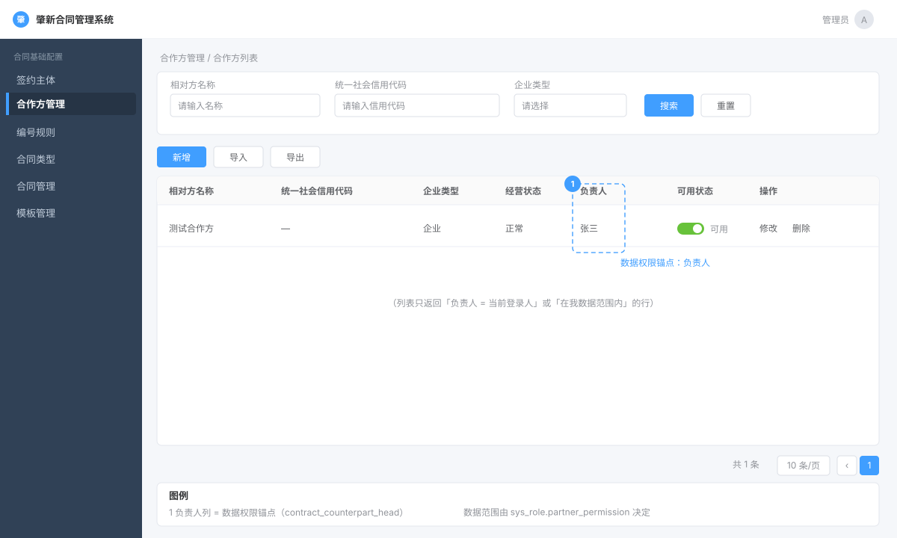

# 第 2 章 · 合作方管理

> 第 1 章的签约主体是「**我方**」，本章的合作方（也叫「相对方」）是「**对方**」——你签合同的另一家公司。
>
> 表面上看，它和第 1 章几乎一样（又是增删改查），但多了**一整章最该学会的东西——数据权限**。第 1 章所有用户看到的是同一份主体列表；本章不一样：**每个人看到哪些合作方，取决于他是谁、他负责哪些**。
>
> **这一章怎么用**：只有一条主线——§四 施工。从 4.2 开始，每一步都给能直接复制、能立刻运行的代码；数据权限的原理放在 4.3.5，跟着「列表查询」这一步讲。
>
> **本章第一次讲透**：① `@DataPermission` 数据权限（**注意：它标在 Mapper 上，不在 Controller**）；② 「数据权限的开关值藏在 [[D0-底座表地图#3. sys_role 角色信息表（行 2502）|`sys_role`]] 角色表里」这个反直觉设计；③ 一个**更新接口里为什么还要再做一次权限校验**。
>
> **本章你会碰到的表**：[[D0-底座表地图#2. conf_contract_counterpart 合作方/相对方表（04 行 79）|`conf_contract_counterpart`]]（业务主表）+ `sys_role`（**数据权限的配置源**）+ [[D0-底座表地图#1. sys_user 用户信息表（行 3072）|`sys_user`]]（查负责人姓名）+ 第 1 章认识的框架表。

> **零基础先补概念（本章的三个新词）**
>
> - **功能权限**：能不能「进这个门、调这个接口」。例如有没有 `conf:contractCounterpart:list` 这个权限码，靠 `@SaCheckPermission` 判断（写法见第 1 章 §4.3.5）。它管的是「接口级」的准入。
> - **数据权限**：进了门之后，能看见「哪些行」。同样调列表接口，普通业务员只看到自己负责的合作方，主管能看到整个部门。它管的是「行级」的过滤，本章用 `@DataPermission` 实现。
> - **SpEL 模板 + 反射**：本项目把「数据范围规则」写成带占位符的 SQL 模板（比如 `#{#userId} = #{#user.userId}`），运行时用 Spring 表达式求值；角色配置存在 `sys_role` 的某一列里，用反射按枚举名读出来。听不懂没关系，§2.3~§2.4 会拆开讲。

---

## 一、这部分是做什么的？

### 1.1 业务含义

**合作方 = 合同里的另一方**。比如你（签约主体：山西肇新）要和「某某科技公司」签合同，「某某科技公司」就是合作方。它的信息和签约主体几乎对称：名称、信用代码、法人、经营状态、银行账号、联系人……**外加一个关键字段：负责人**。



> **图注**：按 `index.vue` 的模板结构画的**示意图，不是真实截图**（官方未提供该页面截图）。重点是「负责人」列——它就是数据权限的锚点；列表只会返回负责人是当前用户、或落在他数据范围内的行。

### 1.2 和第 1 章最大的区别：多了「负责人」和「数据权限」

| | 签约主体（第 1 章） | 合作方（本章） |
|---|---|---|
| 谁能看 | 有 `conf:signingSubject:*` 权限的人 **全部都能看** | 有权限还不够，**还得是这个合作方的「相关负责人」才能看** |
| 关键字段 | 无 | **`CONTRACT_COUNTERPART_HEAD`（负责人）** ← 数据权限的「锚点」 |

**这就是「功能权限」和「数据权限」的区别**，一定要分清：

- **功能权限（第 1 章学的）**：你能不能**进这个门**——能不能调「合作方列表」这个接口。靠 `@SaCheckPermission("conf:contractCounterpart:list")`。
- **数据权限（本章学的）**：进了门之后，你能不能**看到里面所有的东西**——还是只能看到属于你的那一部分。靠 `@DataPermission`。

现实里为什么需要数据权限？因为公司有 100 个业务员、10 万个合作方。如果每个业务员都能看到全部合作方，那是信息泄露、也是干扰（他只想看自己负责的）。**数据权限 = 「按归属过滤行」。**

### 1.3 本章接口

| 接口 | 干什么 | 有数据权限吗 | 施工位置 |
|---|---|---|---|
| `GET /conf/contractCounterpart/list` | 分页列表 | ✅ 有（只能看你负责的） | §4.3 |
| `GET /conf/contractCounterpart/{id}` | 查详情 | ❌ 没有（按 ID 直接查） | §4.5 |
| `POST /conf/contractCounterpart` | 新增 | —— | §4.4 |
| `PUT /conf/contractCounterpart` | 修改 | ✅ **方法体内手工校验** | §4.5 |
| `PUT /conf/contractCounterpart/changeStatus` | 改状态 | —— | §4.6 |
| `DELETE /conf/contractCounterpart/{ids}` | 删除 | ❌ 没有 | §4.7 |
| `POST /conf/contractCounterpart/export` | 导出（复杂合并单元格） | ✅ 有 | §4.8 |
| `POST /conf/contractCounterpart/importData` | Excel 导入 | —— | 整文件复制 |
| `GET /conf/contractCounterpart/hide` `/show` | 隐藏/显示「个人」合作方 | —— | §4.9 |

---

## 二、站在架构师 / 开发经理角度：为什么这么设计？

### 2.1 为什么「数据权限」要放在 Mapper 层（SQL 层）拦截，而不是在 Service 里过滤？

这是本章最核心的设计判断。有两种做法：

**做法 A（在 Service 里过滤）**：查出来全部，再在 Java 里 `if (数据不属于我) 跳过`。
**做法 B（在 SQL 里过滤，本项目选的）**：给 SQL **默默加上一个 `where` 条件**，数据库只返回该返回的行。

| | A：Service 里过滤 | **B：SQL 层过滤（选用）** |
|---|---|---|
| 性能 | 差——**先把全部数据捞进内存再丢掉**，10 万条只留 10 条也得查 10 万条 | 好——数据库直接只查 10 条 |
| 分页 | **会错**——第 1 页 10 条里可能 9 条被过滤掉，变成只显示 1 条 | 正确——过滤发生在分页之前 |
| 安全 | 全靠程序员记得写过滤，**漏一个地方就是漏洞** | 在 SQL 层统一拦截，**标注解就生效** |
| 代码 | 每个查询方法都要手写过滤 | 一个注解搞定 |

**分页正确性这一条是决定性的**。做法 A 会让「每页 10 条」变成「每页 0~10 条随机数」，用户以为数据丢了。

所以本项目的方案是：**用 MyBatis-Plus 的插件机制，在 SQL 执行前偷偷改 SQL**（`PlusDataPermissionInterceptor` + `PlusDataPermissionHandler`）。你只要在 Mapper 方法上标个 `@DataPermission`，框架就自动帮你的 SQL 加上过滤条件。

### 2.2 为什么 `@DataPermission` 标在 **Mapper** 上，不标在 Controller/Service 上？

因为**拦截点在 SQL 生成的那一刻**。数据权限的实现是「改写 SQL 的 `where` 子句」，这件事只有**在 Mapper 执行 SQL 时**才做得到。

- 标的**位置**：Mapper 接口的**方法**上（`zxcm-contract/src/main/java/com/ruoyi/conf/mapper/TContractCounterpartMapper.java:46/54/60`）
- 标的**内容**：告诉框架两件事——
  1. `@DataColumn(key="userId", value="a.contract_counterpart_head")` → **拿哪个字段跟当前用户比**（这里是「负责人」字段）
  2. `resource = DataPermissionResource.partnerPermission` → **去角色的哪个列里读权限配置**（§2.3）

**这是反直觉的**——新手会以为「权限」应该标在接口（Controller）上。记住：**功能权限标 Controller（`@SaCheckPermission`），数据权限标 Mapper（`@DataPermission`）**。

**如果标在 Controller 上会怎样**：Controller 拿不到「即将执行的 SQL」，没法往 `where` 里加条件；只能在方法体里查完再过滤——又回到 §2.1 说的「分页会错、性能差、容易漏」。所以数据权限必须发生在 **SQL 生成的那一刻**，也就是 Mapper 方法上。

### 2.3 最反直觉的设计：数据权限的「开关值」为什么存在 `sys_role` 角色表里？

RuoYi-Vue-Plus 原生的数据权限只有**一个**开关——`sys_role.data_scope`（一个角色一种数据范围，字段在 `ruoyi-base/ruoyi-common/src/main/java/com/ruoyi/common/core/domain/entity/SysRole.java:87`）。但本合同系统有**十个业务域**，每个域的数据权限需要**独立配置**：

- 合同草拟数据的权限（`draftPermission`）
- 审批完成的合同权限（`contractPermission`）
- 台账权限（`ledgerPermission`）
- 用印权限（`stampPermission`）
- **相对方数据权限（`partnerPermission`）** ← 本章这个
- ……连同默认的 `base` 一共 11 项，其中业务域 10 个（见 `ruoyi-base/ruoyi-common/src/main/java/com/ruoyi/common/enums/permissionType/DataPermissionResource.java:22-32`）

**所以本项目给 `sys_role` 表加了一整排列**——一个业务域一列，共 10 列（`ruoyi-base/ruoyi-common/src/main/java/com/ruoyi/common/core/domain/entity/SysRole.java:144-153`）。每个角色在每一列上配一个「数据范围代码」。

`DataPermissionResource` 枚举（`.../DataPermissionResource.java:16`）里那句注释说得最清楚：

```java
/**
 * 使用说明，这里的index需要和role表的字段名一一对应。
 * 系统会使用泛型的方式去读取当前角色配置的权限范围.
 */
partnerPermission("partnerPermission", "相对方数据权限"),
```

**「index 和 role 表的字段名一一对应」**——枚举名 `partnerPermission` 就是 `sys_role` 的**列名**，也是 `RoleDTO` 的**字段名**（`.../RoleDTO.java:59`）。框架用**反射**（`ReflectUtil.getFieldValue(role, resource.getIndex())`，见 `.../PlusDataPermissionHandler.java:141`）按这个字符串去角色对象里取值。**加一个新业务域的数据权限 = 加一个枚举 + 加一个列**。

> **面试怎么答**：「RuoYi 原生数据权限只有一个 `data_scope`，我们系统有十个业务域需要独立配置，所以扩展成『一个业务域一个角色列』，用枚举名和列名一一对应 + 反射读取。好处是加业务域只改配置不动框架代码。」

### 2.4 权限值（1~7）到底代表什么？为什么用「SpEL 模板」而不是 if-else？

每个角色在 `partnerPermission` 列里存一个数字代码，含义定义在 `ContractPermission` 枚举（`.../ContractPermission.java:31`）：

| 代码 | 含义 | 生成的 SQL 片段（`sqlTemplate`） |
|---|---|---|
| `1` | 全部数据 | **空**（不过滤） |
| `2` | 自定义 | `1=0`（默认不给） |
| `3` | 本部门 | `#{#userId} IN #{@sdss.getDeptUser(#user)}` |
| `4` | 本部门及以下 | `#{#userId} IN (#{@sdss.getDeptAndChildUser(#user)})` |
| `5` | 仅本人 | `#{#userId} = #{#user.userId}` |
| `6` | 我管理的部门 | `#{#userId} IN (#{@sdss.getMyDeptUser(#user)})` |
| `7` | 我管理的部门及以下 | `#{#userId} IN (#{@sdss.getMyDeptAndChildUser(#user)})` |

**为什么用 SpEL 模板而不是一堆 `switch-case` 拼字符串？** 因为这段 SQL 片段里**要嵌入动态计算**：`#{@sdss.getDeptUser(#user)}` 是**运行时调用一个 Spring Bean（`@sdss`）算出「你的部门下所有用户 ID」**。用 SpEL 模板，SQL 片段和「动态求值」写在了一起，加新规则只需加一行枚举，不用改任何 Java 逻辑。

最终拼出来的 SQL 长这样（假设某角色是「仅本人」，用户 ID 是 100）：

```sql
SELECT * FROM conf_contract_counterpart
WHERE (del_flag='0' ... 你原本的条件 ...)
  AND (a.contract_counterpart_head = 100)     -- ← @DataPermission 自动加上去的
```

### 2.5 为什么「查询」用 `OR` 拼、而「更新/删除」用 `AND` 拼？

看 `PlusDataPermissionHandler.java:126`：

```java
// 更新或删除需满足所有条件
String joinStr = isSelect ? " OR " : " AND ";
```

- **查询**：一个人可能有**多个角色**，每个角色给一份数据范围。查询时「只要满足**任意一个**角色给的范围就能看」→ 用 `OR` 并起来（宽松，好看全）。
- **更新/删除**：必须**所有角色都允许**才准动这条数据 → 用 `AND`（严格）。

**具体 SQL 长这样**（用户 100 同时有「仅本人」和「本部门」两个角色）：

```sql
-- 查询：满足任意一个角色即可看
WHERE ... AND ( a.contract_counterpart_head = 100
             OR a.contract_counterpart_head IN (本部门用户) )

-- 更新/删除：必须所有角色都允许
WHERE ... AND ( a.contract_counterpart_head = 100
            AND a.contract_counterpart_head IN (本部门用户) )
```

**这是「读宽松、写严格」的安全原则**。面试被问「多角色时数据权限怎么合并」，这个细节很加分。

---

## 三、需要哪些技术？

| 技术 / 机制 | 具体指什么 | 精确定位 | 详解 |
|---|---|---|---|
| **`@DataPermission`** | 数据权限注解，标在 Mapper 方法上 | `ruoyi-base/ruoyi-common/src/main/java/com/ruoyi/common/annotation/DataPermission.java:29` | §4.3.5（第一次讲透） |
| **`@DataColumn`** | 指定「用哪个字段跟当前用户比对」 | `TContractCounterpartMapper.java:46` | §4.3.5 |
| **`DataPermissionResource`** | 业务域枚举（枚举名 = `sys_role` 列名） | `.../DataPermissionResource.java:16` | §2.3 |
| **`ContractPermission`** | 数据范围代码 1~7 + SpEL SQL 模板 | `.../ContractPermission.java:31` | §2.4 |
| **`PlusDataPermissionHandler`** | 改写 SQL 的核心处理器 | `.../PlusDataPermissionHandler.java:64` | §4.3.6 |
| **`PlusDataPermissionInterceptor`** | MyBatis-Plus 插件，挂到 SQL 执行链上 | `.../PlusDataPermissionInterceptor.java:46` | §4.3.6 |
| **JSqlParser** | 解析/改写 SQL 的库 | `.../PlusDataPermissionHandler.java:40/107` | §4.3.6 |
| **SpEL** | 把 `#{...}` 模板求值成 SQL 片段 | `.../PlusDataPermissionHandler.java:79/156` | §2.4 |
| **`DataPermissionHelper`** | 手工拼数据权限 SQL（看板用） | `.../DataPermissionHelper.java:96` | 第 10 章 |
| **反射读角色列** | 按枚举名去角色对象里取值 | `.../PlusDataPermissionHandler.java:141` | §2.3 |
| **EasyPoi 复杂导出** | 合并单元格的导出表格 | `TContractCounterpartController.java:113-249` | §4.8 |
| **`CompareUtils` 变更留痕** | 修改时记录「改了哪些字段」 | `TContractCounterpartServiceImpl.java:206` | §4.5 |
| **已有能力** | 功能权限、逻辑删除、雪花 ID、五件套 | 第 1 章 | 第 1 章 |

---

## 四、功能具体怎么实现（带着你复制）

> **本章涉及的表**（点表名直达底座表地图的字段详情）：
> [[D0-底座表地图#2. conf_contract_counterpart 合作方/相对方表（04 行 79）|`conf_contract_counterpart`]]（合作方） ｜ [[D0-底座表地图#3. sys_role 角色信息表（行 2502）|`sys_role`]]（角色（数据权限配置）） ｜ [[D0-底座表地图#1. sys_user 用户信息表（行 3072）|`sys_user`]]（负责人）


### 4.1 需求：一份「合作方管理」需求单

> 和第 1 章一样，先看需求单、再拆解、最后施工。区别是这一章多了两个东西：**负责人**和**数据权限**——名单里谁能看见谁，是这一章的核心。

#### 4.1.1 需求单

**需求编号** ZXCM-CONF-002　**提出人** 销售部 / 法务部　**优先级** 高　**本期上线**

**背景**：合同里要填「合同相对方」（对方公司）。现在客户信息分散在各业务员自己的 Excel 里：同一个客户被不同人重复建档，名称写法还不一致；有的客户已经和公司打官司或被拉黑，合同却还在签。需要一份全公司统一、但**按负责人隔离**的合作方档案。

**使用角色**

| 角色 | 能做什么 |
|---|---|
| 业务员 | 维护自己负责的合作方（增、改、停用、删除） |
| 部门经理 | 看本部门（或本部门及以下）的业务员维护的合作方 |
| 系统管理员 | 看全部，负责导出、导入、隐藏个人合作方 |

**功能需求**

| # | 功能 | 具体要求 |
|---|---|---|
| 1 | 列表 | 显示编号、名称、信用代码、单位类型、经营状态、可用状态、负责人；可按名称 / 编号 / 信用代码 / 单位类型 / 经营状态筛选；**只能看到自己有数据权限的行** |
| 2 | 新增 | 负责人默认当前登录人；名称不能重复；营业期限可选「长期」；新增后默认可用 |
| 3 | 修改 | 弹窗回填；**没权限的人改不了**，提示「您没有权限操作该数据」；记录「谁、什么时候、改了哪些字段」 |
| 4 | 启停用 | `0` 可用 / `1` 停用 |
| 5 | 删除 | 单条删除；已被合同 / 审批单引用的不许删，提示「删除失败！该合作方已经在使用中。」 |
| 6 | 导出 | 按当前筛选条件导出 Excel，**导出范围同样受数据权限限制**；表头是合并单元格的复杂格式 |
| 7 | 隐藏 / 显示个人合作方 | 一键把「单位类型 = 个人」的合作方批量隐藏 / 恢复 |
| 8 | 导入 | 下载模板批量导入（复用第 1 章 §4.9 的套路，本章不重复讲） |

**非功能要求**

- 权限点：`conf:contractCounterpart:list` / `:query` / `:add` / `:edit` / `:remove` / `:export` / `:import`；
- **数据权限**：每个角色在 `sys_role.partner_permission` 配一档，取值 1~7：

  | 值 | 含义 | 拼进 SQL 的效果 |
  |---|---|---|
  | 1 | 全部数据 | 不加条件 |
  | 2 | 自定义 | `1 = 0`（等于什么都看不到，需要额外配置） |
  | 3 | 本部门 | `负责人 IN (本部门用户)` |
  | 4 | 本部门及以下 | `负责人 IN (本部门及下级部门用户)` |
  | 5 | 仅本人 | `负责人 = 当前登录人` |
  | 6 | 我管理的部门 | `负责人 IN (我管理的部门用户)` |
  | 7 | 我管理的部门及以下 | `负责人 IN (我管理的部门及下级用户)` |

- 删除用逻辑删除；
- 隐藏 / 显示只针对 `company_type = '1'`（个人），且是直接改 `del_flag` 的原生 SQL。

**验收标准**

| 操作 | 预期 |
|---|---|
| 角色配 `partner_permission = 5`，业务员打开列表 | 只看到负责人是自己的行 |
| 同上，用另一个业务员账号改这行 | 提示「您没有权限操作该数据」 |
| 新增同名合作方 | 提示「当前合作方名称已存在」 |
| 营业期限选「长期」 | 结束日期为空 |
| 修改任意字段后看备注 | 多一条变更记录 |
| 删除被合同引用的合作方 | 提示「删除失败！该合作方已经在使用中。」，数据仍在 |
| 导出 | 行数与列表一致（同一套权限条件） |
| 点「隐藏个人合作方」 | `company_type = '1'` 的行消失；点「显示」后回来 |

**本期不做**：合作方信用评级、黑名单审批流、`ban` / `unBan` 的页面入口（Service 里有能力，但没有独立 HTTP 接口）。

#### 4.1.2 拿到需求，先做四件事

**① 给需求定性，再推架构**

| 判断维度 | 本模块的答案 | 推出的设计 |
|---|---|---|
| 数据性质 | 主数据，被合同引用 | 逻辑删除 |
| 数据形状 | 单表 + 一条「负责人」 | 负责人列做行级权限锚点 |
| 状态 | 可用/停用、拉黑、隐藏 | 三个独立状态列，别合成一个 |
| 读写 | 列表必须按人过滤 | 数据权限放 SQL 层（Mapper 注解） |
| 安全边界 | 每人只能看自己负责的 | 插件改写 SQL，不在 Service 过滤 |

→ 架构：一张主表 + 标准 CRUD + Mapper 层数据权限插件 + 逻辑删除/变更留痕。

**② 定数据怎么存**：一张主表 `conf_contract_counterpart`，比签约主体多了「负责人」和「黑名单」两组列。每一列为什么这么设计，见下一节 4.1.3。

**③ 定接口**：8 个功能 → 10 个接口，都挂在 `/conf/contractCounterpart` 下。

| 功能 | 方法 + 路径 | 权限点 |
|---|---|---|
| 列表（带数据权限） | `GET /list` | `conf:contractCounterpart:list` |
| 详情 | `GET /{id}` | `:query` |
| 新增 | `POST /` | `:add` |
| 修改 | `PUT /` | `:edit` |
| 启停用 | `PUT /changeStatus` | `:edit` |
| 删除 | `DELETE /{ids}` | `:remove` |
| 导出 | `POST /export` | `:export` |
| 导入 | `POST /importData` | `:import` |
| 隐藏 / 显示 | `GET /hide`、`GET /show` | 仅登录，无权限点 |

**④ 定实现边界：哪些不用写、哪些必须写、哪些是缺口**

- **框架给**：CRUD、分页、逻辑删除、审计字段、参数校验；
- **必须自己写**：修改前的「双重防护」权限校验、变更留痕、隐藏/显示的原生 SQL；
- **已知缺口**：`USCC`/编号无唯一校验；`hide`/`show` 没有权限点；`ban`/`unBan` 只有 Service 没有 HTTP 入口。

> 最省事的是数据权限：它不是「在 Service 里拼 where」，而是插件在 SQL 层改写（§2.5 讲原理）。所以新增、修改、删除**都不用自己写「是不是我的数据」**——查询自动加条件，更新 / 删除自动加条件。

#### 4.1.3 表设计导读：这张表为什么长这样

> 和第 1 章一样，先看懂表再写代码。这一章的差别只有一句话：**签约主体是「全公司共用」，合作方是「谁开发谁负责」**——多出来的字段几乎都围绕这一句。

**定位：主数据 + 归属**

| 类型 | 例子 | 本章的特别之处 |
|---|---|---|
| 主数据 | 合作方 | 被合同引用，所以要逻辑删除、要防重复 |
| **带归属的主数据** | 本章 | 每条数据有一个**负责人**，列表和修改都要按人隔离（数据权限） |

**字段分组：每一组回答一个业务问题**

| 组 | 列 | 回答什么 | 设计细节 |
|---|---|---|---|
| 身份 | `ID`、`TENANT_ID` | 记录是谁、属于哪个租户 | 同第 1 章：雪花 ID 存 `varchar(64)`，租户由插件自动处理 |
| 标识 | `CONTRACT_COUNTERPART_CODE`、`CONTRACT_COUNTERPART_NAME`、`USCC` | 对方公司叫什么、编号是什么 | `NAME` `NOT NULL`；`CODE` 手工填 |
| **归属** | `CONTRACT_COUNTERPART_HEAD` | 这条数据归谁负责 | 存**用户 id**，不存部门 id。人调了部门，归属不变；数据权限拿它和当前登录人比（§2.3、§2.5） |
| 类型 | `COMPANY_TYPE` | 企业还是个人 | `'1'` = 个人。隐藏 / 显示只处理个人 |
| 状态 | `STATUS`、`DEL_FLAG`、`HIDE` | 能不能用 / 删没删 / 隐没隐 | `STATUS` 0 正常 / 1 停用；`HIDE` 0 正常 / 2 隐藏，和 `DEL_FLAG` 一起改 |
| 风险 | `BAN`、`BAN_REASON`、`BAN_TIME`、`DISPUTE_STATUS`、`CREDIT_STATUS` | 能不能跟它签合同 | 拉黑要留**原因和时间**，否则事后说不清 |
| 扩展 | `BANK_JSON`、`CONTACTS` | 收付款账号、联系人 | 同第 1 章 §2.2 |
| 审计 | `CREATE_BY/TIME`、`UPDATE_BY/TIME`、`REMARKS` | 谁建的、改了什么 | `REMARKS` 复用成变更日志 |

**四个关键取舍**

| 决策 | 本项目选择 | 代价 / 边界 | 什么情况下反过来 |
|---|---|---|---|
| 归属字段 | 存**负责人**，不存部门 | 部门调整要人工改负责人；但「客户跟人走」更符合销售场景 | 组织调整频繁、且业务要求按部门归属 |
| 隐藏 / 显示 | 原生 SQL 一条 UPDATE，同时改 `DEL_FLAG` 和 `HIDE`（`TContractCounterpartServiceImpl.java:298-307`） | 绕过 `@TableLogic`，需要自己保证条件正确 | 隐藏要按权限、按范围细分时 |
| 删除 | 逻辑删除 + 删除前事件校验 | 同第 1 章 §2.4 | 有归档库 |
| 外键 | 不建 | 引用完整性靠应用层 | 强一致要求高 |

> `HIDE` 为什么不复用 `DEL_FLAG`：**语义不同**。`DEL_FLAG=2` 是「这条数据不要了」，`HIDE=2` 是「只是暂时别在列表里出现，还能一键恢复」。实现上两个字段一起改，是为了让列表的 `@TableLogic` 自动过滤直接生效。

**三处必须知道的缺陷**

1. **`USCC`、`CODE` 都没有唯一性校验**：和签约主体一样，只查了名称。
2. **`hide` / `show` 两个接口没有权限点**（`TContractCounterpartController.java:335-344`）：任何登录用户都能触发一次全表 `UPDATE`。这是真实风险，不是设计意图。
3. **黑名单只有字段和 Service 能力，没有 HTTP 入口**：`ban` / `unBan` 在 Service 里，但 Controller 没暴露接口，前端也没有入口。

**演示数据为什么是这 1 条**

一条「测试合作方」，`COMPANY_TYPE=0`（企业）、`STATUS=0`、`DEL_FLAG=0`。作用是让列表、合同起草页的相对方选择、导出三条链路有数据可验。

**对后面章节的连锁影响**

| 后面的事 | 依赖这张表的什么 |
|---|---|
| 审批单 `PARTNERS` 存合作方 id 的 JSON 数组 | 合同引用的是 `ID` |
| 删除前校验「该合作方已经在使用中」 | 无外键 + 逻辑删除，只能发事件让引用方查（§2.5） |
| 导出和列表看到的行数一致 | 导出复用同一套数据权限条件 |

> **面试怎么答**：「合作方是带归属的主数据。归属存负责人而不是部门，因为客户是业务员开发的，人调部门客户不该跟着乱跑；数据权限就锚在这一列上。隐藏和删除用了两个字段，因为一个是业务动作、一个是数据治理。没有外键和唯一索引，引用校验和重复校验都放在应用层，代价是必须自己保证。」

#### 4.1.4 施工计划：拆成 7 个动作，按「能跑」排序

| 步骤 | 动作 | 业务规则 | 做完的标志 |
|---|---|---|---|
| 4.2 | 地基：建表 + Entity + VO + BO + Mapper + 三层骨架 | Mapper 上先挂好 `@DataPermission` | 项目能编译、能启动 |
| 4.3 | 动作 1：列表查询（带数据权限） | 按角色配置过滤行 | 换两个角色登录，看到的行数不一样 |
| 4.4 | 动作 2：新增 | 名称查重；负责人默认当前登录人（前端赋值）；默认可用 | 能存一条 |
| 4.5 | 动作 3：修改 | 双重防护（查一次有权限的数据）+ 变更留痕 | 改一条，备注里有记录 |
| 4.6 | 动作 4：启停用 | `0` 可用 / `1` 停用 | 开关能拨，刷新后保持 |
| 4.7 | 动作 5：删除 | 逻辑删除；被引用时拦截；不支持批量 | 能删一条，库里 `del_flag = 2` |
| 4.8 | 动作 6：导出 | 同一套权限条件 + 合并表头 | Excel 行数和列表一致 |
| 4.9 | 动作 7：隐藏 / 显示个人合作方 | 只处理 `company_type = '1'`，改 `del_flag` + `hide` | 个人合作方能批量隐藏和恢复 |

**为什么先做列表**：数据权限是在列表上第一次见效的。先把列表跑通，你才能在页面上直观看到「张三登录只有 3 条、李四登录有 8 条」，后面的新增 / 修改 / 删除才有参照。

**文件地图**（本章要动 6 个后端文件 + 3 个前端文件）

| 文件 | 层 | 职责 | 在哪一步写 |
|---|---|---|---|
| `TContractCounterpart.java` | Entity | 对应 `conf_contract_counterpart` 表 | 4.2 |
| `TContractCounterpartVo.java` | VO | 返回给前端（列表 join 时多 `headName`） | 4.2 |
| `TContractCounterpartBo.java` | BO | 接前端参数 | 4.2 |
| `TContractCounterpartMapper.java` | Mapper | 数据库操作 + `@DataPermission` | 4.2 |
| `ITContractCounterpartService.java` | Service 接口 | 定义能力 | 4.2 起，随动作增加 |
| `TContractCounterpartServiceImpl.java` | Service 实现 | 业务规则 | 4.2 起，随动作增加 |
| `TContractCounterpartController.java` | Controller | 接请求、转发 | 4.2 起，随动作增加 |
| `api/conf/contractCounterpart.js` | 前端 api | 接口地址集中定义 | 4.3 起 |
| `views/conf/contractCounterpart/index.vue` | 前端页面 | 列表 + 按钮 | 4.3 起 |
| `views/conf/contractCounterpart/edit.vue` | 前端弹窗 | 新增 / 修改表单 | 4.4 起 |

#### 4.1.5 一条链路先看全貌

```
用户动作            前端                          后端                          数据库
────────────────────────────────────────────────────────────────────────────────────
进页面/搜索   index.vue getList()    →  api/contractCounterpart.js  →  Controller.list  →  Service.queryPermissionPageList  →  conf_contract_counterpart
点新增        edit.vue submitForm()  →  addContractCounterpart      →  Controller.add   →  Service.insertByBo
点修改        edit.vue submitForm()  →  updateContractCounterpart   →  Controller.edit  →  Service.updateByBo
拨开关        el-switch              →  changeStatus                →  Controller.changeStatus → Service.updateStauts
点删除        handleDelete()         →  delContractCounterpart      →  Controller.remove →  Service.deleteWithValidByIds
点导出        handleExport()         →  export                      →  Controller.export →  Service.queryListWithPermission
隐藏/显示     按钮                   →  hide/show                   →  Controller.hide/show → Service.hide/show
```

注意列表那一行：Service 走的是 `queryPermissionPageList`（不是第 1 章的 `queryPageList`），差别就是它调用了带 `@DataPermission` 的 Mapper 方法。

### 4.2 地基

**本步目标**：把表和领域对象建好，Mapper 上先挂好 `@DataPermission`。
**做完的标志**：`mvn compile` 通过；启动后数据库里有 `conf_contract_counterpart` 表。

#### 4.2.1 建表

```sql
DROP TABLE IF EXISTS `conf_contract_counterpart`;

CREATE TABLE `conf_contract_counterpart`  (
  `ID` varchar(64) NOT NULL COMMENT '主键',
  `CONTRACT_COUNTERPART_NAME` varchar(200) NOT NULL COMMENT '相对方名称',
  `USCC` varchar(36) NULL DEFAULT NULL COMMENT '统一社会信用代码',
  `COMPANY_TYPE` varchar(10) NULL DEFAULT NULL COMMENT '单位类型',
  `REGISTERED_CAPITAL` varchar(20) NULL DEFAULT NULL COMMENT '注册资本',
  `LEGAL_PERSON_NAME` varchar(30) NULL DEFAULT NULL COMMENT '法人姓名',
  `LEGAL_PERSON_ID_CARD` varchar(30) NULL DEFAULT NULL COMMENT '法定代表人证件号码',
  `BUSINESS_STATUS` varchar(10) NULL DEFAULT NULL COMMENT '经营状态',
  `BUSINESS_START_DATE` datetime(0) NULL DEFAULT NULL COMMENT '营业期限开始时间',
  `BUSINESS_END_DATE` datetime(0) NULL DEFAULT NULL COMMENT '营业期限结束时间',
  `CONTACTS` varchar(4000) NULL DEFAULT NULL COMMENT '联系人',
  `ATTACHMENTS` varchar(4000) NULL DEFAULT NULL COMMENT '资质信息',
  `CREATE_BY` varchar(64) NULL DEFAULT NULL COMMENT '创建人',
  `CREATE_TIME` datetime(0) NULL DEFAULT NULL COMMENT '创建时间',
  `UPDATE_BY` varchar(64) NULL DEFAULT NULL COMMENT '更新者',
  `UPDATE_TIME` datetime(0) NULL DEFAULT NULL COMMENT '更新时间',
  `hide` char(1) NULL DEFAULT NULL COMMENT '是否隐藏 0否 1是',
  `DEL_FLAG` char(1) NOT NULL DEFAULT '0' COMMENT '0 未删除 2 已删除',
  `REMARKS` longtext NULL COMMENT '备注',
  `TENANT_ID` varchar(64) NULL DEFAULT NULL COMMENT '租户id',
  `BANK_JSON` varchar(4000) NULL DEFAULT NULL COMMENT '银行卡信息',
  `CONTRACT_COUNTERPART_CODE` varchar(64) NULL DEFAULT NULL COMMENT '相对方编号',
  `TEL` varchar(32) NULL DEFAULT NULL COMMENT '联系电话',
  `FAX` varchar(32) NULL DEFAULT NULL COMMENT '传真',
  `AREA_NAME` varchar(100) NULL DEFAULT NULL COMMENT '所属地区名称',
  `AREA_CODE` varchar(32) NULL DEFAULT NULL COMMENT '所属地区编码',
  `FOREVER` char(1) NULL DEFAULT NULL COMMENT '营业期限是否长期有效',
  `ADDRESS` varchar(255) NULL DEFAULT NULL COMMENT '详细地址',
  `STATUS` char(255) NULL DEFAULT '0' COMMENT '状态 0正常 1停用',
  `COLL_TIMES` int NULL DEFAULT NULL COMMENT '合作次数',
  `LAST_CREDIT` datetime(0) NULL DEFAULT NULL COMMENT '最近一次信用检查时间',
  `CREDIT_STATUS` varchar(64) NULL DEFAULT NULL COMMENT '信用状态',
  `CONTRACT_COUNTERPART_HEAD` varchar(64) NULL DEFAULT NULL COMMENT '相对方负责人',
  `BUSINESS_SCOPE` longtext NULL COMMENT '营业范围',
  `AVERAGE_SCORE` varchar(255) NULL DEFAULT NULL COMMENT '相对方评价平均分',
  `TYC_RESULT` text NULL COMMENT '天眼查查询结果',
  `DISPUTE_STATUS` varchar(255) NULL DEFAULT '0' COMMENT '纠纷状态',
  `BAN` char(1) NULL DEFAULT '0' COMMENT '是否被拉黑',
  `BAN_REASON` varchar(255) NULL DEFAULT NULL COMMENT '拉黑原因',
  `BAN_TIME` datetime(0) NULL DEFAULT NULL COMMENT '拉黑时间',
  PRIMARY KEY (`ID`) USING BTREE
) ENGINE = InnoDB DEFAULT CHARSET = utf8mb3 COMMENT = '相对方';
```

**关键列**：`CONTRACT_COUNTERPART_HEAD`（负责人，数据权限比对的就是它）、`hide`（个人合作方整体隐藏用，Entity 里没有这个字段）、`DEL_FLAG`（逻辑删除）。

#### 4.2.2 Entity（完整文件）

> **这一步依赖的配置**：同第 1 章——`idType: ASSIGN_ID`（`application.yml:248`）、逻辑删除值 `2/0`（`:254/256`）。

```java
package com.ruoyi.conf.domain;

import java.util.Date;

import javax.validation.constraints.Size;

import com.baomidou.mybatisplus.annotation.TableId;
import com.baomidou.mybatisplus.annotation.TableLogic;
import com.baomidou.mybatisplus.annotation.TableName;
import com.ruoyi.common.core.domain.BaseEntity;
import com.ruoyi.util.compare.Compare;

import lombok.Data;
import lombok.EqualsAndHashCode;

@Data
@EqualsAndHashCode(callSuper = true)
@TableName("conf_contract_counterpart")
public class TContractCounterpart extends BaseEntity {

    private static final long serialVersionUID = 1L;

    @TableId(value = "id")
    private String id;

    @Compare("相对方名称")
    private String contractCounterpartName;

    @Compare("统一社会信用代码")
    private String uscc;

    @Compare(value = "经营状态", dict = "BUSINESS_STATUS")
    private String businessStatus;

    @Compare("法人姓名")
    private String legalPersonName;

    @Compare("法人身份证")
    private String legalPersonIdCard;

    @Compare(value = "相对方类型", dict = "PARTNER_TYPE")
    private String companyType;

    @Compare(value = "注册开始时间", dateFormat = "yyyy-MM-dd")
    private Date businessStartDate;

    @Compare(value = "注册结束时间", dateFormat = "yyyy-MM-dd")
    private Date businessEndDate;

    @Compare(value = "是否长期", dict = "FOREVER")
    private Integer forever = 0;

    @Compare("注册资本")
    private String registeredCapital;

    @Compare("电话")
    private String tel;

    @Compare("传真")
    private String fax;

    private String areaCode;

    private String areaName;

    @Compare("注册地址")
    private String address;

    @Size(min = 0, max = 4000, message = "联系人信息过多，请不要填写过多的联系人")
    @Compare(value = "联系人", showDetail = false)
    private String contacts;

    @Size(min = 0, max = 4000, message = "银行信息过多，请不要填写过多的银行信息")
    @Compare(value = "银行账号", showDetail = false)
    private String bankJson;

    @TableLogic
    private String delFlag;

    private String remarks;

    private String tenantId;

    @Compare("是否禁用")
    private Integer status = 1;

    private Integer collTimes = 0;

    private String contractCounterpartHead;

    @Compare("营业范围")
    private String businessScope;

    private String averageScore;

    private String disputeStatus;

    private String ban;

    private String banReason;

    private Date banTime;
}
```

**讲解**：

- `@Compare("中文名")`：修改时 `CompareUtils` 靠它生成「字段 A 从 x 改成 y」的变更记录（§4.5）；
- `@TableLogic`：逻辑删除；
- `status` 默认 1，但新增时 Service 会设为 0（可用）；
- `contractCounterpartHead` 是数据权限的锚点；
- `hide` 表里有、Entity 里没有——它只在原生 SQL 里用（§4.9）。

#### 4.2.3 VO（完整文件）

```java
package com.ruoyi.conf.domain.vo;

import java.util.Date;

import com.alibaba.excel.annotation.ExcelIgnoreUnannotated;
import com.alibaba.excel.annotation.ExcelProperty;
import com.fasterxml.jackson.annotation.JsonFormat;
import com.ruoyi.common.annotation.ExcelDictFormat;
import com.ruoyi.common.convert.ExcelDictConvert;

import io.swagger.annotations.ApiModel;
import io.swagger.annotations.ApiModelProperty;
import lombok.Data;

@Data
@ApiModel("相对方视图对象")
@ExcelIgnoreUnannotated
public class TContractCounterpartVo {

    private static final long serialVersionUID = 1L;

    @ExcelProperty(value = "主键")
    @ApiModelProperty("主键")
    private String id;

    @ExcelProperty(value = "相对方名称")
    @ApiModelProperty("相对方名称")
    private String contractCounterpartName;

    @ExcelProperty(value = "相对方编号")
    @ApiModelProperty("相对方编号")
    private String contractCounterpartCode;

    @ExcelProperty(value = "统一社会信用代码")
    @ApiModelProperty("统一社会信用代码")
    private String uscc;

    @ExcelProperty(value = "企业类型", converter = ExcelDictConvert.class)
    @ExcelDictFormat(dictType = "company_type")
    @ApiModelProperty("企业类型")
    private String companyType;

    @ApiModelProperty(value = "联系人")
    private String contacts;

    @ApiModelProperty(value = "银行信息")
    private String bankJson;

    private String registeredCapital;

    private String address;

    private String legalPersonName;

    private String legalPersonIdCard;

    @ExcelProperty(value = "经营状态", converter = ExcelDictConvert.class)
    @ExcelDictFormat(dictType = "business_status")
    @ApiModelProperty("经营状态")
    private String businessStatus;

    @JsonFormat(pattern = "yyyy-MM-dd")
    private Date businessStartDate;

    @JsonFormat(pattern = "yyyy-MM-dd")
    private Date businessEndDate;

    private String remarks;

    private String tel;

    private String fax;

    private String areaCode;

    private String areaName;

    private Integer status;

    private Integer forever;

    private Integer collTimes = 0;

    private String contractCounterpartHead;

    private String businessScope;

    /** 负责人姓名（join sys_user 得来，表里没有） */
    private String headName;

    private String averageScore;

    private String disputeStatus;

    private String ban;

    private String banReason;

    @JsonFormat(pattern = "yyyy-MM-dd")
    private String banTime;
}
```

**讲解**：`headName` 是 join `sys_user` 查出来的负责人姓名，数据库里没有——这是 VO 存在的理由（§2.2 的同类思路）。

#### 4.2.4 BO（完整文件）

```java
package com.ruoyi.conf.domain.bo;

import java.util.Date;

import javax.validation.constraints.NotBlank;
import javax.validation.constraints.Size;

import org.hibernate.validator.constraints.Length;

import com.fasterxml.jackson.annotation.JsonFormat;
import com.ruoyi.common.core.domain.BaseEntity;
import com.ruoyi.common.core.validate.AddGroup;
import com.ruoyi.common.core.validate.EditGroup;

import io.swagger.annotations.ApiModel;
import io.swagger.annotations.ApiModelProperty;
import lombok.Data;
import lombok.EqualsAndHashCode;

@Data
@EqualsAndHashCode(callSuper = true)
@ApiModel("相对方业务对象")
public class TContractCounterpartBo extends BaseEntity {

    @ApiModelProperty(value = "主键", required = true)
    @NotBlank(message = "主键不能为空", groups = {EditGroup.class})
    private String id;

    @ApiModelProperty(value = "相对方名称", required = true)
    @NotBlank(message = "相对方名称不能为空", groups = {AddGroup.class, EditGroup.class})
    private String contractCounterpartName;

    @ApiModelProperty(value = "统一社会信用代码", required = true)
    @NotBlank(message = "统一社会信用代码不能为空", groups = {AddGroup.class, EditGroup.class})
    private String uscc;

    @ApiModelProperty(value = "企业类型")
    private String companyType;

    @ApiModelProperty(value = "注册资本")
    private String registeredCapital;

    @ApiModelProperty(value = "注册地址")
    private String address;

    @ApiModelProperty(value = "法人姓名")
    private String legalPersonName;

    @ApiModelProperty(value = "法人身份证号")
    private String legalPersonIdCard;

    @ApiModelProperty(value = "经营状态")
    private String businessStatus;

    @ApiModelProperty(value = "营业期限开始时间")
    @JsonFormat(pattern = "yyyy-MM-dd")
    private Date businessStartDate;

    @ApiModelProperty(value = "营业期限结束时间")
    @JsonFormat(pattern = "yyyy-MM-dd")
    private Date businessEndDate;

    @ApiModelProperty(value = "联系人")
    @Size(min = 0, max = 4000, message = "联系人信息过多，请不要填写过多的联系人")
    private String contacts;

    @ApiModelProperty(value = "银行信息")
    @Length(max = 4000, message = "银行信息信息过多，请不要填写过多的银行信息")
    private String bankJson;

    @ApiModelProperty(value = "备注")
    private String remarks;

    @ApiModelProperty(value = "长期")
    private Integer forever;

    @ApiModelProperty(value = "地区名称")
    private String areaName;

    @ApiModelProperty(value = "地区编号")
    private String areaCode;

    @ApiModelProperty(value = "传真")
    private String fax;

    @ApiModelProperty(value = "电话")
    private String tel;

    @ApiModelProperty(value = "可用状态")
    private String status;

    @ApiModelProperty(value = "负责人")
    private String contractCounterpartHead;

    @ApiModelProperty(value = "营业范围")
    private String businessScope;

    private String ban;

    private String disputeStatus;
}
```

#### 4.2.5 Mapper（完整文件，本章核心）

> **这一步依赖的配置**：`@DataPermission` 能生效，靠 `MybatisPlusConfig:51` 注册的 `PlusDataPermissionInterceptor`（顺序在分页插件之前）；Mapper 还要在 `mapperPackage` 包下。

```java
package com.ruoyi.conf.mapper;

import java.util.List;

import org.apache.ibatis.annotations.Param;
import org.apache.ibatis.annotations.Select;

import com.baomidou.mybatisplus.core.conditions.Wrapper;
import com.baomidou.mybatisplus.core.conditions.query.QueryWrapper;
import com.baomidou.mybatisplus.core.toolkit.Constants;
import com.baomidou.mybatisplus.extension.plugins.pagination.Page;
import com.ruoyi.common.annotation.DataColumn;
import com.ruoyi.common.annotation.DataPermission;
import com.ruoyi.common.core.mapper.BaseMapperPlus;
import com.ruoyi.common.enums.permissionType.DataPermissionResource;
import com.ruoyi.conf.domain.TContractCounterpart;
import com.ruoyi.conf.domain.vo.TContractCounterpartVo;

public interface TContractCounterpartMapper
    extends BaseMapperPlus<TContractCounterpartMapper, TContractCounterpart, TContractCounterpartVo> {

    @Select("select a.*,b.NICK_NAME as headName "
        + "from  CONF_CONTRACT_COUNTERPART a left join SYS_USER b on a.CONTRACT_COUNTERPART_HEAD = b.USER_ID "
        + "${ew.customSqlSegment}")
    List<TContractCounterpartVo> getListJoinSysUser(@Param(Constants.WRAPPER) QueryWrapper<TContractCounterpart> lqw);

    @DataPermission(value = {@DataColumn(key = "userId", value = "a.contract_counterpart_head")},
        resource = DataPermissionResource.partnerPermission)
    @Select("select a.*,b.NICK_NAME as headName "
        + "from  CONF_CONTRACT_COUNTERPART a left join SYS_USER b on a.CONTRACT_COUNTERPART_HEAD = b.USER_ID "
        + "${ew.customSqlSegment}")
    List<TContractCounterpartVo>
        getListJoinSysUserWithPermission(@Param(Constants.WRAPPER) QueryWrapper<TContractCounterpart> lqw);

    @DataPermission(value = {@DataColumn(key = "userId", value = "contract_counterpart_head")},
        resource = DataPermissionResource.partnerPermission)
    @Select("SELECT * FROM conf_contract_counterpart ${ew.customSqlSegment}")
    List<TContractCounterpart>
        selectPartnerByPermission(@Param(Constants.WRAPPER) Wrapper<TContractCounterpart> queryWrapper);

    @DataPermission(value = {@DataColumn(key = "userId", value = "contract_counterpart_head")},
        resource = DataPermissionResource.partnerPermission)
    @Select("SELECT * FROM conf_contract_counterpart ${ew.customSqlSegment}")
    Page<TContractCounterpartVo> selectPagePartnerByPermission(Page<TContractCounterpart> page,
        @Param(Constants.WRAPPER) Wrapper<TContractCounterpart> queryWrapper);
}
```

**讲解**：

- `@DataPermission` 标在 **Mapper 方法**上，不是 Controller/Service；
- `@DataColumn(key="userId", value="...")`：拿当前用户的 `userId`，去和负责人字段比；
- `resource = partnerPermission`：去 `sys_role.partner_permission` 读规则；
- 只有**标了注解的方法**会被插件改写 SQL；`selectVoPage` 这类白得的方法不会；
- 带 join 的 SQL 必须写 `a.` 别名，否则字段歧义。

#### 4.2.6 Service 接口 + 实现骨架

**接口**（先只放 `queryById`，后续动作逐个加）：

```java
package com.ruoyi.conf.service;

import com.ruoyi.conf.domain.vo.TContractCounterpartVo;

public interface ITContractCounterpartService {

    TContractCounterpartVo queryById(String id);

    /** 拉黑合作方（内部能力，当前无独立 HTTP 入口） */
    void ban(String id, String banReason);

    /** 解除拉黑 */
    void unBan(String id);
}
```

> **拉黑能力**：表里有 `BAN` / `BAN_REASON` / `BAN_TIME` 三个字段，被拉黑的合作方不能再签合同。`ban` / `unBan` 在 Service 里实现，但 Controller 没有暴露对应接口——属于当前版本没有页面入口的内部能力。

**实现骨架**：

```java
package com.ruoyi.conf.service.impl;

import org.springframework.beans.factory.annotation.Autowired;
import org.springframework.context.ApplicationEventPublisher;
import org.springframework.stereotype.Service;

import com.ruoyi.conf.domain.vo.TContractCounterpartVo;
import com.ruoyi.conf.mapper.ConfArchivesMapper;
import com.ruoyi.conf.mapper.TContractCounterpartMapper;
import com.ruoyi.conf.service.ITContractCounterpartService;

import lombok.RequiredArgsConstructor;

@RequiredArgsConstructor
@Service
public class TContractCounterpartServiceImpl implements ITContractCounterpartService {

    private final TContractCounterpartMapper baseMapper;

    @Autowired
    private ApplicationEventPublisher applicationEventPublisher;

    @Autowired
    private ConfArchivesMapper confArchivesMapper;

    @Override
    public TContractCounterpartVo queryById(String id) {
        return baseMapper.selectVoById(id);
    }
}
```

> 后面每加一个方法，IDEA 标红就 `Alt+Enter` 自动导入；文档不再逐个列 import。

#### 4.2.7 Controller 骨架

```java
package com.ruoyi.conf.controller;

import org.springframework.validation.annotation.Validated;
import org.springframework.web.bind.annotation.RequestMapping;
import org.springframework.web.bind.annotation.RestController;

import com.ruoyi.common.core.controller.BaseController;
import com.ruoyi.conf.service.ITContractCounterpartService;

import io.swagger.annotations.Api;
import lombok.RequiredArgsConstructor;

@Validated
@Api(value = "相对方控制器", tags = {"相对方管理"})
@RequiredArgsConstructor
@RestController
@RequestMapping("/conf/contractCounterpart")
public class TContractCounterpartController extends BaseController {

    private final ITContractCounterpartService iTContractCounterpartService;
}
```

#### 4.2.8 地基验证

- [ ] 两张相关表存在（`conf_contract_counterpart`、`sys_role`）；
- [ ] 项目能编译；
- [ ] 能启动、能登录。

### 4.3 动作 1：列表查询（带数据权限）

> **这一步依赖的配置**：角色的 `partner_permission` 必须有值（这是数据，不是 yml）——为空时插件直接跳过过滤，看起来像「权限没生效」。

**本步目标**：让列表按角色配置过滤行——这是本章第一次看到数据权限生效。
**做完的标志**：同一份数据，两个角色登录看到的行数不一样；日志里的 SQL 多了负责人条件。

#### 4.3.1 业务逻辑

进入页面 → 前端发 `queryParams` → Controller 调 `queryPermissionPageList` → Service 调 `selectPagePartnerByPermission` → 插件改写 SQL，只返回「负责人是我（或我部门）」的行。

#### 4.3.2 后端完整代码

**Service 接口**加：

```java
import com.ruoyi.common.core.domain.PageQuery;
import com.ruoyi.common.core.page.TableDataInfo;
import com.ruoyi.conf.domain.bo.TContractCounterpartBo;
import com.ruoyi.conf.domain.vo.TContractCounterpartVo;

/** 带数据权限的分页查询 */
TableDataInfo<TContractCounterpartVo> queryPermissionPageList(TContractCounterpartBo bo, PageQuery pageQuery);
```

**Service 实现**加：

```java
@Override
public TableDataInfo<TContractCounterpartVo> queryPermissionPageList(TContractCounterpartBo bo,
    PageQuery pageQuery) {
    LambdaQueryWrapper<TContractCounterpart> lqw = buildQueryWrapper(bo);
    Page<TContractCounterpartVo> result = baseMapper.selectPagePartnerByPermission(pageQuery.build(), lqw);
    return TableDataInfo.build(result);
}

private LambdaQueryWrapper<TContractCounterpart> buildQueryWrapper(TContractCounterpartBo bo) {
    LambdaQueryWrapper<TContractCounterpart> lqw = Wrappers.lambdaQuery();
    lqw.like(StringUtils.isNotBlank(bo.getContractCounterpartName()),
        TContractCounterpart::getContractCounterpartName, bo.getContractCounterpartName());
    lqw.eq(StringUtils.isNotBlank(bo.getUscc()), TContractCounterpart::getUscc, bo.getUscc());
    lqw.eq(StringUtils.isNotBlank(bo.getBusinessStatus()), TContractCounterpart::getBusinessStatus,
        bo.getBusinessStatus());
    lqw.eq(StringUtils.isNotBlank(bo.getCompanyType()), TContractCounterpart::getCompanyType, bo.getCompanyType());
    lqw.eq(TContractCounterpart::getDelFlag, '0');
    lqw.eq(StringUtils.isNotEmpty(bo.getBan()), TContractCounterpart::getBan, bo.getBan());
    lqw.eq(StringUtils.isNotEmpty(bo.getStatus()), TContractCounterpart::getStatus, bo.getStatus());
    lqw.orderByDesc(TContractCounterpart::getCreateTime);
    return lqw;
}
```

**Controller**加：

```java
@ApiOperation("查询相对方列表")
@SaCheckPermission("conf:contractCounterpart:list")
@GetMapping("/list")
public TableDataInfo<TContractCounterpartVo> list(TContractCounterpartBo bo, PageQuery pageQuery) {
    return iTContractCounterpartService.queryPermissionPageList(bo, pageQuery);
}
```

#### 4.3.3 前端完整代码

**api**：

```js
import request from "@/utils/request";

export function listContractCounterpart(query) {
  return request({
    url: "/conf/contractCounterpart/list",
    method: "get",
    params: query,
  });
}
```

**页面**（`index.vue`）：

```js
data() {
  return {
    loading: true,
    total: 0,
    contractCounterpartList: [],
    queryParams: {
      pageNum: 1,
      pageSize: 10,
      contractCounterpartName: undefined,
      uscc: undefined,
      companyType: undefined,
      businessStatus: undefined
    }
  }
},
created() {
  this.getList()
},
methods: {
  getList() {
    this.loading = true
    listContractCounterpart(this.queryParams).then((response) => {
      this.contractCounterpartList = response.rows
      this.total = response.total
      this.loading = false
    })
  }
}
```

```html
<JTable v-loading="loading" :data="contractCounterpartList">
  <el-table-column label="相对方名称" prop="contractCounterpartName" />
  <el-table-column label="统一社会信用代码" prop="uscc" />
  <el-table-column label="企业类型" prop="companyType" />
  <el-table-column label="经营状态" prop="businessStatus" />
  <el-table-column label="负责人" prop="headName" />
</JTable>

<pagination
  v-show="total > 0"
  :total="total"
  :page.sync="queryParams.pageNum"
  :limit.sync="queryParams.pageSize"
  @pagination="getList"
/>
```

#### 4.3.4 逐步讲解

| 步 | 发生了什么 | 关键点 |
|---|---|---|
| 1 | `getList()` | 和普通列表一样 |
| 2 | Controller 调 `queryPermissionPageList` | **不是** `queryPageList` |
| 3 | Service 调 `selectPagePartnerByPermission` | 只有这个方法标了 `@DataPermission` |
| 4 | MyBatis-Plus 插件拦截 SQL | 读 `sys_role.partner_permission`，追加过滤条件 |
| 5 | 返回行数变少 | 这就是「只能看自己负责的」 |
| 6 | 前端完全无感 | 它不知道数据被过滤了 |

#### 4.3.5 第一次讲透：`@DataPermission` 到底怎么写

**Mapper**：`TContractCounterpartMapper.java:38` 起。

先看**没有**数据权限的普通方法（`:41-44`）：

```java
@Select("select a.*, b.NICK_NAME as headName "
      + "from CONF_CONTRACT_COUNTERPART a left join SYS_USER b on a.CONTRACT_COUNTERPART_HEAD = b.USER_ID "
      + "${ew.customSqlSegment}")
List<TContractCounterpartVo> getListJoinSysUser(@Param(Constants.WRAPPER) QueryWrapper<TContractCounterpart> lqw);
```

（`${ew.customSqlSegment}` 是 MyBatis-Plus 的「把条件构造器里的条件拼进来」占位符；`headName` 是 join `sys_user` 取到的负责人姓名。）

再看**有**数据权限的版本（`:46-52`）——**只多了一个注解**：

```java
@DataPermission(value = {@DataColumn(key = "userId", value = "a.contract_counterpart_head")},
    resource = DataPermissionResource.partnerPermission)
@Select("select a.*, b.NICK_NAME as headName "
      + "from CONF_CONTRACT_COUNTERPART a left join SYS_USER b on a.CONTRACT_COUNTERPART_HEAD = b.USER_ID "
      + "${ew.customSqlSegment}")
List<TContractCounterpartVo>
    getListJoinSysUserWithPermission(@Param(Constants.WRAPPER) QueryWrapper<TContractCounterpart> lqw);
```

**注解拆开读**：

```java
@DataPermission(
    // ① key = "userId"：告诉 SpEL 模板里的 #{#userId} 这个变量该填什么
    //    value = "a.contract_counterpart_head"：填的就是「哪一列是负责人」
    value = { @DataColumn(key = "userId", value = "a.contract_counterpart_head") },
    // ② 去角色的哪个列读权限配置（§2.3）
    resource = DataPermissionResource.partnerPermission
)
```

**对照 `ContractPermission.SELF` 的模板** `#{#userId} = #{#user.userId}`：

- `#{#userId}` ← 被替换成 `a.contract_counterpart_head`；
- `#{#user.userId}` ← 被替换成当前登录用户的 ID（比如 `100`）。

拼出来就是 `a.contract_counterpart_head = 100`。**「只有负责人是我」的合作方才查得出来。**

**注意 `a.` 前缀**：SQL 里有 join，字段必须带表别名 `a.` 才不会歧义。

#### 4.3.6 数据权限的执行链路（框架内部）

你标好注解后，框架在 SQL 执行前做了什么？看 `PlusDataPermissionHandler.java:87` 的 `getSqlSegment`：

```
MyBatis-Plus 执行 SQL 前
  ↓
PlusDataPermissionInterceptor 拦下来        （MybatisPlusConfig 里注册的插件）
  ↓
PlusDataPermissionHandler.getSqlSegment(where, 方法ID, isSelect)   :87
  ├─ findAnnotation(方法ID)   :88 → 反射找出这个 Mapper 方法上的 @DataPermission
  │     没找到 → 记进「无效缓存」，直接返回原 where（等于不拦截）
  ├─ 拿到当前登录用户          :93
  ├─ 租户管理员 → 不过滤       :99
  ├─ buildDataFilter(...)     :102 → 算出要拼的 SQL 片段
  ├─ JSqlParser 把片段解析成表达式  :107
  └─ 用 AndExpression 挂到原 where 上  :111
  ↓
最终 SQL = 你的条件 AND (数据权限条件)
```

`buildDataFilter`（`:123-197`）的算法：

```
joinStr = 查询 ? " OR " : " AND "              :126
for (每个角色 role) {                            :137
    如果 resource != base：
        resourceP = 反射读 role.partnerPermission     :141
        空 → 直接返回 ""（等于不限制）               :142
        解析成 ContractPermission 枚举               :145
        是 ALL(1) → 返回 ""（不过滤）                 :150
        否则：用 SpEL 把模板求值成 SQL，用 joinStr 拼起来  :156-157
}
返回拼好的片段
```

> ⚠️ **一个值得注意的行为**：`:141-143` 里，如果某个角色的 `partnerPermission` 列是**空字符串**，代码直接 `return ""`——**整个数据权限就失效了**。而配了非法代码（比如 `"9"`）会抛 `ServiceException("角色数据范围异常")`。也就是「**没配 = 全放行，配错 = 报错**」——新角色忘了配 `partnerPermission`，这个角色的人就能看到全部合作方。

#### 4.3.7 怎么验证数据权限真的生效

1. 用 admin（超管）看列表，记下总条数；
2. 新建一个角色，`partner_permission` 配成「仅本人」，分配给一个普通用户；
3. 用该用户登录，列表只剩 `contract_counterpart_head = 他自己` 的数据；
4. 换回 admin，数据又全了；
5. 打开 MyBatis 日志（`application.yml` 的 `StdOutImpl`），看 SQL 里有没有多出 `contract_counterpart_head = ?`。

### 4.4 动作 2：新增

**本步目标**：能新增一条合作方，负责人默认当前登录人。
**做完的标志**：保存成功；同名再存提示「当前合作方名称已存在」；营业期限选长期后结束日期为空。

#### 4.4.1 业务逻辑

弹窗填写 → 负责人默认当前登录人 → 名称查重 → 插入 → 状态默认可用。

#### 4.4.2 后端完整代码

**Service 接口**加：

```java
Boolean insertByBo(TContractCounterpartBo bo);
```

**Service 实现**加：

```java
@Override
public Boolean insertByBo(TContractCounterpartBo bo) {
    TContractCounterpart add = BeanUtil.toBean(bo, TContractCounterpart.class);
    if (add.getForever() == null) {
        add.setForever(0);
    }
    if (add.getForever() == 1) {
        add.setBusinessEndDate(null);
    }
    add.setStatus(0);              // 新增默认可用
    validEntityBeforeSave(add);

    boolean flag = baseMapper.insert(add) > 0;
    if (flag) {
        bo.setId(add.getId());
    }
    return flag;
}

private void validEntityBeforeSave(TContractCounterpart entity) {
    boolean nameExist;
    if (StringUtils.isBlank(entity.getId())) {
        nameExist = baseMapper.exists(new LambdaQueryWrapper<TContractCounterpart>()
            .eq(TContractCounterpart::getContractCounterpartName, entity.getContractCounterpartName())
            .eq(TContractCounterpart::getDelFlag, "0"));
    } else {
        nameExist = baseMapper.exists(new LambdaQueryWrapper<TContractCounterpart>()
            .eq(TContractCounterpart::getContractCounterpartName, entity.getContractCounterpartName())
            .eq(TContractCounterpart::getDelFlag, "0")
            .ne(TContractCounterpart::getId, entity.getId()));
    }
    if (nameExist) {
        throw new ServiceException("当前合作方名称已存在");
    }
}
```

**Controller**加：

```java
@ApiOperation("新增相对方")
@SaCheckPermission("conf:contractCounterpart:add")
@Log(title = "相对方", businessType = BusinessType.INSERT)
@RepeatSubmit()
@PostMapping()
public R<Void> add(@Validated @RequestBody TContractCounterpartBo bo) {
    return toAjax(iTContractCounterpartService.insertByBo(bo) ? 1 : 0);
}
```

> ⚠️ **坦白点**：BO 上的 `@NotBlank` 写了 `groups = {AddGroup.class, EditGroup.class}`，但 Controller 这里只写 `@Validated`（没指定分组），所以这些分组校验**实际不会执行**。要生效应写成 `@Validated(AddGroup.class)`。

#### 4.4.3 前端完整代码

**api**：

```js
export function addContractCounterpart(data) {
  return request({
    url: "/conf/contractCounterpart",
    method: "post",
    data: data,
  });
}
```

**打开新增弹窗**（`edit.vue:583-589`）：

```js
showAddMode() {
  this.reset();
  this.getTreeselect();
  this.form.contractCounterpartHead = this.userInfo.userId;  // 负责人默认自己
  this.open = true;
  this.title = "添加合作方";
}
```

**提交**（`edit.vue:688-720`）：

```js
submitForm() {
  this.$refs["form"].validate((valid) => {
    if (valid) {
      this.buttonLoading = true;
      this.form.contacts = JSON.stringify(this.form.contactsArray);
      this.form.bankJson = JSON.stringify(this.form.bankJsonArray);

      if (this.form.id != null) {
        updateContractCounterpart(this.form).then(() => {
          this.$modal.msgSuccess("修改成功");
          this.open = false;
          this.$emit("getList");
        }).finally(() => {
          this.buttonLoading = false;
        });
      } else {
        addContractCounterpart(this.form).then(() => {
          this.$modal.msgSuccess("新增成功");
          this.open = false;
          this.$emit("getList");
        }).finally(() => {
          this.buttonLoading = false;
        });
      }
    }
  });
}
```

#### 4.4.4 逐步讲解

| 步 | 代码 | 讲解 |
|---|---|---|
| 1 | `contractCounterpartHead = userInfo.userId` | 新数据的负责人默认自己 |
| 2 | `JSON.stringify` | 联系人/银行数组 → 字符串 |
| 3 | `BeanUtil.toBean` | BO → Entity |
| 4 | `setStatus(0)` | 新增默认可用（Entity 默认是 1） |
| 5 | `validEntityBeforeSave` | 名称查重（新增不加 `.ne(id)`） |
| 6 | `insert` | 雪花 ID 自动生成 |

#### 4.4.5 跑通验证

- [ ] 新增后列表多一条，负责人是自己；
- [ ] 同名再新增，提示「当前合作方名称已存在」；
- [ ] 数据库 `STATUS='0'`、`DEL_FLAG='0'`。

### 4.5 动作 3：修改（双重防护 + 留痕）

**本步目标**：没权限的人改不了，改得动的人留下痕迹。
**做完的标志**：换账号改别人的数据提示「您没有权限操作该数据」；改完后备注里多一条变更记录。

#### 4.5.1 业务逻辑

1. 点「修改」→ 查详情回填（JSON 转数组，`remarks` 转 `remarkJson`）；
2. 保存 → `updateByBo`；
3. **先做一次数据权限校验**：`selectPartnerByPermission` 查不到就拒绝；
4. 用 `CompareUtils` 对比新旧值，把变更写进 `remarks` 的 JSON 数组。

#### 4.5.2 后端完整代码

**Service 接口**加：

```java
Boolean updateByBo(TContractCounterpartBo bo);
```

**Service 实现**加：

```java
@Override
public Boolean updateByBo(TContractCounterpartBo bo) {
    TContractCounterpart update = BeanUtil.toBean(bo, TContractCounterpart.class);
    TContractCounterpart old = baseMapper.selectById(bo.getId());

    // ① 手工数据权限校验：查不到说明「不是你有权改的数据」
    LambdaQueryWrapper<TContractCounterpart> wrapper = new LambdaQueryWrapper<>();
    wrapper.eq(TContractCounterpart::getId, bo.getId());
    List<TContractCounterpart> pData = baseMapper.selectPartnerByPermission(wrapper);
    if (pData.size() == 0) {
        throw new ServiceException("您没有权限操作该数据");
    }

    // ② 长期：把结束日期置空（updateById 不会写 null）
    if (update.getForever() == 1) {
        LambdaUpdateWrapper<TContractCounterpart> lambdaUpdateWrapper = new LambdaUpdateWrapper<>();
        lambdaUpdateWrapper.eq(TContractCounterpart::getId, bo.getId())
            .set(TContractCounterpart::getBusinessEndDate, null);
        baseMapper.update(null, lambdaUpdateWrapper);
    }

    validEntityBeforeSave(update);

    // ③ 变更留痕：把「改了哪些字段」追加到 remarks 的 JSON 数组
    String result = new CompareUtils<TContractCounterpart>().compare(old, update);
    JSONObject object = new JSONObject();
    object.put("date", DateUtils.getDate());
    object.put("userId", LoginHelper.getLoginUser().getUserId());
    object.put("username", LoginHelper.getLoginUser().getNickName());
    object.put("result", result);

    if (StringUtils.isNotEmpty(result)) {
        if (StringUtils.isNotEmpty(update.getRemarks())) {
            JSONArray array = JSONUtil.parseArray(update.getRemarks());
            array.add(object);
            update.setRemarks(array.toString());
        } else {
            JSONArray array = new JSONArray();
            array.add(object);
            update.setRemarks(array.toString());
        }
    }

    return baseMapper.updateById(update) > 0;
}
```

**Controller**加：

```java
@ApiOperation("修改相对方")
@SaCheckPermission("conf:contractCounterpart:edit")
@Log(title = "相对方", businessType = BusinessType.UPDATE)
@RepeatSubmit()
@PutMapping()
public R<Void> edit(@Validated @RequestBody TContractCounterpartBo bo) {
    return toAjax(iTContractCounterpartService.updateByBo(bo) ? 1 : 0);
}
```

#### 4.5.3 前端完整代码

**api**：

```js
export function updateContractCounterpart(data) {
  return request({
    url: "/conf/contractCounterpart",
    method: "put",
    data: data,
  });
}
```

**回填**（`edit.vue:590-614` 的关键部分）：

```js
showUpdateMode(row) {
  this.loading = true;
  this.reset();
  this.getTreeselect();
  const id = row.id || this.ids;
  getContractCounterpart(id).then((response) => {
    this.loading = false;
    response.data.contactsArray = JSON.parse(response.data.contacts) || [];
    response.data.bankJsonArray = JSON.parse(response.data.bankJson) || [];
    this.form = response.data;
    this.open = true;
    this.title = "修改合作方";
    if (response.data.remarks) {
      this.form.remarkJson = JSON.parse(response.data.remarks);  // 变更历史
    }
  });
}
```

#### 4.5.4 逐步讲解

| 步 | 代码 | 讲解 |
|---|---|---|
| 1 | `JSON.parse(contacts)` | 字符串 → 数组，卡片可编辑 |
| 2 | `remarkJson = JSON.parse(remarks)` | 变更历史也是 JSON 数组 |
| 3 | `selectPartnerByPermission` | **手工**做数据权限校验，因为 `updateById` 没标注解 |
| 4 | `pData.size() == 0` | 没权限直接抛异常 |
| 5 | `LambdaUpdateWrapper.set(..., null)` | 绕过 `NOT_NULL` 清空结束日期 |
| 6 | `CompareUtils.compare` | 对比新旧对象，生成「字段 A 从 x 改成 y」 |
| 7 | 追加到 `remarks` | 变更历史越滚越长，这是设计取舍 |

> **为什么修改要「双重防护」**：`@DataPermission` 只对标注解的 Mapper 方法生效；`updateById` 是白得的方法，不带注解。所以必须在方法体里手工再查一次。

#### 4.5.5 跑通验证

- [ ] 修改后列表更新；
- [ ] `remarks` 里多了一条变更记录（前端「变更历史」能看到）；
- [ ] 用无权限用户改别人的数据，提示「您没有权限操作该数据」。

### 4.6 动作 4：启停用

**本步目标**：列表里的开关能拨，状态能持久化。
**做完的标志**：拨动开关刷新后状态不变，数据库 `STATUS` 在 `0/1` 之间变化。

**Service 接口**加：

```java
Boolean updateStauts(TContractCounterpartBo bo);
```

**Service 实现**加：

```java
@Override
public Boolean updateStauts(TContractCounterpartBo bo) {
    TContractCounterpart update = new TContractCounterpart();
    update.setId(bo.getId());
    update.setStatus(Integer.parseInt(bo.getStatus()));
    return baseMapper.updateById(update) > 0;
}
```

**Controller**加：

```java
@ApiOperation("状态修改")
@SaCheckPermission("conf:contractCounterpart:edit")
@Log(title = "相对方", businessType = BusinessType.UPDATE)
@PutMapping("/changeStatus")
public R<Void> changeStatus(@RequestBody TContractCounterpartBo bo) {
    return toAjax(iTContractCounterpartService.updateStauts(bo));
}
```

**前端 api**：

```js
export function changeStatus(id, status) {
  const data = { id, status };
  return request({
    url: "/conf/contractCounterpart/changeStatus",
    method: "put",
    data: data,
  });
}
```

**页面**：

```js
handleStatusChange(row) {
  const text = row.status === 0 ? "可用" : "不可用";
  this.$modal.confirm(
    '确认要将名称"' + row.contractCounterpartName +
    '"的可用状态更改为"' + text + '"吗？'
  ).then(() => {
    return changeStatus(row.id, row.status);
  }).then(() => {
    this.$modal.msgSuccess(text + "成功");
  }).catch(() => {
    row.status = row.status === 0 ? 1 : 0;   // 失败回滚开关
  });
}
```

**验证**：拨动开关 → 数据库 `STATUS` 在 `0/1` 变化 → 刷新后保持。

### 4.7 动作 5：删除

**本步目标**：能删、被引用的删不掉。
**做完的标志**：删除后列表消失、库里 `del_flag = 2`；删被合同引用的合作方会提示「删除失败！该合作方已经在使用中。」。

**Service 接口**加：

```java
Boolean deleteWithValidByIds(Collection<String> ids, Boolean isValid);
```

**Service 实现**加：

```java
@Override
public Boolean deleteWithValidByIds(Collection<String> ids, Boolean isValid) {
    if (ids.size() > 1) {
        throw new ServiceException("对不起，该模块不支持批量删除");
    }
    DataDeleteEvent event =
        new DataDeleteEvent(this, DataDeleteEvent.TABLE_PARTNER, "" + ids.iterator().next());
    applicationEventPublisher.publishEvent(event);

    return baseMapper.deleteBatchIds(ids) > 0;
}
```

**Controller**加：

```java
@ApiOperation("删除相对方")
@SaCheckPermission("conf:contractCounterpart:remove")
@Log(title = "相对方", businessType = BusinessType.DELETE)
@DeleteMapping("/{ids}")
public R<Void> remove(@PathVariable String[] ids) {
    return toAjax(iTContractCounterpartService.deleteWithValidByIds(Arrays.asList(ids), true) ? 1 : 0);
}
```

**前端 api**：

```js
export function delContractCounterpart(id) {
  return request({
    url: "/conf/contractCounterpart/" + id,
    method: "delete",
  });
}
```

**页面**：

```js
handleDelete(row) {
  const ids = row.id || this.ids;
  this.$modal.confirm(
    '是否确认删除合作方名称为"' + row.contractCounterpartName + '"的数据项？'
  ).then(() => {
    this.loading = true;
    return delContractCounterpart(ids);
  }).then(() => {
    this.loading = false;
    this.getList();
    this.$modal.msgSuccess("删除成功");
  }).finally(() => {
    this.loading = false;
  });
}
```

**验证**：数据库记录还在、`DEL_FLAG='2'`，列表里消失。

### 4.8 动作 6：导出

**本步目标**：按当前筛选条件导出 Excel，且导出范围同样受数据权限限制。
**做完的标志**：导出的行数和列表一致；表头是合并单元格的格式。

**Service 接口**加：

```java
List<TContractCounterpartVo> queryListWithPermission(TContractCounterpartBo bo);
```

**Service 实现**加：

```java
@Override
public List<TContractCounterpartVo> queryListWithPermission(TContractCounterpartBo bo) {
    QueryWrapper<TContractCounterpart> qw = Wrappers.query();
    qw.like(StringUtils.isNotEmpty(bo.getContractCounterpartName()),
        "a.CONTRACT_COUNTERPART_NAME", bo.getContractCounterpartName());
    qw.like(StringUtils.isNotEmpty(bo.getUscc()), "a.USCC", bo.getUscc());
    qw.eq(StringUtils.isNotEmpty(bo.getBusinessStatus()), "a.BUSINESS_STATUS", bo.getBusinessStatus());
    qw.eq(StringUtils.isNotEmpty(bo.getCompanyType()), "a.COMPANY_TYPE", bo.getCompanyType());
    qw.eq("a.DEL_FLAG", "0");

    return baseMapper.getListJoinSysUserWithPermission(qw);
}
```

**Controller**加（方法头；完整表头布局在答案册 `TContractCounterpartController.java:108-249`，整段复制）：

```java
@ApiOperation("导出相对方列表")
@SaCheckPermission("conf:contractCounterpart:export")
@Log(title = "相对方", businessType = BusinessType.EXPORT)
@PostMapping("/export")
public void export(TContractCounterpartBo bo, HttpServletResponse response) {
    List<TContractCounterpartVo> list = iTContractCounterpartService.queryListWithPermission(bo);
    // 用 ExcelBuilder 画合并表头：基本信息 / 详细信息 / 财务信息 / 联系人
    // 完整实现见答案册同方法
}
```

**前端**：

```js
handleExport() {
  this.download(
    "conf/contractCounterpart/export",
    { ...this.queryParams },
    `合作方_${new Date().getTime()}.xlsx`
  );
}
```

**验证**：无权限用户导出，Excel 行数应该和列表一致，而不是全量。

### 4.9 动作 7：隐藏 / 显示个人合作方

**本步目标**：一键把「单位类型 = 个人」的合作方批量隐藏，也能恢复。
**做完的标志**：点隐藏后 `company_type = '1'` 的行消失（`del_flag` 和 `hide` 都变成 `2`）；点显示后回来。

**Service 接口**加：

```java
void hide();
void show();
```

**Service 实现**加：

```java
@Override
public void hide() {
    String sql = "update conf_contract_counterpart set del_flag='2',hide='2' where company_type='1'";
    confArchivesMapper.runSql(sql);
}

@Override
public void show() {
    String sql = "update conf_contract_counterpart set del_flag='0',hide='0' "
        + "where company_type='1' AND del_flag='2' AND hide='2'";
    confArchivesMapper.runSql(sql);
}
```

**Controller**加：

```java
@ApiOperation("隐藏相对方")
@GetMapping("/hide")
public R<Void> hide() {
    iTContractCounterpartService.hide();
    return R.ok();
}

@ApiOperation("显示相对方")
@GetMapping("/show")
public R<Void> show() {
    iTContractCounterpartService.show();
    return R.ok();
}
```

**验证**：点「隐藏」后个人合作方从列表消失；点「显示」后回来。

> `hide` 字段不在 Entity 里，只在原生 SQL 里出现——不要以为表字段和 Entity 属性一一对应。

### 4.10 全链路自测清单

- [ ] 每一步代码贴进去都能编译；
- [ ] 列表能看到数据，换角色后行数变化（数据权限生效）；
- [ ] 新增时负责人默认自己；
- [ ] 修改后 `remarks` 有变更记录；
- [ ] 无权限用户改别人的数据被拒绝；
- [ ] 删除后 `DEL_FLAG='2'`；
- [ ] 导出 Excel 的内容和列表一致（也被数据权限过滤）；
- [ ] 隐藏/显示个人合作方有效。

---

#### 操作步骤

本模块只多跑一个脚本：`modules/ch02-counterpart.sql`。它写三样：**合作方菜单 8 行 + `conf_contract_counterpart` 表 + 1 条演示数据**。
不跑它，侧边栏没有「合作方管理」，表也不存在。

```powershell
cmd /c "D:\Develop\mysql-5.7.24-winx64\bin\mysql.exe --no-defaults --ssl-mode=DISABLED -h 192.168.56.10 -P 3306 -uroot -proot zxcm --default-character-set=utf8mb4 < E:\Develop\project\zxcm-learn\script\sql\modules\ch02-counterpart.sql"
```

然后按下面清单走：

```bash
# ① 前置：第 0 章已跑 modules/00 + ch01；本模块的 ch02 已在上一步跑过
# ② 复制「复制清单」里的 17 个后端文件（A 组 10 + B 组 5 + C 组 2）
# ③ 改「复制清单」里的三处必改（必改 1 / 2 / 3）
#    —— 走方案 B 的话，额外删掉导出相关代码
# ④ 复制「前端页面」里的 3 个前端文件
# ⑤ 给角色配数据权限（本章 4.1 表设计导读里的数据权限配置 SQL）
# ⑥ 重启后端；前端 npm run dev（若没在跑）
```

#### 三条硬标准

**1️⃣ 接口通** —— `doc.html` → 「相对方管理」分组：

```
GET  /conf/contractCounterpart/list        → total ≥ 1
GET  /conf/contractCounterpart/{id}        → 单条
GET  /conf/treeSelect/userSelect           → 部门-用户树（不为空）
POST /conf/contractCounterpart             → 新增成功
PUT  /conf/contractCounterpart             → 修改成功
```

**2️⃣ 功能通** —— 浏览器 → **合作方管理 → 合作方**：

- [ ] 列表出现 1 条：**测试合作方**
- [ ] 新增 → 列表变 2 条
- [ ] 点「修改」→ 改名字 → 保存 → 列表更新
- [ ] 点「查看」→ 弹窗是**只读**的（T3 独有）
- [ ] 编辑页「负责人」下拉能拉出**部门-用户树**
- [ ] 删除 → 列表回 1 条
- [ ] ★ **数据权限**：把角色设成「仅本人(5)」重新登录 → 列表条数变化

**3️⃣ 数据对**：

```sql
-- 新增后能查到
SELECT ID, CONTRACT_COUNTERPART_NAME, COMPANY_TYPE, STATUS, DEL_FLAG
FROM conf_contract_counterpart WHERE DEL_FLAG='0';

-- ★ 审计留痕：改过名字的记录，remarks 里有 JSON 变更日志
SELECT REMARKS FROM conf_contract_counterpart
WHERE ID='2075115685989593090' AND REMARKS LIKE '%result%';

-- ★ 数据权限的配置值
SELECT ROLE_KEY, ROLE_NAME, PARTNER_PERMISSION FROM sys_role;

-- 逻辑删除后数据还在
SELECT ID, CONTRACT_COUNTERPART_NAME, DEL_FLAG FROM conf_contract_counterpart;

-- 操作日志
SELECT TITLE, BUSINESS_TYPE, OPER_NAME, OPER_TIME
FROM sys_oper_log ORDER BY OPER_TIME DESC LIMIT 5;
```

### 4.11 前端页面

#### 两个文件（T2 是一个）

| 文件 | 行数 | 干什么 |
|---|---|---|
| `api/conf/contractCounterpart.js` | 70 | 接口清单（含 `deptTreeSelect`）|
| `views/conf/contractCounterpart/index.vue` | 655 | 列表页：搜索 + 表格 + 按钮 |
| `views/conf/contractCounterpart/edit.vue` | 825 | **编辑弹窗（子组件，不是路由）**|

**`edit.vue` 是 `index.vue` 的子组件**（`index.vue:359`）：

```html
<edit ref="edit" @getList="getList" />       <!-- 挂载 -->
```
```js
this.$refs.edit.showAddMode()                 // 新增
this.$refs.edit.showUpdateMode(row)           // 修改
this.$refs.edit.showViewMode(row)             // ★ 查看（第三种模式）
```

**三态设计**：`edit.vue` 同时承担「新增 / 修改 / 查看」，
靠 `showXxxMode()` 切 `disabled` 状态。**T2 没有「查看」态**，这是 T3 多的。

> 💡 **新增时「负责人」默认就是你自己**：`edit.vue:586` 的 `showAddMode()` 里有一句
> `this.form.contractCounterpartHead = this.userInfo.userId` —— 新建的合作方默认挂在当前登录人名下。
> 这直接和数据权限联动：**你新建的记录，默认只有你能看见**（你的角色值是「仅本人」时）。

> 所以 T3 **不需要动前端路由** —— `edit.vue` 不是路由页面，
> 菜单 `sys_menu.COMPONENT` 只指向 `conf/contractCounterpart/index`。

#### 页面元素 ↔ 接口

| 页面元素 | 前端函数 | 接口 |
|---|---|---|
| 打开页面 / 搜索 / 重置 / 分页 | `getList()` | `GET /list` |
| 「新增」 | `handleAdd()` → `$refs.edit.showAddMode()` | 保存时 `POST /` |
| 行内「修改」 | `handleUpdate(row)` | `GET /{id}` → `PUT /` |
| 行内「查看」 | `handleView(row)` | `GET /{id}` → 只读 |
| 行内「删除」 | `handleDelete(row)` | `DELETE /{ids}` |
| 状态开关 | `handleStatusChange(row)` | `PUT /changeStatus` |
| 「导出」 | `handleExport()` | `POST /export`（下载文件流）|
| 「导入」 | `handleImport()` | `POST /importData` |
| 编辑页「负责人」选择器 | `deptTreeSelect()` | `GET /conf/treeSelect/userSelect` |

#### 权限码仍然两边一致

`index.vue:277` 的 `v-hasPermi="['conf:contractCounterpart:edit']"` ↔
后端 `@SaCheckPermission("conf:contractCounterpart:edit")`。
菜单里配的 7 个按钮权限（`modules/ch02-counterpart.sql`）：
`query` / `add` / `edit` / `remove` / `export` / `import` / **`allEdit`**。

> ⚠️ **`conf:contractCounterpart:allEdit`：前端用，后端不用。**
> `index.vue:220/225/278/285` 拿它做**界面分支**（有「全部编辑」权限的人看到一种操作列，没有的看到另一种），
> 但**答案册后端 grep 不到任何一处检查它**。
> 也就是说：这个权限只影响「按钮长什么样」，不影响「接口让不让你调」—— **UI 层的伪权限**。
> 这是「权限码在前后端职责不一致」的典型例子，面试可当反例讲。


### 4.12 复制清单

#### 后端复制清单

**源**：`zhaoxin-contract\zxcm-contract\src\main\java\com\ruoyi\`
**目标**：`zxcm-learn\zxcm-contract\src\main\java\com\ruoyi\`

#### A. 核心（10 个，必须）

| # | 文件 | 作用 | 开头长这样 |
|---|---|---|---|
| 1 | `conf/domain/TContractCounterpart.java` | **Entity** | `@TableName("conf_contract_counterpart")`<br>`public class TContractCounterpart extends BaseEntity` |
| 2 | `conf/domain/bo/TContractCounterpartBo.java` | **Bo** | `public class TContractCounterpartBo extends BaseEntity` |
| 3 | `conf/domain/vo/TContractCounterpartVo.java` | **Vo** | `public class TContractCounterpartVo` |
| 4 | `conf/domain/vo/ContractCounterpartContactsVo.java` | 联系人 JSON 结构 | `public class ContractCounterpartContactsVo` |
| 5 | `conf/domain/vo/ContractCounterpartFinanceVo.java` | 银行 JSON 结构 | `public class ContractCounterpartFinanceVo` |
| 6 | `conf/mapper/TContractCounterpartMapper.java` | **Mapper** | `extends BaseMapperPlus<TContractCounterpartMapper, ...>` |
| 7 | `conf/service/ITContractCounterpartService.java` | Service 接口 | `public interface ITContractCounterpartService` |
| 8 | `conf/service/impl/TContractCounterpartServiceImpl.java` | **ServiceImpl** | `@RequiredArgsConstructor @Service`<br>`public class TContractCounterpartServiceImpl implements ...` |
| 9 | `conf/controller/TContractCounterpartController.java` | **Controller** | `@RequestMapping("/conf/contractCounterpart")` |
| 10 | `conf/enums/PartnerEnums.java` | 纠纷状态枚举 | `public class PartnerEnums` |

#### B. 依赖闭包（5 个，必须）

| # | 文件 | 为什么需要 |
|---|---|---|
| 11 | `conf/controller/TreeSelectorController.java` | 用户树接口（**必须删 1 个方法，见「复制清单」里的必改项**）|
| 12 | `conf/util/TreeSelectModel.java` | #11 的返回类型 |
| 13 | `util/compare/CompareUtils.java` | 审计留痕 |
| 14 | `util/compare/Compare.java` | #13 的注解 |
| 15 | `util/compare/CompareNode.java` | #13 的内部节点 |

#### C. 导入功能（2 个，可选）

| # | 文件 |
|---|---|
| 16 | `conf/domain/vo/TContractCounterpartImportVo.java` |
| 17 | `contract/listener/CounterPartImportListener.java` |

**不做导入** → 不拷这 2 个，并删掉 Controller 的 `importData`/`importTemplate`（`Controller:258-273`）+ 相关 import。

#### D. T2 已拷过，直接复用（不要重复拷）

`conf/util/JsonUtil.java`、`conf/util/ComplexPropertyPreFilter.java`

#### E. 导出功能（方案 A 才需要）

`zxcm-third/zxcm-excel` 整个模块 —— **139 个 java 文件**（`cn/afterturn/easypoi/**` 全套魔改版 EasyPOI）。

#### 前端复制清单（3 个）

**源**：`zhaoxin-contract\zxcm-ui\src\` → **目标**：`zxcm-learn\zxcm-ui\src\`

| 文件 | 作用 |
|---|---|
| `api/conf/contractCounterpart.js` | 接口清单 |
| `views/conf/contractCounterpart/index.vue` | 列表页 |
| `views/conf/contractCounterpart/edit.vue` | 编辑弹窗（子组件）|

#### ⚠️ 必改清单

#### 必改 1（★ 真 bug）：Mapper 两处大写表名

`conf/mapper/TContractCounterpartMapper.java:41-52`

```java
// ❌ 原样（两处都是）：表名全大写
"from  CONF_CONTRACT_COUNTERPART a left join SYS_USER b on a.CONTRACT_COUNTERPART_HEAD = b.USER_ID "

// ✅ 改成小写
"from  conf_contract_counterpart a left join sys_user b on a.CONTRACT_COUNTERPART_HEAD = b.USER_ID "
```

**两处**：`getListJoinSysUser`（`:41`）和 `getListJoinSysUserWithPermission`（`:48`）。
**和 T2 是同一个坑**（本机 `lower_case_table_names=0`，表名大小写敏感）。
**触发点**：**导出功能**（走 `getListJoinSysUserWithPermission`）。

> 另外两个 `@Select`（`selectPartnerByPermission:56`、`selectPagePartnerByPermission:62`）
> 写的是小写 `conf_contract_counterpart`，**没问题** —— 所以列表页能跑、导出才炸。

#### 必改 2：删掉 `TreeSelectorController` 的 `contractTypeSelect` 方法

`conf/controller/TreeSelectorController.java`

```java
// 删这个方法（:242-...）和它的 3 个 import（:43-45）
import com.ruoyi.form.domain.bo.FormBo;              // ← 删
import com.ruoyi.form.domain.vo.FormVo;              // ← 删
import com.ruoyi.form.service.IFormService;          // ← 删

private IFormService formService;                     // ← 删

@GetMapping("/contractTypeSelect")                    // ← 整个方法删
public R<List<TreeSelectModel>> contractTypeSelect(FormBo bo) { ... }
```

**为什么必须删**：不删就要把 `zxcm-form` 模块的 `IFormService` 也拷进来，
而 `zxcm-form` 是 **T5** 的内容（合同类型配置），会引发连锁依赖。
**你 T3 只需要 `userSelect()` 这一个方法**，其余 4 个（`getMyDept` / `deptSelect` / `roleSelect` / `contractTypeSelect`）都不用。

> 验证方法：删完在文件里 grep `Form`，应该 0 命中。

#### 必改 3：删掉 ServiceImpl 的 `hide()` / `show()` 和 Controller 的两个端点

`conf/service/impl/TContractCounterpartServiceImpl.java:280-293`（两个方法）
+ `conf/controller/TContractCounterpartController.java:334-346`（两个端点）
+ `ServiceImpl` 的这两个字段/import：

```java
@Autowired private ConfArchivesMapper confArchivesMapper;              // ← 删
import com.ruoyi.conf.mapper.ConfArchivesMapper;                        // ← 删
```
+ 接口 `ITContractCounterpartService` 里的 `hide()` / `show()` 声明。

**为什么**：`ConfArchivesMapper` 依赖 `ConfArchives` + `ConfArchivesVo`，
而那是 **M4 档案模块**的内容。删掉这两个方法，T3 的依赖闭包就干净了。

> **代价**：失去「一键隐藏个人相对方」功能。但**它本身有安全问题**（见本章 4.9 隐藏 / 显示），
> 删掉反而更好。将来 M4 需要时再加回来。

#### 必改 4：删掉 `TContractCounterpartController` 里没用到的 easypoi/POI import（方案 B 才需要）

见下面方案 B。

#### 必改 5（可选，建议顺手做）：清掉 `TContractCounterpartServiceImpl` 里没用到的 import

`conf/service/impl/TContractCounterpartServiceImpl.java` 里有 5 个 import **在整个文件里一次都没用到**
（编译不报错，但会让「这个类到底依赖谁」看不清楚）：

```java
import com.ruoyi.common.utils.spring.SpringUtils;                    // ← 没用到
import com.ruoyi.system.service.ISysConfigService;                   // ← 没用到（没有对应字段）
import cn.hutool.http.HttpRequest;                                   // ← 没用到
import cn.hutool.http.HttpResponse;                                  // ← 没用到
import cn.hutool.http.HttpUtil;                                      // ← 没用到
```

删掉这 5 行，文件就只剩「真正用到的依赖」。这是面试官随手翻一眼能看到的干净度。
（注意：`ConfArchivesMapper` 和它的 import 属于必改 3，别混在一起漏掉。）

#### ★ 决策点：导出功能要不要保留？

**这是 T3 唯一的重大取舍**，两条路：

| | **方案 A：保留导出** | **方案 B：砍掉导出** |
|---|---|---|
| 要拷的文件 | 全部（含 `zxcm-excel` **+139 个**）| 只要「复制清单」里的 17 个 |
| 前端 | 不动（导出按钮在菜单权限里）| 删 `index.vue` 的导出按钮 |
| 后端改动 | 只改必改 1 | 必改 1 **不用改**（导出删了，那两处不再被调用）+ 删 `export()` 方法 + 删 POI/easypoi import（`Controller:27-31,44-45,65`）+ 删 `getHeaderStyle()` |
| 额外价值 | 练「复杂 Excel 导出」| 无 |
| 面试价值 | 「我做过合并单元格的复杂导出」| 无（但导出不是后端核心考点）|

**我的建议：先走方案 B（砍掉导出），把 CRUD + 数据权限 + 审计留痕跑通。**
等 M1 全部模块通了，再单独回头补导出。

**理由**：139 个文件的 vendored 分支拷贝进来会污染你的项目结构，
而且**你没法讲清那 139 个文件是干嘛的** —— 对一个求职作品集来说，这是负资产。
数据权限 + 审计留痕才是 T3 真正的面试价值。

> 如果走方案 B，还有一个好处：**必改 1（大写表名）可以直接不用改**，
> 因为那两处 `@Select` 只有导出会调。但**建议还是改掉**（留着是定时炸弹）。


### 4.13 坑

| # | 现象 | 真因 / 处理 |
|---|---|---|
| 1 | 导出报 `Table 'zxcm.CONF_CONTRACT_COUNTERPART' doesn't exist` | 大写表名（必改 1）。砍掉导出则不复现 |
| 2 | 编译报找不到 `IFormService` | `TreeSelectorController` 的 `contractTypeSelect` 没删（必改 2）|
| 3 | 编译报找不到 `ConfArchivesMapper` | `hide()`/`show()` 没删（必改 3）|
| 4 | **列表里所有行的「负责人」都是空的** | `selectPagePartnerByPermission` **没有 JOIN `sys_user`**，`headName` 取不到。**只有导出才有 JOIN**。属答案册不一致，不改也能跑 |
| 5 | 列表看不到任何数据 | 角色的 `PARTNER_PERMISSION='2'`（自定义）或 `'5'` 且你没有负责的合作方。改 `sys_role` 或重新分配负责人 |
| 6 | 改了 `sys_role` 但列表没变化 | **权限缓存在 token 里，必须重新登录** |
| 7 | 导入/导出按钮点了没反应 | 没配 `conf:contractCounterpart:export` / `:import` 权限码（`v-hasPermi` 隐藏了按钮）|
| 8 | 新增时传了 `status=1` 但存进去是 `0` | `ServiceImpl:170` **强制** `setStatus(0)`，属设计 |
| 9 | 调 `/changeStatus` 传非数字报 500 | `Integer.parseInt(bo.getStatus())` 没做防御 |
| 10 | 前端传了 `attachments`（资质附件）但库里那列始终为空 | Entity/Bo/Vo 都没有 `attachments` 字段，`BeanUtil` 静默丢弃（3.3 ③）。**不是配置问题，是功能没接通** |
| 11 | 用管理员账号测数据权限，发现「过滤好像没生效」 | `PlusDataPermissionHandler:99` 对租户管理员直接 `return where`（不过滤）。换普通账号测（见 4.3 列表查询）|


## 五、接口速查表

| # | 接口 | 方法 | 权限码 | 入参 | 返回 | 实现位置 |
|---|---|---|---|---|---|---|
| 1 | `/conf/contractCounterpart/list` | GET | `conf:contractCounterpart:list` | `Bo` + `PageQuery` | `TableDataInfo<Vo>` | `Controller:96-100` |
| 2 | `/conf/contractCounterpart/{id}` | GET | `conf:contractCounterpart:query` | `id` | `R<Vo>` | `Controller:280-286` |
| 3 | `/conf/contractCounterpart` | POST | `conf:contractCounterpart:add` | body `Bo` | `R<Void>` | `Controller:288-298` |
| 4 | `/conf/contractCounterpart` | PUT | `conf:contractCounterpart:edit` | body `Bo` | `R<Void>` | `Controller:300-310` |
| 5 | `/conf/contractCounterpart/changeStatus` | PUT | `conf:contractCounterpart:edit` | `id + status` | `R<Void>` | `Controller:312-321` |
| 6 | `/conf/contractCounterpart/{ids}` | DELETE | `conf:contractCounterpart:remove` | `ids` | `R<Void>` | `Controller:323-332` |
| 7 | `/conf/contractCounterpart/export` | POST | `conf:contractCounterpart:export` | `Bo` | 文件流 | `Controller:102-249` |
| 8 | `/conf/contractCounterpart/importData` | POST | `conf:contractCounterpart:import` | `file` + `updateSupport` | `R<Void>` | `Controller:261-268` |
| 9 | `/conf/contractCounterpart/importTemplate` | POST | 无 | `response` | 文件流 | `Controller:270-274` |
| 10 | `/conf/contractCounterpart/hide` | GET | 无 | 无 | `R<Void>` | `Controller:334-339` |
| 11 | `/conf/contractCounterpart/show` | GET | 无 | 无 | `R<Void>` | `Controller:341-346` |

**数据权限说明**：列表（#1）和导出（#7）走 `@DataPermission`；修改（#4）在 Service 里手工校验；详情（#2）、删除（#6）没有数据权限，是已知缺口。

---

### 5.1 逐接口示例

> 通用：`code=200` 成功；`token` 放 Header（`Bearer xxx`）；分页参数 `pageNum` / `pageSize`。

#### `GET /list` — 分页列表（★ 带数据权限）

**请求**：
```
GET /conf/contractCounterpart/list?pageNum=1&pageSize=10&contractCounterpartName=测试
```

**支持的查询条件**（`ServiceImpl.buildQueryWrapper` `:139-156`）：
`contractCounterpartName`(模糊)、`uscc`(精确)、`businessStatus`、`companyType`、`ban`、`status`。
固定条件：`DEL_FLAG='0'`，排序 `CREATE_TIME DESC`。

**响应**：
```json
{
  "code": 200, "total": 1,
  "rows": [{
    "id": "2075115685989593090",
    "contractCounterpartName": "测试合作方",
    "companyType": "0",
    "uscc": null,
    "status": 0,
    "headName": "超级管理员",
    "contractCounterpartHead": "1",
    "contacts": "[]",
    "bankJson": "[]"
  }]
}
```

> ⚠️ 上面这段响应**不会**有 `attachments` 字段 —— `TContractCounterpartVo` 里根本没有这个属性，
> Jackson 只序列化 Vo 自己有的字段。原因见本章「表设计导读」。

**★ 不同的人看到不同的行** —— 权限在 `sys_role.PARTNER_PERMISSION` 列上：

| `PARTNER_PERMISSION` 值 | 枚举 | 含义 | 生成的 SQL 片段（`#{#userId}` 会被替换成「负责人列」）|
|---|---|---|---|
| `NULL` / `''` | — | 未配置 → **不过滤** | （不加条件）|
| `1` | `ALL` | 全部数据 | （不加条件，看全量）|
| `2` | `CUSTOM` | 自定义 | `1=0`（**什么都看不到**，自定义部门还没实现）|
| `3` | `DEPT` | 部门 | `<负责人列> IN #{@sdss.getDeptUser(#user)}` |
| `4` | `DEPT_AND_CHILD` | 部门及以下 | `<负责人列> IN ( #{@sdss.getDeptAndChildUser(#user)} )` |
| `5` | `SELF` | **仅本人** | `<负责人列> = #{#user.userId}` |
| `6` | `MYDEPT` | 我管理的部门 | `<负责人列> IN ( #{@sdss.getMyDeptUser(#user)} )` |
| `7` | `MYDEPT_AND_CHILD` | 我管理的部门及以下 | `<负责人列> IN ( #{@sdss.getMyDeptAndChildUser(#user)} )` |

> 表里的「值」和 `ContractPermission` 枚举一一对应，`code` 就是存进 `sys_role` 那位的值。

**四个容易忽略的行为**（都出自 `PlusDataPermissionHandler.buildDataFilter`，能说出来很加分）：

1. **「没配」和「配全量」是两回事，而且默认值不是空** —— `sys_role.PARTNER_PERMISSION` 建表时
   `DEFAULT '5'`（仅本人）。只有你手动把它置成 `NULL`/空串，才会命中
   `if (StringUtils.isEmpty(resourceP)) return ""` → 完全不过滤。所以**「忘了配」通常不是看全量，而是只看自己**。
2. **值填错会直接 500** —— `ContractPermission.findCode` 找不到就抛 `角色数据范围异常 => xxx`，
   接口直接报错。所以别往这列里填 `'0'`、`'8'` 这种枚举里没有的值。
3. **多角色会「短路」** —— 代码是 `for (RoleDTO role : user.getRoles())`，
   **只要有一个角色的这个值为空，就立刻 `return ""`（整个不过滤）**。给用户挂多个角色时要留意。
4. **租户管理员直接跳过** —— `PlusDataPermissionHandler:99` 有一句
   `if (LoginHelper.isTenantAdmin()) return where;`。**用管理员账号测数据权限，会「看起来没生效」**，要换普通账号测。

> 💡 一句话说人话：数据权限就是**在 SQL 的 `WHERE` 后面自动补一句「负责人 = 我」**（值配 5 时）。
> 配 `1` 等于不补（看全量），配 `2` 等于补一句 `1=0`（啥也看不到）。**改 `sys_role` 里的值 = 改你看到的数据范围**。

**实现链**：
```
Controller:98  → ServiceImpl.queryPermissionPageList:96
              → Mapper.selectPagePartnerByPermission:63   ← 挂 @DataPermission
              → PlusDataPermissionHandler.buildDataFilter:123
              → 反射读 RoleDTO.partnerPermission:141 → ContractPermission 枚举 → SpEL 拼 SQL
```

#### `GET /{id}` — 查详情

`GET /conf/contractCounterpart/2075115685989593090` → `R<TContractCounterpartVo>`
**权限**：`conf:contractCounterpart:query`。**注意这个接口没有数据权限校验**（能查到任何 ID）。

#### `POST /` — 新增

```json
{
  "contractCounterpartName": "某某供应商",
  "companyType": "0",
  "uscc": "91140105MA0LLW8Q2Y",
  "businessStatus": "1",
  "forever": 1,
  "businessStartDate": "2021-03-01",
  "legalPersonName": "王五",
  "contractCounterpartHead": "1",
  "contacts": "[{\"name\":\"王五\",\"tel\":\"13900000000\",\"remarks\":\"业务对接\"}]",
  "bankJson": "[{\"bankName\":\"工商银行太原分行\",\"cardNo\":\"6222...\"}]",
  "attachments": "[]"
}
```

> ⚠️ 上面请求体里的 `attachments` **传了也不会被保存** —— Entity/Bo/Vo 三层都没有这个字段，
> `BeanUtil.toBean` 找不到对应 setter 会**静默丢弃**（见本章「表设计导读」）。

**后端强制覆盖的三个值**（`ServiceImpl.insertByBo:162-178`）：

| 字段 | 强制值 | 说明 |
|---|---|---|
| `forever` | null 时置 `0` | 前端不传就当「非长期」|
| `businessEndDate` | `forever==1` 时置 `null` | 同 T2 |
| **`status`** | **强制 `0`** | ⚠️ **忽略前端传的 status**，新增一律「正常」|

**校验**（`validEntityBeforeSave:238`）：**名称不能重复**（编号查重被注释掉了）。

> ⚠️ **和 T2 的类型不一致**：T2 的 `status` 是 `String`，T3 的是 `Integer`（`add.setStatus(0)`）。
> 前端传 "0" 还是 0 都能被转换，但**这是同一个项目里的两种写法**，面试被问到可以点出来。

#### `PUT /` — 修改（★ 三件事，最复杂的一个）

```json
{ "id": "2075115685989593090", "contractCounterpartName": "改个名", "forever": 1, ... }
```

**改动流程**（`ServiceImpl.updateByBo:184-225`，按顺序）：

```
① 查出旧数据  contractCounterpart = selectById(id)
② ★ 数据权限校验：selectPartnerByPermission(id)
      返回空 → 抛「您没有权限操作该数据」     ← 防止改别人负责的数据
③ forever==1 → LambdaUpdateWrapper 把 BUSINESS_END_DATE 置 null
④ 名称查重
⑤ ★ 审计留痕：CompareUtils.compare(旧, 新) 算出变更文本
      追加到 remarks 的 JSON 数组：[{date, userId, username, result}]
⑥ updateById(update)
```

**★ 第⑤步是这个模块最有价值的代码**，见本章 §六 Q2。

> 💡 **和第②步对比**：T2 的 `updateByBo` 没有权限校验，T3 有。
> 因为 T3 有数据权限，**「看得见」和「能改」必须都拦**。

#### `DELETE /{ids}` — 删除

同 T2：**不支持批量**（`ids.size()>1` 抛异常）→ 发 `DataDeleteEvent(TABLE_PARTNER, id)` → 逻辑删除。

> 注意事件类型从 T2 的 `TABLE_SUBJECT` 换成了 `TABLE_PARTNER`。
> 谁在监听这个事件？本项目里**没有监听者**（答案册里 M4 的归档模块监听）。
> 所以现在发出去没人接 —— **不报错，但也没效果**。

#### `PUT /changeStatus` — 启用/停用

`{ "id": "...", "status": "1" }` → `updateStauts()`（注意方法名拼写是 `Stauts`，不是 `Status`）。
实现很糙：`Integer.parseInt(bo.getStatus())`，传非数字会 `NumberFormatException` 500。

#### `POST /export` — 导出（★ 150 行手工拼表）

**请求**：表单参数（`contractCounterpartName` 等）+ 无 body。
**响应**：Excel 文件流（不是 JSON！）。

**它干的事**：把每个合作方的「基本信息 / 详细信息 / 财务信息 / 联系人」四块，
按**最大行数对齐**（`maxSize`）拼成一张带合并单元格的表：

```
序号│  基本信息(合并4行)  │ 详细信息(合并4行) │ 财务信息 │ 联系人
 1  │ 某某供应商 ...      │ ...               │ 工行/6222│ 王五/139...
    │                     │                   │ 建行/6217│ 李六/138...
```

**依赖**：`ExcelBuilder`（`cn.afterturn.easypoi.excel.ExcelBuilder`）——
**不是 Maven 拉的标准 EasyPOI，而是项目把整个 `cn.afterturn.easypoi` 包魔改后 vendored 进了 `zxcm-third/zxcm-excel`，共 139 个 java 文件**。

> ⚠️ **这是 T3 最大的成本项**。八节给「保留导出」和「砍掉导出」两个方案。

#### `POST /importData` + `/importTemplate`

同 T2 结构，但监听器是 `CounterPartImportListener`，且 `updateSupport` 语义一致。
**权限码是 `conf:contractCounterpart:import`**（T2 的导入复用的是 `:edit`，这里独立了）。

#### `GET /hide` 和 `GET /show`（⚠️ 三个问题）

```java
// Controller:334-346   没有任何 @SaCheckPermission
@GetMapping("/hide")  public R<Void> hide() { service.hide(); return R.ok(); }
@GetMapping("/show")  public R<Void> show() { service.show(); return R.ok(); }
```

```java
// ServiceImpl:281-293  用原生 SQL 执行器批量改
public void hide() {
    String sql1 = "update conf_contract_counterpart set del_flag='2',hide='2' where company_type='1'";
    this.confArchivesMapper.runSql(sql1);
}
```

**三个问题**：
1. **GET 改数据** —— 违反 REST 语义，会被浏览器预取/爬虫误触发
2. **没有权限码** —— 任何登录用户都能一键「隐藏所有个人相对方」（= 批量软删除公司数据）
3. **`runSql` 是裸 SQL 执行器** —— 现在拼的是常量还好，但这个口子一旦被传参就是注入

> **面试价值**：这三条是典型的「代码 review 会打回」的点。
> 主动说出来 + 给出改法（改成 `@PostMapping` / `@SaCheckPermission` / 用 `LambdaUpdateWrapper`），
> 比只说「我实现了隐藏功能」强得多。

#### `GET /conf/treeSelect/userSelect` — 用户树

编辑页选「负责人」时调它，返回**部门-用户树**。
实现在 `TreeSelectorController`，**这个 Controller 有 5 个方法，你只需要 1 个**（见八节「必删」）。

## 六、面试官高频问题 + 答案（企业级视角）

**Q1：功能权限和数据权限有什么区别？**

功能权限管「能不能调这个接口/进这个页面」（`@SaCheckPermission`，标 Controller 方法）；数据权限管「能操作/看到哪些行数据」（`@DataPermission`，标 Mapper 方法）。
**举例**：合作方列表接口，能不能调是功能权限；调了之后只能看到「负责人是我」的记录，是数据权限。

**Q2：你们的数据权限是怎么实现的？**

用 MyBatis-Plus 的插件机制在 **SQL 层**拦截。在 Mapper 方法上标 `@DataPermission`，框架在 SQL 执行前用 JSqlParser 把数据权限的条件 `AND` 到原来的 `where` 上（`PlusDataPermissionHandler.java:87`）。
**为什么在 SQL 层**：① 分页正确（过滤在分页前）；② 性能好（数据库只查该查的）；③ 统一拦截，不容易漏。

**Q3：数据权限的配置存在哪？为什么存在角色表里？**

存在 `sys_role` 表里，而且**一个业务域一列**（`partnerPermission` / `draftPermission` / `ledgerPermission`… 共 10 列，`SysRole.java:144-153`）。
**为什么**：RuoYi 原生只有 `data_scope` 一个开关，但本合同系统有十几个业务域需要独立配置。用「枚举名 ↔ 列名一一对应」（`DataPermissionResource.java:16`）+ 反射读取（`PlusDataPermissionHandler.java:141`）实现，加业务域只加枚举和列，不动框架代码。

**Q4：数据范围代码 1~7 是什么？怎么变成 SQL 的？**

1 全部 / 2 自定义 / 3 本部门 / 4 本部门及以下 / 5 仅本人 / 6 我管理的部门 / 7 我管理的部门及以下。定义在 `ContractPermission.java:31`，每个代码配一个 **SpEL 模板**，比如「仅本人」是 `#{#userId} = #{#user.userId}`。运行时把 `#userId` 换成「负责人字段名」、`#user` 换成当前用户，求值成真实的 SQL 条件。

**Q5：一个用户有多个角色，数据权限怎么合并？**

查询时用 `OR` 把各角色的范围并起来；更新/删除时用 `AND`（必须所有角色都允许才准动）——`PlusDataPermissionHandler.java:126`。**「读宽松、写严格」**。

**Q6：为什么有的地方数据权限是自动的，有的地方要手写校验？**

只有**标了 `@DataPermission` 的 Mapper 方法**才自动生效。本项目里只有「列表」「导出」这类自定义方法标了注解；而「按 ID 查详情」「按 ID 更新」走的是 MyBatis-Plus 白得的 `selectById`/`updateById`（没标注解），所以：更新接口在 Service 里**手工**用带权限的方法查一次、查不到就抛「没权限操作」；而详情接口**没做**校验——这是已知缺口。
**追问：那按 ID 删除呢？** 同样没有数据权限保护，知道 ID 就能删。

**Q7：`@DataPermission` 为什么标在 Mapper 上，不标 Controller 上？**

因为拦截点是「SQL 生成的那一刻」。数据权限的实现就是改写 SQL 的 `where`，只有 Mapper 执行 SQL 时才能改。
**追问：那能标在 Mapper 接口（类）上吗？** 可以，`@Target` 包含 `TYPE`；但标在类上会作用到该 Mapper 的所有方法，方法级更精确。

**Q8：新增角色时，`partnerPermission` 没配会怎样？**

`PlusDataPermissionHandler.java:141-143` 里，若角色该列为空字符串，直接 `return ""` → **数据权限失效，该角色用户能看到全部数据**。配错则抛异常。所以「新增角色时必须记得配数据权限」。

**Q9：复杂导出（合并单元格、一对多）你们怎么做？**

用 `EasyPoi` 的 `ExcelBuilder` 手工布局：先描述表头的多层合并单元格，再逐行按 `rowspan` 合并基本信息列、铺开多条银行/联系人（`TContractCounterpartController.java:113-249`）。简单扁平导出才用 `@ExcelProperty` 注解式。

**Q10：修改时怎么记录「谁改了什么」？**

用 `CompareUtils.compare(旧对象, 新对象)` 算出差异字符串，包成 JSON（含时间、改动人、改动内容），append 到 `remarks` 字段的 JSON 数组里（`TContractCounterpartServiceImpl.java:206-222`）。

### 本章答辩卡（3 组追问级问答）

**卡片 1：数据权限处理器是在哪一步拿到「当前用户有哪些角色」的？**

> **10 秒答案**：先从数据权限上下文或 `LoginHelper` 拿当前 `LoginUser`，然后遍历 `user.getRoles()`。每个角色再按注解里的 `resource` 枚举，用反射读出对应的权限列，逐个拼 SQL 片段。
> **证据**：`PlusDataPermissionHandler.java:93-96`（取用户）、`:137`（遍历角色）、`:141`（反射读列）。

**卡片 2：Mapper 的 SQL 里做了表 join，`@DataColumn` 的字段名为什么必须带 `a.` 别名？**

> **10 秒答案**：因为 `CONF_CONTRACT_COUNTERPART` 和 `SYS_USER` 都有同名列，不带别名数据库无法判断 `contract_counterpart_head` 指哪张表，会报 column ambiguous。所以注解里写 `a.contract_counterpart_head`。
> **证据**：`TContractCounterpartMapper.java:41-43`（join 与别名 `a`）、`:46`（`value = "a.contract_counterpart_head"`）。

**卡片 3：如果新加一个业务域的数据权限，要改哪些地方？**

> **10 秒答案**：三处：① `DataPermissionResource` 加一个枚举（枚举名就是列名）；② `sys_role` 和 `SysRole`/`RoleDTO` 加同名列；③ 在目标 Mapper 方法上把 `resource` 指向新枚举。`PlusDataPermissionHandler` 不用改，因为它按枚举名反射取值。
> **证据**：`DataPermissionResource.java:22-32`、`SysRole.java:143-153`、`RoleDTO.java:51-60`、`PlusDataPermissionHandler.java:141`。

---

## 七、选型对比：为什么不选其他技术栈

### 7.1 数据权限实现：为什么用「MyBatis-Plus 插件改写 SQL」，不用别的？

| 方案 | 问题 |
|---|---|
| Service 层查完再过滤 | **分页会错**、性能差、容易漏（§2.1） |
| 每个 SQL 手写 `where` | 重复、易漏，改规则要动所有 SQL |
| 数据库视图 / 行级安全（Row Level Security） | 复杂、跨库不通用、DBA 维护成本高 |
| **MyBatis-Plus 插件 + 注解（选用）** | **标一个注解就生效**、分页正确、统一拦截不易漏 |

**结论**：Java 生态里「SQL 层统一加过滤条件」最成熟的做法就是 MyBatis 的 Interceptor 机制，配套 JSqlParser 改写 SQL。

### 7.2 权限配置存储：为什么扩展 `sys_role` 加列，不新建「权限配置表」？

| 方案 | 评价 |
|---|---|
| 新建关联表 `(role_id, resource, scope)` | 更范式化、加业务域不用改表结构 |
| **扩 `sys_role` 加列（选用）** | 查询快（不用 join）、和 RuoYi 原生 `data_scope` 风格一致，但加业务域要 ALTER TABLE |

**取舍**：数据权限的读取是**每个查询都发生**的高频操作，加列比 join 快。若业务域会频繁变动，关联表方案更灵活。

### 7.3 多角色权限合并：为什么查询用 OR、写用 AND？

见 §2.5。本质是「读可以宽松、写必须严格」。如果写也用 OR，可能出现「A 角色允许改、B 角色不允许」时仍然放行，违反最小权限。

### 7.4 变更留痕：为什么用 JSON 字符串存 `remarks`，不建审计表？

没有独立查询需求（谁会在 SQL 里按「变更内容」检索？），建审计表成本大于收益。缺点是 `remarks` 会膨胀、无 schema。如果要做「高频、按操作人/时间检索」的审计，就该建正式审计表。

### 7.5 导出：为什么同时用「注解式」和「手工布局」两套？

按复杂度分工：扁平结构用 `@ExcelProperty`（省事）；需要合并单元格/一对多就用 `ExcelBuilder` 手工画（灵活）。用一个工具解决所有场景，反而会让简单场景变复杂、或让复杂场景做不到。

---

## 本章小结 & 下一步

- **第一次讲透的横切能力**：数据权限（§4.3.5、§4.3.6）——后面第 5、9、10 章的合同数据权限都是同一套机制，只换 `resource` 枚举和 `@DataColumn` 字段。
- **必须记牢的一句话**：**功能权限标 Controller（`@SaCheckPermission`），数据权限标 Mapper（`@DataPermission`）**。
- **施工版可直接照做**：本章按「列表 → 新增 → 修改 → 启停用 → 删除 → 导出 → 隐藏/显示」7 个动作拆开，每一步都能单独复制、单独验证。
- **三个设计/风险点**：① 数据权限只在标注解的方法生效，详情接口是缺口（§4.3.5）；② 角色漏配 `partnerPermission` = 全放行（§4.3.6）；③「隐藏 vs 删除」用一个 `hide` 标记区分（§4.9）。
- **一个代码层面的坦白点**：新增/修改的 Controller 只写了 `@Validated`，没指定分组，所以 BO 上带 `groups` 的 `@NotBlank` 实际不会执行（§4.4.2）。

**下一章（第 3 章 · 编号规则）**：合同需要自动编号（比如 `HT-2024-0001`）。编号怎么保证**唯一、不重号**？第 3 章会第一次讲透 **Redis 缓存**（编号预览）和 **`synchronized` 在单机能用、集群会重号**这个经典坑。
