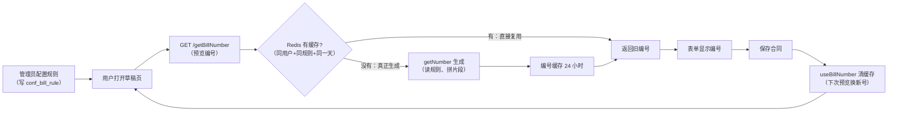
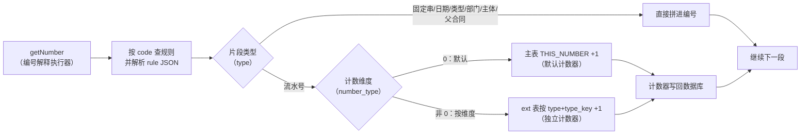
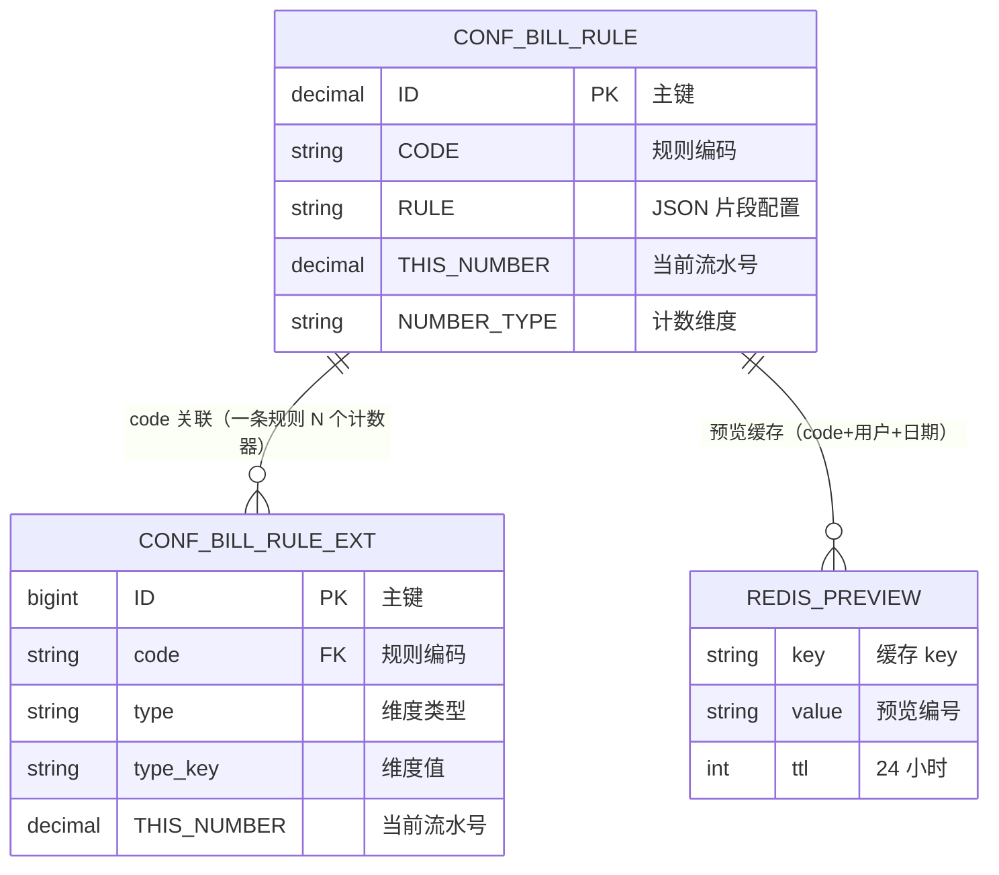
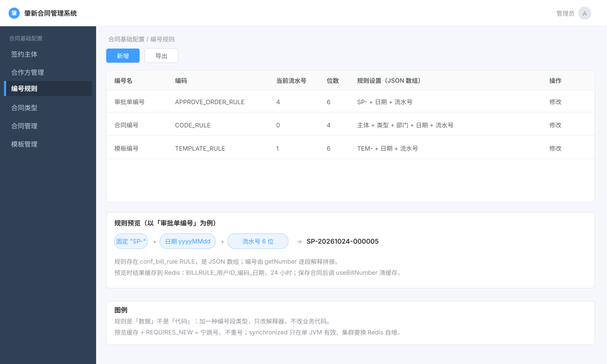
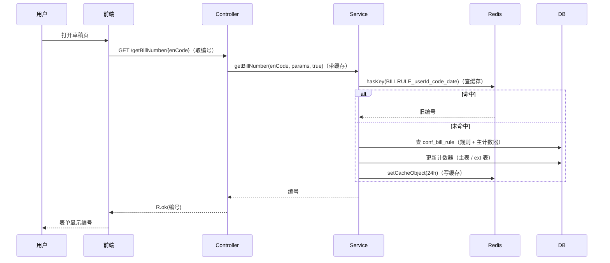

# 第 3 章 · 编号规则

> 前面两章录的是「主数据」（我方主体、对方公司）。本章开始碰「**合同的编号**」——比如 `HT-2024-0001`、`BX-202406-0007`。
>
> 编号看着简单，实则是后端最容易出 bug 的地方之一：**怎么保证不重号？** 单机能靠锁，集群呢？预览时编号能变吗？本章就把这些问题讲透。
>
> **这一章怎么用**：§一 先把业务全貌、表和关系讲清楚；§四 再按业务动作施工，每一步都能复制、能运行。Redis、事务、锁这些概念放在对应的动作里讲。
>
> **本章第一次讲透**：① **Redis 缓存**（编号预览为什么要缓存、怎么缓存）；② **`synchronized` 在单机能用、集群会重号**这个经典坑；③ **`REQUIRES_NEW` 独立事务**——「宁跳号、不重号」的取舍。

> **零基础先补概念（编号问题的四个关键词）**
>
> - **Redis 缓存**：内存里的 key-value 存储，读写快，可以设过期时间（TTL）。本章用它存「预览编号」：`BILLRULE_用户ID_规则编码_日期` → 编号，24 小时过期。
> - **`synchronized`（对象锁）**：保证同一个 JVM 里同一时刻只有一个线程进入某段代码。它锁的是「当前对象」，**管不到另一台服务器上的 JVM**。
> - **事务传播 `REQUIRES_NEW`**：挂起外层事务，自己开一个新事务，干完立刻提交。本章用它实现「编号生成不随业务回滚」。
> - **原子操作**：不会被其他线程打断的操作。Redis 的 `INCR` 是原子的，多台服务器同时自增也不会算错——这是 `synchronized` 在集群下的替代方案。

---

## 一、这部分是做什么的？

### 1.1 业务功能

这个模块解决三件事：

| 功能 | 谁在用 | 说明 |
|---|---|---|
| **编号规则配置** | 管理员 | 用「拼积木」的方式定义编号格式：固定串 + 日期 + 流水号 + 合同类型 + 部门 + 主体…… |
| **编号生成/预览** | 业务人员（草拟合同、模板） | 打开表单时自动带出一个编号；保存时确认使用 |
| **按维度独立编号** | 系统 | 同一个规则可以按「合同类型 / 签约主体 / 父合同」分别计数，互不干扰 |

一句话：**把「编号长什么样」从代码里搬到数据库，让管理员自己配。**

### 1.2 编号是怎么「拼」出来的

规则存在 `conf_bill_rule.rule` 字段里，是一个 **JSON 数组**，数组里每个元素是编号的一个「**片段**」。片段有类型（`type`）：

| `type` | 含义 | 例子 |
|---|---|---|
| `1` | 固定字符串 | `"HT"`（合同） |
| `2` | 年月日（固定格式） | `20240617` |
| `3` | 按**年**重置的流水号 | 0001、0002…（跨年归零） |
| `4` | 按**月**重置的流水号 | 0001、0002…（跨月归零） |
| `5` | 按**日**重置的流水号 | 0001、0002…（跨日归零） |
| `6` | 合同类型编号 | 略 |
| `8` | 起草部门编号 | 略 |
| `9` | 流程编号 | 略 |
| `subject` | 第一个签约主体编号 | 略 |
| `time-yyMM` / `time-yyyy` | 年月 / 年（另一种格式） | 略 |
| `relateCode` | 关联合同编号 | 续签时用（第 9 章） |
| `number` | 流水号（**不重置**） | 0001、0002…（永远累加） |

**一串规则拼起来就是一个编号**。比如规则是 `[{"type":"1","string":"HT"},{"type":"2"},{"type":"4"}]`，生成的就是 `HT` + `20240617` + `0001` = `HT202406170001`。

> 常量定义在 `ConfBillRuleServiceImpl.java:65-77`。
> ⚠️ **小观察**：类型编号里**没有 `7`**（1,2,3,4,5,6,8,9）——中间有个空洞，应该是历史遗留。这种「代码里的空洞」在真实项目里很常见，面试被问到可以诚实说。

**三个关键需求**：

1. **预览时编号不能变**：用户打开草稿页，系统预填一个编号；刷新页面不能把号白白消耗掉 → 需要 Redis 缓存。
2. **真正用了才消耗（设计目标）**：理想情况下只有保存/提交才占用编号。**但当前实现是「首次预览即占用」**——`getNumber` 已经把计数器 +1 了，`useBillNumber` 只是删缓存。这是「设计目标与实现不一致」的坦白点。
3. **不能重号**：两个人同时保存，绝不能生成两个 `0001` → 引出锁、事务和集群问题。

### 1.3 完整业务逻辑

**图 1：业务主流程（配置 → 预览 → 保存）**



> **怎么看**：先看中间的缓存分支——命中就直接返回旧编号；没命中才走 `getNumber` 生成，生成后缓存 24 小时。最后保存合同时清缓存，下次预览才会换新号。

**图 2：`getNumber` 内部（片段怎么拼）**



> **怎么看**：对 `rule` 数组里的每个片段重复这套判断——只有「流水号」片段才动计数器；`number_type=0` 用规则主表 `conf_bill_rule`，非 0 用扩展表 `conf_bill_rule_ext` 按维度各算各的；其它片段（固定串/日期/类型等）直接拼字符串。数组遍历完，编号就拼好了。

**四个阶段**：

| 阶段 | 谁触发 | 关键动作 |
|---|---|---|
| 配置 | 管理员 | 拼 JSON 片段，保存到 [[D0-底座表地图#3. conf_bill_rule 编号规则表（04 行 133）|`conf_bill_rule`]] |
| 生成/预览 | 用户打开表单 | 先查 Redis；没有再 `getNumber`，计数器 +1 |
| 确认使用 | 保存合同 | `useBillNumber` 删缓存，下次预览换新号 |
| 规则变更 | 管理员 | 只影响之后的编号，已生成的不变 |

> **一个必须知道的现状**：预览时 `getNumber` 就已经把计数器 `+1` 了——「生成」即「占用」。清缓存只是删缓存，不会退还编号。所以业务失败时会跳号，但不会重号。

### 1.4 涉及哪些表、什么关系

| 表 / 存储 | 作用 | 关键字段 | 谁写 |
|---|---|---|---|
| `conf_bill_rule` | 规则定义 + **默认计数器** | `CODE`（规则编码）、`RULE`（JSON 片段）、`THIS_NUMBER`（当前流水号）、`NUMBER_TYPE`（计数维度） | 管理员配置；`getNumber` 更新计数器 |
| [[D0-底座表地图#4. conf_bill_rule_ext 编号扩展表（04 行 169）|`conf_bill_rule_ext`]] | **按维度拆开的计数器** | `code` + `type` + `type_key`（三者定位一行）、`THIS_NUMBER` | `getNumber` 在 `numberType != 0` 时更新 |
| Redis（不是表） | 预览编号缓存 | key = `BILLRULE_用户ID_编码_日期`，value = 编号，TTL 24h | `getBillNumber` 写；`useBillNumber` 删 |

**关系**：



> **怎么读**：左边 `CONF_BILL_RULE` 是规则主表，一条规则一行；右边 `CONF_BILL_RULE_EXT` 是按维度拆开的计数器，同一 `code` 下按 `(type, type_key)` 可以有多行；`REDIS_PREVIEW` 不是表，只是预览缓存 key 的示意，key 由「规则编码 + 用户 + 日期」拼成。
>
> **字段对照**：`CODE`=规则编码；`RULE`=JSON 片段；`THIS_NUMBER`=当前流水号；`NUMBER_TYPE`=计数维度；`type_key`=独立编号的 key（合同类型/主体/父合同）。

- **主表与扩展表是逻辑上的 1:N**：没有物理外键，靠 `code` 关联；
- **什么时候用 ext 表**：`number_type = 0` 用主表的 `THIS_NUMBER`；`number_type = relatedCode / subjectCode / contractTypeCode` 时走 ext 表，按对应维度各建一行；
- **规则片段本身不关联任何表**：`type=6/8/9/subject/relateCode` 只是从请求参数里取字符串拼进去。

### 1.5 页面与接口

页面在 `zxcm-ui/src/views/conf/billRule/index.vue`：上半部分是规则列表，下半部分是规则预览（固定串 + 日期 + 流水号怎么拼成一个编号）。



> **图注**：按 `billRule/index.vue` 的结构画的**示意图，不是真实截图**（官方未提供该页面截图）。

| 接口 | 干什么 | 施工位置 |
|---|---|---|
| `GET /conf/billRule/list` | 规则列表 | §4.2 |
| `GET /conf/billRule/{id}` | 规则详情 | §4.2（修改回填） |
| `POST /conf/billRule` | 新增规则 | §4.2 |
| `PUT /conf/billRule` | 修改规则 | §4.2 |
| `DELETE /conf/billRule/{ids}` | 删除规则 | §4.2 |
| `GET /conf/billRule/getBillNumber/{enCode}` | **生成/预览编号**（带缓存） | §4.4 |
| `GET /conf/billRule/useBillNumber/{enCode}` | **清除编号缓存** | §4.4 |

---

## 二、站在架构师 / 开发经理角度：为什么这么设计？

### 2.1 为什么编号规则要用「JSON 数组配置」，而不是给每种规则写死代码？

写死代码会变成 `if (类型 == 合同) ... else if (类型 == 报销) ...`。客户要求「合同编号加部门」时，就得改代码重新发版。

**JSON 数组配置**把「编号长什么样」变成了**数据**：管理员在页面上拖几个片段、配好顺序，编号就变了，**代码一行不用改**。这是「**把变化点数据化**」的经典设计——凡是业务上会变的规则，都别写死在代码里。

代价是代码要「解释」这串 JSON（§4.3 的 `getNumber`）。**用一段稍复杂的解释器代码，换业务的灵活性**，很值。

**举个具体例子**：客户要求「合同编号里加部门代码」。

- 写死代码：改 `getNumber` 的 `if-else` + 重新发版；
- JSON 配置：管理员在规则里加一个 `type=8` 的片段，保存即可，代码不动（解释器里已经有 `TYPE_DEPT` 分支）。

**边界**：JSON 只让「片段组合」可变，不让「片段种类」无限扩展。要加一种全新的片段（比如「项目编号」），仍然要改解释器代码——这是这套设计的适用边界。

### 2.2 为什么「预览编号」要缓存到 Redis？

这是本章最重要的设计。看 `getBillNumber`（`ConfBillRuleServiceImpl.java:364-383`）：

```java
public String getBillNumber(String enCode, Map<String, String> params, boolean isCache) {
    String strNumber;
    if (isCache == true) {
        String thisDate = DateUtils.format(new Date(), "yyyyMMdd");
        String cacheKey = "BILLRULE_" + LoginHelper.getUserId() + enCode + thisDate;   // ← 缓存 key

        if (!RedisUtils.hasKey(cacheKey)) {
            strNumber = this.getNumber(enCode, params);              // 缓存没有 → 真正生成一个
            RedisUtils.setCacheObject(cacheKey, strNumber, Duration.ofHours(24));   // 存 24 小时
        } else {
            strNumber = RedisUtils.getCacheObject(cacheKey).toString();   // 缓存有 → 直接返回
        }
    } else {
        strNumber = this.getNumber(enCode, params);      // 不走缓存，每次都新生成
    }
    return strNumber;
}
```

**为什么必须缓存**：用户打开页面 → 系统生成 `0001` → 刷新 → 又生成 `0002`。**用户什么都没做，编号就被消耗掉了**（因为「生成编号」本身会把计数器 +1，见 §2.3）。

缓存后：同一个用户 + 同一个规则 + 同一天，**反复调都返回同一个编号**，只有缓存过期或主动清掉才会重新生成。

**缓存 key 的设计**：`BILLRULE_ + 用户ID + 规则编码 + 日期`——按用户隔离（张三的预览不会覆盖李四的）、按日期隔离（跨天自动失效）。

### 2.3 为什么「生成编号」就等于「消耗一个号」？

看 `getNumber` 的核心逻辑（`:219-233`，以按年重置的流水号为例）：

```java
if (numberType.equals("0")) {
    Date d = entity.getThisNumberDate();
    Date currentDate = new Date();
    String thisYearDate = DateUtils.format(currentDate, "yyyy");
    String oldYearDate = DateUtils.format(d, "yyyy");
    // 处理每年编号重置的功能
    if (!thisYearDate.equals(oldYearDate)) {
        entity.setThisNumber(entity.getStartNumber());      // 跨年了 → 用起始号
    } else {
        entity.setThisNumber(entity.getThisNumber() + 1);   // 同一年 → 计数器 +1
    }
    entity.setThisNumberDate(currentDate);
    strNumber.append(PadUtil.padRight(String.valueOf(entity.getThisNumber()),
        entity.getNumberLength().intValue(), '0'));         // 左侧补 0 到指定长度
}
// ... 循环结束后：
this.baseMapper.updateById(entity);    // :355  ★ 把计数器写回数据库
```

**关键**：只要规则里含流水号片段，每次调 `getNumber` 都会 **`+1` 并写库**——所以「生成编号」不等于「看看编号」，它是**真的把号用掉了**。

这就解释了两个设计：

1. **为什么要有 Redis 预览缓存**（§2.2）——避免预览动作白白消耗编号。
2. **为什么要有 `useBillNumber` 清缓存接口**——语义是「这个编号我用了」，删掉缓存，下次预览生成新号。

> **注意这个坑**：清缓存只是「删缓存」，它**不会去占用编号**——编号在第一次 `getNumber` 时就已经 `+1` 占掉了。所以模型是：**首次预览即占用**，清缓存只是为了「用了之后别再显示旧的」。

### 2.4 为什么用 `synchronized` 保证不重号？它够用吗？（本章最该记住的坑）

看 `getNumber` 的方法签名（`ConfBillRuleServiceImpl.java:191-193`）：

```java
@Override
@Transactional(propagation = Propagation.REQUIRES_NEW)   // 独立事务
public synchronized String getNumber(String enCode, Map<String, String> param) {   // 加锁
```

- **`synchronized`**：给方法加**对象锁**，保证**同一个 JVM 内**同时只有一个线程能进来读计数器、+1、写回。
- **`REQUIRES_NEW`**：开一个**独立的新事务**（不复用外层事务）。

**这里有个致命问题：`synchronized` 只在单机有效。**

如果系统部署了**两个实例**：

```
实例 A：读计数器=5 → +1 → 写回 6
实例 B：读计数器=5 → +1 → 写回 6     ← 同时发生，两个都生成 0006！重号！
```

**`synchronized` 拦不住跨 JVM 的并发。**

**正确做法应该是什么？**

| 方案 | 做法 | 评价 |
|---|---|---|
| 数据库行锁 | `select ... for update` 锁住计数器那一行 | 能扛集群，但有锁等待、性能差 |
| **Redis 原子自增** | `RedisUtils.incr(key)`——原子操作，天然跨实例 | 主流做法，性能好 |
| 号段模式 | 一次从数据库取 1000 个号到内存 | 性能最好，但实例重启会跳号 |

> **面试必考**：「你们的编号怎么保证不重号？」
> **标准答法**：单机用 `synchronized` + `REQUIRES_NEW` 能保证；但**集群下 `synchronized` 无效**，会重号。生产上应该改成 **Redis 原子自增**或**数据库行锁**。**能主动说出「这个实现集群下有风险」，比假装完美更让面试官信服**。

### 2.5 为什么 `REQUIRES_NEW`（独立事务）？——「宁跳号、不重号」

`REQUIRES_NEW` 的意思是：**从当前事务里脱离出来，开一个全新的事务**。

为什么要这样？假设生成编号和外层业务（比如「保存合同」）在**同一个事务**里。如果外层业务后来**回滚了**，那么编号的 `+1` 也会跟着回滚——**编号被「还回去」了**，下一个请求会拿到同一个号。但如果**并发的另一个请求已经拿到了下一个号**，回滚后的号就重复了。

所以编号的取舍是：**宁肯跳号（浪费几个号），也绝不重号**。用独立事务，意味着编号一旦生成就**立即提交、独立于业务成败**——业务回滚了，号也不退回（跳号），但绝不会和别人撞号。

| 传播行为 | 外层业务回滚时 | 编号结果 |
|---|---|---|
| `REQUIRED`（默认） | 编号的 `+1` 一起回滚 | 号被退回，可能被下一个请求重复使用 |
| **`REQUIRES_NEW`（选用）** | 编号独立提交，不回滚 | 号不退，业务失败就跳号，但不会重号 |

**具体场景**：保存合同时先取号 `0005`，随后保存失败回滚。用 `REQUIRED`，`0005` 被退回，下一个请求也可能拿到 `0005`——如果中间已经有人并发拿到过，就重号了；用 `REQUIRES_NEW`，`0005` 就算用掉了，下次从 `0006` 开始。

### 2.6 为什么要拆出 `conf_bill_rule_ext` 这张表？（「拆表 = 拆锁」）

默认情况下，一个编号规则的计数器存在 `conf_bill_rule.this_number` 这一列里。但 `getNumber` 整个方法共用一把锁。如果所有编号都挤在**同一行**计数器上：

- 按合同类型编号时，类型 A 和类型 B 的编号会**互相等锁**（明明是两件不相干的事）。

所以本项目拆出了 `conf_bill_rule_ext` 表，用 `(code, type, typeKey)` 来**按维度分开计数器**：每个「合同类型」或每个「签约主体」有**自己独立的计数器行**。这样 A 和 B 各算各的，**锁竞争小了**。

**具体例子**：合同类型 A 和 B 都用 `CODE_RULE`，但 `number_type=contractTypeCode`。

- 不拆表：A、B 共用一个 `this_number`，A 生成 `0001` 后 B 只能拿 `0002`；
- 拆表后：A 有自己的行从 `0001` 开始，B 也有自己的行从 `0001` 开始。

> **但要诚实补一句**：当前 `getNumber` 整个方法仍被 `synchronized` 锁住，所以 ext 表并没有真正消除「方法级串行」——它解决的是「不同维度共用一个计数器」的语义问题和数据库行更新冲突。要把方法锁竞争也降下来，得缩小锁粒度或换成 Redis 原子自增。

---

## 三、需要哪些技术？

| 技术 / 机制 | 具体指什么 | 精确定位 | 详解 |
|---|---|---|---|
| **Redis 缓存** | 存「预览编号」，避免重复消耗 | `ConfBillRuleServiceImpl.java:371-378`；`RedisUtils` 的 `setCacheObject`（`:137`）、`getCacheObject`（`:185`）、`deleteObject`（`:206`）、`hasKey`（`:440`） | §4.4 |
| **`synchronized`** | 单机互斥锁，防并发重号 | `ConfBillRuleServiceImpl.java:193` | §2.4 |
| **`@Transactional(REQUIRES_NEW)`** | 独立事务，「宁跳号不重号」 | `ConfBillRuleServiceImpl.java:192`、`:363` | §2.5 |
| **JSON 数组配置** | 编号规则的存储格式（Hutool `JSONArray`） | `ConfBillRuleServiceImpl.java:209-212` | §2.1、§4.3 |
| **`PadUtil.padRight`** | 左侧补位 | `conf/util/PadUtil.java:47` | §4.3 |
| **热点行拆分** | 用 ext 表按维度分计数器 | `conf_bill_rule_ext`；`ConfBillRuleExtServiceImpl.java:94-97` | §2.6、§4.3 |
| **已有能力** | 五件套、功能权限、逻辑删除 | 第 1、2 章 | 第 1、2 章 |

---

## 四、功能具体怎么实现（带着你复制）

> **本章涉及的表**（点表名直达底座表地图的字段详情）：
> [[D0-底座表地图#3. conf_bill_rule 编号规则表（04 行 133）|`conf_bill_rule`]]（编号规则） ｜ [[D0-底座表地图#4. conf_bill_rule_ext 编号扩展表（04 行 169）|`conf_bill_rule_ext`]]（维度计数器）


### 4.1 需求与施工总览

> 前两章是「管一张表」，这一章是「做一个通用能力」。需求单里没有增删改查的花活，重点全在**编号不能重、预览不能变、规则能自己配**。

#### 4.1.1 需求单

**需求编号** ZXCM-CONF-003　**提出人** 合同管理部　**优先级** 高　**本期上线**

**背景**：合同、审批单、档案都要有编号。现在编号是经办人手工填的：格式不统一（`HT-2026-001`、`2026合同001` 混着来），同一个月里还会撞号。需要一个「编号生成器」：管理员配好规则，业务侧调用一次拿一个号，全公司唯一。

**使用角色**

| 角色 | 能做什么 |
|---|---|
| 系统管理员 | 配置编号规则：片段、日期格式、流水号位数、重置周期 |
| 业务用户 | 无感。起草合同时系统自动带出编号 |

**功能需求**

| # | 功能 | 具体要求 |
|---|---|---|
| 1 | 规则管理 | 列表 / 新增 / 修改 / 删除；一条规则由多个片段拼成，存 JSON 数组（文字、日期、流水号、关联编码等，type 见 §1.2） |
| 2 | 编号预览 | 打开合同起草页就显示「下一个可用编号」；连续刷新编号**不变** |
| 3 | 生成编号 | 正式保存单据时才真正消耗一个号 |
| 4 | 重置周期 | 按年（`yyyy`）/ 按月（`yyyyMM`）/ 按日（`yyyyMMdd`）/ 不重置 |
| 5 | 按维度计数 | 同一条规则可以按合同类型、流程、相对方分别从 `0001` 开始数 |
| 6 | 清缓存 | 规则改了之后，预览缓存要能清掉，否则还显示旧编号 |

**非功能要求**

- 权限点：`conf:billRule:list` / `:query` / `:add` / `:edit` / `:remove` / `:export`；
- 取号、清缓存两个接口只要登录，不单独配权限点；
- **并发不能重号**（当前实现是单机 `synchronized`）；
- 编号生成必须在一个独立事务里（`REQUIRES_NEW`）——宁可跳号，不能重号；
- 规则和计数器分两张表：`conf_bill_rule`（规则）+ `conf_bill_rule_ext`（按维度计数）。

**验收标准**

| 操作 | 预期 |
|---|---|
| 配一条规则：`HT` + `yyyyMMdd` + 4 位流水 | 预览得到 `HT202610260001` |
| 连续预览两次 | 编号相同（预览不消耗） |
| 保存一次单据后再预览 | 变成 `...0002` |
| 并发 10 个请求同时取号 | 10 个编号互不相同 |
| 按年重置，跨年后再取 | 从 `0001` 重新开始 |
| 改掉规则里的文字片段后刷新预览 | 显示新格式（缓存已清） |
| 删掉一条正在用的规则 | 先看 §2 里的边界说明，不会连带删计数器 |

**本期不做**：分布式锁（集群部署要另做，见 §2.4）、号段模式、编号回收 / 补号、规则版本化。

#### 4.1.2 拿到需求，先做四件事

**① 给需求定性，再推架构**

| 判断维度 | 本模块的答案 | 推出的设计 |
|---|---|---|
| 数据性质 | 规则 = 低频配置；计数器 = 每次取号都写 | 规则和计数器拆两张表（拆表=拆锁） |
| 数据形状 | 规则是可变片段的有序组合 | `RULE` 存 JSON 数组 |
| 并发 | 取号不能重号 | `synchronized` + 计数器独立事务 |
| 读 | 预览是高频读、不能消耗号 | Redis 缓存预览值 |
| 部署 | 单机 / 集群 | 单机锁在生产不够，需要分布式锁 |

→ 架构：规则表 + 计数器表 + Redis 预览缓存 + 锁与独立事务。

**② 定数据怎么存**：规则和计数器分两张表（`conf_bill_rule` / `conf_bill_rule_ext`），预览号放 Redis。为什么这么拆、每个字段干什么，见下一节 4.1.3。

**③ 定接口**：规则管理 7 个 + 取号 2 个，都挂在 `/conf/billRule` 下。

| 功能 | 方法 + 路径 | 权限点 |
|---|---|---|
| 列表 | `GET /list` | `conf:billRule:list` |
| 详情 | `GET /{id}` | `:query` |
| 新增 | `POST /` | `:add` |
| 修改 | `PUT /` | `:edit` |
| 删除 | `DELETE /{ids}` | `:remove` |
| 导出 | `POST /export` | `:export` |
| 预览编号 | `GET /getBillNumber/{enCode}?flowCode=&contractTypeCode=` | 仅登录 |
| 清缓存 | `GET /useBillNumber/{enCode}` | 仅登录 |

**④ 定实现边界：哪些不用写、哪些必须写、哪些是缺口**

- **框架给**：CRUD、分页、逻辑删除；
- **必须自己写**：规则校验（文字片段必须有 `string`、一条规则最多一个流水号）、取号算法、清缓存；
- **已知缺口**：`ext` 的 `(code,type,type_key)` 无唯一索引；集群下 `synchronized` 失效；预览缓存漏清会显示旧格式。

#### 4.1.3 表设计导读：这两张表为什么长这样

> 前两章是「一张主表搞定」，这一章是「配置 + 状态」分成两张。为什么拆、拆完各自装什么，是这一节的重点。

**定位：不是「主表 + 扩展表」，是「规则定义」和「运行时状态」分离**

| 表 | 角色 | 写频率 | 谁在写 |
|---|---|---|---|
| `conf_bill_rule` | 规则定义（片段、位数、重置周期）+ 一份**默认计数器** | 低（管理员改规则时） | 规则管理页 |
| `conf_bill_rule_ext` | 按维度的**独立计数器**，用 `(CODE, TYPE, TYPE_KEY)` 定位一行 | 高（**每次取号**都写） | 取号逻辑 |

**为什么必须拆**：规则是低频配置，计数器是高频写入。放一张表，每次取号都会 UPDATE 同一行，把配置行锁住；拆开之后，计数器每次只锁 `ext` 的某一行，规则行不受影响。这就是 §2.6 说的「**拆表 = 拆锁**」。

**字段分组：每一列回答一个业务问题**

| 组 | 列 | 回答什么 | 设计细节 |
|---|---|---|---|
| 规则定义 | `NAME`、`CODE`、`RULE` | 这条规则叫什么、长什么样 | `RULE` 用 `longtext` 存 **JSON 数组**：片段有顺序、类型会变，拆成列就没法表达（§2.1） |
| 默认计数器（主表） | `THIS_NUMBER`、`THIS_NUMBER_DATE`、`START_NUMBER`、`NUMBER_LENGTH`、`NUMBER_TYPE` | 数到几了、从几开始、补几位、什么时候重置 | `THIS_NUMBER_DATE` 用来判断**有没有跨重置周期**；`NUMBER_TYPE` 存 `yyyy` / `yyyyMM` / `yyyyMMdd` |
| 维度计数器（ext） | `code`、`type`、`type_key` + 上面那组计数列 | 同一条规则，按合同类型 / 流程 / 相对方各数各的 | 三个字段构成「计数器定位三元组」，取号时按它查一行（§2.6） |
| 审计 | `CREATE_BY/TIME`、`UPDATE_BY/TIME`、`DEL_FLAG`、`TENANT_ID` | 谁改的、删没删、哪个租户 | 同前两章 |

**四个关键取舍**

| 决策 | 选择 | 代价 | 什么情况下反过来 |
|---|---|---|---|
| 规则存储 | JSON 数组 | 不能按片段字段查、无 schema | 规则种类固定、需要按类型统计时 |
| 表数量 | 规则、计数器拆两张 | 两套 Entity / Mapper / Service，理解成本高 | 取号频率极低、锁竞争可忽略 |
| 预览号 | 放 Redis，不落库 | 缓存和数据库可能不一致，必须主动清（§2.2、§4.4） | 预览频率低、要求绝对一致时 |
| 事务 | 计数器用 `REQUIRES_NEW` 独立提交 | **宁跳号、不重号**：主事务回滚了，号也回不去（§2.5） | 业务能接受重号（几乎不可能） |

**四处必须知道的缺陷 / 边界**

1. **两套计数器并存**：主表自己也有 `THIS_NUMBER` 那组字段——默认维度走主表，细分维度走 `ext`。同一个概念两处实现，读代码时容易看漏。
2. **`ext` 的 `(code, type, type_key)` 没有唯一索引**：同一维度如果出现重复行，取号会直接报「查询到多个匹配规则，生成编号失败」（`ConfBillRuleExtServiceImpl` 里显式判断 `exts.size() > 1`），根因在表结构。
3. **`synchronized` 只在单机有效**：集群部署会重号，必须换分布式锁或 Redis 原子自增（§2.4）。
4. **预览缓存靠主动清**：规则改了不调 `useBillNumber`，页面会一直显示旧格式。

**演示数据为什么是这些**

- 8 条规则：让规则列表页有数据，覆盖不同的日期格式和重置周期；
- 1 条 `ext`（`CODE_RULE` + `contractTypeCode`）：让「按合同类型分别计数」这条链路有现成的一行可验。

**对后面章节的连锁影响**

| 后面的事 | 依赖这两张表的什么 |
|---|---|
| 合同起草自动带出编号 | `getNumber` 读规则 + 计数器 |
| 合同类型不同、编号分别计数 | `ext` 的三元组定位 |
| 改规则后预览立刻变 | `useBillNumber` 清 Redis |

> **面试怎么答**：「编号规则拆成规则表和计数器表，是因为写频率完全不同——规则是低频配置，计数器每次取号都要写，放一起会锁配置行。计数器又按 `(code,type,type_key)` 拆维度，同一条规则可以让不同合同类型各自从 0001 开始。代价是两套计数逻辑、需要独立事务保证不重号，以及单机 `synchronized` 在集群下不够用。」

#### 4.1.4 施工计划

| 步骤 | 动作 | 业务规则 | 做完的标志 |
|---|---|---|---|
| 本节 | 地基：两表 + 两组 Entity/Mapper + 骨架 | —— | 项目能编译、能启动 |
| 4.2 | 规则管理（列表 / 新增 / 修改 / 删除） | 文字片段必须有 `string`；一条规则最多一个流水号 | 页面上能配出一条规则 |
| 4.3 | 计数器与编号生成 | 按维度计数；三种重置周期；`synchronized` + `REQUIRES_NEW` | 能拼出 `HT202610260001` |
| 4.4 | 预览与清缓存 | 预览走 Redis，不消耗；保存后清缓存 | 连续预览不变，保存后换号 |
| 4.5 | 前端页面 | Tab 式编辑器、动态字典名 | 页面能配规则（注意补充协议 Tab 的字典 bug） |
| 4.6 | 复制清单 | 14 个后端文件，0 处必改 | 编译通过 |
| 4.7 | 跑通验证 | 接口、页面、数据三边对账 | 三条硬标准全过 |
| 4.8 | 八个坑 | 逐个对照，知道哪些是 bug | 能说出每条的根因 |
| 4.9 | 全链路自测 | 并发、跨周期、清缓存 | 自测清单全绿 |

**为什么先做规则管理**：没有规则，取号无号可拼。而且规则管理是纯 CRUD，能最快把两张表的结构验证一遍。

**文件地图**：

| 文件 | 层 | 职责 |
|---|---|---|
| `ConfBillRule.java` / `ConfBillRuleExt.java` | Entity | 两张表的映射 |
| `ConfBillRuleMapper.java` / `ConfBillRuleExtMapper.java` | Mapper | 两张表的 CRUD |
| `IConfBillRuleService.java` / `ConfBillRuleServiceImpl.java` | Service | 规则管理 + 编号生成 |
| `IConfBillRuleExtService.java` / `ConfBillRuleExtServiceImpl.java` | 扩展 Service | 按维度计数 |
| `ConfBillRuleController.java` | Controller | 接请求 |
| `api/conf/billRule.js` / `views/conf/billRule/index.vue` | 前端 | 规则页 |

> BO/VO（`ConfBillRuleBo/Vo`、`ConfBillRuleExtBo/Vo`）字段和注解较多，直接从答案册 `domain\bo`、`domain\vo` 整文件复制，不在文档里重复贴。

**地基：建表 + Entity + Mapper + 骨架**

**建表**：

```sql
DROP TABLE IF EXISTS `conf_bill_rule`;

CREATE TABLE `conf_bill_rule`  (
  `ID` decimal(20, 0) NOT NULL COMMENT 'id',
  `NAME` varchar(20) NOT NULL COMMENT '编号名',
  `CODE` varchar(30) NOT NULL COMMENT '编号编码',
  `RULE` longtext NULL COMMENT '规则设置',
  `THIS_NUMBER` decimal(20, 0) NULL DEFAULT NULL COMMENT '当前流水号',
  `START_NUMBER` decimal(20, 0) NULL DEFAULT NULL COMMENT '开始编号',
  `NUMBER_LENGTH` decimal(20, 0) NULL DEFAULT NULL COMMENT '流水编号位数',
  `NUMBER_TYPE` varchar(20) NULL DEFAULT NULL COMMENT '编号类型',
  `THIS_NUMBER_DATE` datetime(0) NULL DEFAULT NULL COMMENT '当前编号生成的时间',
  `DEL_FLAG` char(1) NULL DEFAULT '0' COMMENT '0 存在 2 删除',
  `CREATE_BY` varchar(64) NULL DEFAULT NULL,
  `CREATE_TIME` datetime(0) NULL DEFAULT NULL,
  `UPDATE_BY` varchar(64) NULL DEFAULT NULL,
  `UPDATE_TIME` datetime(0) NULL DEFAULT NULL,
  `TENANT_ID` varchar(64) NULL DEFAULT NULL,
  PRIMARY KEY (`ID`) USING BTREE
) ENGINE = InnoDB DEFAULT CHARSET = utf8mb3 COMMENT = '流水规则表';

DROP TABLE IF EXISTS `conf_bill_rule_ext`;

CREATE TABLE `conf_bill_rule_ext`  (
  `ID` bigint NOT NULL COMMENT 'id',
  `code` varchar(255) NULL DEFAULT NULL COMMENT '编号规则',
  `type` varchar(255) NULL DEFAULT NULL COMMENT '独立编号类型',
  `type_key` varchar(255) NULL DEFAULT NULL COMMENT '独立编号的 key',
  `THIS_NUMBER` decimal(20, 0) NULL DEFAULT NULL COMMENT '当前流水号',
  `START_NUMBER` decimal(20, 0) NULL DEFAULT NULL COMMENT '开始编号',
  `NUMBER_LENGTH` decimal(20, 0) NULL DEFAULT NULL COMMENT '流水编号位数',
  `NUMBER_TYPE` varchar(20) NULL DEFAULT NULL COMMENT '编号类型',
  `THIS_NUMBER_DATE` datetime(0) NULL DEFAULT NULL COMMENT '当前编号生成的时间',
  `DEL_FLAG` char(1) NULL DEFAULT '0' COMMENT '0 存在 2 删除',
  `CREATE_BY` varchar(64) NULL DEFAULT NULL,
  `CREATE_TIME` datetime(0) NULL DEFAULT NULL,
  `UPDATE_BY` varchar(64) NULL DEFAULT NULL,
  `UPDATE_TIME` datetime(0) NULL DEFAULT NULL,
  `TENANT_ID` varchar(64) NULL DEFAULT NULL,
  PRIMARY KEY (`ID`) USING BTREE
) ENGINE = InnoDB DEFAULT CHARSET = utf8mb3 COMMENT = '编号扩展表';
```

**Entity（两个）**：

```java
package com.ruoyi.conf.domain;

import java.util.Date;

import com.baomidou.mybatisplus.annotation.TableId;
import com.baomidou.mybatisplus.annotation.TableLogic;
import com.baomidou.mybatisplus.annotation.TableName;
import com.ruoyi.common.core.domain.BaseEntity;

import lombok.Data;
import lombok.EqualsAndHashCode;

@Data
@EqualsAndHashCode(callSuper = true)
@TableName("conf_bill_rule")
public class ConfBillRule extends BaseEntity {

    private static final long serialVersionUID = 1L;

    @TableId(value = "id")
    private Long id;

    private String name;

    private String code;

    private String rule;

    private Long thisNumber;

    private Long startNumber;

    private Long numberLength;

    private String numberType;

    private Date thisNumberDate;

    @TableLogic
    private String delFlag;

    private String tenantId;
}
```

```java
package com.ruoyi.conf.domain;

import java.util.Date;

import com.baomidou.mybatisplus.annotation.TableId;
import com.baomidou.mybatisplus.annotation.TableLogic;
import com.baomidou.mybatisplus.annotation.TableName;
import com.ruoyi.common.core.domain.BaseEntity;

import lombok.Data;
import lombok.EqualsAndHashCode;

@Data
@EqualsAndHashCode(callSuper = true)
@TableName("conf_bill_rule_ext")
public class ConfBillRuleExt extends BaseEntity {

    private static final long serialVersionUID = 1L;

    @TableId(value = "ID")
    private Long id;

    private String code;

    private String type;

    private String typeKey;

    private Long thisNumber;

    private Long startNumber;

    private Long numberLength;

    private String numberType;

    private Date thisNumberDate;

    @TableLogic
    private String delFlag;

    private String tenantId;
}
```

**Mapper（两个）**：

```java
package com.ruoyi.conf.mapper;

import com.ruoyi.common.core.mapper.BaseMapperPlus;
import com.ruoyi.conf.domain.ConfBillRule;
import com.ruoyi.conf.domain.vo.ConfBillRuleVo;

public interface ConfBillRuleMapper
    extends BaseMapperPlus<ConfBillRuleMapper, ConfBillRule, ConfBillRuleVo> {
}
```

```java
package com.ruoyi.conf.mapper;

import com.ruoyi.common.core.mapper.BaseMapperPlus;
import com.ruoyi.conf.domain.ConfBillRuleExt;
import com.ruoyi.conf.domain.vo.ConfBillRuleExtVo;

public interface ConfBillRuleExtMapper
    extends BaseMapperPlus<ConfBillRuleExtMapper, ConfBillRuleExt, ConfBillRuleExtVo> {
}
```

**Service / Controller 骨架**：

```java
package com.ruoyi.conf.service;

import com.ruoyi.conf.domain.vo.ConfBillRuleVo;

public interface IConfBillRuleService {

    ConfBillRuleVo queryById(Long id);
}
```

```java
package com.ruoyi.conf.service.impl;

import org.springframework.stereotype.Service;

import com.ruoyi.conf.domain.vo.ConfBillRuleVo;
import com.ruoyi.conf.mapper.ConfBillRuleMapper;
import com.ruoyi.conf.service.IConfBillRuleService;

import lombok.RequiredArgsConstructor;

@RequiredArgsConstructor
@Service
public class ConfBillRuleServiceImpl implements IConfBillRuleService {

    private final ConfBillRuleMapper baseMapper;

    // 规则片段类型（对应 §1.2 的 type）
    public final String TYPE_STRING = "1";
    public final String TYPE_DATE_yyyyMMdd = "2";
    public final String TYPE_NUMBER_yyyy = "3";
    public final String TYPE_NUMBER_yyyyMM = "4";
    public final String TYPE_NUMBER_yyyyMMdd = "5";
    public final String TYPE_CONTRACT_TYPE = "6";
    public final String TYPE_DEPT = "8";
    public final String TYPE_FLOW_CODE = "9";
    public final String TYPE_SUBJECT = "subject";
    public final String TYPE_DATE_yyyyMM = "time-yyMM";
    public final String TYPE_DATE_yyyy = "time-yyyy";
    public final String TYPE_PARENT_CODE = "relateCode";
    public final String TYPE_NUMBER = "number";

    @Override
    public ConfBillRuleVo queryById(Long id) {
        return baseMapper.selectVoById(id);
    }
}
```

```java
package com.ruoyi.conf.controller;

import org.springframework.validation.annotation.Validated;
import org.springframework.web.bind.annotation.RequestMapping;
import org.springframework.web.bind.annotation.RestController;

import com.ruoyi.common.core.controller.BaseController;
import com.ruoyi.conf.service.IConfBillRuleService;

import io.swagger.annotations.Api;
import lombok.RequiredArgsConstructor;

@Validated
@Api(value = "编号规则控制器", tags = {"编号规则管理"})
@RequiredArgsConstructor
@RestController
@RequestMapping("/conf/billRule")
public class ConfBillRuleController extends BaseController {

    private final IConfBillRuleService iConfBillRuleService;
}
```

> 后面每加一个方法，IDEA 标红就 `Alt+Enter` 自动导入。

**验证**：两张表建好；项目能编译；能启动、能登录。

### 4.2 规则管理（列表 / 新增 / 修改 / 删除）

**本步目标**：能在页面上配出一条合法规则，并把 JSON 数组存进 `conf_bill_rule`。
**做完的标志**：新增、修改、删除都生效；文字片段没填 `string`、或一条规则里放了两个流水号，保存时会被拦下。

**前端 api（整文件）**

```js
import request from "@/utils/request";

export function getBillCode(code, query) {
  return request({ url: "/conf/billRule/getBillNumber/" + code, method: "get", params: query });
}

export function listBillRule(query) {
  return request({ url: "/conf/billRule/list", method: "get", params: query });
}

export function getBillRule(id) {
  return request({ url: "/conf/billRule/" + id, method: "get" });
}

export function addBillRule(data) {
  return request({ url: "/conf/billRule", method: "post", data });
}

export function updateBillRule(data) {
  return request({ url: "/conf/billRule", method: "put", data });
}

export function delBillRule(id) {
  return request({ url: "/conf/billRule/" + id, method: "delete" });
}
```

> 页面 `views/conf/billRule/index.vue` 是**单文件**（列表 + 弹窗都在这一个文件里，不像合作方拆成两个）；片段是「拖拽/增删」出来的数组，提交前 `JSON.stringify` 存进 `rule` 字段。整文件从答案册复制，下面只贴关键方法。

**列表**

Service 接口加：

```java
import com.ruoyi.common.core.domain.PageQuery;
import com.ruoyi.common.core.page.TableDataInfo;
import com.ruoyi.conf.domain.bo.ConfBillRuleBo;
import com.ruoyi.conf.domain.vo.ConfBillRuleVo;
import java.util.List;

TableDataInfo<ConfBillRuleVo> queryPageList(ConfBillRuleBo bo, PageQuery pageQuery);

List<ConfBillRuleVo> queryList(ConfBillRuleBo bo);
```

Service 实现加：

```java
@Override
public TableDataInfo<ConfBillRuleVo> queryPageList(ConfBillRuleBo bo, PageQuery pageQuery) {
    LambdaQueryWrapper<ConfBillRule> lqw = buildQueryWrapper(bo);
    return TableDataInfo.build(baseMapper.selectVoPage(pageQuery.build(), lqw));
}

@Override
public List<ConfBillRuleVo> queryList(ConfBillRuleBo bo) {
    return baseMapper.selectVoList(buildQueryWrapper(bo));
}

private LambdaQueryWrapper<ConfBillRule> buildQueryWrapper(ConfBillRuleBo bo) {
    LambdaQueryWrapper<ConfBillRule> lqw = Wrappers.lambdaQuery();
    lqw.like(StringUtils.isNotBlank(bo.getName()), ConfBillRule::getName, bo.getName());
    lqw.eq(StringUtils.isNotBlank(bo.getCode()), ConfBillRule::getCode, bo.getCode());
    lqw.orderByDesc(ConfBillRule::getCreateTime);
    return lqw;
}
```

Controller 加：

```java
@ApiOperation("查询编号规则列表")
@SaCheckPermission("conf:billRule:list")
@GetMapping("/list")
public TableDataInfo<ConfBillRuleVo> list(ConfBillRuleBo bo, PageQuery pageQuery) {
    return iConfBillRuleService.queryPageList(bo, pageQuery);
}
```

页面：

```js
getList() {
  this.loading = true
  listBillRule(this.queryParams).then((response) => {
    this.billRuleList = response.rows
    this.total = response.total
    this.loading = false
  })
}
```

验证：页面能看到 8 条演示规则。

**新增**

Service 接口加 `Boolean insertByBo(ConfBillRuleBo bo);`，实现：

```java
@Override
public Boolean insertByBo(ConfBillRuleBo bo) {
    ConfBillRule add = BeanUtil.toBean(bo, ConfBillRule.class);
    validEntityBeforeSave(add);
    boolean flag = baseMapper.insert(add) > 0;
    if (flag) {
        bo.setId(add.getId());
    }
    return flag;
}

/** 保存前的数据校验（原实现是 TODO，没有实际校验） */
private void validEntityBeforeSave(ConfBillRule entity) {
    // TODO 做一些数据校验,如唯一约束
}
```

> **坦白点**：`validEntityBeforeSave` 在原实现里是空的，`CODE` 也没有唯一索引——**重复编码是可能的**。真正有内容的校验在 `updateByBo` 里（见下面的「修改」）。

Controller 加：

```java
@ApiOperation("新增编号规则")
@SaCheckPermission("conf:billRule:add")
@Log(title = "编号规则", businessType = BusinessType.INSERT)
@RepeatSubmit()
@PostMapping()
public R<Void> add(@Validated(AddGroup.class) @RequestBody ConfBillRuleBo bo) {
    return toAjax(iConfBillRuleService.insertByBo(bo) ? 1 : 0);
}
```

前端提交（`index.vue:362-389`）：

```js
submitForm() {
  this.$refs['form'].validate((valid) => {
    if (valid) {
      this.buttonLoading = true
      if (this.currentData.id != null) {
        updateBillRule(this.currentData).then(() => {
          this.$modal.msgSuccess('修改成功')
          this.open = false
        }).finally(() => {
          this.buttonLoading = false
        })
      } else {
        addBillRule(this.currentData).then(() => {
          this.$modal.msgSuccess('新增成功')
          this.open = false
          this.getList()
        }).finally(() => {
          this.buttonLoading = false
        })
      }
    }
  })
}
```

验证：新增后列表多一条；数据库 `RULE` 是合法 JSON 数组。

**修改**

Service 接口加 `Boolean updateByBo(ConfBillRuleBo bo);`，实现：

```java
@Override
public Boolean updateByBo(ConfBillRuleBo bo) {
    ConfBillRule update = BeanUtil.toBean(bo, ConfBillRule.class);

    if (bo.getRuleArray().size() > 0) {
        int runningNumberCount = 0;
        for (int i = 0; i < bo.getRuleArray().size(); i++) {
            JSONObject o = bo.getRuleArray().getJSONObject(i);

            // 文字片段必须填 string
            if (o.getStr("type").equals("1") && StringUtils.isEmpty(o.getStr("string"))) {
                throw new ServiceException("文本的内容不能为空");
            }
            // 统计流水号片段（3/4/5）
            if (o.getStr("type").equals("3") || o.getStr("type").equals("4")
                || o.getStr("type").equals("5")) {
                runningNumberCount++;
            }
        }
        if (runningNumberCount > 1) {
            throw new ServiceException("一个编号中只允许使用一次流水号");
        }
    }

    update.setRule(bo.getRuleArray().toString());   // 数组 → JSON 字符串
    validEntityBeforeSave(update);
    return baseMapper.updateById(update) > 0;
}
```

**两条业务规则**（只在修改时校验）：

1. `type=1`（文字片段）必须填 `string`，否则编号会缺一段；
2. 一个规则里**最多一个流水号片段**（`type=3/4/5`），否则会出现 `0001-0001` 这种两个流水号的编号。

> **一个不对称的地方**：`insertByBo` 没有这套校验，也不从 `ruleArray` 反写 `rule`；`updateByBo` 才会校验并 `setRule(ruleArray.toString())`。新增时 `rule` 要靠前端直接传字符串。这是原实现的一个不一致点，可以指出。

Controller 加：

```java
@ApiOperation("修改编号规则")
@SaCheckPermission("conf:billRule:edit")
@Log(title = "编号规则", businessType = BusinessType.UPDATE)
@RepeatSubmit()
@PutMapping()
public R<Void> edit(@Validated(EditGroup.class) @RequestBody ConfBillRuleBo bo) {
    return toAjax(iConfBillRuleService.updateByBo(bo) ? 1 : 0);
}
```

验证：把规则里的 `string` 从 `SP-` 改成 `HT-`，新预览的编号前缀变化；已生成的编号不受影响。

**删除**

Service 接口加 `Boolean deleteWithValidByIds(Collection<Long> ids, Boolean isValid);`，实现：

```java
@Override
public Boolean deleteWithValidByIds(Collection<Long> ids, Boolean isValid) {
    return baseMapper.deleteBatchIds(ids) > 0;
}
```

Controller 加：

```java
@ApiOperation("删除编号规则")
@SaCheckPermission("conf:billRule:remove")
@Log(title = "编号规则", businessType = BusinessType.DELETE)
@DeleteMapping("/{ids}")
public R<Void> remove(@PathVariable Long[] ids) {
    return toAjax(iConfBillRuleService.deleteWithValidByIds(Arrays.asList(ids), true) ? 1 : 0);
}
```

验证：删除后列表消失，`DEL_FLAG='2'`。

### 4.3 计数器与编号生成

**本步目标**：按规则拼出下一个编号，并把计数器加一。
**做完的标志**：调一次取号得到 `HT202610260001`；并发 10 次得到 10 个不同编号；跨重置周期后回到 `0001`。

**扩展计数器（ext 表）**

接口：

```java
package com.ruoyi.conf.service;

import java.util.Map;

import com.ruoyi.conf.domain.ConfBillRule;

public interface IConfBillRuleExtService {

    String getBillNumber(String type, String typeKey, Map<String, String> param, ConfBillRule entity);

    String getBillNumberWithResetByPattern(String type, String typeKey, Map<String, String> param,
        ConfBillRule entity, String updatePattern);
}
```

实现（完整）：

```java
package com.ruoyi.conf.service.impl;

import java.util.Date;
import java.util.List;
import java.util.Map;

import org.springframework.beans.factory.annotation.Autowired;
import org.springframework.stereotype.Service;

import com.alibaba.excel.util.DateUtils;
import com.alibaba.excel.util.StringUtils;
import com.baomidou.mybatisplus.core.conditions.query.LambdaQueryWrapper;
import com.ruoyi.common.exception.ServiceException;
import com.ruoyi.conf.domain.ConfBillRule;
import com.ruoyi.conf.domain.ConfBillRuleExt;
import com.ruoyi.conf.mapper.ConfBillRuleExtMapper;
import com.ruoyi.conf.service.IConfBillRuleExtService;
import com.ruoyi.conf.util.PadUtil;

@Service
public class ConfBillRuleExtServiceImpl implements IConfBillRuleExtService {

    @Autowired
    private ConfBillRuleExtMapper baseMapper;

    @Override
    public String getBillNumber(String type, String typeKey, Map<String, String> param, ConfBillRule entity) {
        if (StringUtils.isEmpty(typeKey)) {
            throw new ServiceException("生成扩展编号的参数不全，请检查编号规则的设置");
        }

        LambdaQueryWrapper<ConfBillRuleExt> wrapper = new LambdaQueryWrapper<>();
        wrapper.eq(ConfBillRuleExt::getType, type);
        wrapper.eq(ConfBillRuleExt::getTypeKey, typeKey);
        wrapper.eq(ConfBillRuleExt::getCode, entity.getCode());
        List<ConfBillRuleExt> exts = baseMapper.selectList(wrapper);

        if (exts.size() == 0) {
            ConfBillRuleExt ext = new ConfBillRuleExt();
            ext.setType(type);
            ext.setTypeKey(typeKey);
            ext.setThisNumber(1L);
            ext.setStartNumber(1L);
            ext.setThisNumberDate(new Date());
            ext.setNumberLength(entity.getNumberLength());
            ext.setCode(entity.getCode());
            baseMapper.insert(ext);
            return PadUtil.padRight("1", entity.getNumberLength().intValue(), '0');
        }
        if (exts.size() == 1) {
            ConfBillRuleExt ext = exts.get(0);
            ext.setThisNumber(ext.getThisNumber() + 1);
            ext.setThisNumberDate(new Date());
            baseMapper.updateById(ext);
            return PadUtil.padRight(ext.getThisNumber().toString(),
                entity.getNumberLength().intValue(), '0');
        }
        throw new ServiceException("查询到多个匹配规则，生成编号失败");
    }

    @Override
    public String getBillNumberWithResetByPattern(String type, String typeKey, Map<String, String> param,
        ConfBillRule entity, String updatePattern) {

        if (StringUtils.isEmpty(typeKey)) {
            throw new ServiceException("生成扩展编号的参数不全，请检查编号规则的设置");
        }

        LambdaQueryWrapper<ConfBillRuleExt> wrapper = new LambdaQueryWrapper<>();
        wrapper.eq(ConfBillRuleExt::getType, type);
        wrapper.eq(ConfBillRuleExt::getTypeKey, typeKey);
        wrapper.eq(ConfBillRuleExt::getCode, entity.getCode());
        List<ConfBillRuleExt> exts = baseMapper.selectList(wrapper);

        if (exts.size() == 0) {
            ConfBillRuleExt ext = new ConfBillRuleExt();
            ext.setType(type);
            ext.setTypeKey(typeKey);
            ext.setThisNumber(1L);
            ext.setStartNumber(1L);
            ext.setThisNumberDate(new Date());
            ext.setNumberLength(entity.getNumberLength());
            ext.setCode(entity.getCode());
            baseMapper.insert(ext);
            return PadUtil.padRight("1", entity.getNumberLength().intValue(), '0');
        }
        if (exts.size() == 1) {
            ConfBillRuleExt ext = exts.get(0);
            String oldKey = DateUtils.format(ext.getThisNumberDate(), updatePattern);
            String nowKey = DateUtils.format(new Date(), updatePattern);
            if (!nowKey.equals(oldKey)) {
                ext.setThisNumber(ext.getStartNumber());
            } else {
                ext.setThisNumber(ext.getThisNumber() + 1);
            }
            ext.setThisNumberDate(new Date());
            baseMapper.updateById(ext);
            return PadUtil.padRight(ext.getThisNumber().toString(),
                entity.getNumberLength().intValue(), '0');
        }
        throw new ServiceException("查询到多个匹配规则，生成编号失败");
    }
}
```

> **防御性编程**：ext 表查出多于 1 行就直接抛异常。正常情况下 `(code, type, type_key)` 应该唯一；查出多条说明数据被污染，宁可报错也不能乱发号。

在 `ConfBillRuleServiceImpl` 里加字段：

```java
private final IConfBillRuleExtService confBillRuleExtService;
```

**编号解释执行器 `getNumber`**

> 原文是一大段 170 行 `if-else`；下面拆成 `getNumber` / `getNumberWithReset` / `getExtNumber` 三个方法，行为等价，更好读。

接口加 `String getNumber(String enCode, Map<String, String> params);`，实现：

```java
@Override
@Transactional(propagation = Propagation.REQUIRES_NEW)
public synchronized String getNumber(String enCode, Map<String, String> param) {
    String thisDate = DateUtils.format(new Date(), "yyyyMMdd");
    String deptCode = param.get("deptCode");
    String flowCode = param.get("flowCode");
    String subjectCode = param.get("subjectCode");
    String contractTypeCode = param.get("contractTypeCode");
    String relatedCode = param.get("relatedCode");

    StringBuilder strNumber = new StringBuilder();

    ConfBillRule entity = baseMapper.selectOne(new LambdaQueryWrapper<ConfBillRule>()
        .eq(ConfBillRule::getCode, enCode));

    if (entity == null) {
        return "单据规则不存在";
    }

    JSONArray array = JSONUtil.parseArray(entity.getRule());
    String numberType = entity.getNumberType();

    for (int i = 0; i < array.size(); i++) {
        JSONObject o = array.getJSONObject(i);
        String type = o.getStr("type");

        if (TYPE_STRING.equals(type)) {
            strNumber.append(o.getStr("string"));
        } else if (TYPE_DATE_yyyyMMdd.equals(type)) {
            strNumber.append(thisDate);
        } else if (TYPE_CONTRACT_TYPE.equals(type)) {
            if (StringUtils.isEmpty(contractTypeCode)) {
                throw new ServiceException("合同类型编码不能为空");
            }
            strNumber.append(contractTypeCode);
        } else if (TYPE_DEPT.equals(type)) {
            if (StringUtils.isEmpty(deptCode)) {
                throw new ServiceException("部门编码不能为空");
            }
            strNumber.append(deptCode);
        } else if (TYPE_FLOW_CODE.equals(type)) {
            if (StringUtils.isEmpty(flowCode)) {
                throw new ServiceException("流程编码不能为空");
            }
            strNumber.append(flowCode);
        } else if (TYPE_SUBJECT.equals(type)) {
            if (StringUtils.isEmpty(subjectCode)) {
                throw new ServiceException("签约主体编号不能为空");
            }
            strNumber.append(subjectCode);
        } else if (TYPE_PARENT_CODE.equals(type)) {
            if (StringUtils.isEmpty(relatedCode)) {
                throw new ServiceException("关联合同编号不能为空");
            }
            strNumber.append(relatedCode);
        } else if (TYPE_DATE_yyyyMM.equals(type)) {
            strNumber.append(DateUtils.format(new Date(), "yyyyMM"));
        } else if (TYPE_DATE_yyyy.equals(type)) {
            strNumber.append(DateUtils.format(new Date(), "yyyy"));
        } else if (TYPE_NUMBER_yyyy.equals(type)) {
            strNumber.append(getNumberWithReset(entity, numberType, param,
                "yyyy", relatedCode, subjectCode, contractTypeCode));
        } else if (TYPE_NUMBER_yyyyMM.equals(type)) {
            strNumber.append(getNumberWithReset(entity, numberType, param,
                "yyyyMM", relatedCode, subjectCode, contractTypeCode));
        } else if (TYPE_NUMBER_yyyyMMdd.equals(type)) {
            strNumber.append(getNumberWithReset(entity, numberType, param,
                "yyyyMMdd", relatedCode, subjectCode, contractTypeCode));
        } else if (TYPE_NUMBER.equals(type)) {
            if ("0".equals(numberType)) {
                entity.setThisNumber(entity.getThisNumber() + 1);
                entity.setThisNumberDate(new Date());
            } else {
                strNumber.append(getExtNumber(entity, numberType,
                    relatedCode, subjectCode, contractTypeCode, param));
            }
        }
    }

    baseMapper.updateById(entity);
    return strNumber.toString();
}

private String getNumberWithReset(ConfBillRule entity, String numberType,
    Map<String, String> param, String pattern,
    String relatedCode, String subjectCode, String contractTypeCode) {

    if ("0".equals(numberType)) {
        Date old = entity.getThisNumberDate();
        Date now = new Date();
        String oldKey = DateUtils.format(old, pattern);
        String nowKey = DateUtils.format(now, pattern);

        if (!nowKey.equals(oldKey)) {
            entity.setThisNumber(entity.getStartNumber());
        } else {
            entity.setThisNumber(entity.getThisNumber() + 1);
        }
        entity.setThisNumberDate(now);
        return PadUtil.padRight(String.valueOf(entity.getThisNumber()),
            entity.getNumberLength().intValue(), '0');
    }
    return getExtNumber(entity, numberType, relatedCode, subjectCode, contractTypeCode, param, pattern);
}

private String getExtNumber(ConfBillRule entity, String numberType,
    String relatedCode, String subjectCode, String contractTypeCode,
    Map<String, String> param) {
    return getExtNumber(entity, numberType, relatedCode, subjectCode, contractTypeCode, param, null);
}

private String getExtNumber(ConfBillRule entity, String numberType,
    String relatedCode, String subjectCode, String contractTypeCode,
    Map<String, String> param, String pattern) {

    String typeKey;
    if ("relatedCode".equals(numberType)) {
        typeKey = relatedCode;
    } else if ("subjectCode".equals(numberType)) {
        typeKey = subjectCode;
    } else {
        typeKey = contractTypeCode;
    }

    if (pattern == null) {
        return confBillRuleExtService.getBillNumber(numberType, typeKey, param, entity);
    }
    return confBillRuleExtService.getBillNumberWithResetByPattern(
        numberType, typeKey, param, entity, pattern);
}
```

**讲解**（不重复 §2.4/§2.5）：

- `synchronized` 的边界、`REQUIRES_NEW` 的取舍，见 §2.4、§2.5；
- 这一段只做一件事：**按规则顺序，把每段拼进 `StringBuilder`**；
- 每段都校验参数：缺合同类型/部门/主体时直接报错，而不是拼出残缺编号。

**三种重置周期**：`type=3/4/5` 分别对应按年/月/日重置，代码结构相同，只是格式串不同。

| type | 格式 | 跨周期判断 |
|---|---|---|
| 3 | `yyyy` | `"2025" != "2026"` → 回到起始号 |
| 4 | `yyyyMM` | `"202510" != "202511"` → 回到起始号 |
| 5 | `yyyyMMdd` | 日期串不同 → 回到起始号 |

做法很朴素：把「上次生成日期」和「当前日期」按同一个 pattern 格式化，**字符串不相等就说明跨周期了**。

> `PadUtil.padRight(String.valueOf(5), 4, '0')` 得到 `0005`。方法名叫 padRight，但实际是**左边补 0、字符串右对齐**，看代码为准。

> **一个原始实现的小坑**：`TYPE_NUMBER` 在 `numberType="0"` 分支只累加计数器，没有把号 append 到结果里。项目里 `number` 类型主要配合 `relatedCode` 使用（走 ext 分支），所以没暴露；配置成默认计数器时编号会少一段。

**验证**：用一条规则生成编号，顺序符合「固定串 + 日期 + 流水号」；数据库 `THIS_NUMBER` 加 1；`numberType=contractTypeCode` 时 ext 表按类型各建一行。

### 4.4 预览编号与清缓存

> **这一步依赖的配置**：`application-dev.yml:185-191` 的 Redis（`192.168.56.10:6379`，db 5）；预览缓存和清缓存都走它，连不上会直接抛异常。

**本步目标**：预览不消耗号，保存后才换号，规则改了缓存能清。
**做完的标志**：连续预览两次编号相同；保存一次单据后再预览变成 `...0002`；调清缓存接口后预览格式跟着规则变。



> **怎么看**：`alt 命中` 分支只读 Redis、不碰数据库；`else 未命中` 才查 `conf_bill_rule`、更新计数器、写缓存。所有写操作都在 Service 里完成，Controller 只负责转发。

**预览编号 `getBillNumber`**

接口加 `String getBillNumber(String enCode, Map<String, String> params, boolean isCache);`，实现：

```java
@Override
@Transactional(propagation = Propagation.REQUIRES_NEW)
public String getBillNumber(String enCode, Map<String, String> params, boolean isCache) {
    if (params == null) {
        params = new HashMap<>();
    }
    String strNumber;
    if (isCache) {
        String thisDate = DateUtils.format(new Date(), "yyyyMMdd");
        String cacheKey = "BILLRULE_" + LoginHelper.getUserId() + enCode + thisDate;

        if (!RedisUtils.hasKey(cacheKey)) {
            strNumber = this.getNumber(enCode, params);
            RedisUtils.setCacheObject(cacheKey, strNumber, Duration.ofHours(24));
        } else {
            strNumber = RedisUtils.getCacheObject(cacheKey).toString();
        }
    } else {
        strNumber = this.getNumber(enCode, params);
    }
    return strNumber;
}
```

**实现细节**：

```java
RedisUtils.hasKey(cacheKey)                                        // 判断 key 是否存在
RedisUtils.getCacheObject(cacheKey)                                // 取对象，用 .toString() 转字符串
RedisUtils.setCacheObject(cacheKey, value, Duration.ofHours(24))   // 存对象 + 过期时间
RedisUtils.deleteObject(cacheKey)                                  // 删 key
```

- 存的是**对象**不是字符串，`RedisUtils` 内部会序列化；
- key = `BILLRULE_ + 用户ID + 规则编码 + 日期`：业务前缀 + 会变的维度 + 标识；
- 24 小时过期是双保险：key 里已有日期，跨天自然失效，过期时间防止野 key 堆积。

Controller 加：

```java
@ApiOperation("获取流水号")
@GetMapping("/getBillNumber/{enCode}")
public R<Object> getBillNumber(@PathVariable("enCode") String enCode,
                               @RequestParam("flowCode") String flowCode,
                               @RequestParam("contractTypeCode") String contractTypeCode) {
    Map<String, String> map = new HashMap<>();
    map.put("flowCode", flowCode);
    map.put("contractTypeCode", contractTypeCode);
    return R.ok(iConfBillRuleService.getBillNumber(enCode, map, true));
}
```

> **第三个参数 `true` 是「预览 / 实占」的开关**：`true` = 走 Redis 缓存（预览场景）；`false` = 每次真实生成（真正要占用编号的场景）。真实例子：模板发起审批时用 `false`（`TemplateAuditServiceImpl.java:68`），合同发起审批时也用 `false`（`ContractAuditServiceImpl.java:580`）。
>
> ⚠️ 这两个接口都没有 `@SaCheckPermission`——任何登录用户都能调，属于权限疏漏。

> 前端调用 `getBillCode(code, query)`——api 文件已在 §4.2 给出。缓存为什么必要、key 为什么这么设计，见 §2.2，这里不重复。

**清缓存 `useBillNumber`**

接口加 `void useBillNumber(String enCode);`，实现：

```java
@Override
public void useBillNumber(String enCode) {
    String thisDate = DateUtils.format(new Date(), "yyyyMMdd");
    String cacheKey = "BILLRULE_" + LoginHelper.getUserId() + enCode + thisDate;
    RedisUtils.deleteObject(cacheKey);
}
```

Controller 加：

```java
@ApiOperation("清除缓存")
@GetMapping("/useBillNumber/{enCode}")
public R<Object> useBillNumber(@PathVariable("enCode") String enCode) {
    iConfBillRuleService.useBillNumber(enCode);
    return R.ok();
}
```

**验证（用 `TEMPLATE_RULE` 走一遍）**：

1. 看初始状态：

```sql
SELECT code, name, this_number, start_number, number_length, number_type
FROM conf_bill_rule
WHERE code = 'TEMPLATE_RULE';
```

2. 调预览接口两次（带 token），记下两次返回：

```bash
curl -H "token: Bearer <你的token>" \
  "http://localhost:8080/conf/billRule/getBillNumber/TEMPLATE_RULE?flowCode=1&contractTypeCode=1"
```

预期：两次返回**完全相同**；数据库 `this_number` 相比初始值只 **+1**。

3. 看 Redis：

```bash
redis-cli -h 192.168.56.10 -a root KEYS "BILLRULE_*"
redis-cli -h 192.168.56.10 -a root TTL "<上一步看到的 key>"
```

预期：能看到形如 `BILLRULE_<用户ID>TEMPLATE_RULE<yyyyMMdd>` 的 key，TTL 接近 24 小时。

4. 清缓存再预览：调 `GET /conf/billRule/useBillNumber/TEMPLATE_RULE`（或直接删 key），再预览——拿到**新编号**，`this_number` 再 +1。

5. 断点：在 `ConfBillRuleServiceImpl.java:371`（拼 cacheKey）、`:373`（判缓存）、`:355`（计数器写回）下断点。第一次请求会走到 `:355`，第二次不会。

**真实调用方**：

- 预览：`TemplateDraftsEditDialog.vue:263-271` → `getBillCode('TEMPLATE_RULE', ...)`；
- 清缓存：后端 `TemplateAuditServiceImpl.java:75` 直接调 Service，**不走 HTTP 入口**（`useBillNumber` 的 Controller 接口存在，但前端 api 里没有调用它的方法）。

### 4.5 前端页面（两个文件）

**本步目标**：把后端接上已经存在的规则页，能按规则动态渲染段配置。
**做完的标志**：顶部 8 个 Tab、段能增删、保存生效；点「补充协议编号」能看到类型下拉框是空的（4.5 的 bug）。

**源**：`zhaoxin-contract/zxcm-ui/src/`　**目标**：`zxcm-learn/zxcm-ui/src/`
（前端是整包复制的，两个文件**本来就在**，不用你写）

| 文件 | 作用 |
|---|---|
| `api/conf/billRule.js` | 6 个接口；另有 `getBillCode(code, query)` 指向 `GET /getBillNumber/{code}`，给草拟页用 |
| `views/conf/billRule/index.vue` | 438 行，**Tab 式编辑器** |

**页面结构（不是表格）**

```
┌─────────────────────────────────────────────────┐
│ [审批单编号] [变更单编号] [合同编号] [模板编号] …   ← 一个规则一个 Tab
├─────────────────────────────────────────────────┤
│ 规则设置（编号：CODE_RULE）:                      │
│   1  [签约主体编号 ▾]  [          ]  [删除]      │
│   2  [文本        ▾]  [ -        ]  [删除]      │
│   3  [合同类型编号 ▾]  [          ]  [删除]      │
│   …                                             │
│   ⊕ 添加一行                                     │
│                                                 │
│ 流水号设置:                                       │
│   开始编号 [1]  编号位数 [4]        [保存]        │
└─────────────────────────────────────────────────┘
```

**页面元素 ↔ 接口**

| 页面元素 | 数据 / 接口 |
|---|---|
| Tab 页签列表 | `GET /list` → 每条一个 Tab，Tab 名 = 规则 `code` |
| 点 Tab 切换 | 纯前端，从列表里取对应项，不请求 |
| 段类型下拉框 | `dict.type[currentData.code + '_TYPE']` ← **按规则 code 动态拼字典名** |
| 添加一行 / 删除一行 | 纯前端操作 `ruleArray` |
| 保存 | `PUT /conf/billRule`，整个 `currentData`（含 `ruleArray`） |

**动态字典名**：规则 `CODE_RULE` → 字典类型 `CODE_RULE_TYPE`。一个页面支持任意多条规则，不用为每条规则写死下拉框。

**⚠️ 一个真 bug**：`conf_bill_rule.code = SP_CODE_RULE`（补充协议），但字典建成了 `SA_CODE_RULE_TYPE`。所以**「补充协议编号」那一页的「类型」下拉框是空的**。

> 修法二选一：改字典名（更安全），或改规则 code。这是「字符串拼名字」的典型翻车——编译器查不出来，只有点到那个 Tab 才发现。

**权限码**：前端没有用 `v-hasPermi`（单据页面上没有增删按钮），权限全靠后端 `@SaCheckPermission`。

### 4.6 复制清单：14 个后端文件，0 处必改

**本步目标**：把 14 个文件拷全，包括容易被漏掉的 `PadUtil`。
**做完的标志**：`mvn compile` 无报错。

**源**：`zhaoxin-contract/zxcm-contract/src/main/java/com/ruoyi/`
**目标**：`zxcm-learn/zxcm-contract/src/main/java/com/ruoyi/`

| # | 文件 | 作用 |
|---|---|---|
| 1 | `conf/domain/ConfBillRule.java` | 规则实体 |
| 2 | `conf/domain/ConfBillRuleExt.java` | 计数器实体 |
| 3 | `conf/domain/bo/ConfBillRuleBo.java` | 入参（**含 `ruleArray`**） |
| 4 | `conf/domain/bo/ConfBillRuleExtBo.java` | 计数器入参 |
| 5 | `conf/domain/vo/ConfBillRuleVo.java` | 出参（**含 `ruleArray`**） |
| 6 | `conf/domain/vo/ConfBillRuleExtVo.java` | 计数器出参 |
| 7 | `conf/mapper/ConfBillRuleMapper.java` | Mapper |
| 8 | `conf/mapper/ConfBillRuleExtMapper.java` | 计数器 Mapper |
| 9 | `conf/service/IConfBillRuleService.java` | Service 接口 |
| 10 | `conf/service/IConfBillRuleExtService.java` | 计数器 Service 接口 |
| 11 | `conf/service/impl/ConfBillRuleServiceImpl.java` | **算法本体** |
| 12 | `conf/service/impl/ConfBillRuleExtServiceImpl.java` | 计数器实现 |
| 13 | `conf/controller/ConfBillRuleController.java` | Controller |
| 14 | `conf/util/PadUtil.java` | **补零工具（依赖闭包）** |

> 第 14 个 `PadUtil` 不在 `conf` 业务代码里，但两个 ServiceImpl 都调它，**必须一起拷**。
> 框架依赖（`RedisUtils` / `ExcelUtil` / `BaseEntity` 等）都已存在，不用动。

**为什么 0 处必改**：第 1、2 章的坑来自 `@Update` 注解里的裸 SQL（大写表名）。本章全程 `LambdaQueryWrapper` + `updateById`，没有裸 SQL。

### 4.7 跑通验证

**本步目标**：接口、页面、数据三边对账。
**做完的标志**：三条硬标准全过；跨年实验能回到 `000001`。

**操作步骤**

```bash
# ① 确认表和数据在（T1 跑过 ch03 就有）
mysql ... -e "SELECT COUNT(*) FROM conf_bill_rule;"      # 预期 8

# ② 复制 4.6 的 14 个文件
# ③ 编译
mvn -o -q compile

# ④ 重启后端；前端没跑就 npm run dev
```

**三条硬标准**

1. **接口通**（`http://localhost:8080/doc.html`）：
   - `GET /conf/billRule/list` → `total = 8`
   - `GET /conf/billRule/getBillNumber/APPROVE_ORDER_RULE?flowCode=T1&contractTypeCode=X` → 返回形如 `SP-20261004-000005`
2. **页面通**：合同基础配置 → 编号规则设置
   - 顶部 8 个 Tab；
   - 「合同编号」Tab 下有 9 行段配置；
   - 添加 / 删除行、改位数保存都生效；
   - **点「补充协议编号」Tab，看类型下拉框是不是空的**（验 4.5 的 bug）。
3. **数据对**：

```sql
SELECT ID, CODE, NAME, NUMBER_TYPE, NUMBER_LENGTH, THIS_NUMBER, THIS_NUMBER_DATE
FROM conf_bill_rule ORDER BY ID;

SELECT ID, CODE, TYPE, TYPE_KEY, THIS_NUMBER, START_NUMBER, NUMBER_LENGTH, THIS_NUMBER_DATE
FROM conf_bill_rule_ext;
```

> ⚠️ **用 `doc.html` 调 `CODE_RULE` 会报「签约主体编号不能为空」**：Controller 只透传 `flowCode` / `contractTypeCode`，`subjectCode` / `deptCode` 传不进来。**验证请用 `APPROVE_ORDER_RULE`**（它只有文本 + 日期 + 流水号）。

**跨年重置实验**

```sql
-- 把主表计数器改成去年、数到 88
UPDATE conf_bill_rule
SET THIS_NUMBER = 88, THIS_NUMBER_DATE = '2025-01-01 00:00:00'
WHERE CODE = 'APPROVE_ORDER_RULE';
```

清缓存后再取号，末尾应回到 `000001`（不是 `000089`）。**跑通这个实验，说明你真的看懂了重置分支。**

### 4.8 这个模块的 8 个坑

**本步目标**：分清哪些是真 bug、哪些是「看起来像 bug」。
**做完的标志**：每条都能说出根因，且能对应到前面的小节。

| # | 现象 | 真因 |
|---|---|---|
| 1 | 「补充协议编号」类型下拉框是空的 | 规则 code 是 `SP_CODE_RULE`，字典名叫 `SA_CODE_RULE_TYPE`（4.5） |
| 2 | 预览多次，流水号只 +1 | **不是 bug**，是 Redis 缓存（4.4） |
| 3 | 编号跑到 `10000` 变 5 位，不报错 | `PadUtil.padRight` 的 `diff <= 0` 直接返回原值，**不截断** |
| 4 | 规则 code 写错时，编号变成「单据规则不存在」 | `else` 分支拼了中文字面量，而不是抛异常 → **脏数据流进编号** |
| 5 | 普通用户能调取号 / 清缓存接口 | 这两个接口**没有权限码**（草拟人必须能取号，但有越权风险） |
| 6 | `number` 类型 + `numberType=0` 时该段什么都不拼 | `TYPE_NUMBER` 分支的 `type=0` 只 `setThisNumber(+1)`，**漏了 `append`** |
| 7 | `doc.html` 调 `CODE_RULE` 报参数为空 | Controller 只收两个参数（4.7） |
| 8 | 给类型配了「开始编号」，首次仍从 1 开始 | `ext` 首次落行时 `START_NUMBER` 写死为 1，没读规则配置 |

> 坑 4 和坑 6 是**静态阅读发现的**，演示数据不会触发。面试可以主动说：「这个模块有两处**静默失败**——规则不存在时拼中文串、`number` 段在某种配置下不输出。都属于『宁可抛异常也不要产出脏数据』的反面案例。」

### 4.9 全链路自测清单

- [ ] 每一步代码贴进去都能编译；
- [ ] 规则列表能显示 8 条演示数据；
- [ ] 新增/修改规则后，预览编号格式跟着变；
- [ ] 同一用户连续预览两次，编号相同、数据库计数器只加一次；
- [ ] 清缓存后再预览，编号变化、计数器再加 1；
- [ ] `numberType=contractTypeCode` 时，不同合同类型各自计数；
- [ ] 能说清「`synchronized` 在集群下为什么不够」。

---

## 五、接口文档（请求 / 响应）

### 5.1 速查表

| # | 接口 | 方法 | 权限码 | 入参 | 返回 | 实现位置 |
|---|---|---|---|---|---|---|
| 1 | `/conf/billRule/list` | GET | `conf:billRule:list` | `Bo` + `PageQuery` | `TableDataInfo<Vo>` | `Controller:74-79` |
| 2 | `/conf/billRule/{id}` | GET | `conf:billRule:query` | `id` | `R<Vo>` | `Controller:96-101` |
| 3 | `/conf/billRule` | POST | `conf:billRule:add` | body `Bo`（`AddGroup`） | `R<Void>` | `Controller:106-113` |
| 4 | `/conf/billRule` | PUT | `conf:billRule:edit` | body `Bo`（`EditGroup`） | `R<Void>` | `Controller:118-125` |
| 5 | `/conf/billRule/{ids}` | DELETE | `conf:billRule:remove` | `ids` | `R<Void>` | `Controller:130-136` |
| 6 | `/conf/billRule/getBillNumber/{enCode}` | GET | 无（登录即可） | `flowCode` + `contractTypeCode` | `R<String>` | `Controller:145-154` |
| 7 | `/conf/billRule/useBillNumber/{enCode}` | GET | 无 | `enCode` | `R<Void>` | `Controller:138-143` |
| 8 | `/conf/billRule/export` | POST | `conf:billRule:export` | `Bo` | 文件流 | `Controller:84-91` |

**说明**：编号生成（#6）和清缓存（#7）没有 `@SaCheckPermission`，因为合同草拟时普通用户也要用。

### 5.2 逐接口示例

**① `GET /list` —— 列表（前端当字典用）**

请求：`?pageNum=1&pageSize=10`（`ConfBillRuleBo` + `PageQuery`）

响应：

```json
{
  "total": 8,
  "rows": [
    {
      "id": 1, "name": "审批单编号", "code": "APPROVE_ORDER_RULE",
      "rule": "[{\"string\":\"SP-\",\"type\":\"1\"},{\"type\":\"2\"},{\"type\":\"3\"}]",
      "ruleArray": [ {"string":"SP-","type":"1"}, {"type":"2"}, {"type":"3"} ],
      "thisNumber": 4, "startNumber": 1, "numberLength": 6, "numberType": "0"
    }
  ]
}
```

`ruleArray` 是后端把 `RULE` 字符串反序列化后**额外塞**进 VO 的（`ServiceImpl:93-100`），前端直接拿它渲染。

> 这个接口**没有分页语义**：前端 `getList()` 拿 `rows` 当字典，有几条规则渲染几个 Tab。

**② `GET /{id}` —— 查详情（有个潜伏 bug）**

```java
public ConfBillRuleVo queryById(Long id) {
    ConfBillRuleVo vo = baseMapper.selectVoById(id);
    vo.setRuleArray(JSONUtil.parseArray(vo.getRule()));
    return baseMapper.selectVoById(id);     // ← 又查一次，刚设的 ruleArray 丢了
}
```

两个问题：查了两次库；返回的对象没有 `ruleArray`。页面不调它，所以没暴雷——属**潜伏 bug**。

**③ `POST /` 新增、`PUT /` 修改**

前端传整个 `currentData`（含 `ruleArray`）。后端做两件事：

```java
// 1) 校验：文本必须有内容；一条规则最多一个流水号
if (o.getStr("type").equals("1") && StringUtils.isEmpty(o.getStr("string"))) {
    throw new ServiceException("文本的内容不能为空");
}
if (runningNumberCount > 1) {
    throw new ServiceException("一个编号中只允许使用一次流水号");
}
// 2) 序列化回 rule 列
update.setRule(bo.getRuleArray().toString());
```

> 「一个编号只允许一次流水号」既是业务约束，也是并发安全的前提：两个计数器就没法用一次 UPDATE 保证原子性。

**④ `DELETE /{ids}`** —— 逻辑删除（`@TableLogic`，`DEL_FLAG=2`）。

**⑤ `POST /export`** —— `queryList` + `ExcelUtil.exportExcel`；`ConfBillRuleVo` 上标了 `@ExcelProperty`。

**⑥ `GET /getBillNumber/{enCode}` —— 生成 / 预览（全篇核心）**

请求：`?flowCode=xxx&contractTypeCode=YYS`

响应：`R<String>`，例如 `"ZXXX-YYS-D01-20261004-0004"`

> ⚠️ Controller **只接收 `flowCode` / `contractTypeCode`**。`subjectCode` / `deptCode` / `relatedCode` 只有 Java 内部调用才带（合同草拟、模板、档案）。
> 所以用 `doc.html` 调 `CODE_RULE` 会在第一段抛「签约主体编号不能为空」。**HTTP 验证请用 `APPROVE_ORDER_RULE`。**

`CODE_RULE` 走一遍（内部调用）：

| 段 | type | 算出 | 依据 |
|---|---|---|---|
| 1 | `subject` | `ZXXX` | `param.subjectCode` |
| 2 | `1` | `-` | 段里的 `string` |
| 3 | `6` | `YYS` | `param.contractTypeCode` |
| 4 | `1` | `-` | |
| 5 | `8` | `D01` | `param.deptCode` |
| 6 | `1` | `-` | |
| 7 | `2` | `20261004` | 当天 `yyyyMMdd` |
| 8 | `1` | `-` | |
| 9 | `3` | `0004` | ext 计数器 3 → 同年 +1 |

**⑦ `GET /useBillNumber/{enCode}` —— 清缓存**

调完下次预览会重新生成（计数器 +1）。合同真提交时用它清掉预览缓存。


---

## 六、面试官高频问题 + 答案（企业级视角）

**Q1：你们的编号是怎么生成的？**

编号规则**存在数据库里**（`conf_bill_rule.rule` 是 JSON 数组），程序运行时解释这串 JSON，逐个片段拼接：固定文本直接拼、日期取当前时间、流水号则读写计数器。规则可变是因为**把「编号长什么样」数据化了**，改规则不用改代码。（`ConfBillRuleServiceImpl.java:193-360`）

**Q2：编号怎么保证不重号？**

**单机**：`getNumber` 方法加了 `synchronized`，保证同一 JVM 内串行执行「读计数器→+1→写回」。**但集群部署下 `synchronized` 无效**（锁只在单个 JVM 内），会重号。生产环境应改用 **Redis 原子自增（`incr`）** 或**数据库行锁（`select ... for update`）**。
**追问：换成 Redis `incr` 之后还需要 `synchronized` 吗？** 不需要本地锁，但「读当前值 → 加一 → 写回」必须收敛成 Redis 的一条原子命令；如果仍然先 `get` 再 `set`，多实例下一样会重号。

**Q3：为什么 `getNumber` 要用 `REQUIRES_NEW` 开独立事务？**

为了「**宁跳号、不重号**」。如果编号生成和外层业务共用事务，业务回滚会把编号的 `+1` 一起回滚，重试时可能拿到已被人占用的号。独立事务让编号一旦生成就立即提交、不随业务回滚，代价是业务失败时会「跳号」，但绝不会重号。

**Q4：为什么要在 Redis 里缓存「预览编号」？**

因为「生成编号」会**真的把计数器 +1**。用户打开草拟页面时系统预填一个编号，如果不缓存，刷新几次就会白白消耗几个号。缓存后，同一用户 + 同一规则 + 同一天反复请求返回同一个编号。（`ConfBillRuleServiceImpl.java:364-383`）
**追问：缓存过期了会怎样？** 过期后下一次预览会重新走 `getNumber`，计数器再 +1，用户会看到一个新号；如果旧号已经用在了业务上，就形成「旧号作废、正式号后移」的跳号。

**Q5：Redis 的 key 怎么设计的？**

`BILLRULE_ + 用户ID + 规则编码 + 日期`。前缀标识业务域，用户维度保证互不干扰，日期维度让 key 跨天自然失效；再配 24 小时过期做双保险。**设计 key 的通用原则：业务前缀 + 会变的维度 + 过期时间。**

**Q6：`useBillNumber` 清除缓存接口是干嘛的？**

语义是「这个编号我用了」。它删掉 Redis 里的预览缓存，这样下次预览会生成新编号。注意它**只删缓存、不占用编号**——编号在首次生成时就已 `+1`。

**Q7：为什么拆出 `conf_bill_rule_ext` 表？**

为了**减少数据库行冲突、让不同维度各自计数**（拆表拆锁）。默认所有编号共用 `conf_bill_rule.this_number` 一行计数器；拆出 ext 表按 `(code,type,typeKey)` 分计数器后，各维度独立自增。**注意**：`getNumber` 本身仍是 `synchronized`，方法级仍然串行（§2.6）。

**Q8：如果编号规则不存在会怎样？**

当前实现会**返回字符串 `"单据规则不存在"` 当编号**（`ConfBillRuleServiceImpl.java:357`），这是不规范的——应该抛 `ServiceException`。属于可以指出的改进点。

**Q9：`thisNumber` 用数据库自增序列不行吗？**

不行。因为这里的流水号是**按周期重置**的（跨年/月/日回到起始值），数据库自增只增不减。而且项目用了 `REQUIRES_NEW` 独立事务，自增序列的消费和事务回滚关系复杂。用「一个字段存当前值 + 代码控制重置」更可控。

**Q10：编号规则里流水号类型（`numberType`）和片段类型（`type`）是什么关系？**

`type` 决定「这一片段是什么」（固定文本/日期/流水号…）；`numberType` 决定「流水号按什么维度算」（`0`=默认按 thisNumber 重置，或 `relatedCode`/`subjectCode`/`contractTypeCode`=按关联合同/主体/类型分别计数，走 ext 表）。两者配合才决定最终用哪套计数器。

### 本章答辩卡（3 组追问级问答）

**卡片 1：`synchronized` 加在 Spring 的 Service 方法上，锁的到底是哪个对象？Service 变成多例会怎样？**

> **10 秒答案**：锁的是当前 Service 实例（`this`）。Spring 默认单例，所以能挡住同一个应用的并发；如果把这个 Bean 配成多例（prototype），每个请求拿一个实例，各有各的锁，就完全失效了。
> **证据**：`ConfBillRuleServiceImpl.java:58-60`、`:193`。

**卡片 2：`getBillNumber` 和 `getNumber` 都标了 `@Transactional(REQUIRES_NEW)`，内层调用会再开一个事务吗？**

> **10 秒答案**：不会。`getBillNumber` 里用 `this.getNumber(...)` 调用，属于「自调用」，不经过 Spring 代理，内层方法上的 `@Transactional` 不生效。真正生效的是外层 `getBillNumber` 上的 `REQUIRES_NEW`。
> **证据**：`ConfBillRuleServiceImpl.java:362-364`、`:374`、`:191-193`。

**卡片 3：为什么 ext 表查计数器要用 `(code, type, typeKey)` 三个条件，主表却只用 `code`？**

> **10 秒答案**：主表一条规则只有一个计数器，`code` 就能唯一定位；ext 表是按维度拆开的，同一规则下「不同合同类型 / 不同主体 / 不同父合同」各有一行，所以必须三个条件一起用。查出多于一行会直接抛异常，防止数据污染后乱发号。
> **证据**：`ConfBillRuleServiceImpl.java:203-205`、`ConfBillRuleExtServiceImpl.java:94-97`、`:72-74`。

---

## 七、选型对比：为什么不选其他技术栈

### 7.1 发号方案：`synchronized` vs Redis 自增 vs 数据库序列 vs 号段

| 方案 | 能扛集群？ | 性能 | 备注 |
|---|---|---|---|
| `synchronized`（本项目当前） | ❌ **不能** | 单机好 | 集群会重号，**仅适合单机部署** |
| 数据库 `AUTO_INCREMENT` / 序列 | ✅ | 中（每次查库） | 简单可靠，但没法按周期重置 |
| **Redis `incr`（推荐）** | ✅ | **高**（内存、原子） | 主流方案，天然跨实例原子 |
| 号段模式（一次取 1000 个） | ✅ | 最高 | 实例重启会跳号 |

**结论**：本项目选 `synchronized` 是因为**当前是单机部署、且要支持按周期重置**（Redis/序列都不直接支持「跨年归零」）。这是特定约束下的选择，但**集群化时必须改**。

### 7.2 规则存储：JSON 数组 vs 关系表 vs 硬编码

| 方案 | 评价 |
|---|---|
| 硬编码 `if-else` | 改规则要改代码发版，❌ |
| 关系表（片段拆成多行） | 规范，但要 join 拼装；片段是**强顺序**的，关系表表达能力弱 |
| **JSON 数组（选用）** | 保存/读取简单，天然表达**有序片段列表**；代价是不能按片段查询（也不需要） |

**为什么 JSON 更合适**：编号规则的本质是「**一串有序片段**」，JSON 数组天然就是这个结构。片段数量少、只整体读写、不单独查询——完全命中「JSON 字符串」的适用场景（第 1 章 §2.2）。

### 7.3 为什么用 Redis 缓存预览编号，不在前端缓存？

前端缓存（比如 localStorage）**拦不住「换浏览器/清缓存后重进」**，而且多个页面/多个 tab 之间不同步。缓存放服务端（Redis）才能做到**对所有客户端一致**，且服务端能控制过期策略。**凡是「状态需要跨客户端一致」的缓存，都应放服务端。**

### 7.4 为什么 `REQUIRES_NEW` 而不是普通事务传播？

普通传播（`REQUIRED`）下，编号生成会**加入外层事务**——外层回滚，编号的 `+1` 也没了。`REQUIRES_NEW` 挂起外层、独立提交，实现「编号不受业务成败影响」。代价是数据库连接占用时间变长，但编号场景值得。

---

## 本章小结 & 下一步

- **第一次讲透的横切能力**：Redis 缓存（§4.4）——后面第 5 章（合同缓存）、第 9 章（明细缓存）都会复用它。
- **必须记住的并发结论**：`synchronized` **只在单机有效，集群会重号**；正解是 Redis 原子自增或数据库行锁（§2.4）。
- **两个设计原则**：① 编号「**宁跳号不重号**」（§2.5，`REQUIRES_NEW`）；② **拆表拆锁**减少热点竞争（§2.6，`conf_bill_rule_ext`）。
- **施工可直接照做**：§四 按「规则管理 → 计数器与生成 → 预览与清缓存」组织，每一步都能单独复制、单独验证。
- **三个「坏味道」**（面试可主动提）：规则不存在返回中文字符串当编号；编号接口没有鉴权注解；`TYPE_NUMBER` 的默认分支只累加、不 append（§4.3）。

**下一章（第 4 章 · 合同类型配置）**：签合同前要先选「合同类型」（采购合同？销售合同？）。合同类型是个**树形结构**（大类套小类），还牵扯到**公共字典**——就是你在前面几章一直看到的 `dict.type.XXX` 的来源。第 4 章第一次讲透**公共字典**和**跨模块依赖的边界**。
