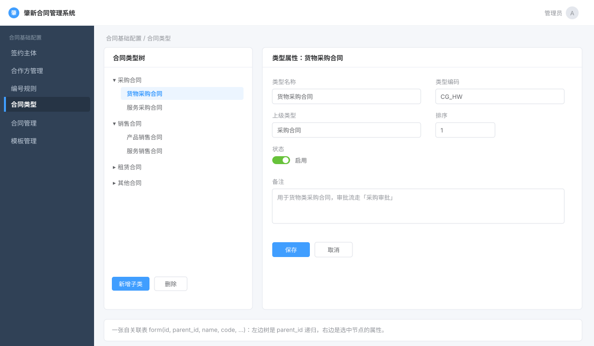

# 第 4 章 · 合同类型配置

> 前三章录的是「主数据」（我方主体、对方公司）和「编号」。本章录**合同的分类体系**——「采购合同 / 销售合同 / 技术合同……」以及每个分类下还能再分子类（树形）。
>
> 合同类型不是一个孤立的配置项：**它决定了这份合同用哪套动态表单字段、走哪条审批流程、能用哪些模板**。所以本章是「配置驱动业务」这条主线的起点。
>
> **本章第一次讲透**：
> 1. **公共字典**（前端 `DataDict` 全局插件 + 后端 `sys_dict` 表 + Redis 缓存）——这是全项目都会用到的横切能力，本章讲透，后面只指路。
> 2. **通用树形选择组件**（`/conf/treeSelect/*`：选人、选部门、选角色、选合同类型）——一个 Controller 供全项目复用。
> 3. **「被引用就不许删」的完整性校验**，而且是用 **Spring 事件**做的**跨模块**校验（这是本章最值得面试讲的设计）。
> 4. **自关联树形表** + 递归层级限制（合同类型最多三级）。
>
> **本章你会碰到的表**：[[D0-底座表地图#5. form 合同类型表（03-missing-base-tables.sql 行 33）|`form`]]（合同类型，肇新原作者建的）+ [[D0-底座表地图#12. sys_dict_type 字典类型表（行 1963）|`sys_dict_type`]]、[[D0-底座表地图#13. sys_dict_data 字典数据表（行 1687）|`sys_dict_data`]]（框架自带的公共字典）+ `sys_dept`、`sys_user`、`sys_role`（树形选择器的数据源）+ Redis（字典缓存）。

> **零基础先补概念（本章 4 个词）**
>
> - **树形结构**：数据像电脑里的文件夹——每个节点记一个「父节点 id」，根节点的父 id 约定为 `0`。数据库里并不真的嵌套，只是每行有一个指向上一层的指针，查询出来后再在内存里拼成树。
> - **Wrapper（条件构造器）**：MyBatis-Plus 提供的「用 Java 代码拼 SQL 条件」的工具，如 `lqw.eq(条件, 列, 值)`。第一个参数是布尔值，为 `true` 才把这段条件拼进 SQL，适合做「传了参数才过滤」。
> - **JSON 字段**：数据库 `longtext` 列里整段存一段 JSON 文本。列结构固定不了（动态表单字段每个类型都不一样），就先把整个结构序列化成字符串存进去，用的时候再解析回对象。
> - **Spring 事件**：发布者调用 `publishEvent(事件对象)` 广播「发生了一件事」，监听者用 `@EventListener` 声明「我关心这件事」。发布者不需要知道谁在听——本章用它做跨模块的删除校验。

---

## 一、这部分是做什么的？

### 1.1 业务含义

公司里的合同要分类。这不是「贴个标签」那么简单，分类树往下走是有一整套连锁反应的：

```
用户起草合同时先选一个「合同类型」
          ↓
系统据此决定：
   ├─ 录入哪些业务字段（dynamic 表单，字段存在 form.json 里）
   ├─ 走哪条审批流程（form.instance_def_key）
   └─ 能用哪些模板（模板表按 contract_type 过滤）
```

所以合同类型是**合同生命周期的第一个分叉点**。



> **图注**：按合同类型页面的结构画的**示意图，不是真实截图**（官方未提供该页面截图）。左边是自关联树（`parent_id`），右边是选中类型的属性表单。

### 1.2 数据模型：一张自关联的树表

合同类型存在 `form` 表里（注意：表名就叫 `form`，不是 `conf_form`，也不是 `sys_form`——这是历史遗留，别被表名骗了）。

建表语句在 `script/sql/zxcm_init.sql:1489`：

```sql
CREATE TABLE `form`  (
  `ID` decimal(20, 0) NOT NULL COMMENT 'id',
  `PARENT_ID` decimal(20, 0) NOT NULL DEFAULT 0 COMMENT '父id',
  `NAME` varchar(20) NOT NULL COMMENT '合同类型名',
  `CODE` varchar(10) NOT NULL COMMENT '合同类型编号',
  `SORT` decimal(10, 0) NOT NULL DEFAULT 0 COMMENT '排序字段',
  `JSON` longtext NULL COMMENT '表单配置',
  `DEL_FLAG` char(1) NOT NULL DEFAULT '0' COMMENT '0 未删除 2 已删除',
  ...
  `TENANT_ID` varchar(64) NULL COMMENT '租户id',
  `VUE_MODULE` varchar(40) NULL COMMENT '动态表单页面',
  `INSTANCE_DEF_KEY` varchar(255) NULL COMMENT '流程编号',
  `CHANGE_INSTANCE_DEF_KEY` varchar(255) NULL COMMENT '变更编号',
  `STATUS` char(1) NULL DEFAULT '0' COMMENT '可用状态',
  PRIMARY KEY (`ID`) USING BTREE
) ENGINE = InnoDB;
```

对应 Java 实体 `zxcm-form/src/main/java/com/ruoyi/form/domain/Form.java:30`：

```java
@Data
@EqualsAndHashCode(callSuper = true)
@TableName("form")
public class Form extends TreeEntity<Form> {

    @TableId(value = "id")
    private Long id;                    // :38
    private String name;                // :42 合同类型名
    private String code;                // :46 合同类型编号（如 CG/XS）
    private Long sort;                  // :50 排序
    private String json;                // :54 表单配置（JSON 字符串）
    @TableLogic
    private String delFlag;             // :59 逻辑删除
    private String tenantId;            // :63 租户
    private String vueModule;           // :67 动态表单页面（前端组件名）
    private String instanceDefKey;      // :72 审批流程编号 ← 绑流程
    private String changeInstanceDefKey;// :77 变更审批流程编号
    private Integer status = 1;         // :81 状态 0可用 1不可用
}
```

**注意 `extends TreeEntity<Form>`**。树形能力不是这张表自己写的，是**继承来的**——见 `ruoyi-base/ruoyi-common/src/main/java/com/ruoyi/common/core/domain/TreeEntity.java:32`：

```java
public class TreeEntity<T> extends BaseEntity {
    private String parentName;                     // :41 仅前端展示，不落库
    @ApiModelProperty("父菜单ID")
    private Long parentId;                         // :47 ← 自关联的「父指针」
    @TableField(exist = false)                     // :52 不是数据库列！
    private List<T> children = new ArrayList<>();  // :54 子节点，只在内存里拼
}
```

两个关键点：

- **`parentId` 是普通列**，指向本表的 `id`。`parentId = 0` 表示根节点（顶级分类）。这就是「自关联树」。
- **`children` 标了 `@TableField(exist = false)`**，意思是**它不对应任何数据库列**。数据库里只有「父 → 子」的指针（`parentId`），「子列表」是查询出来后在内存里现拼的。这是树形表的标准做法，本章 §1.2、§4.4 会讲怎么拼。

真数据长这样（`zxcm_init.sql:1512` 起）：

```
采购合同(CG, parentId=0)          ← 根
 ├─ 运营商(YYS, parentId=采购合同ID) ← 子
销售合同(XS, parentId=0)
技术合同(JS, parentId=0)
...
```

### 1.3 三个容易被忽略但很关键的需求

1. **层级不能无限深**：允许二级、三级，但不能无限套娃——层级一深，选中一个叶子节点后"往上归属到哪个大类"就说不清了。所以代码里硬卡「**最多三级**」。
2. **被用过的类型不能删**：某类型下已经建了合同，或者已经建了模板，这时候删掉类型，那些合同/模板就变成了"没有分类的孤儿"。所以删除前要**跨模块检查引用**。
3. **改名字、改编码要限制**：合同类型已经被合同引用（合同表里存的是类型的 **id**，不是名字），所以改名字其实不影响历史数据；但项目出于稳妥，**只允许改排序和父节点**，`name`/`code` 一旦建好就锁死。

### 1.4 本章接口

本章有**两个** Controller：

**① 合同类型管理**（`FormController`，前缀 `/system/form`）

| 接口 | 干什么 | 权限 |
|---|---|---|
| `GET /system/form/list` | 合同类型列表（**故意不设权限**） | 无 |
| `GET /system/form/{id}` | 类型详情 | `system:form:query` |
| `POST /system/form` | 新增类型 | `system:form:add` |
| `PUT /system/form` | 修改类型（只能改排序/父节点/流程） | `system:form:edit` |
| `PUT /system/form/changeStatus` | 改可用状态 | `system:form:edit` |
| `DELETE /system/form/{ids}` | 删除类型（带引用校验） | `system:form:remove` |
| `POST /system/form/export` | 导出 | `system:form:export` |

**② 通用树形选择组件**（`TreeSelectorController`，前缀 `/conf/treeSelect`）

| 接口 | 干什么 |
|---|---|
| `GET /conf/treeSelect/userSelect` | 部门+用户树（选人用） |
| `GET /conf/treeSelect/deptSelect` | 部门树 |
| `GET /conf/treeSelect/roleSelect` | 角色列表 |
| `GET /conf/treeSelect/contractTypeSelect` | 合同类型树（**合同类型选的话走这里**） |
| `GET /conf/treeSelect/getMyDept` | 我所在的部门 |

**③ 公共字典**（框架自带，`SysDictDataController`，前缀 `/system/dict/data`）

| 接口 | 干什么 |
|---|---|
| `GET /system/dict/data/type/{dictType}` | 按类型取字典（**带 Redis 缓存**） |

> ⚠️ 注意 `list` 的接口在 `FormController.java:73`，**上面那条 `@SaCheckPermission("system:form:list")` 是注释掉的**（`:70-71`），旁边写着注释「公用模块的列表不设置权限」。这是**有意为之**：合同类型是「公用基础数据」，所有登录用户起草合同时都要能读到它，所以不做权限控制。这种"看起来像 bug、其实是有意"的地方，面试被问到要能说清。

---

## 二、站在架构师 / 开发经理角度：为什么这么设计？

### 2.1 为什么合同类型用「一张自关联表」，而不是「大类表 + 小类表」两张表？

最直觉的做法是：`合同大类表` 一张、`合同小类表` 一张，小类表里存 `大类id`。那样就是**两个实体、两张表、两层固定的层级**。

肇新选了**一张自关联表**（`form` 表里 `parent_id` 指向自己的 `id`）。理由是：

- **层级数变成了数据、而不是结构**。今天客户只要两级，明天要三级，后天某个分支要四级——自关联表**不用改表结构**，加一行数据就行。（本项目还额外用代码卡了"最多三级"，但那是业务约束，不是结构约束）
- **一张表 = 一套 CRUD**。增删改查复用同一套代码，不用为大类、小类各写一遍。

代价是：查询时**不能一条 SQL 拿到树**（关系数据库没有原生的树查询），要在内存里递归拼（§4.4）。这是「结构灵活」换「查询稍麻烦」，很值。

**三种树形存法对比**：

| 方案 | 加一层要做什么 | 查整棵树 | 查某个节点的子树 | 适合 |
|---|---|---|---|---|
| **自关联 `parentId`（选用）** | 加一行数据 | 查全表 + 内存递归 | 递归查 / 多次查 | 层级不深、层级数常变 |
| 大类表 + 小类表 | 改表结构 | join | join | 固定两级 |
| `parentId` + `path` 冗余 | 加一行 + 维护 `path` | 按 `path` 排序 | `LIKE '0/1/%'` | 层级深、子树查询多 |

**具体例子**：客户今天要「采购合同 → 货物采购」，明天要「采购合同 → 货物采购 → 设备采购」。自关联表只加一行、把 `parentId` 指向「货物采购」即可；两表方案要加字段或加第三张表。项目里还额外用代码限制了「最多三级」，但那是业务约束，不是表结构约束。

> 这是个小决策点，但面试常问「树形数据你怎么存」——答「自关联 parentId + 内存拼树」，再补一句「如果要按子树快速查询、或者层级很深，可以考虑 `path` 冗余字段（如 `0/1/5/`）用 `LIKE` 查，那是另一种取舍」，就很完整了。

### 2.2 为什么合同类型的代码放在 `zxcm-form` 模块，而不是 `zxcm-contract` 模块？

项目有 8 个顶层模块（第 0 章 §二有模块地图）。「合同类型」这块代码被单独放进了 **`zxcm-form`** 模块：

```
zxcm-form/src/main/java/com/ruoyi/form/
├── controller/FormController.java
├── service/impl/FormServiceImpl.java
├── domain/Form.java
└── mapper/FormMapper.java
```

而 `zxcm-contract` 模块里**大量业务代码都要用到合同类型**（起草合同时要读类型、模板表要按类型过滤……）。这就是**跨模块依赖**：

```
zxcm-contract (业务核心)  ──依赖──▶  zxcm-form (合同类型/动态表单)
```

依赖是**单向**的：`zxcm-contract` 依赖 `zxcm-form`，反过来不依赖。为什么这么切？因为**「合同类型 + 动态表单」是一块相对独立的、可能被复用的能力**（理论上别的业务也能用这套动态表单），而合同业务是它的消费者之一。

> 判断模块边界的一条实用经验：**如果一块能力「谁都需要、且不依赖具体业务」，就剥出去单独成模块**；依赖方向永远是「业务模块 → 基础能力模块」，不能反向，否则会成环。

### 2.3 为什么要有「通用树形选择组件」？

你注意 `TreeSelectorController` 里有**四个**看起来不相干的接口：选人、选部门、选角色、选合同类型。它们被塞进一个 Controller，是因为它们**服务同一件事：给前端的一个「树形选择器 / 下拉」提供数据**。

前端有个通用组件（`treeselect`——用的是开源库 `@riophae/vue-treeselect`），它在很多页面被复用。前端只需要知道「我要一棵什么树」，后端就统一从 `/conf/treeSelect/*` 吐**同一种数据结构**（`TreeSelectModel`，见 §4.8）。

好处：**前端一个组件、后端一个出口**。如果每个页面各写各的树接口，前端就得为每种树写一套适配逻辑。现在统一成一种「树节点」格式，前端零适配。

### 2.4 为什么「不能删已被引用的类型」要用 Spring 事件，而不是直接在删除方法里查？

这是本章**最值得讲**的设计。

朴素做法：在 `FormServiceImpl.deleteWithValidByIds` 里，直接注入合同 Service、模板 Service，然后分别去查「有没有合同/模板用到这个类型」。问题在于**依赖方向反了**：

```
朴素做法：  FormServiceImpl ──依赖──▶ ContractService、TemplateService
现实：       ContractService ──依赖──▶ FormService（业务要用合同类型）

→ 两个方向都有依赖 → 循环依赖 / 模块成环
```

肇新的做法是**反转控制**：合同类型删除时，只**广播一个事件**「我要删这个类型了」，谁关心谁自己来监听：

```java
// FormServiceImpl.java:199-200  只发出事件，不知道谁在听
DataDeleteEvent event = new DataDeleteEvent(this, DataDeleteEvent.TABLE_CONTRACT_TYPE, ""+id);
applicationEventPublisher.publishEvent(event);
```

然后合同模块、模板模块**各自监听**这个事件，自己检查自己：

```java
// ContractDraftServiceImpl.java:710-711  「合同」来监听
@EventListener
public void deleteDataListener(DataDeleteEvent event) {
    if (event.getTable().equals(DataDeleteEvent.TABLE_CONTRACT_TYPE)) {
        // 查有没有合同用了这个类型，有就抛异常，删除被中断
        if (count > 0) throw new ServiceException("删除失败！该合同类型已被使用");
    }
}
```

```java
// TemplateContractServiceImpl.java:697-698  「模板」来监听
@EventListener
public void deleteContractTypeListener(DataDeleteEvent event) {
    if (event.getTable().equals(DataDeleteEvent.TABLE_CONTRACT_TYPE)) {
        // 查有没有模板用了这个类型
        if (count > 0) throw new ServiceException("删除失败！该合同类型已被使用");
    }
}
```

**依赖方向从此只有一个**：合同/模板 → 合同类型。合同类型**完全不知道**谁在用自己。以后新增一个模块也想引用合同类型，只要加一个监听器，`FormServiceImpl` **一行都不用改**——这就是「**开放-封闭**」。

事件的定义在 `ruoyi-base/ruoyi-framework/src/main/java/com/ruoyi/framework/event/DataDeleteEvent.java:27`：

```java
public class DataDeleteEvent extends ApplicationEvent {
    public static String TABLE_CONTRACT_TYPE = "contractType";        // :31
    public static String TABLE_CONTRACT_TYPE_FIELD = "contractTypeField"; // :32
    ...
}
```

> ⚠️ **一个必须讲清的坑**：事件监听器抛异常会不会真的**中断**删除？取决于 `publishEvent` 是同步还是异步。这里是 `ApplicationEventPublisher` 的**同步**发布——`publishEvent` 会**同步**执行所有监听器，监听器抛的异常会**冒泡回 `publishEvent` 的调用方**，于是 `baseMapper.deleteBatchIds(...)`（`:203`，在事件之后）根本不会执行，删除被有效阻止。**如果哪天有人手贱加了 `@Async`，这个保护就失效了**——这是个很好的面试追问点，见 §六 Q5。

### 2.5 为什么要有「公共字典」？直接用枚举不行吗？

项目里到处都是「状态 = 0 可用 / 1 不可用」「是不是 = Y / N」这类**值-标签对照**。如果每处都写 Java 枚举或前端硬编码：

- 后端 `if (status == 0) return "可用"` —— 改文案要改代码、重新发版；
- 前端 `status === 0 ? '可用' : '不可用'` —— 前后端文案可能不一致。

**公共字典**把这些「**键 → 标签**」的映射变成**数据库里的数据**（`sys_dict_type` 定义"有哪些字典"，`sys_dict_data` 存"每一条的键和标签"），再加一层 Redis 缓存。好处：

- 运营在后台**增删改字典项，代码零改动**；
- 前后端**共用同一份定义**，文案永远一致；
- 前端有**一行代码声明式加载**的机制（`dicts: ['sys_normal_disable']`，见 §4.6）。

第 1、2 章你已经用过 `dicts: ['BUSINESS_STATUS']`、`dicts: ['PARTNER_TYPE']`，当时只说"这么写就能用"。**本章把它讲到能自己造一个字典。**

### 2.6 为什么「修改」只让改排序 + 父节点 + 流程？

看 `FormServiceImpl.java:148` 的 `updateByBo`：

```java
public Boolean updateByBo(FormBo bo) {
    // 只允许修改排序和parentId（注释原话）
    Form update = this.baseMapper.selectById(bo.getId());
    update.setParentId(bo.getParentId());          // 允许改父节点（在树上挪位置）
    update.setSort(bo.getSort());                  // 允许改排序
    update.setJson(bo.getJsonArray().toString());  // 允许改表单字段
    update.setInstanceDefKey(bo.getInstanceDefKey());          // 允许改审批流程
    update.setChangeInstanceDefKey(bo.getChangeInstanceDefKey());
    validEntityBeforeSave(update);
    return baseMapper.updateById(update) > 0;
}
```

**做法是「先查出来、只覆盖允许改的字段、再存回去」**，而不是 `BeanUtil.toBean(bo, Form.class)` 整表覆盖。这样 `name`、`code`、`createTime` 等字段天然被保护——前端就算伪造一个改了 `name` 的请求，后端也不会写进去。

前端也做了对应限制（`zxcm-ui/src/views/system/form/index.vue:137`、`:145`、`:154` 三处 `:disabled="form.id > 0"`：新建时可编辑，编辑时这几个输入框变灰）。

> 这是「**白名单式更新**」的实践。面试问「怎么防止用户篡改不该改的字段」，答「不要整对象覆盖，先把数据库里的原对象查出来，只 `set` 允许改的字段」。

---

## 三、需要哪些技术？

| 技术 | 用来解决什么 | 精确位置 |
|---|---|---|
| **自关联树 + 内存拼树** | 合同类型是多级分类 | `TreeEntity.java:32`、前端 `handleTree` |
| **MyBatis-Plus 逻辑删除** | 类型删除不物理删 | `Form.java:58` `@TableLogic`（第 1 章 §2.4 已讲透） |
| **Spring 事件（ApplicationEvent/EventListener）** | 跨模块「被引用就不让删」 | `DataDeleteEvent.java:27` |
| **公共字典（前后端）** | 值-标签对照数据化 | `utils/dict/*`（前端）+ `SysDictTypeServiceImpl.java`（后端） |
| **Redis 缓存** | 字典读多写少，缓存加速 | `SysDictTypeServiceImpl.java:100`（第 3 章 §4.4 已讲透 `RedisUtils`） |
| **Vue 全局 mixin 插件** | 前端「一行声明自动加载字典」 | `utils/dict/index.js:6` |
| **`@riophae/vue-treeselect` 组件** | 树形下拉/级联选择 | `views/system/form/index.vue:209` |
| **流程绑定（instanceDefKey）** | 类型 → 审批流程 | `Form.java:72`（流程本身在第 6 章讲透） |

> 其中**公共字典**、**通用树形选择组件**、**Spring 事件做完整性校验**是本项目第一次出现，本章逐一把机制讲透。

---

## 四、功能具体怎么实现（带着你复制）

> **本章涉及的表**（点表名直达底座表地图的字段详情）：
> [[D0-底座表地图#5. form 合同类型表（03-missing-base-tables.sql 行 33）|`form`]]（合同类型） ｜ [[D0-底座表地图#12. sys_dict_type 字典类型表（行 1963）|`sys_dict_type`]]（字典类型） ｜ [[D0-底座表地图#13. sys_dict_data 字典数据表（行 1687）|`sys_dict_data`]]（字典数据）


### 4.1 需求：一份「合同类型配置」需求单

> 前 3 章都是「一张表 + 增删改查」。这一章不一样：它是**一棵树**，而且牵动三个地方——动态表单、审批流程、模板。所以需求单里真正难的不是 CRUD，是「层级」和「引用」。

**需求单**

**需求编号** ZXCM-FORM-001　**提出人** 合同管理部　**优先级** 高　**本期上线**

**背景**：合同要分类（采购、销售、技术……大类下面还有小类）。选完类型，系统要据此决定三件事：录入哪些业务字段、走哪条审批流程、能用哪些模板。现在这些信息靠初始化脚本写死，每加一个类型都要改代码。

**使用角色**

| 角色 | 能做什么 |
|---|---|
| 系统管理员 | 维护合同类型树、绑定流程、配置动态表单 |
| 业务用户 | 起草合同时从级联选择器里选一个类型（只读） |

**功能需求**

| # | 功能 | 具体要求 |
|---|---|---|
| 1 | 类型树 | 自关联树，`parent_id = 0` 是根；**最多三级** |
| 2 | 新增 | 名称、编码必填；可以指定父节点和排序 |
| 3 | 修改 | **只允许改排序、父节点、流程**；名称和编码建好就锁死 |
| 4 | 启停用 | 停用的类型不出现在起草页的级联选择里 |
| 5 | 删除 | 单条删除；有子类型不能删；被合同 / 模板引用的不能删 |
| 6 | 绑定流程 | 每个类型挂正常审批流程（`instance_def_key`）和变更流程（`change_instance_def_key`） |
| 7 | 动态表单 | `json` 字段存字段配置，前端按它渲染录入页 |
| 8 | 级联选择 | 起草页通过 `/conf/treeSelect/contractTypeSelect` 取类型树 |

**非功能要求**

- 权限点：`system:form:query` / `:add` / `:edit` / `:remove` / `:export`；
- **列表接口故意不设权限**：合同类型是公用基础数据，所有登录用户起草合同时都要读它（`FormController.java:70-71` 的注解是注释掉的）；
- 主键用 `decimal(20,0)` 存雪花 ID，避免前端 JS 精度丢失；
- 逻辑删除（`del_flag` 0/2）。

**验收标准**

| 操作 | 预期 |
|---|---|
| 新增一个根类型 | 树里出现在顶层 |
| 给根类型加子类、再加孙类 | 层级正确 |
| 尝试加第四级 | 提示「合同分类最多支持三级分类」 |
| 修改名称 / 编码 | 不生效（只保存排序、父节点、流程） |
| 删除一个还有子类型的节点 | 提示「当前合同类型包含子类型，不能进行删除」 |
| 删除一个已被合同使用的类型 | 提示「删除失败！该合同类型已被使用」，数据仍在 |
| 没配权限点的用户调 `/system/form/list` | 仍能拿到数据（故意不设权限） |

**本期不做**：类型合并、类型字段级权限、类型的多版本管理。

### 4.2 拿到需求，先做四件事

**① 给需求定性，再推架构**

| 判断维度 | 本模块的答案 | 推出的设计 |
|---|---|---|
| 数据形状 | 自关联树（父 → 子） | `parent_id` + `TreeEntity` |
| 层级约束 | 最多三级 | Service 里卡，数据库不卡 |
| 配置 | 动态表单 + 流程绑定 | `JSON` 列 + 流程编码列 |
| 引用 | 被合同、模板引用 | 删除前发事件校验 |

→ 架构：一张 `form` 表（树 + 配置）+ 引用完整性事件。

**② 定数据怎么存**：一张表 `form`，`parent_id` 指向自己的 `id`；`json` 存动态表单配置；`instance_def_key` 存流程编号。树形能力靠继承 `TreeEntity` 白拿（见 §1.2）。

**③ 定接口**：完整清单见 §1.4。这里只记三个容易踩的点：

- `/system/form/list` 的权限注解是**注释掉的**，不是漏写；
- 起草页选类型走 `/conf/treeSelect/contractTypeSelect`，不走 form 列表；
- 改状态是单独一个 `PUT /changeStatus`，和修改（`PUT /system/form`）不是一个接口。

**④ 定实现边界：哪些不用写、哪些必须写、哪些是缺口**

- **框架给**：雪花 ID、逻辑删除、分页、分组校验；
- **必须自己写**：三级校验、动态表单 JSON 往返、跨模块引用校验；
- **已知缺口**：`NAME`/`CODE` 无唯一索引；修改只允许排序/父节点/流程，靠业务代码限制，数据库不拦。

**施工计划**

| 步骤 | 动作 | 业务规则 | 做完的标志 |
|---|---|---|---|
| 4.3 | 地基：建表 + Entity + BO / VO | 主键 `decimal(20)`；继承 `TreeEntity` | 能编译、能启动 |
| 4.4 | Service：查询 / 新增 / 修改 / 删除 | 三级上限；修改只改三样；删除查子节点 + 引用 | 接口能调通 |
| 4.5 | Controller | `list` 不设权限，其余按权限点 | 页面能拿到数据 |
| 4.6 / 4.7 | 公共字典（前端 / 后端） | 下拉项统一走字典 | 页面上字典能显示 |
| 4.8 | 通用树形选择组件 | 一个 Controller 给多种树 | 起草页能选类型 |
| 4.9 | 引用完整性校验（Spring 事件） | 被合同 / 模板引用不许删 | 删除被拦住 |
| 4.10 | 前端合同类型页面 | 树形表格 + 平铺转树 | 页面能增删改查 |
| 4.11 | 复制清单 | —— | 换个项目能照抄 |

### 4.3 地基：建表 + Entity + BO / VO

> **这一步依赖的配置**：`form` 上的 `@TableLogic` 依赖 `application.yml:254/256` 的 `2/0`；`@TableId` 走 `ASSIGN_ID`（`:248`）。

**这张表为什么长这样**

> 合同类型只占一张表 `form`，但它同时干了三件事：**分类树、动态表单、流程绑定**。看懂这三件事各自对应哪几列，这张表就不用背了。

**定位：主数据 + 树 + 配置**

| 角色 | 对应列 | 说明 |
|---|---|---|
| 分类树 | `ID`、`PARENT_ID` | 自关联：`PARENT_ID = 0` 是根，其余指向本表的 `ID` |
| 动态表单 | `JSON`、`VUE_MODULE` | 这个类型要录哪些字段、前端用哪个页面渲染 |
| 流程绑定 | `INSTANCE_DEF_KEY`、`CHANGE_INSTANCE_DEF_KEY` | 正常审批 / 变更审批走哪条流程 |

**字段分组：每一列回答一个业务问题**

| 组 | 列 | 回答什么 | 设计细节 |
|---|---|---|---|
| 树 | `ID`、`PARENT_ID` | 这个类型在哪一层、父类是谁 | `ID` 用 `decimal(20,0)`：雪花 ID 是 19 位数字，`decimal` 让 JDBC 原样返回、前端不丢精度（和第 1 章的 `varchar` 是两种风格，见下面的取舍） |
| 标识 | `NAME`、`CODE` | 类型叫什么、编号是什么 | 都 `NOT NULL`；`CODE` 是 `CG` / `XS` 这种短码 |
| 顺序 | `SORT` | 前端树里的先后 | 排序用独立列，不靠 `ID`；前端按它升序 |
| 动态表单 | `JSON`、`VUE_MODULE` | 这个类型要录哪些业务字段 | `JSON` 是 `longtext`，存字段配置的自由结构；`VUE_MODULE` 存前端组件名 |
| 流程 | `INSTANCE_DEF_KEY`、`CHANGE_INSTANCE_DEF_KEY` | 正常审批、变更审批各走哪条流程 | 存**流程编码**（字符串），不是流程表的 id |
| 状态 | `STATUS`、`DEL_FLAG` | 能不能用、删没删 | `STATUS` 0 可用 / 1 不可用 |
| 审计 | `CREATE_BY/TIME`、`UPDATE_BY/TIME`、`TENANT_ID` | 谁改的、哪个租户 | 同前几章 |

**四个关键取舍**

| 决策 | 选择 | 代价 | 什么情况下反过来 |
|---|---|---|---|
| 树结构 | **一张自关联表**，不拆「大类表 + 小类表」 | 所有层级查询都要自己拼；层级约束靠代码 | 大类和小类字段差异很大时 |
| 主键类型 | `decimal(20,0)` + 实体 `Long` | 与第 1/2 章的 `varchar` 主键风格不一致 | 统一成字符串更省心，但要改实体和前端 |
| 动态表单 | `JSON` 整段存 | 不能按字段查询、无 schema | 字段固定、需要按字段统计时 |
| 流程绑定 | 存**编码字符串**，不建外键到流程表 | 流程被删/改名时靠编码约定，数据库不保证 | 流程定义稳定、需要强引用时 |

> **为什么流程不建外键**：流程定义会重新部署，主键可能变；但**编码**（`swhtsp` 这种）是业务约定，稳定。这里用的是「弱引用」，代价是流程不存在时只能等到发起审批才报错。

**三处必须知道的边界**

1. **最多三级是代码卡的**，不是数据库约束：`FormServiceImpl.java:131` 里判断，超过就抛「合同分类最多支持三级分类」。
2. **修改只允许改三样**：`sort`、`parentId`、流程（`FormServiceImpl.java:149` 注释写明）。`NAME` / `CODE` 建好就锁死，但数据库层面没有拦——绕过接口直接改表仍然能改。
3. **`NAME` / `CODE` 没有唯一索引**：重复的类型名/编号能建出来。

**演示数据为什么有 56 条**

不是一个示例，而是**一整棵可用的类型树**：采购、销售、技术等根类型，下面挂着子类型，并且每个类型绑定了审批流程编码。少了它：合同起草页的级联选择是空的、审批流也发起不了。所以 `ch04` 这个脚本除了建表，还要灌 56 行数据。

**对后面章节的连锁影响**

| 后面的事 | 依赖这张表的什么 |
|---|---|
| 合同草拟先选类型，再渲染动态表单 | `JSON` + `VUE_MODULE` |
| 发起审批时决定走哪条流程 | `INSTANCE_DEF_KEY` |
| 删除类型前校验「已被合同使用」 | 无外键，靠事件让合同/模板模块查引用（§4.9） |

> **面试怎么答**：「合同类型用一张自关联表，`parent_id` 指向自己，不拆大类小类两张表——因为两类字段完全一样，拆了只会多一次 join。动态表单配置存 JSON，因为字段是自由结构，列不出来。流程绑定存流程编码而不是外键，因为流程会重部署、编码才是稳定标识。三种层级约束、修改限制都放在 Service，不在数据库，代价是绕过接口仍能改坏数据。」

**建表**

直接照抄 `script/sql/zxcm_init.sql:1489`。要点：

- `ID` 用 `decimal(20,0)`（对应 Java `Long`），因为 MySQL 的 `BIGINT` 在雪花 ID 下会超出 JS 安全整数范围，用 `decimal` 存能让 MyBatis/JDBC 原样返回字符串，**前端不丢精度**（这点第 0 章 §四「雪花 ID」讲过）。
- `PARENT_ID` 默认 `0`，根节点就是 `parentId = 0`。
- `DEL_FLAG char(1)` 逻辑删除标记，和全局配置 `logicDeleteValue: 2 / logicNotDeleteValue: 0` 对齐（`application.yml:254-256`）。
- `JSON` 字段 `longtext`——因为是**动态表单的自由结构**，列不出固定列，就整段 JSON 塞进去。

（另外两张字典表 `sys_dict_data`、`sys_dict_type` 是框架自带的，分别见 `script/sql/zxcm_init.sql:3544`、`script/sql/zxcm_init.sql:3820`，**不需要你建**，初始化脚本里已经有。）

**实体 `Form`**

照抄 `zxcm-form/src/main/java/com/ruoyi/form/domain/Form.java`。注意三点：

- `@TableName("form")` —— 表名就叫 `form`；
- `extends TreeEntity<Form>` —— 白拿 `parentId` 和 `children`；
- `@TableId(value = "id")` —— 主键类型由全局配置 `idType: ASSIGN_ID`（`application.yml:248`）决定为雪花，所以**不用写 `type = IdType.ASSIGN_ID`**。

**BO / VO**

- `FormBo`（`zxcm-form/src/main/java/com/ruoyi/form/domain/bo/FormBo.java:40`）：`extends TreeEntity<FormBo>`，带**分组校验注解**（`@NotBlank(groups = {AddGroup.class, EditGroup.class})` 等，:53/:60/:67）。分组校验第 1 章 §4.3 讲过：`@Validated(AddGroup.class)` 只校验必填，`@Validated(EditGroup.class)` 额外校验 `id` 不能为空。
- 注意 `FormBo` 里**没有 `json` 字符串，只有 `JSONArray jsonArray`**（:74）——前端传的是 JSON **数组**，后端 `insertByBo` 里 `add.setJson(bo.getJsonArray().toString())`（:123）自己转成字符串存库。读的时候反过来：`queryById` 里 `vo.setJsonArray(JSONUtil.parseArray(vo.getJson()))`（:71）。**「存字符串、用对象」**这个来回转换，是「数据库存自由结构」的标准做法。
- `FormVo`（`FormVo.java:38`）：**不继承** `TreeEntity`，而是自己写了 `parentId`（:54），因为 VO 要平铺给前端，由前端 `handleTree` 拼树（§4.10）。

### 4.4 Service：三类核心逻辑

**本步目标**：把「查询 / 新增 / 修改 / 删除」四类逻辑写进 `FormServiceImpl`，规则全部落在 Service 里。
**做完的标志**：能新增到三级；第四级报「合同分类最多支持三级分类」；修改只改得动排序/父节点/流程；删除会查子节点和引用。

#### ① 查询（`FormServiceImpl.java:79`）

```java
public List<FormVo> queryList(FormBo bo) {
    LambdaQueryWrapper<Form> lqw = buildQueryWrapper(bo);
    List<FormVo> vos = baseMapper.selectVoList(lqw);
    return vos;
}
```

`buildQueryWrapper`（:104）里全是「**参数非空才拼这个条件**」的写法（`:107` `lqw.eq(bo.getParentId() != null, ...)`），这是 MyBatis-Plus `LambdaQueryWrapper` 的**条件拼装**惯用法：第一个参数是 bool，为 true 才把条件加进 SQL。最后 `lqw.orderByAsc(Form::getSort)`（:112）按排序字段升序。

**注意它返回的是平铺 List，不是树**——拼树交给前端（§4.10）。

#### ② 新增：三级层级校验（`FormServiceImpl.java:120`）

```java
public Boolean insertByBo(FormBo bo) {
    Form add = BeanUtil.toBean(bo, Form.class);
    if (bo.getJsonArray() != null) {
        add.setJson(bo.getJsonArray().toString());   // JSON 数组 → 字符串
    }
    // 判断当前合同的上级层数，合同类型不能超过三层
    if (bo.getParentId() != null && !ROOT_NODE.equals(bo.getParentId())) {   // ROOT_NODE = "0"
        Form parentForm = this.baseMapper.selectById(bo.getParentId());
        if (parentForm != null && parentForm.getParentId() != null && !ROOT_NODE.equals(bo.getParentId())) {
            Form superParent = this.baseMapper.selectById(parentForm.getParentId());   // 再往上查一层
            if (parentForm != null && superParent != null && superParent.getParentId() != null
                    && !(superParent.getParentId() == 0)) {
                throw new ServiceException("合同分类最多支持三级分类");
            }
        }
    }
    validEntityBeforeSave(add);
    boolean flag = baseMapper.insert(add) > 0;
    if (flag) bo.setId(add.getId());
    return flag;
}
```

**逐行读（`zxcm-form/src/main/java/com/ruoyi/form/service/impl/FormServiceImpl.java:120-142`）：**

| 行号 | 代码 | 在干什么、为什么这么写 |
|---|---|---|
| `:120` | `public Boolean insertByBo(FormBo bo)` | 新增入口。返回 `Boolean` 而不是抛异常的 void，方便 Controller 用 `toAjax(flag ? 1 : 0)` 统一包成响应。 |
| `:121` | `BeanUtil.toBean(bo, Form.class)` | 把「前端业务对象 BO」拷成「数据库实体」。BO 多一个 `jsonArray`，实体多一个 `json` 字符串，所以下面还要手动补一步。 |
| `:122-124` | `if (bo.getJsonArray() != null) add.setJson(...)` | 前端传的是 JSON **数组**，数据库列是 `longtext` 字符串，所以调 `toString()` 序列化后存入。 |
| `:126` | `if (parentId != null && !"0".equals(parentId))` | 根节点（`parentId=0`）不需要查祖先，直接跳过层级校验；只有「往某个父节点下面挂」才需要数层数。 |
| `:127` | `selectById(bo.getParentId())` | 查出「新节点的父节点」`parentForm`。 |
| `:128` | `if (parentForm != null && parentForm.getParentId() != null ...)` | 父节点存在，且父节点自己也有父 id（说明父节点不是根），才需要继续往上数。 |
| `:129` | `selectById(parentForm.getParentId())` | 再往上一查，拿到「爷爷节点」`superParent`。这是第二次、也是最后一次查库——因为业务约定最多三级。 |
| `:130-132` | 若 `superParent` 还有非 0 父节点 → 抛异常 | 说明「新增节点 → 父 → 爷 → 曾祖」，加上新节点已经是第四级，直接拒绝，事务里后续 `insert` 不会执行。 |
| `:136` | `validEntityBeforeSave(add)` | 做同名校验、同编码校验（见下一节）。 |
| `:137-140` | `insert(add)` + `bo.setId(add.getId())` | 真正落库；主键由全局 `idType: ASSIGN_ID` 生成雪花值，插入后把生成的主键回填给 BO，前端拿到新 id。 |

> 这张表也能看出这段代码的「编号」对应关系：`parentId` 是父指针，`parentForm` 是父节点，`superParent` 是祖父节点。字段命名不算直观，读源码时先对着注释看一遍。

层级校验的思路：**要新增节点，先数它的祖先有几层**。往上查一层（`parentForm`）、再查一层（`superParent`），如果 `superParent` 自己还有非 0 的父节点，说明再加这一层就超过三级了。

> ⚠️ **坦白点 / 值得注意的写法**：这段 `if` 嵌套判断**很啰嗦且有几处冗余**（比如 `!ROOT_NODE.equals(bo.getParentId())` 在已经确认过 `bo.getParentId() != null && !ROOT_NODE.equals(...)` 之后又判了一次；`parentForm != null` 也重复判）。更清爽的写法是「**循环沿 parentId 往上累加层数，到 0 为止，超过 3 就抛**」。面试时可以主动指出这段可以简化，显示你有代码洁癖——但**答辩时别说"这代码写得烂"**，说"这里可以抽成一个 `countDepth()` 方法更清晰"就够了。

#### ③ 新增/修改前的唯一性校验（`FormServiceImpl.java:164`）

```java
private void validEntityBeforeSave(Form entity) {
    // 查重名
    FormBo bo = new FormBo();
    bo.setName(entity.getName());
    List<FormVo> sameNameList = this.queryList(bo);
    if (entity.getId() == null && sameNameList.size() > 0) {   // 只在新增时校验（id 为空）
        throw new ServiceException("当前名称已被占用，请输入其他名称");
    }
    // 查重编码
    FormBo bo1 = new FormBo();
    bo1.setCode(entity.getCode());
    List<FormVo> sameKeyList = this.queryList(bo1);
    if (entity.getId() == null && sameKeyList.size() > 0) {
        throw new ServiceException("当前编码已被占用，请输入其他编码");
    }
}
```

> ⚠️ **和签约主体一样的坑（第 1 章也记过）**：「先查后判」在并发下**不是原子**的——两个人同时新增同名类型，都查到"没有同名"，都插入成功，就重了。根因是**数据库没有唯一索引兜底**（`form` 表 `NAME`、`CODE` 都只是普通列，没有 `UNIQUE`）。正确做法是给 `(name, del_flag)`、`(code, del_flag)` 建唯一索引，靠数据库保证。**面试问"你做过的唯一性校验靠谱吗"，诚实说"代码层校验了，但并发下需要唯一索引兜底，这个项目没加，是缺口"**——比硬吹靠谱得多。

#### ④ 删除：先查子节点，再发事件（`FormServiceImpl.java:186`）

```java
public Boolean deleteWithValidByIds(Collection<Long> ids, Boolean isValid) {
    if (isValid) {
        // 有子分类不允许删除父分类
        LambdaQueryWrapper<Form> lqw = Wrappers.lambdaQuery();
        lqw.in(Form::getParentId, ids);
        Long childCount = this.baseMapper.selectCount(lqw);
        if (childCount > 0) {
            throw new ServiceException("当前合同类型包含子类型，不能进行删除");
        }
    }
    if (ids.size() > 1) {
        throw new ServiceException("对不起，该模块不支持批量删除");
    } else {
        DataDeleteEvent event = new DataDeleteEvent(this, DataDeleteEvent.TABLE_CONTRACT_TYPE, ""+ids.iterator().next());
        applicationEventPublisher.publishEvent(event);      // ← 广播「我要删了」，谁在用谁拦
    }
    return baseMapper.deleteBatchIds(ids) > 0;              // ← 事件没抛异常才会走到这
}
```

删除有三道闸：**① 有子节点不准删**（本地查）→ **② 不许批量删**（一次一个）→ **③ 发事件让引用方检查**（跨模块）。三道都过了才真正 `deleteBatchIds`。

### 4.5 Controller：`FormController`

**本步目标**：把 Service 接到 HTTP 上，权限点按需求单分配（唯独 `list` 不设权限）。
**做完的标志**：Swagger 里 7 个接口都能调通；没权限的账号调 `list` 仍然能拿到数据。

照抄 `zxcm-form/src/main/java/com/ruoyi/form/controller/FormController.java`。标准 CRUD，和前面几章套路一致（`BaseController` + `toAjax` + `@SaCheckPermission` + `@Log` + `@RepeatSubmit`）：

```java
@Validated
@RestController
@RequestMapping("/system/form")
public class FormController extends BaseController {
    private final IFormService iFormService;      // @RequiredArgsConstructor 注入（:59,:64）

    // 公用模块的列表不设置权限
    @GetMapping("/list")
    public R<List<FormVo>> list(FormBo bo) {      // :73 无 @SaCheckPermission
        return R.ok(iFormService.queryList(bo));
    }

    @SaCheckPermission("system:form:add")
    @RepeatSubmit()                                // :108 防重复提交
    @PostMapping()
    public R<Void> add(@Validated(AddGroup.class) @RequestBody FormBo bo) {   // :110
        return toAjax(iFormService.insertByBo(bo) ? 1 : 0);
    }
    // edit/changeStatus/remove/export 见源码
}
```

> 注入用的是 **`@RequiredArgsConstructor` + `private final`**（构造器注入），而不是 `@Autowired` 字段注入。这是 Spring 官方推荐的写法：`final` 保证不可变、依赖缺失在**启动时**就报错而不是运行时空指针、也方便单元测试。本项目里两种风格混用（合同模块多用 `@Autowired`，form 模块用构造器注入），面试问「为什么用 `@RequiredArgsConstructor`」，这就是标准答案。

### 4.6 【第一次讲透】公共字典 —— 前端机制

这是本章的重点，讲透它，以后所有 `dicts: [...]` 都是这一套。

#### 目标：为什么一行 `dicts: ['xxx']` 就能用？

看任何用了字典的页面，`export default` 里都有一行：

```js
export default {
  dicts: ['BUSINESS_STATUS'],   // ← 就这一行
  ...
}
```

然后模板里就能写 `dict.type.BUSINESS_STATUS`（一个数组）、`dict.type.BUSINESS_STATUS[0].label`，或者用 `this.dict.type.BUSINESS_STATUS` 拿到。

这背后是一套 **Vue 全局 mixin 插件**。链路：

**第 1 步：注册插件**（`zxcm-ui/src/components/DictData/index.js:5`）

```js
function install() {
  Vue.use(DataDict, {
    metas: {
      '*': {                                        // ← 通配所有字典类型
        labelField: 'dictLabel',                    // 后端字段 → label
        valueField: 'dictValue',                    // 后端字段 → value
        request(dictMeta) {
          return getDicts(dictMeta.type).then(res => res.data)   // 调接口
        },
      },
    },
  })
}
```

**第 2 步：插件的核心是 `Vue.mixin`**（`zxcm-ui/src/utils/dict/index.js:6`）

```js
export default function(Vue, options) {
  mergeOptions(options)
  Vue.mixin({
    data() {
      // 如果组件里没写 dicts，什么都不做
      if (this.$options.dicts === undefined || this.$options.dicts === null) return {}
      const dict = new Dict()
      dict.owner = this
      return { dict }                       // ← 给每个声明了 dicts 的组件注入 dict
    },
    created() {
      if (!(this.dict instanceof Dict)) return
      this.dict.init(this.$options.dicts).then(() => {   // ← 组件创建时，按 dicts 数组加载
        this.$nextTick(() => {
          this.$emit('dictReady', this.dict)             // ← 加载完广播事件
        })
      })
    },
  })
}
```

这就是**魔法所在**：`Vue.mixin` 会给**每一个组件**都混入这段 `data` 和 `created`。所以你只要在组件里写 `dicts: ['XXX']`，这个组件创建时就会**自动**去加载这些字典，并把结果放到 `this.dict` 里。

> 大白话：**mixin 是「往所有组件里偷偷塞一段公共代码」**。这里塞的是「创建组件时，看看你有没有 `dicts` 声明，有就去加载」。你不用在每个页面手写 `getDicts(...).then(...)`，声明一下就行。

**第 3 步：`Dict` 类负责加载**（`zxcm-ui/src/utils/dict/Dict.js:16`）

```js
export default class Dict {
  constructor() { this.label = {}; this.type = {} }   // label 存 map、type 存数组
  init(options) {
    if (options instanceof Array) options = { types: options }
    const opts = mergeRecursive(DEFAULT_DICT_OPTIONS, options)
    this._dictMetas = opts.types.map(t => DictMeta.parse(t))   // 解析每个类型
    this._dictMetas.forEach(dictMeta => {
      const type = dictMeta.type
      Vue.set(this.label, type, {})       // this.label['XXX'] = {}
      Vue.set(this.type, type, [])        // this.type['XXX'] = []
      if (dictMeta.lazy) return           // lazy 的字典先不加载
      ps.push(loadDict(this, dictMeta))   // 真正发请求
    })
    return Promise.all(ps)                // 全部并行加载完
  }
}
```

关键：`this.type[类型]` 是**数组**（给 `v-for`、`el-select :options` 用），`this.label[类型]` 是**map**（给"值查标签"用，如 `this.dict.label.XXX['0']` 直接拿到"可用"）。

**第 4 步：`DictMeta.parse` 把字符串解析成元数据**（`zxcm-ui/src/utils/dict/DictMeta.js:28`）

```js
DictMeta.parse = function(options) {
  let opts = null
  if (typeof options === 'string') {
    opts = DictOptions.metas[options] || {}    // 从注册的 metas 里按类型名取配置
    opts.type = options                        // 把类型名当 type
  } else if (typeof options === 'object') {
    opts = options                             // 也可以传对象自定义 request
  }
  opts = mergeRecursive(DictOptions.metas['*'], opts)   // 和 '*' 通配配置合并
  return new DictMeta(opts)
}
```

所以 `dicts: ['BUSINESS_STATUS']` 里的字符串 `'BUSINESS_STATUS'` 会被解析成：`{type:'BUSINESS_STATUS', request: 通配配置的request, labelField:'dictLabel', valueField:'dictValue'}`。

**第 5 步：真正发请求 + 数据转换**（`Dict.js:64`）

```js
function loadDict(dict, dictMeta) {
  return dictMeta.request(dictMeta)                      // GET /system/dict/data/type/BUSINESS_STATUS
    .then(response => {
      const type = dictMeta.type
      let dicts = dictMeta.responseConverter(response, dictMeta)   // 后端数据 → DictData[]
      dict.type[type].splice(0, Number.MAX_SAFE_INTEGER, ...dicts) // 填进数组（响应式）
      dicts.forEach(d => {
        Vue.set(dict.label[type], d.value, d.label)              // 建 value→label 的 map
      })
      return dicts
    })
}
```

`responseConverter`（`DictOptions.js:37`）把后端返回的每一项，按 `labelField='dictLabel'`、`valueField='dictValue'` 抽成 `DictData {label, value, raw}`（`DictConverter.js:4`、`DictData.js:7`）。**这就是为什么元数据里配了 `labelField: 'dictLabel'`**——后端字段名是 `dictLabel`/`dictValue`，前端要的字段名是 `label`/`value`，转换器负责映射。

**第 6 步：渲染**。页面里两种用法：

```html
<!-- 用法一：v-for 出选项 -->
<el-select v-model="form.status" :options="dict.type.BUSINESS_STATUS"> ... </el-select>

<!-- 用法二：<dict-tag> 把值渲染成带颜色的标签 -->
<dict-tag :options="dict.type.BUSINESS_STATUS" :value="scope.row.status" />
```

`<dict-tag>` 是全局注册的组件（`zxcm-ui/src/main.js:57,93`），源码 `zxcm-ui/src/components/DictTag/index.vue`：它拿 `value` 去 `options` 里找匹配项，按 `listClass`（`primary`/`success`/`danger`…）渲染成不同颜色的 `el-tag`——这就是列表里那些「正常/停用」彩色小标签的来源。

#### 「值 → 标签」还有一个手动工具

有时要在 JS 里把值转标签（不是模板里），就用全局挂的 `selectDictLabel`（`zxcm-ui/src/main.js:79`，实现在 `zxcm-ui/src/utils/ruoyi.js:80`）：

```js
// 例：zxcm-ui/src/views/monitor/operlog/index.vue:252
return this.selectDictLabel(this.dict.type.sys_oper_type, row.businessType)
```

🖥 **前端入口**
- 菜单：**合同基础配置 → 合同类型配置**（父目录 `conf`，见 `02-biz-menu.sql:45`）
- 路由：`/conf/form`
- 页面文件：`zxcm-ui/src/views/system/form/index.vue`（513 行）
- API 文件：`zxcm-ui/src/api/system/form.js` + `zxcm-ui/src/api/conf/contractType.js`

> ⚠️ **页面在 `views/system/` 目录下，但菜单挂在「合同基础配置」里** —— 这是 T5 最反直觉的一点。
> 因为 `FormController` 的 `@RequestMapping` 是 `/system/form`（它在 `com.ruoyi.form` 包，不在 `conf` 包）。
> **路由 `/conf/form`（菜单 `PATH=form` + 父目录 `conf`）和接口 `/system/form` 是两个不同的字符串**，别混。

#### 页面元素 ↔ 接口 对照

| 页面元素 | 触发 | 调的接口 | M1 可用？ |
|---|---|---|---|
| 打开页面 | `created()` → `getList()` | `GET /system/form/list` | ✅ |
| 顶部「合同类型名 / 编号」搜索框 | 点「搜索」 | `GET /system/form/list?name=&code=` | ✅ |
| **表格**（树表，`row-key="id"`）| —— | 用 `list` 数据 `handleTree` 拼出来 | ✅ |
| 每行的**可用状态开关** | 点开关 → `handleStatusChange` | `PUT /system/form/changeStatus` | ✅ |
| 每行「删除」 | `handleDelete` | `DELETE /system/form/{id}` | ✅ |
| 工具栏「展开/折叠」 | `toggleExpandAll` | **纯前端**（`refreshTable` 重渲染）| ✅ |
| 工具栏「新增」 | `handleAdd` → 开弹窗 | `getTreeselect()` → `list` | ✅ 打开 |
| ↳ 弹窗里「选择审批流程」按钮 | `selectFlow()` → `flowPane.init('audit')` | **`GET /workflow/designer?category=audit`** | ❌ **404（M2 才有）** |
| ↳ 点「确定」 | `submitForm` → 校验 `instanceDefKeyName` 必填 | —— | ❌ **校验不通过** |
| 每行「修改」 | `handleUpdate` → `getForm(row.id)` | `GET /system/form/{id}` | ✅ |
| ↳ 回填流程名 | `getWorkflowName(code,'audit')` | **`GET /workflow/designer/getWorkflowName/{code}`** | ❌ **404（M2 才有）** |
| 弹窗「确定」（修改）| `submitForm` → `updateForm` | `PUT /system/form` | ❌ 同上，先被校验卡住 |

#### 树表是怎么渲染的（值得记）

```html
<el-table :data="formList" row-key="id" :default-expand-all="isExpandAll"
          :tree-props="{ children: 'children', hasChildren: 'hasChildren' }">
```
Element UI 的**树表**只要三样：`row-key`（唯一键）+ 数据里有 `children` 数组 + `tree-props` 指定字段名。
`formList` 是 `handleTree(response.data,'id','parentId')` 把**平表**转成树的（`src/utils/ruoyi.js` 里的公共方法）。

#### 前端还有两处跨模块依赖（都在项目里，但接口没通）

| 依赖 | 位置 | 现状 |
|---|---|---|
| `import flowPane from '@/views/workflow/myApply/create'` | `index.vue:211` | **文件在**（M0 整包复制了 src）✓ |
| `flowPane` 内部调 `/workflow/designer` | `create.vue:36` | **后端 404**（`zxcm-workflow` 是空的）❌ |

> 📌 所以「选择审批流程」弹窗**能弹出来，但列表是空的**（请求 404）。**这是 M2 的活，不是 T5 的锅。**

### 4.7 【第一次讲透】公共字典 —— 后端机制

> **这一步依赖的配置**：字典读 Redis 缓存（`CacheConstants.SYS_DICT_KEY`）；`application-dev.yml:185` 的 Redis 连不上，字典接口会报错，改字典后也要清缓存才生效。

**接口**在 `ruoyi-admin/src/main/java/com/ruoyi/web/controller/system/SysDictDataController.java:49`：

```java
@GetMapping(value = "/type/{dictType}")                 // :84  按类型取字典
public R<List<SysDictData>> dictType(@PathVariable String dictType) {   // :85 无权限校验
    List<SysDictData> data = dictTypeService.selectDictDataByType(dictType);
    if (ObjectUtil.isNull(data)) data = new ArrayList<>();
    return R.ok(data);
}
```

`/type/{dictType}` **同样不设权限**（对照 `SysDictDataController.java:55-56` 的 `list` 要 `system:dict:list`）——理由和合同类型列表一样：**任何登录用户都要能读到下拉选项**。

**核心：Redis 缓存**。看 `ruoyi-base/ruoyi-system/src/main/java/com/ruoyi/system/service/impl/SysDictTypeServiceImpl.java:100`：

```java
public List<SysDictData> selectDictDataByType(String dictType) {
    List<SysDictData> dictDatas = RedisUtils.getCacheObject(getCacheKey(dictType));  // ① 先查缓存
    if (CollUtil.isNotEmpty(dictDatas)) {
        return dictDatas;                                                            // 命中直接返回
    }
    dictDatas = dictDataMapper.selectDictDataByType(dictType);                       // ② 缓存没有查库
    if (CollUtil.isNotEmpty(dictDatas)) {
        RedisUtils.setCacheObject(getCacheKey(dictType), dictDatas);                 // ③ 回填缓存
        return dictDatas;
    }
    return null;
}

String getCacheKey(String configKey) {                  // :311
    return Constants.SYS_DICT_KEY + configKey;          // "sys_dict:" + 类型名
}
```

这是最经典的 **Cache-Aside（旁路缓存）**模式：**读**时「先缓存、没有再查库、查完回填」。缓存 key 前缀是 `Constants.SYS_DICT_KEY = "sys_dict:"`（`ruoyi-base/ruoyi-common/src/main/java/com/ruoyi/common/constant/Constants.java:146`），所以 Redis 里能看到 `sys_dict:BUSINESS_STATUS` 这样的键。

**写**的时候要**同步更新/清缓存**，否则用户改了字典还读到旧的。三个入口：

- 新增字典类型 `insertDictType`（:195）→ `RedisUtils.setCacheObject(getCacheKey(...), null)`（置空，下次读会重建）；
- 修改字典类型 `updateDictType`（:211）→ 改完 `setCacheObject(key, 最新数据)`；
- 删类型 `deleteDictTypeByIds`（:141）→ `RedisUtils.deleteObject(key)`。

还有两个「批处理」方法用于**启动时预热**和**手动刷新**：

```java
public void loadingDictCache() {   // :157  启动时把所有启用的字典一次性塞进缓存
    List<SysDictData> dictDataList = dictDataMapper.selectList(
        new LambdaQueryWrapper<SysDictData>().eq(SysDictData::getStatus, UserConstants.DICT_NORMAL));
    Map<String, List<SysDictData>> dictDataMap =
        dictDataList.stream().collect(Collectors.groupingBy(SysDictData::getDictType));
    dictDataMap.forEach((k, v) -> {
        String dictKey = getCacheKey(k);
        List<SysDictData> dictList = v.stream()
            .sorted(Comparator.comparing(SysDictData::getDictSort))
            .collect(Collectors.toList());
        RedisUtils.setCacheObject(dictKey, dictList);
    });
}
public void clearDictCache()  { ... RedisUtils.keys("sys_dict:*") ... }   // :174
public void resetDictCache()  { clearDictCache(); loadingDictCache(); }   // :183  提供刷新按钮
```

**为什么字典值得缓存？** 因为它是典型的**读极多、写极少**数据：每个页面加载都要读好几类字典，但一个字典可能一年都不改一次。缓存之后，绝大部分请求完全不碰数据库。**这就是识别「该缓存什么」的第一原则：读多写少、且能容忍短暂不一致。**

> ⚠️ **缓存一致性要留心**：写字典时是"直接改缓存"，如果多个节点同时写、或者写缓存成功但改库失败，都可能不一致。字典这种"改错了也不致命"的数据可以接受；换成余额、库存这种就不能这么简单缓存了。面试被追问见 §六 Q8。

### 4.8 【第一次讲透】通用树形选择组件 `TreeSelectorController`

源码 `zxcm-contract/src/main/java/com/ruoyi/conf/controller/TreeSelectorController.java`。它把「选人 / 选部门 / 选角色 / 选合同类型」四种树**归一化**成同一种数据结构 `TreeSelectModel`（`zxcm-contract/src/main/java/com/ruoyi/conf/util/TreeSelectModel.java:21`）：

```java
@Data
public class TreeSelectModel {
    private String id;
    private String key;
    private String parentId;
    private String name;
    private Boolean hasChildren;
    private String type;        // dept / user / role ...
    private String icon;        // 前端显示的图标
    private List<TreeSelectModel> children;
    private Boolean disabled;
    private String jointName;
    private String extData;     // 自定义扩展属性（:32）
}
```

#### 通用套路：查平铺 → 内存拼树

以**用户选择** `userSelect`（:88）为例，三步：

```java
// ① 查部门，变成树节点
List<SysDept> depts = deptService.selectDeptList(sysDept);
for (SysDept dept : depts) {
    TreeSelectModel model = new TreeSelectModel();
    model.setId(DEPT_PREFIX + dept.getDeptId());          // "dept" + id，防和用户 id 撞号
    model.setName(dept.getDeptName());
    model.setParentId(dept.getParentId() == 0 ? "-1" : DEPT_PREFIX + dept.getParentId());
    model.setType("dept");
    model.setIcon("icon-ym icon-ym-tree-organization3");  // 部门图标
    model.setKey("" + (index++));
    resultList.add(model);
}
// ② 查用户，挂到对应部门下
QueryWrapper wrapper = new QueryWrapper();
wrapper.eq("u.status", '0');                               // 只取启用的用户
List<SysUserDeptVo> vos = sysUserDeptMapper.getListJoinUser(wrapper);
for (SysUserDeptVo user : vos) {
    TreeSelectModel tree = new TreeSelectModel();
    tree.setType("user");
    tree.setParentId(DEPT_PREFIX + user.getDeptId());      // 父 = 所在部门
    tree.setId("" + user.getUserId());
    tree.setName(user.getNickName());
    tree.setIcon("icon-ym icon-ym-tree-user2");
    resultList.add(tree);
}
// ③ 平铺列表 → 树：按 parentId 分组，给每个节点挂 children
Map<String, List<TreeSelectModel>> ParentIdMap = resultList.stream()
        .collect(Collectors.groupingBy(TreeSelectModel::getParentId));
resultList.forEach(tree -> {
    tree.setChildren(ParentIdMap.get(tree.getId()));
    tree.setHasChildren(ParentIdMap.get(tree.getId()) == null ? false : true);
    tree.setDisabled((ParentIdMap.get(tree.getId()) == null && "dept".equals(tree.getType())) ? true : false);
});
// 只留下 parentId == "-1" 的根节点
List<TreeSelectModel> result = resultList.stream()
        .filter(v -> v.getParentId().equals("-1")).collect(Collectors.toList());
return R.ok(result);
```

**拼树的核心算法就三行**：① `groupingBy(parentId)` 把所有节点按「父 id」分组；② 遍历每个节点，`children = 这一组里 id 等于我父 id 的那些`（即 `ParentIdMap.get(我的id)`）；③ 最后只返回 `parentId == "-1"` 的根。**一次遍历建 map、一次遍历挂 children**，时间复杂度 O(n)。

> 注意 `DEPT_PREFIX = "dept"`（:80）：部门和用户在第 ③ 步拼树时会放在同一个列表里，如果部门 id 和用户 id 都可能是 `1`，就会**串**。所以部门 id 统一加前缀 `dept1`，用户用纯数字，**两套 id 空间隔离开**。这是个很实用的防坑技巧。

#### 合同类型树 `contractTypeSelect`（:242）

```java
@GetMapping("/contractTypeSelect")
public R<List<TreeSelectModel>> contractTypeSelect(FormBo bo) {
    List<TreeSelectModel> result = new ArrayList<>();
    List<FormVo> list = formService.queryList(bo);          // ← 复用 form 模块的 Service
    for (FormVo vo : list) {
        TreeSelectModel tree = new TreeSelectModel();
        tree.setType("user");
        tree.setParentId("" + vo.getParentId());
        tree.setId("" + vo.getId());
        tree.setName(vo.getName());
        result.add(tree);
    }
    // 同样的三行拼树，根节点是 parentId == "0"
    Map<String, List<TreeSelectModel>> ParentIdMap = result.stream()
            .collect(Collectors.groupingBy(TreeSelectModel::getParentId));
    result.forEach(tree -> tree.setChildren(ParentIdMap.get(tree.getId())));
    result = result.stream().filter(v -> v.getParentId().equals("0")).collect(Collectors.toList());
    return R.ok(result);
}
```

**注意两点**：① 它 `@Autowired` 注入了 `IFormService`（:70），**跨模块调 `zxcm-form` 的 Service**——这就是 §2.2 说的「业务模块依赖基础能力模块」的实证；② 它能接受 `FormBo bo` 参数，所以前端 `getContractTypeEnable()` 传 `params: {status:0}`（`api/conf/contractType.js:12`）时，只会返回**可用**的类型（`buildQueryWrapper` 的 `status` 条件生效）。

前端有一个**级联选择器**在用这棵树（`views/contract/contractDraft/createContract.vue:414`）：

```js
getContractType() {
  getContractTypeEnable().then((response) => {   // 只取可用的
    this.contractTypeOptions = response.data
  })
},
handleChange(value) {
  // value 是选中路径上的 id 数组，如 [采购合同id, 运营商id]
  const pathLabels = this.$refs['cascaderItem'].getCheckedNodes()[0].pathLabels
  this.form.contractTypeName = pathLabels[pathLabels.length - 1]   // 存叶子名字
  this.getTemplate(value[value.length - 1])                       // 按叶子 id 查模板
}
```

**这就是为什么合同表里 `contract_type` 存的是 JSON 数组**（`ContractDraftServiceImpl.java:714` 用 `lqw.like(ContractDraft::getContractType, "\"" + id + "\"")` 按类型 id 做模糊匹配）——级联选择器天然给出的是**一条路径的 id 数组**（父、子…），原样存下来，删除校验时用 `like "\"id\""` 就能判出"这个类型（哪怕它是路径中间的一级）被引用过"。

### 4.9 【第一次讲透】引用完整性校验（Spring 事件，跨模块）

机制在 §2.4 已讲清，这里给**能抄的代码**。

**事件定义**（`ruoyi-base/ruoyi-framework/src/main/java/com/ruoyi/framework/event/DataDeleteEvent.java:27`，常量在 `:31-32`）：

```java
public class DataDeleteEvent extends ApplicationEvent {
    public static String TABLE_CONTRACT_TYPE = "contractType";     // :31
    public static String TABLE_CONTRACT_TYPE_FIELD = "contractTypeField";  // :32
    private String table;
    private String id;
    public DataDeleteEvent(Object source, String table, String id) {
        super(source);
        this.table = table;
        this.id = id;
    }
    // getTable() / getId() 略
}
```

**发布方**（`zxcm-form/src/main/java/com/ruoyi/form/service/impl/FormServiceImpl.java:199-200`）：注入 `ApplicationEventPublisher`（`:57`），删除时 `publishEvent`。

**订阅方（合同）**（`zxcm-contract/src/main/java/com/ruoyi/contract/service/impl/ContractDraftServiceImpl.java:710-711`）：

```java
@EventListener
public void deleteDataListener(DataDeleteEvent event) {
    if (event.getTable().equals(DataDeleteEvent.TABLE_CONTRACT_TYPE)) {       // 只关心"删类型"
        LambdaQueryWrapper<ContractDraft> lqw = Wrappers.lambdaQuery();
        lqw.like(ContractDraft::getContractType, "\"" + event.getId() + "\""); // contract_type 里含该 id
        long count = this.baseMapper.selectCount(lqw);
        if (count > 0) throw new ServiceException("删除失败！该合同类型已被使用");  // 抛异常 → 中断删除
    }
}
```

**订阅方（模板）**（`zxcm-contract/src/main/java/com/ruoyi/template/service/impl/TemplateContractServiceImpl.java:697-698`）：结构一模一样，只是查的是模板表。

**同步事件的语义要点**（§2.4 已提，这里再钉死）：

- `publishEvent` 默认**同步**，所有监听器在**同一个线程、同一个事务上下文**里依次执行；
- 监听器抛 `ServiceException` → 冒泡回 `publishEvent` → `FormServiceImpl` 的方法在此处中断 → 后面的 `deleteBatchIds` 不执行 → **删除被阻止**；
- 因为 `FormServiceImpl.deleteWithValidByIds` 上**没有 `@Transactional`**，所以这里不存在"删了一半回滚"的问题（删根本就没开始）。

> 面试延伸：Spring 事件还有 `@TransactionalEventListener`（在事务提交后才触发，适合发通知/写日志）和 `@Async` + 异步（适合耗时操作），本项目用的是最朴素的同步监听。**这一点要能答出"为什么这里必须同步"**——异步的话异常就拦不住删除了。

### 4.10 前端合同类型页面

**本步目标**：把后端接上页面——树形表格能展开，弹窗能新增/修改，删除会提示后端返回的原因。
**做完的标志**：页面上能完成一次完整的新增 → 修改 → 删除；第四级、被引用的删除都被后端拦住并显示提示语。

源码 `zxcm-ui/src/views/system/form/index.vue`。和前面几章的页面骨架一样（查询表单 + 表格 + 弹窗），只说本页特有的：

**① 树形表格**（:72）：

```html
<el-table
  v-if="refreshTable"
  :data="formList"
  row-key="id"                                            <!-- 树形表格必需：行的唯一键 -->
  :default-expand-all="isExpandAll"
  :tree-props="{ children: 'children', hasChildren: 'hasChildren' }"   <!-- 认哪个字段是子节点 -->
>
```

Element-UI 的 `el-table` 支持树形数据，只要给 `row-key` 和 `tree-props`。数据从哪来？`:295`：

```js
getList() {
  listForm(this.queryParams).then((response) => {
    // 后端返回平铺 List，前端用 handleTree 拼成树
    this.formList = this.handleTree(response.data, 'id', 'parentId')
  })
}
```

`handleTree` 是全局方法（`main.js:84` 挂的，实现在 `utils/ruoyi.js`）——**拼树在前端做**，所以后端 `queryList` 只返回平铺 List（§4.4 ①）。

**「展开/折叠」按钮的坑**（:391）：

```js
toggleExpandAll() {
  this.refreshTable = false            // 先销毁表格
  this.isExpandAll = !this.isExpandAll
  this.$nextTick(() => { this.refreshTable = true })   // 下一帧再用新值重建
}
```

Element-UI 树形表格的 `default-expand-all` **只在首次渲染生效**，直接改它不会重新展开。所以用 `v-if="refreshTable"` 把表格**销毁再重建**一次。这叫「**用重建强制刷新**」，是不支持响应式的第三方组件常见的绕法。

**② 状态开关**（`zxcm-ui/src/views/system/form/index.vue:91-97`）：`<el-switch :active-value="0" :inactive-value="1">`——**0 是可用、1 是不可用**（和 `sys_normal_disable` 字典恰好相反，别记混）。改的时候 `handleStatusChange`（:316）走 `PUT /system/form/changeStatus`，失败会把开关**回滚**（`.catch(() => row.status = row.status === 0 ? 1 : 0)`）。

**③ 审批流程绑定**（:167-184, :467-503）：类型可绑一个审批流程，存的是**流程的 enCode**（`instanceDefKey`）。选流程时弹出 `flowPane` 组件（`:195`，来自 `@/views/workflow/myApply/create`），选完回填 `instanceDefKey` + 名字。回显时（修改页面）因为库里只存了 enCode，还要调 `/workflow/designer/getWorkflowName/{code}` 反查名字（:492）。**流程本身在第 6 章讲透**，这里只需知道「合同类型挂了一个流程编号」。

**④ 为什么新建时 `reset()` 里 status 是空**（:349）：不设 status，靠数据库默认值 `'0'`（可用）。

### 4.11 本功能复制清单

**照抄即可（`zxcm-form` 模块整套）：**

```
zxcm-form/src/main/java/com/ruoyi/form/
├── controller/FormController.java          ← 4.5
├── service/IFormService.java
├── service/impl/FormServiceImpl.java       ← 4.4
├── domain/Form.java                        ← 4.2
├── domain/bo/FormBo.java                   ← 4.3
├── domain/vo/FormVo.java
└── mapper/FormMapper.java
```

**通用树形选择组件（放在 `zxcm-contract`）：**

```
zxcm-contract/src/main/java/com/ruoyi/conf/
├── controller/TreeSelectorController.java  ← 4.8（可只抄 contractTypeSelect + deptSelect，按需）
└── util/TreeSelectModel.java
```

**前端：**

```
zxcm-ui/src/api/system/form.js                ← 合同类型接口
zxcm-ui/src/api/conf/contractType.js          ← 合同类型树接口
zxcm-ui/src/views/system/form/index.vue       ← 合同类型管理页
```

**公共字典（框架自带，只需理解 + 会用，不用抄）：**

```
zxcm-ui/src/utils/dict/*                      ← 前端插件（6 个文件）
zxcm-ui/src/components/DictData/index.js      ← 注册插件
zxcm-ui/src/components/DictTag/index.vue      ← 字典标签组件
ruoyi-admin/src/main/java/com/ruoyi/web/controller/system/SysDictDataController.java        ← 字典接口
ruoyi-base/ruoyi-system/src/main/java/com/ruoyi/system/service/impl/SysDictTypeServiceImpl.java  ← 字典 Service + 缓存
```

> **公共字典是「框架提供的横切能力」，你的学习项目直接沿用即可**（初始化 SQL 里已有 `sys_dict_*` 表和数据）。你要做的是：**理解它怎么工作**（§4.6/§4.7），以及**当业务需要新的值-标签时，知道去后台建一个字典类型**（`系统管理 → 字典管理`），而不是硬编码。

---

#### 后端复制清单（共 9 个文件）

**① `zxcm-form` 模块（7 个）** —— 源 `zhaoxin-contract/zxcm-form/src/main/java/com/ruoyi/form/` → 目标 `zxcm-learn/zxcm-form/src/main/java/com/ruoyi/form/`

| # | 文件 | 行数 | 干什么 | 文件开头（确认找对了）|
|---|---|---|---|---|
| 1 | `controller/FormController.java` | 150 | Controller | `@RestController`<br>`@RequestMapping("/system/form")`<br>`public class FormController extends BaseController` |
| 2 | `domain/Form.java` | 83 | 实体 | `@TableName("form")`<br>`public class Form extends TreeEntity<Form>` |
| 3 | `domain/bo/FormBo.java` | 95 | 入参 | `@ApiModel("合同类型配置业务对象")`<br>`public class FormBo extends TreeEntity<FormBo>` |
| 4 | `domain/vo/FormVo.java` | 129 | 出参 | `@ExcelIgnoreUnannotated`<br>`public class FormVo` |
| 5 | `mapper/FormMapper.java` | 29 | Mapper（**空接口**）| `public interface FormMapper extends`<br>`BaseMapperPlus<FormMapper, Form, FormVo>` |
| 6 | `service/IFormService.java` | 60 | Service 接口 | `public interface IFormService {` |
| 7 | `service/impl/FormServiceImpl.java` | 206 | ServiceImpl | `@RequiredArgsConstructor` `@Service`<br>`public class FormServiceImpl implements IFormService` |

**② `zxcm-contract` 模块（2 个）** —— 源 `zhaoxin-contract/zxcm-contract/src/main/java/com/ruoyi/conf/` → 目标 `zxcm-learn/zxcm-contract/src/main/java/com/ruoyi/conf/`

| # | 文件 | 行数 | 干什么 | 文件开头 |
|---|---|---|---|---|
| 8 | `controller/TreeSelectorController.java` | 265 | 通用树选择（含 `contractTypeSelect`）| `@RestController`<br>`@RequestMapping("/conf/treeSelect")`<br>`public class TreeSelectorController` |
| 9 | `util/TreeSelectModel.java` | 34 | 树节点数据结构 | `@Data`<br>`public class TreeSelectModel` |

> 📌 **第 8 个文件只属于 T5 吗？不只。** 它同时给别的模块供 `userSelect` / `deptSelect` / `roleSelect`。
> 但因为 **T3 没拷过它**（T3 的 17 个文件里没有），所以**在 T5 一次性拷进来**。
> ⚠️ **它 import 了 T2 的 `TSigningSubject*`** → **T2 必须先做**。

**依赖全部现成，不用管**（已逐个核查过）：
`BaseMapperPlus` `TreeEntity` `DataDeleteEvent` `ServiceException` `JsonUtils` `LoginHelper` `ExcelUtil` `R` `RepeatSubmit` `AddGroup` `EditGroup` `BusinessType` `Log` —— 都在 `ruoyi-base`。

**新代码会被自动扫到，不用改任何配置**：
- `RuoYiApplication.java:38` → `@ComponentScan(basePackages = {"com.ruoyi"})`
- `application.yml:211` → `mapperPackage: com.ruoyi.**.mapper`
- 根 `pom.xml:332` → 已有 `<module>zxcm-form</module>`

#### 前端：3 个文件（**已经在项目里，不用拷**）

M0 的 T9 把整个 `src`（528 个文件）整包复制过了，所以这三个**本来就在**：

| 文件 | 作用 |
|---|---|
| `zxcm-ui/src/api/system/form.js` | 配置页面的 6 个接口 |
| `zxcm-ui/src/views/system/form/index.vue` | 配置页面（树表 + 弹窗）|
| `zxcm-ui/src/api/conf/contractType.js` | **公共下拉**（10+ 页面在用）|

#### ⚠️ 必改项：**零必改**（已实测确认）

和 T4 一样，**T5 拷进来就能编译**。验证过程：

| 检查 | 结果 |
|---|---|
| 有没有原生 SQL / 大写表名？ | **没有**。9 个文件里唯一的 SQL 相关注解是 `@DeleteMapping`（Spring 的，不是 SQL）。`FormMapper` 是**空接口**，没有 `@Update`/`@Select` |
| 有没有「死 import」（引用了不存在/被清空的类）？ | **没有**。`FormServiceImpl` 的 4 个无用 import（`IdUtil` / `JSONArray` / `JsonUtils` / `EventListener`）**指向的类都存在**，只是没用到 → **编译能过**（Java 对无用 import 只 warning） |
| Mapper 里有没有大写表名？ | **没有**（`FormMapper` 空接口）|
| 表名大小写敏感问题？ | 不适用（无原生 SQL）|

> 💡 **可选清理**（不是必须）：`FormServiceImpl` 顶部 4 个没用的 import 可以删掉，让代码更干净。
> 这也是**面试的一个小加分点**：「我会用 IDE 的 Optimize Imports 清掉无用 import，避免依赖关系虚高。」

#### 数据库：`form` 表 + 56 行数据 ← 由 `modules/ch04-contract-type.sql` 提供

这个脚本写三样：**建 `form` 表、灌 56 行合同类型数据、插「合同类型配置」菜单**。

```powershell
cmd /c "D:\Develop\mysql-5.7.24-winx64\bin\mysql.exe --no-defaults --ssl-mode=DISABLED -h 192.168.56.10 -P 3306 -uroot -proot zxcm --default-character-set=utf8mb4 < E:\Develop\project\zxcm-learn\script\sql\modules\ch04-contract-type.sql"
```

**这一条最容易漏**：M0 的 `01` 脚本按 `sys_`/`gen_` 前缀筛选，**把 `form` 排除了**。不跑 `ch04`，`form` 表根本不存在，T5 和 T6 全卡住。

### 4.12 坑

| # | 现象 | 真因 |
|---|---|---|
| 1 | `Table 'zxcm.form' doesn't exist` | `03` 脚本没跑（M0 的 `01` 排除了它）|
| 2 | 新增保存报「审批流程不能为空」 | **正常**。前端校验必填，而选流程要 M2 的 `/workflow/designer` |
| 3 | 点「修改」，弹窗开了但弹一个 404 错误 | `getWorkflowName` 打 `/workflow/designer/getWorkflowName/{code}`，M2 才有 |
| 4 | 点「选择审批流程」，弹窗里列表是空的 | `flowPane` 组件调 `/workflow/designer` → 404 |
| 5 | 菜单路由是 `/conf/form`，接口却是 `/system/form` | **正常**。菜单 `PATH=form` 挂父目录 `conf`；接口在 `com.ruoyi.form` 包 → `/system/form`。**两个不同的字符串** |
| 6 | 页面有 `system:form:export` 权限，却没有导出按钮 | **正常**。后端 `export` 在，前端没做按钮（权限位比功能多）|
| 7 | 新增「采购」被拒，说和「采购合同」重复 | 查重用了 `like`（详见 Q4）|
| 8 | 删除把父子一起删报错 | **正常**。有子类型不允许删父类型 |
| 9 | 项目里有「设备采购」好几个重名 | **正常**。`PARENT_ID` 自关联树，不同大类下同名合法 |
| 10 | `SELECT COUNT(*) FROM form` 是 56，页面只有 50 条 | **正常**。6 条 `DEL_FLAG='2'`（逻辑删除）不显示 |
| 11 | 新增/修改时名称或编号填长了，报 `Data too long for column 'NAME'` | `form.NAME` 只有 `varchar(20)`、`CODE` 只有 `varchar(10)`。**页面输入框有 `maxlength` 帮你兜住，但用 `doc.html`/curl 直调接口就没有这层保护** |
| 12 | 加第四层分类，报「合同分类最多支持三级分类」 | **正常**。业务限制在 `FormServiceImpl.insertByBo`（见 4.4 Service）|
| 13 | 删某个类型，报「删除失败！该合同类型已被使用」 | **正常**（需 T6 已落地）。该类型正被某份合同引用，被 `ContractDraftServiceImpl.deleteDataListener` 拦下（见 4.6）|
| 14 | 点「修改」弹窗里，合同类型名/编号输入框是**灰的**（改不了）| **设计如此**。前端写了 `:disabled="form.id > 0"`，后端 `updateByBo` 也没有 `setName`/`setCode`（见 4.4）|


## 五、每个接口的前后端完整生命流程

### 5.1 合同类型树（给级联选择器用）：`GET /conf/treeSelect/contractTypeSelect?status=0`

```
前端 views/contract/contractDraft/createContract.vue:415
  getContractTypeEnable()  →  api/conf/contractType.js:12
      GET /conf/treeSelect/contractTypeSelect  params:{status:0}
        ↓ 前端统一拦截器 utils/request.js 带上 token
后端 TreeSelectorController.contractTypeSelect(FormBo bo)   :242
  → formService.queryList(bo)                                ← 跨模块调 zxcm-form
      → FormServiceImpl.queryList:79 → buildQueryWrapper:104（status='0' 过滤）
        → FormMapper.selectVoList(lqw) → MyBatis-Plus 生成 SQL
          SELECT * FROM form WHERE del_flag='0' AND status='0' ORDER BY sort ASC
  → 把 List<FormVo> 转 List<TreeSelectModel>
  → groupingBy(parentId) 内存拼树，只留 parentId=='0' 的根
  → R.ok(树)
        ↓ 统一返回 R
前端 then(res => this.contractTypeOptions = res.data)
  → <el-cascader> 渲染 → 用户点选 → handleChange 拿到 id 路径数组
```

### 5.2 合同类型管理列表（树形表格）：`GET /system/form/list`

```
前端 views/system/form/index.vue:297  listForm(queryParams)
  → api/system/form.js:4  GET /system/form/list
后端 FormController.list(FormBo bo)  :73
  ⚠️ 无 @SaCheckPermission（公用模块，有意放开）
  → FormServiceImpl.queryList:79 → buildQueryWrapper（name/code 模糊、status 等值、sort 升序）
  → R.ok(平铺 List<FormVo>)
前端 getList:298  this.formList = this.handleTree(res.data, 'id', 'parentId')   ← 前端拼树
  → <el-table row-key="id" :tree-props="{children:'children'}"> 渲染树形表格
```

### 5.3 新增合同类型：`POST /system/form`  body=FormBo(JSONArray)

```
前端 handleAdd:379 → reset() → getTreeselect() → open=true
  → 用户填 name/code/sort/parentId，选审批流程
  → submitForm:422 → addForm(this.form)
      → api/system/form.js:21  POST /system/form  body 里含 jsonArray、instanceDefKey
后端 FormController.add(bo)  :110
  @SaCheckPermission("system:form:add")   ← 没权限直接 403
  @RepeatSubmit()                          ← 5 秒内重复提交被拦（第 1 章讲过）
  @Validated(AddGroup.class)               ← 只跑 AddGroup 的校验（name/code/sort 非空）
  → FormServiceImpl.insertByBo:120
      ① BeanUtil.toBean → jsonArray.toString() 塞进 json 列
      ② 三级层级校验：往上数两层，超三级抛"最多支持三级分类"
      ③ validEntityBeforeSave:164  重名/重码校验
      ④ baseMapper.insert(add) → 雪花 ID 生成主键
  → toAjax(flag?1:0) → R
前端 then → msgSuccess('新增成功') → open=false → getList() 刷新
```

### 5.4 修改合同类型：`PUT /system/form`

```
前端 handleUpdate:399 → getForm(row.id) 取详情 → open=true（name/code 置灰）
  → 改 sort / parentId / 流程 → submitForm → updateForm(this.form)
      → api/system/form.js:30  PUT /system/form
后端 FormController.edit(bo)  :122  @SaCheckPermission("system:form:edit") @Validated(EditGroup.class)
  → FormServiceImpl.updateByBo:148
      ① baseMapper.selectById(bo.getId()) 取出库里原对象
      ② 只覆盖：parentId / sort / json / instanceDefKey / changeInstanceDefKey  ← 白名单更新
      ③ validEntityBeforeSave（此时 entity.getId() != null，跳过重名校验）
      ④ baseMapper.updateById(update)
前端 then → msgSuccess('修改成功') → getList()
```

### 5.5 改可用状态：`PUT /system/form/changeStatus`  body={id, status}

```
前端 el-switch @change → handleStatusChange:316 → $modal.confirm 二次确认
  → changeStatus(row.id, row.status) → api/system/form.js:47  PUT /system/form/changeStatus
后端 FormController.changeStatus(bo)  :133  @SaCheckPermission("system:form:edit")
  → FormServiceImpl.updateStauts:96
      Form update = new Form(); update.setId(bo.getId()); update.setStatus(Integer.parseInt(bo.getStatus()));
      baseMapper.updateById(update)   ← 只更新 status 一列
前端 成功→toast；失败→开关回滚
```

### 5.6 删除合同类型（带引用校验）：`DELETE /system/form/{ids}`

```
前端 handleDelete:451 → $modal.confirm → delForm(row.id) → api/system/form.js:39
后端 FormController.remove(ids)  :144  @SaCheckPermission("system:form:remove")
  → FormServiceImpl.deleteWithValidByIds(ids, true):186
      ① 闸一：SELECT count(*) FROM form WHERE parent_id IN (ids)  → >0 抛"包含子类型不能删除"
      ② 闸二：ids.size() > 1 → 抛"不支持批量删除"
      ③ 闸三：new DataDeleteEvent(..., TABLE_CONTRACT_TYPE, id) → publishEvent（同步）
           ├─ ContractDraftServiceImpl.deleteDataListener:711
           │    SELECT count(*) FROM contract_draft WHERE contract_type LIKE '%"id"%'
           │       >0 → 抛"该合同类型已被使用" → 中断
           └─ TemplateContractServiceImpl.deleteContractTypeListener:698
                SELECT count(*) FROM template_contract WHERE contract_type = id
                   >0 → 抛同上 → 中断
      ④ 三闸全过：baseMapper.deleteBatchIds(ids)   ← 逻辑删除（UPDATE form SET del_flag='2'）
```

> **面试亮点**：这一个接口串起了「本地校验 + 跨模块校验 + 同步事件中断事务」三件事，讲清楚它是很好的加分项。

### 5.7 取字典：`GET /system/dict/data/type/{dictType}`

```
前端任意页面挂载（dicts:['XXX']）
  → utils/dict/index.js 的 Vue.mixin created 钩子
      → Dict.init(['XXX']) → loadDict → dictMeta.request(dictMeta)
          → api/system/dict/data.js:21  GET /system/dict/data/type/XXX
后端 SysDictDataController.dictType(dictType)  :85  ← 无权限校验
  → SysDictTypeServiceImpl.selectDictDataByType:100
      ① RedisUtils.getCacheObject("sys_dict:XXX")  命中 → 直接返回（不碰库）
      ② 未命中 → SysDictDataMapper.selectDictDataByType → 回填 Redis → 返回
  → R.ok(List<SysDictData>)
前端 responseConverter 把 dictLabel/dictValue 映射成 {label, value, raw}
  → dict.type.XXX = [...]  → 模板 v-for / <dict-tag> 渲染
```

### 5.8 选人 / 选部门 / 选角色：`GET /conf/treeSelect/{userSelect|deptSelect|roleSelect}`

三个接口套路一致（§4.8 已详述 `userSelect`）：

- `userSelect`（:88）：查部门 + 查用户 → 拼成一棵「部门下挂人」的树；
- `deptSelect`（:181）：只查部门 → 部门树（可传 `onlyDept=true` 过滤掉 `childDept` 类型的子部门，:198）；
- `roleSelect`（:219）：查所有启用角色 → 平铺列表（角色没有层级）。

前端用同一个 `treeselect` 组件消费，`normalizer`（`views/system/form/index.vue:306`）负责把 `name` 映射成组件要的 `label`。

### 5.9 动手验证（照做一遍，比看十遍强）

> 以下 URL 里的 `<端口>` 以你本机 `ruoyi-admin/src/main/resources/application.yml` 的 `server.port` 为准；`<token>` 是先登录拿到的访问令牌（Swagger 或前端登录后从浏览器请求头复制）。SQL 在 `mysql` 客户端对 `zxcm` 库执行。

1. **看平铺数据，确认「树是内存拼的」**
   ```sql
   SELECT ID, PARENT_ID, NAME, CODE, STATUS
   FROM form
   WHERE DEL_FLAG = '0'
   ORDER BY SORT ASC;
   ```
   **预期**：每行只有 `PARENT_ID`，没有 `children` 列；「采购合同」`PARENT_ID=0`（根），「运营商」的 `PARENT_ID` 等于「采购合同」的 `ID`。这正好对应 `Form` 实体里 `children` 标了 `@TableField(exist = false)`（`ruoyi-base/ruoyi-common/src/main/java/com/ruoyi/common/core/domain/TreeEntity.java:52-54`）。

2. **调列表接口，确认返回平铺 List**
   ```bash
   curl -X GET "http://localhost:<端口>/system/form/list" \
     -H "Authorization: Bearer <token>"
   ```
   **预期**：`data` 是扁平数组，元素里有 `parentId` 但没有 `children`；前端 `handleTree`（`zxcm-ui/src/views/system/form/index.vue:298`）再把它拼成树。该接口**故意不加** `system:form:list` 权限（`FormController.java:70-71`），所以任何登录用户都能读。

3. **验证「被引用不能删」**
   先找一条**已被合同使用**的类型 id：
   ```sql
   SELECT CONTRACT_TYPE FROM contract_draft WHERE DEL_FLAG = '0' LIMIT 5;
   ```
   （`CONTRACT_TYPE` 是 JSON 数组，里面能看到类型 id。）然后：
   ```bash
   curl -X DELETE "http://localhost:<端口>/system/form/<类型id>" \
     -H "Authorization: Bearer <token>"
   ```
   **预期**：返回业务异常「删除失败！该合同类型已被使用」；再查 `SELECT DEL_FLAG FROM form WHERE ID=<类型id>;` 仍是 `'0'`，没有变成 `'2'`。断点可打在 `FormServiceImpl.java:200`（`publishEvent`）和 `ContractDraftServiceImpl.java:711`（监听器），观察异常从监听器冒泡回删除方法。

4. **验证三级限制**
   ```bash
   curl -X POST "http://localhost:<端口>/system/form" \
     -H "Authorization: Bearer <token>" -H "Content-Type: application/json" \
     -d '{"name":"四级测试","code":"SJ_TEST","sort":0,"parentId":<某个二级节点的id>}'
   ```
   **预期**：若目标父节点本身已经是第三级（即它的父节点也还有父节点），再加一层就是第四级，返回「合同分类最多支持三级分类」（`FormServiceImpl.java:131`）；删除测试数据前不要污染正式库。

5. **验证字典缓存**
   先在页面打开任意带 `dicts: [...]` 的页面，然后在 Redis 执行：
   ```
   KEYS sys_dict:*
   EXISTS sys_dict:BUSINESS_STATUS
   ```
   **预期**：`KEYS` 能看到 `sys_dict:` 前缀；`EXISTS` 返回 `1`。再执行 `DEL sys_dict:BUSINESS_STATUS` 后刷新页面，缓存会被重新回填——对应 `sys_dict` 的 Cache-Aside 逻辑（`ruoyi-base/ruoyi-system/src/main/java/com/ruoyi/system/service/impl/SysDictTypeServiceImpl.java:100-112`）。

---

### 5.10 请求 / 响应速查

> 上面 5.1~5.9 讲「一条请求怎么走」，这里集中看「发什么、回什么」，两边对照着读。

> **统一约定**：所有响应都是 RuoYi 的 `R<T>` 外壳 —— `{"code":200,"msg":"操作成功","data":...}`。
> **判断成功要看 body 里的 `code`，不是 HTTP 状态码**（框架鉴权失败时 HTTP 也是 200）。
> 下面只写 `data` 的形状。

#### `GET /system/form/list` — 列表（返回平表）

**请求**：`?name=&code=&parentId=&sort=&status=`

| 参数 | 类型 | 必填 | 说明 |
|---|---|---|---|
| `name` | string | 否 | **模糊查**（SQL 是 `like`）|
| `code` | string | 否 | **精确查**（`eq`）|
| `parentId` | long | 否 | 按父节点过滤 |
| `sort` | long | 否 | 精确查 |
| `status` | string | 否 | `0` 可用 / `1` 不可用 |

**响应**：
```json
{ "code": 200, "msg": "查询成功",
  "data": [
    { "id": 1805801510534389762, "parentId": 0, "name": "采购合同", "code": "CG",
      "sort": 0, "json": "[]", "status": 0,
      "instanceDefKey": "swhtsp", "changeInstanceDefKey": "swhtbg" },
    { "id": 1805805988113293314, "parentId": 1805801510534389762, "name": "运营商", "code": "YYS",
      "sort": 0, "json": "[]", "status": 0,
      "instanceDefKey": "swhtsp", "changeInstanceDefKey": "swhtbg" }
  ] }
```

> 🔑 **返回的是平表**（每个元素只有 `parentId`，没有 `children`）。**树是前端拼的**：
> `index.vue:298` → `this.handleTree(response.data, 'id', 'parentId')`。这是和 T3 的不同点 —— 见本章 §六 Q1。
> 🔑 **`jsonArray` 字段这里不返回**（`queryList` 没设置它），所以列表里每行的 `jsonArray` 是 `null`。

#### `GET /system/form/{id}` — 查详情

**请求**：`/system/form/1805801510534389762`

**响应**：
```json
{ "code": 200, "data": {
    "id": 1805801510534389762, "parentId": 0, "name": "采购合同", "code": "CG",
    "sort": 0, "json": "[]",
    "jsonArray": [],                       // ← ServiceImpl 里 JSONUtil.parseArray(json) 现算的
    "formArray": null,                     // ← 声明了但没人赋值
    "status": 0, "instanceDefKey": "swhtsp", "changeInstanceDefKey": "swhtbg",
    "instanceDefKeyName": null,            // ← ⚠️ 后端不填，前端另外发请求查
    "changeInstanceDefKeyName": null } }
```

> ⚠️ **`instanceDefKeyName` / `changeInstanceDefKeyName` 永远是 `null`** —— 后端没有做「查流程名」的 join。
> 前端在 `handleUpdate` 里**另发** `GET /workflow/designer/getWorkflowName/{code}` 去补。**这就是修改功能在 M1 挂掉的原因。**

#### `POST /system/form` — 新增

**请求体**（`AddGroup` 校验：`name`、`code`、`sort` 必填）：
```json
{ "name": "运输合同", "code": "YS", "sort": 9, "parentId": 0,
  "jsonArray": [], "instanceDefKey": "swhtsp", "changeInstanceDefKey": "swhtbg" }
```

| 字段 | 校验 |
|---|---|
| `name` | `@NotBlank`，≤20 字符 |
| `code` | `@NotBlank`，≤10 字符 |
| `sort` | `@NotNull` |
| `instanceDefKey` / `changeInstanceDefKey` | **后端不校验**（Bo 上没有注解）|

**服务端还做两件事**（`FormServiceImpl.insertByBo`）：
1. **唯一性校验**：同名 / 同 code 已存在 → `ServiceException("当前名称已被占用…")`
2. **层级校验**：**合同分类最多三级**（超过抛 `ServiceException("合同分类最多支持三级分类")`）

> ⚠️ **唯一性校验有个隐藏 bug**：它用 `queryList(bo)` 查重，而 `name` 走的是 **`like`**。
> 意味着「采购合同」已存在时，**新增「采购」或「购合」也会被判定为重复**。这是「**查重用了模糊匹配**」的典型错误。

> 💡 **一句话说人话**：`insertByBo` 里既做了「**名称能不能重**」业务校验，也做了「**分类能不能到第四层**」结构校验 ——
> 这俩校验都**不走数据库**，是纯 Java 里 `if` 出来的，所以你读代码时别指望在 SQL 里找到它们。

> 🧩 **层级校验里有段「看着像 bug、结论却是对的」代码**（`FormServiceImpl:126-134`）：
> `ROOT_NODE` 是**字符串** `"0"`，而 `bo.getParentId()` 是 **`Long`** ——
> `ROOT_NODE.equals(bo.getParentId())` **永远是 `false`**，所以那两处判断其实形同虚设。
> 真正拦住「第四级」的是最后那句 `!(superParent.getParentId() == 0)`（拿爷爷节点的父 id 是不是 0 来判深度）。
> **面试里可以主动讲这段**：可读性上有坑（字符串比 Long），但**行为结论（最多三级）是对的** —— 属于「歪打正着」的代码，不是功能性 bug。

#### `PUT /system/form` — 修改

**请求体**（`EditGroup`：`id` 必填）：
```json
{ "id": 1805801510534389762, "parentId": 0, "sort": 5,
  "jsonArray": [], "instanceDefKey": "swhtsp", "changeInstanceDefKey": "swhtbg" }
```

**⚠️ 只能改 4 样东西**（`FormServiceImpl.updateByBo` 的实现）：
```java
Form update = this.baseMapper.selectById(bo.getId());   // 先查出原记录
update.setParentId(bo.getParentId());                   // 改 1：父节点
update.setSort(bo.getSort());                           // 改 2：排序
update.setJson(bo.getJsonArray().toString());           // 改 3：表单配置
update.setInstanceDefKey(bo.getInstanceDefKey());       // 改 4：审批流程
update.setChangeInstanceDefKey(bo.getChangeInstanceDefKey());
```

> 🔑 **`name` 和 `code` 根本改不了** —— 方法里压根没 `setName` / `setCode`。
> 前端也配合：输入框上写了 `:disabled="form.id > 0"`。**这是「业务编号不可变」的设计**（改了 code，T6 存下来的历史合同就对不上了）。
> ⚠️ **`bo.getJsonArray().toString()` 会 NPE**：如果请求体不带 `jsonArray`，这里直接空指针。

#### `PUT /system/form/changeStatus` — 启停用 ✅ M1 可用

**请求体**：
```json
{ "id": 1805801510534389762, "status": "1" }
```
> ⚠️ **注意 `status` 传的是 `String`**（`FormBo.status` 是 String），Service 里 `Integer.parseInt` 转成 `Integer` 只更新这一列。

**为什么这个接口 T5 在 M1 就能用**：它**不碰工作流**，`updateStauts` 只 set 了 id + status。

#### `DELETE /system/form/{ids}` — 删除 ✅ M1 可用

**请求**：`/system/form/1805801510534389762`

**服务端校验两条**（`deleteWithValidByIds`）：
1. **有子类型不能删父类型**：`SELECT COUNT(*) FROM form WHERE PARENT_ID IN (ids)` > 0 → 抛「当前合同类型包含子类型，不能进行删除」
2. **不支持批量删除**：`ids.size() > 1` → 抛「对不起，该模块不支持批量删除」

> ⚠️ **路径变量叫 `{ids}`（复数），但实际只支持 1 个** —— 标准的「参数名和实现不符」。
> ⚠️ **删除时会发一个 `DataDeleteEvent` 事件**（`deleteWithValidByIds:199-200`），
> 但**我在 `ruoyi-base` 全库搜过：没有任何 `@EventListener` 监听它** ——
> 也就是说**事件发出去没人接，是个空动作**（监听器原本在已被清空的模块里）。删除本身正常，只是「发通知」这一步在 M1 是死的。
>
> 🔔 **但做完 T6 之后这段会变**：`DataDeleteEvent` 在 `zxcm-contract` 里**有一个真实消费者** ——
> `ContractDraftServiceImpl.deleteDataListener`（`@EventListener`）会接住 `TABLE_CONTRACT_TYPE` 事件，逻辑是
> 「**用 `like` 去 `contract_draft.contract_type` 里找有没有合同引用了这个类型，有就抛异常**」。
> 所以最终效果是：**删一个没被任何合同引用的类型 → 成功；删一个已被合同选中的类型 → 报「删除失败！该合同类型已被使用」**。
> 这一条也是「**用事件解耦**」的正面例子：T5 的删除代码**完全不知道** T6 的存在，却能被 T6 拦住。

#### `POST /system/form/export` — 导出（后端在，前端没按钮）

**请求**：`?name=`（FormBo 过滤）→ 返回 **Excel 文件流**（不是 JSON）。
`ExcelUtil.exportExcel(list, "合同类型配置", FormVo.class, response)`。

> 想验证就直接在 `doc.html` 里调，或在浏览器敲这个 URL。**页面上的导出按钮不存在。**

#### `GET /conf/treeSelect/contractTypeSelect` — 合同类型树（T6 依赖的就是它）

**请求**：`?status=0`（不带则全部）
**响应**（**真树**，带 `children`）：
```json
{ "code": 200, "data": [
    { "id": "1805801510534389762", "parentId": "0", "name": "采购合同", "type": "user",
      "children": [
        { "id": "1805805988113293314", "parentId": "1805801510534389762", "name": "运营商", "type": "user" }
      ] }
  ] }
```

> ⚠️ **注意这里 `id` / `parentId` 是字符串**（`TreeSelectModel.id` 是 `String`），而 `FormVo.id` 是 `Long`。
> 转换在 Controller 里做：`tree.setId("" + vo.getId())`。
> ⚠️ **`type` 被硬编码成 `"user"`**（`TreeSelectorController:248`）—— 明明是个合同类型树，类型却标成 "user"。
> 这是**复制粘贴别的树选择方法没改干净**留下的痕迹（dept 树标 "dept"、role 树标 "role"）。前端目前不读这个字段，所以没炸。

## 六、面试官高频问题 + 答案（企业级开发者角度）

**Q1：树形数据一般怎么存？你们项目怎么做的？**

自关联表：`form` 表用 `parent_id` 指向本表 `id`，`parent_id = 0` 是根。Java 侧继承 `TreeEntity`，它用 `@TableField(exist=false)` 的 `children` 字段承载「子列表」——**这个字段不落库，是查出来后在内存里拼的**。拼树用一次 `groupingBy(parentId)` + 一次遍历挂 children，O(n)。优点：层级数是数据不是结构，加层级不用改表；缺点：不能一条 SQL 出树、按整棵子树查询要递归。深入点可以提「`path` 冗余字段方案（存 `0/1/5/`，用 `LIKE '0/1/%'` 查子树）」。

**Q2：为什么合同类型列表接口不设权限？这不危险吗？**

这是**有意设计**：合同类型是「公用基础数据」，任何登录用户起草合同时都要读它来做下拉框，所以列表/树接口放开；但**增删改**（`add/edit/remove`）都严格校验 `system:form:add` 等权限。**读放开、写收紧**是基础数据接口的常见策略，不是漏写。（源码 `FormController.java:70-71` 有注释明说。）

**Q3：怎么防止用户删掉正在被使用的合同类型？**

三层：① 有子类型不让删（本地查）；② 不许批量删；③ **发一个 `DataDeleteEvent` 事件，合同模块、模板模块各自 `@EventListener` 监听，查到引用就抛 `ServiceException`**。关键是**同步事件**——监听器在 `publishEvent` 的同一线程里跑，异常冒泡回去，导致后面的 `deleteBatchIds` 不执行，删除被阻止。

**追问：两个监听器，一个删了引用、一个没删，执行顺序能保证吗？**

不能。未显式指定 `@Order` 时监听器顺序不保证；第一个抛异常会中断后续监听器，但不代表它们按业务期望的顺序跑。所以**不要把关键副作用（比如改别的表）放进校验型监听器**，监听器只做「查引用、抛异常」这件纯校验的事。（对应 `FormServiceImpl.java:199-203`。）

**Q4：为什么用事件而不是直接在删除方法里调合同 Service 查？**

**依赖方向 + 开闭原则**。业务模块（合同、模板）本来就依赖合同类型；如果反过来合同类型也去依赖合同/模板，会**循环依赖、模块成环**。用事件把依赖反转成单向：合同类型只广播"我要删"，谁在意谁监听。以后新增模块也想引用合同类型，**加个监听器即可，`FormServiceImpl` 零改动**。

**Q5：如果给那个删除监听器加上 `@Async` 会怎样？**

会**破坏保护**。`@Async` 让监听器在**另一个线程**跑，`publishEvent` 立刻返回、不等待、也**捕获不到监听器里的异常**，于是 `deleteBatchIds` 照常执行——类型被删了，却没拦住。所以这类「校验型」监听器**必须同步**。异步只适合「发通知、写日志、跑批」这类失败了也不影响主流程的事。

**Q6：你们的公共字典是怎么工作的？为什么要缓存？**

后端：`sys_dict_type`（有哪些字典）+ `sys_dict_data`（每个字典的键值对），接口 `GET /system/dict/data/type/{type}`，Service 里用 **Cache-Aside**：先查 Redis（key = `sys_dict:类型名`），没有则查库并回填；增删改字典时同步更新/清缓存，还提供 `resetDictCache` 预热刷新。**缓存原因**：字典是典型读极多写极少、且能容忍短暂不一致的数据，缓存后绝大多数请求不碰库。前端：一个 `Vue.mixin` 全局插件，页面写 `dicts: ['XXX']` 就自动加载到 `this.dict.type.XXX`，靠 `labelField/valueField` 把后端字段映射成 `{label,value}`。

**Q7：前端 `dicts: ['XXX']` 一行就生效，这背后的原理是什么？**

`Vue.mixin` 全局混入：给**每个**组件混入一段 `data()`（组件声明了 `dicts` 就注入一个 `Dict` 实例）和 `created()`（组件创建时按 `dicts` 数组 `init`，内部 `request` 调后端接口，结果填进 `dict.type[类型]` 数组和 `dict.label[类型]` map）。所以是「声明式自动加载」，不是每个页面手写请求。

**Q8：字典这种缓存，怎么保证改了之后用户看到新的？**

写入口同步处理：新增类型置空缓存、修改类型写最新数据、删除类型删缓存；另有启动预热 `loadingDictCache` 和手动 `resetDictCache`。这是「**写时更新缓存**」。更严谨的做法是「**写时删除缓存、读时重建**」（避免并发写缓存与写库的顺序问题），以及给缓存设 TTL。对字典这种低危数据，简单更新就够；**要跟面试官点明"换成金额/库存这类强一致的场景，就不能这么缓存了"**。

**Q9：合同类型最多三级，这个限制你怎么实现的？**

新增时向上查祖先：先取 `parent`，再取 `parent.parent`，如果 `parent.parent` 还有非 0 父节点，说明再加一层就超了，抛异常。**更清晰的做法**是写一个 `countDepth(id)` 循环沿 `parent_id` 上溯到 0、计数超 3 就拒。评审时可以说"这段可以用循环重构得更易读"。

**Q10：为什么修改合同类型只允许改排序和父节点？**

因为 `name`/`code` 是**分类的身份标识**，改了会让历史数据和文档对不上；而合同表里存的是类型的 **id**，所以改名字其实不影响引用关系——但项目出于稳妥直接锁死。实现上是**白名单更新**：先 `selectById` 取出库里原对象，只 `set` 允许改的字段再 `updateById`，前端对应输入框 `:disabled="form.id > 0"`。这也是**防止前端伪造字段篡改**的标准手段（不整对象覆盖）。

**Q11：合同类型和审批流程是怎么关联的？**

类型表上有 `instance_def_key`（审批流程编号）和 `change_instance_def_key`（变更流程编号）两列，存的是流程的 **enCode**。配类型时弹出流程选择面板选一个，回显时用 `/workflow/designer/getWorkflowName/{code}` 反查流程名。**具体的流程引擎（Activiti）在第 6 章讲透**——这里只需知道「类型决定了这类合同走哪条审批流」。

**Q12：`form` 表名不叫 `conf_form`，会不会有坑？**

会。表名 `form` 是 MySQL 的非保留字但也有歧义（HTML 表单、动态表单），而且 `@TableName("form")` 和项目其它 `conf_*` / `t_*` 命名不一致。**面试被问到"你们命名规范"时，可以诚实说这张表命名是历史遗留，不够规范，但改名成本高（被多处引用），所以保留**。承认命名技术债比硬撑更显成熟。

### 本章答辩卡（追问级，10 秒版）

**卡 1：树表的根节点为什么用 `parentId=0`，而不是 `NULL`？**

> **10 秒答案**：本项目把根约定为 `0`，这样「查根」「查子」都能用同一个数值条件，不用额外处理 `IS NULL`；`PARENT_ID` 建表也写了 `NOT NULL DEFAULT 0`。代价是根节点不能再用 0 当真实 id（雪花 id 不会为 0，所以安全）。
>
> **证据**：`script/sql/zxcm_init.sql:1490`（`PARENT_ID ... NOT NULL DEFAULT 0`）、`zxcm-form/src/main/java/com/ruoyi/form/service/impl/FormServiceImpl.java:61`（`ROOT_NODE = "0"`）、`zxcm-form/src/main/java/com/ruoyi/form/service/impl/FormServiceImpl.java:126`（根节点跳过层级校验）。

**卡 2：`children` 不落库，那数据量大了怎么分页？**

> **10 秒答案**：现在项目是「一次查全部平铺节点、前端拼树」，没有做树形分页；`children` 只是查询后在内存里挂上去的临时结构（`@TableField(exist = false)`）。合同类型这种基础数据量很小，够用；如果节点上万，要改成按父 id 懒加载子节点，或加 `path` 字段按子树查询。
>
> **证据**：`ruoyi-base/ruoyi-common/src/main/java/com/ruoyi/common/core/domain/TreeEntity.java:52-54`、`zxcm-form/src/main/java/com/ruoyi/form/service/impl/FormServiceImpl.java:79-82`（只返回平铺 `selectVoList`）、`zxcm-ui/src/views/system/form/index.vue:298`（前端拼树）。

**卡 3：字典缓存的 key 不带租户，多租户下会不会串数据？**

> **10 秒答案**：会共用同一份缓存。因为 `getCacheKey` 只拼了 `sys_dict:` + 类型名，没有租户维度；这在本项目里成立的前提是「字典是全局基础数据，所有租户一致」。如果以后要做租户自定义字典，必须把租户 id 拼进 key，并在改字典时按租户清缓存——这是当前实现的隐式假设。
>
> **证据**：`ruoyi-base/ruoyi-common/src/main/java/com/ruoyi/common/constant/Constants.java:146`（`SYS_DICT_KEY`）、`ruoyi-base/ruoyi-system/src/main/java/com/ruoyi/system/service/impl/SysDictTypeServiceImpl.java:311-313`（`getCacheKey` 只拼类型名）。

---

## 七、为什么不选其他技术栈？（选型对比）

### 7.1 树形存储：自关联 `parentId` vs 物化路径 vs 闭包表 vs 嵌套集

| 方案 | 怎么存 | 优势 | 劣势 | 何时用 |
|---|---|---|---|---|
| **自关联 parentId（本项目）** | 每行存父 id | 简单、改层级只动一行、维护成本最低 | 查整棵子树要递归；深层查询慢 | **层级浅（≤3~4 层）、写多读少** |
| 物化路径 | 存 `path = '0/1/5/'` | 查子树一条 `LIKE '0/1/%'` | 移动节点要批量改子树 path | 层级深、读多写少 |
| 闭包表 | 另建「祖先-后代」关系表 | 任意祖先/后代查询都快 | 表膨胀、写复杂 | 层级很深、查询复杂 |
| 嵌套集 | 存 left/right 序号 | 查子树极快 | **任何改动都要重算大量序号**，写极重 | 几乎只读的分类树 |

**结论**：合同类型**层级浅 + 会频繁增改**，自关联是最优解。物化路径是它的自然升级方案（本项目若要支持纵深查询再考虑）。

### 7.2 值-标签对照：数据库字典 vs Java 枚举 vs 前端硬编码

| 方案 | 改文案成本 | 前后端一致 | 运营可维护 | 适合 |
|---|---|---|---|---|
| **数据库字典（本项目）** | 改数据、**零发版** | 共用一份定义 | 后台自助增删 | **运营会改的可配置选项**（状态、类型、是否…） |
| Java 枚举 | 改代码 + 发版 | 前端要另维护 | 否 | **固定的、纯技术性的常量**（如 HTTP 状态、业务分支码） |
| 前端硬编码 | 改代码 + 发版 | 易和后端不一致 | 否 | 只有一处用、绝不改的 |

**结论**：字典适合**业务可配**的选项；枚举适合**技术固定**的常量。两者不是互斥的——本项目里 `ContractEnums`（业务状态机枚举）和 `sys_dict`（展示用选项）并存，各司其职。

### 7.3 跨模块完整性校验：Spring 事件 vs 直接注入依赖 vs 数据库外键

| 方案 | 依赖方向 | 扩展性 | 问题 |
|---|---|---|---|
| **Spring 事件（本项目）** | 单向（引用方→被引用方） | 加监听器即可，不改发布方 | 同步性/异常传播要理解清楚；调试时"谁拦的"要翻监听器 |
| 直接注入 Service | **可能双向 → 循环依赖** | 每加一个引用方都要改删除方法 | 违反开闭、模块成环 |
| 数据库**外键约束** | 无（库层） | 天然保证 | 逻辑删除场景下外键**基本失灵**（行还在，只是 `del_flag=2`）；且耦合库结构、分库分表后失效 |

**结论**：**逻辑删除**（软删）场景下数据库外键管不住引用完整性（父行没被物理删，外键约束不触发），所以必须**应用层校验**；应用层里，事件比直接注入更能守住模块边界。

> 延伸：更严格的方案是「**领域服务 + 防腐层**」或引入**领域事件总线**（如 Spring Modulith / Axon），但那是重量级架构，本项目规模用不上——**面试时能说出"我们用的是轻量同步事件，更重的方案有 X，权衡是 Y"就够亮眼**。

### 7.4 树形选择器：统一接口 vs 每页各写一个

| 方案 | 前端适配 | 复用性 |
|---|---|---|
| **统一 `/conf/treeSelect/*` 出同一结构（本项目）** | 一套组件、零适配 | 高 |
| 每页各写一个树接口 | 每种树前端都要写适配 | 低，重复代码 |

**结论**：把「提供树数据」抽成**一个出口、一种结构**（`TreeSelectModel`），前端一个 `treeselect` 组件通吃，是典型的**归一化**思想——和后面第 5 章「文件上传组件统一」是同一类设计。

### 7.5 Vue 字典插件：全局 mixin vs 每页手动请求 vs Vuex 全局管理

| 方案 | 写法 | 优缺点 |
|---|---|---|
| **全局 mixin（本项目）** | 页面写 `dicts:['XXX']` | 声明式、上手快；缺点是**全局混入会作用于每个组件**（轻微开销）、加载时机隐式 |
| 每页手动 `getDicts().then()` | 显式 | 直观，但**到处重复**、易漏 |
| Vuex 全局管理字典 | 集中 | 状态集中、可跨页复用；但要写 action/mutation，**对"只读的选项数据"偏重** |

**结论**：字典是「**每个页面各自要一份、互不共享状态**」的只读数据，用 mixin 就近加载最省事；如果字典要在组件间频繁共享/联动，才值得上 Vuex。**别为了"架构正确"给只读选项套一层全局状态**——这是过度设计。

---

> **本章小结**：合同类型是「配置驱动」的起点——它用**一张自关联树表**表达分类，用 **`instance_def_key` 挂审批流**、用 **`json` 存动态表单**，往下游决定合同填什么、走什么流程、用哪些模板。同时本章第一次把两块**横切能力**讲到能自己造：**公共字典**（前端 mixin 插件 + 后端 Cache-Aside 缓存）和**通用树形选择组件**（统一树结构）。最值得答辩的一笔，是「**用同步 Spring 事件做跨模块引用校验**」——它同时体现了依赖反转、开闭原则、以及对"同步/异步事件语义"的准确理解。
>
> **下一章（第 5 章 · 合同草拟）**：合同实体本身怎么建？附件怎么存（第一次讲文件存储组件）？「宽表 + 版本表」怎么设计？
