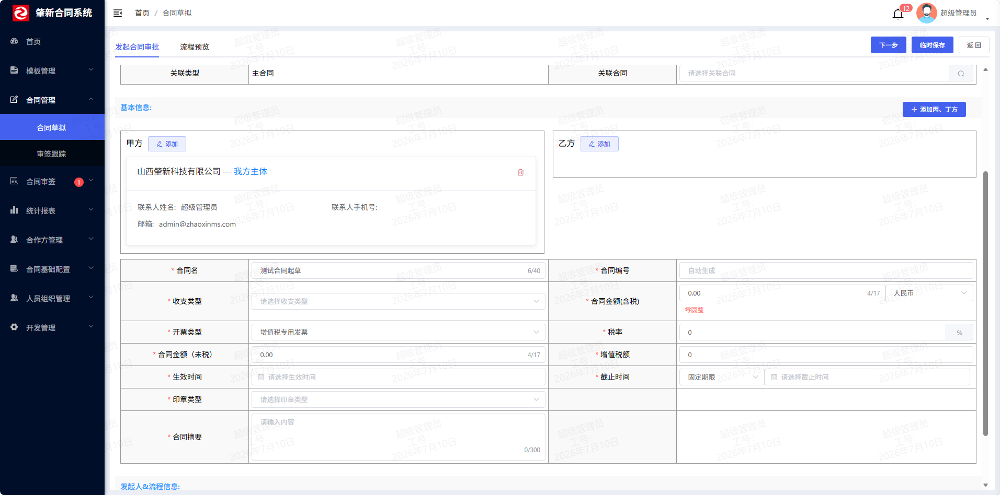

# 第 5 章 · 合同草拟

> 前面四章都在配「基础数据」（主体、合作方、编号规则、合同类型）。从本章开始，**合同本身这个主角登场**。
>
> 「草拟」是合同生命周期的第一步：起草人填合同基本信息、上传合同文件、选模板 → 存成草稿 → 发起审批（第 6 章）。看起来是「一个新增表单」，但它是全系统**字段最多、表关系最绕、最考验设计功力**的一块。
>
> **本章第一次讲透**：
> 1. **文件存储组件**——文件到底存哪、怎么存、怎么取（[[D0-底座表地图#12. conf_file 统一文件表（04 行 198）|`conf_file`]] 表 + 本地磁盘 + `FileUploadUtils`）。这是全项目文件功能的底座，后面模板、用印、归档都用它。
> 2. **「宽表」设计**——合同主表 [[D0-底座表地图#6. contract_draft 合同草稿表（04 行 253）|`contract_draft`]] 有 **80+ 列**，为什么要这么宽？
> 3. **「宽表 + 版本表」的组合**——合同的**文件**为什么要单独一张 [[D0-底座表地图#8. contract_draft_files 合同文件表（04 行 370）|`contract_draft_files`]]，还带版本号？
> 4. **「文件组」**——一份合同不止一个文件，怎么用**一段 JSON** 装下一组文件（`fileGroupsJson`）。
> 5. **一个 Mapper 上挂多套数据权限**（`draftPermission` / `contractPermission` / `ledgerPermission`）——同一个合同表，草稿阶段看自己的、正式阶段看负责人的。
>
> **本章你会碰到的表**：`contract_draft`（合同主表/宽表）+ `contract_draft_files`（合同文件版本表）+ `conf_file`（文件元数据表，全项目共用）。

> **零基础先补概念（本章 4 个词）**
>
> - **宽表**：把一份合同几乎所有字段都放在同一张表里（本项目 80+ 列）。查询详情时一次就能拿全，不用 join 好几张子表；代价是表很宽、加字段要改表结构。
> - **文件组**：一份合同有「一个正文 + 多个附件」，这一整组文件在业务上永远一起提交、一起展示。项目把整组文件序列化成一段 JSON 存进一个列（`file_groups_json`），而不是再建一张关联表。
> - **MultipartFile**：Spring 接收浏览器 `multipart/form-data` 文件上传时封装的对象，能拿到原始文件名、大小、文件流；对应前端 `<el-upload>` 或 `FormData` 提交。
> - **版本表**：专门用一行记录「某份合同某个版本的文件快照」。每上传一次新版就插一行，旧行不覆盖——历史版本因此可以随时回溯。

---

## 一、这部分是做什么的？

### 1.1 业务含义

「起草一份合同」在系统里是这样的：

```
选择合同类型（第 4 章的 form 树）
      ↓
选择「用模板起草」还是「空白起草」
      ↓
用模板 → 自动复制模板的正文 + 附件，生成一份属于本合同的文件副本
空白   → 自己上传正文（改名为合同名）+ 附件
      ↓
填合同基本信息（名称、金额、币种、签约主体、相对方、生效/结束时间、条款…）
      ↓
保存 = 生成一条 contract_draft 记录（状态 = 拟定中）+ 一条 contract_draft_files 记录（V1.0 版）
      ↓
（若填了编号规则）生成合同编号
      ↓
发起审批 → 第 6 章
```



> **图注**：官方 README 的合同起草页截图（演示数据）。看三块：合同基本信息、文件组/附件、以及底部提交审批的按钮。

### 1.2 数据模型：一张「宽表」+ 一张「版本表」

**① 主表 `contract_draft`**（建表语句 `script/sql/zxcm_init.sql:1077`）——**这就是本章说的「宽表」**：

```
contract_draft（80+ 列）
├─ 标识列：ID(varchar64) / CONTRACT_CODE / CONTRACT_NAME / DEL_FLAG / TENANT_ID
├─ 分类列：CONTRACT_TYPE(JSON数组) / CONTRACT_TYPE_NAME / CONTRACT_TEMPLATE_ID
├─ 人      ：DRAFTER_ID/NAME(拟稿人) / CONTRACT_CHARGE_ID/NAME(负责人) / CURRENT_REVIEWER(当前审批人)
├─ 钱      ：AMOUNT / CURRENCY / INOUTTYPE / EXCLUDE_TAX_AMOUNT / TAX / TAX_AMOUNT / INVOICE_TYPE
├─ 时间    ：EFFECTIVE_TIME(生效) / END_TIME(结束) / end_time_type(固定/无固定期限) / MONEY_PERIOD(账期)
├─ 主体对方：SUBJECTS / PARTNERS / SUBJECT_NAMES / PARTNER_NAMES / MERCHANT
├─ 状态列（一堆！）：
│    CONTRACT_STATUS(主状态) / CONTRACT_APPROVE_STATUS(审批状态)
│    CONTRACT_STAMPED_STATUS(印章状态) / CONTRACT_REVIEW_STATUS(复核状态)
│    CONTRACT_CHANGE_STATUS(变更状态) / CONTRACT_DISPUTE_STATUS(纠纷状态)
│    CONTRACT_CANCEL(作废) / RENEWED_STATUS(续约) / CONTRACT_STOCK(存量合同)
│    RENEWED_STATUS / batch(批处理) ...
├─ 文件列：FILE_GROUPS_VERSION(版本号) / FILE_GROUPS_VERSION_NAME(V1.0) / FILE_GROUPS_ID(当前版本行id)
├─ 关联列：RELATED_CONTRACT_ID(关联合同) / CHANGE_ID(变更单) / AUDIT_ID(审批单) / CONTRACT_ARCHIVES_ID(档案)
└─ 大文本：REMARKS / CLAUSES(条款) / CONTRACT_COLLABORATORS(协同人JSON) / batch_json / EXT_DATA
```

实体在 `zxcm-contract/src/main/java/com/ruoyi/contract/domain/ContractDraft.java:40`。几个值得注意的地方：

- **主键是 `String` 而不是 `Long`**（`:48` `private String id`）。表里 `ID varchar(64)`。为什么？因为**合同是会被其它系统引用的业务主键**，用字符串更灵活（能兼容外部导入的主键、能和关联合同对齐），代价是失去自增/数值排序的便利。这是业务主键 vs 技术主键的取舍。
- 有几个字段带了 `@TableField(updateStrategy = FieldStrategy.IGNORED, jdbcType = JdbcType.VARCHAR)`（`:200/206/211/216`，都是"纠纷"相关的字段）：

```java
@TableField(updateStrategy = FieldStrategy.IGNORED, jdbcType = JdbcType.VARCHAR)
private String disputeRegistrantName;
```

  这是本章第一个**要理解清楚的注解细节**。全局配置里 `updateStrategy: NOT_NULL`（`application.yml:261`）意思是「**更新时，值为 null 的字段不拼进 UPDATE 语句**」——这是防止"只传部分字段的更新把其它字段冲成 null"。但纠纷字段**需要能被清空**（比如撤销纠纷登记），null 是有意义的，所以用 `FieldStrategy.IGNORED` **单独覆盖**：这个字段**即使为 null 也拼进 SQL**，从而能真正写入 null。同理 `endTime`（`:259`）也标了它，因为合同可以改回"无固定期限"（结束时间为空）。
- 表上有一组索引（`:1164-1167`）：

```sql
UNIQUE INDEX `draft_index_code`(`CONTRACT_CODE`, `TENANT_ID`)   -- 编号+租户唯一（呼应第 3 章编号）
INDEX `draft_index_status`(`CONTRACT_STATUS`)
INDEX `draft_index_charge`(`CONTRACT_CHARGE_ID`)                 -- 数据权限/列表按负责人过滤
INDEX `draft_index_drafter`(`DRAFTER_ID`)                        -- 数据权限按拟稿人过滤
```

  **索引不是随便建的**：`contract_charge_id`、`drafter_id` 上有索引，正是因为 §2.5 讲的数据权限**会在 WHERE 里拼这两个列**，没索引就会全表扫。**「加了数据权限的条件，记得给它建索引」**——这句话很适合面试。

**② 版本表 `contract_draft_files`**（建表语句 `zxcm_init.sql:1178`）：

```
contract_draft_files
├─ ID / CONTRACT_DRAFT_ID(指向主表)
├─ FILE_GROUPS_VERSION("1") / FILE_GROUPS_VERSION_NAME("V1.0")   ← 版本
├─ MAIN_FILE_ID / MAIN_FILE_NAME                                  ← 这一版的"正文"文件
├─ FILE_GROUPS_JSON                                               ← 这一版包含的全部文件（JSON 数组）
├─ FILE_TYPE (0合同文件/1审批附件/2双章附件/3变更双章附件)
├─ CONTRACT_COLLABORATORS / COORDINATION_STATUS（协同）
└─ DEL_FLAG / TENANT_ID
```

实体 `zxcm-contract/src/main/java/com/ruoyi/contract/domain/ContractDraftFiles.java:33`。

**一张合同 → 多条版本记录**。合同每次「上传新版本」，就**新增一行** `contract_draft_files`，版本号 +1；主表上的 `FILE_GROUPS_VERSION_NAME` 永远指向**当前版本**。

### 1.3 为什么合同要拆成「宽表 + 版本表」？

先想清楚**主表和版本表分别负责什么**：

| | `contract_draft`（宽表） | `contract_draft_files`（版本表） |
|---|---|---|
| 一行代表 | **一份合同** | **一份合同的某一个文件版本** |
| 变化频率 | 合同信息相对稳定 | 每次改文件都 +1 行 |
| 谁在读写 | 列表、详情、报表、数据权限 | 文件管理、版本对比、审批时锁定版本 |

**关键点**：合同「文件」会**反复改版**，但合同「本身」（名称、双方、金额）不会。如果把文件塞进主表，那每次改文件都要 UPDATE 合同主表——**一改文件就动主表，风险大、还可能误伤主表其它字段**。拆开后，**文件的增删改只动版本表，主表只更新一个"当前版本号"指针**（`ContractDraftServiceImpl.java:673-675`）。这就是**「把变化频率不同的数据分开」**——和第 0 章 §二讲分层时的「按变化频率切割」是同一条原则。

### 1.4 「文件组」是什么？（`fileGroupsJson`）

一份合同的文件不止一个：**正文（主文件）+ 若干附件**。它们是一个「**组**」——同一次提交、同一个版本里的一组文件。

肇新**没有**再建一张「文件-合同」关联表，而是把**这一组文件序列化成一段 JSON**，存在 `contract_draft_files.file_groups_json` 里（`:1194`）。JSON 里每个元素长这样（`zxcm-contract/src/main/java/com/ruoyi/contract/model/ContractDraftFilesModel.java:19`）：

```java
@Data
public class ContractDraftFilesModel implements Comparable<ContractDraftFilesModel> {
    public static final String MAIN_FILE = "0";        // :20 正文
    public static final String ATTACHMENT_FILE = "1";  // :21 附件
    public static final String FROM_UPLOAD = "upload";   // :23 用户上传
    public static final String FROM_TEMPLATE = "template"; // :24 来自模板

    private String uid;    // = conf_file.id（真实文件在 conf_file 表里）
    private String name;   // 文件名
    private String from;   // upload / template / change
    private String type;   // 0 正文 / 1 附件
    private String url;    // 访问地址
    private int index;     // 批处理合同时区分归属

    @Override
    public int compareTo(ContractDraftFilesModel o) {
        // 正文优先级最高（排最前）
        if (!o.getType().equals(this.getType())) {
            return o.getType().equals(MAIN_FILE) ? 1 : -1;
        }
        // 其次模板来的排前面
        if (!o.getFrom().equals(this.getFrom())) {
            return o.getFrom().equals(FROM_TEMPLATE) ? 1 : -1;
        }
        return 0;
    }
}
```

一次提交的文件组 JSON 大概长这样：

```json
[
  {"uid":"1858...","name":"服务器采购合同.docx","from":"upload","type":"0","url":"http://.../profile/upload/contract/2024/06/17/xxx.docx"},
  {"uid":"1858...","name":"报价单.xlsx","from":"upload","type":"1","url":"http://.../...xlsx"},
  {"uid":"1858...","name":"附件A.pdf","from":"template","type":"1","url":"http://.../...pdf"}
]
```

**为什么用 JSON 而不是关联表？**

- 文件组是**一个整体**：读写永远是一整组一起读写（提交时整组覆盖、展示时整组渲染），**不需要按单个文件做关联查询**；
- 用关联表要多一张表 + 一对多查询组装，而这里**一次查行就能拿到全部文件**；
- `compareTo` 还能顺手定义「**正文排最前、模板文件次之**」的展示顺序，省一次排序逻辑。

**代价**：不能直接 SQL 查询「哪些合同用了某个文件」。但业务上不需要这个查询，所以这个代价为零。**这是「按使用方式选存储形态」的典型例子**——如果哪天要按文件反查合同，才需要改成关联表或加索引列。

### 1.5 文件元数据为什么又单独一张 `conf_file`？

注意上面 JSON 里的 `uid` 是**文件 id**，真正的文件信息存在 `conf_file` 表（`script/sql/zxcm_init.sql:930`，实体 `zxcm-contract/src/main/java/com/ruoyi/conf/domain/ConfFile.java:26`）：

```java
@TableName("conf_file")
public class ConfFile extends BaseEntity {
    @TableId(value = "id") private Long id;      // :32
    private String fileName;                     // :37 磁盘上的文件名（UUID 名）
    private String originalName;                 // :42 上传时的原始名
    private String fileSuffix;                   // :47 后缀
    private String url;                          // :52 完整访问地址
    private String module;                       // :57 模块（contract / template / seal ...）
    private String onlyofficeKey;                // :59 在线编辑用的 key（第 8 章）
}
```

**为什么文件和合同要"分居"在两张表？** 因为**文件是全项目共用的资产**：

- 合同用（module=contract）、模板用（module=template）、用印文件用（module=seal）……**都指向同一张 `conf_file`**；
- 文件可以被**复制**（`ConfFileServiceImpl.copyFile`，§4.2）——模板文件复制成合同文件，产生一条**新的** `conf_file` 记录，但**物理文件各存一份**（因为合同文件后续要独立编辑）；
- `contract_draft_files.file_groups_json` 里只存 `uid`（= `conf_file.id`），**fileGroupsJson 引用 conf_file**，是「一对多 + 引用」的结构。

**这层抽象的好处**：以后换存储（本地磁盘 → 对象存储 OSS）时，**只改 `ConfFileServiceImpl` + `FileUploadUtils` 两处**，合同、模板、用印的代码**一行都不用动**——因为它们只认 `conf_file` 的 id 和 url，不关心文件实际存在哪。这就是「**存储方式可替换**」。

---

## 二、站在架构师 / 开发经理角度：为什么这么设计？

### 2.1 为什么合同主表是「一张巨大的宽表」？

`contract_draft` 有 80+ 列，很多人第一反应是「这不合范式，应该拆表」。但拆不拆要看**访问模式**：

- 合同详情页**一次要把几乎所有字段都展示出来**（名称、金额、双方、状态、日期……）；
- 列表页要**按多种条件筛选 + 排序 + 数据权限**；
- 如果按"基本信息表 / 金额表 / 时间表 / 状态表"拆成 5 张，那么**每次查详情要 join 5 张表**，写起来、维护起来都更痛苦，性能也不见得好（多次随机 IO）。

**宽表的适用条件**：字段**同生共死**（一次查基本都要）、**行数不会爆炸**（合同是千万级以内，不是日志那种亿级）、**写入不频繁**。合同完全满足，所以**宽表是对的**。

| 判断维度 | 宽表 | 拆表 |
|---|---|---|
| 字段是否同生共死 | 是（详情页一次全要） | 否（各查各的） |
| 行数量级 | 千万以内 | 亿级 / 日志型 |
| 写入频率 | 低 | 高 |
| 典型反例 | —— | 订单商品明细、设备每秒上报 |

> 反例：如果是**订单的商品明细**（一行订单对多行商品），就必须拆子表；如果是**设备每秒上报**（写极多、查很少），也要拆。**「宽表 vs 拆表」不是范式问题，是访问模式问题。** 面试被问"这个表这么大你不拆吗"，答「同生共死 + 量级可控，宽表减少 join，是刻意的反范式」就对了。

### 2.2 为什么「文件」单独拆成版本表？

见 §1.3。一句话：**文件的"变化频率"和合同的"变化频率"不一样**，分开后改文件不碰主表，主表只维护一个"当前版本指针"。

### 2.3 为什么合同列表要用**手写 SQL**（`@Select` + `LEFT JOIN`）？

看 `ContractDraftMapper.java:40`：

```java
public interface ContractDraftMapper extends BaseMapperPlus<ContractDraftMapper, ContractDraft, ContractDraftVo> {

    @DataPermission(value = {@DataColumn(key = "userId", value = "drafter_id")},
        resource = DataPermissionResource.draftPermission)
    @Select("SELECT * FROM contract_draft ${ew.customSqlSegment}")
    Page<ContractDraft> selectDraftPage(Page<ContractDraft> page, @Param(Constants.WRAPPER) Wrapper<ContractDraft> queryWrapper);
    ...
```

如果只查 `contract_draft` 一张表，`@Select("SELECT * FROM contract_draft ${ew.customSqlSegment}")` 就够。但合同列表**还要显示审批信息**（当前审批人、审批单里的金额/币种等），这些在 `contract_audit_form` 表里。于是有：

```java
// :48 关联审批表，用 MAP 语法把 b 表的列映射成 VO 的嵌套对象
@DataPermission(value = {@DataColumn(key = "userId", value = "a.drafter_id")},
    resource = DataPermissionResource.draftPermission)
@Select("SELECT a.*,"
        + "b.create_time as 'auditForm.createTime',"
        + "b.current_task as 'auditForm.currentTask',"
        + "b.current_assignee as 'auditForm.currentAssignee', "
        + "b.instance_id as 'auditForm.instanceId' FROM contract_draft a left join contract_audit_form b on a.audit_id = b.id ${ew.customSqlSegment}")
Page<ContractDraftVo> selectDraftAuditPage(Page<ContractDraft> page, @Param(Constants.WRAPPER) Wrapper<ContractDraft> queryWrapper);
```

**两个关键技术点**：

1. **`b.xxx as 'auditForm.xxx'`**——MyBatis 的**嵌套属性映射**语法。结果集里列名叫 `auditForm.createTime`，MyBatis 就会把它塞进 VO 的 `auditForm` 对象（`ContractDraftVo.auditForm`）的 `createTime` 字段里。这样**一条 join 出来的平表**，自动组装成**嵌套的 Java 对象**。
2. **`${ew.customSqlSegment}`**——MyBatis-Plus 的 **Wrapper 占位符**：把 Java 侧 `LambdaQueryWrapper` 生成的条件（WHERE / ORDER BY）**拼进来**。所以「join 逻辑手写 + 条件/数据权限用 Wrapper 动态生成」两不耽误。这个 `a.` / `b.` 别名也正是为什么 Service 里 `buildQueryWrapper` 里要写成 `lqw.eq(ContractDraft::getContractStatus, ...)`——Wrappers 生成的列名会带 `contract_draft.` 前缀，所以 join 时要用 `a` 别名并让 SQL 用 `${ew.customSqlSegment}`。

**为什么不用 MyBatis-Plus 的分页对象自动 join？** 因为 MP 默认只做**单表** CRUD；**多表 join 官方就推荐手写 SQL**（或用 XML）。这里选择**注解式手写 SQL**（`@Select` 写在接口上），好处是 SQL 和 Java 挨着、一眼看到；坏处是复杂 SQL 会让接口文件很长（这个 Mapper 有 222 行，一堆 `@Select`）。

> 注意这个 Mapper 里**围绕同一张合同表有近 10 个不同的查询方法**（`selectDraftPage` / `selectContractPage` / `pageContractWidthArchives` / `pageContractWidthTask` / `bookPage` / `bookList` / `selectRelatedList` / `pageContractWithoutPermission`…）。这不是**重复**，而是「**同一实体在不同业务场景下需要不同的 join + 不同的数据权限**」。这也是读这段代码要先**搞清"这个方法服务于哪个页面"**的原因。

### 2.4 为什么同一个合同表，Mapper 上挂了**三种数据权限**？

这是本章和第 2 章（数据权限）的接续。第 2 章讲透的机制是：`@DataPermission(resource = DataPermissionResource.XXX)` 指定**用 `sys_role` 的哪一列**来控制数据范围。合同表**一个实体、多个业务阶段**，所以按阶段给不同的 resource：

```java
// ① 草拟阶段：按"拟稿人"过滤（我只看我起草的）
@DataPermission(value = {@DataColumn(key = "userId", value = "drafter_id")},
    resource = DataPermissionResource.draftPermission)              // :42
// ② 正式合同/台账：按"合同负责人"过滤（我只看我负责的）
@DataPermission(value = {@DataColumn(key = "userId", value = "a.contract_charge_id")},
    resource = DataPermissionResource.contractPermission)           // :57 / :93 / :122
// ③ 台账列表：按台账权限（更细的列）
@DataPermission(value = {@DataColumn(key = "userId", value = "a.contract_charge_id")},
    resource = DataPermissionResource.ledgerPermission)             // :160 / :180 / :199
```

**为什么同一张表要用不同的 resource？** 因为**"谁该看到这份合同"在不同阶段是不同的**：

- **草拟阶段**：合同还没生效，只有**起草人本人**（和协同人）该看 → 用 `drafter_id` + `draftPermission`；
- **正式阶段（履行/用印/归档）**：合同已经归属某个**负责人**，该看的是"负责人 + 其上级部门" → 用 `contract_charge_id` + `contractPermission`；
- **台账**：台账可能有独立的权限配置（比如档案管理员能看全部） → 用 `ledgerPermission`。

**这就是数据权限设计的进阶用法**：不是"一表一权限"，而是「**一实体多阶段多权限**」——同一个物理表，按业务阶段选不同的过滤列和不同的角色配置列。这是很能体现设计深度的点。

### 2.5 为什么「用模板起草」要**复制**模板文件，而不是引用？

看 `ContractDraftServiceImpl.java:287` 的 `copyTemplateFile`：

```java
ConfFile mainFile = confFileServiceImpl.copyFile(new File(mainFilePath), fileName, "contract");  // :300
```

模板的正文会被**物理复制**一份到合同目录，产生**新的 `conf_file` 记录**（`copyFile` 逻辑见 §4.2）。

**为什么不直接引用模板的文件？** 因为合同文件**后续会被独立编辑**（在线编辑、上传新版本、盖章时替换）。如果引用模板文件，那么「改这份合同的正文」就会**改到所有用了这个模板的合同**——灾难。所以**模板文件是"只读母版"，签出时必须复制一份副本**。这是「**模板 vs 实例**」的标准做法（和第 7 章模板发布态、第 8 章文档生成是同一套思路）。

| 方案 | 改合同会不会污染模板 | 模板升级会不会改历史合同 | 结论 |
|---|---|---|---|
| 引用模板文件 | 会（改的是母版） | 会（历史合同跟着变） | ❌ |
| **复制副本（选用）** | 不会 | 不会 | ✅ |

### 2.6 为什么用 `ContractEvent` 记录合同操作，而不是直接写日志表？

看 `ContractEvent.java:21` 和 `ContractEventEnum.java:16`。合同几乎每个动作——新建、发起审批、审批通过/拒绝、盖章、上传双章、复核、变更、归档、借阅、下载、查看——都**发一个 `ContractEvent`**：

```java
// ContractDraftServiceImpl.java:280  新增合同时发事件
ContractEvent event = new ContractEvent(this, add.getId(), ContractEventEnum.add);
applicationEventPublisher.publishEvent(event);
```

事件枚举里的动作（`ContractEventEnum.java:16-33`）几乎就是一份**合同全生命周期的操作清单**：

```java
add("add", "合同新建"), audit("audit", "发起审批"),
auditPass(...), auditReject(...), seal("seal", "发起盖章"), sealPass(...), sealReject(...),
uploadSeal("uploadSeal", "上传双章文件"), reviewPass(...), change("change", "发起变更"),
archive("archive", "合同归档"), borrow("borrow", "合同借阅"), download("download", "合同下载"), ...
```

**为什么用事件**（和第 4 章 §2.4 是同一套思想）：

- **主流程只管发事件，不关心谁消费**：查合同操作记录、发通知给相关人、写操作日志、更新统计——这些都是**旁观者**，各自 `@EventListener` 监听，主流程（新增合同）**一行都不用改**；
- 合同的操作点非常多，如果每个点都直接调"写日志服务 + 发通知服务 + 更新统计服务"，代码会**爆炸式耦合**；
- 事件让"合同发生了什么"和"发生之后要做什么"**解耦**。

> ⚠️ 注意：和 `DataDeleteEvent` 一样，这类事件默认是**同步**的。所以如果某个监听器抛异常，会**影响主流程**——对**日志/通知**类监听器这是要避免的（应该内部 try-catch 或改异步）；对**校验**类监听器这是**必需的**（第 4 章 §2.4）。**同一个框架，两种用法，取决于监听器是"校验"还是"通知"**——这个区分是面试很好的追问点。

---

## 三、需要哪些技术？

| 技术 | 用来解决什么 | 精确位置 |
|---|---|---|
| **文件存储组件（本地磁盘）** | 存合同/模板/用印文件 | `ConfFileServiceImpl.java:98`、`FileUploadUtils.java:114` |
| **`MultipartFile` + `@RequestPart`** | 接收浏览器上传的文件流 | `ConfFileController.java:98` |
| **`@TableField(updateStrategy=IGNORED)`** | 让某字段能被更新成 null | `ContractDraft.java:200`、`application.yml:261` |
| **宽表 + 索引设计** | 一表承载合同全部信息 | `zxcm_init.sql:1077`、`:1164` |
| **版本表（乐观版本号）** | 合同文件多版本 | `ContractDraftFiles.java:57` |
| **JSON 序列化存一组文件** | 「文件组」 | `ContractDraftFilesModel.java:19`、`JsonUtil` |
| **MyBatis 手写 SQL + Wrapper 占位符** | 多表 join 列表 + 动态条件 | `ContractDraftMapper.java:44`、`${ew.customSqlSegment}` |
| **MyBatis 嵌套属性映射** | 平表 → 嵌套 VO | `as 'auditForm.createTime'`（`:50`） |
| **`@DataPermission` 多 resource** | 一实体多阶段权限 | `ContractDraftMapper.java:42/57/160` |
| **`@TableLogic` 逻辑删除** | 合同软删 | `ContractDraft.java:141`、`ContractDraftFiles.java:73` |
| **`@InterceptorIgnore(tenantLine)`** | 跨租户查（如定时任务） | `ContractDraftMapper.java:215` |
| **Spring 事件 + `@EventListener`** | 合同操作广播 | `ContractEvent.java:21` |
| **`@Transactional`** | 主表 + 版本表 + 文件表一致性 | `ContractDraftServiceImpl.java:210/378/680` |
| **EasyPoi/Excel 导出** | 合同导出 | `ContractDraftVo` 的 `@ExcelProperty` |

---

## 四、功能具体怎么实现（带着你复制）

> **本章涉及的表**（点表名直达底座表地图的字段详情）：
> [[D0-底座表地图#6. contract_draft 合同草稿表（04 行 253）|`contract_draft`]]（合同主表） ｜ [[D0-底座表地图#8. contract_draft_files 合同文件表（04 行 370）|`contract_draft_files`]]（文件版本） ｜ [[D0-底座表地图#7. contract_draft_partnerids 合同相对方关联表（04 行 352）|`contract_draft_partnerids`]]（相对方关联） ｜ [[D0-底座表地图#9. contract_his 合同历史表（04 行 397）|`contract_his`]]（历史快照） ｜ [[D0-底座表地图#10. contract_his_files 合同历史文件表（04 行 487）|`contract_his_files`]]（历史文件） ｜ [[D0-底座表地图#11. contract_point_log 合同节点日志表（04 行 514）|`contract_point_log`]]（节点日志） ｜ [[D0-底座表地图#12. conf_file 统一文件表（04 行 198）|`conf_file`]]（文件元数据）


### 4.1 需求、表设计与施工计划

**需求单（模拟）**

**需求编号** ZXCM-CONTRACT-001　**提出人** 合同管理部　**优先级** 高　**本期上线**

**背景**：合同现在线下用 Word 流转，版本靠文件名区分（`合同_v3_最终版.docx`），附件散在邮件里。需要在系统里完成「起草 → 存版本 → 发起审批」的前半段。

**功能需求**

| # | 功能 | 具体要求 |
|---|---|---|
| 1 | 起草 | 先选合同类型（第 4 章的树），再选「用模板」或「空白」；用模板时复制模板正文和附件 |
| 2 | 基本信息 | 名称、金额/币种/税率、签约主体、相对方、生效/结束时间、条款 |
| 3 | 文件组 | 正文 + 若干附件，作为一个「组」一起保存 |
| 4 | 保存 | 生成一条合同记录 + 一条 V1.0 文件版本 + 合同编号（第 3 章） |
| 5 | 修改 | 只改基本信息，不动文件 |
| 6 | 上传新版本 | 版本号 +1，新增一行版本记录，主表只更新「当前版本」指针 |
| 7 | 删除 / 作废 | 未审批的可删；已进入审批的走作废 |
| 8 | 列表 | 要带审批单信息；按数据权限过滤（拟稿人 / 负责人 / 协同人） |

**验收标准**：起草保存后列表可见；上传新版本后版本历史有 2 行、主表指针指向 V2.0；删除后列表消失；换角色登录看到的行数不同。

**本期不做**：在线编辑（第 8 章）、审批流转（第 6 章）、模板管理（第 7 章）。

**拿到需求先做四件事**

① **给需求定性，再推架构**

| 判断维度 | 本模块的答案 | 推出的设计 |
|---|---|---|
| 数据性质 | 业务单据，要记全过程、可追溯 | 宽表 + 多状态列 |
| 数据形状 | 80+ 列信息 + 文件多版本 | 主表 + 独立版本表 |
| 状态 | 9 个正交状态（审批/用印/复核/变更…） | 多个状态列，不合成一个 |
| 读写 | 列表按拟稿人/负责人过滤 | 这两列建索引 + 数据权限插件 |
| 引用 | 被审批、归档引用 | 逻辑删除 |

→ 架构：合同宽表 + 文件版本表 + 文件实体表（`conf_file`）+ 版本指针。

② **定存储**：一张宽表存合同本身，一张版本表存文件版本，文件实体单独一张 `conf_file`。

③ **定接口**：核心是「新增 / 修改 / 列表 / 详情 / 上传新版本 / 删除」，具体见 §四 各小节和 §五。

④ **定实现边界：哪些不用写、哪些必须写、哪些是缺口**

- **框架给**：分页、逻辑删除、文件存储组件、编号规则；
- **必须自己写**：版本指针维护、合同状态流转、审批快照；
- **已知缺口**：`ch05` 没有演示数据；无外键；状态多且分散在 Service 的 if 里。

**表设计导读：这两张表为什么长这样**

**定位：业务单据 + 版本**

| | `contract_draft`（宽表） | `contract_draft_files`（版本表） |
|---|---|---|
| 一行代表 | 一份合同 | 一份合同的某个文件版本 |
| 变化频率 | 低（信息相对稳定） | 高（每次改文件 +1 行） |
| 谁在读写 | 列表、详情、报表、数据权限 | 文件管理、版本对比、审批锁定版本 |

**为什么拆**：如果把文件塞进主表，每次改文件都要 UPDATE 合同主表——一改文件就动主表，风险大。拆开后，版本表只追加，主表只更新一个「当前版本」指针（`ContractDraftServiceImpl.java:673-675`）。这就是第 0 章说的「按变化频率切割」。

**字段分组**

| 组 | 列 | 回答什么 |
|---|---|---|
| 标识 | `ID`、`CONTRACT_CODE`、`CONTRACT_NAME`、`DEL_FLAG`、`TENANT_ID` | 合同是谁、编号多少、叫什么 |
| 分类 | `CONTRACT_TYPE`（JSON 数组）、`CONTRACT_TYPE_NAME`、`CONTRACT_TEMPLATE_ID` | 属于哪个类型、从哪个模板来 |
| 人 | `DRAFTER_ID/NAME`、`CONTRACT_CHARGE_ID/NAME`、`CURRENT_REVIEWER` | 谁起草、谁负责、当前在谁手上 |
| 钱 | `AMOUNT`、`CURRENCY`、`INOUTTYPE`、`EXCLUDE_TAX_AMOUNT`、`TAX`、`TAX_AMOUNT`、`INVOICE_TYPE` | 合同金额与税务拆分 |
| 时间 | `EFFECTIVE_TIME`、`END_TIME`、`end_time_type`、`MONEY_PERIOD` | 什么时候生效、什么时候到期 |
| 主体/对方 | `SUBJECTS`、`PARTNERS`、`SUBJECT_NAMES`、`PARTNER_NAMES`、`MERCHANT` | 和谁签；id + 名称快照双存 |
| 状态 | `CONTRACT_STATUS`、审批/印章/复核/变更/纠纷/作废/续约… | 合同处在生命周期哪一步（第 6、9 章展开） |
| 文件指针 | `FILE_GROUPS_VERSION`、`_VERSION_NAME`、`FILE_GROUPS_ID` | 当前版本号、指向版本表哪一行 |
| 关联 | `RELATED_CONTRACT_ID`、`CHANGE_ID`、`AUDIT_ID`、`CONTRACT_ARCHIVES_ID` | 关联合同、变更单、审批单、档案 |

**四个关键取舍**

| 决策 | 选择 | 代价 | 什么情况下反过来 |
|---|---|---|---|
| 宽表 vs 垂直拆表 | 一张 80+ 列宽表 | 列多难维护、每次加字段要改表 | 字段分组稳定、详情要一次取全，拆了反而多次查询 |
| 文件版本 | 独立版本表，主表只存指针 | 多一张表、详情要多查一次 | 文件只存一份、不需要历史版本 |
| 文件组 | `JSON` 存在版本表里（`file_groups_json`） | 不能按文件维度查 | 需要按文件检索、统计时 |
| 主键 | `String`（`varchar(64)`） | 失去自增和数值排序 | 合同主键要对外引用 / 兼容导入 |
| 索引 | `CONTRACT_CODE` 唯一 + 状态/负责人/拟稿人三个普通索引 | 写入略慢 | **数据权限拼了哪两列，就必须给哪两列建索引**（§1.2） |

**已知缺陷 / 边界**

- **80+ 列宽表**：加字段容易，读懂难；新同事第一次看会懵；
- **状态字段有 9 个**（主状态、审批、印章、复核、变更、纠纷、作废、续约、存量），命名相似、含义交叉，是本章最容易看错的地方；
- **没有演示数据**：`ch05` 脚本只建表不插合同，第一份合同要你自己造；
- **没有外键**：`CONTRACT_TEMPLATE_ID`、`AUDIT_ID` 都是弱引用，指向的记录可能不存在。

**施工计划**

| 步骤 | 做什么 | 做完的标志 |
|---|---|---|
| 4.2 | 文件存储组件 | 能上传一个文件拿到 `fileId` |
| 4.3 | 主表实体 `ContractDraft` | 实体字段和 80+ 列对上，编译通过 |
| 4.4 | 版本表实体与 Model | 文件组 JSON 能序列化 / 反序列化 |
| 4.5 | 新增合同 | 一条合同 + 一条 V1.0 版本 + 合同编号 |
| 4.6 | 修改合同 | 改基本信息，版本不变 |
| 4.7 | 上传新版本 | 版本表 +1 行，主表指针更新 |
| 4.8 | 删除 / 作废 | 列表消失，或状态变为作废 |
| 4.9 | 其他 Service 片段 | 详情能返回文件组 + 动态表单 + 审批记录 |
| 4.10 | Mapper 与列表查询 | 列表带审批信息，不同角色行数不同 |

**建表**

照抄 `script/sql/zxcm_init.sql` 的三段：
- `contract_draft`（`:1077-1168`，注意索引 `:1164-1167`）
- `contract_draft_files`（`:1178-1197`）
- `conf_file`（`:930` 起）

**建表时务必带上那 4 个索引**（`draft_index_code` / `status` / `charge` / `drafter`），理由见 §1.2 末尾。

### 4.2 【第一次讲透】文件存储组件

> **这一步依赖的配置**：上传落盘路径是 `application-dev.yml:4` 的 `ruoyi.profile`（学习版：`E:/Develop/project/zxcm-learn/uploadPath`）；单文件上限 80MB 在 `application.yml:70-74`。路径不存在时上传直接失败。

**本步目标**：搞懂文件怎么落地、怎么拿到 `fileId`。
**做完的标志**：上传一个文件，`conf_file` 里多一行，接口能返回文件 id。

这是本章的底座，所有文件功能都走它。

#### ① 上传入口

`zxcm-contract/src/main/java/com/ruoyi/conf/controller/ConfFileController.java:75`（类定义）、`:98`（上传方法）：

```java
@RestController
@RequestMapping("/conf/file")
public class ConfFileController extends BaseController {
    private final IConfFileService iConfFileService;

    @PostMapping("/upload/{module}")                         // :97  module 决定存到哪个子目录
    public R<Map<String, Object>> upload(@RequestPart("file") MultipartFile file,
                                         @PathVariable("module") String module) {
        if (ObjectUtil.isNull(file)) throw new ServiceException("上传文件不能为空");
        ConfFile confFile = iConfFileService.upload(file, module);
        Map<String, Object> map = new HashMap<>(2);
        map.put("url", confFile.getUrl());          // 前端拿这三个字段拼成文件对象
        map.put("fileName", confFile.getOriginalName());
        map.put("fileId", confFile.getId());
        return R.ok(map);
    }
}
```

- **`@RequestPart("file") MultipartFile`**：Spring 处理 `multipart/form-data` 的标准方式。前端 `el-upload` 组件把文件放进名为 `file` 的表单域，Spring 帮你封装成 `MultipartFile`（有 `getOriginalFilename()`、`getSize()`、`transferTo()` 等方法）。
- **`module` 是个路径变量**：`/conf/file/upload/contract` 表示"这个文件属于 contract 模块"，会被存到 `.../contract/` 子目录，也在 `conf_file.module` 里记下来。**模块隔离**方便按模块做权限（比如 `download` 接口里就检查了 `module=='contract'` 的 office 文件不给直接下，`:128`）。

> **上传接口没有 `@SaCheckPermission`**（对比合同新增有权限）——因为**任何登录用户都可能要上传附件**，权限控制放在"这个文件能挂到哪个业务对象上"（业务接口）而不是"能不能上传"。

#### ② 落盘：`ConfFileServiceImpl.upload`（`:98`）

```java
public ConfFile upload(MultipartFile file, String module) throws IOException {
    String originalfileName = file.getOriginalFilename();
    String suffix = StringUtils.substring(originalfileName,
        originalfileName.lastIndexOf("."), originalfileName.length());      // ① 取后缀（含点）
    String filePath = RuoYiConfig.getUploadPath() + File.separator + module; // ② 拼目录
    String fileName = FileUploadUtils.upload(filePath, file);                // ③ 落盘，返回相对路径
    String url = serverConfig.getUrl() + fileName;                          // ④ 拼完整 URL
    ConfFile confFile = new ConfFile();
    confFile.setUrl(url);
    confFile.setFileSuffix(suffix);
    confFile.setOriginalName(file.getOriginalFilename());   // 原始名（给用户看的）
    confFile.setFileName(fileName);                         // 磁盘名（UUID）
    confFile.setModule(module);
    this.baseMapper.insert(confFile);                       // ⑤ 元数据入库
    return confFile;
}
```

#### ③ 核心：`FileUploadUtils.upload`（`ruoyi-base/ruoyi-common/src/main/java/com/ruoyi/common/utils/file/FileUploadUtils.java:114`）

```java
public static final String upload(String baseDir, MultipartFile file, String[] allowedExtension)
        throws FileSizeLimitExceededException, IOException, FileNameLengthLimitExceededException,
               InvalidExtensionException {
    int fileNamelength = file.getOriginalFilename().length();
    if (fileNamelength > FileUploadUtils.DEFAULT_FILE_NAME_LENGTH) {       // ① 文件名太长（>100）拒绝
        throw new FileNameLengthLimitExceededException(DEFAULT_FILE_NAME_LENGTH);
    }
    assertAllowed(file, allowedExtension);                                 // ② 校验大小(≤100M) + 扩展名白名单
    String fileName = extractFilename(file);                               // ③ 生成新文件名
    File desc = getAbsoluteFile(baseDir, fileName);                        // ④ 算绝对路径 + 递归建目录
    file.transferTo(desc);                                                 // ⑤ 真正写磁盘
    String pathFileName = getPathFileName(baseDir, fileName);              // ⑥ 返回对外相对路径
    return pathFileName;
}

public static final String extractFilename(MultipartFile file) {           // :135
    String fileName = file.getOriginalFilename();
    String extension = getExtension(file);
    fileName = DateUtils.datePath() + "/" + IdUtils.fastUUID() + "." + extension;   // :138
    return fileName;                     // 例：2024/06/17/3f2a...c1.docx
}
```

**这套逻辑里有 5 个必须理解的设计点**（每一句都能成为面试考点）：

1. **为什么要重命名？** 用户上传的原始名可能：重复（两个人都叫"合同.docx"）、含非法字符（`..`、`/`、中文）、或**被恶意构造做路径穿越**（`../../etc/passwd`）。所以**磁盘上只认 UUID 名**，原始名另存到 `originalName` 字段给用户看。这是**安全 + 防冲突**的双重考虑。
2. **为什么要按日期分目录**（`DateUtils.datePath()` → `2024/06/17/`）？如果所有文件都堆在一个目录，**单目录文件数量几万几十万后，文件系统的目录查找会变慢**（ext4 还好，但 Windows/NTFS 和一些存储会明显退化）。按日期分桶是标准的**目录分片**做法。
3. **大小限制 100M**（`:51` `DEFAULT_MAX_SIZE`）、**扩展名白名单**（`MimeTypeUtils.DEFAULT_ALLOWED_EXTENSION`）。**这是安全边界，必须在服务端做**——前端的 `before-upload` 校验（`FileUploadContract/index.vue:140`）只是"用户体验"，**可以被绕过**（改前端、直接发请求）。**「前端校验是体验，后端校验才是安全」**，这句话务必记牢。
4. **`getPathFileName`（`:153`）返回什么？**

```java
public static final String getPathFileName(String uploadDir, String fileName) throws IOException {
    int dirLastIndex = RuoYiConfig.getProfile().length() + 1;
    String currentDir = StringUtils.substring(uploadDir, dirLastIndex);   // 去掉 profile 前缀
    String pathFileName = Constants.RESOURCE_PREFIX + "/" + currentDir + "/" + fileName;
    return pathFileName;      // 例：/profile/upload/contract/2024/06/17/3f2a...c1.docx
}
```

   它返回的是**「对外 URL 里的相对路径」**，以 `Constants.RESOURCE_PREFIX = "/profile"`（`Constants.java:86`）开头。**为什么不直接返回磁盘绝对路径？** 因为**绝对路径暴露服务器目录结构，是安全隐患**；而且换存储时路径会变。所以存进数据库的是**相对路径**，后端要读文件时再**把相对路径换回磁盘路径**（见 §4.2 ⑤ 和 `download`）。

5. **`RuoYiConfig.getProfile()` 带租户**（`ruoyi-base/ruoyi-common/src/main/java/com/ruoyi/common/config/RuoYiConfig.java:79`）：

```java
public static String getProfile() {
    return profile + File.separator + LoginHelper.getTenantId();   // 磁盘上按租户分目录！
}
```

   意思是：**不同租户的文件在磁盘上物理隔离**（`.../profile/000000/upload/...` vs `.../profile/888888/upload/...`）。这是**多租户在文件层面的落地**——租户 A 拿不到租户 B 的文件路径，天然隔离。

#### ④ 路径 ↔ URL 的来回转换（读文件时）

下载时（`ConfFileController.java:135-142`）：

```java
// 本地资源路径
String localPath = RuoYiConfig.getProfile();
// 数据库里的相对 URL 换回磁盘绝对路径
String downloadPath = localPath + StringUtils.substringAfter(confFile.getUrl(), Constants.RESOURCE_PREFIX);
response.setContentType(MediaType.APPLICATION_OCTET_STREAM_VALUE);
FileUtils.setAttachmentResponseHeader(response, downloadName);   // 加 Content-Disposition: attachment
FileUtils.writeBytes(downloadPath, response.getOutputStream());
```

`StringUtils.substringAfter(url, "/profile")` 把 `http://host:8080/profile/upload/contract/2024/...docx` 里的 `/upload/contract/2024/...docx` 抠出来，拼到本地 `profile` 目录上，就得到磁盘路径。**URL → 相对路径 → 磁盘路径**这条转换链，是全项目文件读写的关键，务必搞清。

#### ⑤ 复制文件（模板 → 合同）：`copyFile`（`:127`）

```java
public ConfFile copyFile(File file, String fileName, String module) throws IOException {
    String suffix = StringUtils.substring(fileName, fileName.lastIndexOf("."), fileName.length());
    String filePath = RuoYiConfig.getUploadPath() + File.separator + module;
    String uuid = DateUtils.datePath() + "/" + IdUtils.fastUUID();
    File dest = FileUploadUtils.getAbsoluteFile(filePath, uuid + suffix);      // 目标（新 UUID）
    String saveFile = FileUploadUtils.getPathFileName(filePath, uuid + suffix);
    FileUtil.copy(file.getAbsolutePath(), dest.getAbsolutePath(), true);        // Hutool 复制文件
    String url = serverConfig.getUrl() + saveFile;
    ConfFile confFile = new ConfFile();   // ... set 各字段
    confFile.setModule(module);
    this.baseMapper.insert(confFile);     // 新文件 = 新记录
    return confFile;
}
```

**注意**：复制 = **磁盘上一份新副本 + 数据库一条新记录**。所以"用模板起草一份合同"会让模板文件在磁盘上**多一份**。这是为了**隔离**（§2.5），代价是磁盘占用增加——业务上完全可接受（一个模板可能被用几十上百次，磁盘不值钱）。

> **本地磁盘存储的短板**（选型见 §七）：**多实例部署时会出问题**——用户上传到实例 A 的磁盘，请求被负载均衡转发到实例 B 时就找不到文件。本项目**单实例部署**或**多实例共享挂载目录**才行。生产上规模大了应该换对象存储（OSS/MinIO）。

### 4.3 主表实体 `ContractDraft`

> **这一步依赖的配置**：`@TableLogic` 依赖 `application.yml:254/256` 的 `2/0`；雪花主键依赖 `:248` 的 `ASSIGN_ID`。

**本步目标**：把 80+ 列宽表映射成实体，并把 `FieldStrategy.IGNORED` 那几处看懂。
**做完的标志**：实体编译通过，字段与表列一一对应。

照抄 `zxcm-contract/src/main/java/com/ruoyi/contract/domain/ContractDraft.java`。三处要点：
- `@TableName("contract_draft")`、`extends BaseEntity`（不是 `TreeEntity`，合同不是树）；
- `@TableId(value = "id") private String id`（业务主键，见 §1.2）；
- 需要能被清空的字段加 `@TableField(updateStrategy = FieldStrategy.IGNORED, ...)`（`:200/206/211/216/259`）。

### 4.4 版本表实体与 Model

**本步目标**：版本表实体 + 文件组 JSON 的模型。
**做完的标志**：`fileGroupsJson` 能转成对象列表、再转回字符串。

- `ContractDraftFiles`（`zxcm-contract/src/main/java/com/ruoyi/contract/domain/ContractDraftFiles.java:33`）：照抄，注意 `fileGroupsJson`（`:86`）是 `String`（JSON 字符串），`fileType`（`:90`）。
- `ContractDraftFilesBo`（`zxcm-contract/src/main/java/com/ruoyi/contract/domain/bo/ContractDraftFilesBo.java:36`）：**常量集中在这里**：

```java
public static final String FILE_TYPE_CONTRACT = "0";       // :41 建合同时的文件
public static final String FILE_TYPE_APPROVE = "1";        // :45 发起审批时的附件
public static final String FILE_TYPE_SEAL = "2";           // :49 上传双章附件
public static final String FILE_TYPE_CHANGE_SEAL = "3";    // :54 变更双章附件
public static final String IS_MAIN_FILE = "0";             // :59 主文件
```

  **一张版本表用 `file_type` 复用了 4 种场景**（合同文件、审批附件、双章文件、变更双章文件）——同一份"文件版本"结构，服务不同的业务阶段。这是「**用类型字段复用表**」的做法。
- `ContractDraftFilesModel`：§1.4 已给全文，直接照抄（它实现了 `Comparable` 来定排序）。

### 4.5 Service：新增合同（`insertByBo`，`:211`）——本章主线

**本步目标**：起草保存，一次写三样：合同、V1.0 版本、合同编号。
**做完的标志**：保存后列表能看到，版本表有 1 行，编号不为空。

这是最值得逐行读的方法：

```java
@Override
@Transactional                                    // ① 主表 + 版本表 + 文件表，要么全成要么全败
public ContractDraft insertByBo(ContractDraftBo bo) throws IOException {
    ContractDraft add = BeanUtil.toBean(bo, ContractDraft.class);
    validEntityBeforeSave(add);                   // ② 空方法（见 §4.9 坦白点）
    add.setContractCode(null);                    // ③ 插入时编号置空（编号由后续流程生成）

    List<ContractDraftFilesModel> uploadFiles =
        JsonUtil.getJsonToList(bo.getFileGroup(), ContractDraftFilesModel.class);   // ④ JSON → 对象列表
    if (StringUtils.isEmpty(bo.getFileGroup())) {
        throw new ServiceException("合同的文件不能为空");                         // ⑤ 文件必填
    }
    if (StringUtils.isNotBlank(bo.getContractTemplateId())) {
        copyTemplateFile(bo, uploadFiles);        // ⑥ 用模板起草 → 复制模板文件（§4.2⑤）
    }
    // ⑦ 必须有且只有一个"正文"
    boolean hasMainFile = false;
    for (ContractDraftFilesModel model : uploadFiles) {
        if (ContractEnums.FileTypeEnums.mainFile.getIndex().equals(model.getType())) hasMainFile = true;
    }
    if (!hasMainFile) throw new ServiceException("合同文件必须包含一个合同正文");

    // ⑧ 关联合同校验
    if (StringUtils.isEmpty(bo.getRelatedType())) add.setRelatedType("main");       // 默认主合同
    if (!add.getRelatedType().equals("main") && StringUtils.isEmpty(bo.getRelatedContractId())) {
        throw new ServiceException("子合同与补充协议必须选择关联合同");
    }
    if (StringUtils.isNotEmpty(bo.getRelatedContractId())) {                        // 填了则回填关联合同快照
        ContractDraft related = this.contractDrafterMapper.selectById(bo.getRelatedContractId());
        add.setRelatedContractCode(related.getContractCode());
        add.setRelatedContractId(related.getId());
        add.setRelatedContractName(related.getContractName());
        add.setRelatedTime(new Date());
    }

    // ⑨ 拟稿人/负责人从登录态取（不信任前端传来的"我是谁"）
    LoginUser loginUser = LoginHelper.getLoginUser();
    add.setContractChargeId(loginUser.getUserId().toString());
    add.setContractChargeName(loginUser.getNickName());
    add.setDrafterName(loginUser.getNickName());
    add.setDrafterId(loginUser.getUserId().toString());

    boolean flag = baseMapper.insert(add) > 0;    // ⑩ 写主表
    if (flag) {
        // ⑪ 写版本表：第一版 = V1.0
        ContractDraftFilesBo contractDraftFilesBo = new ContractDraftFilesBo();
        contractDraftFilesBo.setFileGroupsJson(JsonUtils.toJsonString(uploadFiles));  // 整组文件 JSON 落库
        contractDraftFilesBo.setContractDraftId(add.getId());
        uploadFiles.stream().forEach(fileDetailed -> {      // 挑出主文件记到 main_file_id
            if (ContractEnums.FileTypeEnums.mainFile.getIndex().equals(fileDetailed.getType())) {
                contractDraftFilesBo.setMainFileId(fileDetailed.getUid());
                contractDraftFilesBo.setMainFileName(fileDetailed.getName());
            }
        });
        contractDraftFilesBo.setFileType(ContractDraftFilesBo.FILE_TYPE_CONTRACT);
        contractDraftFilesServiceImpl.insertByBo(contractDraftFilesBo);

        // ⑫ 发事件：合同新建
        ContractEvent event = new ContractEvent(this, add.getId(), ContractEventEnum.add);
        applicationEventPublisher.publishEvent(event);
    }
    return add;
}
```

**逐行读（`zxcm-contract/src/main/java/com/ruoyi/contract/service/impl/ContractDraftServiceImpl.java:211-284`，按编号对应上面的 ①-⑫）：**

| 行号 | 代码/动作 | 在干什么、为什么这么写 |
|---|---|---|
| `:210` | `@Transactional` | 把后面所有写库动作包进一个事务：主表、版本表、`conf_file`（模板复制时）要么全成功，要么全回滚。 |
| `:212` | `BeanUtil.toBean(bo, ContractDraft.class)` | BO → Entity。前端传来的字段先整体拷进来，后面再把不可信的字段覆盖掉。 |
| `:213` | `validEntityBeforeSave(add)` | 当前是空方法（见 §4.9 坦白点），保留扩展点。 |
| `:214` | `add.setContractCode(null)` | 新建时强制清空编号。编号由第 3 章编号规则在后续流程生成，**不允许前端塞一个编号进来**。 |
| `:215-216` | `JsonUtil.getJsonToList(...)` | 前端 `fileGroup` 是 JSON **字符串**，这里解析成 `List<ContractDraftFilesModel>`，后面才能遍历校验。 |
| `:218-220` | 文件为空 → 抛异常 | 合同不能没有文件，这是最重要的业务前置条件之一。 |
| `:222-224` | 有模板 id → `copyTemplateFile` | 用模板起草时，把模板正文/附件**物理复制**成合同自己的文件，并追加到 `uploadFiles`（§4.2⑤）。 |
| `:227-235` | 遍历找 `type=mianFile` | 必须**有且只有一个**正文；没有就报「合同文件必须包含一个合同正文」。注意模板文件也参与这次校验。 |
| `:238-240` | `relatedType` 默认 `"main"` | 前端没传关联类型时，默认按主合同处理。 |
| `:244-246` | 非主合同必须有 `relatedContractId` | 子合同/补充协议必须挂到一份已有合同上，否则业务上说不清它属于谁。 |
| `:249-255` | 回填关联合同快照 | 把关联合同的编号、名称、时间**冗余**存一份，避免以后关联合同改名导致历史记录对不上。 |
| `:257-261` | `LoginHelper.getLoginUser()` | **拟稿人/负责人从服务端登录态取**，覆盖前端传值，防止伪造身份（§六 Q10）。 |
| `:263` | `baseMapper.insert(add)` | 写主表；主键是业务字符串 id（见 §1.2）。 |
| `:264-278` | 写版本表 | 新合同固定生成第一版：文件组 JSON 整段存入，同时挑出正文记到 `main_file_id/main_file_name` 便于列表快速展示。 |
| `:280-281` | `publishEvent(ContractEvent(add))` | 发「合同新建」领域事件；因为仍在 `@Transactional` 内，监听器失败会影响整个新增。 |

**必须理解的 5 个设计点**：

- **⑨ 拟稿人/负责人从 `LoginHelper.getLoginUser()` 取，不信前端**。如果前端传 `drafterId=别人`，会被后端覆盖。**「身份信息只能从登录态取，永远不能信前端传的」**——这是安全铁律（否则谁都能伪造"我是 XX 起草的"）。
- **④ JSON → 对象列表**：前端传的是 `fileGroup`（JSON 字符串），后端用 `JsonUtil.getJsonToList(...)` 转成 `List<ContractDraftFilesModel>` 才能遍历校验。
- **⑥ 顺序有讲究**：先 `copyTemplateFile` **往 `uploadFiles` 里追加**模板文件，再统一做"⑦ 是否有正文"的校验。所以**模板文件也参与"必须有正文"的校验**——用模板起草时，模板的正文就是合同正文。
- **⑪ 先把文件组 JSON 整段存进版本表**，再单独把"正文"的 uid/name 记到 `main_file_id/main_file_name` 便于**快速展示**（列表/详情不用解析 JSON 就能显示正文名）。
- **⑫ 事件在事务内发出**：`insertByBo` 有 `@Transactional`，事件（同步）也在事务里执行。所以监听器里如果做的事失败了，**整个新增合同会回滚**。对"日志/通知"类监听器要小心（§2.6 的 ⚠️）。

### 4.6 Service：修改合同（`updateByBo`，`:379`）

**本步目标**：只改合同基本信息，不动文件版本。
**做完的标志**：改名称后列表更新，版本表行数不变。

```java
@Override
@Transactional
public Boolean updateByBo(ContractDraftBo bo) {
    ContractDraft update = BeanUtil.toBean(bo, ContractDraft.class);
    validEntityBeforeSave(update);
    List<ContractDraftFilesModel> uploadFiles = JsonUtil.getJsonToList(bo.getFileGroup(), ContractDraftFilesModel.class);
    if (StringUtils.isEmpty(bo.getFileGroup())) throw new ServiceException("合同的文件不能为空");
    // ...（同样校验必须有正文，:390-399）

    /* 修改合同基本信息时,对合同文件内容进行修改 start */
    ContractDraftFilesVo contractDraftFilesVo =
        contractDraftFilesServiceImpl.queryDraftFileByContractId(update.getId(), update.getFileGroupsVersionName());
    if (contractDraftFilesVo != null) {
        ContractDraftFilesBo contractDraftFilesBo = new ContractDraftFilesBo();
        contractDraftFilesBo.setId(contractDraftFilesVo.getId());     // 更新"当前版本"那一条
        contractDraftFilesBo.setFileGroupsJson(bo.getFileGroup());
        // 重新挑主文件...
        contractDraftFilesBo.setFileType(ContractDraftFilesBo.FILE_TYPE_CONTRACT);
        contractDraftFilesServiceImpl.updateByBo(contractDraftFilesBo);
    }
    return baseMapper.updateById(update) > 0;
}
```

**要点**：修改合同（还在草稿阶段）时，**文件是"就地更新当前版本"而不是新增版本**——因为还没提交，不构成"新版本"。真正产生新版本是 `addNewVersion`（§4.7）。**区分"草稿期改文件"和"提交后改文件"**，是这类系统的重要业务规则。

### 4.7 Service：上传新版本（`addNewVersion`，`:627`）

**本步目标**：版本 +1，主表只更新指针。
**做完的标志**：版本表多一行 V2.0，主表 `FILE_GROUPS_VERSION_NAME` 变成 V2.0。

```java
public ContractDraftFilesBo addNewVersion(ContractDraftFilesBo bo) {
    ContractDraft contract = this.baseMapper.selectById(bo.getContractDraftId());
    if (contract.getBatch().equals("1")) {
        throw new ServiceException("合并审批的合同不允许上传新版本");        // ① 批处理合同不允许改版
    }
    if (StringUtils.isEmpty(bo.getFileGroupsVersionName())) throw new ServiceException("新版本号不能为空");
    if (!bo.getFileGroupsVersionName().substring(0, 1).equals("V")) {      // ② 版本号必须以 V 开头
        throw new ServiceException("版本号必须以大写 V开头");
    }
    float version = 0;
    try { version = Float.valueOf(bo.getFileGroupsVersionName().substring(1)); }   // ③ 去掉 V 后必须能解析成数字
    catch (Exception e) { throw new ServiceException("版本号格式不正确"); }

    float oldVersion = Float.valueOf(contract.getFileGroupsVersionName().substring(1));
    if (oldVersion >= version) {                                          // ④ 新版本必须更大
        throw new ServiceException("新版本号必须大于上一个版本号");
    }
    // ...校验必须有主文件（:653-666）

    int oldVersionInt = Integer.valueOf(contract.getFileGroupsVersion());
    bo.setFileType(ContractDraftFilesBo.FILE_TYPE_CONTRACT);
    bo.setFileGroupsVersion(oldVersionInt + 1 + "");                      // ⑤ 数字版本号 = 旧 + 1
    contractDraftFilesServiceImpl.insertByBo(bo);                         // ⑥ 插入新的版本行（不覆盖旧的）

    contract.setFileGroupsVersion(bo.getFileGroupsVersion());             // ⑦ 主表指向新版本
    contract.setFileGroupsVersionName(bo.getFileGroupsVersionName());
    contract.setFileGroupsId(bo.getId());
    this.baseMapper.updateById(contract);
    return bo;
}
```

**要点**：
- **两个版本号**：`fileGroupsVersion`（**内部递增的数字**，1、2、3…）和 `fileGroupsVersionName`（**用户自定义的展示名**，V1.0、V2.0）。之所以分开，是因为跟外部系统对接/迁移时，用户想自己命名版本（V2.1、V3.0），但系统内部需要一个**可比较的数字**来排序和递增。
- **⑥ 插新行而不是改旧行**——这才是"版本"的本质：**历史版本永久保留**，随时可回溯（`ContractDraftFilesController.java:132` 的 `fileVersions` 接口就是列全部版本）。

> ⚠️ **坦白点**：版本号校验用 `Float.valueOf`（浮点数）来比较，**用 float 比较版本号是有精度隐患的**（`V1.10` 和 `V1.1` 在 float 里可能相等或无法按预期比较）。更稳的做法是**分段落解析成整数数组**比较（类似 SemVer 的做法：`1.10` → `[1,10]`，逐段比）。这里能用是因为版本号大概率是 `V1.0/V2.0` 这种简单形式，但**面试时可以指出这个隐患并给出正确做法**，很加分。

### 4.8 Service：删除/作废合同（`deleteContract`，`:682`）

**本步目标**：未审批的能删，已审批的走作废。
**做完的标志**：删除后列表消失；作废后状态字段变化、记录仍在。

```java
@Transactional
public void deleteContract(String contractId) {
    ContractDraft draft = this.baseMapper.selectById(contractId);
    // ① 只有"拟定中"的合同能删
    if (!draft.getContractStatus().equals(ContractEnums.ContractStatusEnums.draft.getIndex())) {
        // ② 例外一：存量合同（导入进来的历史合同）可以删
        if (StringUtils.isNotEmpty(draft.getContractStock()) && draft.getContractStock().equals("1")) {
            // 存量合同 → 放行
        } else {
            // ③ 例外二：审批被驳回的合同也可以删
            if (draft.getContractStatus().equals(ContractEnums.ContractStatusEnums.audit.getIndex())
                && draft.getContractApproveStatus().equals(ContractEnums.ApproveStatusEnums.reject.getIndex())) {
                // 放行
            } else {
                throw new ServiceException("该合同不可删除或作废");   // 其余一律拒绝
            }
        }
    }
    // ④ 逻辑删除 + 置为"已作废"
    LambdaUpdateWrapper<ContractDraft> luw = new LambdaUpdateWrapper<>();
    luw.eq(ContractDraft::getId, contractId)
       .set(ContractDraft::getDelFlag, "2")
       .set(ContractDraft::getContractStatus, ContractEnums.ContractStatusEnums.canceled.getIndex());
    this.baseMapper.update(null, luw);
    // ⑤ 发删除事件（第 4 章讲过，谁引用谁监听）
    DataDeleteEvent event = new DataDeleteEvent(this, DataDeleteEvent.TABLE_CONTRACT, contractId);
    applicationEventPublisher.publishEvent(event);
}
```

**要点**：这是**状态机式校验**——「删除」不是一个无条件动作，而是**只允许特定状态下删除**（拟定中 / 存量 / 被驳回），其它状态一律拒绝。**合同是严肃的法律文件，删错了是重大事故**，所以宁可严也不能松。**第 6 章会把整个合同状态机讲透**，这里先记住「删除 = 状态校验 + 逻辑删除 + 广播事件」。

**注意**：它**没有** `@TableLogic` 自动逻辑删除，而是**手写** `set(delFlag, "2")`——因为要**同时**改状态（作废），一条 UPDATE 干两件事，比"先逻辑删再改状态"少一次 SQL。

### 4.9 其他 Service 片段

**本步目标**：详情、按编号查这些零散但必需的查询。
**做完的标志**：详情接口返回文件组 + 动态表单 + 最后一次审批记录。

- **`queryById`（`:126`）+ `getContractDetail`（`:132`）**：查合同详情时，额外组装三样东西——**当前版本的文件组**（`:134`）、**动态表单**（按合同类型查 `form`，`:136-138`）、**最后一次审批记录**（`:141-144`）。这就是 VO 比 Entity 厚的原因：详情页要的东西跨了好几张表。
- **`queryByCode`（`:151`）**：按合同编号查——**这个编号就是第 3 章编号规则生成的**，是合同对外唯一标识。
- **`getContractStatusShow`（`:577`）**：**把一堆状态列翻译成一句人话**。合同的"显示状态"是 `contract_status`（主状态）+ `contract_approve_status`/`contract_stamped_status`/`contract_review_status` 等**组合出来的**——比如「审批中」= `contract_status=审批阶段` 且 `approve_status=1`。这是个 `if-else` 长链（`:582-624`），**把多列状态归约成一个可读字符串**。
- **`getFulfilStatus`（`:549`）**：**履行状态的实时计算**——不是存的，而是根据「生效时间、结束时间、当前时间」**算**出来的（未生效/履行中/已到期）。「已到期」是时间自动到达的，**没法提前存**，只能算。
- **`validEntityBeforeSave`（`:489`）是空方法**：

```java
private void validEntityBeforeSave(ContractDraft entity) {}
```

  ⚠️ **坦白点**：合同的新增/修改**没有任何后端的业务唯一性校验**（不像签约主体查重名、编号规则查重码）。**合同编号的唯一性靠的是数据库唯一索引** `draft_index_code(CONTRACT_CODE, TENANT_ID)`（`:1164`）——**这是正确的做法**（代码层查重有并发漏洞，索引才是最后防线；第 1、4 章那两个是"只查不拦"，这里干脆交给索引）。但**"合同名重复""同一相对方签了重复合同"这些业务重复，系统没有拦**——这是**真实的业务缺口**，答辩时如实说。

### 4.10 Mapper 与列表查询

**本步目标**：列表 join 审批单，并挂上三种数据权限。
**做完的标志**：列表能看到审批状态；换角色登录行数不同；SQL 日志里有用到负责人/拟稿人索引。

照抄 `ContractDraftMapper.java`。要点在 §2.3、§2.4 已讲：

- 每个查询方法 **`@Select` 手写 SQL**，用 `${ew.customSqlSegment}` 让 Wrapper 拼条件；
- **`as 'auditForm.xxx'`** 做嵌套映射；
- 每个方法按场景挂 **`@DataPermission`**（草稿用 `draftPermission`/`drafter_id`；正式合同用 `contractPermission`/`contract_charge_id`；台账用 `ledgerPermission`）；
- **`@InterceptorIgnore(tenantLine = "true")`**（`:215`）用在**需要跨租户**的查询上（比如系统级定时任务要扫所有租户的合同），**临时关掉多租户拦截器**。这是"多租户是默认，个别场景显式豁免"的做法。

### 4.11 前端

**① 列表页 `views/contract/contractDraft/index.vue`**：标准列表 + 数据权限（后端 Mapper 管）。注意它调 `getContractTypeEnable()`（`:217,345`）拿合同类型树——**复用了第 4 章的树接口**。

**② 创建页 `views/contract/contractDraft/createContract.vue`**：核心是**选类型 → 选模板/上传文件 → 提交**。

```js
// :414 拿合同类型树（第 4 章接口）
getContractType() { getContractTypeEnable().then(r => { this.contractTypeOptions = r.data }) },
// :419 选了类型 → 拿模板列表
handleChange(value) {
  const pathLabels = this.$refs['cascaderItem'].getCheckedNodes()[0].pathLabels
  this.form.contractTypeName = pathLabels[pathLabels.length - 1]
  this.getTemplate(value[value.length - 1])       // 按叶子类型查模板
},
// :521 提交
submitForm() {
  this.form.fileGroup = JSON.stringify(this.selectedFiles)          // 文件组 → JSON 字符串
  this.form.contractType = JSON.stringify(this.form.contractTypeArray) // 类型路径 → JSON 字符串
  ...
  addContractDraft(this.form).then(res => {
    this.$emit("applyAudit", res.data)              // 新增成功后，把合同交给"发起审批"流程（第 6 章）
  })
}
```

**关键点**：前端把「文件组」和「合同类型路径」都**`JSON.stringify` 成字符串**再提交——和后端 `JsonUtil.getJsonToList` 对应。**前后端用 JSON 字符串作为"结构化数据"的传输格式**，是全项目的惯例（第 4 章的 `jsonArray` 也是）。

**③ 文件上传组件 `zxcm-ui/src/components/FileUploadContract/index.vue`**（组件从 `:1` 起，核心配置在 `:110`）：

```js
uploadFileUrl: process.env.VUE_APP_BASE_API + '/conf/file/upload/' + this.uploadModule,   // :110
headers: { token: 'Bearer ' + getToken() },        // :113 上传也要带 token（el-upload 不走 request.js 拦截器！）
handleUploadSuccess(res, file) {                    // :179
  this.fileList.push({ uid: res.data.fileId, name: res.data.fileName, url: res.data.url })
  this.$emit('input', this.fileList)               // 把文件列表同步给父组件，最终进 fileGroup
}
```

> ⚠️ **一个容易踩的坑**：`el-upload` 是**自己发 HTTP 请求**的，**不走项目统一的 `request.js` 拦截器**，所以**必须手动加 token 头**（`:113`）。很多初学者上传接口 401，就是因为忘了这行。

**④ 新版本页 `views/contract/contractDraft/newVersion.vue`**：上传新版本，调 `POST /contract/contractDraft/newVersion`。

🖥 **前端入口**
- 菜单：**合同管理 → 合同草拟**
- 路由：`/contract/contractDraft`
- 页面目录：`zxcm-ui/src/views/contract/contractDraft/`（**7 个文件、3854 行**）
- API：`zxcm-ui/src/api/contract/contractDraft.js` + `contractDraftFiles.js`

| 页面文件 | 行数 | 职责 |
|---|---|---|
| `index.vue` | 464 | 草拟列表（我的合同 / 关联合同）|
| `createContract.vue` | 611 | **新建合同主流程** |
| `edit.vue` | 1169 | 编辑（含 M2 审批组件）|
| `apply.vue` | 1309 | 提交审批申请（**M2**）|
| `merchant.vue` | 79 | 甲乙方信息组件 |
| `flowShow.vue` | 36 | 流程展示（**M2**）|
| `newVersion.vue` | 186 | 创建新版本 |

#### `index.vue`（列表）元素 ↔ 接口

| 页面元素 | 触发 | 调的接口 | M1 可用？ |
|---|---|---|---|
| 打开页面 | `created()` | `GET /contract/contractDraft/list` | ✅ |
| 「合同类型」筛选下拉 | 加载时 | `GET /conf/treeSelect/contractTypeSelect?status=0` | ✅（**T5 已供**）|
| 顶部「创建合同」 | `handleAdd` → `createContract.add()` | 见 5.2 | ✅（不选模板时）|
| 每行「发起审批」 | `showApply` → `apply.vue` | `/contract/contractAudit/*` | ❌ 404（M2）|
| 每行「编辑文本」 | `editDoc` | 新窗口打开 `/contractFileEdit`（`views/components/wps/contractFileEdit`）| ❌ M3（wps 在线编辑）|
| 更多 →「创建新版本」 | `handleUpdateFile` → `newVersion` | `POST /contract/contractDraft/newVersion` | ✅ |
| 更多 →「文件管理」 | `handleUpdate` | `createContract.updateContract()`（同 5.2）| ✅ |
| 更多 →「下载文件」 | `handleDownload` → `DocDialog` | 走 M4 的文档链路 | ❌ M4 |
| 更多 →「删除」 | `handleDelete` | `DELETE /contract/contractDraft/{id}` | ✅ |

> ⚠️ **这个页面没有「我的合同 / 关联合同」两个页签** —— 别去找。
> `myContractList` / `relatedContractList` 的**真实调用方不在这个页面**：
> - **「我的合同」在首页驾驶舱**：`views/index.vue` 的 `myContract` 页签 → `views/dashboard/myContract.vue` → `GET /contract/dashboard/myContractList`（**另一个 Controller** `DashboardController`）。
>   `ContractDraftController` 里那个 `/contract/contractDraft/myContractList` **当前没有任何前端页面调它**（属于「有接口、无调用方」）。
> - **「关联合同」在弹窗里**：`views/components/BizDialog/SelectContractDialog/index.vue` 调 `/contract/contractDraft/relatedContractList`（就是 5.2 里「选择关联合同」那个弹窗）。
> 两者都用了**大写表名 SQL**，在本机都会 500（见「复制清单」里的必改项）。

#### `createContract.vue`（新建）—— ★ 哪一步会挂

| 步 | 调的接口 | M1 |
|---|---|---|
| 打开新建弹窗 | `GET /conf/treeSelect/contractTypeSelect?status=0` | ✅ |
| **选完类型 → 自动拉「可用模板」** | **`GET /template/templateDrafts/getLoginerCanUseTemplate`** | ❌ **404（M3）** |
| 上传合同文件 | `POST /conf/file/upload/contract` | ✅（conf 包在）|
| 点「选择关联合同」 | `GET /contract/contractDraft/relatedContractList` | ❌ 500（大写表名）|
| 点「保存」 | `POST /contract/contractDraft` | ✅ |
| 保存成功后 → 弹审批 | `apply.vue` → `/contract/contractAudit/*` | ❌ 404（M2），**但合同已存进去了** |

> ⚠️ **一个体验坑**：选类型后 `getTemplate` 请求**没有 `.catch`/`.finally`** —— M3 未就绪时
> `templateListLoading` 会**永久卡在 true**（右侧一直转圈），但**不阻塞保存**。看着吓人，其实不影响落库。

#### 其余页面

`edit.vue` / `apply.vue` / `flowShow.vue` **大量依赖 M2 的 `/activiti/process/*` 和 `/workflow/designer/*`** ——
M2 之前这些页面**能打开，但一操作就 404**。**这是 M2 的活，不是 T6 的锅。**

### 4.12 本功能复制清单

```
后端（zxcm-contract 模块）
├── contract/
│   ├── controller/ContractDraftController.java          ← 合同主表 CRUD
│   ├── controller/ContractDraftFilesController.java     ← 版本表 + 版本历史
│   ├── service/IContractDraftService.java + impl/ContractDraftServiceImpl.java
│   ├── service/IContractDraftFilesService.java + impl/ContractDraftFilesServiceImpl.java
│   ├── domain/ContractDraft.java / ContractDraftFiles.java
│   ├── domain/bo/ContractDraftBo.java / ContractDraftFilesBo.java
│   ├── domain/vo/ContractDraftVo.java / ContractDraftFilesVo.java / ContractFileVersionVo.java
│   ├── model/ContractDraftFilesModel.java               ← 文件组模型
│   └── mapper/ContractDraftMapper.java / ContractDraftFilesMapper.java
└── conf/  （文件底座，本模块要复制过来或放进公共模块）
    ├── controller/ConfFileController.java
    ├── service/IConfFileService.java + impl/ConfFileServiceImpl.java
    ├── domain/ConfFile.java / bo/ConfFileBo.java / vo/ConfFileVo.java
    └── mapper/ConfFileMapper.java

框架层（已在 RuoYi-Vue-Plus 里，直接用）
└── ruoyi-base/ruoyi-common/src/main/java/com/ruoyi/common/utils/file/FileUploadUtils.java
    ruoyi-base/ruoyi-common/src/main/java/com/ruoyi/common/config/RuoYiConfig.java
    ruoyi-base/ruoyi-common/src/main/java/com/ruoyi/common/constant/Constants.java (RESOURCE_PREFIX)

前端
├── api/contract/contractDraft.js / contractDraftFiles.js
├── api/conf/ 里其实没有 file.js —— 上传直接拼 URL（见 FileUploadContract）
├── views/contract/contractDraft/index.vue / createContract.vue / edit.vue / newVersion.vue / apply.vue
└── components/FileUploadContract/index.vue
```

> **注意**：`ContractDraftServiceImpl` 依赖了 `ContactAuditForm`、`TemplateContract`、`ConfBillRule`、`TSigningSubject`、`Form` 等**多个模块的 Service**（见 import `:50-81`）。这说明**合同草拟是"业务中枢"**——它把前面几章的基础数据都串起来了。复制时要**按依赖顺序**：先复制 conf（主体/编号/文件/类型），再复制 template，最后才是 contract。

---

#### 后端复制清单 —— ⚠️ 单元比 M1 概览说的大

> 📌 **M1 概览列的是一堆「文件」，但 T6 真实的可编译单元是「包 + 兄弟包」**（原因见本章「复制清单」开头）。
> **推荐按方案 A**：整包拷 `zxcm-contract/src/main/java/com/ruoyi/` 下的全部 **8 个包** + `src/main/resources/**`。

**① 核心包 `contract/`（87 个 java）** —— 源 `zhaoxin-contract/zxcm-contract/src/main/java/com/ruoyi/contract/`

| 分组 | 关键文件（行数）| 作用 |
|---|---|---|
| controller | `ContractDraftController`(218)、`ContractDraftFilesController`(188) | T6 的两个 Controller |
| domain | `ContractDraft`(396)、`ContractDraftFiles`(92)、`ContractDraftPartnerids`(47)、`ContractHis`(369)、`ContractHisFiles`(81)、`ContractAuditForm`(252) | 实体（**后 3 个 M2 用，但同包必须一起**）|
| domain/bo | `ContractDraftBo`(365)、`ContractDraftFilesBo`(132)、`ContractStatusBo`(120)… | 入参 |
| domain/vo | `ContractDraftVo`(573)、`ContractDraftFilesVo`(123)、`ContractHisVo`(395)… | 出参 |
| mapper | `ContractDraftMapper`(**222，16 条 `@Select`**)、`ContractDraftFilesMapper`(67)、`ContractDraftStatMapper`(351，**死代码**) | ⚠️ 大写表名在这 |
| service | `IContractDraftService`(126)、`IContractDraftFilesService`(98)、`impl/ContractDraftServiceImpl`(**734**)、`impl/ContractDraftFilesServiceImpl`(225) | 核心逻辑 |
| enums | `ContractEnums`(285) | **状态机地基** |
| model | `ContractDraftFilesModel`、`ContractCollaborators`、`DocContent` | 辅助模型 |

**② 编译依赖的兄弟包**（都是硬依赖，缺一编译不过）：

| 包 | 现状 | 为什么 T6 需要 |
|---|---|---|
| `conf/`（63）| **T2/T3/T4 已拷部分** | `contract` import 它 50 次（`ConfFile` / `ConfBillRule` / `TSigningSubject`）|
| `template/`（54 java + 7 XML）| **M3** | `contract` import 它 11 次 → **得提前进来** |
| `report/`（23 VO + 5 BO）| **M4** | `contract` import 它 15 次 → **得提前进来** |
| `event/` | M2 | `ContractEvent` / `ContractEventEnum` |
| `util/` | M2/M3 | `TaxUtil` 等 |
| `onlyoffice/` `wps/` | M3 | 方案 A 一起拷；方案 B 留到 M3 |

> ⚠️ **拷 `template/` 时别忘了 `src/main/resources/mapper/template/*.xml`**（7 个）——
> 那是 `selectLinkTemplateName` / `selectScopeList` 的**唯一实现**，不拷会在运行期报 `Invalid bound statement (not found)`。

**依赖全部现成，不用管**：
`BaseMapperPlus` `DataDeleteEvent` `DataPermission` `ServiceException` `LoginHelper` `ExcelUtil` `R` `RepeatSubmit` `AddGroup`/`EditGroup` `BusinessType` `Log` —— 都在 `ruoyi-base`。
`@MapperScan` 值 `com.ruoyi.**.mapper`、`typeAliasesPackage` `com.ruoyi.**.domain` 已覆盖新包，**不用改配置**。

#### 前端：7 个文件（**已经在项目里，不用拷**）

M0 的 T9 整包复制过 `src`，所以 `views/contract/contractDraft/**` + `api/contract/contractDraft*.js` **本来就在**。

#### ⚠️ 必改项：**不是「零必改」—— 要改大写表名**

> 🔴 本机 MySQL `lower_case_table_names = 0`（**表名大小写敏感**）。答案册里有些手写 SQL 用了**大写表名**，
> 在本机一定报 `Table 'zxcm.CONTRACT_DRAFT' doesn't exist`。

**T6 路径上受影响的位置**：

| 文件 | 大写表名 | 影响哪个接口 |
|---|---|---|
| `mapper/ContractDraftMapper.java`（**10/16 条 `@Select`**）| `CONTRACT_DRAFT` / `CONTRACT_AUDIT_FORM` / `CONF_ARCHIVES` / `CONTRACT_REMARKS` / `CONTRACT_FULFIL_TASK` | `/myContractList`、`/relatedContractList`、台账等 |
| `mapper/ContractDraftFilesMapper.java`（**3/3 条**）| `CONTRACT_DRAFT_FILES` / `CONTRACT_DRAFT` / `SYS_USER` | 文件列表 / 版本聚合 |

**`ContractDraftMapper` 里「用了大写表名」的 10 个方法**（`grep` 表名即可核对）：

| 方法 | 用到的大写表 |
|---|---|
| `pageContractWidthArchives` | `CONTRACT_DRAFT` / `CONF_ARCHIVES` |
| `pageContractJoinArchives` | `CONTRACT_DRAFT` / `CONF_ARCHIVES` |
| `pageContractWidthForm` | `CONTRACT_DRAFT` / `CONTRACT_AUDIT_FORM` |
| `selectRelatedList`（← 关联合同 500 的元凶）| `CONTRACT_DRAFT` / `CONTRACT_AUDIT_FORM` |
| `pageContractWidthTask`（← 我的合同 500 的元凶）| `CONTRACT_DRAFT` / `CONTRACT_AUDIT_FORM` / `CONTRACT_FULFIL_TASK` |
| `pageContractWithoutPermission` | `CONTRACT_DRAFT` / `CONTRACT_AUDIT_FORM` |
| `bookPage` / `bookList`（台账）| `CONTRACT_DRAFT` / `CONTRACT_AUDIT_FORM` / `CONF_ARCHIVES` |
| `contractRemarkList` | `CONTRACT_REMARKS` / `CONTRACT_DRAFT` / `CONTRACT_AUDIT_FORM` |
| `selectDeleteAuditInstanceIds` | `CONTRACT_AUDIT_FORM` / `CONTRACT_DRAFT` |

> ✅ **另外 6 个方法本来就是小写**（`selectDraftPage` / `selectDraftAuditPage` / `selectContractPage` / `countNum` /
> `selectByIdInAllTenant` / `selectContractInAllTenant`）—— **列表主干正好在这 6 个里，所以 M1 能跑通。**

**修法**：把 SQL 里的大写表名**逐个改成小写**（和 `04` 脚本一致）。**别去改 MySQL 配置**（Linux 上要重建库）。

```sql
-- 改完用这个自查：M1 关心的接口是否还有大写表名（应无输出）
-- （在 IDEA 里搜 ContractDraftMapper.java 的 @Select 段落即可）
```

> ✅ **M1 主干不受影响的证据**：列表 `/list` 走的是 `selectDraftPage`（**小写**），
> 新建/修改/删除走 MP 自带的 `insert/updateById`（认 `@TableName("contract_draft")` 小写）。
> **所以「新建 + 列表 + 编辑 + 删除」这条主干能跑通**，挂掉的是 `/myContractList`、`/relatedContractList` 这些 M4 口径的接口。

#### 数据库：7 张表 + 菜单 ← 由 `modules/ch05-contract-draft.sql` 提供

这个脚本只建本模块要用的 **7 张表**：`contract_draft`、[[D0-底座表地图#7. contract_draft_partnerids 合同相对方关联表（04 行 352）|`contract_draft_partnerids`]]、`contract_draft_files`、[[D0-底座表地图#9. contract_his 合同历史表（04 行 397）|`contract_his`]]、[[D0-底座表地图#10. contract_his_files 合同历史文件表（04 行 487）|`contract_his_files`]]、[[D0-底座表地图#11. contract_point_log 合同节点日志表（04 行 514）|`contract_point_log`]]、`conf_file`，外加「合同管理 → 合同草拟」菜单。**不会碰其他模块的表。**

```powershell
cmd /c "D:\Develop\mysql-5.7.24-winx64\bin\mysql.exe --no-defaults --ssl-mode=DISABLED -h 192.168.56.10 -P 3306 -uroot -proot zxcm --default-character-set=utf8mb4 < E:\Develop\project\zxcm-learn\script\sql\modules\ch05-contract-draft.sql"
```

### 4.13 坑

| # | 现象 | 真因 |
|---|---|---|
| 1 | 启动直接失败，报「找不到 bean」/ `NoSuchBeanDefinitionException` | T6 的构造器注入要求 `template`/`report`/`conf` 的类都在 → 按本章「复制清单」的「方案 A」整包拷 |
| 2 | 编译报「找不到符号 `com.ruoyi.template.*`」 | 同上，`contract` 硬 import 了 `template`/`report` |
| 3 | `/myContractList`、`/relatedContractList` 报 **500** `Table 'zxcm.CONTRACT_DRAFT' doesn't exist` | 大写表名（本章「复制清单」里的必改项）|
| 4 | 新建成功但 **`CONTRACT_CODE` 是 NULL** | **正常**。编号审批通过才生成（Q3）|
| 5 | 保存时报「合同的文件不能为空」 | **正常**。必须有正文文件（后端手工校验）|
| 6 | 删除后 `CONTRACT_STATUS` 变成 `'2'` | **正常**。逻辑删除顺手标成「作废」 |
| 7 | 点「选择关联合同」报 500 | 大写表名（同 #3）|
| 8 | 选完类型后右侧一直转圈 | `getTemplate` 无 `finally`，M3 未就绪时 loading 卡住，**不阻塞保存** |
| 9 | 保存后弹审批报 404 | **正常**。`apply.vue` 走 M2 的 `/contract/contractAudit/*` |
| 10 | 列表是空的 | **正常**。业务表 0 初始数据，先新建一条 |
| 11 | API 直调新建（传裸 `contractType`）后，列表能看，**点详情/编辑就报错** | `contractType` 必须是 **JSON 数组字符串**（见 4.5 Service），裸 id 会在 `getContractDetail` 解析数组时抛异常 |
| 12 | `newVersion` 报「合并审批的合同不允许上传新版本」，或直接 500 空指针 | `addNewVersion` 里 `contract.getBatch().equals("1")` —— **`batch` 为 null 时 NPE**（新建时若没传 `batch`，这一列就是 null）|
| 13 | 新建子合同/补充协议没选关联合同，报「子合同与补充协议必须选择关联合同」 | **正常**。`relatedType != "main"` 时后端强制要求 `relatedContractId` |
| 14 | 用 `V1` 之外的花样传版本号，报「版本号必须以大写 V开头」/「新版本号必须大于上一个版本号」 | **正常**。`newVersion` 对版本号做了格式 + 递增校验 |
| 15 | `put` 修改合同名/类型时被拦下 | `contractName` / `contractType` / `contractTypeName` 在 `EditGroup` 里也带 `@NotBlank` —— **不能留空**（但**可以改**，和 T5 的 name/code「不可改」不同）|


## 五、每个接口的前后端完整生命流程

### 5.1 上传文件：`POST /conf/file/upload/{module}`（multipart）

```
前端 components/FileUploadContract/index.vue:110
  el-upload :action="VUE_APP_BASE_API + '/conf/file/upload/contract'"  :headers="{token:'Bearer '+getToken()}"
  → 浏览器直接 POST multipart/form-data，字段名 file
后端 ConfFileController.upload(file, "contract")  :98
  ⚠️ 无 @SaCheckPermission（登录即可传）
  → ConfFileServiceImpl.upload:98
      ① 取后缀 → ② 目录 = getUploadPath()/contract（含租户）
      ③ FileUploadUtils.upload:114 → 校验大小/扩展名 → 生成 日期/UUID.后缀 → transferTo 落盘
      ④ url = serverConfig.getUrl() + "/profile/upload/contract/2024/06/17/xxx.docx"
      ⑤ conf_file 表 insert
  → R.ok({url, fileName, fileId})
前端 handleUploadSuccess:179 → fileList.push({uid:fileId, name, url})
```

### 5.2 新增合同：`POST /contract/contractDraft`（body=ContractDraftBo，含 fileGroup JSON）

```
前端 createContract.vue:521  submitForm → addContractDraft(this.form)
      fileGroup = JSON.stringify(selectedFiles)（模板起草时为空数组）
      contractType = JSON.stringify(contractTypeArray)
后端 ContractDraftController.add(bo)  :181
  @SaCheckPermission("contract:contractDraft:add") | @RepeatSubmit() | @Validated(AddGroup.class)
  → ContractDraftServiceImpl.insertByBo:211  @Transactional
      ① BeanUtil.toBean → ContractDraft
      ② fileGroup JSON → List<ContractDraftFilesModel>
      ③ 有模板 → copyTemplateFile:287（复制模板正文/附件，生成新 conf_file）
      ④ 校验"必须有正文"
      ⑤ 关联合同校验 + 回填关联合同快照
      ⑥ 拟稿人/负责人 ← LoginHelper.getLoginUser()（不信前端）
      ⑦ baseMapper.insert → 写 contract_draft（主键 String，由雪花/前端 id）
      ⑧ contractDraftFilesServiceImpl.insertByBo → 写第一版 contract_draft_files（V1.0）
      ⑨ publishEvent(ContractEvent(add))  ← 同步，在事务内
  → R.ok(ContractDraft)
前端 then → $emit('applyAudit', res.data)  ← 立刻进入"发起审批"
```

### 5.3 合同详情：`GET /contract/contractDraft/{id}`

```
前端 getContractDraft(id) → GET /contract/contractDraft/{id}
后端 ContractDraftController.getInfo(id)  :167  @SaCheckPermission("contract:contractDraft:query")
  → ContractDraftServiceImpl.queryById:126
      ① baseMapper.selectVoById(id)  （单表）
      ② getContractDetail:132 组装三样：
           - 当前版本文件组：contractDraftFilesServiceImpl.queryDraftFileByContractId(id, 版本名)
           - 动态表单：iFormService.queryById(合同类型叶子id)   ← 跨模块调 form
           - 最后一次审批：contractAuditFormMapper.selectById(auditId)
  → R.ok(ContractDraftVo)（含 form、fileGroup、auditForm）
```

### 5.4 草稿列表：`GET /contract/contractDraft/list`

```
前端 listContractDraft(query) → GET /contract/contractDraft/list
后端 ContractDraftController.list(bo, pageQuery)  :147  @SaCheckPermission("contract:contractDraft:list")
  → ContractDraftServiceImpl.queryPageList:163
      ① buildQueryWrapper:185（合同名模糊、编号等值、类型等值、创建时间区间、del_flag=0）
      ② 强制 contract_status = draft（只要"拟定中"）
      ③ baseMapper.selectDraftPage(page, lqw)  →  Mapper:44
           @DataPermission(drafter_id, draftPermission)  ← SQL 层注入数据权限
           @Select("SELECT * FROM contract_draft ${ew.customSqlSegment}")
           → 数据权限处理器改写 SQL，追加 AND drafter_id IN (...)（视角色配置）
      ④ 结果 BeanCopyUtils 转 VO
  → TableDataInfo（分页）
```

### 5.5 修改合同：`PUT /contract/contractDraft`

```
前端 edit.vue  → updateContractDraft(this.form)
后端 ContractDraftController.edit(bo)  :203  @SaCheckPermission("...:edit") @Validated(EditGroup.class)
  → ContractDraftServiceImpl.updateByBo:379  @Transactional
      ① BeanUtil.toBean → 校验有文件、有正文
      ② 查"当前版本"的 contract_draft_files 行
      ③ 就地把 fileGroupsJson 更新为新文件组（不新增版本）
      ④ baseMapper.updateById(主表)
```

### 5.6 上传新版本：`POST /contract/contractDraft/newVersion`

```
前端 newVersion.vue → addNewVersion(data)
后端 ContractDraftController.addNewVersion(bo)  :191  @SaCheckPermission("...:add") @Transactional
  → ContractDraftServiceImpl.addNewVersion:627
      ① 批处理合同（batch=1）拒绝
      ② 版本名必须以 V 开头、V 后能解析成数字、必须大于旧版本
      ③ 必须有主文件
      ④ contractDraftFilesServiceImpl.insertByBo — 插入新版本行（数字版本 +1）
      ⑤ 主表 fileGroupsVersion/VersionName/fileGroupsId 指向新版本
  → R.ok
```

### 5.7 版本历史：`GET /contract/contractDraftFiles/fileVersions/{contractId}`

```
后端 ContractDraftFilesController.getFileVersions(contractId)  :131-133  （无 @SaCheckPermission）
  → iContractDraftFilesService.queryList(bo{contractDraftId})
  → 按 fileGroupsVersion 去重，每个版本留一条（正文 id/name）
  → 按版本号数字倒序（最新在前）
  → R.ok(List<ContractFileVersionVo>)
前端 newVersion.vue / 合同详情页 → 展示版本下拉
```

### 5.8 删除/作废合同：`DELETE /contract/contractDraft/{id}`

```
后端 ContractDraftController.remove(id)  :214  @SaCheckPermission("...:remove")
  → ContractDraftServiceImpl.deleteContract:682  @Transactional
      ① 状态校验：只有"拟定中 / 存量合同 / 审批被驳回"可删
      ② 逻辑删除：update set del_flag='2', contract_status=已作废
      ③ publishEvent(DataDeleteEvent(TABLE_CONTRACT, id))  ← 同步，被引用则中断
  → R.ok
```

### 5.9 文件下载：`GET|POST /conf/file/download/{fileId}`

```
后端 ConfFileController.download(fileId, response)  :121
  ① iConfFileService.getById(fileId) 查元数据
  ② ⚠️ 若 module=='contract' 且是 office 文件 → 抛"没有权限访问该文件"
     （office 合同文件必须走打包下载/在线编辑，防绕过，见第 8 章）
  ③ 相对 URL → 磁盘路径（getProfile() + substringAfter(url,'/profile')）
  ④ 设 Content-Disposition: attachment，写字节流到 response
前端 FileUploadContract:232 downloadFile → this.download('/conf/file/download/'+uid, {}, name)
```

### 5.10 动手验证（照做一遍，比看十遍强）

> `<端口>` 以本机 `application.yml` 为准，`<token>` 为登录令牌，SQL 在 `zxcm` 库执行。

1. **单文件上传（先验证文件底座）**
   ```bash
   curl -X POST "http://localhost:<端口>/conf/file/upload/contract" \
     -H "Authorization: Bearer <token>" \
     -F "file=@./test.docx"
   ```
   **预期**：返回 `{url, fileName, fileId}`。随后：
   ```sql
   SELECT ID, FILE_NAME, ORIGINAL_NAME, FILE_SUFFIX, MODULE, URL
   FROM conf_file ORDER BY CREATE_TIME DESC LIMIT 1;
   ```
   **预期**：`FILE_NAME` 是 `2026/xx/xx/<UUID>.docx` 形式（不是原始名），`ORIGINAL_NAME` 才是 `test.docx`，`MODULE='contract'`——对应 `ConfFileServiceImpl.java:98-115`。

2. **断点跟一次新增合同**
   - 断点 1：`ContractDraftServiceImpl.java:215`（文件组 JSON 解析后），观察 `uploadFiles.size()` 和每个元素的 `type/from`。
   - 断点 2：`ContractDraftServiceImpl.java:257`（`LoginHelper.getLoginUser()`），观察 `loginUser` 确实是当前登录人——即使请求 body 里伪造 `drafterId`，`:261` 也会覆盖。
   - 断点 3：`ContractDraftServiceImpl.java:263`（`insert`），观察雪花/字符串主键生成。
   **预期**：三步都能停住；放行后主表多一行、版本表多一行。

3. **SQL 验证「一行合同 + 一行版本」**
   先调新增接口（或页面保存草稿），然后：
   ```sql
   SELECT ID, CONTRACT_NAME, CONTRACT_CODE, CONTRACT_STATUS, FILE_GROUPS_VERSION_NAME
   FROM contract_draft ORDER BY CREATE_TIME DESC LIMIT 1;

   SELECT ID, CONTRACT_DRAFT_ID, FILE_GROUPS_VERSION, FILE_GROUPS_VERSION_NAME, FILE_TYPE, MAIN_FILE_ID
   FROM contract_draft_files ORDER BY CREATE_TIME DESC LIMIT 1;
   ```
   **预期**：合同表 `FILE_GROUPS_VERSION_NAME='V1.0'`；版本表 `FILE_TYPE='0'`（合同文件）、`FILE_GROUPS_VERSION='1'`，并且 `FILE_GROUPS_JSON` 里能看到你上传/复制进来的正文和附件对象。

4. **验证版本号校验**
   ```bash
   curl -X POST "http://localhost:<端口>/contract/contractDraft/newVersion" \
     -H "Authorization: Bearer <token>" -H "Content-Type: application/json" \
     -d '{"contractDraftId":"<合同id>","fileGroupsVersionName":"V1.0","fileGroupsJson":"[...]"}'
   ```
   **预期**：当前已是 `V1.0` 时返回「新版本号必须大于上一个版本号」（`ContractDraftServiceImpl.java:649-650`）。再传 `V2.0` 应成功，并新增一行版本记录、主表指针变为 `V2.0`（`:673-675`）。

5. **验证删除的状态闸门**
   对一条「审批中」的合同调 `DELETE /contract/contractDraft/{id}`，**预期**返回「该合同不可删除或作废」（`ContractDraftServiceImpl.java:689-695`）；对「拟定中」合同则应成功，且 SQL 查 `DEL_FLAG='2'`、`CONTRACT_STATUS=2`（`canceled`）。

---

### 5.11 请求 / 响应速查

> 上面 5.1~5.10 讲「一条请求怎么走」，这里集中看「发什么、回什么」，两边对照着读。

> **统一约定**：所有响应都是 RuoYi 的 `R<T>` 外壳 —— `{"code":200,"msg":"操作成功","data":...}`。
> **判断成功要看 body 里的 `code`，不是 HTTP 状态码**（框架鉴权失败时 HTTP 也是 200）。
> 下面只写 `data` 的形状。

#### `GET /contract/contractDraft/list` — 列表 ✅

**请求**：`?contractName=&contractType=&contractStatus=&contractCode=&pageNum=1&pageSize=10`（`ContractDraftBo` + 分页）

**响应**：`TableDataInfo<ContractDraftVo>` —— `{ "code":200, "rows":[...], "total":N }`（**分页接口用 `rows`/`total`，不是 `data`**）

> 🔑 走的是 `ContractDraftMapper.selectDraftPage`，**这条 SQL 的表名是小写**（`contract_draft`）→ **M1 唯一没被大写表名坑到的查询**。
> 🔑 Service 里**强制 `contract_status=0`**（只查草稿）—— 所以这个「合同草拟」列表**只显示草稿**，履行中/已结束的要去「我的合同」。

#### `GET /contract/contractDraft/{id}` — 查详情 ✅

`@PathVariable String id`（**单数**）。返回 `ContractDraftVo`。

> ⚠️ 详情里会带 `formArray` / `jsonArray`（合同类型的动态表单配置，从 T5 的 `IFormService` 查）。
> 这就是 T6 **必须依赖 T5 的 `zxcm-form` 模块**的地方。

#### `POST /contract/contractDraft` — 新增 ★（M1 的主菜）

**请求体**（`@Validated(AddGroup.class)`，`throws IOException`）：
```json
{ "contractName": "2026年度采购合同",
  "contractType": "[\"1805801510534389762\",\"1805805988113293314\"]",  // ★ 必须是 JSON 数组字符串（前端 JSON.stringify 出来的）
  "contractTypeName": "运营商",                  // 级联选择器最后一级（叶子）的名字
  "relatedType": "main",                        // 来自字典 relate_type；空则后端补 "main"
  "contractStock": "0", "coordinationStatus": "0",
  "fileGroup": "[{\"uid\":\"1913...\",\"name\":\"采购合同.docx\",\"from\":\"upload\",\"type\":0}]",
  "contractTemplateId": null }                  // 不选模板时为 null
```

> ⚠️ **`contractType` 的格式是 T6 最容易踩的坑之一**：它**不是**一个裸 id，而是
> **一个 JSON 数组字符串**（前端 `JSON.stringify(this.form.contractTypeArray)` 的结果）。
> 如果你图省事、用 `doc.html`/curl 直接传 `"contractType": "1805801510534389762"`（裸 id），
> insert 能存进去，但**详情接口 `GET /contract/contractDraft/{id}` 会挂** ——
> 因为 `getContractDetail` 里 `JsonUtil.getJsonToList(vo.getContractType(), Long.class)` 按数组解析，裸 id 直接抛异常。
> **一句话：`contractType` 存的是「选类型的路径数组」，不是单个 id。**

> 📌 **`subjects`（签约主体）/ `partners`（相对方）不在这个接口里** —— 新建页（`createContract.vue`）根本不发这两个字段，
> 它们是在**编辑页 / 发起审批页**（M2）才填的。所以别照着「新建能不能带主体」去判断功能是否完整。

**服务端做这些事**（`ContractDraftServiceImpl.insertByBo`，`@Transactional`）：

| 步 | 行为 | 关键点 |
|---|---|---|
| 1 | **`add.setContractCode(null)`** | ⭐ **不生成合同编号！** 编号是**审批通过时**才生成的（见 Q3）|
| 2 | 校验文件不能为空、必须含**正文文件** | `:"合同的文件不能为空"` |
| 3 | `relatedType` 为空 → 默认 `"main"` | 双保险（库默认也是 `main`）|
| 4 | 从登录人填 `contractChargeId/Name`、`drafterName/Id` | `LoginHelper` |
| 5 | 若传了 `contractTemplateId` → `copyTemplateFile`（**M3 模板**）| M1 不选模板则跳过 |
| 6 | **`baseMapper.insert(add)`** → 写 `contract_draft` | 第 1 张表 |
| 7 | `contractDraftFilesServiceImpl.insertByBo(...)` → 写 `contract_draft_files` | 第 2 张表 |
| 8 | 发 `ContractEvent(this, id, ContractEventEnum.add)` | 监听者写 `contract_point_log`（节点日志）|

| 字段 | 校验 |
|---|---|
| `contractName` | `@NotBlank`（AddGroup + EditGroup）|
| `contractType` | `@NotBlank`（AddGroup + EditGroup）|
| `contractTypeName` | `@NotBlank`（AddGroup + EditGroup）|
| `fileGroup` | **后端无 `@NotBlank`** —— 靠 `insertByBo` 手工抛 `ServiceException`（前端也把必填校验注释掉了）|

> ⚠️ Bo 里**只有 4 个字段带真实校验注解**，其余一大堆字段只有 `@ApiModelProperty(required=true)` ——
> **那是 Swagger 的文档标注，不是校验**。别以为「required=true 就会拦」。

#### `PUT /contract/contractDraft` — 修改 ✅

（`EditGroup`：`id` 必填）写 `contract_draft_files`（若版本文件存在）+ `contract_draft`（`updateById`）。同样校验「文件不能为空、必须有正文」。

> 🔑 **`contractName` / `contractType` 在 `EditGroup` 里也带 `@NotBlank`** —— 所以修改时**不能把它们留空**，
> 但**改不改由前端决定**（这里的校验只是「不能为空」，不是「不可改」）。
> ⚠️ 和 T5 的「`name`/`code` 根本改不了」不同，**T6 的合同名是可以改的**。

#### `DELETE /contract/contractDraft/{id}` — 删除 ✅

`@PathVariable String id`（**单数**）。

**服务端校验**（`deleteContract`）：
1. **只有「草稿 / 存量 / 审批被拒」三种状态能删**，否则抛「该合同不可删除或作废」
2. **逻辑删除**：`LambdaUpdateWrapper.set(delFlag,"2").set(contractStatus,"2")` —— **只更新 `contract_draft` 一张表**的两列
3. 发 `DataDeleteEvent(TABLE_CONTRACT, contractId)`

> ⚠️ **删除后 `CONTRACT_STATUS` 变成 `'2'`（=作废）**，不是 `'0'` —— 看起来像「删着删着变成作废了」，其实是设计：
> 逻辑删除的合同在数据上归入「作废」状态。

#### `POST /contract/contractDraft/newVersion` — 创建新版本 ✅

**请求体** `ContractDraftFilesBo`（含版本号）。服务端校验：
1. 版本号必须 **`V` 开头**、且**必须大于旧版本**（`Float.valueOf` 解析）
2. **批量合同（`batch=1`）禁止上传新版本**
3. 写 `contract_draft_files` 新增一条 + 更新 `contract_draft` 的版本字段

> ⚠️ **第 2 条有个 NPE 风险**：`contract.getBatch().equals("1")` —— `batch` 列为 `null` 时直接空指针（见 Q6）。

#### `GET /contract/contractDraft/getContractByCode?contractCode=` — 按编号查 ✅

按 `CONTRACT_CODE` 查单条。M1 阶段新建的合同 `CONTRACT_CODE` 是 **`null`**（不生成编号），所以这个接口在 M1 基本查不到东西 —— **它是 M2 之后（审批生成编号）才有用的接口**。

#### `GET /contract/contractDraft/templateList` — 选模板 ❌ M3

委托 `ITemplateContractService.queryPageList`，强制 `status=发布`。**M3 的模板体系**。

#### `GET /contract/contractDraft/myContractList` / `relatedContractList` — ⚠️ M1 报 500

> 🔴 **这两个接口的 M1 状态是「接口在，但一调就 500」** ——
> 因为它们的 SQL 在 `ContractDraftMapper` 里用了**大写表名 `CONTRACT_DRAFT`**，
> 而本机 MySQL 是 `lower_case_table_names=0`（表名敏感）→ `Table 'zxcm.CONTRACT_DRAFT' doesn't exist`。
> **修法见本章「复制清单」里的必改项**。
>
> 逻辑上它们也属 M4：
> - `myContractList` 硬编码 `contract_status in (6,7,8)`（履行中/中止/已结束）—— 这些状态 M4 才有
> - `relatedContractList` 给「选择关联合同」弹窗用，配合 M4 的台账

#### `ContractDraftFilesController` 的 7 个接口

| 接口 | M1 用途 |
|---|---|
| `GET /list` `GET /{id}` `POST` `PUT` `DELETE /{ids}` | 合同文件的独立 CRUD（**非超管调不动**，权限码菜单里没有）|
| `GET /fileVersions/{contractId}` | 版本聚合（详情页用）|
| `GET /history/{contractId}` | 历史聚合（**排序有 bug**，见 Q6）|

## 六、面试官高频问题 + 答案（企业级开发者角度）

**Q1：合同表为什么设计成这么宽的宽表？不怕性能问题吗？**

宽表的判断标准是**访问模式**：字段"同生共死"（一次查基本都要）、行数量级可控（合同千万级以内）、写不频繁。合同三者都满足，宽表能**避免每次查详情 join 5 张子表**，读写都更简单。反例：订单明细（一对多）必须拆子表；海量写入的日志表也要拆。**结论**：宽表 vs 拆表不是范式问题，是"数据一起被访问的方式"问题。我也注意了给高频过滤列（状态、负责人、拟稿人）建索引（`zxcm_init.sql:1164-1167`）。

**Q2：合同的文件为什么单独一张表？还带版本号？**

因为**文件的"变化频率"和合同的"变化频率"不同**。合同信息相对稳定，文件会反复改版。拆开后**改文件只动版本表，主表只维护一个"当前版本指针"**（`ContractDraftServiceImpl.java:673`），避免"改个文件 UPDATE 合同主表"的风险。版本号也是**两套**：内部递增数字（1,2,3…，用于比较/排序）+ 用户展示名（V1.0、V2.0，用于业务对接）。每次上传新版本**插新行、不覆盖**，所以历史版本永久可回溯。

**Q3：一份合同有正文和多个附件，你怎么存这一组文件？**

用**"文件组"**：把这一组文件序列化成 JSON 数组存在 `contract_draft_files.file_groups_json`。每项是 `ContractDraftFilesModel {uid, name, from, type, url}`，`type` 区分正文/附件，`from` 记录来源（上传/模板）。**为什么用 JSON 而不是关联表**：这组文件永远整组读写、不需要按单个文件做关联查询，JSON 一次查行就拿到全部，还省了组装；`compareTo` 顺手定义"正文排最前"。**如果哪天要按文件反查合同**，才需要改成关联表。

**Q4：文件到底存在哪？怎么存？**

**本地磁盘 + 数据库记元数据**：`FileUploadUtils.upload`（`FileUploadUtils.java:114`）做「校验大小/扩展名 → 生成 `日期/UUID.后缀` 新名 → `transferTo` 落盘」，目录是 `RuoYiConfig.getUploadPath()/{module}`（**含租户，物理隔离**）。数据库 `conf_file` 记 `fileName`(UUID名)、`originalName`(原名)、`url`(完整地址)、`module`。**为什么不直接存文件名**：原名可能重复/含非法字符/路径穿越，磁盘只认 UUID；原名存字段给用户看。**为什么要相对路径**：不暴露服务器目录、方便换存储。读到文件时把 URL 里的 `/profile/...` 换回磁盘路径。

**Q5：为什么不直接把合同文件存数据库（BLOB）？**

数据库存 BLOB 的话：大文件会**撑大数据库、拖慢备份和主从同步**、读取要走 JDBC 没有 HTTP 缓存的优势、也不方便 CDN 分发。**文件系统/对象存储更适合存大二进制**，数据库只存**元数据 + 路径**。这是"把合适的存储交给合适的组件"。

**Q6：上传接口为什么没做权限校验？不怕乱传吗？**

上传接口只要求登录（不带业务权限），因为**任何需要附件的业务都要上传能力**；真正的控制放在"**这个文件能挂到哪个业务对象上**"——即业务接口（如新增合同）有权限校验。另外后端做了**大小限制（100M）+ 扩展名白名单**，前端 `before-upload` 的校验只是体验、**可被绕过**，**安全校验必须在服务端**。还有一点：合同模块的 office 文件**禁止直接下载**（`ConfFileController.java:128-132`），强制走打包/在线编辑，防止绕过权限拿到原始文件。

**追问：`module` 参数是前端传的，能靠它做权限吗？**

不能。`module` 只决定「文件存到哪个子目录、记到 `conf_file.module`」，前端可以随便传；真正的隔离在业务接口（谁能把文件挂到哪份合同）和下载规则（合同 office 文件走打包）上。把 `module` 当权限维度是误用。

**Q7：为什么合同列表用 `@Select` 手写 SQL 而不是 MyBatis-Plus？**

因为列表要**join 审批表**拿当前审批人、金额等字段，**MyBatis-Plus 默认只做单表 CRUD，多表 join 官方就建议手写 SQL**。这里用注解式 `@Select`，并用两个技巧：① `${ew.customSqlSegment}` 把 Java 侧 `LambdaQueryWrapper` 生成的条件（含数据权限）拼进来；② `b.xxx as 'auditForm.xxx'` 把平表列**映射成 VO 的嵌套对象**。**为什么不写 XML**：SQL 和接口挨着更直观；缺点是复杂 SQL 让接口文件变长。

**Q8：同一个合同实体，为什么 Mapper 上有三种 `@DataPermission`？**

因为**"谁该看到这份合同"在不同阶段不同**：草拟阶段按 `drafter_id`（我只看我起草的，`draftPermission`）；正式阶段按 `contract_charge_id`（我只看我负责的，`contractPermission`）；台账另有台账权限（`ledgerPermission`）。所以是「**一实体多阶段多权限**」——同一物理表，按业务场景选不同的过滤列和不同的角色配置列。**另外**：因为这些过滤列会进 WHERE，我在 `contract_charge_id`、`drafter_id` 上都建了索引（`:1164-1167`），避免全表扫描。

**Q9：用模板起草合同，为什么文件要复制一份而不是引用模板？**

因为合同文件**后续要被独立编辑**（在线编辑、改版、盖章替换）。如果引用模板文件，"改这份合同"就会**改到所有用了该模板的合同**，灾难。所以模板是**只读母版**，签出时**复制成独立副本**（`copyTemplateFile` → `ConfFileServiceImpl.copyFile`），磁盘一份新文件 + 数据库一条新 `conf_file`。这是「模板 vs 实例」的标准隔离。

**Q10：为什么拟稿人、负责人不从请求里取，而从登录态取？**

安全铁律：**身份信息只能来自服务端登录态**。如果信前端传的 `drafterId`，任何人伪造一个请求就能"以别人名义起草合同"，还绕过了数据权限（因为数据权限按 `drafter_id` 过滤）。所以 `insertByBo` 里用 `LoginHelper.getLoginUser()` 覆盖（`ContractDraftServiceImpl.java:257-261`）。

**Q11：合同的"已到期"状态是怎么来的？**

**算出来的，不是存的**。`getFulfilStatus`（`:549`）根据「生效时间 vs 当前时间」「结束时间 vs 当前时间」实时判断：未生效/履行中/已到期。"已到期"是时间自然到达的，**没法提前写进数据库**（除非加定时任务，但时间点还会被改），所以每次查询实时计算。**这和"审批中"这种"由用户操作驱动"的状态不同**——后者可以存在 `contract_approve_status` 里。

**Q12：合同显示的状态有"审批中""盖章中""已盖章"…，这些存哪？**

**存的是多个原子状态列，显示的是它们的组合**。表里有一组状态列：`contract_status`（主状态）+ `contract_approve_status`（审批）+ `contract_stamped_status`（印章）+ `contract_review_status`（复核）+ `contract_change_status`（变更）… `getContractStatusShow`（`:577`）把这些**组合翻译成一句人话**。**为什么不直接存一个"显示状态"字符串**：因为显示状态是派生值，存了就会和原子状态不一致（改了一个忘了改另一个）。**派生数据不落库、用时计算**。完整状态机在第 6 章。

**Q13：上传新版本时，你直接改版本号字段不行吗？为什么插新行？**

因为版本的意义就是**保留历史**。插新行后，用户随时能看 V1.0、V2.0 各是什么文件、谁在什么时候传的（`fileVersions` 接口）。如果覆盖，旧版本就永远丢了——合同是法律文件，**历史文件必须留痕**。这也是"归档/审批要锁定某个具体版本"的前提。

**Q14：`@Transactional` 加在 `insertByBo` 上是为了什么？**

因为一次新增要写**三处**：`contract_draft`（主表）+ `contract_draft_files`（版本表）+ 可能多个 `conf_file`（模板复制），还要发事件。**必须保证原子性**——如果主表插成功、版本表插失败，就成了"有合同没文件"的坏数据。`@Transactional` 保证要么全成、要么全回滚。

**Q15：多实例部署时，本地磁盘存文件会有什么问题？**

**文件落在一个实例的磁盘上，请求被负载均衡转到另一个实例时就找不到文件**（404）。解决办法：① 多实例**共享挂载目录**（NFS/共享存储）；② 换**对象存储**（OSS/MinIO/S3），所有实例都从同一个对象存储读写；③ 上传和下载都走**同一台文件服务**。本项目是单实例或共享挂载，规模大了应迁对象存储——**好消息是代码里做了 `conf_file` 抽象，迁移只需改 `ConfFileServiceImpl` + `FileUploadUtils`**。

### 本章答辩卡（追问级，10 秒版）

**卡 1：合同主键为什么用 `String`（`varchar(64)`），不像其他表用雪花 `Long`？**

> **10 秒答案**：合同是会被外部系统和关联合同引用的**业务主键**，字符串更灵活（兼容导入数据、关联合同对齐），代价是不能自增、按 id 排序不直观。雪花 id 转字符串同样唯一，只是不再用数值类型。
>
> **证据**：`script/sql/zxcm_init.sql:1077`（`contract_draft` 建表）、`zxcm-contract/src/main/java/com/ruoyi/contract/domain/ContractDraft.java:48`（`private String id`）。

**卡 2：`file_groups_json` 里的 `uid` 指向 `conf_file`，删除合同时文件会一起删吗？**

> **10 秒答案**：不会级联删除。删除合同只是把主表逻辑删除（`DEL_FLAG='2'`、状态改为已作废），`conf_file` 和磁盘文件都还在；这保证了其他引用（如模板副本、审批附件）不受影响，但会留下无人引用的「孤儿文件」，生产上需要额外的清理任务——本项目没有，是缺口。
>
> **证据**：`zxcm-contract/src/main/java/com/ruoyi/contract/service/impl/ContractDraftServiceImpl.java:682-708`（只更新主表 + 发事件）、`zxcm-contract/src/main/java/com/ruoyi/conf/service/impl/ConfFileServiceImpl.java:119-124`（文件删除是独立入口）。

**卡 3：草稿期改文件和提交后改文件，为什么一个「就地更新」、一个「插新版本」？**

> **10 秒答案**：草稿还没有形成对外承诺的版本，直接覆盖当前版本的 JSON 即可；一旦发起审批/进入流程，文件内容就成了审批对象，必须「插一行新版本、旧版本保留」，否则审批过的是哪一版就说不清。区别的本质是「有没有进入需要留痕的阶段」。
>
> **证据**：`zxcm-contract/src/main/java/com/ruoyi/contract/service/impl/ContractDraftServiceImpl.java:403-421`（`updateByBo` 更新当前版本行）、`zxcm-contract/src/main/java/com/ruoyi/contract/service/impl/ContractDraftServiceImpl.java:669-675`（`addNewVersion` 插新行并移动主表指针）。

---

## 七、为什么不选其他技术栈？（选型对比）

### 7.1 文件存储：本地磁盘 vs 对象存储 vs 数据库 BLOB vs 分布式文件系统

| 方案 | 优势 | 劣势 | 适合 |
|---|---|---|---|
| **本地磁盘（本项目）** | 简单、零依赖、快（本地 IO） | **多实例不能共享**；扩容要挂盘；备份麻烦 | 单机/小规模、内网部署 |
| **对象存储（OSS/MinIO/S3）** | 多实例共享、无限扩容、可 CDN、有生命周期管理 | 需要额外组件、有网络延迟、要处理外链鉴权 | **中大型生产（推荐）** |
| **数据库 BLOB** | 事务一致、备份一体化 | 撑大库、拖慢主从/备份、无 HTTP 缓存 | 极小文件（头像）、强一致要求 |
| **分布式文件系统（FastDFS/Ceph）** | 专业、海量 | 运维重 | 超大规模自建 |

**结论**：本项目用本地磁盘（部署简单、内网单机）。**迁移路径清晰**：因为有 `conf_file` 抽象，只需替换 `ConfFileServiceImpl` 的上传/下载实现，业务代码不动。**面试时能主动说出"我们现在的短板 + 迁移方案"比硬吹更好。**

### 7.2 一组文件：JSON 字段 vs 关联表 vs 分隔符字符串

| 方案 | 结构能力 | 查询能力 | 适合 |
|---|---|---|---|
| **JSON 字段（本项目）** | 强（任意嵌套） | 弱（不能直接 SQL 查单个文件） | **整组读写、不需要反查** |
| 关联表 | 强（规范） | 强（能按文件反查合同） | 需要按单个文件做关联查询 |
| 逗号分隔字符串 | 弱（只能存简单 id） | 无 | 临时/极简场景 |

**结论**：文件组**整组读写、无需反查**，JSON 最优。**"是否需要按单个元素查询"是选 JSON 还是关联表的分水岭。**

### 7.3 宽表 vs 垂直拆表

| 方案 | 查询 | 维护 | 适合 |
|---|---|---|---|
| **宽表（本项目）** | 一次查全、无 join | 表宽、加字段要改表 | **字段同生共死、量级可控** |
| 垂直拆表 | 要 join | 表窄、可独立演进/权限 | 字段访问模式差异大、含敏感列 |
| 主表 + 扩展 JSON | 灵活 | 灵活 | 动态/稀疏字段（如 ext_data） |

**结论**：合同字段稳定且一起访问 → 宽表；真要动态字段，用 `ext_data` JSON 列兜底（表里已有）。

### 7.4 文件上传：全量上传 vs 分片上传 vs 断点续传

| 方案 | 大文件 | 弱网 | 复杂度 |
|---|---|---|---|
| **全量上传（本项目默认）** | 受限于单次请求（≤100M） | 断了要重传 | 低 |
| 分片上传 | 好（`FileUploadUtils.mergeFiles:247` 有分片合并能力） | 好 | 中 |
| 断点续传 | 最好 | 最好 | 高（要记录分片状态） |

**结论**：合同文件通常几 MB，全量上传够用；`FileUploadUtils` 已备好分片合并方法（`:247`）以备大文件需求，需要时启用。

### 7.5 版本号：浮点数 vs 分段整数 vs 时间戳

| 方案 | 比较正确性 | 可读性 | 备注 |
|---|---|---|---|
| **浮点数（本项目现状）** | ⚠️ 有精度/语义隐患（1.10 vs 1.1） | 中 | 简单但不够严谨 |
| **分段整数（SemVer 式）** | 正确（`[1,10]` 逐段比） | 高 | **推荐** |
| 时间戳/Git 式 hash | 唯一但不可读 | 低 | 用于内部版本 |

**结论**：本项目用浮点比较（`ContractDraftServiceImpl.java:641-651`）在 `V1.0/V2.0` 场景尚可，但**严格来说应该分段解析成整数数组比较**。这是可以主动指出并给出改进方案的点。

---

> **本章小结**：合同草拟是全书**信息量最大**的一章，它把前面所有基础数据（主体、合作方、编号、类型、模板）**都串了起来**。核心设计有三对：**宽表 vs 版本表**（按变化频率拆）、**文件组 JSON vs conf_file 元数据表**（按访问方式拆）、**多阶段多数据权限**（按业务阶段配）。技术上打透了**文件存储底座**（本地磁盘 + UUID 重命名 + 日期分片 + 租户物理隔离 + 相对路径安全）、**MyBatis 手写 join + Wrapper 占位 + 嵌套映射**、**`updateStrategy=IGNORED` 让字段可置空**。答辩时最值得讲的：宽表的取舍理由、文件组的 JSON vs 关联表、以及"身份信息只信登录态"这条安全铁律。
>
> **下一章（第 6 章 · 审批流与事件状态机）**：草稿保存后点「发起审批」会怎样？Activiti 引擎怎么跑？合同的十几种状态怎么转？Spring 事件怎么把"业务"和"流程"接起来？
