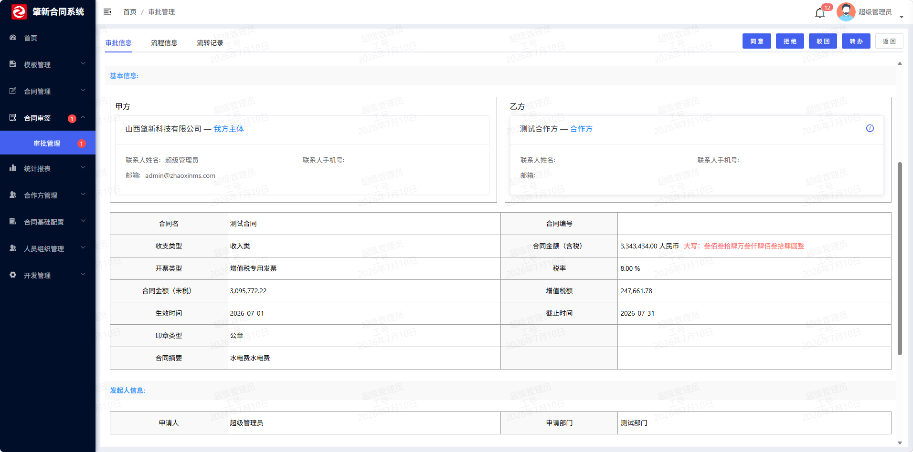
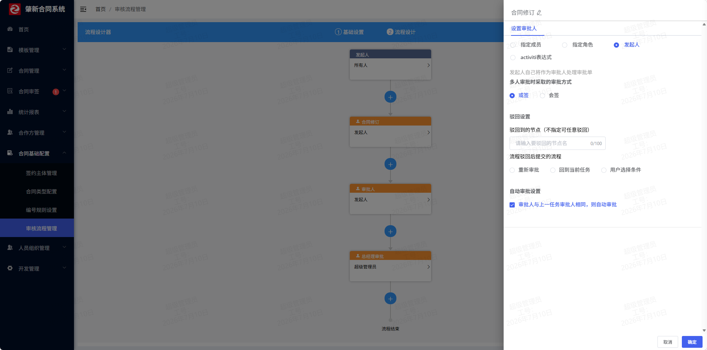

# 第 6 章 · 审批流与事件状态机

> 第 5 章我们把合同「存进了草稿箱」。本章把这张草稿**送进流程、让多个人依次审批、审批完自动改状态**。
>
> 这是整个后端**最像「架构」的一章**，因为它引入了两个「重器」：
> 1. **Activiti 工作流引擎**——审批链路不是写在 Java `if-else` 里的，而是画出来、存在数据库里、由引擎跑的。
> 2. **Spring 事件机制**——合同业务域和流程引擎**互相不认识**，靠「发事件 / 听事件」通信。
>
> 学完本章你会发现：**合同的审批状态，根本不是「一个字段」**，而是**六个正交状态字段**共同描述的。这是全章最容易被面试官追问、也最能体现设计水平的一点。

> **本章第一次讲透**：
> 1. **Activiti 6 引擎接入**——`act_*` 表族是什么、三大 Service（`RuntimeService`/`TaskService`/`HistoryService`）分别管什么、流程引擎怎么启动。
> 2. **Spring 事件机制**——`ApplicationEvent` / `ApplicationEventPublisher` / `@EventListener`，以及**同步事件 vs 异步事件**这个高频坑。
> 3. **BPMN 与设计器 JSON 的互转**——「前端画流程图 → 存成 XML → 部署成流程定义」这条链（`BPMNCreator`）。
> 4. **「事件驱动解耦」的两种用法**——校验型监听器（第 4 章）vs 通知型监听器（第 5 章）/ 流程桥接型监听器（本章）。同一套机制，三种用法。
> 5. **状态机**——为什么合同用「多状态字段」而不是「一个大状态枚举」。

> **本章你会碰到的表**：
> - [[D0-底座表地图#14. contract_audit_form 合同审批单表（04 行 538）|`contract_audit_form`]]（合同审批单，业务侧"这一单"的档案）
> - [[D0-底座表地图#11. contract_point_log 合同节点日志表（04 行 514）|`contract_point_log`]]（合同节点日志，每一次状态变化记一条）
> - `act_ru_task` / `act_ru_execution` / `act_ru_variable`（**运行时**：谁现在该审批）
> - `act_hi_taskinst` / `act_hi_procinst` / `act_hi_comment`（**历史**：谁几点批了什么意见）
> - `act_re_procdef` / `act_re_deployment` / `act_ge_bytearray`（**流程定义**：画好的流程图本身）

> **零基础先补概念（本章 4 个词）**
>
> - **Activiti 工作流**：一个「读流程图、按图派任务」的引擎。**流程定义**是画好的那张图；**流程实例**是这张图被某份合同「跑了一次」；**任务**是当前停在某个审批节点、等某个人点「同意」。待办查 `act_ru_*`，历史查 `act_hi_*`。
> - **BPMN**：工作流的标准 XML 格式（节点、连线、网关条件都写在 XML 里）。业务人员在设计器里拖拽出的图，最终会被转成 BPMN 交给 Activiti 执行。
> - **状态机**：用「当前状态 + 发生的事件 → 下一个状态」描述业务流转。严格的实现会拒绝非法跃迁；本项目的状态约束散落在各个 Service 的 `if` 里，属于「隐式状态机」。
> - **Spring 事件（同步/异步）**：发布者 `publishEvent`，监听者 `@EventListener`。默认**同步**：监听器在发布者线程里跑，抛异常会中断发布者；加 `@Async` 才换线程，但会丢登录上下文、脱离事务。本项目的审批桥接必须同步，日志通知类理想上应异步或事务提交后执行。

---

## 一、这部分是做什么的？

### 1.1 业务含义

合同起草人填好合同、选好审批流程后，点「发起审批」。接下来会发生：

1. 合同从「拟定中」变成「**审批中**」；
2. 系统根据**画的流程图**，把任务派给第一个人（比如部门负责人）；
3. 负责人收到待办，打开看合同、可以**同意 / 驳回 / 回退 / 转办 / 加签**；
4. 同意 → 流到下一个人；驳回 → 流程终止，合同退回「拟定中」让起草人改；
5. 所有人同意 → 流程结束，合同自动**生成编号**、状态变成「履行中」（本项目精简流程：审批通过后上传双章即完成用印）。

**关键点：这条「派给谁、下一步给谁、什么条件走哪个分支」的规则，不是硬编码的**，而是**业务管理员在页面上画出来的**。换一条流程规则，改的是数据，不是代码。

| 合同审批 | 审批流程设计器 |
|---|---|
|  |  |

> **图注**：官方 README 截图（演示数据）。左图是审批页面（待办/同意/驳回的入口），右图是流程设计器（把审批节点画成流程图）。

### 1.2 六个正交状态字段（本章最核心的设计）

打开 `zxcm-contract/src/main/java/com/ruoyi/contract/domain/ContractDraft.java`，你会看到合同主表里躺着**六个状态字段**，而不是一个：

| 字段 | 含义 | 枚举定义位置 |
|---|---|---|
| `contractStatus` | **合同总状态**：拟定/审批中/待签署/已签署/履行中/中止/已结束/已作废 | `ContractEnums.java:19-21` |
| `contractApproveStatus` | **审批状态**：未审批/审批中/通过/不通过/撤销 | `ContractEnums.java:115-116` |
| `contractStampedStatus` | **用印状态**：签署中/拒绝签署/签署完成/他人拒绝 | `ContractEnums.java:257-258` |
| `contractReviewStatus` | **复核状态**：复核中/复核失败/复核通过 | `ContractEnums.java:200-201` |
| `contractChangeStatus` | **变更状态**：未变更/变更中/已变更/变更失败/已撤回 | `ContractEnums.java:228-229` |
| `coordinationStatus` | **协同状态**：未协同/协同中/协同关闭 | `ContractEnums.java:144-145` |

**为什么不是「一个状态字段」？**

看这段代码就明白了——`ContractDraftServiceImpl.java:577` 的 `getContractStatusShow`：

```java
public static String getContractStatusShow(ContractDraft draft) {
    ...
    if (draft.getContractStatus().equals(ContractEnums.ContractStatusEnums.draft.getIndex())) {
        // 拟定中
    } else if (draft.getContractStatus().equals(ContractEnums.ContractStatusEnums.canceled.getIndex())) {
        // 已作废
    } else if (draft.getContractStatus().equals(ContractEnums.ContractStatusEnums.audit.getIndex())) {
        // 审批中
    } else if (draft.getContractStatus().equals(ContractEnums.ContractStatusEnums.signing.getIndex())) {
        // 待签署 ...
    } else if (draft.getContractStatus().equals(ContractEnums.ContractStatusEnums.fulfil.getIndex())) {
        // 履行中 → 还要再调 getFulfilStatus 看"未生效/已生效/已截止/变更中"
        String fulfilStatus = ContractDraftServiceImpl.getFulfilStatus(
            draft.getEffectiveTime(), draft.getEndTime(), draft.getChangeStatus());
        ...
    }
    ...
}
```

**「前端要显示的状态」是这六个字段算出来的，不是存出来的。** 因为：

- 一份合同可能**同时**处于「履行中」+「变更中」（合同在履行，但有人在发起变更）；
- 「履行中」内部还分「未生效 / 已生效 / 已截止」——这是**根据 `effectiveTime` / `endTime` 跟当前时间比出来的**（`getFulfilStatus`，`:549`），**不能存**，一存就会过期。

如果把这一切塞进一个 `status` 字段，你会写出上百个枚举值、且无法表达"正交"。**这是本章面试必答题**（见 §六 Q2）。

> ⚠️ **坦白点**：`getContractStatusShow` 是一串 `if-else`（`zxcm-contract/src/main/java/com/ruoyi/contract/service/impl/ContractDraftServiceImpl.java:582-624`），**不是严格意义上的「状态机」**（没有显式的状态跃迁表、没有非法跃迁拦截）。它是「**状态 → 展示文案**的映射函数」。本项目真正的状态约束是**散落在各个 Service 的 if 校验里**（比如 `ContractAuditServiceImpl.java:620` 「当前合同不处于审批中的状态」）。面试时可以说：**"用 if 分散校验状态在小系统里够用，规模大了会演变成难以维护的隐式状态机，规范做法是引入状态机库（Spring StateMachine / COLA StateMachine）显式声明 `状态 + 事件 → 新状态` 的跃迁表"**——这个认知很加分。

### 1.3 数据模型：审批单 + 节点日志 + 引擎表族

本功能涉及**三块**表，来自**三个不同的"主人"**：

**① 业务侧：`contract_audit_form`（合同审批单）** — 肇新原作者建的

定义在 `script/sql/zxcm_init.sql:1001`。实体 `zxcm-contract/src/main/java/com/ruoyi/contract/domain/ContractAuditForm.java:38`。

它是「**这一次审批**」的档案：把合同发起审批那一刻的所有信息**快照**下来（金额、生效时间、签约主体、相对方……），再挂上流程实例 id：

```java
@TableName("contract_audit_form")
public class ContractAuditForm extends BaseEntity {
    private Long id;              // :46
    private String auditCode;     // :51  审批单号（APPROVE_ORDER_RULE 生成）
    private String auditStatus;   // :55  审批状态
    private Long contractId;      // :59  关联的合同
    private String instanceId;    // :148 Activiti 流程实例 id ★桥接字段★
    private String instanceDefKey;// :152 用哪张流程图（流程定义 key）★桥接字段★
    private String currentTask;   // :194 当前待办节点名（冗余，为了列表能直接显示）
    private String currentAssignee; // :198 当前待办人（冗余）
    private String modifyFiles;   // :241 审批人修订中的文件（按 taskId 分组）
    ...
}
```

两个桥接字段要记牢：
- `instanceDefKey`（`:152`）→ 指向 `act_re_procdef`（**哪张流程图**）；
- `instanceId`（`:148`）→ 指向 `act_ru_execution` / `act_hi_procinst`（**这一次跑的流程**）。

**② 业务侧：`contract_point_log`（合同节点日志）** — 肇新原作者建的

定义在 `zxcm_init.sql:1348`。这是合同的「**时间线**」：用户每次点「发起审批」「审批通过」「上传双章」……都会往里插一条（见 §4.13）。

```sql
-- zxcm_init.sql:1348
CREATE TABLE `contract_point_log`  (
  `CONTRACT_ID`     varchar(64)  COMMENT '合同id',
  `POINT`           varchar(64)  COMMENT '节点',       -- 如 'auditPass'
  `POINT_DESCRIBE`  varchar(64)  COMMENT '节点描述',   -- 如 '审核通过'
  `BUSINESS_JSON`   longtext     COMMENT '业务基本数据',
  `CREATE_BY_ID`    varchar(64)  COMMENT '创建人id',
  ...
  INDEX `point_log_contract`(`CONTRACT_ID`) USING BTREE,
  INDEX `point_log_type`(`POINT`) USING BTREE
) COMMENT = '合同节点日志';
```

**注意它是「只增不改」的**——没有任何更新逻辑，只 `insert`。这是**审计日志的正确姿势**（第 9 章的「历史不可变原则」会再讲一次）。

**③ 引擎侧：25 张 `act_*` 表** — **Activiti 框架自动建的，不是你建的**

在 `script/sql/zxcm_init.sql` 里搜 `CREATE TABLE \`act_`，能看到 25 张（`act_designer:49`、`act_evt_log:81`、`act_ge_bytearray:105` …）。它们**不需要你维护**，`application-workflow.yml:8` 里 `databaseSchemaUpdate: true` 会让 Activiti 启动时自动建/升级。

按**前缀**分四大族，记住这套命名法，面试时能一口气说出引擎干了什么：

| 前缀 | 含义 | 关键表 | 问你什么 |
|---|---|---|---|
| `act_re_*` | **Re**pository 仓库（静态定义） | `act_re_procdef`(:440) 流程定义、`act_re_deployment`(:388) 部署记录、`act_ge_bytearray`(:105) 存 BPMN XML 原文 | 「流程图存在哪？」→ 在 `act_ge_bytearray` 的 `BYTES_` 列里 |
| `act_ru_*` | **Ru**nning 运行时 | `act_ru_task`(:682) **当前待办任务**、`act_ru_execution`(:530) 执行实例（流程跑到哪了）、`act_ru_variable`(:758) 流程变量 | 「谁现在该审批？」→ 查 `act_ru_task.ASSIGNEE_` |
| `act_hi_*` | **Hi**story 历史 | `act_hi_taskinst`(:305)、`act_hi_procinst`(:276)、`act_hi_actinst`(:148)、`act_hi_comment`(:202) 审批意见 | 「审批历史/谁批的/什么意见？」→ 查 `act_hi_*` |
| `act_ge_*` | **Ge**neral 通用 | `act_ge_property`(:129) 引擎版本号、`act_ge_bytearray`(:105) | — |

**一个流程实例（`instanceId`）的生命：** 启动时在 `act_ru_execution` 建一行 → 每到一个节点在 `act_ru_task` 建/改任务 → 变量写 `act_ru_variable` → 任务办完**从 `act_ru_task` 删掉、往 `act_hi_taskinst` 补一条** → 流程结束 `act_ru_execution` 删除、`act_hi_procinst` 留痕。**"运行时表会清空、历史表永久留"** —— 这是「为什么查待办查 `act_ru_*`、查历史查 `act_hi_*`」的根本原因。

### 1.4 为什么审批单要独立一张表？（而不是只在合同上加字段）

因为审批单是**快照**、合同是**当前值**：

- 合同发起审批后，合同主表的金额**可能会被后续操作改动**（比如变更后金额变了）；
- 但**当初审批的是什么金额，必须留痕**——否则事后审计「你批的到底是 100 万还是 200 万」就说不清了。

所以 `saveForm`（`ContractAuditServiceImpl.java:213`）里你会看到**大量的「同时更新审批单 + 合同主表」**：

```java
// ContractAuditServiceImpl.java:429-447（节选）
// 同步审批数据到合同主文件
contract.setAmount(add.getAmount());
contract.setEndTime(add.getEndTime());
contract.setEffectiveTime(add.getEffectiveTime());
contract.setSubjects(add.getSubjects());
contract.setPartners(add.getPartners());
...
contract.setAuditId(add.getId());          // ★合同反过来记住"我这次的审批单是哪个"★
```

**双向指针**：合同 `auditId` → 审批单 `id`；审批单 `contractId` → 合同 `id`。这样两边都能互查。

> 这也是**「宽表 + 快照表」**模式的又一次出现（第 5 章是「宽表 + 版本表」）。共同点：**主表存当前值、附属表存历史快照**。面试如果问"你怎么做数据留痕"，答这个模式。

---

## 二、站在架构师 / 开发经理角度：为什么这么设计？

### 2.1 为什么用 Activiti 引擎，而不是自己写 if-else 审批链？

假设自己写，代码会长这样：

```java
// 反例：硬编码审批链
if (amount > 1000000) {
    if (deptLeader.approve() && gmLeader.approve()) { pass(); }
} else if (contractType == "采购合同") {
    if (deptLeader.approve() && legal.approve()) { pass(); }
}
// ...100 个合同类型 → 100 个分支
```

**问题：**
1. **改动要发版**。业务说「30 万以上的合同加一个法务审批」，你得改代码、重新部署。
2. **无法配置化**。甲方买的是「合同系统」，不是「肇新的合同系统」——他们要自己改流程。
3. **画不出图**。审批进度、谁在审、流程图高亮，自己实现非常痛苦。

**引擎方案：** 审批规则**画成流程图**（BPMN）→ 存进 `act_ge_bytearray` → 引擎按图跑 → 前端直接问引擎要"当前节点、历史节点"来高亮流程图。

**代价（也要会说）：** 引擎很重（25 张表、一堆 API、调试困难、Activiti 6.0.0.RC1 本身是 RC 版本有坑）。**小系统、流程固定不变的，别上引擎**——这是选型对比 §7.1 的内容。

### 2.2 为什么合同域和流程引擎之间用 Spring 事件解耦？

这是本章最关键的一个设计决策，看代码：

**合同域**（`ContractAuditServiceImpl.java:588-589`）发起审批时，**不直接调引擎**：

```java
// ContractAuditServiceImpl.java:585-592
if (contract.getContractStock().equals("0")) {
    // 非存量合同，发起工作流处理
    sendBeginAuditNotify(contract);
    AuditFlowEvent event = new AuditFlowEvent(this, contract, form, AuditFlowEvent.TYPE_START);
    applicationEventPublisher.publishEvent(event);          // ★只是"发了个事件"★

    ContractEvent event1 = new ContractEvent(this, contract.getId(), ContractEventEnum.audit);
    applicationEventPublisher.publishEvent(event1);
}
```

**引擎域**（`zxcm-workflow` 模块，`FlowAuditService.java:93-95`）**听着这个事件**：

```java
// FlowAuditService.java:93
@EventListener
public void start(AuditFlowEvent event) {
    if (event.getType().equals(AuditFlowEvent.TYPE_START)) {
        // ... 组装变量、启动 Activiti 流程
    }
}
```

**如果直接调会怎样？** 合同域就得 `import` 引擎的 `IProcessService`——模块间**硬依赖**。而实际依赖方向是：

```
zxcm-workflow  ──依赖──>  zxcm-contract
（引擎知道合同，因为要读合同信息）
```

**反过来合同依赖引擎就形成循环依赖**，Spring 启动都起不来。

用事件后，**依赖被反转了**：合同域只依赖 Spring 的 `ApplicationEvent`（框架类），引擎域依赖合同域的 Event 类。**合同域不认识引擎，引擎认识合同**——单向，干净。

> 这是**依赖倒置**在工程里的具体落地。面试问"两个模块怎么解耦"，这就是标准答案之一。

### 2.3 为什么流程结束用 Activiti 的 `ExecutionListener` 回调，而不是轮询？

流程跑完的瞬间，怎么通知合同域「审批通过了」？

**反例：定时任务轮询** `act_ru_execution`，发现某实例没了就认为结束了 → **有延迟**（用户点完"同意"要等几秒才看到状态变）、**有并发问题**（多个定时任务抢同一实例）。

**本项目：** 在 BPMN 的**流程结束事件**上挂一个监听器（`BPMNCreator` 里配置 `flowEndListener`，`ExecutionListener.EVENTNAME_END`），流程一结束，引擎**同步回调**它：

```java
// zxcm-workflow/src/main/java/com/ruoyi/workflow/engine/listener/FlowEndListener.java:34-47
@Component
public class FlowEndListener implements ExecutionListener {
    @Autowired
    private FlowAuditService flowAuditService;

    @Override
    public void notify(DelegateExecution execution) {
        String type = execution.getVariable(ProcessServiceImpl.FLOW_TYPE).toString();
        String pass = execution.getVariable("pass").toString();
        String instanceId = execution.getProcessInstanceId();
        if (pass.equals("true")) {
            flowAuditService.auditSuccess(type, instanceId);   // ★回调合同域★
        }
    }
}
```

再往下（`FlowAuditService.java:180-189`）：

```java
// FlowAuditService.java:180
public void auditSuccess(String type, String instanceId) {
    if (type.equals("audit")) {
        // 用 instanceId 反查审批单 → 拿到 contractId
        LambdaQueryWrapper<ContractAuditForm> lqw = Wrappers.lambdaQuery();
        lqw.eq(ContractAuditForm::getInstanceId, instanceId);
        ContractAuditForm form = contractAuditFormMapper.selectOne(lqw);
        contractAuditService.complete(form.getContractId());  // ★回到合同域★
    }
}
```

**完整闭环：**
```
beginAudit → 发 AuditFlowEvent → FlowAuditService.start → 引擎启动
   ↓（审批人点同意 N 次）
引擎流程结束 → FlowEndListener.notify → auditSuccess → contractAuditService.complete → 改合同状态
```

**注意 `instanceId` 是唯一的纽带**：合同域把 `instanceId` 存进 `contract_audit_form.instanceId`（`zxcm-workflow/src/main/java/com/ruoyi/workflow/business/service/FlowAuditService.java:157`），引擎结束再拿它反查回 `contractId`。**用"业务 id"当桥梁，还是用"引擎实例 id"当桥梁，是工作流集成的经典选择题**——本项目两个都用：引擎启动时把 `businessId` 设为 `businessKey`（§2.5），回调时用 `instanceId` 反查。

### 2.4 为什么要一个 `ContractEvent`「轻量事件总线」？

除了 `AuditFlowEvent`（合同 ↔ 引擎的桥），项目还有第二套事件 `ContractEvent` + `ContractEventEnum`（`zxcm-contract/src/main/java/com/ruoyi/event/ContractEventEnum.java:16-33`）：

```java
public enum ContractEventEnum {
    add("add", "合同新建"), audit("audit", "发起审批"),
    auditPass("auditPass", "审核通过"), auditReject("auditReject", "审核拒绝"),
    seal("seal", "发起盖章"), sealPass("sealPass", "盖章通过"), sealToCancel("sealToCancel", "盖章合同作废"),
    uploadSeal("uploadSeal", "上传双章文件"), reviewPass("reviewPass", "复核通过"),
    change("change", "发起变更"), changePass("changePass", "变更通过"),
    archive("archive", "合同归档"), borrow("borrow", "合同借阅"),
    closeContract("closeContract", "合同关闭"),
    download("download", "合同下载"), fileView("fileView", "合同文件查看"), contractView("contractView", "合同查看");
    ...
}
```

**它的定位：合同的「领域事件」**——「合同发生了一件值得记录/通知的事」。当前只有一个监听器：

```java
// ContractPointLogServiceImpl.java:170-184
@EventListener
public void addContractPointLog(ContractEvent event) {
    ContractPointLog bo = new ContractPointLog();
    bo.setPoint(event.getContractEventType().getIndex());     // 'auditPass'
    bo.setContractId(event.getContractId());
    bo.setPointDescribe(event.getContractEventType().getName()); // '审核通过'
    bo.setBusinessJson(event.getBusinessJson());
    ...
    this.baseMapper.insert(bo);
}
```

**为什么要单独搞一套？** 因为 `AuditFlowEvent` 只管「审批」这一件事，而合同的生命周期里还有归档、借阅、变更、下载……**如果每加一个动作就往合同 Service 里插一段"记日志"代码，合同 Service 会越来越胖**。有了 `ContractEvent`，合同 Service 只管「发事件」，**记日志的逻辑集中在监听器里**。

**⚠️ 和 `DataDeleteEvent`（第 4 章）对比 —— 同一框架、三种用法：**

| 事件 | 类型 | 监听器行为 | 抛异常的影响 |
|---|---|---|---|
| `DataDeleteEvent`（第 4 章 §2.4） | **校验型** | 校验「这个主体/合作方还在用吗」，用了就抛 `ServiceException` | **必须**影响主流程（要拦截删除） |
| `ContractEvent` | **通知型** | 插一条节点日志 | **不应**影响主流程（记日志失败不该让业务失败）→ 理想应 try-catch 或改异步 |
| `AuditFlowEvent` | **桥接型** | 启动 Activiti 流程 | **必须**影响主流程（流程起不来，审批就是没发起） |

**同一个 Spring 事件机制，取决于监听器的语义，对异常的容忍度完全不同。** 这是很好的追问点（见 §六 Q7）。

### 2.5 为什么流程变量用**中文 key**（`variables.put("签约主体", ...)`）？

看 `zxcm-workflow/src/main/java/com/ruoyi/workflow/business/service/FlowAuditService.java:99-117`：

```java
Map<String, Object> variables = new HashMap<>();
variables.put("CONTRACT_ID", "" + event.getContractDraft().getId());
variables.put("签约主体", event.getForm().getSubjectNames());   // 中文 key！
variables.put("合作方", event.getForm().getPartnerNames());
variables.put("合同金额", event.getForm().getAmount());
variables.put("生效时间", event.getForm().getEffectiveTime());
variables.put("合同类型", event.getContractDraft().getContractTypeName());
...
```

**因为要在 BPMN 的排他网关里写条件表达式**，而条件表达式是业务人员在**设计器里手填**的。

排他网关（XOR Gateway）的条件长这样：

```xml
<sequenceFlow id="flow1" sourceRef="gateway1" targetRef="task_legal">
  <conditionExpression xsi:type="tFormalExpression">
    ${合同金额 > 1000000}
  </conditionExpression>
</sequenceFlow>
```

**条件里的变量名，就是 `variables.put` 的 key。** 用中文，是为了让**不懂技术的业务管理员在画流程图时能看懂、能自己写条件**（"合同金额大于 100 万走法务"）。如果用 `amount`，业务员就得查文档才能配。

> ⚠️ **坦白点**：中文变量名在工程上**有隐患**——编码问题、表达式解析库兼容性、重构时 IDE 无法安全重命名。**规范做法是英文变量名 + 设计器里维护"变量中文显示名"的映射表**。本项目为了"业务可配置"牺牲了工程规范性，是个**可讨论的取舍**。面试时主动指出并给出改进方案，比藏着强。

### 2.6 为什么 `deptLeader` / `companyLeader` / `P_岗位code` 要**启动时算好**放进变量？

看 `FlowAuditService.java:119-149`：

```java
// 注入 deptLeader
SysUser deptUser = sysDeptService.getDeptLeader(event.getForm().getApplyDept().toString());
variables.put("deptLeader", deptUser.getUserName());              // 部门负责人

// 注入公司负责人
SysUser companyUser = sysDeptService.getCompanyLeader(...);
variables.put("companyLeader", companyUser.getUserName());

// 注入岗位信息
List<SysPosition> positions = sysPositionService.getAllPositionByDept(...);
for (SysPosition p : positions) {
    List<String> usernames = ...;
    variables.put("P_" + p.getFlowCode(), StringUtil.join(usernames, ","));      // 或签：多人逗号串
    variables.put("P_" + p.getFlowCode() + "_LIST", usernames);                  // 会签：多人数组
}
```

**原因：** 流程节点上写的是 `${deptLeader}` 这样的**表达式**，引擎运行时要从变量里取值当审批人。**「部门负责人是谁」是组织架构数据，不是流程数据**——所以启动时查一次组织架构、注入变量。

**还会在审批过程中刷新**：`FlowAuditService.updateInstanceProp`（`:300`）在每次办理任务前重算一遍（`:309-338`），**防止部门负责人中途换人**。这是很细的一点。

**「或签」vs「会签」的区别（面试常考）：**
- **或签**：多个人里**任一人**处理即可 → 变量传**逗号串**（`P_xxx`），引擎当候选组；
- **会签**：**所有人都要**处理 → 变量传**数组**（`P_xxx_LIST`），节点配置为多实例。

### 2.7 为什么要 `CustomIdGenerator` 换成雪花 ID？

Activiti 默认用 `DbIdGenerator`（查库取号，`act_ge_property` 表里的 `next.dbid`，每次 +1）。**高并发下会锁表**。

本项目换成雪花（`zxcm-workflow/src/main/java/com/ruoyi/workflow/engine/config/CustomIdGenerator.java:20-27`）：

```java
public class CustomIdGenerator implements IdGenerator {
    @Override
    public String getNextId() {
        return IdUtil.getSnowflake().nextIdStr();
    }
}
```

在 `ActivitiConfig.java:37` 注册：`processEngineConfiguration.setIdGenerator(new CustomIdGenerator())`。**和第 1 章的雪花 ID、`application.yml:248` 的 `idType: ASSIGN_ID` 是同一套思路**——**去数据库化取号**。

同一个 `ActivitiConfig`（`:22-40`）还解决了**流程图中文乱码**（`:34-36` 设"宋体"）和**自定义流程图生成器**（`:38`）——这两个是 Activiti 中文场景的经典坑，值得记一笔。

---

## 三、需要哪些技术？

| 技术 | 用在哪 | 精确位置 |
|---|---|---|
| **Activiti 6.0.0.RC1** | 工作流引擎（BPMN 解析、流程调度、任务派发） | `zxcm-workflow/pom.xml:31-34`（starter）、`:36-39`（bpmn-layout 画图）、`:42-49`（json-converter 设计器） |
| `RuntimeService` | 启动流程、设流程名、查运行中实例 | `ProcessServiceImpl.java:100`（注入）、`:157`（启动） |
| `TaskService` | 查待办/已办、签收、完成任务、加批注、读写流程变量 | `ProcessServiceImpl.java:98`、`:164`（批注）、`:638`（完成） |
| `HistoryService` | 查历史任务/活动实例（流程图高亮、审批历史） | `ProcessServiceImpl.java:99`、`:689`（`selectHistoryList`） |
| `IdentityService` | 设置"当前操作人"（写入 `act_hi_*` 的发起人） | `ProcessServiceImpl.java:97`、`:155` |
| **Spring 事件** | `ApplicationEvent` / `ApplicationEventPublisher` / `@EventListener` | `AuditFlowEvent.java:24`、`ContractAuditServiceImpl.java:112`(publisher)、`FlowAuditService.java:93`(listener) |
| **Activiti `ExecutionListener`** | 流程结束回调业务 | `FlowEndListener.java:34`、BPMN 注册在 `BPMNCreator.java:142-149` |
| **BPMN 设计器 / JSON 互转** | 前端画图 → BPMN XML | `BPMNCreator.java`、`activiti-json-converter` 依赖 |
| **雪花 ID** | 替换 Activiti 默认取号器 | `CustomIdGenerator.java:23` |
| **`@EnableAsync` + `@Async`** | 异步线程池（本项目通知/日志类可用） | `AsyncConfig.java:35`、`OperLogService.java:26` |
| **Sa-Token 权限** | 审批接口的权限码 | `ContractAuditController.java:172`、`:185`、`:198`、`:211`、`:225`、`:241`、`:257`、`:267`、`:280`、`:293` |

> **注意版本**：是 **Activiti 6.0.0.RC1**，不是 7。这版是社区 RC（`RC` = Release Candidate），**activiti-spring-boot-starter-rest-api** 提供 `ProcessEngine` 自动装配。项目**没有**用 activiti-cloud / Spring Boot 2 的 activiti 7 分支。

---

## 四、功能具体怎么实现（带着你复制）

> **本章涉及的表**（点表名直达底座表地图的字段详情）：
> [[D0-底座表地图#14. contract_audit_form 合同审批单表（04 行 538）|`contract_audit_form`]]（审批单） ｜ [[D0-底座表地图#11. contract_point_log 合同节点日志表（04 行 514）|`contract_point_log`]]（节点日志） ｜ [[D0-底座表地图#13. act_designer 流程设计器表（03-missing-base-tables.sql 行 117）|`act_designer`]]（流程定义） ｜ [[D0-底座表地图#15. contract_remarks 合同审签意见表（04 行 612）|`contract_remarks`]]（审签意见） ｜ [[D0-底座表地图#组 ⑧ Activiti 引擎表（24 张）—— 只给规律，细节归 M2|Activiti 引擎表]]


### 4.1 需求、表设计与施工计划

**需求单（模拟）**

**需求编号** ZXCM-CONTRACT-002　**提出人** 合同管理部 / 法务部　**优先级** 高　**本期上线**

**背景**：合同审批现在靠线下签字，走到哪一步要打电话问；驳回后改完再走一遍，历史意见留不下来。需要线上审批：谁批的、什么时候批的、驳回理由是什么，都能查。

**功能需求**

| # | 功能 | 具体要求 |
|---|---|---|
| 1 | 发起审批 | 起草人选流程（流程由管理员在设计器里画）→ 合同进入「审批中」 |
| 2 | 待办 | 当前处理人能看到「待我审批」列表 |
| 3 | 审批动作 | 同意 / 驳回 / 回退 / 转办 / 加签 |
| 4 | 流转 | 同意 → 下一节点；全通过 → 合同生成编号、进入履行中；驳回 → 退回拟定中 |
| 5 | 审批历史 | 每个节点的处理人、时间、意见都要能查 |
| 6 | 节点日志 | 合同详情页的「操作记录」时间线 |
| 7 | 流程设计 | 业务管理员在页面上画流程图，改流程不改代码 |

**验收标准**：发起后合同状态变「审批中」、审批人待办里出现；同意后流到下一人；全部通过后合同编号不为空、状态「履行中」；驳回后合同回到「拟定中」且能改；操作记录里有完整时间线。

**本期不做**：电子签章（第 9 章）、移动端审批。

**拿到需求先做四件事**

① **给需求定性，再推架构**

| 判断维度 | 本模块的答案 | 推出的设计 |
|---|---|---|
| 数据性质 | 业务单据 + 第三方引擎的混合体 | 业务表 + 引擎表 |
| 状态 | 流程状态交给引擎，业务状态自己记 | 审批单做桥接，存两个流程字段 |
| 一致性 | 合同域与引擎要解耦 | Spring 事件驱动 |
| 读 | 待办高频查引擎运行时表 | 审批单冗余当前处理人 |
| 安全 | 审批人只能办自己的任务 | 引擎 assignee + 业务校验 |

→ 架构：审批单 + 节点日志 + `act_designer` + Activiti 引擎表 + 事件。

② **定存储**：审批单一张、节点日志一张、引擎表 25 张（框架自动建）。

③ **定接口**：发起、待办、审批动作、历史、设计器保存，见 §四各小节。

④ **定实现边界：哪些不用写、哪些必须写、哪些是缺口**

- **框架给**：24 张引擎表（启动自建）、事件机制、分页；
- **必须自己写**：审批单快照、两个桥接字段、发起/回调/状态校验；
- **已知缺口**：状态机是分散的 if；节点日志会膨胀；`contract_remarks` 无主键。

**表设计导读：三块表、三个主人**

| 表 | 谁建的 | 角色 | 写频率 |
|---|---|---|---|
| `contract_audit_form` | 肇新原作者 | **一次审批的档案**：发起时的快照 + 桥接字段 | 每次发起 / 动作 |
| `contract_point_log` | 肇新原作者 | **合同时间线**：只增不改 | 每个业务动作 |
| `act_*`（25 张） | Activiti 引擎 | 流程定义、运行时、历史 | 引擎自己管 |

**审批单为什么是快照**：合同在审批过程中还会被改（驳回后改金额），但审批要看的是「**提交那一刻**」的内容。所以审批单把金额、主体、相对方这些**复制一份**存下来，而不是只存合同 id。

**两个桥接字段必须分清**：

| 字段 | 指向 | 回答 |
|---|---|---|
| `INSTANCE_DEF_KEY` | `act_re_procdef.KEY_` | 用的是**哪张流程图**（定义） |
| `INSTANCE_ID` | `act_ru_execution` / `act_hi_procinst` | **这一次**跑的是哪个流程实例 |

**两个索引别忽略**：`audit_form_contract(CONTRACT_ID)` 按合同查审批单；`audit_form_instance(INSTANCE_ID)` 让引擎回调能反查审批单——没它回调全表扫。

**节点日志只增不改**：没有任何 UPDATE，只有 INSERT。这是审计日志的正确姿势，也是第 9 章「历史不可变」的前奏。

**引擎表按前缀分四族**：

| 前缀 | 含义 | 关键表 |
|---|---|---|
| `act_re_*` | 仓库（静态定义） | `act_re_procdef`、`act_ge_bytearray`（BPMN 原文） |
| `act_ru_*` | 运行时 | `act_ru_task`（当前待办）、`act_ru_execution`、`act_ru_variable` |
| `act_hi_*` | 历史 | `act_hi_taskinst`、`act_hi_procinst`、`act_hi_comment` |
| `act_ge_*` | 通用 | `act_ge_property` |

> 「运行时表会清空、历史表永久留」——查待办查 `act_ru_*`，查历史查 `act_hi_*`。

**四个关键取舍**

| 决策 | 选择 | 代价 | 什么情况下反过来 |
|---|---|---|---|
| 自研审批链 vs 引擎 | Activiti | 学习成本高、25 张表要理解 | 流程简单固定（两级审批）时自研 if-else 更快 |
| 审批单独立 vs 合同加字段 | 独立一张表 | 多一张表、多一次查询 | 一份合同只审批一次、且不担心快照 |
| 快照 vs 只存 id | 快照 | 字段冗余、可能和合同不一致 | 审批必须看最新数据时 |
| 节点日志 | 只增不改 | 数据膨胀、要归档 | 不需要审计时 |

**已知缺陷 / 边界**

- **状态机是 if 分散校验**，不是显式跃迁表：`getContractStatusShow` 只是「状态 → 文案」的映射，非法跃迁靠各 Service 的 if 拦（§1.2 坦白点）；
- **`contract_point_log` 会持续膨胀**，没有归档策略；
- **`act_*` 25 张表不能手动改**，升级引擎由 `databaseSchemaUpdate: true` 负责；
- **审批单快照字段多**，和合同表有大量重复列，读代码时容易搞混「这个字段是审批时的还是当前的」。

**演示数据**：`ch06` 脚本里 [[D0-底座表地图#13. act_designer 流程设计器表（03-missing-base-tables.sql 行 117）|`act_designer`]] 有 2 条流程定义（正常审批 / 变更审批），但 `contract_audit_form` 没有演示数据——第一次审批要自己走一遍。

**对后面章节的连锁影响**

| 后面的事 | 依赖这里的什么 |
|---|---|
| 用印 / 归档 | 审批通过才允许上传双章 |
| 合同列表显示当前审批人 | 审批单冗余的 `CURRENT_ASSIGNEE` |
| 报表统计审批时长 | `act_hi_taskinst` 的开始/结束时间 |
| 合同详情「操作记录」 | `contract_point_log` |

**施工计划**

> 施工单的完整任务清单见本章「任务清单」小节，可以和上面的分步顺序对照着看。

| 步骤 | 做什么 | 做完的标志 |
|---|---|---|
| 4.2 | Activiti 6 引擎接入 | 引擎启动，`act_*` 表自动建好 |
| 4.3 | Spring 事件机制 | 能发事件、监听器能收到 |
| 4.4 | BPMN 与设计器 JSON 互转 | 画一张图能存成 BPMN 并部署 |
| 4.5 | 审批单实体 | 实体与表对上，两个桥接字段清楚 |
| 4.6 | 保存审批单 `saveForm` | 能存一条审批单拿到 id |
| 4.7 | 发起审批 `beginAudit` | 合同状态变审批中、流程实例启动 |
| 4.8 | `FlowAuditService.start` | 事件能驱动引擎启动 |
| 4.9 | `submitApply` / `complete` | 同意后能流转到下一节点 |
| 4.10 | 回调链 | 流程结束后合同状态自动更新 |
| 4.11 | 拒绝 / 撤销 | 驳回退回拟定中、撤销能撤回 |
| 4.12 | 状态机总览 | 六个状态字段能串成一张跃迁表 |
| 4.13 | 节点日志 | 每个动作都能在时间线里查到 |
| 4.14 | 回写当前待办 | 列表能显示当前处理人 |

**建表**

**业务表两条**（`act_*` 由引擎自动建，不用管）：

```sql
-- script/sql/zxcm_init.sql:1001（节选）
CREATE TABLE `contract_audit_form`  (
  `ID`              decimal(20, 0) NOT NULL,
  `CONTRACT_ID`     decimal(20, 0) NOT NULL COMMENT '合同id',
  `AUDIT_CODE`      varchar(200)   COMMENT '审批单号',
  `AUDIT_STATUS`    varchar(200)   COMMENT '审核状态',
  `INSTANCE_DEF_KEY` varchar(255)  COMMENT '流程编号',      -- → act_re_procdef.KEY_
  `INSTANCE_ID`     varchar(255)   COMMENT '流程实例id',    -- → act_ru_execution.PROC_INST_ID_
  `CURRENT_TASK`    varchar(255)   COMMENT '当前待办任务',
  `CURRENT_ASSIGNEE`varchar(255)   COMMENT '当前处理人',
  `MODIFY_FILES`    text           COMMENT '修订中的文件',
  `CONTRACT_CODE`   varchar(255)   COMMENT '合同编号',
  ...
  PRIMARY KEY (`ID`) USING BTREE,
  INDEX `audit_form_contract`(`CONTRACT_ID`) USING BTREE,   -- :1065
  INDEX `audit_form_instance`(`INSTANCE_ID`) USING BTREE    -- :1066 ★回调反查靠它★
) COMMENT = '合同审批单';

-- script/sql/zxcm_init.sql:1348（见 §1.3 ②）—— contract_point_log 节点日志
```

两个索引别忽略：
- `audit_form_contract(CONTRACT_ID)` → 按合同查审批单；
- `audit_form_instance(INSTANCE_ID)` → **`FlowAuditService.auditSuccess` 用 `instanceId` 反查审批单**（`:185-186`），**没这个索引回调会全表扫**。

**引擎配置**（`ruoyi-admin/src/main/resources/application-workflow.yml`）：

```yaml
# application-workflow.yml:1-8
spring:
  activiti:
    check-process-definitions: false   # 不检查 classpath:/processes/（本项目流程存库，不用文件）
    db-identity-used: false            # 不启用 Activiti 自带的用户/组表（用 RuoYi 的 sys_user/sys_role）
    databaseSchemaUpdate: true         # ★启动时自动建/升级 act_* 表★
```

> `db-identity-used: false` 很重要：Activiti 自带 `act_id_user`/`act_id_group` 一套用户体系，本项目**用 RuoYi 的 `sys_user`/`sys_role`**，所以关掉引擎自带的——**避免两套用户体系打架**。

### 4.2 【第一次讲透】Activiti 6 引擎接入

> **这一步依赖的配置**：`application-workflow.yml:1-8`（`databaseSchemaUpdate: true` 自动建 `ACT_*` 表、`db-identity-used: false` 用 RuoYi 用户体系）；并且 Maven profile 必须是 `dev,workflow`（`pom.xml:425`），否则这个 yml 不生效。

**本步目标**：把引擎接进来，理解它管什么、不管什么。
**做完的标志**：启动后 `act_*` 表自动建好；能部署一张流程图。

**① 什么是工作流引擎？**

把「谁在什么条件下把任务交给谁」这套逻辑，从 Java 代码里**抽出来**，变成**图**（BPMN）+ **数据**（引擎表）+ **API**（三大 Service）。引擎读图、按图走、把"当前该谁办"记在 `act_ru_task`。

**② 核心概念（必须先分清 4 个词）：**

| 概念 | 英文 | 存哪 | 例子 |
|---|---|---|---|
| **流程定义** | Process Definition | `act_re_procdef`（+ `act_ge_bytearray` 存 XML） | 「合同审批流程 V3」——**一张图** |
| **流程实例** | Process Instance | `act_ru_execution` / `act_hi_procinst` | 「张三这份采购合同的这次审批」——**跑一次** |
| **执行实例** | Execution | `act_ru_execution` | 一实例可能有多条执行（并行网关/子流程），**普通线性流程 = 1 实例 1 执行** |
| **任务** | Task | `act_ru_task` / `act_hi_taskinst` | 「部门负责人审批」——**当前等一个人办的活** |

一句话记：**定义是"图"，实例是"这次跑"，任务是"现在该谁点同意"**。

**③ 三大 Service 各管什么（背下来）：**

```java
// ProcessServiceImpl.java:97-100
private IdentityService identityService;   // 我是谁（发起人/办理人）
private TaskService taskService;           // 任务：查待办、签收、完成、批注、变量
private HistoryService historyService;     // 历史：查已办、活动实例（流程图画红绿用）
private RuntimeService runtimeService;     // 运行时：启动流程、查运行实例
private ProcessEngine processEngine;       // 引擎本体（:108）
```

**④ 启动一个流程（本项目实际写法）：**

```java
// ProcessServiceImpl.java:149-180（private submitApply）
String username = LoginHelper.getLoginUser().getUsername();
// 设置发起人（引擎写进 activiti:initiator）
identityService.setAuthenticatedUserId(username);
// ★启动：key = 流程定义编号，businessId = 业务主键！
ProcessInstance instance = runtimeService.startProcessInstanceByKeyAndTenantId(
        key, businessId + "", variables, LoginHelper.getTenantId());
// 给实例起个名（列表里显示"XX合同审批"）
runtimeService.setProcessInstanceName(instance.getId(), name);
// 加一条批注"发起审批"
taskService.addComment(null, instance.getId(), "发起审批");
// 查当前生成的任务
List<Task> tasks = taskService.createTaskQuery()
        .processInstanceId(instance.getProcessInstanceId()).list();
// 若只有一个任务且配置了"自动审核"，直接跳过
if (tasks.size() == 1 && flowUtil.skipSameAuditUser(instance.getProcessInstanceId(), tasks.get(0))) {
    this.complete(tasks.get(0).getId(), instance.getProcessInstanceId(), JSON.toJSONString(map));
}
```

**两个重点：**

1. **`startProcessInstanceByKeyAndTenantId` 多传了租户 id**——Activiti 自带多租户隔离。**本项目要支持多租户**（RuoYi-Vue-Plus 的租户功能），所以流程实例也按租户隔离。用的是**三方重载**版本（key + businessKey + variables + tenantId）。
2. **`businessId + ""` 就是 businessKey**——引擎把「这个流程实例属于哪条业务数据」记进 `act_ru_execution.BUSINESS_KEY_`。**这是"业务 → 流程"的正向指针**，本项目的 `businessId` 传的是**审批单 id**（`FlowAuditService.java:153` 传 `event.getForm().getId()`）。

**⑤ 完成任务（审批人点"同意"）：**

```java
// ProcessServiceImpl.java:583-673（节选）
public void complete(String taskId, String instanceId, String variablesStr) {
    Map<String, Object> variables = (Map<String, Object>) JSON.parse(variablesStr);
    String comment = variables.get("comment").toString();
    String pass = variables.get("pass").toString();
    ...
    variables.put("pass", "true".equals(pass));        // 转成 boolean 给网关用
    // ① 如果指定了"跳到某节点"（回退/跳转），走 JumpAnyWhereCmd
    Object o = taskService.getVariable(taskId, NEXT_TASK_ID);
    if (o != null) {
        taskService.addComment(taskId, instanceId, comment);
        taskService.removeVariable(taskId, NEXT_TASK_ID);
        processEngine.getManagementService().executeCommand(new JumpAnyWhereCmd(taskId, o.toString()));
        return;
    }
    // ② 正常完成
    TaskEntityImpl task = (TaskEntityImpl) taskService.createTaskQuery().taskId(taskId).singleResult();
    if (task.getDelegationState() != null && task.getDelegationState().equals(DelegationState.PENDING)) {
        // 转办任务：先 resolve
        taskService.resolveTask(taskId, variables);
        if (StringUtils.isBlank(task.getOwner())) taskService.claim(taskId, completeUser);
    } else {
        taskService.claim(taskId, completeUser);        // ★先签收★
    }
    if (StringUtils.isNotEmpty(comment)) {
        identityService.setAuthenticatedUserId(completeUser);
        taskService.addComment(taskId, instanceId, comment);   // 审批意见写 act_hi_comment
    }
    taskService.complete(taskId, variables);           // ★推进流程★
    ...
    // ③ 推进后，回写业务表当前待办
    changeFormInfo(tasks);   // → asyncUpdateService.updateAuditTaskInfo
}
```

**必记 3 个点：**
- **`claim`（签收）**：候选组任务（"财务部任一人"）必须**先认领**才属于你。`ASSIGNEE_` 有值才算"已签收"。
- **`addComment`**：审批意见存 `act_hi_comment`，**这就是"审批历史里那句意见"的来源**。
- **`complete`**：真正推进流程。它会触发**下一个节点**，如果下一个是结束事件，就触发 `FlowEndListener`。

**⑥ 流程图（前端高亮用）：** `ProcessServiceImpl.selectHistoryList`（`:689`）查 `act_hi_actinst`（已走过哪些节点）+ `act_ru_task`（正在哪），前端把这两组节点 id 传到画好的 SVG 上，标红绿。

### 4.3 【第一次讲透】Spring 事件机制

**本步目标**：搞懂合同域和引擎之间为什么用事件解耦。
**做完的标志**：能写一个事件 + 监听器，发布后监听器收到。

**① 三件套：**

| 角色 | 类 | 本项目位置 |
|---|---|---|
| 事件 | `ApplicationEvent` 的子类 | `AuditFlowEvent extends ApplicationEvent`(`:24`)、`ContractEvent`(`:21`)、`DataDeleteEvent` |
| 发布者 | `ApplicationEventPublisher` | `ContractAuditServiceImpl.java:112`（`@Autowired`）、调用在 `:589` |
| 监听者 | `@EventListener` 注解的方法 | `FlowAuditService.java:93`、`ContractPointLogServiceImpl.java:170` |

**② 最小可用代码（照抄）：**

```java
// 1) 定义事件（继承 ApplicationEvent，必须调 super(source)）
@Data
public class MyEvent extends ApplicationEvent {
    private String contractId;
    public MyEvent(Object source, String contractId) {
        super(source);                 // ★必须★
        this.contractId = contractId;
    }
}

// 2) 发布
@Autowired private ApplicationEventPublisher publisher;
publisher.publishEvent(new MyEvent(this, contractId));

// 3) 监听
@EventListener
public void onMyEvent(MyEvent event) {
    log.info("收到事件: {}", event.getContractId());
}
```

**③ 同步 vs 异步 —— 最高频的坑：**

`@EventListener` 默认是**同步**的：`publishEvent` 这一行会**阻塞**，直到所有监听器跑完。**监听器抛异常，会冒泡回发布者**，导致发布者的 `@Transactional` 一起回滚。

本项目**刻意**利用了同步（`AuditFlowEvent` 起不来流程 = 审批就是没发起，必须回滚）。但对**通知/日志类**（`ContractEvent`），同步是**隐患**——记日志失败不该让业务失败。

**改异步的正确姿势（两种，都要会说）：**

```java
// 方案 A：@Async（需要 @EnableAsync，本项目已有：AsyncConfig.java:35）
@Async
@EventListener
public void addContractPointLog(ContractEvent event) { ... }
// ⚠️ 坑：@Async 的监听器如果写库，和发布者不在同一事务里，
//    发布者回滚了它照样写（数据不一致）；且拿不到 LoginHelper（ThreadLocal 跨线程丢失）

// 方案 B：@TransactionalEventListener（推荐）
@TransactionalEventListener(phase = TransactionPhase.AFTER_COMMIT)
public void addContractPointLog(ContractEvent event) { ... }
// ★ AFTER_COMMIT：等发布者事务提交后再执行，规避"主事务回滚但日志已写"★
```

**三个事务阶段要记牢：**
- `BEFORE_COMMIT`：提交前（还能读到未提交数据，异常能回滚主事务）
- `AFTER_COMMIT`（**最常用**）：提交后（**日志/通知/发消息用这个**）
- `AFTER_ROLLBACK`：回滚后（补偿用）
- `AFTER_COMPLETION`：无论成败都执行

> **本项目现状坦白**：`ContractPointLogServiceImpl.addContractPointLog`（`:170`）用的是**朴素 `@EventListener`（同步、无事务阶段）**。也就是说**如果它插日志失败了，会连累发起审批的主事务回滚**。小概率但存在。**正确改法**就是上面的方案 B。这是可以主动指出的改进点。

**④ `@EventListener` 还能做"条件监听"：**

```java
@EventListener(condition = "#event.contractEventType.index == 'auditPass'")
public void onAuditPass(ContractEvent event) { ... }
```
本项目没用（用 `if` 判断的），但 SpEL 条件监听是解除"一个监听器里堆一堆 if"的优雅做法。

### 4.4 【第一次讲透】BPMN 与设计器 JSON 的互转

**本步目标**：设计器画的 JSON 怎么变成引擎认识的 BPMN XML。
**做完的标志**：画一张两级审批图，能转成 BPMN 并部署成功。

**背景**：业务人员在页面上**拖拽画流程图**（前端是仿钉钉/仿 processon 的设计器），但 Activiti **只认 BPMN 2.0 XML**。所以要有个「**设计器 JSON ↔ BPMN XML**」的翻译层。

**链路：**

```
① 前端设计器：用户拖节点 → 生成 JSON 树（childNode/conditionNodes 嵌套）
      ↓
② 保存：JSON 存进 act_designer 表（script/sql:49，项目自定义表，不是 Activiti 官方的）
      ↓
③ 发布：BPMNCreator 把 JSON 树 → BPMN Model（Activiti 的 Java 对象模型）
      ↓  （zxcm-workflow/src/main/java/com/ruoyi/workflow/engine/designer/BPMNCreator.java）
④ activiti-bpmn-model 序列化成 BPMN 2.0 XML
      ↓
⑤ repositoryService 部署 → 写 act_re_deployment / act_re_procdef / act_ge_bytearray
      ↓
⑥ 发起审批时 runtimeService.startProcessInstanceByKeyAndTenantId(key, ...) 按这张图跑
```

**`BPMNCreator` 关键片段（`:136-171` 节选思路）：**

```java
// 注册"流程开始"监听器
ActivitiListener flowStartListener = new ActivitiListener();
flowStartListener.setEvent(ExecutionListener.EVENTNAME_START);
flowStartListener.setImplementation("${flowStartListener}");     // ★Spring Bean 名★
// 注册"流程结束"监听器 —— 这就是 FlowEndListener 的来源
ActivitiListener flowEndListener = new ActivitiListener();
flowEndListener.setEvent(ExecutionListener.EVENTNAME_END);
flowEndListener.setImplementationType(ImplementationType.IMPLEMENTATION_TYPE_DELEGATEEXPRESSION);
flowEndListener.setImplementation("${flowEndListener}");
process.setExecutionListeners(getGlobalListener());
```

**`${flowEndListener}` 是 SpEL 引用 Spring Bean**——所以引擎在流程结束时会去 Spring 容器拿那个名字叫 `flowEndListener` 的 Bean（`@Component`，`FlowEndListener.java:33`）来执行。**这是"引擎回调业务"能拿到 Spring 依赖注入的关键**，否则 `FlowEndListener` 里 `@Autowired FlowAuditService` 会是 null。

**每个节点也能挂监听器**：`ApproverNodeCreator.java:74,138` 给审批节点挂"会签监听器"，`EmptyNodeCreator` 给空节点挂监听器。**"节点 → 监听器"是引擎的扩展点机制**。

> ⚠️ 本项目的 BPMN 转换是**大量自研代码**（`zxcm-workflow/src/main/java/com/ruoyi/workflow/engine/designer/` 一整个包）。**这不是标准做法**——标准做法是直接用 **Activiti Modeler / bpmn-js**，画出来的就是 BPMN，省掉 JSON 互转层。本项目自研是为了复刻钉钉式的国产业务设计器体验。**面试若问"为什么自己写设计器"**，答"业务要求钉钉式交互 + 流程权限管控，开源 bpmn-js 定制成本高"——但**也要承认**这块代码维护成本高、是技术债。

### 4.5 审批单实体 `ContractAuditForm`

> **这一步依赖的配置**：`contract_audit_form` 的逻辑删除同样依赖 `application.yml:254/256` 的 `2/0`。

**本步目标**：审批单实体和两个桥接字段。
**做完的标志**：实体编译通过，`instanceDefKey` / `instanceId` 的含义能讲清。

见 §1.3。重点字段再列一遍：`contractId`(:59)、`instanceDefKey`(:152)、`instanceId`(:148)、`currentTask`(:194)、`currentAssignee`(:198)、`modifyFiles`(:241)。

**`currentTask` / `currentAssignee` 是"反范式冗余"**：本来查当前待办该去 `act_ru_task`，但**为了列表页能一条 SQL 出结果**（不用 join 引擎表），把当前节点名/待办人**冗余**在审批单上，由 `AsyncUpdateService.updateAuditTaskInfo`（`:51`）在每次办完后回写。**空间换查询性能**的典型。

### 4.6 Service：保存审批单 `saveForm`（`ContractAuditServiceImpl.java:213`）

**本步目标**：先存审批单，再发起流程。
**做完的标志**：提交后 `contract_audit_form` 多一行、返回审批单 id。

`apply.vue` 点「提交审批单」时调，**它是 beginAudit 的前置**——先把表单存进 `contract_audit_form`，拿到审批单 id，再发起流程。

**流程（照抄要点）：**

```java
@Override
@Transactional
public boolean saveForm(ContractAuditForm form) {
    ContractDraft contract = contractDraftMapper.selectById("" + form.getContractId());
    ContractAuditForm add = BeanUtil.toBean(form, ContractAuditForm.class);

    // ① 复用未提交的审批单（避免点两次生成两条）
    if (contract.getAuditId() != null) {
        ContractAuditForm oldForm = contractAuditFormMapper.selectById(contract.getAuditId());
        if (oldForm.getAuditStatus().equals(ContractEnums.ApproveStatusEnums.none.getIndex())) {
            add.setId(oldForm.getId());          // 有旧的未提交单 → 更新它
        }
    }
    // ② 解析签约方（从 merchant JSON 里拆出主体/相对方 id 和名字）
    // ③ 解析条款
    // ④ 一堆业务校验：主体不能空、相对方不能空、固定期限必须有截止时间、
    //    "审核之后的合同不允许修改"（:285-288）、"合同还在协同中"（:291）、
    //    "请选择要使用的流程"（:296，instanceDefKey 不能空）
    // ⑤ 关联合同信息（子合同/补充协议必须有关联合同，:322）
    // ⑥ 税率、发起人、发起部门
    // ⑦ 编号：客户要求"审核通过后再生成"，所以这里禁用了（:377-418 是一大段注释掉的代码）
    // ⑧ 落库：有 id 就 update，没有就 insert（auditStatus = 未审批）
    // ⑨ ★关键：把审批数据"同步"回合同主表（:429-465）★
    contract.setAmount(add.getAmount());
    ...
    contract.setAuditId(add.getId());         // 合同记住审批单
    contractDraftMapper.updateById(contract);
    // ⑩ 相对方关联表重建（先删后插，:471-474）
}
```

**两个设计点：**

1. **「合同主表 + 审批单」双写**（`:429-465`）：因为是快照模式（§1.4），保存审批单时必须把值也同步给合同主表——**保证用户在合同列表看到的是最新值**。
2. **编号生成被"客户要求"禁用**（`:384-418`、`:526-559` 两处大段注释）：注释写着「**客户要求审核通过之后生成合同编号，先禁用**」。真正的编号生成挪到了 `complete`（`:631-677`，审批通过时）。**这是"需求变更留下来的历史注释"**——读代码时看到大段注释掉的逻辑，**先找注释里的原因说明**，别急着删。

### 4.7 Service：发起审批 `beginAudit`（`:496`）—— 本章主线

**本步目标**：合同状态变审批中、流程实例启动、待办派给第一个人。
**做完的标志**：合同状态变了，审批人待办里能看到这条。

这是 `apply.vue` 点「发起审批」后的入口（`ContractAuditController.java:228`）。

```java
@Override
@Transactional
public void beginAudit(String contractId) {
    ContractDraft contract = contractDraftMapper.selectById(contractId);
    ContractAuditForm form = baseMapper.selectById(contract.getAuditId());

    // ① 前置校验（三道状态闸门）
    if (!contract.getContractStatus().equals(ContractStatusEnums.draft.getIndex()))
        throw new ServiceException("拟定中的合同才能发起审批");           // :501
    if (contract.getCoordinationStatus().equals(CoordinationStatusEnums.progess.getIndex()))
        throw new ServiceException("合同还在协同中，请先结束协同再发起审批"); // :505
    if (!contract.getContractApproveStatus().equals(ApproveStatusEnums.none.getIndex()))
        throw new ServiceException("当前合同不能发起审批");                // :509
    // ② 流程必选
    if (StringUtils.isEmpty(form.getInstanceDefKey()))
        throw new ServiceException("请选择要使用的流程");                  // :514
    // ③ （编号生成按客户要求挪到审批通过时，这里留空）

    // ④ ★改状态：合同 → 审批中，审批单 → 审批中，记发起时间★
    contract.setContractApproveStatus(ApproveStatusEnums.progress.getIndex());
    contract.setContractStatus(ContractStatusEnums.audit.getIndex());
    contract.setContractApproveApplyTime(new Date());
    contractDraftMapper.updateById(contract);

    // ⑤ 生成审批单号（APPROVE_ORDER_RULE 编号规则，第 3 章）
    Map<String, String> map = new HashMap<>();
    SysDept dept = sysDeptService.selectDeptById(Long.valueOf(form.getApplyDept()));
    SysDept parentDept = sysDeptService.selectParentDeptByType(dept.getDeptId(), "dept");
    map.put("deptCode", parentDept.getDeptCode());
    String code = confBillRuleService.getBillNumber(BILL_CODE, map, false);   // BILL_CODE="APPROVE_ORDER_RULE"(:107)
    form.setAuditCode(code);
    form.setAuditStatus(ApproveStatusEnums.progress.getIndex());
    baseMapper.updateById(form);

    // ⑥ ★分叉：非存量合同 → 走工作流；存量合同 → 直接置"履行中"★
    if (contract.getContractStock().equals("0")) {
        sendBeginAuditNotify(contract);                                       // 通知协同人
        applicationEventPublisher.publishEvent(
            new AuditFlowEvent(this, contract, form, AuditFlowEvent.TYPE_START));  // :588-589
        applicationEventPublisher.publishEvent(
            new ContractEvent(this, contract.getId(), ContractEventEnum.audit));   // :591
    } else {
        contract.setContractStatus(ContractStatusEnums.fulfil.getIndex());     // 存量合同不进流程
        contractDraftMapper.updateById(contract);
    }
}
```

**必须理解的点：**

1. **`@Transactional` 包着 `publishEvent`**——同步监听器（`FlowAuditService.start`）在**同一事务**里跑。所以**引擎启动失败、事务回滚、"审批中"状态也回滚**，数据一致。**这是"同步事件"的价值**（§4.3 ③）。
2. **「存量合同」跳过流程**（`:585`）——历史遗留合同不需要重新审批，直接算履行中。
3. **`BILL_CODE = "APPROVE_ORDER_RULE"`**（`:107`）——审批单号和合同号是**两套编号规则**（第 3 章）。合同号在 `complete` 里生成，用 `CODE_RULE`。

**逐行读（`zxcm-contract/src/main/java/com/ruoyi/contract/service/impl/ContractAuditServiceImpl.java:496-609`）：**

| 行号 | 代码/动作 | 在干什么、为什么这么写 |
|---|---|---|
| `:495-496` | `@Transactional` + `beginAudit(String contractId)` | 整个「发起审批」是一个事务：后面改合同状态、改审批单、启动流程必须一起成功或一起回滚。 |
| `:497` | `selectById(contractId)` 取合同 | 后面所有校验都基于这条合同记录。 |
| `:498` | `selectById(contract.getAuditId())` 取审批单 | **审批单必须已经保存**（`saveForm` 先调），否则这里拿到 null。 |
| `:501-502` | 必须 `draft`（拟定中） | 第一道闸：只有拟定中的合同能发起审批。 |
| `:505-506` | 协同状态不能是「协同中」 | 第二道闸：协同没结束就审批，审批人看到的是半成品。 |
| `:509-510` | 审批状态必须 `none`（未审批） | 第三道闸：防止重复发起审批。 |
| `:514-515` | `instanceDefKey` 不能为空 | 流程编号没选就发起，引擎不知道怎么起流程。 |
| `:519-560` | 大段注释的编号生成 | 客户要求「审批通过后再生成编号」，所以这里整段禁用（§4.6）。 |
| `:571-573` | 设置 `approveStatus=progress`、`contractStatus=audit`、发起时间 | **合同进入审批中的唯一入口**；注意总状态和审批状态是两个字段（§1.2）。 |
| `:575` | `updateById(contract)` | 状态先落库；如果后面的流程启动失败，`@Transactional` 会把它一起回滚。 |
| `:577-584` | 生成审批单号并更新审批单 | 用 `APPROVE_ORDER_RULE` 编号规则（第 3 章），与合同编号是两套规则。 |
| `:585` | `if ("0".equals(contractStock))` | 分叉：非存量合同走工作流，存量合同（导入的历史合同）跳过流程。 |
| `:586-591` | 发 `AuditFlowEvent` + `ContractEvent` | 一个事件给引擎启动流程，一个事件给日志记「发起审批」；都是同步发布。 |
| `:594-597` | 存量合同 → 直接 `fulfil` | 历史合同已经生效，不需要再走一遍审批，直接把状态置为履行中。 |

### 4.8 Listener：`FlowAuditService.start`（`FlowAuditService.java:94`）

**本步目标**：把上一节的事件真正变成引擎的启动调用。
**做完的标志**：事件触发后 `act_ru_execution` 有新的实例。

**这一步是「合同域 → 引擎」的桥梁**，把上一节的 Event 变成真正的流程启动。

```java
@EventListener
public void start(AuditFlowEvent event) {
    if (event.getType().equals(AuditFlowEvent.TYPE_START)) {
        // ① 组装流程变量（含中文 key，供排他网关用）
        Map<String, Object> variables = new HashMap<>();
        variables.put("CONTRACT_ID", "" + event.getContractDraft().getId());
        variables.put("签约主体", event.getForm().getSubjectNames());
        variables.put("合同金额", event.getForm().getAmount());
        variables.put("生效时间", event.getForm().getEffectiveTime());
        variables.put("apply", LoginHelper.getLoginUser().getUsername());
        variables.put("applyName", LoginHelper.getLoginUser().getNickName());
        variables.put("applyDept", event.getForm().getApplyDept());
        // ② 注入审批人（部门负责人/公司负责人/岗位成员）
        variables.put("deptLeader", sysDeptService.getDeptLeader(...).getUserName());
        variables.put("companyLeader", ...);
        for (SysPosition p : positions) {
            variables.put("P_" + p.getFlowCode(), join(usernames, ","));      // 或签
            variables.put("P_" + p.getFlowCode() + "_LIST", usernames);       // 会签
        }
        // ③ 启动流程
        try {
            ProcessInstance instance = processService.submitApply(
                event.getForm().getId(),                      // businessId（审批单 id）
                event.getForm().getInstanceDefKey(),          // 流程定义 key
                event.getForm().getContractName(),
                event.getContractDraft().getContractCode(),
                event.getForm().getAuditCode(),
                "audit",                                      // ★FLOW_TYPE = audit★
                variables);
            // ④ 回写 instanceId 到审批单（★关键：回调反查的钥匙★）
            ContractAuditForm form = event.getForm();
            form.setInstanceId(instance.getId());
            contractAuditFormMapper.updateById(form);
            // ⑤ 回写当前待办信息
            List<Task> tasks = taskService.createTaskQuery()
                .processInstanceId(instance.getProcessInstanceId()).list();
            asyncUpdateService.updateAuditTaskInfo(tasks);
        } catch (ActivitiException ae) {
            if (ae.getMessage().contains("Unknown property"))
                throw new ServiceException(NEXT_APPROVER_CONFIG_MESSAGE);
            throw new ServiceException(WORKFLOW_HANDLE_FAIL_MESSAGE);
        } catch (Exception e) {
            log.error("发起流程失败", e);
            throw new ServiceException(WORKFLOW_START_FAIL_MESSAGE);
        }
    }
}
```

**四个关键点：**

1. **`"audit"` 这个 `FLOW_TYPE`**：因为**同一套引擎跑多种业务**（合同审批 `audit`、变更 `change`、模板 `template`、用印……）。回调时**靠它区分该通知哪个业务域**（`FlowEndListener.java:41`、`FlowAuditService.auditSuccess:182` 都判 `type.equals("audit")`）。**这是"多业务共用一套工作流引擎"的隔离手段**。
2. **`form.setInstanceId(instance.getId())`（`:157`）** —— 把引擎实例 id 存回业务表，**这是全章最重要的一个赋值**：没有它，流程结束时找不到是哪份合同。
3. **异常翻译**（`:164-174`）：引擎的 `ActivitiException` 对用户毫无意义，转成「找不到下一位审批人，请联系管理员检查流程审批节点、岗位成员或部门负责人配置」（`:63`）。**面向业务的可读报错**，是工程素养。
4. **`@Transactional`**：`beginAudit` 的事务还没提交，监听器就在同一事务里——**流程启动成功但后续报错，整个回滚，`act_ru_*` 里的数据也回滚**（Activiti 用同一个数据源，参与同一事务）。

> ⚠️ **坦白点**：`processService.submitApply` 抛异常后，`act_ru_*` 表可能**已有脏数据**（引擎内部事务不一定和 Spring 事务完全对齐，RC 版本尤其）。生产上更稳的是**补偿/对账**：定时扫「合同状态=审批中但 `instanceId` 为空」的记录并告警。本项目没有。

### 4.9 引擎侧：`ProcessServiceImpl` 的 `submitApply` 与 `complete`

**本步目标**：同意后流转到下一节点，包括回退/跳转。
**做完的标志**：同意一次，`act_ru_task` 的处理人变成下一个人。

见 §4.2 ④⑤。补充**回退/跳转**（这是引擎的高级用法，本项目自己写了 `JumpAnyWhereCmd`）：

```java
// ProcessServiceImpl.java:594-603
Object o = taskService.getVariable(taskId, NEXT_TASK_ID);
if (o != null) {
    taskService.addComment(taskId, instanceId, comment);
    taskService.removeVariable(taskId, NEXT_TASK_ID);
    processEngine.getManagementService()
        .executeCommand(new JumpAnyWhereCmd(taskId, o.toString()));   // ★"任意跳转"自定义命令★
    return;
}
```

**Activiti 6 原生的自由跳转支持很弱**，所以项目自研了 `JumpAnyWhereCmd`（`zxcm-workflow/src/main/java/com/ruoyi/workflow/engine/cmd/JumpAnyWhereCmd.java:39`），实现「**回退到任意历史节点**」。前端「流程回退」按钮（`Audit.vue:184` `jumpTo`）→ `POST /activiti/process/jumpTo`（`ActivitiProcessController.java:387`）→ 设置 `NEXT_TASK_ID` 变量 → 下次 `complete` 时走跳转分支。

**「驳回」和「回退」是两回事**（面试爱问）：
- **驳回**：流程**终止**，业务回到起点（本项目 `reject` → 合同退回拟定中）；
- **回退**：流程**退回上一步**，业务继续在流程里（`jumpTo` → 流转到指定节点）。

### 4.10 回调链：`FlowEndListener` → `auditSuccess` → `complete`

**本步目标**：流程结束后，合同状态怎么自动更新。
**做完的标志**：全部通过后合同变成履行中、编号生成。

**完整回调（审批通过）：**

```java
// ① 引擎流程结束 → FlowEndListener.notify（FlowEndListener.java:39）
String type = execution.getVariable(FLOW_TYPE).toString();   // "audit"
String pass = execution.getVariable("pass").toString();      // "true"
if (pass.equals("true")) flowAuditService.auditSuccess(type, execution.getProcessInstanceId());

// ② FlowAuditService.auditSuccess（:180）
if (type.equals("audit")) {
    ContractAuditForm form = 按 instanceId 反查();             // ⚠️ 用 instanceId 找审批单
    contractAuditService.complete(form.getContractId());      // → 合同域
}

// ③ ContractAuditServiceImpl.complete（:618）
```

**`complete` 干了什么（`:618-702`）：**

```java
@Override
@Transactional
public void complete(Long contractId) {
    ContractDraft contract = contractDraftMapper.selectById("" + contractId);
    // ① 二次状态校验（防止重复回调）
    if (!contract.getContractStatus().equals(ContractStatusEnums.audit.getIndex()))
        throw new ServiceException("当前合同不处于审批中的状态");
    if (!contract.getContractApproveStatus().equals(ApproveStatusEnums.progress.getIndex()))
        throw new ServiceException("当前合同状态不正确");

    ContractAuditForm form = baseMapper.selectById(contract.getAuditId());

    // ② ★真正生成合同编号★（客户要求审批通过后才生成）
    if (StringUtils.isEmpty(contract.getContractCode())) {
        // 按 主合同/子合同/补充协议 三种规则生成：
        //   main → CONF CODE_RULE（:655）
        //   sub  → SUB_CODE_RULE（:663，需要关联合同编号）
        //   sp   → SP_CODE_RULE（:671，补充协议）
        contract.setContractCode(contractCode);
    }

    // ③ 改状态：审批通过 + 记通过时间
    contract.setContractApproveStatus(ApproveStatusEnums.pass.getIndex());
    contract.setContractApprovePassTime(new Date());
    contractDraftMapper.updateById(contract);

    // ④ 更新审批单
    form.setAuditStatus(ApproveStatusEnums.pass.getIndex());
    form.setContractCode(contract.getContractCode());
    form.setCurrentTask("审批通过");
    form.setCurrentAssignee("合同草拟人");
    baseMapper.updateById(form);

    // ⑤ 通知拟稿人（站内信 / 邮件 / 短信）
    pushNotifyUtil.sendMessage("CONTRACT_APPROVE_PASS", map, "" + contract.getDrafterId());
    pushNotifyUtil.sendMessage("CONTRACT_APPROVE_PASS_EMAIL", map, ...);
    pushNotifyUtil.sendMessage("CONTRACT_APPROVE_PASS_SMS", map, ...);

    // ⑥ ★发领域事件 → 记节点日志★
    applicationEventPublisher.publishEvent(
        new ContractEvent(this, contract.getId(), ContractEventEnum.auditPass));
}
```

**注意 `complete` 里没有把 `contractStatus` 改成"履行中"**——因为精简流程里，审批通过后**合同还是"审批中"**，要等**上传双章合同**（`uploadSealContract`，`:944`）才进"履行中"（`:1026`）。**"审批通过"和"合同生效"是两件事**——这是业务常识，也是面试可以讲的细节。

**编号生成的三种规则（`:651-675`）**：这是「主合同 / 子合同 / 补充协议」**三种编号规则**的落地，关联第 3 章 §编号规则。`relatedType` 判定（`main`/`sub`/`sp`）。

### 4.11 审批拒绝 / 撤销

**本步目标**：驳回退回拟定中，撤销能撤回。
**做完的标志**：驳回后合同可编辑；撤销后流程实例结束。

```java
// 拒绝：ContractAuditServiceImpl.java:706
@Override
@Transactional
public void reject(Long contractId) {
    // 校验状态（必须审批中 + 审批中）
    contract.setContractApproveStatus(ApproveStatusEnums.reject.getIndex());
    contractDraftMapper.updateById(contract);
    // 审批单：不通过，当前节点="审批失败"，办理人="合同草拟人"
    form.setAuditStatus(ApproveStatusEnums.reject.getIndex());
    form.setCurrentTask("审批失败");
    form.setCurrentAssignee("合同草拟人");
    baseMapper.updateById(form);
    // 通知拟稿人 3 通道
    // 发 ContractEvent(auditReject)
}
```

**注意 `reject` 没有把 `contractStatus` 改回 `draft`**——它只改审批状态，**合同的"回拟定中"是另一个人工动作** `backToDraft`（`:785`，前端 `auditList.vue:363` 有「重新编辑」按钮，权限 `contract:contractDraft:backToDraft`）。**这中间留了"人工确认"的口子**——驳回后是让起草人改还是直接作废，由人决定。

```java
// backToDraft（:785）
if (!contractStatus.equals(audit) && !contractStatus.equals(signing))
    throw new ServiceException("当前合同不处于审批中/待签署的状态");
contract.setContractStatus(draft.getIndex());              // 回拟定中
contract.setContractApproveStatus(none.getIndex());        // 审批状态清空
contract.setContractStampedStatus(signing.getIndex());
```

**撤销**（`cancel`，`:742`）：发起人自己撤回 → 审批单状态 `cancel` → 内部调 `backToDraft`。引擎侧入口是 `POST /activiti/process/cancelApply`（`ActivitiProcessController.java:518`）→ `flowAuditService.auditCancel`（`:204`）→ `contractAuditService.cancel`。

### 4.12 状态机总览（把六个字段串起来）

**本步目标**：把六个状态字段的关系画成一张跃迁表。
**做完的标志**：能说出「合同现在处于什么状态、下一步能做什么」。

**这张跃迁表是本章的"地图"，建议自己画一遍：**

| 触发动作 | `contractStatus` | `contractApproveStatus` | 其他 | 代码位置 |
|---|---|---|---|---|
| 保存草稿 | `draft(0)` | `none(0)` | — | `ContractDraftServiceImpl.insertByBo:211` |
| **发起审批** | `draft → audit(3)` | `none → progress(1)` | `approveApplyTime` | `beginAudit:571-573` |
| **审批通过** | `audit(3)` 不变 | `progress → pass(2)` | **生成 `contractCode`** | `complete:678-679` |
| 审批拒绝 | `audit(3)` 不变 | `progress → reject(3)` | — | `reject:715` |
| 审批撤销 | → `draft(0)` | `progress → cancel(4)`→`none` | — | `cancel:742` → `backToDraft:792` |
| 重新编辑 | `audit/signing → draft(0)` | → `none(0)` | — | `backToDraft:792-794` |
| **上传双章** | `→ fulfil(6)` | — | `stampedStatus → pass(2)`、`reviewStatus → success(6)` | `uploadSealContract:1023-1026` |
| 关闭合同 | `fulfil → done(8)` | — | — | `closeContract:822` |
| 作废 | `→ canceled(2)` | — | 记 `contractCancelRemark` | `cancelContract:865` |

**你会发现：状态是被"业务动作"推着走的，而不是被"状态字段"驱动的。** 这就是 §1.2 里说的「**隐式状态机**」——没有集中式的 `transition(from, event) → to`，而是散在 Service 里。**能说清这个现状 + 说出改进方向（显式状态机库），是加分项。**

### 4.13 节点日志：`ContractEvent` → `contract_point_log`

**本步目标**：每个业务动作都写一条时间线。
**做完的标志**：详情页「操作记录」能看到发起、同意、驳回。

见 §2.4 的监听器代码（`ContractPointLogServiceImpl.java:170`）。**这个监听器是"合同时间线"的唯一写入者**：合同详情页的「操作记录」tab 就是查 `contract_point_log`。

**发起审批时发的两个事件**（`beginAudit:588-591`）要分清：
- `AuditFlowEvent(TYPE_START)` → 给**引擎**用（启动流程）；
- `ContractEvent(audit)` → 给**日志**用（记"发起审批"）。

**同一个业务动作、两个不同的事件、两个不同的监听器**——**事件驱动让"一个动作触发多个副作用"变得非常干净**（不用在 `beginAudit` 里写"启动流程 + 记日志 + 发通知"三件事）。

### 4.14 `AsyncUpdateService`：回写当前待办

**本步目标**：让合同列表能直接显示当前审批人。
**做完的标志**：每次流转后 `CURRENT_ASSIGNEE` 跟着变。

`AsyncUpdateService.java:51` 的 `updateAuditTaskInfo(tasks)` 被调用的地方：`FlowAuditService.start:163`（启动后）、`ProcessServiceImpl.complete` 里的 `changeFormInfo`（每次办完后，调用在 `:663` / `:667` / `:670`，方法定义在 `:676`）、`batchComplete`。

```java
public void updateAuditTaskInfo(List<Task> tasks) {
    ContractAuditForm form = 按 instanceId 查();
    if (form == null || empty(form.getInstanceId())) return;
    // 多个任务只取第一个
    form.setCurrentTask(tasks.get(0).getName());
    form.setCurrentAssignee(getTaskCandidate(tasks));   // :67 可能是人名，也可能是"【角色】xxx"
    contractAuditFormMapper.updateById(form);
}

private String getTaskCandidate(List<Task> tasks) {
    // ① 已签收 → task.getAssignee() 直接是人
    // ② 未签收 → 查 identityLink：
    //     userId → 用户昵称
    //     groupId → 按 roleKey 查 sys_role 拿 roleName，拼成 "【角色】财务部"
    ...
}
```

**类名叫 `Async` 但方法不是 `@Async`**（同步调用）——名字有点误导，**坦白点**：类名应是 `AuditTaskSyncService` 之类。它的**真实目的**是把引擎数据（`act_ru_task`）**投影**到业务表（`contract_audit_form.current_task`），是 §4.5 说的"反范式冗余"的**同步机制**。

### 4.15 前端

**接口封装** `zxcm-ui/src/api/contract/contractAudit.js`：
- `listContractAudit`（我的合同列表）、`beginAudit`（发起审批）、`auditSuccess`/`auditFail`（旧流程兼容）、`backToDraft`（重新编辑）、`uploadSealContract`（上传双章）。

**页面：**

| 页面 | 文件 | 关键点 |
|---|---|---|
| 我需要审批的合同 | `views/contract/contractAudit/auditList.vue` | `taskList`(:709)、`cancelApply`(:838)、`backToDraft`按钮(:363) |
| 合同详情/追踪 | `views/contract/contractAudit/trace.vue` | 流程图 `designer/{instanceId}`(:141)、审批历史 `listHistory`(:172) |
| **审批办理弹窗** | `views/workflow/form/Audit.vue` | `taskConfig`(:121)、流程图高亮(:130)、`reject`(:213)、`cancelApply`(:250) |
| 发起审批表单 | `zxcm-ui/src/views/contract/contractDraft/apply.vue` | 选流程表单项(:554)、`addContractAudit`(:1177)、`selectFlow`(:1055) |
| 待办中心 | `views/workflow/todoItem/index.vue`、`views/dashboard/todo.vue` | 全局待办列表 |

**流程图高亮的实现（`Audit.vue:127-156`）：**

```js
// 1) 拿到设计器 JSON（含节点 id）+ 已完成节点 + 进行中节点
request({ url: `/activiti/process/designer/` + data.instanceId }).then((res) => {
  this.designerImg = res.data.model.processData
  const completeTasks = res.data.completeTasks   // 已办节点 id
  const tasks = res.data.tasks                   // 当前节点 id
  // 2) 递归遍历 JSON 树，给匹配的节点打 state
  const loop = (data, taskDefKey, className) => {
    if (Array.isArray(data)) { data.forEach((d) => loop(d, taskDefKey, className)) }
    if (data.nodeId === taskDefKey) { data.state = className; return }
    if (data.conditionNodes) loop(data.conditionNodes, taskDefKey, className)
    if (data.childNode) loop(data.childNode, taskDefKey, className)
  }
  completeTasks.forEach((task) => loop(this.designerImg, task, 'complete'))  // 绿
  tasks.forEach((task) => loop(this.designerImg, task, 'active'))            // 红
})
```

**注意**：前端**不是**把引擎的图渲染出来，而是**用自己设计器的 JSON 树 + 引擎给的"节点 id 状态"**来着色。**两边靠 `nodeId`（= BPMN 的 `activityId`）对齐**。所以 §4.4 的 JSON↔BPMN 转换里，**节点 id 必须保持一致**，否则流程图高亮会错位。

**审批意见/办理（`Audit.vue:178-230`）**：`approval()` 弹同意框（`Agree.vue`）、`reject()` 弹"拒绝后流程将终止"输入原因（`:189-230`）、`cancel()` 弹"撤销审批不可恢复"（`:231`）。**每次操作完都 `this.$EventBus.$emit("updateTipCount")` 刷新待办角标**——这是前端事件总线，和后端 Spring 事件无关（**别混淆**）。

**整套都在项目里**（M0 整包复制的），M2 只需「接线」：

| 页面 | 路径 | 调的接口 |
|---|---|---|
| 流程设计器 | `views/workflow/designer/index.vue` | `/workflow/designer`、`/deploy/{id}` |
| 我的待办 | `views/workflow/todoItem/todo/index.vue` | `/activiti/process/taskList` |
| 我的已办 | `views/workflow/todoItem/done/index.vue` | `/activiti/process/taskDoneList` |
| 审批动作组件 | `views/workflow/form/{Agree,Back,TransUser,BatchAgree,Edit}.vue` | `complete` / `backTasks`·`jumpTo` / `delegate` / `batchComplete` |
| 审签跟踪 | `views/contract/contractAudit/trace.vue` | `/activiti/process/designer/{instanceId}`、`/listHistory` |
| 合同审签列表 | `views/contract/contractAudit/{index,auditList}.vue` | `taskList`、`cancelApply`、`uploadSealContract`(M4) |
| 审批单 | `views/contract/contractAuditForm/index.vue` | `listContractAuditForm` |
| 我的申请 | `views/workflow/myApply/create.vue` | `/workflow/designer?category=audit&enabledMark=0` ← **T5 的那个 404 调用点** |

> 📌 **没有 `api/workflow/` 这个目录** —— 前端 workflow 相关请求**全部内联 `url:`**，别去找这个包。

### 4.16 本功能复制清单

```
复制顺序（严格按依赖）：
1) 事件类（放在 zxcm-contract 的 event 包）：
   - AuditFlowEvent.java        ← 合同域 → 引擎 的桥
   - ContractEvent.java         ← 领域事件
   - ContractEventEnum.java     ← 事件枚举（16 种）
2) 枚举：ContractEnums.java     ← 六个状态枚举（审批/用印/复核/变更/协同/总状态）
3) 业务表 DDL：
   - contract_audit_form        ← 审批单（注意 instanceId 索引）
   - contract_point_log         ← 节点日志（只增）
4) 实体 / BO / VO / Mapper：
   - ContractAuditForm / ContractAuditFormBo / ContractAuditFormVo / ContractAuditFormMapper
   - ContractPointLog / ContractPointLogBo / ContractPointLogVo / ContractPointLogMapper
5) 业务侧 Service：
   - IContractAuditService + ContractAuditServiceImpl   ★核心★
   - IContractAuditFormService + ContractAuditFormServiceImpl
   - IContractPointLogService + ContractPointLogServiceImpl（含事件监听）
6) 业务侧 Controller：
   - ContractAuditController（/contract/contractAudit）
   - ContractAuditFormController（/contract/contractAuditForm）
7) 引擎模块 zxcm-workflow（整包，或抽最小集）：
   - pom 依赖：activiti-spring-boot-starter-rest-api 6.0.0.RC1 + bpmn-layout + json-converter
   - ActivitiConfig + CustomIdGenerator              ← 引擎配置
   - IProcessService + ProcessServiceImpl            ← 三大 Service 封装
   - FlowAuditService                                ← ★事件监听器（桥接）★
   - FlowEndListener + FlowStartListener             ← ExecutionListener
   - AsyncUpdateService                              ← 待办回写
   - ActivitiProcessController                       ← /activiti/process/*
   - FlowDesignerServiceImpl / BPMNCreator           ← 设计器（最重，可后置）
8) 配置：application-workflow.yml（databaseSchemaUpdate: true）
9) 前端：api/contract/contractAudit.js + views/contract/contractAudit/*
        + views/workflow/form/Audit.vue + views/workflow/todoItem/*
```

**依赖方向别搞反**：`zxcm-workflow` 依赖 `zxcm-contract`（引擎要读合同），**不是反过来**（§2.2）。

---

##### 后端复制清单

**① `zxcm-workflow` 整包（81 个 java）** —— 源 `zhaoxin-contract/zxcm-workflow/src/main/java/com/ruoyi/`

| 顶层包 | 文件数 | 关键类 |
|---|---|---|
| `base/` | 7 | `ActionResult` + `base/vo/*`（自研的请求/响应封装）|
| `common/` | 10 | `WorkflowBaseController`、`AjaxResult`、`JsonUtil`、`SqlUtil`（**从别处抄的脚手架副本，必须整包拷**）|
| `workflow/` | 64 | 见下 |

`workflow/` 关键子包：
| 子包 | 关键类 |
|---|---|
| `engine/controller/` | **`WorkflowDesignerController`**（2 个 404 端点在这）、`ActivitiProcessController`、`ActivitiProcessDefinitionController` |
| `engine/service/impl/` | **`ProcessServiceImpl`（922，引擎内核包装）**、`FlowDesignerServiceImpl` |
| `engine/mapper/` | `TaskMapper`（303，手写引擎 SQL）、`MyAuditContractMapper`（⚠️ 大写表名）|
| `engine/config/` | `ActivitiConfig`、`CustomIdGenerator`、`CustomProcessDiagramGenerator` |
| `engine/listener/` | `FlowEndListener`、`UserTaskListener`、`GroupCounterSignListener`（+ 2 个死/空壳）|
| **`business/service/`** | ★ **`FlowAuditService`（345，`@EventListener` 桥接层）**、`AsyncUpdateService`（引擎→业务回填）|
| `engine/entity/` | `FlowDesignerEntity`（`@TableName("act_designer")`）|

**② ⚠️ `zxcm-notify` 整包（37 个 java）** —— 源 `zhaoxin-contract/zxcm-notify/src/main/java/com/ruoyi/`
（`zxcm-workflow` 硬依赖 `PushNotifyUtil`，见第一节「边界一」）

**③ 合同侧**：`ContractAuditController` / `ContractAuditServiceImpl`（1049）/ `ContractAuditForm` 等 —— **T6 已随 `contract` 包引入**。

> ✅ **依赖全部现成**：`BaseMapperPlus`、`DataDeleteEvent`、`ServiceException`、`LoginHelper`、`R`、`@MapperScan`（`com.ruoyi.**.mapper`）、`application-workflow.yml`（已激活）—— **不用改任何配置**。

##### 前端：整套已在项目里

`views/workflow/**`、`views/contract/contractAudit/**`、`views/contract/contractAuditForm/**`、`api/activiti/**` —— **M0 整包复制过，无需再拷**。

##### ⚠️ 必改项：**大写的表名**

| 文件 | 大写表名 | 走哪个接口 |
|---|---|---|
| `zxcm-workflow/.../engine/mapper/MyAuditContractMapper.java:35` | `CONTRACT_DRAFT` / `CONTRACT_AUDIT_FORM` | `GET /activiti/process/myAuditContract` |
| `zxcm-contract/.../contract/mapper/ContractAuditFormMapper.java:42` | `CONTRACT_AUDIT_FORM` / `CONTRACT_DRAFT` | `listAuditFiles` |

> **修法**：改成小写（和 `04` 脚本一致）。**`TaskMapper` 里用的 `ACT_*` 全大写是安全的**（引擎自建也是大写），`act_designer` 小写也安全 —— **只有这两处业务表名要改**。

##### 数据库

| 需要什么 | 靠什么 |
|---|---|
| `act_designer`（2 行）| `modules/ch06-approval.sql` |
| 24 张 `ACT_*` 引擎表 | **引擎自建**（启动即有，无需脚本）|
| 4 张业务/桥接表（审批单 / 节点日志 / 备注 / 复核）| 同上，`modules/ch06-approval.sql` |

> 只跑一个脚本：`modules/ch06-approval.sql`——它建 `act_designer` + 4 张业务表 + 审批相关菜单，是 `03`/`04` 里属于 M2 的那一部分。

### 4.17 任务清单：T1~T5（施工单对照）

##### T1 · 引入 zxcm-workflow 模块 ★

**做什么**：把 `zxcm-workflow` + `zxcm-notify` **整包**拷进学习项目，重启后端。

**关键点**：
- `zxcm-workflow/src/main/java/com/ruoyi/` 下 **81 个文件、3 个顶层包**（`base/` 7、`common/` 10、`workflow/` 64）
- `src/main/resources` **是空的** —— **没有 XML、没有配置要拷**
- ⚠️ **再拷 `zxcm-notify` 整个模块**（见第一节「边界一」）
- 根 `pom.xml` 里模块应已声明（M0 时就在）；`@MapperScan` 值 `com.ruoyi.**.mapper` 已覆盖新包，**不用改配置**

**完成标志**：重启后无「找不到 bean」；`GET /workflow/designer` 不再是 404。

##### T2 · 画一条审核流程 ★★

**做什么**：让 `act_designer` 里有一条可用的流程定义，并**部署到引擎**。

**关键点**：
- 设计器页面 `views/workflow/designer/index.vue` → 调 `/workflow/designer`（列表）、`/workflow/designer/deploy/{id}`（部署）
- ⚠️ **designer 的三个写操作（POST/PUT/deploy）会自动部署** → 调试时「改一下流程就多一个流程定义版本」
- `03` 脚本已经塞了 2 条流程（`swhtsp` / `swhtbg`），**你可以直接用**，也可以自己画一条

**完成标志**：`SELECT KEY_ FROM ACT_RE_PROCDEF;` 能看到 `swhtsp`（部署成功）。

##### T3 · 提交审批 ★★★（M2 的第一个硬骨头）

**做什么**：合同草稿 → 点「提交审批」→ 引擎里**起一个流程实例**。

**核心链路**（这是 M2 最该背下来的一条）：

```
ContractAuditServiceImpl.beginAudit(L496)
   ① 校验：contractStatus==draft(0) && coordination!=progress && approveStatus==none(0)
   ② 置状态：approveStatus=progress(1)、contractStatus=audit(3)、applyTime=now
   ③ 发 AuditFlowEvent(TYPE_START)   ← 解耦！业务不直接调引擎
        ↓
FlowAuditService.start(L93, @EventListener)   ← 桥接层接住事件
   ④ 组装流程变量（合同名/金额/收支/签约主体/合作方/deptLeader/companyLeader…）
   ⑤ processService.submitApply(...) → runtimeService.startProcessInstanceByKeyAndTenantId(key, businessId, vars, tenantId)
   ⑥ 回写：form.setInstanceId(instance.getId()) → contractAuditFormMapper.updateById
   ⑦ asyncUpdateService.updateAuditTaskInfo(tasks)   ← 把引擎的当前任务回填到业务表
```

**关键点**：
- **③ 是解耦点**：业务侧只发一个事件，**不知道引擎的存在**（依赖倒置，见 Q3）
- `contract_stock=="0"` 时正常走审批；否则（**存量合同**）直接置 `fulfil(6)` 跳过审批
- 写表：`contract_audit_form`（instance_id / audit_status）+ `contract_draft`（状态列）+ `contract_point_log`（节点日志）

**完成标志**：`ACT_RU_TASK` 里出现一条待办任务；合同 `CONTRACT_STATUS='3'`（审批中）。

##### T4 · 我的待办 / 审批动作 ★★★

**做什么**：待办列表 → 点「同意」→ 流程往下走。

**核心链路**：
```
ActivitiProcessController.complete(L576)
   → ProcessServiceImpl.complete(L583)：taskService.claim → taskService.complete
        （处理 NEXT_TASK_ID 跳转、delegate/resolveTask）
   流程到 END → 触发 BPMN 里的 ${flowEndListener}
        ↓
FlowEndListener(L48)：判 pass=="true" → flowAuditService.auditSuccess(type, instanceId)
        ↓
写回 contract_draft（contractStatus → 待签/履行）、contract_audit_form（"审批通过"）
```

- **驳回**：`ActivitiProcessController.reject(L617)` → `ProcessServiceImpl.auditFail(L564)` → `runtimeService.deleteProcessInstance`
- **`AsyncUpdateService.updateAuditTaskInfo(L51-69)` 是唯一的「引擎→业务」回填点**：
  把引擎当前任务的 `Task::getName` 写进 `contract_audit_form.CURRENT_TASK`，候选人写进 `CURRENT_ASSIGNEE`。
  ⚠️ 它**只取第一个任务** → 会签/并行时显示不全。

**完成标志**：待办列表出数；点「同意」后流程流转；`contract_draft.CONTRACT_STATUS` 随之变。

##### T5 · 审签跟踪 + 审批单 + 审签意见 ★★

**做什么**：看「这份合同走到哪了」+ 留痕。

**关键点**：
- **流程图**：`trace.vue` → `GET /activiti/process/designer/{instanceId}`（引擎画流程图）
- **审批历史**：`GET /activiti/process/listHistory`
- **审批单**：`contract_audit_form`（62 列）
- **审签意见**：[[D0-底座表地图#15. contract_remarks 合同审签意见表（04 行 612）|`contract_remarks`]] 表（⚠️ **无主键**，见本章「坑」小节）
- ⚠️ 实测：**全库没有任何 `addComment` 调用** —— Activiti 的 `ACT_HI_COMMENT`（引擎表）**实际没被业务写入**，
  审签意见走的是自建的 `contract_remarks`

**完成标志**：`trace.vue` 能画出流程图；审签跟踪列表能出数。


### 4.18 坑

| # | 现象 | 真因 |
|---|---|---|
| 1 | 编译报「找不到 `com.ruoyi.notify.*`」 | 没拷 `zxcm-notify`（M2 概览漏了这个模块）|
| 2 | 编译报「找不到 `com.ruoyi.contract.*`」 | T6 没先做 → **顺序必须 T6 → M2** |
| 3 | `/workflow/designer` 还是 404 | 模块拷了但**没重启后端** |
| 4 | `/myAuditContract` 报 500 `Table 'zxcm.CONTRACT_DRAFT' doesn't exist` | 大写表名（8.3）|
| 5 | 提交审批后待办列表是空的 | 桥接链第③跳断：`act_designer.EN_CODE` 与 `form.INSTANCE_DEF_KEY` 对不上 |
| 6 | 改了流程后「多出一个流程定义版本」 | **正常**。designer 写操作**自动部署** |
| 7 | 会签/并行时 `CURRENT_ASSIGNEE` 只显示一个人 | `AsyncUpdateService` **只取第一个任务** |
| 8 | 待办列表报 SQL 语法错（特殊字符）| `getInnerJoinSql` 字符串拼接用户输入（**SQL 注入面**）|
| 9 | 撤销审批、重新编辑点了没反应 | `TemplateAuditServiceImpl.backToDraft` 之类是**空实现** |
| 10 | 普通用户看不到任何待办/审批按钮却能 curl 调通 | **权限注解极稀疏**（只有 `printAudit` 有）—— 前端挡住了，后端没挡 |
| 11 | 提交审批报「找不到下一位审批人，审批暂时无法继续。请联系管理员检查流程审批节点、岗位成员或部门负责人配置。」| 流程节点绑的岗位没人 / 部门没配负责人 → `FlowAuditService` 捕获 Activiti 的 `Unknown property` 后**翻译成这句中文**（真实文案来自该类的常量 `NEXT_APPROVER_CONFIG_MESSAGE`）|
| 12 | 审批通过后空指针 / 流程走完状态没变 | `FlowEndListener` 里直接 `execution.getVariable("pass").toString()`——**流程图没设 `pass` 变量就 NPE**；且它只在 `pass=="true"` 时调 `auditSuccess`。**驳回走的是另一条路**（`reject` → `ProcessServiceImpl.auditFail` → `runtimeService.deleteProcessInstance`），**不会**触发这个监听器 |
| 13 | `contract_point_log.BUSINESS_JSON` 一直是 null | `ContractEvent` 的 4 参构造器**声明了 `businessJson` 形参但构造器体里没赋值**（源码 bug，见 Q6）|
| 14 | 期待"提交审批时生成合同编号 / 存快照"，实际都没有 | `beginAudit` 生成的是**审批单号** `AUDIT_CODE`（合同编号生成代码被注释掉，改到 `complete` 里生成）；`contract_his` 快照**开源版没有任何写入代码**（只有实体 + Mapper）|


### 4.19 没考虑周全的地方

##### A. M2 暴露的「横切关注点」问题

**事实**：审批流是**横切**所有业务的 —— 它不属于合同，但合同、模板（M3）都要用。

**为什么重要**：横切模块的**依赖方向是「业务 → 引擎」**（合同依赖引擎），
但**引擎的桥接层又反过来依赖业务对象**（`FlowAuditService` import `ContractDraft`）→ **双向耦合**。

**How to apply（面试怎么讲）**：
- **承认**：「审批引擎和业务对象**双向依赖** —— 业务发事件，引擎的桥接层又要读业务对象。」
- **讲取舍**：「这是**单体项目里做工作流的常见代价**。真要彻底解耦，桥接层应该**只依赖业务对象的『接口』而不知道具体类**，
  但那样代码量和抽象层次都要上一个台阶。**当前项目的取舍是「可读性优先」。**」
- **给结论**：「所以我判断：**能识别出这条双向依赖、并说清为什么暂时不拆**，比硬拆一个漏抽象层要值。」

##### B. 项目级的两个提醒

| # | 问题 | 为什么重要 |
|---|---|---|
| 1 | **事件驱动的「静默失效」** | M1 的 `DataDeleteEvent` 无人监听 → M2 才补上监听器。**事件发出去没人接不报错**，上线前必须检查「事件有没有人接」|
| 2 | **权限注解极稀疏** | 审批动作（complete/reject/delegate）**全靠前端挡**。**前端隐藏 ≠ 后端拦截**，这是真实的安全隐患 |

##### C. M2 特有的

**C-1. ★ 把「四跳桥接链」画出来并讲清楚**

M2 最值钱的产出不是「跑通了审批」，而是**能画出并讲清那条四跳链**：
`contract_draft → form → act_designer → ACT_RE_PROCDEF → ACT_RU_TASK`。
**面试里画这条链，胜过背一堆 API。**

**C-2. 验收姿势：先主干，后分支**

M2 的主干是「提交 → 待办 → 同意」。**先把主干跑通并验收**，
把「转办/批量/撤销/跳节点」这些**分支**标注为「支线功能，按需验证」。
别为了「全绿」在 M2 就把所有审批动作全测一遍。


## 五、每个接口的前后端完整生命流程

### 5.1 发起审批：`POST /contract/contractAudit/beginAudit`（**本章最核心**）

```
【前端】apply.vue 点「发起审批」
  ├─ 先 POST /contract/contractAudit          → 保存审批单（saveForm），拿 auditId
  └─ 再 POST /contract/contractAudit/beginAudit  body={contractId}
        ↓
【Controller】ContractAuditController.beginAudit（:230）
  @SaCheckPermission("contract:contractDraft:add") @RepeatSubmit()
  → iContractAuditService.beginAudit(contractId)
        ↓
【Service】ContractAuditServiceImpl.beginAudit（:496）@Transactional
  ① 三道状态闸门（draft / 非协同中 / approveStatus=none）
  ② instanceDefKey 不能空
  ③ 改状态：contractStatus=audit(3)、approveStatus=progress(1)、记时间
  ④ 生成审批单号（APPROVE_ORDER_RULE，第 3 章）→ form.auditCode
  ⑤ publishEvent(AuditFlowEvent(TYPE_START))   ← ★同步、同事务★
  ⑥ publishEvent(ContractEvent(audit))
        ↓
【Listener】FlowAuditService.start（:94）@EventListener
  组装 variables（中文 key + deptLeader/companyLeader/P_岗位）
  → processService.submitApply(businessId=审批单id, key=instanceDefKey, ..., "audit", variables)
        ↓
【引擎】ProcessServiceImpl.submitApply（:149）
  identityService.setAuthenticatedUserId(username)
  runtimeService.startProcessInstanceByKeyAndTenantId(key, businessId+"", variables, tenantId)
  runtimeService.setProcessInstanceName(...)
  taskService.addComment(null, instanceId, "发起审批")
  查 tasks → 若"自动审核"→ 直接 complete 跳过
  → 返回 ProcessInstance
        ↓
  回到 FlowAuditService.start：
  form.setInstanceId(instance.getId()) → contractAuditFormMapper.updateById(form)  ★
  asyncUpdateService.updateAuditTaskInfo(tasks)  → 回写 currentTask/currentAssignee
        ↓
【Listener】ContractPointLogServiceImpl.addContractPointLog（:171）
  insert contract_point_log（POINT='audit', POINT_DESCRIBE='发起审批'）
        ↓
【返回】R.ok() → 前端刷新，合同状态显示「审批中」
```

**引擎侧副产物**：`act_ru_execution`（新实例）、`act_ru_task`（第一个审批任务）、`act_ru_variable`（所有变量）、`act_hi_comment`（"发起审批"）。

### 5.2 我的待办：`GET /activiti/process/taskList`

```
【前端】待办中心 / auditList.vue:709
  GET /activiti/process/taskList?pageNum=1&pageSize=10&...
        ↓
【Controller】ActivitiProcessController.taskList（:567）
  → processService.findTodoTasks(taskVo)（:271）
        ↓
【Service】ProcessServiceImpl.findTodoTasks
  query.setUserId(LoginHelper.getLoginUser().getUsername())
  query.setTenantId(LoginHelper.getTenantId())
  读 sys.workflow.drafterTask 配置，区分"我的待办"vs"我发起的"
  拼 customSql（联表合同数据）
  → taskMapper.findTodoTasks（自定义 SQL）
        ↓
【返回】TableDataInfo（含 taskId、instanceId、合同名、当前节点）
```

**注意**：待办查询**不是查 `act_ru_task` 一张表**，而是**联表合同业务表**（`customSql`），因为待办列表要显示合同名/金额等业务信息。**引擎表 + 业务表的联查**是工作流集成里绕不开的一环。

### 5.3 审批办理（同意）：`POST /activiti/process/complete`

```
【前端】Audit.vue 或 edit.vue
  POST /activiti/process/complete
  body = { taskId, instanceId, variables: JSON.stringify({comment, pass:"true"}) }
        ↓
【Controller】ActivitiProcessController.complete（:576）
  ① flowAuditService.updateInstanceProp(taskId, instanceId)   ← 刷新审批人变量
  ② processService.complete(taskId, instanceId, variables)    ← ★推进流程★
  ③ flowAuditService.publishAuditFileToContract(instanceId, taskId)  ← 审批人改的文件转正
        ↓
【Service】ProcessServiceImpl.complete（:583）
  见 §4.2 ⑤：
    - NEXT_TASK_ID 存在 → JumpAnyWhereCmd（回退）
    - 否则：claim(签收) → addComment(批注) → taskService.complete(推进)
    - 推进后：changeFormInfo(tasks) → asyncUpdateService.updateAuditTaskInfo
        ↓
【引擎】taskService.complete 触发下一节点：
  - 还有下一节点 → 在 act_ru_task 建新任务（待办转移）
  - 已是最后一个节点 → 触发 ★流程结束事件★
        ↓
【Listener】FlowEndListener.notify（:39）
  pass=="true" → flowAuditService.auditSuccess("audit", instanceId)（:45）
        ↓
【Service】FlowAuditService.auditSuccess（:180）
  按 instanceId 反查 ContractAuditForm → contractAuditService.complete(contractId)
        ↓
【Service】ContractAuditServiceImpl.complete（:618）@Transactional
  ① 二次状态校验
  ② 生成合同编号（CODE_RULE / SUB_CODE_RULE / SP_CODE_RULE）
  ③ approveStatus=pass(2)，记通过时间
  ④ 更新审批单（currentTask="审批通过"）
  ⑤ 通知拟稿人（站内信/邮件/短信）
  ⑥ publishEvent(ContractEvent(auditPass))
        ↓
【Listener】ContractPointLogServiceImpl → insert contract_point_log('auditPass','审核通过')
        ↓
【返回】AjaxResult.success() → 前端刷新待办 + 提示"操作成功"
```

**这条链路跨越了 4 层：Controller → Service → 引擎 → 监听器 → 回业务 Service → 又一个监听器。** 是"事件驱动 + 引擎回调"的典型形态。**面试如果让你"讲一次审批通过发生了什么"，就按这条讲。**

### 5.4 审批拒绝：`POST /activiti/process/reject`

```
【前端】Audit.vue:189 reject() → 弹原因输入框 → POST /activiti/process/reject
                                     body={instanceId, taskId, variables:{comment:"【拒绝】xxx", pass:"false"}}
        ↓
【Controller】ActivitiProcessController.reject（:617）@Transactional
  ① runtimeService 查 processInstance（拿 processDefinitionKey）
  ② processService.auditFail(taskId, instanceId, variables)   ← 先把当前任务"办掉"
  ③ flowAuditService.publishAuditFileToContract(...)
  ④ ★flowAuditService.auditFail(entity.getCategory(), instanceId)★
        ↓
【Service】FlowAuditService.auditFail（:192）
  按 instanceId 反查审批单 → contractAuditService.reject(contractId)
        ↓
【Service】ContractAuditServiceImpl.reject（:706）
  approveStatus=reject(3)；审批单"审批失败"；通知拟稿人；publishEvent(auditReject)
        ↓
【注意】合同 contractStatus 仍是 audit(3)！要靠"重新编辑"backToDraft 才回 draft(0)
```

### 5.5 撤销申请：`POST /activiti/process/cancelApply`

```
【前端】Audit.vue:231 cancel() / auditList.vue:838 → POST /activiti/process/cancelApply?instanceId=&comment=
        ↓
【Controller】ActivitiProcessController.cancelApply（:518）
  → flowAuditService.auditCancel(entity.getCategory(), processInstance.getId())（:548）
        ↓
【Service】FlowAuditService.auditCancel（:204）→ contractAuditService.cancel(contractId)
        ↓
【Service】ContractAuditServiceImpl.cancel（:742）
  approveStatus=cancel(4)；审批单"审批取消"；然后内部调 backToDraft(contractId)（:762）
        ↓
  backToDraft（:785）：contractStatus=draft(0)、approveStatus=none(0)
```

### 5.6 审批历史：`POST /activiti/process/listHistory`

```
【前端】Audit.vue:161 / trace.vue:172
  POST /activiti/process/listHistory  body={processInstanceId, pageNum, pageSize}
        ↓
【Controller】ActivitiProcessController.listHistory（:150）
  → processService.selectHistoryList(historicActivity)（:689）
        ↓
【Service】historyService.createHistoricActivityInstanceQuery()
  .processInstanceId(...).activityType("userTask").finished()
  .orderByHistoricActivityInstanceStartTime().asc()
  对每个 activity：taskService.getTaskComments(taskId, "comment") 取审批意见（:709）
  并手动补"开始节点/结束节点"
        ↓
【返回】活动列表（节点名、办理人、开始/结束时间、耗时、意见）
```

### 5.7 流程实例图（高亮）：`GET /activiti/process/designer/{instanceId}`

```
【前端】Audit.vue:130 / trace.vue:141
  GET /activiti/process/designer/{instanceId}?instanceId=
        ↓
【Controller】ActivitiProcessController.getDesignerImg（:241）
  ① 读设计器 JSON（act_designer 表）
  ② 查 completeTasks（act_hi_actinst 已完成 userTask）
  ③ 查 tasks（act_ru_task 进行中）
  → 返回 { model: {processData: 设计器JSON}, completeTasks, tasks }
        ↓
【前端】用 nodeId 匹配，给 JSON 树节点打 complete(绿)/active(红)，渲染 SVG（§4.15）
```

### 5.8 旧流程兼容接口：`POST /contract/contractAudit/auditSuccess` / `auditFail`

**`ContractAuditController.java:176,189`**——这两个是**早期没有工作流引擎时**的"手工审批通过/失败"接口，现在**前端主流程不再用**（走 `/activiti/process/complete`）。但**代码保留**，直接调 `iContractAuditService.complete/reject`。

**「兼容旧流程」的注释**在 `applyStamp`（`:239` `@Deprecated`）、`getSeal`（`:255` `@Deprecated`）、`getSeal/{id}`（返回空数组 `:260`）都能看到。**读到 `@Deprecated` + "兼容旧流程"就说明：这一段还活着，但新代码别再调它。** 这是接手老项目的常识。

### 5.9 我的合同列表：`GET /contract/contractAudit/list`

```
【前端】auditList.vue / 我的合同页
  GET /contract/contractAudit/list?pageNum&pageSize&contractName=...
        ↓
【Controller】ContractAuditController.list（:104）
  → iContractAuditService.queryPageList(bo, pageQuery)（实现见 ContractAuditServiceImpl.java:132）
        ↓
【Service】queryPageList
  手写 QueryWrapper：
    lqw.eq("a.drafter_id", LoginHelper.getUserId().toString())   ← ★只看自己的★
    lqw.ne("a.contract_status", draft)                            ← 草稿不上这个列表
    lqw.eq("a.del_flag", "0")
  → draftMapper.selectDraftAuditPage(page, lqw)  ← 联表审批单(取审批创建时间)
        ↓
【返回】TableDataInfo<ContractDraftVo>
```

**注意它和 `ContractDraftController.list`（第 5 章）的区别**：
- 草稿列表（第 5 章）`/=draft`，走 `selectDraftPage`（数据权限 `draftPermission`）；
- **"我的合同"（本章）** 显式 `drafter_id = 当前用户` + `status != draft`，**用自己的 SQL，不走 `@DataPermission`**。

**为什么？** 因为语义不同：「我的合同」= **我提交过的全部状态**（不管我是不是负责人）；台账视图靠 `bookPage`（`ledgerPermission`）。**"同一个表、不同列表页面、不同数据范围"**——这是第 5 章 §2.4「一个 Mapper 挂多套数据权限」的延伸，本章这里是**"干脆不用数据权限、直接硬编码 drafter_id"**。两种做法并存，**读代码时要看清每个查询方法服务哪个页面**。

### 5.10 查流程信息：`GET /workflow/businessIdToWorkflow/auditId`

`BusinessIdToWorkflowController.java:49-62`：

```
GET  /workflow/businessIdToWorkflow/auditId?auditId=xxx   → 按审批单 id 查流程信息
GET  /workflow/businessIdToWorkflow/changeId?changeId=xxx → 按变更单 id 查流程信息
```

**这是「业务 id → 流程信息」的正向查询**（§4.2 ④ 里 `businessKey = 审批单 id` 的用处）。前端拿它查"这条业务的流程跑到哪了"。**和 §5.7 用 `instanceId` 查图是两条路**：一条从业务 id 出发、一条从引擎 id 出发。

### 5.11 动手验证（照做一遍，比看十遍强）

> `<端口>` 以本机 `application.yml` 为准，`<token>` 为登录令牌，SQL 在 `zxcm` 库执行。需要一条**拟定中**的合同，且审批单已保存并选了流程。

1. **发起审批 + 查三张表**
   ```bash
   curl -X POST "http://localhost:<端口>/contract/contractAudit/beginAudit" \
     -H "Authorization: Bearer <token>" -H "Content-Type: application/json" \
     -d '{"contractId":<合同id>}'
   ```
   然后：
   ```sql
   SELECT CONTRACT_STATUS, CONTRACT_APPROVE_STATUS, AUDIT_ID
   FROM contract_draft WHERE ID = '<合同id>';

   SELECT INSTANCE_ID, INSTANCE_DEF_KEY, CURRENT_TASK, CURRENT_ASSIGNEE
   FROM contract_audit_form WHERE CONTRACT_ID = <合同id>;

   SELECT ID_, NAME_, ASSIGNEE_, PROC_INST_ID_
   FROM act_ru_task;
   ```
   **预期**：合同 `CONTRACT_STATUS='3'`（审批中）、`CONTRACT_APPROVE_STATUS='1'`（审批中）；审批单 `INSTANCE_ID` 有值且 `CURRENT_TASK` 是第一个节点名；`act_ru_task` 多出一行（或若干行，取决于是否有并行/会签）。若 `INSTANCE_ID` 仍为空，说明流程没起来。

2. **断点跟一次「事件 → 引擎 → 回写」**
   - 断点 1：`ContractAuditServiceImpl.java:589`（`publishEvent(AuditFlowEvent)`），放行后应进入监听器。
   - 断点 2：`FlowAuditService.java:153`（`submitApply` 调用），观察 `businessId = 审批单 id`、`key = instanceDefKey`。
   - 断点 3：`FlowAuditService.java:157`（`form.setInstanceId(...)`），这是**回调反查的钥匙**。
   - 断点 4（审批最后一步时）：`FlowEndListener.java:45`，观察 `pass` 是否为 `"true"`，随后进入 `auditSuccess`。

3. **审批通过后再查**
   ```sql
   SELECT ID_, NAME_, ASSIGNEE_, END_TIME_ FROM act_hi_taskinst ORDER BY START_TIME_ DESC LIMIT 5;
   SELECT CONTRACT_STATUS, CONTRACT_APPROVE_STATUS, CONTRACT_CODE
   FROM contract_draft WHERE ID = '<合同id>';
   SELECT POINT, POINT_DESCRIBE FROM contract_point_log
   WHERE CONTRACT_ID = '<合同id>' ORDER BY CREATE_TIME ASC;
   ```
   **预期**：`act_ru_task` 里这条流程的任务消失，`act_hi_taskinst` 留下历史；合同 `APPROVE_STATUS='2'`（通过）、`CONTRACT_CODE` 已生成，但 `CONTRACT_STATUS` 仍是 `'3'`（审批通过 ≠ 履行中，见 §4.10）；`contract_point_log` 依次有 `audit`（发起审批）和 `auditPass`（审核通过）两条。

4. **验证「驳回不自动回草稿」**
   在审批弹窗点「拒绝」，然后查合同：
   ```sql
   SELECT CONTRACT_STATUS, CONTRACT_APPROVE_STATUS FROM contract_draft WHERE ID = '<合同id>';
   ```
   **预期**：`APPROVE_STATUS='3'`（不通过），但 `CONTRACT_STATUS` 仍是 `'3'`；必须再调「重新编辑」`backToDraft` 才会回到 `'0'`（§4.11）。

5. **看日志定位流程失败**
   故意选一个没配置审批人的流程发起，观察后端日志关键字 `发起流程失败`（`FlowAuditService.java:172`）；前端应收到「找不到下一位审批人，审批暂时无法继续。请联系管理员检查流程审批节点、岗位成员或部门负责人配置。」（常量定义在 `FlowAuditService.java:63`）。

---

### 5.12 请求 / 响应速查

> 上面 5.1~5.11 讲「一条请求怎么走」，这里集中看「发什么、回什么」，两边对照着读。

M2 的接口分**两处**：流程引擎侧（`zxcm-workflow`）+ 合同侧（`zxcm-contract`）。

##### `WorkflowDesignerController`（`/workflow/designer`）—— ★ 含 T5 的两个 404 端点

**这就是 M1-T5 里「新增/修改合同类型」挂掉时打的那两个接口。** 它们**一直都在**，只是**模块没拷、路由没装上**：

| 方法 | URL | 用途 | M1-T5 里为什么 404 |
|---|---|---|---|
| GET | `/workflow/designer` | 流程设计**列表**（`?category=audit&enabledMark=0`）| `zxcm-workflow/src` 是空的，Controller 没进容器 |
| GET | `/workflow/designer/getWorkflowName/{code}` | 按流程编码取**流程名** | 同上 |
| GET | `/deploy/{id}` | 部署到引擎 | |
| GET | `/{id}` | 流程详情 | |
| POST | `` | 新建流程（**自动部署**）| |
| PUT | `/{id}` | 更新流程（**自动部署**）| |

> 🔑 **把因果讲清**：T5 的 404 **不是 URL 写错了**，而是**模块没引进来**。T1 做完并重启，那两个接口立刻恢复。
> **别去改前端 URL** —— 那是南辕北辙。
>
> ⚠️ **该类无任何 `@SaCheckPermission`** —— 流程设计器**仅靠菜单路由挡**（能进菜单就能用）。

##### `ActivitiProcessController`（`/activiti/process`）—— 待办 & 审批动作

| 方法 | URL | 用途 |
|---|---|---|
| GET | `/taskList` | **我的待办**（`todo/index.vue` 调它）|
| GET | `/taskDoneList` | **我的已办** |
| GET | `/taskApplyList` | 我的申请 |
| POST | `/complete` | **审批通过** |
| POST | `/batchComplete` | 批量通过 |
| POST | `/reject` | **驳回** |
| POST | `/delegate` | 转办 |
| POST | `/cancelApply` | 撤销申请 |
| POST | `/jumpTo` | 跳任意节点 |
| GET | `/backTasks` | 驳回可选节点 |
| GET | `/designer/{instanceId}` | **审签跟踪流程图** |
| GET | `/listHistory` | 审批历史 |
| GET | `/myAuditContract` | 我审批的合同（⚠️ 大写表名）|

> ⚠️ **权限注解极稀疏**：这一整个 Controller 里**只有 `printAudit` 一个**带 `@SaCheckPermission`；
> `complete` / `reject` / `delegate` / `cancelApply` 这些**敏感动作全都没有注解**，**只靠前端菜单挡**。
> **这是个真实的安全隐患点**（面试可以主动提，见第六节 Q6）。
>
> ⚠️ **类用 `@AllArgsConstructor` 构造注入**（与项目其它 `@Autowired` 风格不一致）。

##### 另外两个 workflow Controller

- `ActivitiProcessDefinitionController`（`/activiti/definition`）：流程定义的列表 / 上传 / 删除 / 挂起 / 激活。
- `WorkflowSelectorController`（`/workflow/treeSelect`）：`/userSelect`、`/roleSelect`（选审批人的树）。

##### 合同侧 `ContractAuditController`（`/contract/contractAudit`）—— 提交 & 用印的入口

| 方法 | URL | 权限码 | 用途 |
|---|---|---|---|
| POST | `""` | `contract:contractDraft:add` | **提交审批申请**（写审批单）|
| POST | `/beginAudit` | `contract:contractDraft:add` | **发起审批**（★ T3 的核心）|
| GET | `/list` | | 审签列表 |
| GET | `/{id}` | | 审批单详情 |
| POST | `/auditSuccess` · `/auditFail` | `contract:contract:audit` | 审批结果回调 |
| POST | `/backToDraft` | `contract:contractDraft:backToDraft` | 退回草稿 |
| POST | `/uploadSealContract` | `contract:contractDraft:uploadStampedContract` | 上传双章（**M4**）|
| POST | `/cancelContract` | `contract:contractDraft:stampCancel` | 作废（**M4**）|

## 六、面试官高频问题 + 答案（企业级开发者角度）

### Q1：为什么用工作流引擎，不自己写审批逻辑？

**A：**

三个层面：

1. **可配置**。审批规则画在流程图里（存 `act_re_procdef` + `act_ge_bytearray`），改流程不改代码、不发版。甲方自己就能配「30 万以上加一个法务节点」。
2. **状态可观测**。引擎自动维护 `act_ru_task`（当前谁在看）、`act_hi_taskinst`（谁批过）、`act_hi_comment`（批语），前端流程图高亮、审批历史、耗时统计**都是白拿的**。自己写要全部造一遍。
3. **能力齐全**。或签/会签/并行/排他/子流程/定时/回退/转办/加签——引擎都有现成实现。

**但要主动说代价**：引擎重（本项目 25 张 `act_*` 表）、学习曲线陡、Activiti 6.0.0.RC1 是 RC 版有坑、**跨模块调试很痛苦**（一次审批跨越 4 个模块）。**流程固定不变的小项目不该上引擎**。这个"辨证"的说法比一边倒强。

### Q2：合同的"状态"为什么不是一个字段？怎么设计的？

**A：**
因为合同有**多个正交状态可以同时成立**：一份合同可以「履行中」+「变更中」，也可以「履行中」但「未生效」。塞进一个字段会变成几十个无法组合的枚举值。

本项目用**六个正交字段**（`ContractDraft`）：
- `contractStatus` 总状态、`contractApproveStatus` 审批、`contractStampedStatus` 用印、`contractReviewStatus` 复核、`contractChangeStatus` 变更、`coordinationStatus` 协同。

**前端展示的状态是"算出来的"**（`ContractDraftServiceImpl.getContractStatusShow:577`），"履行中"内部还要按 `effectiveTime`/`endTime` 跟当前时间比出「未生效/已生效/已截止」（`getFulfilStatus:549`）——**这类状态不能存，存了就会过期**。

（加分）**坦白**：跃迁约束散在 Service 的 if 里，是**隐式状态机**。规范做法是引入状态机库显式声明跃迁表（配 §4.12 那张表讲），能拦截非法跃迁。

### Q3：Spring 事件是同步还是异步？你的项目怎么用的？

**A：**
**默认同步**：`publishEvent` 会阻塞到所有 `@EventListener` 跑完；监听器抛异常会冒泡到发布者，**一起回滚发布者的事务**。

本项目**故意用同步**在关键路径上：
- `beginAudit` 里 `publishEvent(AuditFlowEvent)` 是**同步的**，所以「启动 Activiti 失败」会连「合同置为审批中」一起回滚，保证数据一致（`ContractAuditServiceImpl.java:589`）。

对**日志/通知类**，同步是隐患：记日志失败不该让业务失败。正确改法：
- `@TransactionalEventListener(phase = AFTER_COMMIT)`——**主事务提交后**才执行，规避"主事务回滚、日志已写"；
- 或 `@Async`（需 `@EnableAsync`，本项目 `AsyncConfig.java:35` 已有），但要**注意 `@Async` 拿不到 `LoginHelper`（ThreadLocal 跨线程丢失）**、且脱离事务。

（坦白）本项目 `addContractPointLog`（`ContractPointLogServiceImpl.java:170`）是**朴素同步监听器**，插日志失败会连累主事务——这是可改进点。

### Q4：`@Async` 有什么坑？（高频）

**A：**
1. **拿不到请求上下文**：`RequestContextHolder`、`LoginHelper`（基于 `ThreadLocal`/`Sa-Token`）在子线程里是空的 → 要用 `@Async` 必须提前把 `userId` 等**当参数传进去**。
2. **事务不生效**：`@Async` 方法和调用者**不在同一线程**，事务传播不了；如果异步方法内部要写库，得自己 `@Transactional`。
3. **同一类内自调用失效**：`this.asyncMethod()` 不走代理，`@Async` 不生效（和 `@Transactional` 自调用失效同理）。
4. **返回值**：只能返回 `void` 或 `Future`。
5. **线程池**：默认用 `SimpleAsyncTaskExecutor`（**每次新建线程，不是池！**）——**生产必须自定义线程池**（本项目 `AsyncConfig.java` 就是干这个的）。

### Q5：工作流的「驳回」和「回退」有什么区别？

**A：**
- **驳回（reject）**：流程**终止**。本项目 `ContractAuditServiceImpl.reject:706` 把审批状态置 `reject`，流程实例结束，合同停在 `audit`，再由人工「重新编辑」`backToDraft:785` 退回拟定中。
- **回退（jumpTo）**：流程**退回上游节点**，继续在流程里跑。本项目用自研 `JumpAnyWhereCmd`（设置 `NEXT_TASK_ID` 变量，`ProcessServiceImpl.java:594-603`），支持**退到任意历史节点**。

**核心区别：驳回是"这事不行了"，回退是"这步要重来"**。业务上前者往往触发通知+退回，后者只是任务换人/换节点。

**追问：回退到上游节点，合同表单/审批单数据会跟着回滚吗？**

不会。`jumpTo` 只移动引擎里的任务位置（`JumpAnyWhereCmd`），`contract_audit_form` 里的表单数据、`contract_draft` 的字段都不会自动还原；如果需要「回退后重新填写」，业务上得自己重新保存。**引擎只管任务流转，不管业务数据快照**。

### Q6：流程和业务的 id 怎么对应？

**A：**
**双向**：

1. **业务 → 流程**：启动时 `runtimeService.startProcessInstanceByKeyAndTenantId(key, businessId+"", vars, tenantId)`（`ProcessServiceImpl.java:157`），`businessId`（本项目=**审批单 id**）成为引擎的 `businessKey`，存在 `act_ru_execution.BUSINESS_KEY_`。前端可用 `GET /workflow/businessIdToWorkflow/auditId?auditId=` 反查（`BusinessIdToWorkflowController.java:56`）。
2. **流程 → 业务**：启动拿到 `ProcessInstance.getId()` 后，回写 `contract_audit_form.instanceId`（`FlowAuditService.java:157`）。**流程结束回调时用 `instanceId` 反查审批单**（`auditSuccess:185-187`），再拿 `contractId` 回合同域。

**为什么要双向？** 因为访问模式不同：**从合同看流程**（流程跑到哪了）用业务 id 方便；**从引擎回调找业务**（流程结束了该通知谁）只有 `instanceId` 可用。**只有一边的指针不够用**。

### Q7：`@EventListener` 抛异常会怎样？你怎么保证不影响主流程？

**A：**
同步监听器抛异常 → **冒泡到 `publishEvent` 调用处** → 回滚发布者事务。

**要"不影响主流程"，三种手段：**
1. 监听器内部 **try-catch 吞掉**（最简单，但会静默失败）；
2. `@Async`（换线程，异常不回传，但要自定义线程池）；
3. `@TransactionalEventListener(AFTER_COMMIT)`（主事务提交后执行，异常不回滚主流程，**推荐**）。

**反过来，要"必须影响主流程"**（如第 4 章 `DataDeleteEvent` 校验型监听器），就**保持同步、让它抛**。

**同一个机制，取决于监听器语义**——这正是本项目里 `DataDeleteEvent`（抛）、`AuditFlowEvent`（抛）、`ContractEvent`（不该抛却抛了）三种用法的分野。

### Q8：Activiti 的 `act_ru_*` 和 `act_hi_*` 有什么区别？

**A：**
- `act_ru_*`（**Ru**nning）= **运行时**：只存**当前活着的**数据。`act_ru_task` 是当前待办任务；任务办完这一行就**删了**。流程结束，`act_ru_execution` 也删了。
- `act_hi_*`（**Hi**story）= **历史**：**永久留痕**。任务办完往 `act_hi_taskinst` 补一条；流程结束往 `act_hi_procinst` 补一条。

**所以**：查"我现在该办什么"查 `act_ru_*`；查"历史审批记录/流程图高亮"查 `act_hi_*`。**运行时表小而快，历史表大且只增**——这也是为什么生产上常把 `act_hi_*` 定期归档。

### Q9：流程变量用中文 key，有什么问题？

**A：**
**好处**：业务人员在设计器里写排他网关条件时能看懂（`${合同金额 > 1000000}`），**降低配置门槛**。

**问题**：
1. **编码/表达式解析兼容性**——中文变量名在不同 EL 实现下可能踩坑；
2. **不可重构**——IDE 改不了中文 key，改名要靠全局搜索；
3. **国际化**——多语言场景下变量名成了中文，无法翻译。

**规范做法**：用英文变量名 + 设计器维护「变量 key → 中文显示名」的映射表（元数据）。本项目为"业务可配置"牺牲了工程规范，**是可讨论的取舍**。

### Q10：为什么换掉 Activiti 默认的 `DbIdGenerator`？

**A：**
Activiti 默认 `DbIdGenerator` 用 `act_ge_property` 表的 `next.dbid` **每次 +1 取号**，高并发下 **`SELECT FOR UPDATE` 锁这一行**，成为瓶颈。

本项目换成**雪花 ID**（`CustomIdGenerator.java:23`：`IdUtil.getSnowflake().nextIdStr()`），在 `ActivitiConfig.java:37` 注册。**和 `application.yml:248` 的 `idType: ASSIGN_ID`、第 1 章的雪花 id 是同一思路：去数据库化取号**，避免取号成为单点。

### Q11：审批过程中部门负责人换人了怎么办？

**A：**
本项目在**每次办理任务前重算审批人变量**：`FlowAuditService.updateInstanceProp`（`:300`）在 `POST /activiti/process/complete` 里被调（`ActivitiProcessController.java:578`），它重新查 `deptLeader`/`companyLeader`/岗位成员并 `taskService.setVariable`（`:310`、`:315`、`:335`），**覆盖启动时注入的旧值**。

**为什么必须重算？** 启动时注入的是**当时的**组织架构；审批可能拖几天，期间负责人调岗了，如果还用旧变量，任务会派给已离职/已调岗的人。**"流程变量里的组织信息要每次校验"**是个容易漏的坑。（代码里还有 try-catch 兜底：`updateInstanceProp:339` "由于旧数据、部门配置问题…更新失败暂时就保留原数据继续审核"。）

### Q12：六个状态字段怎么保证一致性？会不会出现"审批通过但合同状态还是审批中"？

**A：**
**会**——如果不用事务。所以：

1. **业务状态的修改都在 `@Transactional` 里**：`beginAudit`（`:495`）、`complete`（`:617`）、`reject`（`:705`）、`uploadSealContract`（`:943`）全是 `@Transactional`（方法体分别在下一行 `:496` / `:618` / `:706` / `:944`）；
2. **合同主表 + 审批单 + 节点日志在同一事务**：任何一步抛异常，全部回滚；
3. **回调路径也带事务**：`FlowAuditService.auditSuccess` 是 `@Transactional` 的吗？——**不是**（`:180` 没有注解），但它调的 `contractAuditService.complete` 是 `@Transactional`，**所以核心写操作有事务保护**。

（坦白）**真正的风险在"引擎事务"和"Spring 事务"的边界**：Activiti 6.0.0.RC1 的流程结束回调里，`taskService.complete` 的引擎事务可能已经提交，而 `ContractAuditServiceImpl.complete` 若失败，**引擎认为流程结束了、业务却回滚了**。生产上应有**对账任务**：扫「`act_hi_procinst` 已结束但合同仍 `audit` + `approveStatus=progress`」的不一致记录并告警/补偿。本项目没有，是可改进点。

### Q13：`@RepeatSubmit` 是干嘛的？审批接口为什么都加它？

**A：**
`@RepeatSubmit`（`ContractAuditController.java:174`、`:187`、`:200`、`:213`、`:227`、`:243`、`:269`、`:295`、`:326` 等几乎是标配）是 RuoYi 的**防重复提交**注解——在 `RepeatSubmitInterceptor` 里用 **Redis 存"同一用户 + 同一 URL + 同一参数"的请求指纹**，短时间内第二次请求直接拒绝。

**审批接口必须加**：用户手抖点两下「同意」，如果没防重，`taskService.complete` 会执行两次——第一次推进流程、第二次**任务已不存在**，轻则报错、重则流程错乱。**幂等性**在工作流接口上尤其重要。

### Q14：`ContractEvent` 监听器失败会不会导致审批失败？

**A：**
**会**——因为 `ContractPointLogServiceImpl.addContractPointLog`（`:170`）是**同步 `@EventListener`**，它插日志抛异常会冒泡到 `publishEvent`（`complete:700`），连累 `complete` 的事务回滚。

**也就是说：日志表写失败 = 审批通过失败。** 这是**当前实现的风险点**。

**正确做法**：改 `@TransactionalEventListener(AFTER_COMMIT)` 或 `@Async`（§Q3）。**面试时主动指出这个隐患 + 给方案**，比"我们用了事件解耦"这种正面话术更有说服力——**说明你真的读懂了同步/异步的边界**。

### Q15：如果要支持"加签/转办/会签"，你要改哪里？

**A：**
- **转办（delegate）**：引擎原生支持——`taskService.delegateTask`，本项目 `POST /activiti/process/delegate`（`ActivitiProcessController.java:490`）已实现，且 `ProcessServiceImpl.complete:618` 处理了 `DelegationState.PENDING`（被委托人先 `resolveTask` 再 `claim`）。
- **加签**：往当前节点的 `identityLink` 里加人（`taskService.addUserIdentityLink`），或多实例节点的实例数 +1。**Activiti 6 加签要自己写**（`JumpAnyWhereCmd` 就是这类自研命令的模式）。
- **会签（多实例）**：节点配 `multiInstanceLoopCharacteristics`，变量传**数组**（本项目 `P_xxx_LIST`，`FlowAuditService.java:147`）——**或签传逗号串、会签传数组**，这是引擎的约定。
- **改哪里**：**流程定义层**（`BPMNCreator` + 节点 Creator）+ **变量注入层**（`FlowAuditService`）+ **前端设计器**。**注意：加签/会签基本只动引擎侧，不用改合同业务代码**——这正是"引擎解耦"的价值体现。

### 本章答辩卡（追问级，10 秒版）

**卡 1：`instanceId` 是在流程启动成功后哪一步回写的？如果回写失败会怎样？**

> **10 秒答案**：`FlowAuditService.start` 拿到 `ProcessInstance` 后，立刻把 `instance.getId()` 写回 `contract_audit_form.instanceId`，之后才回写当前待办。因为 `beginAudit` 和监听器在同一个同步事务里，回写失败会连合同状态一起回滚；但 Activiti RC 版内部事务与 Spring 事务不完全对齐，`act_ru_*` 可能留下脏数据，生产上应做对账任务。
>
> **证据**：`zxcm-workflow/src/main/java/com/ruoyi/workflow/business/service/FlowAuditService.java:153-158`（启动 + 回写）、`zxcm-contract/src/main/java/com/ruoyi/contract/service/impl/ContractAuditServiceImpl.java:495-496`（`@Transactional`）、`:585-591`（同步发事件）。

**卡 2：审批都通过了，为什么合同的 `contractStatus` 还不是「履行中」？**

> **10 秒答案**：因为「审批通过」和「合同生效」是两件事。本项目精简流程要求审批通过后再上传双章合同，`uploadSealContract` 时才会把 `contractStatus` 置为 `fulfil(6)`；`complete` 只改审批状态、生成合同编号。这样「批了但还没盖章」的合同不会被误当成履行中。
>
> **证据**：`zxcm-contract/src/main/java/com/ruoyi/contract/service/impl/ContractAuditServiceImpl.java:678-679`（只改审批状态、记通过时间）、`:1023-1026`（上传双章时才改总状态、用印状态、复核状态）。

**卡 3：存量合同为什么可以直接跳过审批流？**

> **10 秒答案**：存量合同是系统上线前就存在、通过导入进来的历史合同，它们早就生效了，重新走一遍审批没有业务意义。所以 `beginAudit` 里按 `contractStock` 分叉：非存量走 `AuditFlowEvent`，存量直接把状态置为 `fulfil(6)`。代价是这些合同没有引擎审批痕迹，属于业务上接受的缺口。
>
> **证据**：`zxcm-contract/src/main/java/com/ruoyi/contract/service/impl/ContractAuditServiceImpl.java:585`（分叉条件）、`:594-597`（存量合同直接置履行中）。

---

## 七、为什么不选其他技术栈？（选型对比）

### 7.1 自研审批链 vs 工作流引擎

| 维度 | 自研 if-else / 状态表 | 工作流引擎（本案 Activiti） |
|---|---|---|
| 上手成本 | 低（会写 if 就行） | 高（BPMN、25 张表、三大 Service） |
| 流程可配置 | ✗ 改动要发版 | ✓ 画图即可 |
| 审批历史/流程图 | 全自己写 | ✓ 白拿 |
| 或签/会签/并行/子流程 | 全自己写、易错 | ✓ 现成 |
| 调试难度 | 低 | 高（跨模块、跨引擎表） |
| 性能 | 高（就是普通查询） | 中（引擎有开销） |
| 适用场景 | **流程固定、单条线路** | **流程多变、多分支、多角色** |

**本项目的选择理由**：合同审批是**典型的多分支 + 多角色 + 甲方要自配**场景 → 上引擎。

**什么时候不该上引擎**（面试加分）：只有一条固定审批线的内部小系统、或者审批逻辑和业务高度耦合到"必须写代码才能表达"的场景——上引擎是**过度设计**，维护成本远超收益。

### 7.2 Activiti vs Flowable vs Camunda

| 维度 | **Activiti**（本案） | Flowable | Camunda 7 |
|---|---|---|---|
| 血统 | 原版 | **Activiti 团队出走后的 fork（6.x 起）** | Activiti 另一支 fork |
| 社区活跃度 | 低（6.0.0.RC1 长期 RC） | **高** | 高 |
| API 兼容 | — | **几乎和 Activiti 一致**（迁移成本低） | 有差异（`camunda:` 命名空间） |
| 性能/功能 | 基础 | 更好 | 最好（含 DMN 决策表、Cockpit 运维台） |
| 商业支持 | 弱 | 中 | **强（Camunda 公司）** |
| 国内落地 | 多（很多老项目） | 逐渐增多 | 少 |

**本项目选 Activiti 的原因**：RuoYi-Vue-Plus 生态**历史包袱**——肇新的工作流是基于 RuoYi 早期工作流模块改的，早期普遍用 Activiti；且 **Activiti 中文资料最多**（虽然版本老）。

**客观评价**：新项目**更该选 Flowable**（API 兼容、社区活跃、bug 少）。**本项目用 Activiti 6.0.0.RC1 是历史选择**，如果重做值得迁移——**API 层面迁移成本不高**（`runtimeService`/`taskService` 接口名基本一致）。**能说清"为什么现在选 Activiti 不等于它最优"**，是很强的答案。

### 7.3 Spring 事件 vs MQ vs 观察者模式

| 维度 | **Spring 事件**（本案） | MQ（RocketMQ/Kafka） | 手写观察者 |
|---|---|---|---|
| 进程 | **同进程** | 跨进程 | 同进程 |
| 事务一致性 | ✓ **同事务，能一起回滚** | ✗ 最终一致（要事务消息/outbox） | 看实现 |
| 可靠性 | 进程挂了 → 事件丢 | ✓ 持久化、可重投 | 进程挂了 → 丢 |
| 耦合度 | 低（发布者不认识监听者） | 最低 | 中 |
| 引入成本 | **零（Spring 自带）** | 高（要部署 MQ、运维） | 低 |
| 适用 | **同应用内的解耦** | 跨系统、削峰、异步重活 | 玩具场景 |

**本案选 Spring 事件**：合同域和引擎域**在同一个 JVM**（同一个 Spring 容器），且需要**同事务回滚**（起流程失败要回滚合同状态）——**Spring 事件的"同事务"恰好是 MQ 给不了的**。

**什么时候该换 MQ**：如果"审批通过后要通知第三方系统""要发大量邮件/短信"——这些**跨系统、可异步、失败要重试**的活，就该甩给 MQ，而不是塞在 Spring 同步事件里拖慢主流程。

### 7.4 同步事件 vs 异步事件（`@EventListener` 的两种姿势）

| 维度 | 同步（默认） | `@Async` | `@TransactionalEventListener` |
|---|---|---|---|
| 线程 | 发布者线程 | 独立线程池 | 默认发布者线程（可配 `@Async`） |
| 事务 | 同一事务 | **脱离事务** | 可绑定 `BEFORE_COMMIT`/`AFTER_COMMIT`/`AFTER_ROLLBACK` |
| 异常影响主流程 | **会**（回滚） | 不会 | `AFTER_COMMIT` 不会 |
| 拿 `LoginHelper` | ✓ | ✗（ThreadLocal 丢失） | ✓ |
| 适合 | 校验型、必须回滚的业务 | 通知、日志 | **日志、通知、发消息（最佳）** |

**关键结论**：**"必须影响主流程"用同步（默认）；"不能影响主流程"用 `@TransactionalEventListener(AFTER_COMMIT)`**。`@Async` 风险最多（丢上下文、脱事务），**别默认用它**。

### 7.5 单状态字段 vs 多状态字段（状态机）

| 维度 | 单个 `status` 字段 | **多个正交状态字段**（本案） |
|---|---|---|
| 表达力 | 只能表达"互斥的当前态" | **能表达"同时成立的多态"** |
| 枚举数量 | 组合爆炸（几十上百） | **每个维度几个，正交组合** |
| 前端展示 | 直接取用 | 要"算"（`getContractStatusShow`） |
| 查询 | `where status = ?` 简单 | 多条件 `where status=? and approve_status=?` |
| 索引 | 一个 | 可能要多个（本案 `draft_index_status` 等，见第 5 章） |
| 适用 | 状态天然互斥（如"订单：待付款/已付款/已发货"） | **状态可叠加**（合同：履行中 + 变更中） |

**本案选多字段**：因为合同的状态**确实可叠加**（履行中同时变更中、履行中同时未生效）。**判据是"状态能不能同时成立"**——不能就单字段，能就多字段。

**（进阶）** 多状态字段的**代价**是"一致性靠人保证"（§Q12）——最终规范做法是**显式状态机**：用 Spring StateMachine / COLA StateMachine 声明 `(状态, 事件) → 新状态` 的跃迁表，**非法跃迁直接抛异常**，把 §4.12 那张表从"文档"变成"代码"。

---

## 本章小结

| 你学到了 | 精确位置 |
|---|---|
| 合同六大状态字段（正交） | `ContractEnums.java:19,115,200,228,257,144` |
| 审批单实体 + 两个桥接字段 | `ContractAuditForm.java:38,148,152` |
| 25 张 `act_*` 引擎表族 | `script/sql/zxcm_init.sql:49,105,530,682,305,440` |
| 发起审批（状态闸门 + 发事件） | `ContractAuditServiceImpl.java:496`（发事件 `:588-591`） |
| 事件桥接（合同域 → 引擎） | `FlowAuditService.java:94` |
| 引擎启动（businessKey = 业务 id） | `ProcessServiceImpl.java:149-180` |
| 引擎完成任务 | `ProcessServiceImpl.java:583` |
| 流程结束回调（引擎 → 合同域） | `FlowEndListener.java:39` → `FlowAuditService.java:180` |
| 审批通过（生成编号 + 改状态） | `ContractAuditServiceImpl.java:618` |
| 节点日志（事件监听器） | `ContractPointLogServiceImpl.java:170` |
| 待办回写（反范式冗余） | `AsyncUpdateService.java:51` |
| 引擎配置（雪花 id + 中文字体） | `ActivitiConfig.java:22`、`CustomIdGenerator.java:20` |
| 引擎自动建表配置 | `application-workflow.yml:8` |
| 引擎依赖版本（**6.0.0.RC1**） | `zxcm-workflow/pom.xml:31-49` |

**本章的"一句话"**：
> **合同状态被业务动作推着走（隐式状态机）；跨模块通信靠 Spring 事件解耦；流程调度交给 Activiti，用 `businessKey`（正向）和 `instanceId`（反向）把业务和引擎缝在一起。**

**下一章预告**：第 7 章「模板体系」——合同不是每次从零起草的，很多是从**模板**生成的。模板有**自己的审批流**（`TemplateAuditController`）、**自己的版本和发布态**，是"合同生命周期之前的生命周期"。你会再次看到 `FlowAuditService` 式的桥接（`TemplateAuditServiceImpl` 也发 `AuditFlowEvent`），以及本章学的"多业务共用一套引擎"是怎么落实的。
