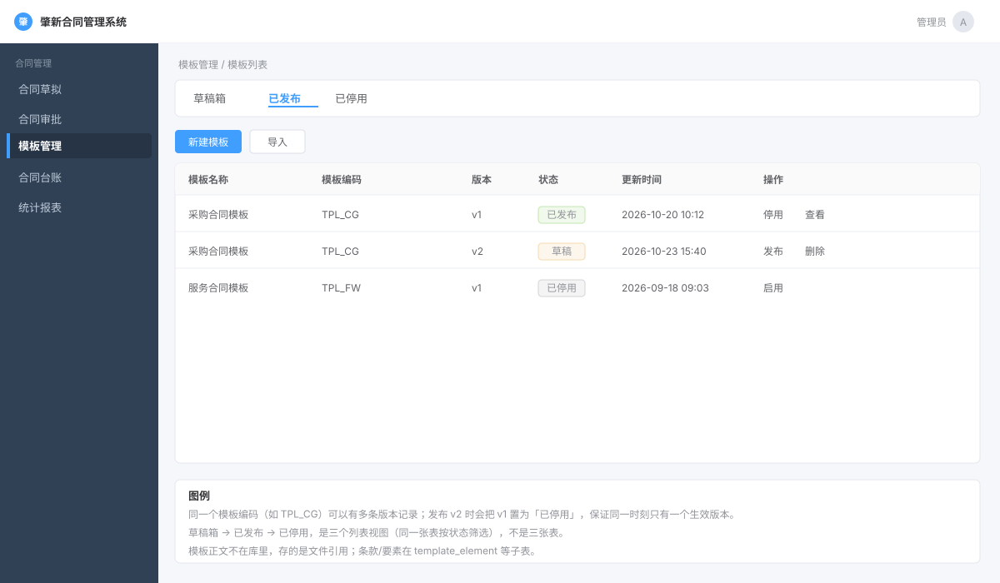

# 第 7 章 · 模板体系

> 第 5 章合同草拟时，有一个动作我们**故意跳过了**：**「从模板起草」**。当时只说"模板文件会被**复制**成合同文件"（第 5 章 §2.5）。
>
> 本章把「模板」这个角色讲完——**它不是合同的一个字段，而是一整套独立体系**：模板有自己的创建/发布/停用/版本、自己的适用范围、自己的审批、自己的附件和条款库。**模板的生命是"合同生命之前的生命"**。
>
> 一句话理解模板的定位：**模板是"合同的模具"**。用模具浇出来的合同是合同，模具坏了/过时了要换新模具（新版本），旧模具要下架（停用）。

> **本章第一次讲透**：
> 1. **「同 code 多版本 + 单选生效」的版本管理**——和第 5 章的「版本表」是**两种不同的版本方案**，本章讲清「什么场景用哪种」。
> 2. **「发布态」建模**——一个模板上为什么躺着 **4 个状态字段**（`status` / `published` / `draftStatus` / `versionShow`）。
> 3. **适用范围（[[D0-底座表地图#21. template_scope 模板适用范围表（04 行 854）|`template_scope`]]）+ `EXISTS` 子查询**——"这个模板你能不能用"是怎么算的。
> 4. **关联模板（[[D0-底座表地图#20. template_link_relation 模板关联关系表（04 行 833）|`template_link_relation`]]）的自关联 + 发布前置校验**——模板可以"拼装"。
> 5. **条款库 / 模板要素**——模板正文里的可替换内容是怎么结构化的（第 8 章会用到）。

> **本章你会碰到的表（7 张，注意哪些是"活的"）**：
> - [[D0-底座表地图#16. template_contract 合同模板表（04 行 720）|`template_contract`]]（模板主表，**活**）
> - `template_scope`（适用范围，**活**）
> - `template_link_relation`（模板关联关系，**活**）
> - [[D0-底座表地图#18. template_clause 模板条款表（04 行 786）|`template_clause`]] / [[D0-底座表地图#19. template_clause_type 模板条款类型表（04 行 812）|`template_clause_type`]]（条款库，**活**）
> - [[D0-底座表地图#17. template_element 模板要素表（04 行 760）|`template_element`]]（模板要素，**活**，给第 8 章文档生成用）
> - [[D0-底座表地图#22. template_attachment 模板附件表（04 行 880）|`template_attachment`]]（模板附件，**已被 `fileGroup` JSON 取代，只在 WPS 模块残留**）

> **零基础先补概念（4 个）**
>
> 1. **主从表（主表 / 子表）**：主表存"这个东西本身"，子表存"挂在它下面的若干行"。比如 `template_contract` 是主表（一行 = 一个模板版本），`template_scope` 是子表（一个模板可以有多条适用部门/人员）。子表靠 `TEMPLATE_ID` 指回主表。
> 2. **版本 vs 生效版本**：模板改过很多次就有多个"版本"，但**同一时刻只能有一个版本对外可用**。本项目把 N 个版本都塞在 `template_contract` 表里，用 `VERSION_SHOW = '1'` 的那一行表示"当前生效版本"（其余行是 `0`）。
> 3. **多对多**：一个模板对多个部门开放，一个部门也能用多个模板。这种关系不能靠随便加一列解决，必须加一张**关系表** `template_scope`，每行只记"一个模板 ↔ 一个部门/一个人"。
> 4. **模板拼装（关联模板）**：成品模板可以引用若干"零件模板"（如通用保密条款模板）。引用关系记在 `template_link_relation` 里，起草时再把零件的主文件/附件拼进合同。**一份成品 = 自己的正文 + 引用的一堆零件**。

> **本章文件索引（完整路径，均相对仓库根 `zhaoxin-contract/`）**：
>
> | 文中简写 | 完整路径 |
> |---|---|
> | `TemplateContract.java` | `zxcm-contract/src/main/java/com/ruoyi/template/domain/TemplateContract.java` |
> | `TemplateEnums.java` | `zxcm-contract/src/main/java/com/ruoyi/template/enums/TemplateEnums.java` |
> | `TemplateContractServiceImpl.java` | `zxcm-contract/src/main/java/com/ruoyi/template/service/impl/TemplateContractServiceImpl.java` |
> | `TemplateAuditServiceImpl.java` | `zxcm-contract/src/main/java/com/ruoyi/template/service/impl/TemplateAuditServiceImpl.java` |
> | `TemplateContractController.java` / `TemplatePublishController.java` / `TemplateStopController.java` / `TemplateAuditController.java` | `zxcm-contract/src/main/java/com/ruoyi/template/controller/` |
> | `ContractDraft.java` | `zxcm-contract/src/main/java/com/ruoyi/contract/domain/ContractDraft.java` |
> | `ContractDraftServiceImpl.java` | `zxcm-contract/src/main/java/com/ruoyi/contract/service/impl/ContractDraftServiceImpl.java` |
> | `ContractAuditFormServiceImpl.java` / `ContractAuditServiceImpl.java` | `zxcm-contract/src/main/java/com/ruoyi/contract/service/impl/` |
> | `FlowAuditService.java` | `zxcm-workflow/src/main/java/com/ruoyi/workflow/business/service/FlowAuditService.java` |
> | `WpsTemplateController.java` | `zxcm-contract/src/main/java/com/ruoyi/wps/controller/WpsTemplateController.java` |
> | `FormServiceImpl.java` | `zxcm-form/src/main/java/com/ruoyi/form/service/impl/FormServiceImpl.java` |
> | `templateDrafts/index.vue` | `zxcm-ui/src/views/template/templateDrafts/index.vue` |
> | `zxcm_init.sql` | `script/sql/zxcm_init.sql` |
> | `JsonUtil.java` | `zxcm-contract/src/main/java/com/ruoyi/conf/util/JsonUtil.java` |

---

## 一、这部分是做什么的？

### 1.1 业务含义

**没有模板时**：每份合同都要从零起草附件（把上份合同的 Word 改改、另存为……），格式不统一、法务条款可能漏、审批人每次都要仔细看格式。

**有模板时**：管理员维护好**公司标准模板**（带固定格式、标准条款、可填要素）→ 起草人**选模板 → 填要素 → 生成合同**。

从系统看，「模板」是一份**受管控的资产**：

1. **谁能建模板**：有 `template:templateDrafts:add` 权限的人（通常是法务/管理员）。
2. **模板不是立即生效的**：先存"草稿（创建中）"→ **发起审批**（法务审）→ 审批通过 = **已发布**，业务员才能用。
3. **模板会改**：改了不能覆盖旧版（旧合同可能已引用），要**发新版本**。**同一时刻只有一个版本"生效"**，但历史版本都留着。
4. **模板会过时**：可以**停用**；停用的模板起草人看不到。
5. **模板有适用范围**：不是所有模板对所有人开放，可以限定「某某部门 / 某某人」才能用。



> **图注**：按模板管理页面的结构画的**示意图，不是真实截图**（官方未提供该页面截图）。重点是「同一个模板编码有多条版本记录」：草稿 → 已发布 → 已停用，同一时刻只有一个生效版本。

### 1.2 模板的状态：**4 个状态字段**（这是本章第一个抓手）

打开 `zxcm-contract/src/main/java/com/ruoyi/template/domain/TemplateContract.java`，你会看到模板主表上有**4 个跟"状态"有关的字段**：

| 字段 | 取值 | 含义 | 定义位置 |
|---|---|---|---|
| `status` | `0`未发布 / `1`已发布 / `2`已停用 | **发布态**（主状态） | `TemplateEnums.java:139-141` |
| `published` | `0`否 / `1`是 | **是否已发布过**（冗余标志位） | 实体 `:67` |
| `draftStatus` | `0`创建中 / `1`审批中 / `2`审批成功 / `3`审批失败 / `4`撤销 | **草稿/审批态** | `TemplateEnums.java:80-81` |
| `versionShow` | `0`否 / `1`是 | **是不是当前生效的版本**（同 code 只允许一个 `1`） | `TemplateEnums.java:108-109` |

**为什么要 4 个？** 因为模板上看起来有**四个问题**要回答（其中第 4 个其实能由第 1 个推导出来，见下方坦白点）：

1. `status`：**对外**看，这模板现在**能不能用**？（已发布能用 / 停用不能用）
2. `draftStatus`：**对内**看，这模板**走到哪一步了**？（还在创建 / 在审批 / 审批成功 / 失败）
3. `versionShow`：**这个版本**是不是"当前生效版本"？（同 `templateCode` 下只有一个）
4. `published`：**曾经**发布过没有？（历史标志位）

> ⚠️ **坦白点**：`published` 和 `status` **语义高度重叠**——`published = '1'` 的实际含义是"**曾经发布过**"，等价于 `status != '0'`（不是"当前已发布"）。注意**停用时它也会被置为 `'1'`**：`TemplateContractServiceImpl.java:240-241` 的 `realStop` 里就是 `published="1"` + `status=已停用`。所以判断"现在能不能用"只能看 `status`。代码里这两个字段总是一起被赋值：`TemplateContractServiceImpl.java:190-191`、`:212-213`、`:240-241`、`:267-268`。**这是历史演进留下的冗余字段**——先有 `published`（布尔），后来需求变成三态，就加了 `status`，但没清掉 `published`。**面试被问"这两个字段什么区别"时，诚实答"冗余，是历史遗留，`status` 是权威字段"** 比硬编一个区别强得多。
>
> 这和**第 6 章合同"六个正交状态字段"是同一个模式**：**状态不是"一个字段"**。区别是：合同那六个**真的正交**（履行中 + 变更中可同时成立），模板这四个**有冗余**（`published` 是 `status` 的退化版）。**"正交"和"冗余"要能分辨**——这是很好的追问点。

### 1.3 「同 code 多版本 + 单选生效」是怎么存的？

**模板的版本模型非常值得单独说**，因为它跟第 5 章的合同版本**完全不同**：

**合同的版本**（第 5 章）：`contract_draft`（主表，1 行）+ [[D0-底座表地图#8. contract_draft_files 合同文件表（04 行 370）|`contract_draft_files`]]（版本表，N 行）。**主表永远只有一行**，历史版本在版本表里。

**模板的版本**（本章）：**`template_contract` 表里放 N 行**，**同一个 `templateCode`，不同 `version`**，靠 `versionShow=1` 标记"哪一行是当前生效版本"。

```sql
-- 概念示意：template_contract 里的数据长这样
-- ID                   TEMPLATE_CODE      VERSION  VERSION_SHOW  STATUS
-- 2075149785349861377  TEM-20260709000001  1.0       0           2(已停用)
-- 2075149888888888888  TEM-20260709000001  2.0       0           2(已停用)
-- 2075149999999999999  TEM-20260709000001  3.0       1           1(已发布)  ← 当前生效
```

**`versionShow=1` 的"单选"是靠代码保证的**，看 `publish`（`TemplateContractServiceImpl.java:178-192`）：

```java
// ① 先把同 code 的所有行 versionShow 全置 0
LambdaUpdateWrapper<TemplateContract> update = new LambdaUpdateWrapper<TemplateContract>();
update.set(TemplateContract::getVersionShow, TemplateEnums.TemplateVersionShowEnums.no.getIndex());  // 全置 0
update.eq(TemplateContract::getTemplateCode, dbModel.getTemplateCode());
this.baseMapper.update(null, update);

// ② 再把"我这一行"置 1
dbModel.setVersionShow(TemplateEnums.TemplateVersionShowEnums.yes.getIndex());
```

**「先全部置 0，再把目标置 1」**——这就是"单选生效"的实现口诀。`changeVersion`（`:796-808`）用的是一模一样的两步。**记住这个口诀**。

> ⚠️ **再补一个坦白点（并发）**：这套"先全 0 再置 1"**只靠代码顺序，没有数据库唯一约束、也没有加锁**。"同一 `templateCode` 只能有一行 `versionShow=1`"在**单线程**下成立；如果两个请求同时发布同一模板的两个版本，两个事务可能各自把对方置 0、再把自己的行置 1，最终出现**两行都是 `1`**（取决于数据库隔离级别和提交顺序）。更稳妥的做法是发布前按 `templateCode` 加锁（如 Redis 分布式锁），或在数据库层用"生成列 + 唯一索引"表达这个约束。**面试被追问"你怎么保证唯一"时，主动承认这是应用层约定、不是数据库约束**，比说"代码保证了"更可信。

**和合同版本方案对比（面试爱问）**：

| | 合同（第 5 章） | 模板（本章） |
|---|---|---|
| 主表行数 | **1 行**（永远） | **N 行**（一版本一行） |
| 版本存哪 | 独立版本表 `contract_draft_files` | **同表**（`template_contract`） |
| "当前版本"标志 | 主表指针 `fileGroupsVersion` | **`versionShow` 列** |
| 判断当前版本 | 读主表指针字段 | `WHERE versionShow = 1` |
| 历史版本查询 | 查版本表 | **同表 `WHERE templateCode = ?`** |
| 优点 | 主表干净、版本表可无限增长 | 简单直接、不用 join |
| 缺点 | 多一次 join | 主表会膨胀（一个模板 10 版本 = 10 行） |

**为什么同样是"版本"要用两种方案？** 看**访问模式**：
- 合同**主表有 80+ 列**（宽表，第 5 章），如果一版本一行，**会有大量重复数据**（80 列 × N 版本）→ 所以拆版本表，只把"会变的部分"（文件组）放版本表，**只有 4 个字段**。
- 模板主表**只有 30 个字段**，且**整个模板（含正文文件、适用范围）都会随版本变**（不只文件变）→ 一版本一行**没有浪费**，反而省了 join。

**判据：看"版本之间变化的字段占比"。变的多 → 一版本一行；变的少 → 拆版本表。**

### 1.4 数据模型全貌

```
template_contract（模板主表，N 行/模板 = N 个版本）
   ├─< template_scope（适用范围：这个版本对哪些部门/人开放）
   ├─< template_link_relation（parent_id → child_id：非关联模板引用关联模板）
   └─< template_element（模板要素：正文里可替换的"占位"）

template_clause_type（条款类型：货物/服务/保密...）
   └─< template_clause（条款库：一条条可复用的条款文本）

template_attachment（模板附件 —— 已被 fileGroup JSON 取代）
```

**「非关联模板」vs「关联模板」是什么？** （`TemplateEnums.java:21-22`）

- **关联模板**（`linkTemplateType=1`）：**被别的模板引用的"零件模板"**。比如「通用保密条款模板」。
- **非关联模板**（`linkTemplateType=0`）：**给业务员用的"成品模板"**，它**引用**若干关联模板。

所以一个成品模板 = 自己的正文 + 引用的一堆零件模板的附件。**这就是"模板拼装"**。

**发布前置校验**（`publish:194-204`）：非关联模板发布时，**它引用的所有关联模板必须都已发布**，否则报"发布失败：当前模板依赖的关联模板未发布"（`:199`）。**这是"依赖必须先就绪"的典型约束**。

**停用级联**（`stop:222-231`）：**停用一个关联模板时，所有引用它的成品模板一起停用**（`:227` 调 `realStop`）。**为什么？** 因为零件没了，成品就是残缺的——**不能让你用一个引用了已下架零件的模板**。

**重新发布不级联**（精确注释在 `TemplatePublishController.java:81`）：

> `// 1.关联模板停用， 使用该模板的非关联模板需要一起停用。关联模板重新发布之后，引用他的非关联模板不会发布，需要单独执行发布。`

**停用向下级联、重新发布不向上级联** —— 这是**刻意的非对称设计**（"错误要连带保护、恢复要人工确认"）。**面试问"为什么不对称"，这就是答案**。

---

## 二、站在架构师 / 开发经理角度：为什么这么设计？

### 2.1 为什么模板要独立成体系，而不是合同表加个 `isTemplate` 字段？

**注意：合同表里确实有 `isTemplate` 字段**（`ContractDraft.java:341`，第 5 章）。**但那是"这份合同本身是由模板生成的"标记，不是"模板"本身。**

**模板不能塞进合同表**，因为它的**生命周期、字段、操作完全不同**：

| | 合同 | 模板 |
|---|---|---|
| 状态 | 审批/用印/复核/变更… | 创建/发布/停用/版本 |
| 核心操作 | 发起审批、用印、归档 | 发布、停用、发新版 |
| 有版本 | 有（文件版本） | 有（整模板版本） |
| 有适用范围 | **无** | **有**（谁能用） |
| 有条款库 | 无 | **有** |
| 会写的数据量 | 每份合同一行起 | 少量（几十上百） |

**硬塞进一张表的后果**：一张表里一半字段只有合同用、一半只有模板用，**每个字段都对另一半是 NULL**。这是典型的「**一张表两个实体**」反模式。

**判据：生命周期不同 → 拆两张表。** 合同和模板是"两种东西"，不是"一种东西的两种状态"。

### 2.2 为什么"发布态"是三态而不是布尔 `isPublished`？

**反例**：`isPublished` 布尔。但业务需要**"停用"**这个状态——停用**不是"没发布"**：
- 从没发布过：**草稿**，管理员还在改；
- 已发布：**在用**；
- 已停用：**发布过、现在下架**（可能因为法务更新了条款）。

**`isPublished = false` 无法区分"从没发布"和"已下架"**——而这两者的**后续操作完全不同**（前者要发布、后者要重新发布）。

| 状态 | 含义 | 允许的操作 |
|---|---|---|
| 草稿 `none` | 从没发布过 | 编辑、发布、删除 |
| 已发布 `publish` | 正在用 | 停用、发新版本 |
| 已停用 `stop` | 发布过、现在下架 | 重新发布、查看 |

**这就是"三态 vs 布尔"的经典判据：如果一个布尔值未来可能要区分"假"的两种含义，就该上枚举。** 本项目用 `TemplateContractStatusEnums`（`none`/`publish`/`stop`，`TemplateEnums.java:139-141`）。

（顺带：`published` 这个残留的布尔字段，正是"当初用了布尔、后来不够用改成三态"的**考古证据**——`TemplateContract.java:67`。）

### 2.3 为什么"适用范围"要独立表 + `EXISTS` 子查询？

`template_scope`（`zxcm_init.sql:5203`）：一行表示"**这个模板对某个部门** 或 **某个人**开放"。

```java
// TemplateContractServiceImpl.java:363-373（getLoginerCanUseTemplate 节选）
Long[] depts = LoginHelper.getLoginUser().getDeptIds();
String deptIdSql = "(" + StringUtils.join(depts, ",") + ")";

LambdaQueryWrapper<TemplateContract> lqw = Wrappers.lambdaQuery();
lqw.eq(TemplateContract::getStatus, TemplateContractStatusEnums.publish.getIndex());   // 必须已发布
lqw.eq(TemplateContract::getContractType, bo.getContractType());                        // 对应合同类型
lqw.eq(TemplateContract::getVersionShow, TemplateVersionShowEnums.yes.getIndex());      // 必须是生效版本
lqw.exists("SELECT 1 FROM TEMPLATE_SCOPE WHERE TEMPLATE_SCOPE.DEL_FLAG = 0 "
    + "AND TEMPLATE_SCOPE.TEMPLATE_ID = TEMPLATE_CONTRACT.ID "
    + "AND ( TEMPLATE_SCOPE.USER_ID = " + LoginHelper.getUserId()
    + "   OR TEMPLATE_SCOPE.DEPT_ID in " + deptIdSql + ")");
```

**为什么独立表？** 因为**适用范围是多对多**：一个模板对多个部门开放，一个部门有多个模板。**多对多用独立表是范式要求**（不能塞进模板表的某一列）。

**为什么用 `EXISTS` 而不是 `JOIN`？** `EXISTS` 找到第一条匹配就短路返回，**不需要去重**；`JOIN` 会因为"一个模板匹配多个 scope 行"而**产生重复行**，还得 `DISTINCT`。**"只是判断'有没有'用 EXISTS"** —— 这是 SQL 优化的常识考点。

> ⚠️ **坦白点**：这里用**字符串拼接**把 `depts`/`userId` 塞进 SQL（`"in (" + join(depts) + ")"`）。`depts` 来自登录 token（`Long[]`）、`userId` 来自 `LoginHelper`，**都是数字**，所以实际不可注入；但**这是"拼接 SQL"的坏习惯**，看代码时要意识到风险。规范做法是 MyBatis 的 `apply` 参数绑定（`lqw.apply("... in ({0})", list)`）。**面试可以主动指出**。

另外注意：**`getLoginerCanUseTemplate` 的权限是"数据级"的**——不是靠 `@DataPermission`（第 2 章），而是靠 **`EXISTS` 子查询手写过滤**。**第 2 章学的是"框架帮你改 SQL"，这里是"自己写 SQL 过滤"**——两条路都能实现数据权限，要能说清各自适用场景（框架适合"按角色/部门"通用规则，手写适合"业务特有"的可见性规则）。

### 2.4 为什么"关联模板的自关联"用独立关系表，而不是在模板表上加 `parentId`？

**如果加 `parentId`**：一个成品模板只能引用**一个**零件模板。但业务上成品模板要**引用多个**（保密 + 争议解决 + 付款…）→ **多对多** → 必须独立表 `template_link_relation`（`parent_id` / `child_id`，`zxcm_init.sql:5181`）。

**注意它是"自关联"**：`parent_id` 和 `child_id` **都指向 `template_contract.id`**。所以查询要用 `EXISTS` 子查询，且**方向要分清**（`:339-341` vs `:351-353`）：

```java
// getUsedLikeTemplateList（:334）：当前"非关联模板"引用了哪些"关联模板"
//   TEMPLATE_LINK_RELATION.CHILD_ID = TEMPLATE_CONTRACT.ID AND PARENT_ID = 我
// getBeUsedNoLikeTemplateList（:346）：当前"关联模板"被哪些"非关联模板"引用
//   TEMPLATE_LINK_RELATION.CHILD_ID = 我 AND PARENT_ID = TEMPLATE_CONTRACT.ID
```

**两个方法的 `CHILD_ID` / `PARENT_ID` 位置刚好对调**——**读这段代码最容易搞反方向**，务必对照着看。

### 2.5 为什么附件从 `template_attachment` 表迁到了 `fileGroup` JSON？

**证据链**：
- `template_attachment` 表**存在**（`zxcm_init.sql:5037`）；
- 但 `TemplateContractServiceImpl` 里**已经不用它了**——`insertByBo:486` 把附件存进 `fileGroup`（JSON 字符串），`updateByBo:541-542` 也是；
- 唯一还在用 `template_attachment` 的是 `WpsTemplateController.java:87`（WPS 在线编辑模块）；
- 更直白的证据：`TemplateContractServiceImpl.java:403-408` 有**注释掉的** `templateAttachmentService.queryList(...)`。

**为什么迁到 JSON？** 和**第 5 章 §2 的"文件组 JSON"** 是同一个理由：

1. **附件永远整体读写**——读模板必然读全部附件，写模板必然全量替换，**没有"单独查某一个附件"的需求** → 不需要独立表的查询能力；
2. **少一张表、少一次 join、少一次事务**；
3. **附件数量少**（几个到几十个），JSON 不臃肿。

**代价**（第 5 章也讲过）：**没法用 SQL 查"哪些模板用了某个文件"**、**没法建索引**、**要整段读写**。所以这是**"读写模式决定存储形态"**的再次应用。**同一个项目里第 5 章（合同）和本章（模板）都做了这个选择，说明这不是偶然，是一致的设计风格**——面试时能指出"项目一贯倾向用 JSON 存小规模、整体读写的集合"，很有说服力。

### 2.6 为什么条款库要独立两张表（`template_clause_type` + `template_clause`）？

**条款 = 可复用的合同文本片段**（"本合同争议由甲方所在地法院管辖"之类）。业务上：

1. **条款要分类**（保密类 / 付款类 / 争议解决类）→ `template_clause_type`（`zxcm_init.sql:5090`，含 `SORTING` 排序号）；
2. **一条条款属于一个类型、适用于若干合同类型** → `template_clause`（`zxcm_init.sql:5062`），`CONTRACT_TYPE` 是 **longtext**（存的是一段 JSON 数组——**一条条款可以适用多个合同类型**）。

**为什么 `CONTRACT_TYPE` 用 longtext 存 JSON 数组而不是关联表？** 同 §2.5 的理由——**"一条条款适用哪些合同类型"是整体读写的（编辑条款时全量提供，展示时整体用）**，且**合同类型数量有限**（第 4 章，几十个），不建索引也能接受。

**还有一组字段值得注意**（`template_clause` 尾部）：

```sql
`SOURCE_TYPE`        char(1)     COMMENT '0 自建 1 模板',
`SOURCE_TEMPLATE_ID` varchar(64) COMMENT '来源模板id',
`SOURCE_FILE_ID`     varchar(64) COMMENT '来源文档id',
```

**这说明条款有两种来源**：**人工自建**（`SOURCE_TYPE=0`）或**从某个模板/文档里抽取**（`SOURCE_TYPE=1`）。**"来源溯源"字段**（记住来源模板和来源文件）——这是**数据血缘**的思路：条款能回答"我是从哪份模板里提出来的"。**这个设计很有想法，面试可以夸**。

### 2.7 为什么"模板审批"看起来没接上工作流？（**本章最重要的坦白点**）

**读代码会遇到的反常现象：**

1. `TemplateAuditServiceImpl.beginAudit`（`:55`）——把 `instanceDefKey` 硬编码成 `"templateAudit"`（`:57`）、`draftStatus` 置为"审批中"，**但唯一该发事件的代码被注释掉了**：

```java
// TemplateAuditServiceImpl.java:76-77
// TemplateFlowEvent event = new TemplateFlowEvent(this, realTemplate, AuditFlowEvent.TYPE_START);
// applicationEventPublisher.publishEvent(event);
```

2. 被注释引用的 `TemplateFlowEvent` **这个类根本不存在**（全项目搜不到文件）；
3. `FlowAuditService.auditSuccess`（第 6 章 `:182`）只处理 `type.equals("audit")`，**没有任何地方处理 `"templateAudit"`**；
4. `TemplateAuditServiceImpl` 的 `complete`(:83) / `reject`(:105) / `cancel`(:114) **全项目零调用**（`grep` 只在自己文件里出现）；
5. `backToDraft`(:128) 是**空方法**，`queryPageList`(:123) **返回 null**；
6. 前端 `templateDrafts/index.vue:473` 的 `handleBeginAudit` 确实调了 `POST /template/templateAudit`，**能成功**（因为 `beginAudit` 自己返回 `true`），但**没有流程实例被创建**——所以 `row.instanceId` 是 `null`，而 `cancelApply` 方法（`zxcm-ui/src/views/template/templateDrafts/index.vue:414`，拼请求参数在 `:432-437`）却拿 `row.instanceId` 去调 `/activiti/process/cancelApply`。

**结论（必须诚实写出来）：**

> **模板审批在当前代码里是"半成品"**——`beginAudit` 接口是通的，但它**不发流程事件、不启动 Activiti、不写 `instanceId`**，所以模板**实际上永远走不到"审批通过"**；配套的 `complete`/`reject`/`cancel`/`backToDraft` 是空实现或死代码。

**那么模板实际靠什么生效？** 靠**直接发布**：前端 `handlePublish`（`templateDrafts/index.vue:465`）→ `GET /template/templateDrafts/publish/{id}` → `TemplateContractServiceImpl.publish(:166)`。**发布 = 直接置"已发布"，不走审批**。

**为什么是这样？** 合理推测：**早期设计了模板审批，后来简化为"有权限的人直接发布"，审批相关的代码没删干净**（硬编码 `instanceDefKey="templateAudit"` 和注释掉的事件就是痕迹）。

**这份文档怎么处理它？** 本章**照实讲清两边**：
- ✅ **"直接发布"这套是完整可用的**——`publish`/`stop`/`rePublish`/`addNewVersion`/`changeVersion` 全都有完整实现，是本章主线；
- ⚠️ **"模板审批"这套是残缺的**——**别照着 `TemplateAuditServiceImpl` 抄**，会得到一个"接口通但不工作"的假功能。

> **学习价值**：这正是**真实项目的样子**——**不是所有代码都是"最佳实践"**。学会**分辨"活代码 / 死代码 / 半成品"**（本章 §1.3 的 `template_attachment` 是"被取代"、这里是"没做完"），比背设计模式更重要。**面试被问"你项目里有什么技术债"，这就是一个绝佳的、有细节的答案。**

### 2.8 为什么模板的版本比较用 `BigDecimal`，而合同（第 5 章）用 `Float`？

**对比两处代码：**

```java
// 第 5 章：合同 addNewVersion（ContractDraftServiceImpl.java:643 附近）
// 用 Float.valueOf 解析版本号比较（第 5 章 §4.7 已指出这是精度隐患）

// 本章：模板 addNewVersion（TemplateContractServiceImpl.java:741-756）
BigDecimal nvb = new BigDecimal(newVersion);
for (TemplateContract t : templates) {
    BigDecimal old = new BigDecimal(t.getVersion());
    if (old.compareTo(nvb) > 0) throw new ServiceException("新版本号小于历史版本，创建失败");
    if (old.compareTo(nvb) == 0) throw new ServiceException("当前版本号已经存在，创建失败");
}
```

**模板用 `BigDecimal` 是对的**（十进制精确比较），**合同用 `Float` 是有隐患的**（第 5 章坦白点）。

**同一个项目、同一个功能（版本比较）、两种实现**——这是**代码库不一致（inconsistency）**的典型。**面试若问"你怎么看代码质量"，拿这个当例子**："同一语义在两处实现不一致，说明缺统一的版本号工具类；正确做法是抽 `VersionUtils.compare(String, String)` 统一实现"。**这比空谈"要写单元测试"具体一百倍。**

---

## 三、需要哪些技术？

| 技术 | 用在哪 | 精确位置 |
|---|---|---|
| **MyBatis-Plus `EXISTS` 子查询** | 适用范围/关联模板过滤 | `TemplateContractServiceImpl.java:339,351,370` |
| **「先全 0 再置 1」单选生效** | 版本生效、发布、切版本 | `TemplateContractServiceImpl.java:178-192, 800-807` |
| **`BigDecimal` 版本比较** | 新版本号校验 | `TemplateContractServiceImpl.java:741-756` |
| **文件复制**（第 5 章组件） | 发新版本时复制模板正文 | `TemplateContractServiceImpl.java:761-770`（`confFileService.copyFile`）+ `RuoYiConfig.getProfile()` |
| **Spring 事件（监听型）** | 合同类型删除时校验模板引用 | `TemplateContractServiceImpl.java:697-708`（`DataDeleteEvent`，第 4 章回声） |
| **编号规则**（第 3 章） | 模板编号 `TEMPLATE_RULE` | `TemplateContractServiceImpl.java:110,174`；`TemplateAuditServiceImpl.java:51,68` |
| **`JsonUtil.toStringTableInfoExclude`** | 列表排除大 JSON 字段 | `TemplatePublishController.java:71` → `conf/util/JsonUtil.java:218` |
| **`@TableLogic` 逻辑删除** | 模板/适用范围/关联关系 | `TemplateContract.java:91` 等各表 |
| **多租户 `tenantId`** | 模板按租户隔离 | 各表 `TENANT_ID` 列 |
| **Sa-Token 权限码** | 模板增删改发布停用 | `TemplateContractController.java:72,104,125,136,148,160,171` 等 |

---

## 四、功能具体怎么实现（带着你复制）

> **本章涉及的表**（点表名直达底座表地图的字段详情）：
> [[D0-底座表地图#16. template_contract 合同模板表（04 行 720）|`template_contract`]]（模板主表） ｜ [[D0-底座表地图#17. template_element 模板要素表（04 行 760）|`template_element`]]（模板要素） ｜ [[D0-底座表地图#18. template_clause 模板条款表（04 行 786）|`template_clause`]]（条款库） ｜ [[D0-底座表地图#19. template_clause_type 模板条款类型表（04 行 812）|`template_clause_type`]]（条款类型） ｜ [[D0-底座表地图#20. template_link_relation 模板关联关系表（04 行 833）|`template_link_relation`]]（关联关系） ｜ [[D0-底座表地图#21. template_scope 模板适用范围表（04 行 854）|`template_scope`]]（适用范围） ｜ [[D0-底座表地图#22. template_attachment 模板附件表（04 行 880）|`template_attachment`]]（附件（残留）） ｜ [[D0-底座表地图#12. conf_file 统一文件表（04 行 198）|`conf_file`]]（文件元数据） ｜ [[D0-底座表地图#8. contract_draft_files 合同文件表（04 行 370）|`contract_draft_files`]]（合同文件版本）


### 4.1 需求、表设计与施工计划

**需求单（模拟）**

**需求编号** ZXCM-TEMPLATE-001　**提出人** 法务部　**优先级** 高　**本期上线**

**背景**：每份合同都从零改 Word，格式不统一、标准条款容易漏。需要一套受管控的模板：法务维护、审批后发布、业务员只能选已发布的。

**功能需求**

| # | 功能 | 具体要求 |
|---|---|---|
| 1 | 模板维护 | 新建（草稿）、编辑、删除；模板挂正文文件和附件 |
| 2 | 审批发布 | 草稿 → 审批 → 已发布；未发布的业务员看不到 |
| 3 | 版本 | 改模板不能覆盖旧版，要**发新版本**；同一模板同一时刻只有**一个生效版本** |
| 4 | 停用 | 停用后业务员选不到；历史合同不受影响 |
| 5 | 适用范围 | 可以限定某些部门 / 人才能用 |
| 6 | 关联模板 | 成品模板可以引用「零件模板」（如通用保密条款） |
| 7 | 条款库 | 可复用条款文本，按条款类型分组 |

**验收标准**：发布后业务员能选到；发新版本后旧版仍可查、但不再生效；停用后列表里选不到；停用一个关联模板，引用它的成品模板一起停用；引用未发布的关联模板时，发布报错。

**本期不做**：模板审批的完整流程（见 §4.10 坦白点）、模板在线编辑（第 8 章）。

**拿到需求先做四件事**

① **给需求定性，再推架构**

| 判断维度 | 本模块的答案 | 推出的设计 |
|---|---|---|
| 数据性质 | 受管控的资产，有发布态 | `STATUS` + 审批态字段 |
| 版本 | 整个模板（正文、范围）都随版本变 | 一版本一行，`VERSION_SHOW` 标记生效 |
| 关系 | 成品引用零件模板 | 独立关系表 |
| 范围 | 按部门/人限定谁能用 | `template_scope` |
| 引用 | 被合同引用 | 不物理删，停用代替 |

→ 架构：模板主表（N 版本）+ 范围/关联/要素/条款表。

② **定存储**：7 张表，但真正在用的是 6 张（`template_attachment` 已被 JSON 取代）。

③ **定接口**：CRUD、发布、停用、发版本、切换版本、查可用模板，见 §四。

④ **定实现边界：哪些不用写、哪些必须写、哪些是缺口**

- **框架给**：CRUD、逻辑删除、审批状态字段；
- **必须自己写**：`VERSION_SHOW` 单选、停用级联、可用模板过滤；
- **已知缺口**：`PUBLISHED` 冗余；`VERSION_SHOW` 无唯一约束；模板审批半成品；`template_attachment` 是残留表。

**表设计导读：7 张表，先分清「活」和「残留」**

| 表 | 状态 | 角色 |
|---|---|---|
| `template_contract` | 活 | 模板主表，**一行 = 一个版本** |
| `template_scope` | 活 | 这个版本对哪些部门 / 人开放 |
| `template_link_relation` | 活 | 成品模板引用了哪些零件模板 |
| `template_element` | 活 | 正文里的可替换要素 |
| `template_clause_type` | 活 | 条款类型 |
| `template_clause` | 活 | 条款文本 |
| `template_attachment` | **残留** | 已被 `FILE_GROUP` JSON 取代，别再往里写 |

**核心设计：模板的版本为什么和合同不一样**

| | 合同（第 5 章） | 模板（本章） |
|---|---|---|
| 主表行数 | 1 行永远 | **N 行**（一版本一行） |
| 版本存哪 | 独立版本表 | **同表**，靠 `TEMPLATE_CODE` + `VERSION` |
| 当前版本标志 | 主表指针 | `VERSION_SHOW = 1` |
| 判断当前版本 | 读指针 | `WHERE VERSION_SHOW = 1` |

**判据是「版本之间变化的字段占比」**：合同 80+ 列、只有文件组会变 → 拆版本表；模板 30 列、整个模板（正文、适用范围）都随版本变 → 一版本一行不浪费。

**4 个状态字段，其中一个是冗余**：

| 字段 | 回答 | 备注 |
|---|---|---|
| `STATUS` | 对外能不能用（0 未发布 / 1 已发布 / 2 已停用） | **权威字段** |
| `DRAFT_STATUS` | 对内走到哪一步（创建 / 审批 / 成功 / 失败 / 撤销） | 和审批相关 |
| `VERSION_SHOW` | 这个版本是不是当前生效版本 | 同 code 只应有一行 = 1 |
| `PUBLISHED` | 曾经发布过没有 | **历史遗留冗余**，停用时也会置 1，判断能不能用只看 `STATUS` |

**「单选生效」靠代码两步**：先把同 `TEMPLATE_CODE` 的所有行 `VERSION_SHOW` 置 0，再把目标行置 1（`publish` `:178-192`、`changeVersion` `:796-808`）。**没有数据库唯一约束、没有加锁**——并发发布可能出两行都是 1（§1.3 坦白点）。

**四个关键取舍**

| 决策 | 选择 | 代价 | 什么情况下反过来 |
|---|---|---|---|
| 版本模型 | 一版本一行（同表） | 主表膨胀（10 版 = 10 行） | 版本间只有少量字段变化时拆版本表 |
| 状态字段 | 4 个（含 1 个冗余） | 新人容易看错 | 一开始就设计成三态 + 一个标志位 |
| 附件 | `FILE_GROUP` JSON | 不能按附件维度查 | 附件要单独检索、统计时 |
| 关联模板 | 独立关系表 | 多一次查询 | 层级固定、只有一层引用时可在主表加 parentId |

**已知缺陷 / 边界**

- **`PUBLISHED` 冗余**，和 `STATUS` 语义重叠；
- **`VERSION_SHOW` 单选没有数据库约束**，并发下有风险；
- **模板审批是半成品**（§4.10）：`INSTANCE_DEF_KEY` / `INSTANCE_ID` 有字段，但链路没接通；
- **`template_attachment` 是残留表**，新代码不要再依赖它；
- **停用级联、重新发布不级联**，是刻意的非对称设计（§1.4）。

**演示数据**：`ch07` 脚本插了 1 条模板 + 2 条适用范围，够验证「列表有数据、能选模板」；版本切换、关联模板要自己造。

**对后面章节的连锁影响**

| 后面的事 | 依赖这里的什么 |
|---|---|
| 合同起草用模板 | 复制模板的正文和附件（第 5 章 §2.5） |
| 文档生成填要素 | `template_element` + contentControl（第 8 章） |
| 模板停用后合同还能看 | 模板版本不物理删除 |

**施工计划**

> 施工单的完整任务清单见本章「任务清单」小节，可以和上面的分步顺序对照着看。

| 步骤 | 做什么 | 做完的标志 |
|---|---|---|
| 4.2 | 模板实体 | 实体与 7 张表对上 |
| 4.3 | 模板 CRUD | 能新建草稿、编辑、删除 |
| 4.4 | 发布 `publish` | 发布后 `STATUS=1`、`VERSION_SHOW=1` |
| 4.5 | 停用 / 重新发布 | 停用后业务员选不到；关联模板停用会级联 |
| 4.6 | 发新版本 | 同 code 多一行、旧版 `VERSION_SHOW=0` |
| 4.7 | 切换版本 | 生效版本换到指定行 |
| 4.8 | 查可用模板 | 业务员只看到已发布 + 在适用范围内的 |
| 4.9 | 引用完整性 | 删合同类型时，模板模块能拦住 |
| 4.10 | 坦白点 | 知道模板审批为什么没接通 |

**建表**

**7 张表**，按"活/残留"分组：

```sql
-- ① 模板主表（活）—— script/sql/zxcm_init.sql:5113
CREATE TABLE `template_contract`  (
  `ID`               varchar(64) NOT NULL DEFAULT '1.0',
  `TEMPLATE_NAME`    varchar(100) NOT NULL COMMENT '模板名称',
  `TEMPLATE_CODE`    varchar(40)  COMMENT '模板编号',       -- ★同 code 多版本★
  `CONTRACT_TYPE`    varchar(64) NOT NULL COMMENT '适用合同类型',  -- → form.id（第4章）
  `LINK_TEMPLATE_TYPE` char(1)    COMMENT '是否为关联模板 0否 1是',
  `STATUS`           char(1)      COMMENT '合同状态 0未发布 1已发布 2已停用',
  `PUBLISHED`        char(1)      COMMENT '是否已发布 0未发布 1已发布',  -- ⚠️ 冗余
  `MAIN_FILE_ID`     decimal(65,0) COMMENT '主文件ID',      -- → conf_file.id（第5章）
  `MAIN_FILE_FORMAT` char(1)      COMMENT '0 格式合同 1 非格式合同',
  `MAIN_FILE_NAME`   varchar(200) COMMENT '模板正文名称',
  `MAIN_FILE_PATH`   varchar(200) COMMENT '模板正文路径',
  `JSON`             longtext     COMMENT '模板内容(JSON)',   -- 自定义表单配置
  `FILE_GROUP`       longtext     COMMENT '模板文件组(JSON)', -- ★附件存这里★
  `VERSION`          varchar(6) DEFAULT '1.0' COMMENT '版本号',
  `VERSION_SHOW`     char(1) DEFAULT '0' COMMENT '是否当前生效版本,0否 1是',
  `DRAFT_STATUS`     char(2) DEFAULT '0' COMMENT '草稿状态',
  `INSTANCE_DEF_KEY` varchar(255) COMMENT '流程编号',        -- ⚠️ 模板审批用（半成品）
  `INSTANCE_ID`      varchar(255) COMMENT '流程实例id',      -- ⚠️ 同上
  `PUBLISH_TIME`     datetime     COMMENT '发布时间',
  ...
  PRIMARY KEY (`ID`) USING BTREE
) COMMENT = '合同模板';

-- ② 适用范围（活）—— script/sql/zxcm_init.sql:5203
CREATE TABLE `template_scope`  (
  `TEMPLATE_ID` varchar(64) NOT NULL COMMENT '模板id',
  `DEPT_ID`     varchar(64) COMMENT '适用部门',
  `USER_ID`     varchar(64) COMMENT 'user_id',
  `SCOPE_TYPE`  char(1) COMMENT '适用类型 0 部门 1人员',
  ...
) COMMENT = '合同模板使用范围';

-- ③ 关联关系（活）—— script/sql/zxcm_init.sql:5181
CREATE TABLE `template_link_relation`  (
  `PARENT_ID` varchar(64) NOT NULL COMMENT '主模板id',
  `CHILD_ID`  varchar(64) NOT NULL COMMENT '子模板id',
  ...
) COMMENT = '模板关联关系';

-- ④⑤ 条款库（活）—— script/sql/zxcm_init.sql:5090 / :5062
CREATE TABLE `template_clause_type`  (...);   -- 条款类型
CREATE TABLE `template_clause`  (
  `CONTRACT_TYPE`   longtext NOT NULL COMMENT '合同类型',      -- JSON 数组
  `SOURCE_TYPE`     char(1)   COMMENT '0 自建 1 模板',          -- ★来源溯源★
  `SOURCE_TEMPLATE_ID` varchar(64) COMMENT '来源模板id',
  `SOURCE_FILE_ID`  varchar(64) COMMENT '来源文档id',
  ...
) COMMENT = '模板条款库';

-- ⑥ 模板要素（活，第8章用）—— script/sql/zxcm_init.sql:5153
CREATE TABLE `template_element`  (
  `ELEMENT_NAME` varchar(40) NOT NULL COMMENT '合同要素名称',
  `ELEMENT_TYPE` char(1) NOT NULL COMMENT '0 手动输入 1 选择条款',
  `OBJECT_CODE`  varchar(64) COMMENT '关联字段',
  `TEMPLATE_ID`  varchar(64) NOT NULL COMMENT '模板id',
  `DOC_ID`       varchar(64) COMMENT '文档中contentControl的id',  -- ★Word 内容控件的 id★
  `CONTENT`      longtext    COMMENT '默认内容',
  ...
) COMMENT = '模板合同要素';

-- ⑦ 模板附件（⚠️ 残留，只在 WPS 模块用）—— script/sql/zxcm_init.sql:5037
CREATE TABLE `template_attachment`  (...);
```

**新增字段/表时注意**：
1. **多租户列** `TENANT_ID` 每张表都要有（RuoYi-Vue-Plus 租户插件会自动加条件）；
2. **逻辑删除列** `DEL_FLAG` 每张表都要有（`@TableLogic`）；
3. `template_contract.ID` 是 **varchar(64)** 雪花字符串（第 1 章：`idType: ASSIGN_ID`），不是自增。

### 4.2 实体 `TemplateContract`（`:35`）

> **这一步依赖的配置**：`@TableLogic` 依赖 `application.yml:254/256` 的 `2/0`；模板发布编号依赖 `conf_bill_rule` 里的 `TEMPLATE_RULE` 数据。

**本步目标**：主表实体 + 4 个状态字段的含义。
**做完的标志**：实体编译通过，能说出 `STATUS` 和 `PUBLISHED` 的区别。

见 §1.2 的字段表。补充几个**非状态**的重点字段：

```java
@TableName("template_contract")
public class TemplateContract extends BaseEntity {
    private String id;              // :43  varchar 雪花 id
    private String templateCode;    // :51  ★版本归组键★
    private String contractType;    // :55  → form.id（第 4 章合同类型）
    private String linkTemplateType;// :59  0非关联 1关联
    private String mainFileId;      // :71  → conf_file.id
    private String mainFileFormat;  // :75  0格式合同 1非格式合同
    private String json;            // :105 模板自定义表单（合同类型带的 json 复制过来）
    private String fileGroup;       // :110 ★附件 JSON★
    private String version;         // :115 版本号 '1.0'
    private String versionShow;     // :119 ★当前生效版本标志★
    private String draftStatus;     // :123
    private Date   publishTime;     // :127
    private String instanceId;      // :131 ⚠️ 模板审批（半成品）
    private String instanceDefKey;  // :135 ⚠️ 同上
}
```

### 4.3 Service：模板 CRUD

**本步目标**：草稿的新增、编辑、删除。
**做完的标志**：能建一条草稿模板，列表能查到。

**新增 `insertByBo`（`:467`）：**

```java
@Override
@Transactional
public Boolean insertByBo(TemplateContractBo bo) {
    TemplateContract add = BeanUtil.toBean(bo, TemplateContract.class);
    // ① 初始化四个"状态"字段（新模板一定是：未发布 + 创建中 + 版本不可见）
    add.setCreateDeptId("");
    add.setStatus("0");                                            // 未发布
    add.setPublished("0");
    add.setDraftStatus(TemplateDraftStatusEnums.create.getIndex()); // 创建中
    add.setVersionShow(TemplateVersionShowEnums.no.getIndex());     // 不是生效版本
    validEntityBeforeSave(add);                                    // ⚠️ 空方法（:628）

    // ② ★从合同类型上"抄"自定义表单配置★
    FormVo formVo = this.formService.queryById(Long.valueOf(bo.getContractType()));
    if (formVo != null) add.setJson(formVo.getJson());

    // ③ 主文件：从 conf_file 拿真实文件名/路径（防伪造）
    ConfFile file = confFileService.getById(Long.valueOf(bo.getMainFileId()));
    add.setMainFileId(file.getId());
    add.setMainFilePath(file.getFileName());

    // ④ 附件 → fileGroup JSON
    if (CollectionUtil.isNotEmpty(bo.getAttachmentsArray())) {
        add.setFileGroup(JsonUtils.toJsonString(bo.getAttachmentsArray()));
    }

    boolean flag = baseMapper.insert(add) > 0;
    if (flag) {
        bo.setId(add.getId());
        // ⑤ 关联模板（多对多）→ template_link_relation 逐条插入
        if (no.equals(add.getLinkTemplateType()) && isNotEmpty(bo.getLinkTemplateArray())) {
            for (TemplateContractVo item : bo.getLinkTemplateArray()) {
                TemplateLinkRelationBo linkRelationBo = new TemplateLinkRelationBo();
                linkRelationBo.setParentId(add.getId());
                linkRelationBo.setChildId(item.getId());
                templateLinkRelationService.insertByBo(linkRelationBo);
            }
        }
        // ⑥ 适用范围：用户 → template_scope(scopeType=1)
        if (isNotEmpty(bo.getScopeUserArray())) {
            for (TemplateScopeBo item : bo.getScopeUserArray()) {
                TemplateScopeBo scopeBo = new TemplateScopeBo();
                scopeBo.setTemplateId(add.getId());
                scopeBo.setScopeType(TemplateScopeTypeEnums.user.getIndex());
                scopeBo.setUserId(item.getUserId());
                templateScopeService.insertByBo(scopeBo);
            }
        }
        // ⑦ 适用范围：部门 → template_scope(scopeType=0)
        if (isNotEmpty(bo.getScopeDeptArray())) {
            for (TemplateScopeBo item : bo.getScopeDeptArray()) {
                TemplateScopeBo scopeBo = new TemplateScopeBo();
                scopeBo.setTemplateId(add.getId());
                scopeBo.setScopeType(TemplateScopeTypeEnums.dept.getIndex());
                scopeBo.setDeptId(item.getDeptId());
                templateScopeService.insertByBo(scopeBo);
            }
        }
    }
    return flag;
}
```

**三个点：**
1. **第 ② 步是"模板继承合同类型"**：模板的自定义表单配置（`json`）**直接从合同类型抄**（第 4 章的 `form.json`）——所以**同一个合同类型下的所有模板，表单结构一致**。这是第 4 章和第 7 章的**衔接点**。
2. **第 ③ 步是"反查防伪造"**：前端只传 `mainFileId`，后端**拿 id 去查 [[D0-底座表地图#12. conf_file 统一文件表（04 行 198）|`conf_file`]]**取真实路径——**绝不相信前端传的路径**。这是文件安全的基本功（第 5 章 §4.2 讲过"服务端校验"）。
3. **`validEntityBeforeSave` 是空方法**（`:628-630`，`// TODO 做一些数据校验,如唯一约束`）——**坦白点**：模板名/编号的**唯一性没有校验**，并发下可能建出同名模板。**这是可以主动指出的缺口**（第 4 章 `form` 表也有同样问题）。

**修改 `updateByBo`（`:529`）** 的结构和新增几乎**一一对应**（`:546-576`）——**先删旧关联再插新关联**：

```java
boolean flag = baseMapper.updateById(update) > 0;
if (flag) {
    templateLinkRelationService.deleteByTemplateId(update.getId());   // ★先删★
    templateScopeService.deleteByTemplateId(update.getId());
    // 再插（同 insertByBo 的 ⑤⑥⑦）
}
```

**「先删后插」是"子集合整体替换"的标准做法**——比"逐条 diff 增删改"简单得多，**代价是主键会变**（关联行的 id 每次更新都变）。**小集合用这个足够**。

**删除 `deleteWithValidByIds`（`:637`）** 同样是"删主表 + 删子集合"：

```java
boolean result = baseMapper.deleteBatchIds(ids) > 0;   // 逻辑删除（@TableLogic → DEL_FLAG=2）
if (result) {
    ids.stream().forEach(x -> {
        templateLinkRelationService.deleteByTemplateId(x);
        templateScopeService.deleteByTemplateId(x);
    });
}
```
（`if (isValid) { // TODO }` 又是空校验——**和 §4.3 一样的缺口**。）

### 4.4 Service：发布 `publish`（`:166`）

**本步目标**：发布 + 「单选生效」两步操作。
**做完的标志**：发布后 `STATUS=1`，同 code 下只有这一行 `VERSION_SHOW=1`。

**这是模板从"草稿"变成"业务员可用"的关键动作**（前端「发布」按钮 → `GET /template/templateDrafts/publish/{id}`）。

```java
@Override
@Transactional
public Boolean publish(String id) {
    TemplateContract dbModel = baseMapper.selectById(id);

    // ① 没有编号就生成（TEMPLATE_RULE，第 3 章）
    if (StringUtils.isEmpty(dbModel.getTemplateCode())) {
        Map<String, String> map = new HashMap<>();
        String code = confBillRuleService.getBillNumber(CODE, map, false);
        dbModel.setTemplateCode(code);
    }

    // ② ★单选生效：同 code 的版本全置 versionShow=0★
    LambdaUpdateWrapper<TemplateContract> update = new LambdaUpdateWrapper<>();
    update.set(TemplateContract::getVersionShow, TemplateVersionShowEnums.no.getIndex());
    update.eq(TemplateContract::getTemplateCode, dbModel.getTemplateCode());
    this.baseMapper.update(null, update);

    // ③ 我这一行：生效 + 审批成功 + 记发布时间 + 已发布
    dbModel.setVersionShow(TemplateVersionShowEnums.yes.getIndex());
    dbModel.setDraftStatus(TemplateDraftStatusEnums.auditSuccess.getIndex());
    dbModel.setPublishTime(new Date());
    dbModel.setPublished("1");
    dbModel.setStatus(TemplateContractStatusEnums.publish.getIndex());
    this.baseMapper.updateById(dbModel);

    // ④ ★前置校验：非关联模板引用的一切关联模板必须已发布★
    if (no.equals(dbModel.getLinkTemplateType())) {
        List<TemplateContractVo> linkTemplateList = getUsedLikeTemplateList(id);
        if (CollectionUtil.isNotEmpty(linkTemplateList)) {
            linkTemplateList.forEach(link -> {
                if (!publish.getIndex().equals(link.getStatus())) {
                    throw new ServiceException("发布失败：当前模板依赖的关联模板未发布");
                }
            });
        }
    }
    return realPublish(id);   // :208 再更新一次 status/published
}
```

**逐行读（对应 `zxcm-contract/src/main/java/com/ruoyi/template/service/impl/TemplateContractServiceImpl.java:164-205`）：**

| 行 | 这一行在干什么 | 为什么这么写 |
|---|---|---|
| `:164-166` | `@Override @Transactional public Boolean publish(String id)` | 整个发布是一个事务；第 ④ 步校验失败抛异常时，前面改的状态会一起回滚 |
| `:169` | `selectById(id)` 取数据库里的模板行 | 不能改前端传进来的对象，必须基于库里的真实数据 |
| `:172-176` | 只有 `templateCode` 为空才生成编号 | 老数据或首次发布可能没编号；已有编号的版本绝不能重新生成，否则同一模板的多个版本会被拆成不同 `code` |
| `:179-182` | 构造 `LambdaUpdateWrapper`：`versionShow=0 WHERE templateCode=?` | 第一步：把同 code 的所有版本统一"取消生效" |
| `:185-188` | 当前行设 `versionShow=1`、`draftStatus=审批成功`、`publishTime=当前时间` | 第二步：把"我"设为唯一生效版本，并补齐发布信息 |
| `:190-191` | 当前行设 `published='1'`、`status=已发布` | 对外可见性由 `status` 决定；`published` 是"曾经发布过"的历史冗余（见 §1.2） |
| `:192` | `updateById(dbModel)` 落库 | 到这里，状态已经改完了 |
| `:194-204` | 若是非关联模板，查它引用的零件模板，有未发布的就抛异常 | 发布前置校验；抛异常 → `@Transactional` 把前面的改动回滚 |
| `:205` | `return realPublish(id)` | 再更新一次 `published/status`，这一步是冗余的（见本节末尾） |

**注意顺序问题**：第 ②③ 步**先把状态改好了**，第 ④ 步才校验关联模板——**如果校验失败抛异常，`@Transactional` 会回滚前面的修改**，所以最终一致。**但逻辑上"先改后校验"读起来别扭**；更清晰的写法是**先校验、后修改**。（**可以指出这个可读性问题**，虽然是"能用"的。）

**`realPublish`（`:208`）看起来和第 ③ 步重复**——它再设一次 `published="1"` 和 `status=publish`。**这是冗余代码**（第 ③ 步已设过），属于可清理项。

### 4.5 Service：停用 `stop` / 重新发布 `rePublish`（级联与不对称）

**本步目标**：停用向下级联，重新发布不向上级联。
**做完的标志**：停用零件模板后，引用它的成品模板也停用；重新发布后成品仍需手动发布。

**停用 `stop`（`:218`）——向下级联：**

```java
@Override
public Boolean stop(String id) {
    TemplateContractVo dbModel = baseMapper.selectVoById(id);
    // 如果停用的是"关联模板"，把引用它的成品模板一起停用
    if (yes.equals(dbModel.getLinkTemplateType())) {
        List<TemplateContractVo> noLinkTemplateList = getBeUsedNoLikeTemplateList(id);
        if (CollectionUtil.isNotEmpty(noLinkTemplateList)) {
            noLinkTemplateList.forEach(noLink -> {
                if (publish.getIndex().equals(noLink.getStatus())) {
                    realStop(noLink.getId());       // ★级联停用★
                }
            });
        }
    }
    return realStop(id);
}
```

**重新发布 `rePublish`（`:246`）——不向上级联，但要求关联模板已发布：**

```java
@Override
public Boolean rePublish(String id) {
    TemplateContractVo dbModel = baseMapper.selectVoById(id);
    // 成品模板重新发布时，它引用的关联模板必须都已发布
    if (no.equals(dbModel.getLinkTemplateType())) {
        List<TemplateContractVo> linkTemplateList = getUsedLikeTemplateList(id);
        if (CollectionUtil.isNotEmpty(linkTemplateList)) {
            linkTemplateList.forEach(link -> {
                if (!publish.getIndex().equals(link.getStatus())) {
                    throw new ServiceException("当前非关联模板存在未发布的关联模板");
                }
            });
        }
    }
    return realRePublish(id);
}
```

**不对称的理由**（`TemplatePublishController.java:81` 的注释已写清）：
- **停用**：零件下架 → **连带保护**，成品一起下架（**安全优先**，避免残缺模板继续被用）；
- **重新发布**：零件恢复 → **不自动恢复成品**，要人**单独**发布（**避免误上线**——零件修好了不代表成品可以用了，服务可能已经变了）。

**「破坏性操作自动传播、恢复性操作人工确认」** —— 这是很成熟的运维设计哲学，**面试可以点出来**。

### 4.6 Service：发新版本 `addNewVersion`（`:740`）

**本步目标**：同一模板多版本共存。
**做完的标志**：同 code 多一行，新版本 `VERSION_SHOW=0`，旧版仍可查。

```java
@Override
@Transactional
public void addNewVersion(String templateId, String newVersion) {
    BigDecimal nvb = new BigDecimal(newVersion);              // ★用 BigDecimal 比版本★
    TemplateContractVo template = this.queryById(templateId);
    List<TemplateContract> templates = this.getTemplateByCode(template.getTemplateCode());

    // ① 版本号校验：必须"大于历史最大值且不重复"
    for (TemplateContract t : templates) {
        BigDecimal old = new BigDecimal(t.getVersion());
        if (old.compareTo(nvb) > 0) throw new ServiceException("新版本号小于历史版本，创建失败");
        if (old.compareTo(nvb) == 0) throw new ServiceException("当前版本号已经存在，创建失败");
    }

    // ② 复制模板到新对象
    TemplateContractBo newTemplate = BeanUtil.toBean(template, TemplateContractBo.class);

    // ③ ★复制模板正文文件（物理复制，第 5 章的 copyFile）★
    String localPath = RuoYiConfig.getProfile();
    String mainFilePath = localPath
        + StringUtils.substringAfter(template.getMainFilePath(), Constants.RESOURCE_PREFIX);
    try {
        ConfFile file = confFileService.copyFile(new File(mainFilePath), template.getMainFileName(), "template");
        newTemplate.setMainFileId("" + file.getId());
        newTemplate.setMainFilePath(file.getFileName());
    } catch (IOException e) {
        throw new ServiceException("创建新版本失败");
    }

    // ④ 清空 id/版本/审计字段 → 走 insertByBo 插一条新行
    newTemplate.setId("");
    newTemplate.setVersion(newVersion);
    newTemplate.setCreateTime(null);
    newTemplate.setCreateBy(null);
    this.insertByBo(newTemplate);

    // ⑤ ★复制模板要素绑定（template_element）★
    LambdaQueryWrapper<TemplateElement> elementsQuery = new LambdaQueryWrapper<>();
    elementsQuery.eq(TemplateElement::getTemplateId, templateId);
    List<TemplateElement> elements = this.templateElementMapper.selectList(elementsQuery);
    for (TemplateElement element : elements) {
        element.setId(null);                              // 清主键
        element.setTemplateId(newTemplate.getId());        // 指向新模板
        element.setCreateBy(null); element.setCreateTime(null);
        element.setUpdateBy(null); element.setUpdateTime(null);
        this.templateElementMapper.insert(element);
    }
}
```

**四个关键点：**

1. **第 ③ 步的路径还原**（`substringAfter(mainFilePath, RESOURCE_PREFIX)`）：`mainFilePath` 存的是**相对 URL**（`/profile/upload/template/...`，第 5 章 §4.2 ④），要**拼回物理路径**才能 `new File(...)`。`RuoYiConfig.getProfile()` 是磁盘根（第 5 章）。**"存相对路径、用时拼绝对路径"** 是第 5 章定的规则，这里在还债。
2. **"复制而非引用"**（第 5 章 §2.5 的回声）：新版本**物理复制一份正文文件**。这样**老版本的文件不受影响**——因为老合同可能正在用老的模板文件。**代价是磁盘占用**。
3. **第 ⑤ 步：要素绑定也要复制**——因为新版本的 Word 正文是复制来的，**正文里的 `contentControl`（内容控件：Word 里一种带 id/tag 的结构化文本块，程序能精确定位它，详见第 8 章开头的零基础概念）`DOC_ID` 和旧版一致**，所以要素绑定可以直接复制（只需改 `templateId`）。**这是"文件复制 + 元数据复制"必须成对**的体现——**只复制文件不复制元数据，新版本的功能就残缺了**。这个细节很容易漏，**面试答出来很亮**。
4. **`insertByBo` 会重新赋"四个状态字段"**（未发布/创建中/不可见）——所以新版本**建出来是草稿态**，要**再走一次发布**。**"发新版本" ≠ "新版本立即生效"**，这是刻意的（新版要再审批/再发布）。

### 4.7 Service：切换版本 `changeVersion`（`:796`）

**本步目标**：把生效版本切到指定行。
**做完的标志**：切换后只有目标行 `VERSION_SHOW=1`。

给"已发布的历史版本"做**回滚**用——比如新版 3.0 有问题，切回 2.0：

```java
@Override
public void changeVersion(String templateId) {
    TemplateContract template = this.baseMapper.selectById(templateId);
    // 同样的"先全 0 再置 1"口诀
    LambdaUpdateWrapper<TemplateContract> update = new LambdaUpdateWrapper<>();
    update.set(TemplateContract::getVersionShow, TemplateVersionShowEnums.no.getIndex());
    update.eq(TemplateContract::getTemplateCode, template.getTemplateCode());
    this.baseMapper.update(null, update);

    template.setVersionShow(TemplateVersionShowEnums.yes.getIndex());
    this.baseMapper.updateById(template);
}
```

**注意它只切 `versionShow`，不改 `status`**——所以**只能切到"已发布过"的版本**（停用的版本切了也不可见）。**这是"版本回滚"的最小实现**。

### 4.8 Service：查询我能用的模板 `getLoginerCanUseTemplate`（`:361`）

**本步目标**：业务员只看到「已发布 + 在适用范围内」的模板。
**做完的标志**：换一个不在范围内的账号，列表里看不到该模板。

**这是给业务员用的接口**（第 5 章「从模板起草」时调）——见 §2.3 的代码。**四个条件**：

```java
lqw.eq(TemplateContract::getStatus, publish.getIndex());        // ① 已发布
lqw.eq(TemplateContract::getContractType, bo.getContractType()); // ② 对应合同类型
lqw.eq(TemplateContract::getVersionShow, yes.getIndex());        // ③ 是生效版本
lqw.exists("... USER_ID = 我 OR DEPT_ID in 我的部门集合");         // ④ ★在适用范围内★
```

**这四条缺一不可**，且**顺序无所谓**（都是 AND）。**第 ③ 条最关键**——没有它，一个模板的**所有历史版本都会冒出来**。

**返回前还做了"附件展开"**（`:374-423`）：把 `fileGroup` JSON 解析成附件数组，如果是成品模板，**再把它引用的关联模板的正文和附件也拼进来**（`:389-421`）——**所以业务员拿到的是一份"完整的可下载材料清单"**（自己正文 + 零件正文 + 所有附件）。**这是"模板拼装"在读取侧的落地**。

### 4.9 引用完整性：`deleteContractTypeListener`（`:697`）—— 第 4 章的回声

**本步目标**：删合同类型时，模板模块能拦住。
**做完的标志**：类型下还有模板时，删除报「该合同类型已被使用」。

```java
@EventListener
public void deleteContractTypeListener(DataDeleteEvent event) {
    if (event.getTable().equals(DataDeleteEvent.TABLE_CONTRACT_TYPE)) {
        TemplateContractBo bo = new TemplateContractBo();
        bo.setContractType(event.getId());
        long count = this.baseMapper.selectCount(this.buildQueryWrapper(bo));
        if (count > 0) {
            throw new ServiceException("删除失败！该合同类型已被使用");
        }
    }
}
```

**这就是第 4 章 §2.4 / 第 6 章 §2.4 讲的"校验型监听器"的又一个实例**！第 4 章的模式是：

> 合同类型要被删除 → `formService.deleteWithValidByIds` 发 `DataDeleteEvent(TABLE_CONTRACT_TYPE)`（`FormServiceImpl.java:199`）→ **所有"引用了合同类型"的表各自监听、各自校验**，有一处引用就抛异常阻止删除。

**本项目里监听 `TABLE_CONTRACT_TYPE` 的只有两处**（第 4 章已列）：
- `ContractDraftServiceImpl.java:710`（`:712` 判断事件类型；合同草稿用了这个类型吗）
- `TemplateContractServiceImpl.java:697`（`:699` 判断事件类型；**本章：模板用了这个类型吗**）

**这是一个绝佳的"开闭原则"案例**：新增一个"引用合同类型的模块"，**不用改 `formService` 一行代码**——新模块自己加个 `@EventListener` 就行。**面试问"开闭原则在项目里怎么体现"，这就是最具体的答案**（比"用接口不用实现"具体得多）。

（对照：`ContractAuditFormServiceImpl.java:118` 的 `@EventListener` 监听的是 `TABLE_PARTNER`（`:120`）/ `TABLE_SUBJECT`（`:129`），**不是合同类型**——但它复用了同一套"删除前发事件、引用方各自校验"的机制，模块各管各的。）

### 4.10 ⚠️ 坦白点：模板审批是半成品

**本步目标**：搞清楚哪些字段是真的、哪些链路没接通。
**做完的标志**：能说出 `INSTANCE_DEF_KEY` / `INSTANCE_ID` 在这里为什么是摆设。

**已在 §2.7 详述**。这里给**复制时的行动指南**：

```
✅ 照抄（完整可用）：
   TemplateContractController        /template/templateDrafts
   TemplatePublishController         /template/templatePublish
   TemplateStopController            /template/templateStop
   TemplateContractServiceImpl       的 publish/stop/rePublish/addNewVersion/changeVersion
   TemplateScopeServiceImpl
   TemplateLinkRelationServiceImpl
   TemplateClauseServiceImpl / TemplateClauseTypeServiceImpl

⚠️ 别照抄 / 抄了要自己补（半成品）：
   TemplateAuditController            /template/templateAudit
   TemplateAuditServiceImpl           beginAudit 不发事件；complete/reject/cancel 死代码；
                                      backToDraft 空方法；queryPageList 返回 null
   TemplateContract.instanceId / instanceDefKey   字段留着但没人写

   → 如果要让模板走审批：参考第 6 章，把 beginAudit 里注释掉的
     publishEvent 打开，新建 TemplateFlowEvent（继承 ApplicationEvent），
     在 FlowAuditService 里加 type=="templateAudit" 的分支即可。
```

### 4.11 前端

**API 封装**（`zxcm-ui/src/api/template/`）：

| 文件 | 端点 |
|---|---|
| `templateDrafts.js` | `/template/templateDrafts/list`(:6)、`queryList`(:14)、`{id}`(:22)、`details/{id}`(:30)、新增(:38)、`publish/{id}`(:47)、修改(:54)、删除(:63) |
| `templatePublish.js` | `list`(:6)、`stop/{id}`(:14)、`newVersion`(:22)、`versionList`(:31)、`changeVersion`(:40) |
| `templateStop.js` | `list`(:6)、`rePublish/{id}`(:14) |
| `templateAudit.js` | `POST /template/templateAudit`(:5)（⚠️ 半成品） |

**页面**（`zxcm-ui/src/views/template/`）：

| 页面 | 文件 | 作用 |
|---|---|---|
| **草稿箱** | `templateDrafts/index.vue` | 模板列表：新增/编辑/发布(:465)/发起审批(:473)/删除 |
| 模板编辑弹窗 | `templateDrafts/TemplateDraftsEditDialog.vue` | 上传正文（`fileUploadMain.vue`）、附件（`fileUploadAttachment.vue`）、选关联模板（`linkTemplate.vue`） |
| 模板查看弹窗 | `templateDrafts/TemplateDraftsViewDialog.vue` | 只读视图 |
| **已发布** | `templatePublish/index.vue` | 已发布列表 + 停用(:14) |
| 发新版本 | `templatePublish/newVersion.vue` | 填新版本号 |
| 版本列表 | `templatePublish/versionList.vue` | 历史版本 + 切换版本 |
| **已停用** | `templateStop/index.vue` | 停用列表 + 重新发布 |

**前端两处值得注意：**

1. **列表接口返回的是 String 不是 JSON 对象**——`TemplatePublishController.list`（`:67`）返回 `String`（`JsonUtil.toStringTableInfoExclude(tableDataInfo, TemplateContractVo.class, "json")`，`:71`）。**它把 `json` 字段排除掉**——因为模板的 `json`（自定义表单配置）**很大**，列表页根本用不到，传过去浪费带宽。**"列表接口裁剪大字段"是很有价值的接口优化**（面试可以讲）。
2. **`templateDrafts/index.vue:473 handleBeginAudit`** 是**半成品入口**（§2.7）——照抄前端时**这个按钮会"成功"但什么也没发生**。

**整套已在项目里**（M0 整包复制）：

| 页面 | 路径 | 调的接口 |
|---|---|---|
| 草稿箱 | `views/template/templateDrafts/index.vue` | `list`、`publish/{id}`、`del`、`getContractType` |
| 新建/编辑弹窗 | `templateDrafts/TemplateDraftsEditDialog.vue` | `add`/`update`/`getTemplateDrafts`、`getContractTypeEnable`、`getBillCode` |
| 上传主文件 | `templateDrafts/fileUploadMain.vue` | `POST /conf/file/upload/template` |
| 已发布 | `views/template/templatePublish/index.vue` | `list`、`stop` |
| ↳ 新版本/版本列表 | `templatePublish/{newVersion,versionList}.vue` | `/newVersion`、`/versionList`、`/changeVersion` |
| 已停用 | `views/template/templateStop/index.vue` | `list`、`rePublish/{id}` |
| 编辑器 | `views/components/wps/onlyoffice.vue`、`templateMerge.vue` | `geturl`/`getConfig` |

API 文件：`api/template/{templateDrafts,templatePublish,templateStop,templateAudit}.js`（已在项目内）。

> ⚠️ **`editjson` 端点没有前端调用者**；条款库编辑器组件（`components/ZnClause/`）**存在但无 view 引用**
> → **T1 的「定义条款库、插入元素」在这个前端里没有可用入口**。别以为你漏了页面。

### 4.12 本功能复制清单

```
复制顺序（注意依赖：模板 → 合同类型 → 文件 → 编号规则）：
1) 枚举：TemplateEnums.java
   （4 组：LinkTemplateType / TemplateScopeType / TemplateDraftStatus /
           TemplateVersionShow / TemplateContractStatus）
2) 表 DDL（7 张）：template_contract / template_scope / template_link_relation /
   template_clause / template_clause_type / template_element / template_attachment
3) 实体 / BO / VO / Mapper（每个领域对象一套三件套 + Mapper）：
   TemplateContract / TemplateScope / TemplateLinkRelation /
   TemplateClause / TemplateClauseType / TemplateElement / TemplateAttachment
4) Service（接口 + Impl）：
   ITemplateContractService + TemplateContractServiceImpl   ★核心★
   ITemplateScopeService + TemplateScopeServiceImpl
   ITemplateLinkRelationService + TemplateLinkRelationServiceImpl
   ITemplateClauseService / ITemplateClauseTypeService / ITemplateElementService
   ⚠️ ITemplateAuditService + TemplateAuditServiceImpl     ← 半成品，见 §4.10
5) Controller：
   TemplateContractController   /template/templateDrafts
   TemplatePublishController    /template/templatePublish
   TemplateStopController       /template/templateStop
   ⚠️ TemplateAuditController   /template/templateAudit    ← 半成品
6) 依赖（必须先有）：
   - conf（第 3 章编号规则 IConfBillRuleService、第 5 章文件 IConfFileService）
   - form（第 4 章 IFormService，模板的 json 从合同类型抄）
   - system（ISysUserService，查创建人昵称）
   - 公共：DataDeleteEvent（第 4 章，监听合同类型删除）
7) 前端：api/template/*.js + views/template/templateDrafts|templatePublish|templateStop
8) 权限码：template:templateDrafts:* / template:templatePublish:* /
           template:templateStop:* / template:templateAudit:*
```

---

##### 后端复制清单

**① `template` 包（54 java + 7 XML）** —— 源 `zhaoxin-contract/zxcm-contract/src/main/java/com/ruoyi/template/`
（⚠️ **T6 若整包拷过，这包已在**；此处供核对）

| 分组 | 关键类 |
|---|---|
| controller | `TemplateContractController`(178)、`TemplatePublishController`(117)、`TemplateStopController`(72)、`TemplateAuditController`(159) |
| domain | `TemplateContract`(136)、`TemplateElement`、`TemplateClause`、`TemplateClauseType`、`TemplateLinkRelation`、`TemplateScope`、`TemplateAttachment` |
| service/impl | **`TemplateContractServiceImpl`(809，发布/版本核心)**、`TemplateElementServiceImpl`(233)、`TemplateClauseServiceImpl`(320)… |
| mapper | `TemplateContractMapper`(46)、`TemplateScopeMapper`(33)… |
| XML | `resources/mapper/template/` **7 个**（★ 别漏）|

**② `onlyoffice` 包（58 java）** + **③ `wps` 包（11 java）**
源 `.../com/ruoyi/onlyoffice/` 和 `.../com/ruoyi/wps/`
（⚠️ **T6 走方案 A 则已在**；走方案 B 要补）

| 分组 | 关键类 |
|---|---|
| onlyoffice/callbacks | `CallbackHandler`(61)、`implementations/{SaveCallback(122),ForcesaveCallback(121),EditCallback(69)}` |
| onlyoffice/services/configurers | `DefaultFileConfigurer`(155)、`DefaultEditorConfigConfigurer`(121)… |
| onlyoffice/util/service | `DefaultServiceConverter`(281)（转 PDF）|
| wps/controller | `WpsController`(289)、`OnlyofficeCallbackController`(164)、`WpsCallbackController`(242) |
| wps/service | `DefaultJwtManager`(132)（**回调验签核心**）|

> ✅ **依赖现成**：`prime-jwt` / `json-simple` / `itextpdf` / `poi` 在 `zxcm-contract/pom.xml` 里已有；`@MapperScan` 覆盖新包。

##### 前端：整套已在项目里

`views/template/**`（草稿箱/已发布/已停用）、`views/components/wps/**`（编辑器）、`api/template/**` —— 无需再拷。

##### ⚠️ 必改项：**大写表名 + 补 XML**

| 文件 | 问题 |
|---|---|
| `resources/mapper/template/TemplateContractMapper.xml` | 大写 `TEMPLATE_CONTRACT` / `TEMPLATE_LINK_RELATION` |
| `resources/mapper/template/TemplateScopeMapper.xml` | 大写 `TEMPLATE_SCOPE` / `SYS_USER` / `SYS_DEPT` |
| `service/impl/TemplateContractServiceImpl.java:339,351,370,436,453,454` | 大写表名 |
| `service/impl/TemplateClauseTypeServiceImpl.java:168,172` | 大写 `TEMPLATE_CLAUSE` |
| `mapper/TemplateContractMapper.java:40,43` | 大写 `TEMPLATE_CONTRACT` |

> ⚠️ **XML 必须拷** —— `selectLinkTemplateName` / `selectScopeList` **没有 `@Select`**，缺 XML 会在运行期报
> `Invalid bound statement (not found)`（**编译能过，跑起来才炸**）。

##### 数据库 & 外部服务

| 需要什么 | 靠什么 |
|---|---|
| 7 张模板表 + 菜单 | `modules/ch07-template.sql`（`conf_file` / `contract_draft_files` 第 5 章已建）|
| `TEMPLATE_RULE` 编号规则 | 同 `04` 脚本的 `conf_bill_rule` |
| **OnlyOffice 文档服务器** | **`docker run -i -t -d -p 8081:80 onlyoffice/documentserver`（独立部署）** |
| 3 项配置 | `application-dev.yml` 的 `onlyoffice.domain` / `callbackUrl` / `secret` |

### 4.13 任务清单：T1~T2（施工单对照）

##### T1 · 模板草稿箱 ★★

**做什么**：建模板 → 传主文件（Word）→ 配适用范围 → 存草稿。

**关键点**：
- 页面 `views/template/templateDrafts/index.vue` → `GET /template/templateDrafts/list`（`?status=0`）
- 上传主文件走 **`POST /conf/file/upload/template`**（`fileUploadMain.vue:48`）→ 「文件」是 `conf` 包管的
- 新建/编辑弹窗 `TemplateDraftsEditDialog.vue`：类型下拉用 **T5 的 `getContractTypeEnable`**
- ⚠️ **「关联模板」页签在前端被注释掉了**（`TemplateDraftsEditDialog.vue:109-116`），UI 未启用

**完成标志**：草稿箱列表出现你新建的模板。

##### T2 · 发布 / 停用 / 重新发布 ★★

**做什么**：草稿 → 发布（生成编号、置版本生效）→ 停用 → 重新发布。

**发布逻辑**（`TemplateContractServiceImpl.publish`，`L164-206`）：
1. 无 `templateCode` → 调 **`confBillRuleService.getBillNumber("TEMPLATE_RULE", …)`** 生成编号（**T4 的编号规则**）
2. 同 `templateCode` 的其他行 `VERSION_SHOW=0`
3. 当前行 `VERSION_SHOW=1`、`STATUS='1'`、`PUBLISH_TIME=now`
4. **非关联模板**要检查它引用的关联模板**都已发布**，否则抛「当前模板依赖的关联模板未发布」

| 操作 | 关键行为 |
|---|---|
| **停用** `stop` | 若该模板是「关联模板」，把它被引用的非关联模板**一起停用** |
| **重新发布** `rePublish` | 非关联模板要校验其关联模板都已发布 |
| **新版本** `addNewVersion` | 版本号必须**严格大于所有历史且不重复**；复制主文件（新 `ConfFile`）+ 复制全部 `template_element` |
| **切换版本** `changeVersion` | 同 `templateCode` 全部 `VERSION_SHOW=0`，选中行 `=1` |

> ⚠️ **`realStop` 把 `PUBLISHED` 也置 `'1'`** —— `PUBLISHED` 和 `STATUS` 语义重叠、容易不一致（技术债）。

**完成标志**：发布后模板编号有值；`VERSION_SHOW=1`；停用后状态变 `2`。


### 4.14 坑

| # | 现象 | 真因 |
|---|---|---|
| 1 | 运行期报 `Invalid bound statement (not found)` | **没拷 Mapper XML**（`selectLinkTemplateName` 靠 XML）|
| 2 | 发布/版本列表报 500 `Table 'zxcm.TEMPLATE_CONTRACT' doesn't exist` | 大写表名（8.3）|
| 3 | 打开编辑器一片空白 | `onlyoffice.domain` 配错 / OnlyOffice 服务器没起 |
| 4 | 编辑后保存，后端没收到回调 | `callbackUrl` 用了 `localhost`（OnlyOffice 容器访问不到）|
| 5 | 回调报 `JWT validation failed` | `onlyoffice.secret` 与 OnlyOffice 端 `local.json` 不一致 |
| 6 | 草稿箱是空的 | **正常**。初始那行 `STATUS=1`（已发布），草稿箱只显示 `STATUS=0` |
| 7 | 「关联模板」页签点不出来 | **正常**。前端把它注释掉了（`TemplateDraftsEditDialog.vue:109`）|
| 8 | 条款库 / 插入元素找不到入口 | **正常**。前端没有可用 UI（组件存在但无 view 引用）|
| 9 | 点「撤销审批/重新编辑」没反应 | `TemplateAuditServiceImpl.backToDraft` 是空实现 |
| 10 | 合同草拟的「可用模板」下拉是空的 | `getLoginerCanUseTemplate` 按 `template_scope` 过滤 → **模板没配适用范围就选不到** |
| 11 | 编辑/保存弹「该文档不允许修改」| `SaveCallback` 校验合同状态必须**是 `draft(0)` 或 `audit(3)`**，其他状态不允许在线改 |
| 12 | 打开编辑器拿不到 `onlyofficeModel` | **`getConfig` 只回 `fileName/editorType/fileType`**，完整模型在 **`geturl`**，别调错接口 |


### 4.15 没考虑周全的地方

##### A. M3 暴露的「文件与文档」跨模块问题

**事实**：文件能力（`conf_file` + 上传接口）在 **conf 包**，模板在 **template 包**，编辑器在 **onlyoffice/wps 包** ——
**一个「在线编辑」功能横跨三个包 + 一台外部服务**。

**Why 重要**：说明**「文件/文档」在本项目里是「跨模块公共能力」**，不是某个模块的私产。
`conf_file` 被模板、合同、附件共用。

**How to apply（面试怎么讲）**：
- **识别**：「文件是**横切能力**，`conf_file` 一张表服务模板/合同/附件。」
- **讲边界**：「所以文件上传接口放在 `conf` 而不是 `template` —— **能力放对了地方，复用才自然**。」
- **讲代价**：「代价是**任何要传文件的模块都依赖 `conf`**，`conf` 成了隐性「基础能力层」。」

##### B. 项目级的两个提醒

| # | 问题 | 为什么重要 |
|---|---|---|
| 1 | **「有 Service 无 Controller/页面」是常态** | 归档/借阅（M4）、条款库（M3）都是这样。**别以为漏拷了，是答案册本身没做前端** |
| 2 | **编译能过 ≠ 运行能过** | Mapper XML 缺失是**运行期**才炸 —— **「零必改」的检查必须包含「XML 是否齐全」**，不能只看 Java |

##### C. M3 特有的

**C-1. ★ T3 的验收要留出「环境时间」**

OnlyOffice 是**独立服务**，部署 + 网络 + secret 对齐，**可能要花掉 M3 一半的时间**。
别把它当成「顺手配一下」—— **先把 `docker run` 和服务连通性单独验通，再谈 Java 集成**。

**C-2. 把「保存为什么是覆盖不是加版本」讲清楚**

答案册的 `SaveCallback` **只覆盖文件 + 换 key**。**这是有意的**：
`conf_file.ONLYOFFICE_KEY` 每次打开都重新生成 → **「每次打开都是一次新会话」**。
版本递增是**合同模块**的事（`contract_draft_files.FILE_GROUPS_VERSION`），**不在这条回调链里**。
面试里讲清这个分工，比说「我集成了 OnlyOffice」专业得多。


## 五、每个接口的前后端完整生命流程

### 5.1 新增模板：`POST /template/templateDrafts`

```
【前端】templateDrafts/index.vue → TemplateDraftsEditDialog 填表
  上传正文 → POST /conf/file/upload/template（第5章文件组件）→ 拿 mainFileId
  上传附件 → 存成 attachmentsArray（[{uid,name,url}...]）
  选关联模板 / 选适用范围（部门/人员）
  → POST /template/templateDrafts  body=TemplateContractBo
        ↓
【Controller】TemplateContractController.add（:140）
  @SaCheckPermission("template:templateDrafts:add")
  → iTemplateContractService.insertByBo(bo)
        ↓
【Service】TemplateContractServiceImpl.insertByBo（:467）
  ① 初始化 4 状态（未发布/创建中/不可见）
  ② 从合同类型抄 json（formService.queryById）
  ③ 主文件反查 conf_file（防伪造）
  ④ 附件 → fileGroup JSON
  ⑤ insert 主表
  ⑥ 关联模板 → template_link_relation（多对多）
  ⑦ 适用范围 → template_scope（用户/部门）
        ↓
【返回】R.ok() → 前端刷新列表，模板状态显示「创建中」
```

### 5.2 发布模板：`GET /template/templateDrafts/publish/{id}`

```
【前端】templateDrafts/index.vue:465 handlePublish → publishTemplateDrafts(id)
        ↓
【Controller】TemplateContractController.publish（:127）
  @SaCheckPermission("template:templateDrafts:publish")
  → iTemplateContractService.publish(id)
        ↓
【Service】TemplateContractServiceImpl.publish（:166）
  ① 无 templateCode → 生成（TEMPLATE_RULE，第3章）
  ② ★同 code 全置 versionShow=0★
  ③ 本行 versionShow=1 + draftStatus=审批成功 + publishTime + status=已发布
  ④ 非关联模板 → 校验引用的关联模板都已发布（否则抛异常）
  ⑤ realPublish（:208）
        ↓
【返回】R.ok() → 模板变成「已发布」，业务员可在起草时选到它
```

### 5.3 发新版本：`POST /template/templatePublish/newVersion`

```
【前端】templatePublish/newVersion.vue 填新版本号 → POST { templateId, newVersion }
        ↓
【Controller】TemplatePublishController.newVersion（:91）
  @SaCheckPermission("template:templatePublish:newVersion")
  → iTemplateContractService.addNewVersion(templateId, newVersion)
        ↓
【Service】TemplateContractServiceImpl.addNewVersion（:740）
  ① BigDecimal 校验版本号（不重复 + 大于历史最大）
  ② BeanUtil 复制模板 → BO
  ③ ★物理复制正文文件（confFileService.copyFile）★
  ④ 清 id/version/审计字段 → insertByBo（新版本 = 草稿态）
  ⑤ ★复制 template_element 要素绑定★
        ↓
【返回】R.ok() → 版本列表多一条，新版本是「创建中/未发布」
```

### 5.4 查询我能用的模板：`GET /template/templateDrafts/getLoginerCanUseTemplate`

```
【前端】合同起草页（第5章 createContract.vue）选合同类型后，拉可用模板
  GET /template/templateDrafts/getLoginerCanUseTemplate?contractType=xxx
        ↓
【Controller】TemplateContractController.getLoginerCanUseTemplate（:96）
  （无 @SaCheckPermission —— 业务员都要用）
  → iTemplateContractService.getLoginerCanUseTemplate(bo)
        ↓
【Service】TemplateContractServiceImpl.getLoginerCanUseTemplate（:361）
  WHERE status=已发布 AND contractType=? AND versionShow=1
    AND EXISTS(template_scope WHERE userId=我 OR deptId IN 我的部门)
  然后：解析 fileGroup → 附件数组；成品模板再拼上关联模板的正文和附件
        ↓
【返回】R<List<TemplateContractVo>>（含正文 + 全部附件）
```

### 5.5 停用模板：`GET /template/templatePublish/stop/{id}`

```
【前端】templatePublish/index.vue → 停用按钮
        ↓
【Controller】TemplatePublishController.stop（:80）
  @SaCheckPermission("template:templatePublish:stop")
  → iTemplateContractService.stop(id)
        ↓
【Service】TemplateContractServiceImpl.stop（:218）
  若停用的是"关联模板" → ★连带停用所有引用它的成品模板★（realStop）
  再 realStop 自己（status=已停用）
        ↓
【返回】R.ok() → 该模板从「已发布」移到「已停用」
```

### 5.6 重新发布：`GET /template/templateStop/rePublish/{id}`

```
【前端】templateStop/index.vue → 重新发布
        ↓
【Controller】TemplateStopController.rePublish（:69）
  @SaCheckPermission("template:templateStop:rePublish")
  → iTemplateContractService.rePublish(id)
        ↓
【Service】TemplateContractServiceImpl.rePublish（:246）
  成品模板 → 校验引用的关联模板都已发布（否则抛异常）
  realRePublish（status=已发布）
  注意：★不会连带重新发布引用它的成品模板★（见 §4.5 的不对称）
        ↓
【返回】R.ok()
```

### 5.7 版本列表 / 切换版本

```
版本列表：GET /template/templatePublish/versionList?templateCode=xxx
  → TemplatePublishController.versionList（:102）
  → getPublishedByCode（:728）—— WHERE templateCode=? AND published=1
  → R<List<TemplateContract>>

切换版本：GET /template/templatePublish/changeVersion?templateId=xxx
  → TemplatePublishController.changeVersion（:113）
  → changeVersion（:796）—— 「先全 0 再置 1」切 versionShow
```

### 5.8 删除模板：`DELETE /template/templateDrafts/{ids}`

```
【前端】勾选 → 删除
        ↓
【Controller】TemplateContractController.remove（:163）
  @SaCheckPermission("template:templateDrafts:remove")
  → iTemplateContractService.deleteWithValidByIds(ids, isValid)
        ↓
【Service】TemplateContractServiceImpl.deleteWithValidByIds（:637）
  ① （isValid 分支是空 TODO —— 缺口）
  ② deleteBatchIds（逻辑删除 → DEL_FLAG=2）
  ③ 删 template_link_relation + template_scope
        ↓
【返回】R.ok()
```

### 5.9 模板详情：`GET /template/templateDrafts/{id}` 与 `details/{id}`

```
getInfo： GET /template/templateDrafts/{id}         → TemplateContractController.getInfo（:116）
queryFiles：GET /template/templateDrafts/details/{id} → getFiles（:106）
  → iTemplateContractService.queryFilesById（:654）
    ① selectVoById
    ② 解析 fileGroup → attachmentsArray
    ③ 成品模板：拼上关联模板的附件 + 关联模板列表（linkTemplateArray）
```

### 5.10 合同类型删除时的引用校验（事件链路）

```
【触发】管理员删除合同类型（第4章）
  FormServiceImpl.deleteWithValidByIds（:186）
    → publishEvent(DataDeleteEvent(this, TABLE_CONTRACT_TYPE, id))（:199 附近）
        ↓
【监听】TemplateContractServiceImpl.deleteContractTypeListener（:697）
  if (event.getTable() == TABLE_CONTRACT_TYPE) {
      count = count(WHERE contractType = event.getId());
      if (count > 0) throw new ServiceException("删除失败！该合同类型已被使用");
  }
        ↓
【效果】有模板在用这个合同类型 → 抛异常 → 整个删除事务回滚
```

### 5.11 动手验证（约 10 分钟）

> **准备**：后端已启动（默认 `http://localhost:8080`），浏览器登录后按 F12，从任意请求头里复制 `token: Bearer xxx` 的完整值。登录接口返回的令牌字段是 `data.token`（`ruoyi-admin/src/main/java/com/ruoyi/web/controller/system/SysLoginController.java:86-89`），请求头名是 `token`（`ruoyi-admin/src/main/resources/application.yml:103`，前端拼头见 `zxcm-ui/src/utils/request.js:33`）。下文用 `$TOKEN` 指这一整串。

**① 新建模板，看四个状态字段的初值**

调用 `POST /template/templateDrafts`（`TemplateContractController.java:140`）后执行：

```sql
SELECT ID, TEMPLATE_CODE, STATUS, PUBLISHED, DRAFT_STATUS, VERSION_SHOW
FROM template_contract ORDER BY CREATE_TIME DESC LIMIT 1;
```

预期：`STATUS='0'`、`PUBLISHED='0'`、`DRAFT_STATUS='0'`、`VERSION_SHOW='0'`（对应 `insertByBo` 的 `:470-473`）。

**② 发布，验证"单选生效"**

调用 `GET /template/templateDrafts/publish/{id}`（`TemplateContractController.java:127`），然后按编号查所有版本：

```sql
SELECT ID, VERSION, VERSION_SHOW, STATUS, DRAFT_STATUS, PUBLISHED
FROM template_contract WHERE TEMPLATE_CODE = '<刚生成的编号>';
```

预期：目标行 `VERSION_SHOW='1'`、`STATUS='1'`、`PUBLISHED='1'`，同 code 的其他行 `VERSION_SHOW` 全为 `'0'`。断点可打在 `TemplateContractServiceImpl.java:179`（全置 0）和 `:185`（置 1）。

**③ 发新版本，验证版本号校验**

调用 `POST /template/templatePublish/newVersion`，body 为 `{"templateId":"<id>","newVersion":"<与已有版本相同>"}`（`TemplatePublishController.java:90-93`）。在 `TemplateContractServiceImpl.java:754` 打断点。预期：命中 `compareTo == 0` 分支，抛 `ServiceException("当前版本号已经存在，创建失败")`，版本列表不会多出一条。

**④ 验证适用范围过滤**

给模板只配一个"部门"范围，然后换一个**不在该部门**的账号调用 `GET /template/templateDrafts/getLoginerCanUseTemplate?contractType=<合同类型 id>`（`TemplateContractController.java:96`）。预期：结果里没有该模板。再核对 SQL：

```sql
SELECT TEMPLATE_ID, SCOPE_TYPE, DEPT_ID, USER_ID
FROM template_scope WHERE TEMPLATE_ID = '<id>';
```

预期：`SCOPE_TYPE='0'` 的行有 `DEPT_ID`、`USER_ID` 为空；`SCOPE_TYPE='1'` 的行反过来（写入逻辑见 `insertByBo:501-519`）。

**⑤ 验证"删除合同类型"的引用校验**

对一个**已被模板引用**的合同类型执行删除（入口在第 4 章）。在 `TemplateContractServiceImpl.java:704-705` 打断点。预期：`count > 0`，抛 `ServiceException("删除失败！该合同类型已被使用")`，接口响应出现这句话，且合同类型没有被删掉（事务回滚）。

---

### 5.12 请求 / 响应速查

> 上面 5.1~5.11 讲「一条请求怎么走」，这里集中看「发什么、回什么」，两边对照着读。

##### 四个模板 Controller

**① `TemplateContractController`（`/template/templateDrafts`）—— 草稿箱**

| 方法 | URL | 权限码 | 用途 |
|---|---|---|---|
| GET | `/list` | `template:templateDrafts:list` | **草稿列表**（强制 `status=0`）|
| GET | `/getLoginerCanUseTemplate` | **无** | ★ **合同草拟（T6）用的「可用模板」下拉** |
| GET | `/queryList` | 无 | 下拉（强制 `linkTemplateType=1` + `status=1`）|
| GET | `/details/{id}` · `/{id}` | `:query` | 明细 / 详情 |
| GET | `/publish/{id}` | `:publish` | **发布** |
| POST | `` | `:add` | 新增草稿 |
| PUT | `` | `:edit` | 修改 |
| DELETE | `/{ids}` | `:remove` | 删除 |
| POST | `/editjson` | `:editjson` | 保存模板 JSON（⚠️ 前端无调用者、权限码菜单里也没有）|

**② `TemplatePublishController`（`/template/templatePublish`）—— 已发布**

| 方法 | URL | 权限码 | 用途 |
|---|---|---|---|
| GET | `/list` | `:list` | 已发布列表（`status=1` + `versionShow=1`）（⚠️ 返回 **String**，非标准 `R<T>`）|
| GET | `/stop/{id}` | `:stop` | **停用** |
| POST | `/newVersion` | `:newVersion` | **建新版本** |
| GET | `/versionList` | `:versionList` | 按 `templateCode` 查全部已发布版本 |
| GET | `/changeVersion` | `:versionList` | 切换生效版本（⚠️ 用 `templateId`，和上行参数名不一致）|

**③ `TemplateStopController`（`/template/templateStop`）—— 已停用**

| 方法 | URL | 权限码 | 用途 |
|---|---|---|---|
| GET | `/list` | `template:templateStop:list` | 已停用列表（`status=2`）|
| GET | `/rePublish/{id}` | `:rePublish` | **重新发布** |

**④ `TemplateAuditController`（`/template/templateAudit`）—— 模板审批**

| 方法 | URL | 权限码 | 用途 |
|---|---|---|---|
| POST | `` | `template:templateAudit:add` | 发起模板审批 |
| POST | `/backToDraft` | `template:templateAudit:add` | 重新编辑（⚠️ **Service 空实现**）|
| GET | `/template` | 无 | 审批单明细 |

> ⚠️ **权限位缺口**：`template:templateDrafts:editjson` 和 `template:templateAudit:add` **在菜单 SQL 里都不存在** →
> 相关端点**只有超管能调**。而 `editjson` 又**没有任何前端调用者** → 是「有后端、无前端、无权限位」的三无接口。

##### OnlyOffice / WPS 的回调与控制端点

| Controller | 方法 | URL | 用途 |
|---|---|---|---|
| `WpsController` | GET | `/wps/weboffice/getConfig` | 取编辑器配置（只回 `fileName/editorType/fileType`）|
| `WpsController` | GET | **`/wps/weboffice/geturl`** | ★ 取**完整编辑器模型**（含 `onlyofficeModel`）|
| `OnlyofficeCallbackController` | POST | **`/onlyofficeCallback/save`** | ★ **保存回调**（OnlyOffice 服务器回写）|
| `OnlyofficeCallbackController` | GET | `/onlyofficeCallback/download/{fileId}` | 给 OnlyOffice 服务器**下载源文件** |
| `OnlyofficeCallbackController` | GET | `/onlyofficeCallback/temp/resource` | 临时资源 |
| `WpsCallbackController` | POST | `/wpsCallback/v1/3rd/file/save` | WPS 旧链路保存 |
| `WpsCallbackController` | POST | `/wpsCallback/onnotify` | 空实现 |

> 📌 **`/wpsCallback/**` 和 `/onlyofficeCallback/**` 已经在 `application.yml` 的 `security.excludes` 里**（回调免 sa-token 过滤器，但见第四节的「并非完全免鉴权」）。

## 六、面试官高频问题 + 答案（企业级开发者角度）

### Q1：模板和合同有什么区别？为什么不合一张表？

**A：**
**它们生命周期不同**：合同是"一份具体的法律文件"（有审批/用印/归档/变更），模板是"生产合同的模具"（有发布/停用/版本/适用范围）。

**共用字段很少**（都是 name/code/文件），**特有字段很多**（合同有金额/主体/相对方；模板有适用范围/关联关系/条款库）。合表的后果是**一半字段对另一半永远是 NULL**——典型的"一张表两个实体"反模式。

**判据：生命周期不同 → 拆表。** 注意合同表里的 `isTemplate` 字段（`ContractDraft.java:341`）是"这份合同由模板生成"的标记，**不是模板本身**——别混淆。

### Q2：模板的"版本"怎么存的？和合同的版本方案一样吗？

**A：不一样，而且这个对比很有价值。**

- **合同（第 5 章）**：主表 1 行 + **独立版本表** `contract_draft_files`。因为合同主表是 **80+ 列的宽表**，一版本一行会**大量重复**；而且合同的**版本只影响"文件组"**（4 个字段会变）。
- **模板（本章）**：**同表 N 行**，同 `templateCode` 不同 `version`，用 **`versionShow=1`** 标记生效版本。因为模板主表才 **30 列**，且**整个模板（正文、附件、适用范围）都随版本变**——一版本一行没有浪费，还省了 join。

**判据：看"版本之间变化的字段占比"。变的多 → 同表多行；变的少 → 拆版本表。**

**实现口诀**：切版本/发布时 **「先同 code 全部 `versionShow=0`，再把目标置 1」**（`TemplateContractServiceImpl.java:178-192`、`:800-807`）。

### Q3：模板有 4 个状态字段，是不是设计过度？

**A：一半对。**

- `status`（未发布/已发布/已停用）：**必要**，回答"能不能用"；
- `draftStatus`（创建中/审批中/通过/失败/撤销）：**必要**，回答"走到哪了"；
- `versionShow`（是否生效版本）：**必要**，回答"这个版本是不是当前的"；
- `published`（曾否发布）：**冗余**——它和 `status` 语义重叠，代码里总是同时赋值（`:190-191`）。

**诚实结论**：`published` 是**历史遗留**（先有布尔 `published`，后来需求变三态加了 `status`，没删旧的）。**权威字段是 `status`**。

**能分辨"正交状态"（合同六字段）和"冗余字段"（模板 `published`）**，说明真的读了代码、而不是套模板。

**追问：模板停用后，`published` 会变回 `0` 吗？**
不会。`realStop` 里仍然写 `published="1"`（`TemplateContractServiceImpl.java:240-241`），因为它表达的是"曾经发布过"；停用后判断能否使用只看 `status='2'`。

### Q4：「发布」和「审批通过」有什么区别？本项目模板走审批吗？

**A：**
**设计上**：模板应该「创建 → 发起审批 → 审批通过 = 发布」，「发布」是审批的**结果**。

**实际代码里（必须诚实说）**：**模板审批是半成品**。
- `TemplateAuditServiceImpl.beginAudit`（`:55`）把 `draftStatus` 置为"审批中"，但**发流程事件那行被注释了**（`:76-77`），且引用的 `TemplateFlowEvent` 类**不存在**；
- `complete`/`reject`/`cancel` 是**死代码**（全项目零调用），`backToDraft` 空实现，`queryPageList` 返回 null；
- 所以模板**实际靠"有权限的人直接发布"**（`TemplateContractServiceImpl.publish:166`）——**发布 = 直接置已发布，不走审批**。

**为什么？** 早期设计了模板审批，后来简化为"直接发布"，**代码没清干净**。

**面试价值**：主动指出这个，说明**读过真实的代码库、能分辨活代码和死代码**——比"我们模板也走工作流审批"这种漂亮假话强得多。**如果要真的接上**：参考第 6 章，打开注释的事件、补 `TemplateFlowEvent`、在 `FlowAuditService` 里加 `type=="templateAudit"` 分支即可。

### Q5：模板的"适用范围"怎么实现的？为什么用 `EXISTS`？

**A：**
独立表 `template_scope`（模板 ↔ 部门/人员，多对多），查询时用 **`EXISTS` 子查询**过滤（`TemplateContractServiceImpl.java:370-372`）：

```sql
WHERE status=已发布 AND contractType=? AND versionShow=1
  AND EXISTS (SELECT 1 FROM template_scope
              WHERE del_flag=0 AND template_id = template_contract.id
                AND (user_id = 我 OR dept_id IN 我的部门))
```

**为什么独立表**：适用范围是**多对多**，范式要求独立表。

**为什么 `EXISTS` 而不是 `JOIN`**：**只要判断"有没有"，`EXISTS` 找到第一条就短路**；`JOIN` 会因为"一个模板匹配多行 scope"而**产生重复行**，还得 `DISTINCT`。**"判断存在用 EXISTS"是 SQL 优化基本功。**

**另外**：这是**手写的业务级数据权限**，和第 2 章 `@DataPermission`（框架级、按角色/部门通用规则改 SQL）是**两条路**——通用规则用框架，业务特有可见性用 `EXISTS` 手写。能说清各自适用场景很加分。

**追问：这里能改成 JOIN 吗？**
能跑，但一个模板匹配多条 `template_scope` 时会产生重复行，必须再加 `DISTINCT`；这里的语义只是"存在一条范围记录"，`EXISTS` 找到第一条就返回，更直接（代码见 `TemplateContractServiceImpl.java:370-372`）。

### Q6：发新版本时为什么要"复制"文件而不是"引用"？

**A：**
**因为版本之间必须互不影响。** 老版本的模板文件，可能**正在被引用它的合同用着**（第 5 章 §2.5：合同起草时会把模板文件**复制**成合同文件，但历史上也可能有直接引用）。如果新版本"引用"同一个文件，**改新版本会让老版本一起变**——版本隔离就没了。

所以 `addNewVersion:761-770` **物理复制**正文（`confFileService.copyFile`）。**代价是磁盘占用**（同一文件存 N 份）。**这是"版本隔离 vs 存储成本"的取舍**，本项目选隔离。

**还有一个容易漏的点**：**光复制文件不够，还要复制 `template_element` 要素绑定**（`:779-792`）——因为新版正文里的 Word 内容控件 `DOC_ID` 和旧版一致，要素绑定必须跟着复制，否则**新版本的模板生成文档时会找不到要素**。**"文件 + 元数据成对复制"** 是这个功能的关键细节。

### Q7：为什么"停用"会级联，"重新发布"不级联？

**A：** 这是**刻意的非对称设计**，注释写在 `TemplatePublishController.java:81`：

- **停用级联**：停用一个**关联模板**（零件）→ **所有引用它的成品模板一起停用**。因为零件下架了，成品就是残缺的，**不能让你用**。（**安全优先**）
- **重新发布不级联**：零件修好重新发布 → **成品不自动恢复**，要人单独发布。因为"零件可用"不代表"成品该上线"（服务可能已经变了），**避免误上线**。（**人工确认**）

**一句话总结：「破坏性操作自动传播，恢复性操作人工确认」。** 这是成熟的**运维安全**思路，很多系统（如 Kubernetes 的 Pod 驱逐 vs 恢复、数据库的 DROP vs CREATE）都有类似不对称。

### Q8：`template_link_relation` 的自关联查询最容易错在哪？

**A：**
最容易**把 `PARENT_ID` 和 `CHILD_ID` 搞反**。两个方法的写法**刚好对调**：

```java
// getUsedLikeTemplateList（:334）：我（成品）引用了哪些零件
//   CHILD_ID = TEMPLATE_CONTRACT.ID  AND  PARENT_ID = 我
// getBeUsedNoLikeTemplateList（:346）：我（零件）被哪些成品引用
//   CHILD_ID = 我  AND  PARENT_ID = TEMPLATE_CONTRACT.ID
```

**记忆法**：**`PARENT_ID = 我` 就是"我引用了别人"**（我是父/主）；`CHILD_ID = 我` 就是"别人引用了我"（我是子/零件）。**先确定"我"在关系的哪一边**，再写 SQL。

**为什么用 `EXISTS`**：`template_contract` 要和 `template_link_relation` 自关联，用 `JOIN` 要写两次别名、容易乱；`EXISTS` 只需表达"存在一条指向我的关系"。**自关联场景 `EXISTS` 可读性更好**。

### Q9：模板的附件为什么用 JSON 存，不用 `template_attachment` 表？

**A：**
因为**附件永远整体读写**（读模板必读全部附件、写模板全量替换），**没有"查某个附件"的需求**，且**数量少**。用 JSON（`file_group` 列）省了一张表、一次 join、一次事务。**和合同 `fileGroupsJson`（第 5 章）是同一模式**。

**代价**：无法用 SQL 查"哪些模板用了某文件"、无法建索引、要整段读写。

**证据**：`TemplateContractServiceImpl.java:403-408` 有**注释掉的** `templateAttachmentService.queryList(...)`——说明确实从表迁到了 JSON，`template_attachment` 表现在**只在 WPS 模块（`WpsTemplateController.java:87`）残留**。**"同一个项目里合同和模板都选了 JSON 存集合"**，说明这是一致的团队风格，不是偶然。

### Q10：为什么列表接口返回 `String` 而不是 `R<...>`？

**A：**
`TemplatePublishController.list`（`:67`）返回 `String`，是 `JsonUtil.toStringTableInfoExclude(tableDataInfo, TemplateContractVo.class, "json")`（`:71`）的结果。

**目的是排除 `json` 字段**——模板的 `json`（自定义表单配置，从合同类型抄来的，第 4 章）**可能很大**，而**列表页根本不用它**。传过去就是**浪费带宽**（一个 50KB 的表单配置 × 20 条 = 1MB 空流量）。

**这是"列表接口裁剪大字段"的优化**。另一种做法是**定义专门的 `TemplateListVo`**（只含列表需要的字段）——**比运行时排除更类型安全**。能在两者之间评优劣加分。

（⚠️ 注意：这个 `String` 返回**破坏了统一返回格式**（第 0 章的 `R<T>`），前端要特殊处理。**是折中，不完美**。）

### Q11：模板编号和合同编号是一套规则吗？

**A：**
**不是**。模板编号用 `TEMPLATE_RULE`（`TemplateContractServiceImpl.java:110`），合同编号用 `CODE_RULE` / `SUB_CODE_RULE` / `SP_CODE_RULE`（第 6 章 `ContractAuditServiceImpl.java:121-123`），审批单号用 `APPROVE_ORDER_RULE`（`:107`）。

**每个业务实体一套编号规则**，规则本身配在 `conf_bill_rule` 表（第 3 章）。**好处**：各类单据编号格式独立可配（模板 `TEM-...`、审批单 `APR-...`、合同 `HT-...`），互不干扰。

**注意编号生成时机不同**：模板是**发布时**生成（`publish:172-176`），合同是**审批通过时**生成（第 6 章 `complete`，客户要求）——**同一套编号机制，触发时机由业务定**。

### Q12：模板里为什么还有"条款库"和"模板要素"？和模板正文什么关系？

**A：** 三个层次的东西：

1. **模板正文**（`template_contract.main_file_id`）：完整的 Word 文档，**最终形态**；
2. **模板要素**（`template_element`）：正文里**可替换的"占位"**——对应 Word 的**内容控件**（`DOC_ID` 存 `contentControl` 的 id）。生成合同时，用合同的实际值（金额、主体名）**替换占位**。**`ELEMENT_TYPE` 分"手动输入(0)"和"选择条款(1)"**。
3. **条款库**（`template_clause` / `template_clause_type`）：**可复用的条款文本片段**（按类型分类）。要素类型是"选择条款"时，就是**从条款库里挑一条**填进占位。

**关系**：`正文` 里挖了 N 个 `占位`（要素），其中一些占位的候选值来自 `条款库`。**第 8 章（文档生成与在线编辑）会详细讲"怎么把要素值填回 Word"**——本章只需知道**这三张表是给文档生成准备的元数据**。

（**加分**：`template_clause` 还有 `SOURCE_TYPE`/`SOURCE_TEMPLATE_ID`/`SOURCE_FILE_ID`——**条款能溯源"从哪份模板的哪份文档里提取的"**，是**数据血缘**的思路。这比"手输一条条款"更进一步。）

### Q13：合同类型被删时，怎么保证模板不会变成"孤儿"？

**A：**
用**第 4 章的 `DataDeleteEvent` 机制**：合同类型删除时发事件（`FormServiceImpl.java:199`），**`TemplateContractServiceImpl.deleteContractTypeListener`（`:697`）监听**——查有没有模板用这个类型（`count > 0` 就抛 `ServiceException`），事务回滚，删除被阻止。

**关键是"各模块自己监听"**：新增一个"引用合同类型的模块"，**不用改 `formService` 一行代码**，新模块加个 `@EventListener` 就行。**这就是开闭原则的具体落地**。

**同一个机制在项目里的多个监听者**：
- `ContractDraftServiceImpl.java:710`（合同草稿，监听 `TABLE_CONTRACT_TYPE`）
- `TemplateContractServiceImpl.java:697`（**本章：模板**，监听 `TABLE_CONTRACT_TYPE`）
- `ContractAuditFormServiceImpl.java:118`（同一套机制，但监听的是 `TABLE_PARTNER`/`TABLE_SUBJECT`，不是合同类型）

**"引用完整性靠事件 + 各自校验"** 是第 4 章定下的模式，本章和后面各章都在复用。

### Q14：如果让你给模板加"批量导入"功能，要注意什么？

**A：** 按重要性：

1. **幂等**：重复导入同一个模板（同 `templateCode` + `version`）要**拒绝或跳过**，不能建重复行（`addNewVersion:747-756` 的版本校验逻辑就是这个思路）；
2. **事务**：一次导入批量模板，**整批成功或整批失败**（`@Transactional`）；
3. **编号**：批量导入要不要生成 `templateCode`？——注意 `getBillNumber(CODE, map, false)` 的第三个参数（`false` 大概是"不立即占用"，第 3 章），批量生成要**避免重号**（第 3 章的 Redis + 锁问题）；
4. **文件**：导入的 Word 文件要**落盘 + 建 `conf_file` 记录**（第 5 章文件组件），路径要**服务端校验**（防穿越）；
5. **附件/关联/适用范围**要**一起导入**（§4.3 的"先删后插"或"逐条插"）；
6. **去重大字段裁剪**：导入接口**不要返回大 `json`**（§Q10）。

### Q15：这个模块你看到什么问题？怎么改？

**A：**（这题就是"考你有没有真的读代码"，诚实列）

1. **模板审批半成品**（§2.7、§4.10）：`beginAudit` 不发事件、`complete`/`reject`/`cancel` 死代码、`backToDraft` 空方法、`queryPageList` 返 null。**要么接上（参考第 6 章），要么删掉**（死代码是负担）。
2. **`published` 冗余字段**（§1.2、Q3）：和 `status` 语义重叠，应删。
3. **`validEntityBeforeSave` 空实现**（`:628`）、`deleteWithValidByIds` 的 `isValid` 空分支（`:638`）：**模板名/编号没有唯一性校验**，并发下可能重名。应加唯一索引或乐观锁。
4. **`realPublish`/`realStop`/`realRePublish` 与主方法重复赋值**（`:208-214` 等）：冗余代码。
5. **`publish` 先改状态后校验**（`:178-204`）：靠事务回滚兜底，读起来别扭，**应先校验后修改**。
6. **拼接 SQL**（`:339-341, 351-353, 370-372`）：虽然参数来自可信来源，但坏习惯，应用 `apply` 参数绑定。
7. **版本比较实现不一致**：模板用 `BigDecimal`（对），合同用 `Float`（第 5 章，有精度隐患）——**应抽 `VersionUtils` 统一**。

**"能看到问题"本身就是能力的体现**——面试时**先说功能怎么实现的（证明读懂了），再说这些问题（证明读透了）**，比只夸设计强。

### 本章答辩卡（3 组追问级问答）

**卡 1：如果两个管理员同时发布同一个模板的两个版本，"唯一生效版本"还成立吗？**

> **10 秒答案**：不一定。代码是"先把同 code 全部置 0，再把自己的行置 1"，没有加锁、也没有数据库唯一约束；两个事务并发时可能都看到对方是 0，最后各自把自己置 1，出现两行 `versionShow=1`。这是应用层约定，不是数据库保证。改进是按 `templateCode` 加分布式锁，或用"生成列 + 唯一索引"兜底。
>
> **证据**：`zxcm-contract/src/main/java/com/ruoyi/template/service/impl/TemplateContractServiceImpl.java:178-192`（发布两步）、`:800-807`（切版本同样两步）。

**卡 2：模板版本号 1.10 和 1.9 谁大？项目里两处版本比较的实现一致吗？**

> **10 秒答案**：模板用 `BigDecimal.compareTo`（`TemplateContractServiceImpl.java:741,748`），按十进制比较，1.10 大于 1.9；合同那边用 `Float.valueOf`（`ContractDraftServiceImpl.java:643,648`），浮点比较有精度风险。同一个项目两套实现，应该抽统一的 `VersionUtils`。
>
> **证据**：`zxcm-contract/src/main/java/com/ruoyi/template/service/impl/TemplateContractServiceImpl.java:741-756`；`zxcm-contract/src/main/java/com/ruoyi/contract/service/impl/ContractDraftServiceImpl.java:643-648`。

**卡 3：模板的版本列表为什么能查到"已停用"的版本？切到它以后业务员能看到吗？**

> **10 秒答案**：版本列表查的是 `published='1'`（`getPublishedByCode`，`:728-735`），停用只改 `status`、不改 `published`，所以停用版本仍在列表里。`changeVersion` 只切 `versionShow`、不改 `status`（`:796-808`），而业务员查可用模板要求 `status=已发布`（`:367-369`），所以切到停用版本后依然不可见——这是"版本回滚"的实际边界。
>
> **证据**：`zxcm-contract/src/main/java/com/ruoyi/template/service/impl/TemplateContractServiceImpl.java:236-242,367-369,728-735,796-808`。

---

## 七、为什么不选其他技术栈？（选型对比）

### 7.1 版本管理：同表多行 vs 独立版本表 vs 快照表

| 维度 | **同表多行**（模板，本章） | **独立版本表**（合同，第 5 章） | 全量快照表 |
|---|---|---|---|
| 主表行数 | N（一版本一行） | 1 | 1 |
| 版本存哪 | 同表 + `versionShow` 列 | 版本表 | 快照表（所有字段） |
| 查询当前版本 | `WHERE versionShow=1` | 读主表指针 | 读主表 |
| 查询历史版本 | `WHERE code=?`（可能扫到当前版本） | 查版本表 | 查快照表 |
| 数据冗余 | 中（不相变的字段也复制） | 低 | 高（全字段） |
| 适用 | **整个实体都随版本变**（模板） | **只有部分字段随版本变**（合同只有文件变） | 强审计、字段少 |
| 判据 | — | **"变化字段占比高 → 同表；低 → 版本表"** | — |

**本项目的两种选择都对**——因为**两个实体的"变化字段占比"不同**。**能说清"什么时候用哪种"比记住"本项目用了哪种"重要**。

### 7.2 发布态：布尔 vs 三态 vs 状态机

| 维度 | `isPublished` 布尔 | **三态枚举**（本案 `status`） | 状态机（StateMachine） |
|---|---|---|---|
| 表达"未发布/已发布/已停用" | ✗（无法区分"没发布"和"下架"） | ✓ | ✓ |
| 非法跃迁拦截 | ✗ | ✗（靠 if） | ✓（声明式跃迁表） |
| 实现成本 | 最低 | 低 | 高（引入库 + 配置） |
| 适用 | 真的只有两态 | **三态及以上的"简单"状态** | 状态多、跃迁规则复杂 |

**判据**：**"布尔值的'假'会不会分化出两种含义"**——会，就上枚举。**是否要显式状态机**：看跃迁规则复杂度——模板只有"发布/停用/重发布"几个动作，**枚举 + if 校验够了**；合同形态多（第 6 章），**该上状态机但没上**（第 6 章坦白点）。

### 7.3 适用范围：独立关系表 vs JSON 列 vs 位图

| 维度 | **独立表 `template_scope`**（本案） | JSON 列 | 位图/标签 |
|---|---|---|---|
| 多对多 | ✓ 天然支持 | △ 要整段读写 | ✓ |
| 查询"我能用的模板" | ✓ `EXISTS` 高效 | ✗ 要全表扫 + 应用层过滤 | ✓ 位运算 |
| 能建索引 | ✓ | ✗ | ✓ |
| 写入 | 一次一行 | 整段替换 | 位运算 |
| 适用 | **需要反查"谁能用"**（本案必须） | 只读展示 | 权限维度固定的超大表 |

**本案必须用独立表**——因为核心查询是"**反查：给我看我能用的模板**"（`getLoginerCanUseTemplate`）。JSON 存法**做不到**这种反查（要么全表扫、要么应用层遍历）。**判据：要不要"从范围反查主体"**。

### 7.4 关联模板：独立关系表 vs 父指针 vs JSON

| 维度 | **独立表 + `EXISTS`**（本案） | `parentId` 单指针 | JSON 数组 |
|---|---|---|---|
| 一个成品引用多个零件 | ✓ 多对多 | ✗ 只能一个 | ✓ |
| 反查"谁引用了我" | ✓ `EXISTS` | ✓ 简单 where | ✗ |
| 停用级联 | ✓ 查得出来 | ✓ | ✗ |
| 适用 | **多对多 + 要级联/反查**（本案） | 一对一/一对多 | 只读快照 |

**本案必须独立表**——因为要**多对多 + 反查 + 级联**（§4.5 的停用级联靠 `getBeUsedNoLikeTemplateList` 反查）。JSON 存法**做不到反查和级联**。

### 7.5 附件：JSON vs 独立表 vs 对象存储引用

| 维度 | **`fileGroup` JSON**（本案） | 独立表 `template_attachment` | 对象存储 + 表 |
|---|---|---|---|
| 查询附件 | 整体读写 ✓ | ✓ 可单查 | ✓ |
| "哪些模板用了某文件" | ✗ | ✓ | ✓ |
| 表数量 / join | 少 | 多 | 中 |
| 迁移/复用（更名） | ✗ 难 | ✓ | ✓ |
| 适用 | **数量少、整体读写**（本案） | 需要单查/反查 | 大文件、多实例 |

**本案选 JSON**：附件数量少（几个到几十个）、永远整体读写、无需反查。**代价**是"反向查询做不到"——**本项目接受这个代价**（没有"按文件查模板"的需求）。

**注意 `template_attachment` 表还在**（只在 WPS 模块用）——所以**项目其实是"表 + JSON 并存"**，读代码时要分清"哪条路是主路"。**同一个项目里不同模块选不同方案，是演进的结果，不是设计混乱**（但也确实带来了理解成本）。

---

## 本章小结

| 你学到了 | 精确位置 |
|---|---|
| 模板 4 个状态字段（含冗余的 `published`） | `TemplateContract.java:63,67,119,123`；`TemplateEnums.java:139,80,108` |
| 「同 code 多版本 + 单选生效」 | `template_contract` 表（`zxcm_init.sql:5113`）+ `publish:178-192` |
| 「先全 0 再置 1」口诀 | `TemplateContractServiceImpl.java:178-192, 800-807` |
| 发布（含关联模板前置校验） | `TemplateContractServiceImpl.java:166` |
| 停用级联 / 重发布不级联 | `:218` / `:246`；注释在 `TemplatePublishController.java:81` |
| 发新版本（复制文件 + 复制要素） | `TemplateContractServiceImpl.java:740-793` |
| 适用范围 `EXISTS` 子查询 | `:361-373`；表 `zxcm_init.sql:5203` |
| 关联模板自关联（方向易反） | `:334` vs `:346`；表 `zxcm_init.sql:5181` |
| 引用完整性（第 4 章事件回声） | `:697-708` → `FormServiceImpl.java:199` |
| ⚠️ 模板审批半成品 | `TemplateAuditServiceImpl.java:55,76,83,128` |
| ⚠️ 唯一生效版本无数据库约束 | 并发风险见 §1.3 口诀后的坦白点；`publish:178-192` 只有代码顺序 |
| 列表裁剪大 JSON 字段 | `TemplatePublishController.java:67-72` → `conf/util/JsonUtil.java:218` |
| 条款库 / 模板要素 | `zxcm_init.sql:5062,5090,5153` |

**本章的"一句话"**：
> **模板是"合同的模具"——它有自己的生命周期（创建/发布/停用）、自己的版本（同 code 多行 + 单选生效）、自己的适用范围（`EXISTS` 子查询）和拼装关系（自关联 + 不对称级联）。项目里"模板审批"是半成品，实际靠"直接发布"生效——分清活代码和死代码，是读真实项目的基本功。**

**下一章预告**：第 8 章「文档生成与在线编辑」——本章留了个尾巴：**"模板要素怎么替换进 Word？"**（`template_element.DOC_ID` → Word 内容控件）。第 8 章会讲 OnlyOffice / WPS 是怎么**在线打开 Word、把要素值填进去、再保存回来**的，以及那条**回调协议**（`OnlyofficeCallbackController`）。本章的 `template_element` 和 `template_contract.main_file_id` 在那里会派上大用场。
