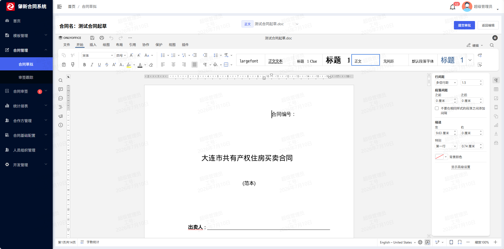

# 第 8 章 · 文档生成与在线编辑

> 第 5 章我们说「合同的文件存在 [[D0-底座表地图#12. conf_file 统一文件表（04 行 198）|`conf_file`]] 里、文件组存在 `fileGroupsJson` 里」，第 7 章我们说「模板有主文件 + 附件 + 要素」。但**从头到尾没有回答一个问题**：
>
> **用户在浏览器里，到底是怎么"打开"这个 Word、改它、再存回去的？**
>
> 答案是：**我们根本没在自己的服务器上渲染 Word**。我们请了一个"外援"——**文档服务器（OnlyOffice Document Server，或 WPS 开放平台）**。它才是真正打开 Word、让你敲字、帮你保存的那个程序。我们的后端只干三件事：**发配置、给文件、收回调**。
>
> **一句话理解本章**：我们不是"做 Word 编辑器"，我们是"**给 Word 编辑器当后台**"。这是一个**三段式架构**：浏览器（前端）↔ 文档服务器（第三方）↔ 我们的后端。

> **本章第一次讲透**：
> 1. **三段式文档编辑架构**：为什么"编辑器"可以不在我们的服务器上，以及由此产生的**网络可达性约束**（这是最容易踩的坑）。
> 2. **OnlyOffice 的接入协议**：`document` / `editorConfig` / `permission` / `token` 四块配置到底在说什么，`key` 为什么是关键。
> 3. **回调协议（Callback）**：文档服务器在什么时机、用什么 `status` 码回头调我们的接口；`status=2` / `6` 分别是什么意思。
> 4. **JWT 签名**：为什么配置文件里有个 `onlyoffice.secret`，它防的是谁。
> 5. **策略自注册模式**：`Callback` 接口用 `@Autowired default` 方法把自己的实现自动塞进 `CallbackHandler`——一个很值得抄的 Spring 技巧。
> 6. **要素填充（contentControl + postMessage）**：模板里的"填空位"是怎么在文档里定位的。

> **本章你会碰到的组件（注意哪些是"活的"）**：
> - `WpsController`（**活**，虽然名字叫 wps，但它是**当前唯一的在线编辑入口**，内部按配置分流 OnlyOffice / WPS）
> - `OnlyofficeCallbackController` + `CallbackHandler` + `SaveCallback`（**活**，当前实际在用的保存链路）
> - `DefaultFileConfigurer` / `DefaultEditorConfigConfigurer` / `DefaultJwtManager`（**活**，拼 OnlyOffice 配置）
> - `WpsCallbackController` + `WpsCallbackController.v1/3rd/*`（**WPS 老链路，配置注释里写明"已不可用，仅作历史参考"**）
> - `ChangeFileToPDFService`（**死代码**，没有任何调用方）
> - `TemplateElement` / [[D0-底座表地图#17. template_element 模板要素表（04 行 760）|`template_element`]]（**表是活的，但"填要素"的链路没接通**——本章 §2.9 坦白）

> **零基础先补概念（4 个）**
>
> 1. **文档服务器（Document Server）**：可以把它理解成"**部署在另一台机器上的网页版 Word**"。真正打开 `.docx`、排版、编辑、保存的是它，不是我们的后端。本项目接的是 OnlyOffice Document Server（配置见 `ruoyi-admin/src/main/resources/application-dev.yml:59-69`）。
> 2. **回调（Callback）**：不是我们不停去问"存好了吗"，而是文档服务器**主动调我们的接口**说"存好了，文件在这个 URL"。方向反过来，所以后端必须**让文档服务器访问得到**（`onlyoffice.callbackUrl`）。
> 3. **JWT（JSON Web Token）**：一段**带签名的字符串**。这里用来给"发给文档服务器的配置"盖章：浏览器可以改 JSON，但改完签名就对不上，文档服务器会拒绝。密钥是 `onlyoffice.secret`（`application-dev.yml:67`）。
> 4. **内容控件（contentControl）**：Word 里一种"**带编号的结构化文本块**"，像给一段文字贴上标签，程序可以按 id/tag 精确找到它。本项目把控件的 id 存在 `template_element.DOC_ID`（`script/sql/zxcm_init.sql:5161`），"要素填充"就靠它定位。

> **本章文件索引（完整路径，均相对仓库根 `zhaoxin-contract/`）**：
>
> | 文中简写 | 完整路径 |
> |---|---|
> | `WpsController.java` | `zxcm-contract/src/main/java/com/ruoyi/wps/controller/WpsController.java` |
> | `OnlyofficeCallbackController.java` | `zxcm-contract/src/main/java/com/ruoyi/wps/controller/OnlyofficeCallbackController.java` |
> | `CallbackHandler.java` / `Callback.java` / `Status.java` | `zxcm-contract/src/main/java/com/ruoyi/onlyoffice/callbacks/` |
> | `SaveCallback.java` / `ForcesaveCallback.java` / `EditCallback.java` | `zxcm-contract/src/main/java/com/ruoyi/onlyoffice/callbacks/implementations/` |
> | `DefaultFileConfigurer.java` / `DefaultEditorConfigConfigurer.java` | `zxcm-contract/src/main/java/com/ruoyi/onlyoffice/services/configurers/implementations/` |
> | `DefaultJwtManager.java` | `zxcm-contract/src/main/java/com/ruoyi/wps/service/DefaultJwtManager.java` |
> | `ConfFileServiceImpl.java` | `zxcm-contract/src/main/java/com/ruoyi/conf/service/impl/ConfFileServiceImpl.java` |
> | `ContractDraftServiceImpl.java` | `zxcm-contract/src/main/java/com/ruoyi/contract/service/impl/ContractDraftServiceImpl.java` |
> | `TemplateElementServiceImpl.java` | `zxcm-contract/src/main/java/com/ruoyi/template/service/impl/TemplateElementServiceImpl.java` |
> | `onlyoffice.vue` / `templateMerge.vue` / `contractFile*.vue` | `zxcm-ui/src/views/components/wps/` |
> | `application-dev.yml` | `ruoyi-admin/src/main/resources/application-dev.yml` |
> | `zxcm_init.sql` | `script/sql/zxcm_init.sql` |

---

## 一、这部分是做什么的？

### 1.1 业务含义

一份合同的生命里，有**四次**和"文档"直接打交道：

| 时机 | 用户想做的事 | 本章负责吗 |
|---|---|---|
| 起草时 | 打开模板生成的合同正文，改合同条款、填金额/日期 | ✅ 本章主线 |
| 审批时 | 审批人打开合同看一眼，可能还要"修订模式"批注 | ✅ 本章（只读 + 修订） |
| 用印/归档前 | 把 Word 转成 PDF、盖个"水印"、打印 | ⚠️ 本章有代码，**但是死代码**（§4.10） |
| 归档后 | 只能看，不能改 | ✅ 本章（只读模式） |

**用户视角的体验是这样的**（这是本章要解释的全部）：

1. 点"在线编辑" → 浏览器弹出一个**长得跟 Word 一模一样的编辑器**（其实是 OnlyOffice 的页面，嵌在 iframe 里；iframe 就是"网页里再嵌一个网页"的 HTML 标签）。
2. 敲字、插表格、改格式 → 编辑的是**文档服务器上的一个临时副本**。
3. 关掉页面 / 点保存 → **文档服务器主动回头调用我们后端的接口**，把改好的文件地址给我们；我们从那个地址把文件**拉下来覆盖**本地磁盘上的原件。

**注意第 3 步的方向**：是**别人调用我们**，不是我们轮询别人。这一点决定了我们的后端必须**暴露在文档服务器能访问到的网络上**——这是本章最大的工程约束。



> **图注**：官方 README 的 OnlyOffice 在线编辑截图（演示数据）。注意它是**独立的文档服务器**，通过回调和我们系统交互，不是页面里嵌了个富文本编辑器。

### 1.2 三段式架构：谁是谁

```
 ┌─────────────┐        ① 我该怎么打开文件？        ┌──────────────────┐
 │  浏览器      │ ────────────────────────────────► │  我们的后端       │
 │ (zxcm-ui)   │ ◄──────────────────────────────── │ (ruoyi-admin)    │
 │             │   ② 配置 JSON（含文档地址+回调地址）  │                  │
 │             │                                   │  WpsController    │
 │             │        ③ 文档服务器 api.js          │  OnlyofficeCallback│
 │  OnlyOffice │ ◄──────────────────────────────── │  Controller       │
 │  iframe     │                                   └──────────────────┘
 │             │        ④ 我要那个文件！                      ▲
 │             │ ────────────────────────────────► │  /onlyofficeCallback/download
 │             │ ◄──────────────────────────────── │
 │             │                                   │
 │             │        ⑤ 用户编辑完，我保存好了，文件在这  │
 │             │ ────────────────────────────────► │  /onlyofficeCallback/save
 └─────────────┘                                   └──────────────────┘
         ▲
         │ ⑥ 其实 ③④⑤ 都是我（文档服务器）干的
         │
 ┌───────────────────┐
 │ 文档服务器          │  ← 一个独立部署的服务（OnlyOffice DS / WPS 云）
 │ 192.168.0.100:8081 │     它才真正在解析 docx、跑排版引擎
 └───────────────────┘
```

**三个角色，各自负责什么：**

| 角色 | 负责 | 关键属性 |
|---|---|---|
| **浏览器** | 加载编辑器 SDK、把配置塞进去、处理 iframe 消息 | 需要能访问**文档服务器**（不是只有后端能访问） |
| **我们的后端** | 发配置、给文件、收回调、落盘 | 需要被**文档服务器**访问到（`callbackUrl`） |
| **文档服务器** | 真正的 Word 渲染/编辑/保存/格式转换 | 独立部署，**要能反向访问我们的后端** |

> **⚠️ 最容易踩的坑**：`onlyoffice.domain` 是"**浏览器**要访问的地址"，`onlyoffice.callbackUrl` 是"**文档服务器**要访问的地址"。在 Docker/虚拟机环境里这两个值经常不一样（一个是宿主机 IP，一个是容器内 IP）。配置错了的症状是：**编辑器能打开、但一保存就丢**（回调打不进来）。

### 1.3 核心数据：三个字段撑起整章

本章虽然代码多，但**真正落到数据库上的只有三个字段**：

| 字段 | 表 | 作用 | 位置 |
|---|---|---|---|
| `ONLYOFFICE_KEY` | `conf_file` | 文档服务器用它判断"这是不是我缓存过的那份文件" | `script/sql/zxcm_init.sql:942` |
| `DOC_ID` | `template_element` | Word 里那个"填空题"的 **contentControl id** | `script/sql/zxcm_init.sql:5161` |
| `fileGroupsJson`（第 5 章讲过） | [[D0-底座表地图#8. contract_draft_files 合同文件表（04 行 370）|`contract_draft_files`]] | 一份合同由哪些文件组成 | 见第 5 章 §1.4 |

再加两条配置：

| 配置 | 位置 | 值（开发环境） |
|---|---|---|
| `onlineEditor` | `ruoyi-admin/src/main/resources/application-dev.yml:57` | `onlyoffice` |
| `onlyoffice.secret` | `application-dev.yml:67` | `zxcm`（JWT 密钥） |

### 1.4 `key` 到底是什么：本章的第一个"啊哈"

`conf_file.ONLYOFFICE_KEY` 这个字段，是整个在线编辑的**核心传动轴**。理解它，你就理解了 80% 的坑。

**文档服务器的工作模型是"缓存 + 版本号"**：

1. 前端告诉它：`url=文件地址`、`key=abc123`。
2. 文档服务器看 `key`：
   - **`key` 没见过** → 从 `url` 下载文件，缓存起来，编辑这份缓存。
   - **`key` 见过** → 直接用缓存（**不再下载**），因为"key 没变说明文件没变"。
3. 用户编辑、保存 → 文档服务器回调我们，我们把新文件覆盖到本地磁盘。
4. **关键**：覆盖完之后，如果 `key` 不变，下次打开文档服务器**还会用旧的缓存**→ 用户看到的是**上一版的内容**！

所以项目里有一个专门的动作叫 **`changeKey`**（`ConfFileServiceImpl.java:150`）：

```java
@Override
public ConfFile changeKey(Long fileId) {
    String key = IdUtil.getSnowflake().nextIdStr();   // 换一个新的雪花 ID
    ConfFile confFile = this.baseMapper.selectById(fileId);
    confFile.setOnlyofficeKey(key);
    this.baseMapper.updateById(confFile);
    return confFile;
}
```

**它被调用的时机，全都跟"文件内容变了"有关**：

| 调用点 | 为什么 |
|---|---|
| `zxcm-contract/src/main/java/com/ruoyi/onlyoffice/callbacks/implementations/SaveCallback.java:109` | 保存回调（status=2）写盘后 → 换 key，下次打开看到新内容 |
| `zxcm-contract/src/main/java/com/ruoyi/wps/controller/WpsController.java:142,151,160` | 打开文件时如果 key 为空 → 补一个（历史数据/模板复制产生的文件没 key） |

> **面试一句话**：`onlyofficeKey` 是**文档服务器的缓存语义 key**，不是我们的业务版本号。**凡是文件内容变了，必须换 key，否则用户会看到旧缓存**。这是一条很容易在 Code Review 里漏掉的隐性契约。

---

## 二、站在架构师 / 开发经理角度：为什么这么设计？

### 2.1 为什么用第三方文档服务器，而不是自己用 POI 渲染？

这是本章第一个、也是最重要的选型问题。

**如果自己渲染**：你需要用 Apache POI 或 OpenOffice/LibreOffice 把 `.docx` 渲染成 HTML，再把 HTML 编辑完、反渲染回 `.docx`。结果是：

- **格式必丢**：Word 的页眉页脚、域、批注、修订、表格合并、字体嵌入……POI 支持度是"能读个大概"，反渲染回去基本面目全非。
- **多人协同不可能**：你要自己实现 OT/CRDT 算法（Google Docs 那套），这是博士级工作量。
- **无法实时修订**：Word 的"修订模式（Track Changes）"是个极复杂的结构，自己实现等于重写 Word。

**用 OnlyOffice / WPS 的代价**：多部署一个服务（内存至少 2GB 起）、多一套配置、多一层网络依赖。但换来的是**开箱即用的"真 Word 体验"**。

| 方案 | 格式保真 | 协同编辑 | 成本 |
|---|---|---|---|
| POI / OpenOffice 自研 | 差（页眉、批注、修订、合并单元格易丢） | 要自己实现 OT/CRDT | 研发无底洞 |
| **OnlyOffice / WPS（选用）** | 高（真 Word 渲染） | 自带 | 多一个服务 + 配置 |

> **开发经理的账**：多一个中间件实例（运维成本）+ 一次接入工作（一次性成本） ≪ 自己实现 Word 引擎（无底洞）。**合同系统里文档是核心资产，格式错一个页眉都可能被法务打回**，这个钱必须花。

### 2.2 为什么"文档服务器"要能反向访问我们的后端？

这是三段式架构**最反直觉**的一点，也是最容易配错的。

普通的前后端交互里，**前端访问后端**，后端从不"主动找前端"。但在线编辑里多了一个角色：

- **浏览器 → 文档服务器**：加载编辑器（需要 `onlyoffice.domain` 可从浏览器访问）。
- **文档服务器 → 我们的后端**：取文件（`document.url`）、回调保存（`editorConfig.callbackUrl`）。

**为什么必须反向？** 因为**文件在文档服务器上编辑，它得知道"从哪拿原文件、往哪报结果"**。它不能凭空变出文件。

看配置就明白了（`application-dev.yml:59-69`）：

```yaml
onlyoffice:
  domain: http://192.168.0.100     # ← 浏览器要能访问到（部署文档服务器的机器）
  port: 8081
  callbackUrl: http://192.168.0.10:8080/onlyofficeCallback   # ← 文档服务器要能访问到（部署我们后端的机器）
  secret: zxcm
```

**`192.168.0.100` 和 `192.168.0.10` 是两个不同的机器**。这就是为什么配置文件里要**同时**填这两个地址——它们分别服务于两个不同的网络方向。

**工程后果**：部署时必须保证这两条网络路径都通。常见故障：
- 用 `localhost` 当 `callbackUrl` → 文档服务器在自己容器里找 `localhost:8080`，**找不到**，保存静默失败。
- 跨机器时防火墙只开了前端方向 → 回调打不进来。

### 2.3 为什么编辑凭据用"JWT token"，而不是复用登录 session？

看 `DefaultFileConfigurer.java:129` 和 `DefaultEditorConfigConfigurer.java:82`，`editorConfig` 里带着一个 `token`，这个 token 是用 `onlyoffice.secret` 签的 **JWT**（`DefaultJwtManager.java:54`）。

**为什么不直接给文档服务器发一个 Sa-Token 的 session**？因为：

1. **文档服务器不是我们的用户**。它是"服务端"，没有浏览器 cookie，也不该持有我们的登录态。
2. **配置里可能包含敏感信息**（文件地址、权限）。浏览器可以随便改这个 JSON！所以要用 **JWT 签名**：文档服务器验证签名，**改一个字节就验不过**。这防的是"**前端篡改配置**"（比如把 `permission.edit` 从 `false` 改成 `true`）。

| 方案 | 文档服务器能验证吗 | 前端能篡改吗 | 结论 |
|---|---|---|---|
| 复用登录 session | 不能（它不是我们的用户） | 可以伪造 | ❌ |
| **JWT 签名（选用）** | 能（验签） | 改一个字节就失败 | ✅ |

> **一句话**：JWT 在这个场景的作用是**给"发给第三方服务端的配置"做完整性校验**，防的是恶意前端，不是防用户。`onlyoffice.secret` 生产环境**必须改**（默认 `zxcm` 是演示值，`application-dev.yml:66` 的注释也这么写）。

### 2.4 为什么保存是"文档服务器回调 + 我们主动拉"，而不是"前端上传"？

你可能会想：前端不是也能拿到编辑后的文件吗？为什么不让前端上传？

**因为前端拿不到完整文件**。文档服务器运行在**独立域名/端口**的 iframe 里，前端跨域拿不到它的文件对象；就算硬拿，一个大 docx 走前端中转再上传，既慢又不可靠（用户可能切换页面）。

**用回调 + 主动拉的好处**：

- **可靠**：文档服务器保存成功才回调，回调是**服务端到服务端**，不受用户是否关页面影响。
- **省流量**：文件不经过浏览器（浏览器只传几十字节的配置）。

| 方案 | 可靠性 | 流量 | 前提 |
|---|---|---|---|
| 前端上传 | 用户关页面就断 | 文件走浏览器 | 前端能拿到完整文件（实际拿不到） |
| **回调 + 主动拉（选用）** | 服务端到服务端 | 浏览器只传配置 | 开放回调接口 + 验签 |

代价是我们得**开放一个回调接口**并且**验证调用来源**——这就引出 §2.5。

### 2.5 回调接口怎么防伪造？

看 `OnlyofficeCallbackController.java:81-90`：

```java
public String save(HttpServletRequest request, @RequestBody Track body,
    @RequestParam("contractId") String contractId, @RequestParam("fileId") String fileId,
    @RequestParam("loginToken") String loginToken) {
    // 验证token
    LoginUser user = LoginHelper.getLoginUserByToken(loginToken);
    LoginHelper.login(user);
    if (user == null) {
        throw new ServiceException("token验证失败");
    }
    ...
```

这个接口的 URL 是**前端拼出来交给文档服务器的**（`WpsController.java:223-224`）：

```java
.callbackUrl(onlyofficeCallbackUrl + "/save?fileId=" + fileId + "&contractId=" + contractId
    + "&loginToken=" + StpUtil.getTokenValue())
```

注意最后一段 **`&loginToken=xxx`**——这是把**当前登录用户的 Sa-Token** 直接拼进回调 URL！回调发生时，后端用这个 token **反查登录用户**并**手动恢复登录态**（`LoginHelper.login(user)`）。

**这么设计的原因**：`SaveCallback` 里需要判断"这份合同现在是什么状态"（`SaveCallback.java:74-78`），而状态判断用了数据权限（`contract_draft` 上挂了多种数据权限，见第 5 章 §2.4）。没有登录态，权限过滤器会 null 指针。

**这么设计的风险（必须承认）**：**token 出现在 URL 里**。URL 会进：
- 文档服务器的日志
- 中间的 Nginx access log
- 我们自己的 access log

任何能看到日志的人，都能**拿这个 token 冒充该用户**（直到 Sa-Token 过期）。

> **这是一处真实的工程妥协**（本章第 1 个坦白点）。更稳的做法是：**回调 URL 里放一次性随机码**（存 Redis，用一次即焚、绑定 `fileId`），文档服务器用这个码换身份，而不是直接吊销用户的正式 token。这一点在面试里主动说出来，比被问出来强。

### 2.6 为什么 WPS 被弃用、OnlyOffice 上位？

配置文件的注释写得很直白（`application-dev.yml:56`、`:74`）：

```yaml
# 在线编辑引擎：onlyoffice 或 wps（推荐 onlyoffice；wps 为早期接口，仅作参考，已不可用）
onlineEditor: onlyoffice
...
# WPS 开放平台配置（旧接口，已不可用，仅作历史参考）
wps:
```

**原因推测（结合代码）**：

| 维度 | WPS 云（`solution.wps.cn`） | OnlyOffice 自部署 |
|---|---|---|
| 部署 | **必须走 WPS 云**，文件要能被公网访问 | 可**内网自部署**，数据不出内网 |
| 数据安全 | 合同要上传到 WPS 服务器 | 文件始终在自己的服务器（仅文档服务器临时缓存） |
| 成本 | 按量/按年 | 自己出机器 |
| 回调协议 | `v1/3rd/file/*` 一套（`WpsCallbackController.java:86,162`） | `status` 码 + JWT（`CallbackHandler.java:51`） |

**对合同系统这种"文档是机密资产"的场景，能内网自部署是决定性的**。所以项目保留了 WPS 的代码作为"历史归档"，实际运行走 OnlyOffice。

### 2.7 为什么"要素填充"用 contentControl，而不是后端替换占位符？

一个朴素的想法：模板 Word 里写 `{{甲方名称}}`，后端用 POI 把 `{{甲方名称}}` 文本替换掉，不就完了？

**不行，原因有三个**：

1. **Word 会把占位符拆碎**。你在 Word 里看到的 `{{甲方名称}}`，在底层 XML 里可能被拆成 `{{甲方` + `名称}}`（Word 按"拼写/校对"切 run）。POI 按文本替换经常**替换不到**，这是 POI 老手都知道的坑。
2. **替换后失去"这是个字段"的语义**。用户改了合同，你无法知道"哪块是甲方的名字"。
3. **无法做"填空式"交互**。

**contentControl（内容控件）是 Word 的原生解决方案**：你可以在 Word 里把一段内容标记成"内容控件"，给它一个 **id 和一个 tag**。这段内容是一个**结构化的、可被程序定位的块**。

项目的做法（`onlyoffice.vue:56-104`）：**前端通过 postMessage 驱动 OnlyOffice 插件**去操作这些 contentControl：

```javascript
mergeData(dataList) {
  dataList.forEach(item => {
    item.Tag = 'templateElement' + item.docId   // ← 后端存的 DOC_ID，拼成 tag
  })
  const data = { action: 'mergeContent', dataList: dataList }
  window.frames[1].frames[0].postMessage(JSON.stringify(data), '*')
}
```

**约定是这样的**：

| 层 | 存什么 |
|---|---|
| Word 文档里 | 一个 contentControl，`Tag = templateElement` + `<docId>` |
| 数据库 `template_element.DOC_ID` | 那个 `<docId>` 的数字部分 |
| 前端 | 用 `'templateElement' + docId` 反拼出 Tag，postMessage 让插件去填充 |

**这么设计的好处**：后端完全不用碰 Word 二进制（POI 的坑全部绕过），只存一个 id；**填充动作交给文档服务器自己的插件**（因为文档已经加载在它内存里了，改起来最快）。

> **但这条路现在没接通**——见 §2.9。

### 2.8 为什么"用模板起草"要复制文件？（第 5 章回声）

`ContractDraftServiceImpl.copyTemplateFile`（`:287`）把模板主文件 + 附件 + 关联模板的文件，**全部 `copyFile` 一份新的**（`ConfFileServiceImpl.copyFile:127`）。

**这和在线编辑是同一个道理的延伸**：如果合同"引用"模板文件，那么：

1. 用户在线编辑合同时，**改的就是模板文件本身**（因为指向同一个 `conf_file`），模板被污染。
2. 模板发新版本时，**所有历史合同的内容会跟着变**——法律上是灾难（合同是历史凭证，不能变）。

所以**必须复制**。复制之后，合同的 `conf_file` 是独立的，改合同不影响模板，模板升级不影响已生成的合同。

### 2.9 ⚠️ 坦白点：本章的"要素填充"链路**没有接通**

这是本章最重要的诚实说明。我把实情摆出来：

**有的零件（都在）**：

| 零件 | 位置 | 状态 |
|---|---|---|
| `template_element` 表（存 DOC_ID） | `script/sql/zxcm_init.sql:5153` | ✅ 有 DDL |
| `TemplateElement` 实体（`docId` 字段） | `TemplateElement.java:71` | ✅ 有 |
| `TemplateElementService.getCluaseByTemplate`（要素→条款） | `TemplateElementServiceImpl.java:84` | ✅ 有，**但零调用方** |
| 前端 postMessage 桥（`mergeData` / `addContentControl` / ...） | `onlyoffice.vue:56-104` | ✅ 有，**但零调用方** |
| 开关 `sys.templateMerge.enable` | `script/sql/zxcm_init.sql:3497` | ✅ 有，值 `true` |
| 前端读开关 | `zxcm-ui/src/store/modules/settings.js:37`（`templateMergeEnable`） | ✅ 有，**但没人用** |

**断在哪**：

1. 后端**没有** `TemplateElementController`（`template/controller/` 下只有 4 个 Controller，没有 Element 的）。
2. `getCluaseByTemplate`（把模板要素翻译成合同的"条款"）**全仓零调用**。
3. 前端 `onlyoffice.vue` 的 `mergeData`/`addContentControl` **全仓零调用**——grep `mergeContent`、`addContentControl`，只有定义处，没有调用处。
4. `templateMergeEnable` 这个开关读到 store 里，但**没有视图用 `v-if="templateMergeEnable"`**。

> **所以现状是**：模板里的"填空"能力**有数据模型、有开关、有前端桥接方法，但整条链路缺了中间的"调用者"**。**实际可用的功能是：模板文件被复制成合同文件（§2.8），用户在线编辑合同 Word 时自己手填**。自动把要素值填进 Word 这件事，**本项目没做完**。
>
> **面试时怎么说**：主动讲"要素填充是设计了但未落地的能力，我实现时会补三件事：① `TemplateElementController` 暴露要素列表；② 前端起草页读要素、渲染成表单；③ 提交时调 `mergeData` 让插件填充 + `forceSave` 落盘"。**这比假装它做完了强一百倍**。

### 2.10 ⚠️ 坦白点：`ChangeFileToPDFService` 是死代码

`ChangeFileToPDFService.java:48` 这个类做两件很实用的事：

- `covertToPdf(...)`（`:60/:69/:83`）：调 OnlyOffice 的转换服务，把 Word **转成 PDF**。
- `addWaterMark(...)`（`:99/:104`）：用 iText 往 PDF 上**加水印**。

**但全仓 grep `covertToPdf` / `addWaterMark` / `ChangeFileToPDFService`，零调用方。** 它是一个**写好了但没人用的能力**。

> **含义**：项目里"Word 转 PDF"、"PDF 加水印"**目前没有生效**。如果需要（比如归档要 PDF、预览要带水印），**接一个 Controller 调用它就行**——零件是齐的，只差接线。这属于"**技术债，但不是坏代码**"。

### 2.11 ⚠️ 坦白点：WPS 那套接口已不可用

`WpsCallbackController.java:67` 的 `/wpsCallback/v1/3rd/*` 是 **WPS 开放平台的回调协议**（WPS 云会按 `v1/3rd/file/info`、`v1/3rd/file/save` 这些约定路径来调我们）。这套代码写得挺完整（`:86` 文件信息、`:124` 用户信息、`:162` 保存），但：

- 配置里 `wps.appid` 和 `wps.secret` **是空的**（`application-dev.yml:76-77`）。
- 注释明确说"**已不可用，仅作历史参考**"。

> **面试价值**：这是一份**"对照实现"**——同一件事（在线编辑文件），WPS 云和 OnlyOffice 的**回调协议完全不同**（WPS 是固定的 REST 路径 + 平台主动 POST 文件流；OnlyOffice 是 `status` 码 + JWT + 我们主动拉）。**能讲清两者的差异，说明你不是只会"照着教程抄"，而是理解了协议背后的设计**。

---

## 三、需要哪些技术？

| 技术 | 用在哪 | 精确位置 | 关键点 |
|---|---|---|---|
| **OnlyOffice Document Server** | 真正的 Word 渲染/编辑/保存 | 外部服务 | 独立部署，需浏览器 + 后端双向可达 |
| **PostMessage / iframe** | 浏览器与编辑器插件通信 | `onlyoffice.vue:56-104` | 跨域通信靠 `window.postMessage`（浏览器给别的窗口/iframe 发消息的 API） |
| **JWT（HMAC-SHA256）** | 签名发给文档服务器的配置 | `DefaultJwtManager.java:54` | 用 `only-office.secret`；防前端篡改 |
| **策略模式 + 自注册** | `status` 码 → 处理器 | `Callback.java:42` | 接口的 `@Autowired default` 方法 |
| **Spring `@Value`** | 读回调地址等配置 | `WpsController.java:75-92` | 9 个配置项一处注入 |
| **Sa-Token** | 回调时恢复登录态 | `OnlyofficeCallbackController.java:86` | `LoginHelper.getLoginUserByToken` |
| **Apache POI** | 检测 Word 是否"限制编辑" | `WpsController.java:242-288` | `HWPFDocument`(.doc) / `XWPFDocument`(.docx) |
| **iText** | PDF 加水印 | `ChangeFileToPDFService.java:104` | **死代码**，`BaseFont.createFont("STSong-Light")` 中文字体 |
| **Hutool `HttpUtil.downloadFile`** | 从回调 URL 拉文件 | `ChangeFileToPDFService.java:65` | 也可用 `HttpURLConnection`（`SaveCallback:89`） |
| **Spring `ApplicationEventPublisher`** | 记录"查看/下载/编辑"行为 | `WpsController.java:166` | 发 `ContractEvent(fileView)`（第 6 章的领域事件） |

> **新概念定位**：
> - **"Spring 事件"** 第一次讲透在**第 6 章 §4.3**（`ApplicationEventPublisher` + `@EventListener`）。本章只当"顺手用一下"。
> - **"文件存储组件（`conf_file` / `copyFile` / 上传下载）"** 第一次讲透在**第 5 章 §4.2 / §4.3**。本章不重复。
> - 本章**第一次讲透**的是：文档服务器接入模型、回调协议、contentControl、postMessage。

---

## 四、功能具体怎么实现（带着你复制）

> **本章涉及的表**（点表名直达底座表地图的字段详情）：
> [[D0-底座表地图#12. conf_file 统一文件表（04 行 198）|`conf_file`]]（文件元数据） ｜ [[D0-底座表地图#17. template_element 模板要素表（04 行 760）|`template_element`]]（模板要素） ｜ [[D0-底座表地图#8. contract_draft_files 合同文件表（04 行 370）|`contract_draft_files`]]（合同文件版本）


### 4.1 需求、数据与配置

**需求单（模拟）**

**需求编号** ZXCM-DOC-001　**提出人** 合同管理部　**优先级** 高　**本期上线**

**背景**：合同正文是 Word，用富文本编辑器改完格式全乱；法务要求「打开就是 Word、保存回原文件」。自己用 POI 渲染排版不现实，需要接一个独立的文档服务器。

**功能需求**

| # | 功能 | 具体要求 |
|---|---|---|
| 1 | 打开编辑器 | 点「在线编辑」，浏览器里出现 Word 一样的编辑器 |
| 2 | 读文件 | 文档服务器能拿到我们磁盘上的原文件 |
| 3 | 保存回写 | 用户编辑完，文档服务器回调我们，把新文件覆盖本地原件 |
| 4 | 再次打开是新内容 | 不能看到上次的缓存 |
| 5 | 模板生成合同 | 用模板起草时复制模板正文和附件 |
| 6 | 要素填充 | Word 里的「填空题」能被系统填上（**本章未接通**） |

**验收标准**：打开编辑器不报错；改一段文字保存后，本地文件内容变了；再次打开看到的是新内容（而不是缓存）。

**本期不做 / 已知缺口**：要素填充链路未接线（§4.9）、PDF 转换是死代码（§4.10）、WPS 老链路已不可用（§4.11）。

**拿到需求先做四件事**

① **给需求定性，再推架构**

| 判断维度 | 本模块的答案 | 推出的设计 |
|---|---|---|
| 数据性质 | 三方服务集成，不是 CRUD | 配置 + 回调，不建新表 |
| 数据落点 | 只有三个字段 | 复用 `conf_file` / `template_element` / `contract_draft_files` |
| 交互方向 | 文档服务器反向调用我们 | 后端必须可达 + 回调验签 |
| 缓存 | key 决定是否复用旧文件 | 内容一变必须换 key |

→ 架构：四条链路（geturl / getConfig / 保存回调 / 下载）+ JWT 验签 + key 管理。

② **定数据**：真正落库的只有**三个字段**（见下），其余是配置。

③ **定接口**：打开配置、取文件、保存回调、下载，四条主链路。

④ **定实现边界：哪些不用写、哪些必须写、哪些是缺口**

- **框架给**：文件组件、JWT、事件；
- **必须自己写**：`geturl`/`getConfig`、回调鉴权、`changeKey`；
- **已知缺口**：要素填充链路未接通；PDF 转换是死代码；WPS 老链路已不可用。

**数据设计：三个字段撑起整章**

| 字段 | 表 | 作用 |
|---|---|---|
| `ONLYOFFICE_KEY` | `conf_file` | 文档服务器的**缓存 key**，判断「这是不是我缓存过的那份文件」 |
| `DOC_ID` | `template_element` | Word 里 contentControl 的 id（要素填充用） |
| `fileGroupsJson` | `contract_draft_files` | 一份合同由哪些文件组成（第 5 章） |

**最容易错的一点：`ONLYOFFICE_KEY` 不是版本号**

文档服务器的模型是「缓存 + key」：

```
key 没见过 → 下载文件、缓存、编辑缓存
key 见过   → 直接用缓存，不再下载
```

所以**文件内容一变，必须换 key**（`ConfFileServiceImpl.changeKey:150` 生成新雪花 ID）。忘了换的症状是：**保存成功了，但再次打开还是旧内容**。这是隐性的接口契约，Code Review 最容易漏。

**四个关键取舍**

| 决策 | 选择 | 代价 | 什么情况下反过来 |
|---|---|---|---|
| 第三方文档服务器 vs 自研渲染 | OnlyOffice | 多一个部署、要保证双向网络可达 | 只需要简单预览、不做编辑时 |
| 保存方式 | 文档服务器回调 + 我们拉取 | 后端必须暴露给文档服务器 | 前端直接上传（但会丢格式/丢版本） |
| 编辑凭据 | 单独 JWT token | 多一套签发逻辑 | 内网、可信环境可直接复用 session |
| 要素填充 | contentControl + 前端桥 | 依赖 Word 文件本身有控件 | 用占位符后端替换（会丢样式） |

**已知缺陷 / 边界**

- **`key` 忘换 → 看到旧缓存**：不是 bug，是契约；
- **`callbackUrl` 必须能被文档服务器访问**：Docker/虚拟机里 `domain` 和 `callbackUrl` 经常不是同一个地址；
- **要素填充只有前端桥，没有后端落点**（§4.9）；
- **`ChangeFileToPDFService` 是死代码**（§4.10）。

**演示数据**：`ch05` 的 `conf_file` 有 8 条演示文件记录，够验证「取文件、下载」；在线编辑需要一个真实部署的文档服务器。

**对后面章节的连锁影响**

| 后面的事 | 依赖这里的什么 |
|---|---|
| 用印后转 PDF / 水印 | 本章的转换服务（当前是死代码） |
| 归档只读 | 同一套编辑器，改成只读模式 |
| 模板 → 合同文件复制 | `copyTemplateFile`（§4.7） |

**施工计划**

> 施工单的完整任务清单见本章「任务清单」小节，可以和上面的分步顺序对照着看。

| 步骤 | 做什么 | 做完的标志 |
|---|---|---|
| 4.2 | OnlyOffice 接入模型 | 能说出四块配置、两次握手 |
| 4.3 | `geturl` 打开入口 | 前端能拿到编辑器配置 |
| 4.4 | `getConfig` 查文件元信息 | 返回文件地址和 key |
| 4.5 | 回调保存链路 | 保存后本地文件被覆盖、key 已换 |
| 4.6 | 文件下载接口 | 文档服务器能下载到文件 |
| 4.7 | 模板复制生成合同 | 新合同有独立的文件副本 |
| 4.8 | 前端加载 SDK | 编辑器能渲染出来 |
| 4.9 | 要素填充（未接线） | 知道缺哪一段 |
| 4.10 | PDF 死代码 | 知道为什么不能用 |
| 4.11 | WPS 老链路 | 能对比两种协议 |

#### 4.1.1 `conf_file` 里的 `ONLYOFFICE_KEY`（`zxcm_init.sql:930-945`）

```sql
DROP TABLE IF EXISTS `conf_file`;
CREATE TABLE `conf_file`  (
  `ID` bigint NOT NULL COMMENT '主键',
  `URL` varchar(255) COMMENT '文件访问地址',
  `ORIGINAL_NAME` varchar(255) COMMENT '原始文件名',
  `FILE_SUFFIX` varchar(20) COMMENT '文件后缀',
  `FILE_NAME` varchar(255) COMMENT '存储文件名（uuid）',
  ...
  `MODULE` varchar(255) COMMENT '模块（contract/template）',
  `ONLYOFFICE_KEY` varchar(255) COMMENT 'onlyofficeKey',   -- ← 第 942 行，本章核心
  PRIMARY KEY (`ID`)
);
```

> 注意 `MODULE` 字段：`contract` / `template`。上传时按模块分目录（`ConfFileServiceImpl.upload:103`：`RuoYiConfig.getUploadPath() + File.separator + module`）。**这决定了磁盘上的物理目录**。

#### 4.1.2 `template_element` 里的 `DOC_ID`（`script/sql/zxcm_init.sql:5153-5177`）

```sql
CREATE TABLE `template_element`  (
  `ID` varchar(64) NOT NULL COMMENT '主键',
  `ELEMENT_NAME` varchar(40) NOT NULL COMMENT '合同要素名称',
  `ELEMENT_TYPE` char(1) NOT NULL COMMENT '合同要素类型 0 手动输入 1 选择条款',
  `OBJECT_CODE` varchar(64) COMMENT '关联字段',
  `OBJECT_NAME` varchar(200) COMMENT '要素对象名称',
  `OBJECT_TYPE` char(1) COMMENT '要素对象类型',
  `TEMPLATE_ID` varchar(64) NOT NULL COMMENT '模板id',
  `DOC_ID` varchar(64) COMMENT '文档中contentControl的id',   -- ← 第 5161 行
  `CONTENT` longtext COMMENT '默认内容',
  ...
);
```

**字段含义（对着 `TemplateElement.java` 看）**：

| 字段 | Java | 含义 |
|---|---|---|
| `ELEMENT_TYPE` | `elementType`（`:49`） | `0` = 手动输入（字段库），`1` = 选择条款（条款库），`2` = 签约方 |
| `OBJECT_CODE` | `objectCode`（`:54`） | 字段/条款的 id；签约方是字典 value |
| `OBJECT_TYPE` | `objectType`（`:63`） | 签约方才有：甲1/乙2/丙3/丁4 |
| `DOC_ID` | `docId`（`:71`） | **Word 里的 contentControl id** ← 本章的关键 |
| `CONTENT` | `content`（`:75`） | Word 里选中的那段内容（默认值） |

#### 4.1.3 配置文件（`application-dev.yml:55-79`）

```yaml
--- # 在线编辑配置（OnlyOffice / WPS）
onlineEditor: onlyoffice                 # ← 分流开关
onlyoffice:
  domain: http://192.168.0.100           # 浏览器可达
  port: 8081
  callbackUrl: http://192.168.0.10:8080/onlyofficeCallback   # 文档服务器可达
  secret: zxcm                           # JWT 密钥，生产必改
  plugin: http://192.168.0.100:8081/plugin/html/config.json  # 插件配置
  logo:
  logoEmbedded:
  logoUrl:
wps:                                     # 旧接口，已不可用
  appid:
  secret:
  wpsdomain: https://solution.wps.cn
  downloadurl: http://localhost:8080
```

> `zxcm-ui` 那边还有个前端侧开关：`sys.templateMerge.enable`（`script/sql/zxcm_init.sql:3497`，值 `true`），通过 `GET /common/config` 下发（`ruoyi-admin/src/main/java/com/ruoyi/web/controller/common/CommonController.java:75`；读配置在 `:83`，放进响应在 `:90`），前端存进 store 的 `templateMergeEnable`（`zxcm-ui/src/store/modules/settings.js:37`）。**读它的人……没有**（§2.9）。

**复制清单（第 1 步）**：

```
✅ 抄：conf_file 表（含 ONLYOFFICE_KEY 列）
✅ 抄：template_element 表（含 DOC_ID 列）
✅ 抄：application-dev.yml 的 onlineEditor + onlyoffice 段
✅ 抄：sys_config 里加 sys.templateMerge.enable（如果要做要素填充）
⚠️ 别抄：wps 段（已废弃）。只保留 onlineEditor 开关，值写死 onlyoffice 也行。
🔧 改：secret 换成你自己的随机串；callbackUrl 换成你的后端 IP（能被文档服务器访问到）
```

---

### 4.2 【第一次讲透】OnlyOffice 接入模型：四块配置 + 两次握手

> **这一步依赖的配置**：`application-dev.yml:57-67`——`onlineEditor: onlyoffice`、`onlyoffice.domain`（浏览器访问地址）、`port`、`callbackUrl`（文档服务器反向访问后端的地址）、`secret`（JWT 密钥）。这四个配错任何一个，表现都是「编辑器能开、保存丢」。

**本步目标**：搞懂浏览器、我们、文档服务器三方的调用方向。
**做完的标志**：能画出「谁访问谁」的图，分清 `domain` 和 `callbackUrl`。

这一节是本章的**技术心脏**，请你慢慢读。

#### 4.2.1 前端拿到的配置长什么样

`WpsController.getUrl`（`:129`）在 `onlineEditor == "onlyoffice"` 分支（`:191`）里，最终返回的 `UrlModel.onlyofficeModel` 是一个 **`OnlyofficeFileModel`**（`zxcm-contract/src/main/java/com/ruoyi/onlyoffice/filemodel/OnlyofficeFileModel.java:45-54`）。它的结构就是 OnlyOffice 官方 API 要求的那个对象：

```java
fileModel.setDocumentType(documentType);       // word / cell / slide
fileModel.setType(wrapper.getType());          // desktop / mobile / embedded
fileModel.setDocument(...);                    // ① 文档在哪、叫什么、缓存key
fileModel.setEditorConfig(...);                // ② 编辑器怎么用（回调地址、语言、用户、权限）
fileModel.setToken(jwtManager.createToken(map));// ③ 上面全部的 JWT 签名
```

拆开看三块：

**① `document`（`DefaultDocumentConfigurer` + `DefaultDocumentWrapper`）**

| 字段 | 值 | 来源 |
|---|---|---|
| `url` | 文件下载地址 | `WpsController.java:225`：`callbackUrl + "/download/" + fileId + "?fileId=...&contractId=...&loginToken=..."` |
| `key` | 缓存 key | `conf_file.ONLYOFFICE_KEY`（`:140`，为空则 `changeKey`） |
| `title` | 显示的文件名 | `confFile.getOriginalName()` |
| `fileType` | 扩展名（doc/docx/pdf） | `WpsUtil.getSuffix` |
| `permissions` | 权限对象 | 见下 |

**② `editorConfig`（`DefaultEditorConfigConfigurer.java:72`）**

```java
config.setCallbackUrl(wrapper.getCallbackUrl());   // ← :82 保存回调打哪
config.setLang(wrapper.getLang());                  // ← "zh-CN"
config.setMode(canEdit && !view ? Mode.edit : Mode.view);  // ← :106 编辑 or 只读
config.setUser(wrapper.getUser());                  // ← :108 显示"谁在编辑"
config.setPlugins(p);                               // ← :110-114 插件（要素填充要用）
```

**③ `permissions`（`DefaultFileConfigurer.java:81-110`）**

权限是个**细粒度的布尔对象**，不是简单的"可读/可写"：

```java
if (wrapper.getCanEdit()) {
    userPermissions.setChat(true);          // 能不能 @ 别人
    userPermissions.setComment(true);       // 能不能加批注
    userPermissions.setDownload(true);
    userPermissions.setModifyContentControl(true);  // ← 能不能改"内容控件"（要素填充相关！）
    userPermissions.setModifyFilter(true);           // 能不能用筛选（表格）
    userPermissions.setPrint(true);
    userPermissions.setEdit(true);
    userPermissions.setFillForms(true);              // ← 能不能填表单域
    userPermissions.setReview(true);                 // ← 能不能用"修订模式"
} else {
    // 只读：chat/comment/modifyContentControl/modifyFilter/edit/review 全 false
    userPermissions.setDownload(true);
    userPermissions.setPrint("true".equals(viewPrint));  // 看 sys_config: office.view.print
    userPermissions.setFillForms(true);   // ← 注意：只读时"填表单"仍是 true
}
```

> **注意最后一行**：只读模式下调的 `fillForms=true`。这是 OnlyOffice 的语义：**"只读"是指不能改正文，但表单域/内容控件是可以填的**。这对"要素填充"很关键——即使合同进入只读阶段，理论上要素仍可填（取决于 `modifyContentControl`）。

然后 `updatePermissions(...)`（`:140`）还会根据 `action` **二次修正**：

```java
// DefaultFileConfigurer.java:140-153（逐字照源码）
private Permission updatePermissions(Permission userPermissions, Action action, Boolean canEdit) {
    userPermissions.setComment(!action.equals(Action.view) && !action.equals(Action.fillForms)
        && !action.equals(Action.embedded) && !action.equals(Action.blockcontent));

    userPermissions.setFillForms(!action.equals(Action.view) && !action.equals(Action.comment)
        && !action.equals(Action.embedded) && !action.equals(Action.blockcontent));

    userPermissions.setReview(canEdit && (action.equals(Action.review) || action.equals(Action.edit)));

    userPermissions.setEdit(canEdit && (action.equals(Action.view) || action.equals(Action.edit)
        || action.equals(Action.filter) || action.equals(Action.blockcontent)));
    return userPermissions;
}
```

> **为什么要改两次？** 第一次是按"能不能编辑"，第二次是按"**这次打开是干什么**（action）"——同样是 edit 权限，`Action.view` 打开时不该能评论。**权限是"能力 × 意图"的乘积**，这个建模思路值得学。

#### 4.2.2 第一次握手：浏览器 → 后端 → 文档服务器

```
① 前端加载 SDK：<script src="{onlyofficeDomain}/web-apps/apps/api/documents/api.js">
   （见 onlyoffice.vue:120 addonlyofficeHead）
② 前端 new DocsAPI.DocEditor('viewFile', fileModel)
   （见 onlyoffice.vue:145 loadonlyoffice）
③ DocEditor 内部：
   - 用 document.url 去我们的后端下载文件（带 loginToken 验证）
   - 用 document.key 判断缓存
   - 用 editorConfig.callbackUrl 记住"以后往这报"
```

#### 4.2.3 第二次握手：文档服务器 → 后端（保存回调）

```
① 用户关闭编辑器 / 触发强制保存
② 文档服务器 POST 到 callbackUrl，body 是一个 Track 对象：
   { "status": 2, "key": "...", "url": "http://文档服务器/内部地址/xxx.docx", "users": [...] }
   （Track DTO 见 zxcm-contract/src/main/java/com/ruoyi/onlyoffice/dto/Track.java:42-50）
③ 我们的 /onlyofficeCallback/save 收到：
   - 用 loginToken 恢复登录态（:86）
   - 用 JWT 验签 body（:101 jwtManager.parseBody）
   - 按 status 分发给对应 Callback（:107 callbackHandler.handle）
④ SaveCallback 从 body.url 下载文件，覆盖本地磁盘（:88-100）
⑤ changeKey（:109）→ 下次打开是新内容
⑥ 返回 {"error":0}
```

**`status` 码对照表**（`Status.java:32-37`）：

| status | 枚举 | 含义 | 谁处理 |
|---|---|---|---|
| 1 | `EDITING` | 用户正在编辑（文档服务器报告"有人打开了"） | `EditCallback` |
| 2 | `SAVE` | **文档已就绪，请保存** | `SaveCallback` ← 主力 |
| 3 | `CORRUPTED` | 保存出错 | 无（`CallbackHandler:53` 打 warn 返回 0） |
| 6 | `MUST_FORCE_SAVE` | 编辑中，但当前状态要强制落盘 | `ForcesaveCallback` |
| 7 | `CORRUPTED_FORCE_SAVE` | 强制保存出错 | 无 |

> **面试常问**：`status=2` 和 `status=6` 有什么区别？——**2 是"文档关闭了，常规保存"；6 是"文档还开着，但（比如点保存按钮）强制落盘"**。两者都会"从 `body.url` 下载 + 覆盖本地文件"，但**只有 2 会换 `onlyofficeKey`**：`SaveCallback.java:109` 调了 `changeKey`，而 `ForcesaveCallback.handle`（`ForcesaveCallback.java:64-114`）里没有这个调用。这是两者的实质差异，详见 §4.5.5。

#### 4.2.4 复制清单（第 2 步）

```
✅ 抄：OnlyofficeFileModel / EditorConfig / Permission / Track（DTO 层）
✅ 抄：DefaultFileConfigurer 的"权限两次修正"逻辑
✅ 抄：DefaultEditorConfigConfigurer 的 mode/callbackUrl/lang 设置
✅ 抄：DefaultJwtManager.createToken / parseBody
🔧 改：只保留你需要的 status 码（2 必留；6 可选；1/3/7 可省）
❌ 别抄：configurations/Embedded、serializers/SerializerFilter（项目里已注释不用）
```

---

### 4.3 后端主线 A：`GET /wps/weboffice/geturl`（打开编辑器的入口）

**本步目标**：返回编辑器需要的配置（文件地址、key、回调地址、token）。
**做完的标志**：前端拿到 JSON 能初始化编辑器。

**位置**：`WpsController.java:129`（`@RequestMapping("/wps")`:65 + `value="/weboffice/geturl"`）

这是**前端打开编辑器的第一个请求**。它做四件事：

```java
@RequestMapping(value = "/weboffice/geturl", method = RequestMethod.GET)
public R<UrlModel> getUrl(@RequestParam("_w_fileid") String fileId,
    @RequestParam("_w_business_type") String businessType, @RequestParam("_w_file_role") String fileRole,
    @RequestParam("_w_contract_id") String contractId, @RequestParam("isEdit") String isEdit,
    @RequestParam("isReview") String isReview) throws IOException {
```

**① 拿文件基本信息 + key（`:136-163`）**

```java
ConfFile confFile = confFileService.getById(Long.valueOf(fileId));
suffix = WpsUtil.getSuffix(confFile.getFileName());
fileName = confFile.getOriginalName();
key = confFile.getOnlyofficeKey();
if (StringUtils.isEmpty(key)) {                       // ← 历史数据可能没 key
    confFile = confFileService.changeKey(confFile.getId());
    key = confFile.getOnlyofficeKey();
}
```

> **三个 `if (businessType == ...)` 分支代码几乎一样**（`:136`/`:145`/`:154`）——这是**可以合并的重复代码**（`TMPL_MAIN`/`TMPL_ATTACH`/其他 都走同一套）。**面试时可以说"这里能抽成一个方法"**。

**② 记录"查看文件"行为（`:165-168`）**

```java
if (!StringUtils.isEmpty(contractId)) {
    ContractEvent event1 = new ContractEvent(this, contractId, ContractEventEnum.fileView);
    applicationEventPublisher.publishEvent(event1);
}
```

> 这是第 6 章讲过的**领域事件**：查看文件不是"写日志表"，而是**发一个 `ContractEvent`**，由监听器落库（`contract_point_log`）。**观察点**：只有 `contractId` 非空才发——**看模板文件不记行为日志**（因为模板不是"合同"，没有 point log 的必要）。

**③ 按 `onlineEditor` 分流（`:174` / `:191`）**

```java
if (onlineEditor.equals("wps")) {
    // 拼 WPS 云 URL + 签名（WpsUtil.getSignature）
    ...
} else if (onlineEditor.equals("onlyoffice")) {
    // 拼 OnlyOffice 配置（本节重点）
    ...
}
```

**④ OnlyOffice 分支的完整拼装（`:191-237`）**

```java
model.setFileType(suffix);
boolean canEdit = "true".equals(isEdit);
boolean canReview = "true".equals(isReview);
canReview = this.canReview(canReview, fileId);       // ← 额外的 POI 检测，见下

User user = new User();
user.setName(LoginHelper.getLoginUser().getNickName());
user.setId("" + LoginHelper.getUserId());

Type showType = Type.desktop;

List<String> pluginData = new ArrayList<>();
pluginData.add(plugin);                              // ← 插件地址（要素填充用）

OnlyofficeFileModel fileModel = fileConfigurer.getFileModel(DefaultFileWrapper.builder()
    .fileId(fileId).fileName(fileName).key(key).canEdit(canEdit).canReview(canReview)
    .callbackUrl(onlyofficeCallbackUrl + "/save?fileId=" + fileId + "&contractId=" + contractId
        + "&loginToken=" + StpUtil.getTokenValue())              // ← 关键：回调 URL 带 loginToken
    .url(onlyofficeCallbackUrl + "/download/" + fileId + "?fileId=" + fileId + "&contractId=" + contractId
        + "&loginToken=" + StpUtil.getTokenValue())              // ← 下载 URL 也带 loginToken
    .type(showType).lang("zh-CN").action(canEdit ? Action.edit : Action.view).user(user)
    .pluginsData(pluginData)
    .build());
```

> **两个 URL 角色不同**：
> - `.url(...)`：**文档服务器去下载原文件**的地址。
> - `.callbackUrl(...)`：**文档服务器保存后回调**的地址。
>
> 两个都带 `loginToken`，因为两个接口都要身份（下载要判断权限、保存要判断合同状态）。

**`canReview` 的额外检测（`:242-288`）**——这是本章一个**很妙的小细节**：

```java
public boolean canReview(boolean review, String fileId) throws IOException {
    String path = confFileService.getFilePath(Long.valueOf(fileId));
    String ext = FileNameUtil.extName(path);
    if ("doc".equals(ext) || "docx".equals(ext)) {
        String type = FileTypeUtil.getTypeByPath(path);
        FileInputStream fis = new FileInputStream(path);
        if ("doc".equals(type)) {
            HWPFDocument hwpfDocument = new HWPFDocument(fis);
            try {
                if (hwpfDocument.getDocProperties().isFProtEnabled()) {   // ← Word"限制编辑"
                    hwpfDocument.close(); fis.close();
                    return false;                                        // 受保护 → 不能修订
                }
            } catch (Exception e) { /* 空指针默认没限制 */ }
            hwpfDocument.close(); fis.close();
        }
        if ("zip".equals(type)) {                       // ← docx 本质是 zip
            XWPFDocument document = new XWPFDocument(fis);
            try {
                if (document.isEnforcedProtection()) {
                    document.close(); fis.close();
                    return false;
                }
            } catch (Exception e) { }
            document.close(); fis.close();
        }
    }
    return review;
}
```

**它在干什么**：**用 POI 打开文件二进制，检查 Word 有没有设置"限制编辑"（保护）**。如果文档被保护了，**即使前端传 `isReview=true`，也强制降级为 `false`**（不给修订权限）。

> **为什么值得学**：
> 1. **权限判断要落到"事实"上，不能只信前端参数**。前端传什么都可能（或者过时），真正打开文件看有没有保护，才是可靠的。
> 2. **`.docx` 是 zip**——`FileTypeUtil.getTypeByPath` 对 docx 返回 `"zip"`（因为 docx 就是个 zip 容器），所以这里用 `"zip".equals(type)` 判断 docx。**这个细节很多人不知道**。
> 3. **catch 空指针 = 默认无保护**：POI 读某些文档的属性会 NPE，这里把异常当成"没限制"。属于"**宽容解析**"。

---

### 4.4 后端主线 B：`GET /wps/weboffice/getConfig`（纯查文件元信息）

**本步目标**：只查文件元信息，不生成编辑器配置。
**做完的标志**：返回文件名、地址、key，且 key 为空时会补。

**位置**：`WpsController.java:100`

```java
public R<UrlModel> getConfig(@RequestParam("_w_fileid") String fileId, ...) {
    // 三个分支同样代码：查 conf_file，拿 suffix + fileName
    UrlModel model = new UrlModel();
    model.setFileName(fileName);
    model.setEditorType(onlineEditor);     // ← 告诉前端"用哪个编辑器"（前端据此分支）
    model.setFileType(suffix);
    return R.ok(model);
}
```

**它和 `geturl` 的区别**：

| | `getConfig` | `geturl` |
|---|---|---|
| 干什么 | 只查**元信息**（文件名、后缀、"用哪个编辑器"） | 拼**完整编辑器配置** |
| 谁先调 | 先调它 | 后调它 |
| 为什么分两个 | 前端先用它判断"是图片还是文档"，图片走 `<el-image>`，文档才加载 SDK | 避免无谓地加载重型 SDK |

> 前端这么用的（`templateMerge.vue:164-193`）：`getConfig` → 如果是 png/jpg 就 `<el-image>` 显示，`onlyoffice` 才 `this.$refs.onlyoffice.loadDoc(...)`。**这是一个"先探路再加载"的优化**。

---

### 4.5 后端主线 C：回调保存链路（`SaveCallback` + `CallbackHandler` + `Callback` 自注册）

**本步目标**：保存回调能鉴权、能拉文件、能覆盖本地、能换 key。
**做完的标志**：编辑后保存，磁盘文件更新，`ONLYOFFICE_KEY` 变了。

这是本章**最值得抄的代码块**。

#### 4.5.1 入口：`POST /onlyofficeCallback/save`（`OnlyofficeCallbackController.java:81`）

```java
@ApiOperation("文档保存入口")
@RequestMapping(value = "/save", method = RequestMethod.POST)
@ResponseBody
public String save(HttpServletRequest request, @RequestBody Track body,
    @RequestParam("contractId") String contractId, @RequestParam("fileId") String fileId,
    @RequestParam("loginToken") String loginToken) {

    // ① 验证 token，恢复登录态
    LoginUser user = LoginHelper.getLoginUserByToken(loginToken);
    LoginHelper.login(user);
    if (user == null) {
        throw new ServiceException("token验证失败");
    }

    try {
        // ② 把 body 序列化回来，取出 Authorization 头，交给 JWT 验签
        String bodyString = objectMapper.writeValueAsString(body);
        String header = request.getHeader("Authorization");
        if (bodyString.isEmpty()) {
            throw new RuntimeException("{\"error\":1,\"message\":\"Request payload is empty\"}");
        }
        org.json.simple.JSONObject bodyCheck = jwtManager.parseBody(bodyString, header);
        body = objectMapper.readValue(bodyCheck.toJSONString(), Track.class);
    } catch (Exception e) {
        log.error("解析 OnlyOffice 回调请求体失败", e);
        return e.getMessage();
    }

    // ③ 按 status 分发
    int error = callbackHandler.handle(body, fileId, contractId);
    return "{\"error\":" + error + "}";
}
```

**四个关键点**：

1. **返回值是裸 JSON 字符串 `{"error":0}`**，不是 `R.ok()`。因为**这是给文档服务器看的**，它只认 `{"error":0}`（0 = 成功）。**返回其他格式，文档服务器会认为保存失败并不断重试**。
2. **`@RequestBody Track body` 里 url 是文档服务器的"内部地址"**（形如 `http://文档服务器/cache/files/xxx/output.docx`），**只有文档服务器自己能访问**。所以后续下载必须由**我们的后端**去拉（不能转给前端）。
3. **`loginToken` 是从 URL 参数里恢复登录态**（§2.5 已经讨论过风险）。
4. **验签失败时返回的是 `e.getMessage()`**（`:105`），不是协议要求的 `{"error":1}`。文档服务器看到一段普通文本，可能无法判断"失败原因"，也可能继续重试。**建议统一改成 `{"error":1}`**，详细异常只写日志，不要把内部错误信息回给第三方。

> ⚠️ **坦白点（鉴权失败分支是死代码）**：`LoginHelper.getLoginUserByToken` 在失败时**直接抛异常**（`ruoyi-base/ruoyi-common/src/main/java/com/ruoyi/common/helper/LoginHelper.java:102-108`：`throw new RuntimeException("登录信息读取失败")`），根本不会返回 `null`。所以 `OnlyofficeCallbackController.java:88-90` 的 `if (user == null) throw new ServiceException("token验证失败")` **永远执行不到**。token 过期/伪造时实际抛出的是 `NotLoginException` 或 `RuntimeException`，返回的通常是 HTTP 错误页，而不是文档服务器要求的 `{"error":1}`。**更稳的写法**：把恢复登录态包进 `try-catch`，失败时按协议返回 `{"error":1}`（或明确的 401 JSON），别让第三方服务去猜。

#### 4.5.2 分发器：`CallbackHandler`（`CallbackHandler.java:41`）

```java
@Service
public class CallbackHandler {
    private Map<Integer, Callback> callbackHandlers = new HashMap<>();

    public void register(int code, Callback callback) {   // ← :47 注册
        callbackHandlers.put(code, callback);
    }

    public int handle(Track body, String fileName, String contractId) {  // ← :51 分发
        Callback callback = callbackHandlers.get(body.getStatus());      // 按 status 找处理器
        if (callback == null) {
            logger.warn("Callback status " + body.getStatus() + " is not supported yet");
            return 0;                                                     // 不认识的 status → 装作成功
        }
        return callback.handle(body, fileName, contractId);
    }
}
```

这是一个**极简的策略模式**：`status` 码 → `Callback` 实现的 `Map`。

#### 4.5.3 【第一次讲透】`@Autowired default` 方法自注册（`Callback.java:36-45`）

**注意注册不是靠外部代码调的**，而是靠**接口的默认方法**自动完成的：

```java
public interface Callback {
    int handle(Track body, String fileId, String contractId);   // 处理回调
    int getStatus();                                            // 我处理哪个 status

    @Autowired
    default void selfRegistration(CallbackHandler callbackHandler) {  // ← :42
        callbackHandler.register(getStatus(), this);                  // 把自己塞进注册表
    }
}
```

**这是什么原理？**

- Spring 创建 `Callback` 的**每个实现 Bean**（`SaveCallback`、`EditCallback`、`ForcesaveCallback`）时，会**扫描该 Bean 上所有 `@Autowired` 的注入点**。
- **接口上的 `default` 方法也算注入点**！Spring 会对每个实现调用这个默认方法，并把 `CallbackHandler` 注入进去。
- 于是每个实现**在自己被创建时，主动把自己注册进 `Map`**。

**为什么这么设计更好？**

| 方案 | 问题 |
|---|---|
| 在 `CallbackHandler` 里 `@PostConstruct` 手动 `register(new SaveCallback())` | 每加一个处理器要改 `CallbackHandler`（**改中心类**），破坏开闭原则；且 `new` 出来不享受 Spring 注入 |
| 在 `CallbackHandler` 里注入 `List<Callback>` 遍历注册 | 也行，但**注册逻辑在中心类**，还是要改中心类才能改行为 |
| **`@Autowired default`（本项目）** | **新加一个处理器 = 新建一个实现类，什么都不用改**（✅ 开闭原则） |

> **这是"自注册 / 自发注册"模式**（Self-Registration）。同类用法：Spring Security 的 `WebSecurityConfigurer`、Spring Boot 的 `EnvironmentPostProcessor`。**面试时能说出"用 `@Autowired` 的 default 方法做自注册"是很亮的一笔**。
>
> **注意**：要求每个实现的 `getStatus()` 返回**不同的**码，否则后注册的会覆盖先注册的（`Map.put` 语义）。

#### 4.5.4 主力处理器：`SaveCallback`（`SaveCallback.java:58`）

```java
@Slf4j
@Component
public class SaveCallback implements Callback {
    @Autowired private ContractDraftMapper contractDraftMapper;
    @Autowired private IConfFileService confFileService;

    @Override
    public int handle(Track body, String fileId, String contractId) {
        int result = 0;
        try {
            String downloadUri = body.getUrl();          // ← 文档服务器的内部地址

            // ★ 状态校验：只有"草拟"和"审批中"的合同允许改
            ContractDraft draft = contractDraftMapper.selectById(contractId);
            if (draft != null
                && !draft.getContractStatus().equals(ContractEnums.ContractStatusEnums.draft.getIndex())
                && !draft.getContractStatus().equals(ContractEnums.ContractStatusEnums.audit.getIndex())) {
                throw new ServiceException("该文档不允许修改");
            }

            ConfFile confFile = confFileService.getById(Long.valueOf(fileId));
            if (ObjectUtil.isNull(confFile)) {
                throw new ServiceException("文件数据不存在!");
            }
            // 算出本地磁盘目标路径
            String localPath = RuoYiConfig.getProfile();
            String downloadPath = localPath + StringUtils.substringAfter(confFile.getUrl(), Constants.RESOURCE_PREFIX);

            // ★ 从文档服务器的 URL 把文件拉下来，覆盖本地
            URL uri = new URL(downloadUri);
            java.net.HttpURLConnection connection = (java.net.HttpURLConnection)uri.openConnection();
            InputStream stream = connection.getInputStream();
            try {
                try (FileOutputStream outputStream = new FileOutputStream(downloadPath)) {
                    int read;
                    byte[] bytes = new byte[1024];
                    while ((read = stream.read(bytes)) != -1) {
                        outputStream.write(bytes, 0, read);
                    }
                }
            } catch (FileNotFoundException e) {
                log.error("保存文档时未找到目标文件", e);
            } catch (IOException e) {
                log.error("保存文档时写入文件失败", e);
            } finally {
                stream.close();
            }

            confFileService.changeKey(confFile.getId());   // ★ 换 key
        } catch (Exception ex) {
            log.error("处理 OnlyOffice 保存回调失败", ex);
            result = 1;                                    // ← 返回 1 = 失败
        }
        return result;
    }

    @Override
    public int getStatus() {
        return Status.SAVE.getCode();     // ← 2
    }
}
```

**逐行读（对应 `zxcm-contract/src/main/java/com/ruoyi/onlyoffice/callbacks/implementations/SaveCallback.java:64-121`）：**

| 行 | 这一行在干什么 | 为什么这么写 |
|---|---|---|
| `:65-67` | `handle(Track body, String fileId, String contractId)`，`result=0` 表示成功 | 返回值是给文档服务器看的协议值，不是给前端看的 |
| `:69-71` | 取 `body.getUrl()`（新文件地址）、`changesurl`、`key` | `url` 是文档服务器内部的临时缓存地址，只有它能提供 |
| `:74-78` | 用 `contractId` 查合同；状态不是 `draft`/`audit` 就抛异常 | **服务端状态门**：前端 `permission.edit` 可以伪造，这里才是真正可信的写保护 |
| `:80-83` | 用 `fileId` 查 `conf_file`，查不到就抛异常 | 防止往一个不存在的文件写盘 |
| `:85-87` | `RuoYiConfig.getProfile()` + `substringAfter(url, "/profile")` 还原磁盘路径 | 数据库存的是 URL，落盘需要绝对路径（第 5 章 §4.2 的规则） |
| `:88-90` | 用 `HttpURLConnection` 打开 `body.url`，拿输入流 | 文档服务器地址只有后端能访问，所以必须由后端主动拉 |
| `:92-100` | 1024 字节 buffer 循环读，覆盖写本地文件 | 大文件不能一次读进内存；边读边写，内存占用恒定 |
| `:101-107` | 分别 catch `FileNotFoundException`/`IOException`，`finally` 关流 | 避免文件句柄泄漏；异常先记日志，交给外层统一返回失败 |
| `:109` | `confFileService.changeKey(confFile.getId())` | 内容变了必须换缓存 key，否则下次打开看到旧内容（本章核心） |
| `:110-115` | 任何异常 → `result=1`，不往外抛 | 文档服务器只认 `{"error":1}`；抛异常会变成 500 HTML，它解析不了 |
| `:118-120` | `getStatus()` 返回 `Status.SAVE`（2） | 自注册时用这个值当 `CallbackHandler` 里 `Map` 的 key |

**逐点讲**：

1. **状态校验是本方法的"业务心脏"**（`:74-78`）。它保证**只有草拟/审批中的合同能被在线编辑改动**。已经签约、用印、归档的合同，**即使前端伪装 `canEdit=true`，也不会被改**——因为**最终落盘前在这里拦**。

   > 这是**纵深防御**的典型：前端权限（`permission.edit`）是第一道门，后端状态校验是**最后一道、也是唯一可信的门**。
   
   > **⚠️ 一个可以改进的点（面试可以主动提）**：`draft == null` 时**直接放行**（`draft != null && ...`）。如果 `contractId` 传了模板 id 或乱码，`draft` 为 null，**状态校验被完全跳过**。更稳的写法是 `if (draft == null) throw ...`（视业务定）。这是一个真实的边界漏洞。

2. **HTTP 拉取用手写 `HttpURLConnection` + 1024 字节 buffer 循环**（`:88-100`）。这是**可以直接换成 `HttpUtil.downloadFile` 或 `RestTemplate`** 的样板代码——因为 `ChangeFileToPDFService` 里就用了 Hutool 的 `HttpUtil.downloadFile`（`ChangeFileToPDFService.java:65`）。**两处风格不统一**，属于可以统一的技术债。

3. **`changeKey` 是最后一步，绝不能漏**（`:109`）。漏了的话，用户"改完保存 → 重新打开看到的是旧内容"，是**最典型的 onlyoffice 接入 bug**。

4. **异常吞掉后返回 `result=1`**，而不是抛异常。因为**文档服务器需要拿到 `{"error":1}` 才能知道失败**；抛异常会返回 Spring 的 500 HTML，文档服务器解析不了。**这是"对外接口要返回协议约定的错误格式"的体现**。

#### 4.5.5 `EditCallback` 和 `ForcesaveCallback`

- `EditCallback.getStatus()` 返回 `EDITING(1)`（`EditCallback.java:66-67`）。它的 `handle` 只在**用户打开文档时**跑一次。本项目里它**没有实质业务**（就是"我知道了"），存在的意义是**避免 `CallbackHandler` 打 warn 日志**。
- `ForcesaveCallback.getStatus()` 返回 `MUST_FORCE_SAVE(6)`（`ForcesaveCallback.java:116-119`）。逻辑与 `SaveCallback` 类似（整个文件 121 行），**也是在文档还开着时落盘**。
  **但它没有调 `changeKey`**：`ForcesaveCallback.handle`（`:64-114`）只做状态校验 + 下载 + 覆盖，对比 `SaveCallback.java:109` 就少了最后一步。**这不是笔误，可以理解为"6 只是编辑中的临时落盘，等关闭时的 2 再统一换 key"**；但也留下一个边界：如果用户只点保存（6）后进程异常退出、再没触发 2，磁盘已是新内容、`onlyofficeKey` 却还是旧的，下次打开可能命中旧缓存。**这一点适合在面试里主动指出**。

> **复制建议**：如果你只做单机小系统，**只抄 `SaveCallback` + 让其他 status 被 `CallbackHandler` 打 warn** 也能跑。但**完整抄三个**更稳（用户点"保存"按钮时会发 6，不处理会丢那一版）。

#### 4.5.6 复制清单（第 3 步）

```
✅ 抄：OnlyofficeCallbackController.save（注意返回裸 JSON、loginToken 恢复登录态）
✅ 抄：CallbackHandler（Map 分发）+ Callback 的 @Autowired default 自注册
✅ 抄：SaveCallback（含状态校验 + 拉文件 + changeKey）
✅ 抄：EditCallback / ForcesaveCallback（可选但推荐）
🔧 改：loginToken 方案 → 换成"一次性随机码存 Redis"（更安全，见 §2.5）
🔧 改：HttpURLConnection 样板 → 换成 HttpUtil.downloadFile（更短）
🔧 改：draft == null 时应当报错，而不是放行（补边界）
⚠️ 注意：SaveCallback 需要判断合同状态 → 依赖 ContractDraftMapper，抄的时候别忘了这张表
```

---

### 4.6 文件下载接口：`GET /onlyofficeCallback/download/{fileId}`

**本步目标**：让文档服务器能下载到文件。
**做完的标志**：用 token 能下载，无 token 被拒。

**位置**：`OnlyofficeCallbackController.java:111`

这个接口**同时被两个"角色"调用**：

1. **文档服务器**（通过 `document.url`）下载原文件。
2. **浏览器**（用 `<el-image>` 或直接点击下载时）。

```java
@GetMapping("/download/{fileId}")
public void download(HttpServletRequest request, @PathVariable Long fileId,
    HttpServletResponse response, @RequestParam("contractId") String contractId,
    @RequestParam("loginToken") String loginToken) throws IOException {
    // ① 恢复登录态
    LoginUser user = LoginHelper.getLoginUserByToken(loginToken);
    LoginHelper.login(user);
    if (user == null) {
        throw new ServiceException("token验证失败");
    }
    ConfFile confFile = confFileService.getById(fileId);
    if (ObjectUtil.isNull(confFile)) {
        throw new ServiceException("文件数据不存在!");
    }
    // ② 数据库 URL → 本地磁盘路径
    String localPath = RuoYiConfig.getProfile();
    String downloadPath = localPath + StringUtils.substringAfter(confFile.getUrl(), Constants.RESOURCE_PREFIX);
    String downloadName = StringUtils.substringAfterLast(downloadPath, "/");
    // ③ 流式写回
    response.setContentType(MediaType.APPLICATION_OCTET_STREAM_VALUE);
    FileUtils.setAttachmentResponseHeader(response, downloadName);
    FileUtils.writeBytes(downloadPath, response.getOutputStream());
}
```

**`url` → 磁盘路径的转换公式**（这套公式在本章反复出现，值得记）：

```
conf_file.URL 形如：  http://localhost:8080/profile/upload/contract/2026/07/10/xxx.doc
Constants.RESOURCE_PREFIX = "/profile"
RuoYiConfig.getProfile() = 磁盘上的 profile 根目录

downloadPath = getProfile() + substringAfter(URL, "/profile")
             = <磁盘profile> + /upload/contract/2026/07/10/xxx.doc
```

> **为什么不直接存磁盘路径而要存 URL？** 因为 URL 可以**直接给浏览器/外部系统用**（比如 `document.url`）；同时通过 `Constants.RESOURCE_PREFIX` 这个"锚点"又能反解出磁盘路径。**一个字段两种用途**，这是 RuoYi 的设计习惯。

**为什么不检查 `contractId` 的权限？** 这里只在 `:86` 验证 token 有效性，**没有**做"这个用户能不能看这份合同"的判断（`ContractDetailController.PermissionCheck:222` 那套）。所以 **`loginToken` 的泄露比 §2.5 说的更严重**——不只是能改，还能**下载任意 fileId**。

> **面试改进点**：这个接口应该像 `ContractDetailController.contractFiles:441` 那样调 `PermissionCheck`，或者更彻底——**把 `contractId` 和 `fileId` 的从属关系校验一遍**。

---

### 4.7 后端主线 D：模板 → 合同的"文档生成"（`copyTemplateFile`）

**本步目标**：用模板起草时复制文件，生成合同自己的副本。
**做完的标志**：新合同的文件 id 和模板不同，改合同不影响模板。

**位置**：`ContractDraftServiceImpl.java:287`

这是"文档生成"这四个字的**真实含义**——不是"用程序生成 Word"，而是**把模板的文件复制一套、改名成合同名**。

```java
public List<ContractDraftFilesModel> copyTemplateFile(ContractDraftBo bo, List<ContractDraftFilesModel> uploadFiles)
    throws IOException {
    String templateId = bo.getContractTemplateId();
    TemplateContractVo templateContract = templateContractServiceImpl.queryById(templateId);

    String localPath = RuoYiConfig.getProfile();
    String mainFilePath = localPath + StringUtils.substringAfter(templateContract.getMainFilePath(), Constants.RESOURCE_PREFIX);

    // ★ 主文件：命名规则 = 合同名 + 模板文件的后缀
    String suffix = StringUtils.substring(templateContract.getMainFileName(),
        templateContract.getMainFileName().lastIndexOf("."), templateContract.getMainFileName().length());
    String fileName = bo.getContractName() + suffix;      // ← "采购合同-2026" + ".docx"
    ConfFile mainFile = confFileServiceImpl.copyFile(new File(mainFilePath), fileName, "contract");
    ContractDraftFilesModel mainFileModel = new ContractDraftFilesModel();
    mainFileModel.setName(fileName);
    mainFileModel.setUid("" + mainFile.getId());
    mainFileModel.setUrl(mainFile.getUrl());
    mainFileModel.setFrom("template");                   // ← 标记来源
    mainFileModel.setType(ContractDraftFilesModel.MAIN_FILE);   // ← "0" 正文
    uploadFiles.add(mainFileModel);

    // ★ 附件：从模板的 fileGroup JSON 反序列化，逐个 copyFile
    List<TemplateAttachmentVo> templateAttachmentVoList =
        JsonUtils.parseArray(templateContract.getFileGroup(), TemplateAttachmentVo.class);
    for (TemplateAttachmentVo vo : templateAttachmentVoList) {
        String filePath = localPath + StringUtils.substringAfter(vo.getAttachmentFilePath(), Constants.RESOURCE_PREFIX);
        ConfFile file = confFileServiceImpl.copyFile(new File(filePath), vo.getAttachmentFileName(), "contract");
        ContractDraftFilesModel model = new ContractDraftFilesModel();
        model.setName(vo.getAttachmentFileName());
        model.setUid("" + file.getId());
        model.setUrl(file.getUrl());
        model.setFrom("template");
        model.setType(ContractDraftFilesModel.ATTACHMENT_FILE);   // ← "1" 附件
        uploadFiles.add(model);
    }

    // ★ 关联模板（第 7 章 §2.4 的 template_link_relation）：子模板的主文件 + 附件，也复制成附件
    TemplateLinkRelationBo linkBo = new TemplateLinkRelationBo();
    linkBo.setParentId(templateId);
    List<TemplateLinkRelationVo> relations = templateLinkRelationService.queryList(linkBo);
    for (TemplateLinkRelationVo relation : relations) {
        TemplateContractVo childTemplate = templateContractServiceImpl.queryById(relation.getChildId());
        // ... copyFile 子模板主文件 → setType(ATTACHMENT_FILE)
        // ... copyFile 子模板附件 → setType(ATTACHMENT_FILE)
    }
    Collections.sort(uploadFiles);
    return uploadFiles;
}
```

**三个要点**：

1. **主文件命名 `合同名 + 模板后缀`**（`:299`）：用户看到的是"采购合同-2026.docx"而不是"c8a52561-bac9-...docx"。**改名靠的是 `copyFile` 的第二个参数 `fileName`**（`ConfFileServiceImpl.copyFile:127` → `confFile.setOriginalName(fileName)`）。
2. **`from = "template"`**：文件来源标记。前端据此显示"来自模板"的标签，也方便排查"这个文件是用户传的还是模板复制来的"。
3. **关联模板的文件降级为"附件"**（`:346`）：**子模板的主文件在合同里只是附件**。因为"一份合同只有一个正文"——这个约束在 `updateByBo` 里有硬校验（`ContractDraftServiceImpl.java:391-399`，第 5 章 §4.6 讲过）。

> **与本章主题的关系**：`copyTemplateFile` 产出的**新 `conf_file` 记录 `ONLYOFFICE_KEY` 是空的**（`copyFile:138-145` 只 set 了 url/suffix/originalName/fileName/module，**没 set onlyofficeKey**）。所以用户第一次打开合同时，`WpsController:141` 那段 `if (empty(key)) changeKey(...)` 才会触发——**"补 key"这个分支不是防御性代码，而是复制流程的必然结果**。**把这个因果串起来，说明你真的读懂了。**

---

### 4.8 前端：从加载 SDK 到渲染编辑器

**本步目标**：把后端配置塞进 OnlyOffice SDK，渲染出编辑器。
**做完的标志**：浏览器里能看到 Word 界面并编辑。

**位置**：`zxcm-ui/src/views/components/wps/onlyoffice.vue`

#### 4.8.1 三步走

```javascript
// 第一步：动态加载文档服务器的 SDK（:120 addonlyofficeHead）
addonlyofficeHead(data) {
  const script = document.createElement('script')
  script.type = 'text/javascript'
  script.src = data.onlyofficeDomain + '/web-apps/apps/api/documents/api.js'   // ← 动态插入 <script>
  document.getElementsByTagName('head')[0].appendChild(script)
}

// 第二步：拿配置（:25 loadDoc，以下为源码实际写法）
loadDoc(fileId, type, contractId, isEdit, isReview = false) {
  this.isEdit = isEdit
  getUrl(fileId, type, contractId, isEdit, isReview).then((res) => {
    var index = res.data.fileName.lastIndexOf('.')
    var ext = res.data.fileName.substring(index + 1)
    if (!this.onlyofficeLoaded) {
      this.addonlyofficeHead(res.data)          // 首次加载 SDK
    }
    // 注意：源码这里没有 this.onlyofficeLoaded = true
    this.loadonlyoffice(res.data.onlyofficeModel)   // 第三步
  })
}

// 第三步：实例化 DocEditor（:136 loadonlyoffice）
loadonlyoffice(fileModel) {
  this.viewFile = true
  this.$nextTick(() => {
    var html = ' <div id="viewFile" style="height: calc(100vh - 65px); width: calc(100vw - 0px)"></div>'
    document.getElementById('viewFileContainer').innerHTML = html
    setTimeout(function() {
      const docEditor = new window.DocsAPI.DocEditor('viewFile', fileModel)   // ← OnlyOffice 官方 API
    }, 500)
  })
}
```

> **两个可以吐槽的点（面试可说）**：
> 1. `this.onlyofficeLoaded = true` 在 `loadDoc` 里**没有赋值**（只有 `addonlyofficeHead` 里加了 script，但那行 `if (!this.onlyofficeLoaded)` 永远为真 → **每次 loadDoc 都会重复插入 `<script>`**）。虽然浏览器会去重同名 script，但这是**逻辑不严谨**。
> 2. `setTimeout(..., 500)` 是**用固定 500ms 等 SDK 加载完成**——不靠谱（网慢时 500ms 不够）。更稳的是**监听 script 的 `onload`**，或者用 `DocsAPI` 的轮询。**这是"魔法数字"技术债**。

#### 4.8.2 接收插件消息（`:38 receiveMessage`）

```javascript
mounted() {
  window.addEventListener('message', this.receiveMessage)
},
receiveMessage(event) {
  if (event.data === 'loaded') {          // ← 插件加载完成，给父页面发个 'loaded'
    this.pluginLoaded = true
    this.$emit('pluginLoaded')            // ← 冒泡给上层的 templateMerge/contractFileEdit
  }
}
```

**这是 iframe 与父页面的通信桥**：
- **子（插件）→ 父**：插件用 `window.parent.postMessage('loaded', '*')` 通知"我好了"。
- **父（页面）→ 子**：见下（要素填充）。

#### 4.8.3 向插件发指令：`postMessage` 的"两层 iframe"约定

```javascript
mergeData(dataList) {
  dataList.forEach(item => {
    item.Tag = 'templateElement' + item.docId
  })
  const data = { action: 'mergeContent', dataList: dataList }
  window.frames[1].frames[0].postMessage(JSON.stringify(data), '*')   // ← 注意两层
}
```

**`window.frames[1].frames[0]` 是什么？** 这是**硬编码的 iframe 索引**：
- `frames[1]` → 页面里第二个 iframe（OnlyOffice 的编辑器主框架）
- `.frames[0]` → 里面的第一个子框架（**插件**所在的框架）

> **这是本章最脆的地方**（第 3 个坦白点）：**它假设 DOM 里 iframe 的顺序永远不变**。OnlyOffice 版本升级、页面结构变化，这个 `frames[1].frames[0]` 就会指向错误的目标（或者变成 `undefined` 报错）。**正确做法**是给插件 iframe 一个固定 `id`，用 `document.getElementById(...).contentWindow.postMessage(...)`，或者用 OnlyOffice 官方的 plugin API（`window.Asc.plugin`）。

#### 4.8.4 完整前端文件清单

| 文件 | 作用 | 路由 |
|---|---|---|
| `onlyoffice.vue` | **编辑器封装组件**（被下面 4 个页面复用） | — |
| `contractFileEdit.vue` | 合同**在线编辑**（`isEdit=true`） | `/contractFileEdit`（`router/index.js:75`） |
| `contractFileView.vue` | 合同**只读预览**（`isEdit=false`，`:212`） | `/contractFileView`（`:81`） |
| `contractFileRevise.vue` | 合同**在线修订**（`:173`，配合 `sys.revise.enable`） | `/contractFileRevise`（`:87`） |
| `fileView.vue` | **通用**文件预览（模板预览等） | `/fileView`（`:93`） |
| `templateMerge.vue` | 起草页内嵌的**文档区**（`editInfo.vue:23` / `index.vue:30` 引用） | 组件，无独立路由 |

**它们打开文件的思路基本一致**（都先 `getConfig`/`getUrl` 判断类型；下面以 `zxcm-ui/src/views/components/wps/contractFileEdit.vue:154` 为例，省略了 WPS 分支和日志代码）：

```javascript
loadDoc(fileId, contractId, revise = false) {
  getUrl(fileId, 'CONTRACT', contractId, 'true', 'false').then((res) => {
    this.editorType = res.data.editorType
    var ext = res.data.fileName.substring(res.data.fileName.lastIndexOf('.') + 1)
    if (['png','jpg','jpeg','gif'].includes(ext)) {
      this.viewFile = 'image'
      this.url = this.baseURL + '/conf/file/download/' + fileId + '?token=Bearer ' + getToken() + '&t=' + Date.now()
    } else if (res.data.editorType == 'onlyoffice') {
      this.viewFile = 'office'
      this.$nextTick(() => {
        this.$refs.onlyoffice.loadDoc(fileId, 'CONTRACT', contractId, 'true', revise)
      })
    }
  })
}
```

> **注意图片分支的 `&t=` + `Date.now()`**：**时间戳做缓存破坏**（cache busting）。因为图片可能被同名覆盖，浏览器会缓存旧图，加时间戳强制重新请求。**和 `changeKey` 是同一个思路的不同实现**（一个是给文档服务器看的 key，一个是给浏览器看的 query）。

#### 4.8.5 复制清单（第 4 步）

```
✅ 抄：onlyoffice.vue（loadDoc + addonlyofficeHead + loadonlyoffice + receiveMessage）
✅ 抄：4 个页面组件（edit/view/revise/fileView）
✅ 抄：api/tool/wps.js（getConfig + getUrl 两个函数）
✅ 抄：router/index.js 的 4 条 hidden 路由
🔧 改：window.frames[1].frames[0] → 给 iframe 固定 id，用 getElementById
🔧 改：setTimeout(500) → 监听 script.onload 或轮询 DocsAPI
🔧 改：this.onlyofficeLoaded = true 补上，避免重复插 script
🔧 改：iframe 里的图片预览 URL 里的 token 放 header 而不是 query（安全）
```

---

### 4.9 要素填充的前端桥（`onlyoffice.vue:56-104`）——零件齐全，未接线

**本步目标**：看懂要素填充「差哪一段」。
**做完的标志**：能指出前端把值传给了谁、后端为什么没接。

虽然**没接通**（§2.9），但这几个方法是**理解"要素填充该怎么做"的最好教材**：

```javascript
// 批量填充（起草时用）：把要素值一次性塞进文档
mergeData(dataList) {
  dataList.forEach(item => {
    item.Tag = 'templateElement' + item.docId    // ← 用 DOC_ID 拼 Tag
  })
  const data = { action: 'mergeContent', dataList: dataList }
  window.frames[1].frames[0].postMessage(JSON.stringify(data), '*')
}

// 新建内容控件（模板设计时用）：在 Word 里框住一段内容，标记成"要素"
addContentControl(id, alias) {
  const data = { action: 'createContentControl', Id: id, Tag: 'templateElement' + id, Alias: alias }
  window.frames[1].frames[0].postMessage(JSON.stringify(data), '*')
}

// 选中 / 删除 / 更新内容控件
selectContentControl(id) {
  window.frames[1].frames[0].postMessage(JSON.stringify({
    action: 'getContentControl', Tag: 'templateElement' + id
  }), '*')
}
deleteContentControl(id) {
  window.frames[1].frames[0].postMessage(JSON.stringify({
    action: 'deleteContentControl', Tag: 'templateElement' + id
  }), '*')
}
updateContentControl(id, alias) {
  window.frames[1].frames[0].postMessage(JSON.stringify({
    action: 'updateContentControl', Tag: 'templateElement' + id, Alias: alias
  }), '*')
}

// 强制保存（改完文档后落盘）
forceSave() {
  window.frames[1].frames[0].postMessage(JSON.stringify({ action: 'forceSave' }), '*')
}
```

**协议约定总结**：

| `action` | 参数 | 干什么 |
|---|---|---|
| `createContentControl` | `Id` / `Tag` / `Alias` | Word 里创建内容控件 |
| `getContentControl` | `Tag` | 读控件当前值 |
| `updateContentControl` | `Tag` / `Alias` | 改控件的提示文字 |
| `deleteContentControl` | `Tag` | 删控件（但保留内容） |
| `mergeContent` | `dataList[{Tag, ...}]` | **批量填值** ← 核心 |
| `forceSave` | — | 强制保存到服务器 |

> **这些 action 名称是 OnlyOffice 插件（`onlyoffice.plugin` 指向的那个 `config.json` 插件）自定义的**。也就是说：`plugin: http://192.168.0.100:8081/plugin/html/config.json`（`application-dev.yml:69`）指向一个**部署在文档服务器上的自定义插件**，它监听了这些 `postMessage` 并调用 OnlyOffice 的 `window.Asc.plugin.callCommand` 去操作 contentControl。
>
> **所以要真正跑通要素填充，除了后端和前端，还需要部署这个自定义插件**——这是 §2.9 说的"缺了中间的调用者"之外的**第二个缺口**（插件本体不在本仓库里）。**面试时这一点一定要说清楚**：不是"忘了写一行调用"，而是**跨仓库的协同能力未完成**。

#### 4.9.1 后端侧：要素 → 合同条款（`getCluaseByTemplate`）

**位置**：`TemplateElementServiceImpl.java:84`

这是"要素"在**后端**的唯一用途——把模板里的要素**翻译成合同起草页的"条款选择"**：

```java
@Override
public List<ContractDraftDetailClause> getCluaseByTemplate(String templateId) {
    List<ContractDraftDetailClause> clauses = new ArrayList<>();
    // 只获取模版中涉及到的条款要素
    TemplateElementBo teBo = new TemplateElementBo();
    teBo.setTemplateId(templateId);
    teBo.setElementType("1");                                      // ← 1 = 条款
    List<TemplateElementVo> elementVos = this.queryList(teBo);
    if (elementVos != null && elementVos.size() > 0) {
        List<String> codes = elementVos.stream().map(TemplateElementVo::getObjectCode).collect(Collectors.toList());
        List<TemplateClauseContractVo> list = this.templateCluaseService.queryListForContract(codes);
        for (TemplateClauseContractVo clauseContractVo : list) {
            ContractDraftDetailClause clause = new ContractDraftDetailClause();
            clause.setId(clauseContractVo.getClaustTypeId());
            clause.setClauseTypeName(clauseContractVo.getClaustTypeName());
            clause.setSelectOptions(clauseContractVo.getClauseInfoList());
            clause.setClauseTypeCode(clauseContractVo.getClaustTypeCode());
            clauses.add(clause);
        }
    }
    // 自定义条款（非条款库，objectType == "0"）
    for (TemplateElementVo vo : elementVos) {
        if (vo.getObjectType().equals("0")) {
            ContractDraftDetailClause clause = new ContractDraftDetailClause();
            clause.setId(IdUtil.randomUUID());
            clause.setClauseTypeName("自定义");
            List<TemplateClauseInfo> infos = new ArrayList<TemplateClauseInfo>();
            TemplateClauseInfo info = new TemplateClauseInfo();
            info.setClauseCode(vo.getObjectCode());
            info.setClauseContent(this.changeWordContentToClauseContent(vo.getContent()));  // ← 空格转 <input>
            info.setClauseName(vo.getObjectName());
            info.setId(IdUtil.randomUUID());
            infos.add(info);
            clause.setSelectOptions(infos);
            clause.setClauseTypeCode("custom");
            clauses.add(clause);
        }
    }
    return clauses;
}
```

**`changeWordContentToClauseContent`（`:127`）很值得一看**——它把 Word 里的一段文字**按连续空格切出"填空位"**：

```java
// zxcm-contract/src/main/java/com/ruoyi/template/service/impl/TemplateElementServiceImpl.java:127-161
private String changeWordContentToClauseContent(String content) {
    // 将空格替换为 input
    StringBuilder newContent = new StringBuilder();
    int konggeNum = 0;
    for (int i = 0; i < content.length(); i++) {
        char c = content.charAt(i);
        if (c == ' ' || c == ' ') {     // 源码写的是字面字符：U+00A0（不间断空格）和普通半角空格
            konggeNum += 1;
            // 没有下一个字符了：根据空格数生成 input
            if (i + 1 == content.length()) {
                int totalWidth = konggeNum * 10;
                newContent.append("<input style='width:" + totalWidth + "px'/>");
            } else {
                char nextChar = content.charAt(i + 1);
                // 下一个还是空格：继续累计，先不生成
                if (nextChar == ' ' || nextChar == ' ') {
                    // 什么都不做
                } else {
                    // 空格段结束：按长度生成 input，并清零计数
                    int totalWidth = konggeNum * 10;
                    newContent.append("<input style='width:" + totalWidth + "px'/>");
                    konggeNum = 0;
                }
            }
        } else {
            newContent.append(c);
        }
    }
    return newContent.toString();
}
```

**它在干什么**：Word 里用户用**空格**标出"这里要填"，后端把每一段连续空格转成 **HTML `<input>`**（宽度 = 空格数 × 10px），前端就能把它渲染成填空表单。

> **⚠️ 两个真实问题（面试可主动提）**：
> 1. **用空格数估算输入框宽度**（`konggeNum * 10`）。在中文字体/非等宽字体下并不准确——一个汉字宽 ≠ 两个半角空格宽。**正确做法**是用 contentControl 的结构化信息（类型/长度）来决定控件样式，而不是靠空格的像素数猜。
> 2. 源码里参与判断的两种字符是 **U+00A0（不间断空格，Word 里很常见）和普通半角空格 `U+0020`**，**不是中文全角空格 U+3000**。也就是说，如果文档里用的是全角空格 `　`，这个方法**识别不出来**，不会生成 input。这是一个容易被忽略的兼容性缺口；更稳的做法是显式处理 `　`，或干脆只依赖 contentControl 标记。
>
> （另外，结尾空格段生成 input 后 `konggeNum` 没有再清零——因为循环马上结束，不影响本方法结果；但知道这个细节，说明你是逐字读过而不是只看个大概。）

---

### 4.10 ⚠️ PDF 转换 + 水印（`ChangeFileToPDFService`，死代码）

**本步目标**：知道这段代码为什么不能用。
**做完的标志**：能说出它依赖什么、哪里断了。

**位置**：`onlyoffice/ChangeFileToPDFService.java:48`

```java
@Service
public class ChangeFileToPDFService {
    @Value("${onlyoffice.domain}") private String onlyofficeDomain;
    @Value("${onlyoffice.port}") private String onlyofficePort;
    @Value("${onlyoffice.callbackUrl}") private String onlyofficeCallbackUrl;
    @Autowired private DefaultServiceConverter covertService;
    @Autowired private ISysConfigService sysConfigService;

    // ① ConfFile → 指定目标路径的 PDF
    public String covertToPdf(ConfFile file, String destFile) {
        String s = covertService.getConvertedUri(
            onlyofficeCallbackUrl + "/download/" + file.getId() + "?fileId=" + file.getId()
                + "&contractId=&loginToken=" + StpUtil.getTokenValue(),
            FileUtil.getSuffix(file.getOriginalName()), "pdf", "", "", false, "");
        HttpUtil.downloadFile(s, destFile);
        return destFile;
    }

    // ② ConfFile → 临时目录 PDF
    public String covertToPdf(ConfFile file) { /* 同上，路径用 getTempPath */ }

    // ③ 本地 File → PDF（走 /temp/resource 拉文件）
    public String covertToPdf(File file) throws IOException { /* ... */ }

    // ④ 加水印（读 sys_config: sys.watermark.doc）
    public void addWaterMark(String srcPdfPath, String tarPdfPath) throws IOException, DocumentException {
        String waterMarkText = sysConfigService.selectConfigByKey("sys.watermark.doc");
        this.addWaterMark(srcPdfPath, tarPdfPath, waterMarkText);
    }

    public void addWaterMark(String srcPdfPath, String tarPdfPath, String WaterMarkContent) throws IOException, DocumentException {
        PdfReader reader = new PdfReader(srcPdfPath);
        PdfStamper stamper = new PdfStamper(reader, new FileOutputStream(tarPdfPath));
        PdfGState gs = new PdfGState();
        BaseFont font = BaseFont.createFont("STSong-Light", "UniGB-UCS2-H", BaseFont.NOT_EMBEDDED);  // ← 中文字体
        gs.setFillOpacity(0.4f);       // 透明度
        int total = reader.getNumberOfPages() + 1;
        for (int i = 1; i < total; i++) {
            Rectangle ps = reader.getPageSize(i);
            float width = ps.getWidth(), height = ps.getHeight();
            int fontSize = 56;
            if (WaterMarkContent.length() > 10) fontSize = 46;
            if (WaterMarkContent.length() > 14) fontSize = 36;
            // 在 1/3 高度处画一个
            content = stamper.getOverContent(i);
            content.beginText();
            content.setGState(gs);
            content.setColorFill(BaseColor.DARK_GRAY);
            content.setFontAndSize(font, fontSize);
            content.showTextAligned(Element.ALIGN_CENTER, WaterMarkContent, width / 2, height / 3, 30);
            content.endText();
            // 在 2/3 高度处再画一个（同样代码，位置 height * 2 / 3）
            ...
        }
        stamper.close();
    }
}
```

**两个技术点值得记住**：

1. **PDF 转换不是本地转换，而是调 OnlyOffice 的转换服务**（`covertService.getConvertedUri`）。原理：把文件的下载 URL 交给文档服务器 → 文档服务器转换 → **返回一个"转换结果的临时 URL"** → 我们用 `HttpUtil.downloadFile` 拉回来。**这是 OnlyOffice 的"云转换"用法**。
2. **iText 加水印用 `STSong-Light` + `UniGB-UCS2-H` 字体**（`:109`）：iText 的**内置中文字体**，不嵌入（`NOT_EMBEDDED`）。**中文 PDF 加水印的经典写法**——用默认字体中文会变成方块/乱码。

> **但再次强调：这个类零调用方。** 要用的话，写个 Controller 就行：
>
> ```java
> @GetMapping("/contract/{contractId}/pdf")
> public void exportPdf(@PathVariable Long contractId, HttpServletResponse response) throws Exception {
>     ConfFile confFile = /* 查合同的正文文件 */;
>     String pdf = changeFileToPDFService.covertToPdf(confFile);
>     changeFileToPDFService.addWaterMark(pdf, pdf + ".wm.pdf");
>     // 流式写回 response
> }
> ```

---

### 4.11 WPS 老链路对照（理解"另一个协议长什么样"）

**本步目标**：对比 WPS 和 OnlyOffice 两种接入协议。
**做完的标志**：能说出为什么 WPS 被弃用。

WPS 云的回调协议**和 OnlyOffice 完全不同**——它是**固定的 REST 路径**，WPS 云按约定来调：

**位置**：`WpsCallbackController.java:67`（`@RequestMapping("/wpsCallback")`）

| WPS 约定路径 | 方法 | 干什么 | 位置 |
|---|---|---|---|
| `/v1/3rd/file/info` | GET | 返回文件元信息 + **该用户权限** | `:86` |
| `/v1/3rd/user/info` | POST | 返回协同用户列表 | `:124` |
| `/v1/3rd/file/online` | POST | 通知"有人在编辑" | `:156`（空实现） |
| `/v1/3rd/file/save` | POST | **WPS 把文件流 POST 给我们** | `:162` |
| `/onnotify` | POST | 通知回调 | `:236`（空实现） |

**关键差异**：

| 维度 | OnlyOffice | WPS 云 |
|---|---|---|
| 谁来取文件 | 文档服务器**主动 GET** 我们的 download | WPS 云**主动 GET** 我们的 download（一样） |
| 怎么保存 | 文档服务器**给一个临时 URL**，我们**主动拉** | WPS **POST 文件流**给我们（`MultipartFile file`，`:164`） |
| 身份 | URL 里带 `loginToken` | Header 里带 `x-wps-weboffice-token`（`:116`） |
| 权限模型 | `permission` 细粒度布尔对象 | `"read"/"write"` 字符串（`:120`） |
| 配置 | `document/editorConfig` JSON + JWT | URL 参数 + `_w_signature`（`WpsUtil.getSignature`） |

**WPS 的保存实现（`:162-210`）**：

```java
@RequestMapping(value = "/v1/3rd/file/save", method = RequestMethod.POST)
public Object save(HttpServletRequest request, @RequestParam("file") MultipartFile file,
    @RequestParam("_w_fileid") String fileid, @RequestParam("_w_contract_id") String contractId) {
    String token = request.getHeader("x-wps-weboffice-token");      // ← WPS 用 header 传身份
    LoginUser user = LoginHelper.getLoginUserByToken(token);
    if (user == null) throw new ServiceException("token验证失败");

    FileModel filemodel = new FileModel();
    if (!file.isEmpty()) {
        ContractDraft draft = contractDraftMapper.selectById(contractId);
        if (!draft.getContractStatus().equals(ContractEnums.ContractStatusEnums.draft.getIndex())) {
            throw new ServiceException("该文档不允许修改");           // ← 比 OnlyOffice 更严：只允许草拟态
        }
        ConfFile confFile = confFileService.getById(Long.valueOf(fileid));
        String downloadPath = /* URL → 磁盘路径 */;
        BufferedOutputStream out = new BufferedOutputStream(new FileOutputStream(new File(downloadPath)));
        out.write(file.getBytes());        // ← 直接写 MultipartFile 的字节
        out.flush(); out.close();
        filemodel.setName(confFile.getOriginalName());
        filemodel.setSize(new File(downloadPath).length());
        filemodel.setVersion(1);
        filemodel.setId(fileid);
        filemodel.setDownload_url(downloadurl + "/wpsCallback/file/download/" + fileid);
    }
    Map<String, Object> map = new HashMap<>();
    map.put("file", filemodel);
    return map;                            // ← WPS 要求返回 { "file": {...} } 结构
}
```

> **三个对照收获**：
> 1. **状态校验的门槛不同**：OnlyOffice 允许 `draft` + `audit`，WPS 只允许 `draft`。**这说明"审批中能不能改合同"是个业务决策，两个集成里不一致**——是一个**真实的不一致点**。
> 2. **返回值格式由协议规定**：OnlyOffice 要 `{"error":0}`，WPS 要 `{"file":{...}}`。**"对外接口返回什么，是甲方（第三方）说了算"**。
> 3. **WPS 保存后没调 `changeKey`**（因为 WPS 不用 OnlyOffice 的缓存 key）。**这也解释了为什么 `ONLYOFFICE_KEY` 字段名带 onlyoffice 前缀**——它是 OnlyOffice 专有的。

---

### 4.12 复制清单（本章汇总）

| 抄什么 | 位置 | 备注 |
|---|---|---|
| `conf_file` 的 `ONLYOFFICE_KEY` 列 | `script/sql/zxcm_init.sql:942` | 必抄，否则每次打开都重新下载 |
| `template_element` 的 `DOC_ID` 列 | `script/sql/zxcm_init.sql:5161` | 要做要素填充才抄 |
| `application-dev.yml` 的 `onlineEditor` + `onlyoffice` 段 | `ruoyi-admin/src/main/resources/application-dev.yml:55-79` | 必抄；secret 自己生成 |
| `OnlyofficeFileModel` / `EditorConfig` / `Permission` / `Track` | `OnlyofficeFileModel.java:45`、`EditorConfig.java:51`、`Permission.java:43`（均在 `zxcm-contract/src/main/java/com/ruoyi/onlyoffice/filemodel/`）；`Track.java:42-50`（`zxcm-contract/src/main/java/com/ruoyi/onlyoffice/dto/`） | 必抄（协议对象） |
| `DefaultFileConfigurer`（权限两次修正） | `zxcm-contract/src/main/java/com/ruoyi/onlyoffice/services/configurers/implementations/DefaultFileConfigurer.java:71-153` | 必抄 |
| `DefaultEditorConfigConfigurer`（mode/callbackUrl/lang） | `zxcm-contract/src/main/java/com/ruoyi/onlyoffice/services/configurers/implementations/DefaultEditorConfigConfigurer.java:72-120` | 必抄 |
| `DefaultJwtManager`（createToken/parseBody） | `zxcm-contract/src/main/java/com/ruoyi/wps/service/DefaultJwtManager.java:54,86` | 必抄 |
| `OnlyofficeCallbackController`（save/download/tempShow） | `zxcm-contract/src/main/java/com/ruoyi/wps/controller/OnlyofficeCallbackController.java:81,111,140` | 必抄；改 loginToken 方案 |
| `CallbackHandler` + `Callback` 自注册 | `zxcm-contract/src/main/java/com/ruoyi/onlyoffice/callbacks/CallbackHandler.java:41-60`、`Callback.java:36-45` | 必抄（模式很亮） |
| `SaveCallback` / `EditCallback` / `ForcesaveCallback` | `zxcm-contract/src/main/java/com/ruoyi/onlyoffice/callbacks/implementations/`（SaveCallback.java:58；ForcesaveCallback.java:58） | 必抄；`SaveCallback` 补 `draft==null` 校验 |
| `ConfFileServiceImpl` 的 `changeKey` / `copyFile` / `getFilePath` | `zxcm-contract/src/main/java/com/ruoyi/conf/service/impl/ConfFileServiceImpl.java:150,127` | 必抄 |
| `WpsController.getUrl` / `getConfig` / `canReview` | `zxcm-contract/src/main/java/com/ruoyi/wps/controller/WpsController.java:129,100,242` | 抄思路（尤其 canReview 用 POI 查保护） |
| 前端 `onlyoffice.vue` + 4 个页面组件 + `api/tool/wps.js` + 路由 | `zxcm-ui/src/views/components/wps`、`api/tool`、`router` | 抄；改 `frames[1].frames[0]` 和 setTimeout |
| `ContractDraftServiceImpl.copyTemplateFile`（模板→合同） | `contract/service/impl:287` | 必抄（这是"文档生成"的真相） |
| **别抄** `ChangeFileToPDFService` | `onlyoffice/ChangeFileToPDFService.java` | 死代码。要用就写 Controller 接上 |
| **别抄** `WpsCallbackController` + `wps` 配置 | `wps/controller/WpsCallbackController.java` | 已废弃，只作协议对照 |
| **别抄** `onlyoffice/configurations/Embedded`、`serializers/SerializerFilter` | `onlyoffice/` | 项目里已注释不用 |

---

### 4.13 任务清单：T3 OnlyOffice 在线编辑

**做什么**：在浏览器里**在线编辑 Word 模板**并保存。

> 🔴 **T3 不是「写 Java」，是「部署一台服务 + 配 3 个地址」**。先看清楚整条链路。

#### T3-1 部署 OnlyOffice 文档服务器（独立服务）

```bash
docker run -i -t -d -p 8081:80 onlyoffice/documentserver
```

这条命令做三件事：拉并启动 OnlyOffice 文档服务器；`-p 8081:80` 把容器内 80 映射到宿主 8081（后面 `onlyoffice.port` 要填 8081）；`-d` 后台运行。

**它必须是「OnlyOffice 服务器能访问到你的后端」的网络关系**（回调要回到你的 8080）。

#### T3-2 改 3 项配置（`application-dev.yml`）

```yaml
onlyoffice:
  domain: http://<OnlyOffice 服务器 IP>       # ① 前端从这加载 api.js
  port: 8081
  callbackUrl: http://<后端能被访问到的 IP>:8080/onlyofficeCallback   # ② ③ OnlyOffice 回调用它
  secret: zxcm                                 # ③ 必须与 OnlyOffice 端 local.json 的 secret 一致
```

> ⚠️ **`callbackUrl` 不能是 `localhost`** —— 因为发起回调的是**另一个容器**，它认不了你的 localhost。

#### T3-3 完整回调链路（★ 背下来）

```
【打开】
1. 合同草拟点「在线编辑」→ 新窗口打开路由 /contractFileEdit
2. contractFileEdit.vue:loadDoc() → getUrl(fileId,'CONTRACT',...)  →  GET /wps/weboffice/geturl
3. 后端 WpsController.geturl（L126-240）：
     · 读 ConfFile，取/生成 onlyofficeKey（key 空则重新生成 → 每次打开都是新会话）
     · 组装 OnlyofficeFileModel：
          callbackUrl = callbackUrl + "/save?fileId=..&contractId=..&loginToken=" + StpUtil.getTokenValue()
          document.url = callbackUrl + "/download/{fileId}?...&loginToken=.."
          token = JWT(onlyoffice.secret)   ← DefaultFileConfigurer 里签名
4. onlyoffice.vue 动态注入 <script src="{domain}/web-apps/.../api.js"> → new DocsAPI.DocEditor(...)

【保存】
5. 编辑完 → OnlyOffice 服务器 POST 到 callbackUrl  →  /onlyofficeCallback/save
6. OnlyofficeCallbackController.save（L81-109）：
     · LoginHelper.getLoginUserByToken(loginToken) + login(user)  ← 用打开者的 sa-token 重新登录
     · jwtManager.parseBody(body)  ← 用 onlyoffice.secret 验签，失败抛 JWT validation failed
     · 按 Track.status 分发：SAVE(2)→SaveCallback、MUST_FORCE_SAVE(6)→ForcesaveCallback、EDITING(1)→EditCallback(空壳)
7. SaveCallback.handle（L64-116）：
     · 校验合同状态必须是 draft/audit，否则抛「该文档不允许修改」
     · 把 body.url 的流下载，覆盖写回本地文件
     · confFileService.changeKey(...)  ← 刷新 onlyofficeKey
     · ⚠️ 不生成 PDF、不新增 contract_draft_files 版本行
```

> 💡 **一句话说人话**：这条链里**最反直觉的是"谁在调谁"**——文档不是在你的服务器上编辑的，是在**另一台 OnlyOffice 服务器**上编辑的；它改完**反过来回调你的后端**。
> 所以"保存"这一下：**发起者是 OnlyOffice 服务器，不是用户浏览器**。用户浏览器早就关了也没关系，回调照样来。
> 这也是为什么回调地址必须让**那台服务器**访问得到、为什么回调里没有用户登录态（只能靠 `loginToken` + `secret` 验签补回来）。

**完成标志**：浏览器能打开编辑器、编辑后保存、文件内容真的变了。

#### T3-4 编辑器在哪几个地方用

| 场景 | 组件 | 走的接口 |
|---|---|---|
| 合同在线编辑 | `views/components/wps/onlyoffice.vue` | `geturl` |
| 模板合并 / 预览 | `views/components/wps/templateMerge.vue` | `getConfig`（只判类型）+ 内部 `geturl` |

> 🔑 **`getConfig` 和 `geturl` 是两个接口**：`getConfig` 只回 `fileName/editorType/fileType`，`geturl` 才回完整模型。

> 模板表、复制清单、坑等共享内容见本书第 7 章的「施工篇」。


## 五、每个接口的前后端完整生命流程

> 本章的接口有个特点：**它们不是"前端 → 后端"两方，而是三方（前端 / 后端 / 文档服务器）**。每一条我都会标明"谁调谁"。

### 5.1 打开编辑器第一步：`GET /wps/weboffice/getConfig`

```
[前端] onlyoffice.vue:25 loadDoc()
   ↓ getConfig(fileId, type, contractId, isEdit, isReview)      api/tool/wps.js:4
   ↓ GET /wps/weboffice/getConfig?_w_fileid=&_w_business_type=&_w_file_role=9
         &_w_contract_id=&isEdit=&isReview=
[后端] WpsController:100
   ├─ confFileService.getById(fileId)          → 查 conf_file
   ├─ WpsUtil.getSuffix(fileName)              → 后缀
   └─ 返回 R<UrlModel>{fileName, editorType, fileType}    ← editorType = "onlyoffice"
[前端] res.data.editorType 判分支：
   ├─ 'image'      → <el-image> 直接显示
   └─ 'onlyoffice' → 进 §5.2
```

**要点**：这个接口**不写库、不发事件、不涉及文档服务器**，是最轻的一步。**为什么要有它？** 让前端**先知道该不该加载重型 SDK**（§4.4）。

### 5.2 打开编辑器第二步：`GET /wps/weboffice/geturl`（**核心接口**）

```
[前端] onlyoffice.vue:27 getUrl(fileId, type, contractId, isEdit, isReview)
   ↓ GET /wps/weboffice/geturl?...
[后端] WpsController:129
   ├─ ① 查 conf_file，拿 suffix/fileName/key
   │      if (key 为空) confFileService.changeKey(fileId)      ← :142
   ├─ ② if (contractId 非空) publishEvent(ContractEvent(fileView))   ← :166
   │      → 第 6 章：监听器落 contract_point_log（"谁在什么时候看了哪个文件"）
   ├─ ③ 按 onlineEditor 分流
   └─ ④ onlyoffice 分支（:191）：
        ├─ canEdit   = isEdit == "true"
        ├─ canReview = isReview == "true" → canReview(canReview, fileId)   ← POI 查文档是否保护
        ├─ 拼 DefaultFileWrapper：
        │     callbackUrl = {callbackUrl}/save?fileId=&contractId=&loginToken=   ← :223
        │     url         = {callbackUrl}/download/{fileId}?fileId=&contractId=&loginToken=  ← :225
        ├─ fileConfigurer.getFileModel(wrapper)                       DefaultFileConfigurer:134
        │     ├─ 建 Permission（canEdit ? 全开 : 只读）               :85-110
        │     ├─ updatePermissions（按 action 二次修正）               :140
        │     ├─ defaultDocumentConfigurer.configure（document 块）    DefaultDocumentConfigurer
        │     ├─ defaultEditorConfigConfigurer.configure（editorConfig 块）  :72
        │     │     ├─ callbackUrl / lang / mode / user / plugins       :82/86/106/108/110
        │     └─ fileModel.setToken(jwtManager.createToken(map))      :129
        └─ 返回 R<UrlModel>{onlyofficeModel, editorType, fileName, fileType, onlyofficeDomain}
[前端] onlyoffice.vue:32 addonlyofficeHead(domain)   → 插 <script src=.../api.js>
[前端] onlyoffice.vue:136 loadonlyoffice(fileModel):
   ├─ 建 <div id="viewFile">
   └─ new window.DocsAPI.DocEditor('viewFile', fileModel)     ← 文档服务器开始接手
[文档服务器] 用 document.url 去 GET /onlyofficeCallback/download/{fileId}?loginToken=
   ↓
[后端] OnlyofficeCallbackController:111 download()
   ├─ LoginHelper.getLoginUserByToken(loginToken) → 恢复登录态   ← :118
   ├─ confFileService.getById(fileId)
   ├─ URL → 磁盘路径（getProfile + substringAfter("/profile")）
   └─ FileUtils.writeBytes(磁盘文件 → response)
[文档服务器] 拿到文件 → 用 document.key 做缓存判断 → 渲染编辑器
```

**要点**：
- `key` 为空时 `changeKey` 触发（三个业务类型分支分别在 `WpsController.java:142`、`:151`、`:160`）——**复制模板产生的文件都是这个情况**（§4.7）。
- `fileView` 事件只记**合同**，不记模板（`:165`）。
- 返回的 `onlyofficeModel` 是**文档服务器的契约对象**，前端只是**转发**，不改它。

### 5.3 保存回调（**本章核心链路**）：`POST /onlyofficeCallback/save`

```
[文档服务器] 用户关闭编辑器 / 点保存
   ↓ POST {callbackUrl}/save?fileId=&contractId=&loginToken=
     Header: Authorization: Bearer <JWT>
     Body: Track{ status, key, url, users, ... }
[后端] OnlyofficeCallbackController:81 save()
   ├─ ① LoginHelper.getLoginUserByToken(loginToken); LoginHelper.login(user)   ← :86-87
   │      user == null → ServiceException("token验证失败")
   ├─ ② objectMapper.writeValueAsString(body) → bodyString
   │      jwtManager.parseBody(bodyString, Authorization头)                     ← :101
   │      → 验签 + 把 payload 解出来 → 重新 readValue 成 Track
   ├─ ③ callbackHandler.handle(body, fileId, contractId)                        ← :107
   │      → CallbackHandler:51 按 body.status 找 Callback
   └─ 返回 {"error":0|1}    ← 裸字符串，给文档服务器看的
        ↓
[SaveCallback] handle()  （status 必须 == 2）
   ├─ ★ 状态门：draft.getContractStatus() ∈ {draft, audit}？否则抛"该文档不允许修改"   :74-78
   ├─ confFileService.getById(fileId) → ConfFile
   ├─ URL → 磁盘路径
   ├─ ★ 从 body.url 拉文件：HttpURLConnection → InputStream → FileOutputStream 覆盖  :88-100
   ├─ ★ confFileService.changeKey(confFile.getId())                            :109
   └─ 返回 0（成功）/ 1（失败，异常被吞）
[文档服务器] 收到 {"error":0} → 停止重试；{"error":1} → 可能重试
```

**要点**：
- **`{"error":0}` 是硬契约**，不能返回 `R.ok()`。
- **状态门是唯一可信的写保护**（§4.5.4）。
- **`changeKey` 漏了 = 用户改完看到旧内容**。

### 5.4 强制保存回调：`POST /onlyofficeCallback/save`（status=6）

```
[文档服务器] 用户点"保存"按钮（文档还开着）
   ↓ POST /onlyofficeCallback/save   Body: Track{status:6, ...}
[后端] OnlyofficeCallbackController:81（同一个入口）
   └─ CallbackHandler:51 → ForcesaveCallback.handle()
        ├─ 状态校验 + 下载 + 覆盖（与 SaveCallback 相同）
        ├─ 注意：没有 changeKey（对比 SaveCallback:109，见 §4.5.5）
        └─ 返回 0
```

**要点**：**入口相同、处理器不同**——`status` 决定走哪条。这就是 `Map<Integer, Callback>` 分发的价值。另一个容易忽略的差异是：**status=6 不换 key**，所以"改完立刻重新打开是否看到新内容"最终仍取决于关闭时的 status=2。

### 5.5 拉取临时文件：`GET /onlyofficeCallback/temp/resource`

```
[文档服务器] 转换服务需要一份本地临时文件（PDF 转换时用）
   ↓ GET /onlyofficeCallback/temp/resource?resource=/profile/temp/xxx&tenantId=
[后端] OnlyofficeCallbackController:141 tempShow()
   ├─ ★ 白名单：resource 必须以 "/profile/temp" 开头，否则"权限不足"   :143
   ├─ FileUtils.checkAllowDownload(resource)                          ← 防目录穿越
   ├─ RuoYiConfig.getProfile(tenantId)     ← 注意：多租户路径
   └─ 写回文件字节
```

**要点**：
- **开头白名单（`startsWith("/profile/temp")`）** 是**防路径穿越（Path Traversal）**的关键。`resource=../../etc/passwd` 会被拦。**这是本章唯一一处显式的安全校验**（对应 §4.6 说 Download 接口缺的那块）。
- 这个接口**没有登录校验**（只有白名单）——因为只有文档服务器会调，且限定在 temp 目录。**风险相对可控，但仍属"开放接口"**。

### 5.6 合同文件明细：`GET /contract/contractDetail/contractFiles`

```
[前端] contractFileEdit.vue:122 loadContractFile(contractId)
   ↓ GET /contract/contractDetail/contractFiles?contractId=
[后端] ContractDetailController:426
   ├─ ★ PermissionCheck(draft)                     ← :441 调 :222
   │     ├─ 草拟人 / 负责人 → 放行
   │     ├─ draft / audit 状态 → 放行（审批人可变，不做严格权限）
   │     └─ 否则 → 拒绝
   ├─ 查 contract_audit_form（如果 auditId 非空）
   ├─ contractDraftFilesService.queryDraftFileByContractId(id, versionName)
   ├─ 如果有 sealFilesId → 用"双章文件"覆盖（result.put("files", reviewFiles)）
   └─ 返回 {draft, form, draftFiles, files}
[前端] fileList = JSON.parse(files.fileGroupsJson)   ← 解析出文件数组
   └─ 逐个 loadDoc(uid, contractId) → 回到 §5.2
```

**要点**：
- **`files` 优先用"双章文件"**（`:466`）：合同盖过章后，展示的是**盖章版**，而不是草稿版。**这是"显示时选哪个版本"的隐式规则**。
- **`PermissionCheck`（`:222`）在本章是"对照样本"**——它才是"该有的权限校验"，而 §4.6 的 download 接口缺了它。

### 5.7 WPS 文件下载（对照）：`GET /wpsCallback/file/download/{fileId}`

```
[WPS 云] GET /wpsCallback/file/download/{fileId}  Header: x-wps-weboffice-token
[后端] WpsCallbackController:212
   ├─ LoginHelper.getLoginUserByToken(header token)
   ├─ confFileService.getById(fileId)
   └─ 写回文件
```

### 5.8 WPS 保存（对照）：`POST /wpsCallback/v1/3rd/file/save`

```
[WPS 云] POST /wpsCallback/v1/3rd/file/save?_w_fileid=&_w_contract_id=
        multipart: file=<文件流>   Header: x-wps-weboffice-token
[后端] WpsCallbackController:162
   ├─ 验 header token
   ├─ ★ 状态门：只允许 contractStatus == draft（比 OnlyOffice 严）
   ├─ 直接把 MultipartFile 字节写盘
   └─ 返回 {"file": {name, size, version, id, download_url}}
```

**要点**：**WPS 是"推文件"（POST body），OnlyOffice 是"给地址让我们拉"**。这两种模式在分布式系统里很常见——**推 vs 拉**，各有权衡（推：实时但要求网络稳定；拉：解耦但多一次往返）。

### 5.9 通用文件下载：`GET|POST /conf/file/download/{fileId}`

```
[前端] 任意地方点下载 / 图片预览
   ↓ GET /conf/file/download/{fileId}?token=Bearer xxx
[后端] ConfFileController:120
   ├─ 校验登录（Sa-Token 拦截器）
   ├─ confFileService.getById(fileId)
   └─ 写回文件字节
```

**要点**：这是**第 5 章讲过的通用下载接口**（§5.9）。本章的 `onlyofficeCallback/download` 是它的"专用版本"（带 `loginToken` 而不是 Sa-Token header，因为文档服务器不会带 cookie/header）。

### 5.10 打包下载 + 行为日志：`POST /conf/file/downloadZip`

```
[前端] 勾选多个文件 → 打包下载
   ↓ POST /conf/file/downloadZip  body: [fileId...]  ?contractId=
[后端] ConfFileController:148
   ├─ 逐个查 conf_file
   ├─ ★ publishEvent(ContractEvent(download))        ← :157
   │     → 第 6 章监听器 → contract_point_log("下载了哪些文件")
   └─ 打成 zip 流式返回
```

**要点**：**"下载"这个动作要留痕**（合同是法律凭证，谁下载过要能查）。**第 5 章的 `download` 事件**就是干这个的。

### 5.11 用模板起草（"文档生成"入口）：`POST /contract/contractDraft`

```
[前端] 起草页选模板 → 提交
   ↓ POST /contract/contractDraft  body: ContractDraftBo{ contractTemplateId, contractName, fileGroup... }
[后端] ContractDraftServiceImpl.insertByBo（第 5 章 §4.5）
   ├─ ★ copyTemplateFile(bo, uploadFiles)              ← :287（本章 §4.7）
   │     ├─ copyFile(模板主文件, 合同名+后缀, "contract")
   │     ├─ copyFile(模板附件...)  → setType(ATTACHMENT_FILE)
   │     └─ 关联模板的主文件 + 附件 → 也复制成附件
   ├─ 写 contract_draft
   ├─ 写 contract_draft_files（fileGroupsJson = 上面那批文件）
   └─ publishEvent(ContractEvent(add))
```

**要点**：**这一条才是"文档生成"的真相**——不是程序化生成 Word，而是**模板文件复制 + 改名**。复制出来的文件 `ONLYOFFICE_KEY` 为空，用户第一次打开时由 `WpsController:142` 补（§5.2）。

### 5.12 动手验证（约 15 分钟）

> **准备**：后端和 OnlyOffice Document Server 都要启动；浏览器登录后按 F12，从请求头复制 `token: Bearer xxx`（请求头名见 `ruoyi-admin/src/main/resources/application.yml:103`，前端拼法见 `zxcm-ui/src/utils/request.js:33`）。下文用 `$TOKEN` 指这一整串。**注意**：完整走一遍"打开编辑器 + 回调保存"需要文档服务器能从它的网络位置访问到你的 `onlyoffice.callbackUrl`；本机单独调试时，先用只读的方式验证前半段，回调部分用断点或日志观察。

**① 复制模板起草后，确认新文件的 key 是空的**

用模板起草一份合同（入口 `POST /contract/contractDraft`，第 5 章），从 `contract_draft_files.file_groups_json` 里找到正文文件的 `uid`，然后查：

```sql
SELECT ID, URL, MODULE, ONLYOFFICE_KEY FROM conf_file WHERE ID = <正文文件 id>;
```

预期：`MODULE='contract'`，`ONLYOFFICE_KEY` 为 `NULL`。原因见 §4.7：`copyFile` 只复制文件、不复制 key（`zxcm-contract/src/main/java/com/ruoyi/conf/service/impl/ConfFileServiceImpl.java:127-145`）。

**② 调 `getConfig`，验证"先探路"**

```bash
curl -H "token: $TOKEN" \
  "http://localhost:8080/wps/weboffice/getConfig?_w_fileid=<fileId>&_w_business_type=CONTRACT&_w_file_role=9&_w_contract_id=<contractId>&isEdit=true&isReview=false"
```

预期返回 `data.editorType='onlyoffice'`、`data.fileName`、`data.fileType`（对应 `WpsController.java:100-124`）。此接口不写库、不发事件。

**③ 调 `geturl`，检查配置里的三样东西**

```bash
curl -H "token: $TOKEN" \
  "http://localhost:8080/wps/weboffice/geturl?_w_fileid=<fileId>&_w_business_type=CONTRACT&_w_file_role=9&_w_contract_id=<contractId>&isEdit=true&isReview=false"
```

在响应里检查：`data.onlyofficeModel.document.key` 非空（第一次调用会触发 `changeKey`，见 `WpsController.java:141-143`）；`data.onlyofficeModel.editorConfig.callbackUrl` 包含 `/save?fileId=...&contractId=...&loginToken=...`（`WpsController.java:223-224`）；顶层有 JWT 字符串 `token`。再查一次 ① 的 SQL，预期 `ONLYOFFICE_KEY` 已经非空。

**④ 断点看保存链路**

在浏览器里打开编辑器改一个字，然后关闭；按下表打断点，预期依次命中：

| 断点 | 预期看到 |
|---|---|
| `OnlyofficeCallbackController.java:107` | `body.status` 为 `2`（关闭时）或 `6`（点保存时） |
| `CallbackHandler.java:52` | `callbackHandlers.get(2)` 拿到 `SaveCallback` |
| `SaveCallback.java:74` | `contractId` 能查到合同，状态为 `draft` 或 `audit` |
| `SaveCallback.java:109` | 只有 status=2 才走到 `changeKey` |

保存后再查 ① 的 SQL，预期 `ONLYOFFICE_KEY` 变成一个新值（雪花 ID）。如果 status=6 时观察 `ForcesaveCallback`，会发现它**不经过** `changeKey`（§4.5.5）。

**⑤ 验证回调验签：不带 JWT 模拟一次**

```bash
curl -X POST -H "token: $TOKEN" -H "Content-Type: application/json" \
  "http://localhost:8080/onlyofficeCallback/save?fileId=<fileId>&contractId=<contractId>&loginToken=<登录 token，不带 Bearer>" \
  -d '{"status":2,"key":"1","url":"http://127.0.0.1:9/not-exist.docx"}'
```

预期：请求进到 `OnlyofficeCallbackController.java:101` 的 `jwtManager.parseBody` 时因缺少 `Authorization` 验签失败，日志出现"解析 OnlyOffice 回调请求体失败"，返回的不是 `{"error":0}`。这验证了**配置 JSON 和回调 body 都必须带 JWT**——文档服务器伪造不了。

> **日志关键字**："Callback status … is not supported yet"（`CallbackHandler.java:54`，收到未实现的 status）、"处理 OnlyOffice 保存回调失败"（`SaveCallback.java:111`）、"该文档不允许修改"（状态门拦截，`SaveCallback.java:77`）。

---

## 六、面试官高频问题 + 答案（企业级开发者角度）

### Q1：你们合同系统的"在线编辑"是怎么实现的？

**答**：三段式架构——**浏览器 / 文档服务器 / 我们的后端**。我们没有自己实现 Word 渲染，而是接入 **OnlyOffice Document Server**：前端从 `/wps/weboffice/geturl` 拿到一份编辑器配置 JSON（含 `document.url`、`document.key`、`editorConfig.callbackUrl`、`permissions`、JWT 签名），交给文档服务器的 `DocsAPI.DocEditor` 渲染；用户编辑的是文档服务器上的缓存副本；保存时**文档服务器回调**我们的 `/onlyofficeCallback/save`，我们从回调给的 URL **主动拉取**新文件覆盖本地磁盘，并**换 `onlyofficeKey`** 让缓存失效。

### Q2：为什么要用第三方文档服务器？不能自己用 POI 做吗？

**答**：POI **读** Word 勉强可以，但**渲染 + 编辑 + 反写**会丢格式（页眉页脚、域、批注、修订、表格合并都不支持好），而且**多人协同**要自己实现 OT/CRDT 算法。合同是核心资产，格式错一个页眉会被法务打回。接入文档服务器的成本是"多一个中间件 + 一次接入"，远小于自己实现 Word 引擎。

### Q3：`onlyofficeKey` 是干什么的？（**高频**）

**答**：文档服务器的**缓存 key**。它的模型是"key 没变 → 用缓存，不重新下载文件"。所以**凡是文件内容变了，必须换 key**，否则用户重新打开看到的是**旧缓存**。项目里 `SaveCallback:109` 保存后调 `changeKey`，`WpsController:142,151,160` 对没 key 的历史/复制文件补 key。**这不是业务版本号，是缓存语义**——很容易在 Code Review 里漏掉。

**追问：那能不能直接用业务版本号当 key？**
不建议。同一个业务版本可以被保存很多次（版本号不变、内容已变），而 key 必须跟着"内容是否变化"走；本项目用雪花 ID 每次重新生成（`ConfFileServiceImpl.java:150-153`），语义更安全。

### Q4：`status=2` 和 `status=6` 有什么区别？

**答**：`2`（SAVE）是"文档关闭时的常规保存"；`6`（MUST_FORCE_SAVE）是"文档还开着，但（点保存按钮）强制落盘"。两者都会做状态校验、下载、覆盖，但**只有 `2` 会换 `onlyofficeKey`**（`SaveCallback.java:109`）；`ForcesaveCallback` 的 `handle`（`ForcesaveCallback.java:64-114`）没有 `changeKey`。所以 `2` 发生在用户离开文档时，承担"让下次打开看到新内容"的收尾；`6` 只保证磁盘是新的。此外 `1` 是"有人在编辑"、`3`/`7` 是错误码。

**追问：那强制保存后立刻重新打开，会看到旧缓存吗？**
如果原编辑会话还没结束，不会——它还在用同一个会话；但若服务异常退出、没走到 status=2，就会出现"磁盘已是新内容、key 还是旧的"的窗口，下次打开可能命中旧缓存。这也是 §4.5.5 记下的一个边界风险。

### Q5：回调接口怎么保证安全？**（这是个陷阱题）**

**答**：项目里做了三件事，但**都不够**，我会改：

**现状**：
1. 回调 URL 里拼了 `loginToken`（当前用户 Sa-Token），回调时 `LoginHelper.getLoginUserByToken` 恢复登录态。
2. JWT 验签（`onlyoffice.secret`）保证 body 没被篡改。
3. `temp/resource` 有 `startsWith("/profile/temp")` 白名单防路径穿越。

**问题**：**`loginToken` 出现在 URL 里**，会进文档服务器日志、Nginx access log、我们的日志。谁看到日志都能冒充该用户。而且 `download` 接口**只验 token 不验权限**（没调 `PermissionCheck`），token 泄露后**能下载任意 fileId**。

**我会改**：URL 里放**一次性随机码**（存 Redis，用一次即焚、绑定 fileId + 期望的合同状态），文档服务器用码换身份；`download` 接口补上"fileId 是否属于该 contractId"的校验；敏感 token 走 header（但文档服务器改不了 header，所以**一次性码是正解**）。

### Q6：为什么 `document.url` 和 `callbackUrl` 都用 `onlyofficeCallback` 开头的地址？

**答**：因为**这两个接口都是给文档服务器访问的**，而文档服务器不是我们系统的登录用户（没 cookie/header），所以它们接受 `loginToken` 参数而非常规鉴权。放在同一个 Controller 下便于统一处理"恢复登录态 + 验签"的逻辑。

### Q7：`onlyoffice.domain` 和 `onlyoffice.callbackUrl` 为什么是两个不同的 IP？

**答**：**网络可达性方向不同**。`domain` 是"**浏览器**要访问的地址"（部署文档服务器的机器）；`callbackUrl` 是"**文档服务器**要访问的地址"（部署我们后端的机器）。在 Docker/虚拟机里这两台机器 IP 不同，配置错一个的典型症状是**编辑器能打开、一保存就丢**（回调打不进来）。**这是接入文档服务最容易踩的坑**。

### Q8：`Callback` 接口上的 `@Autowired` default 方法做了什么？

**答**：这是**自注册（Self-Registration）模式**。`Callback` 是回调处理器接口，每个实现（`SaveCallback`/`EditCallback`/`ForcesaveCallback`）在**被 Spring 创建时**，Spring 会调用接口的 `default void selfRegistration(CallbackHandler)`（因为它是 `@Autowired` 注入点），**实现类自己把自己注册进 `CallbackHandler` 的 Map**。

**好处**：新增一个 status 处理器 = 新建一个实现类，**不用改 `CallbackHandler`**（开闭原则）。对比"在 Handler 里手动 register"要改中心类。

**注意**：要求每个实现的 `getStatus()` 返回**不同**的码，否则 `Map.put` 会覆盖。

### Q9：模板的"要素"是怎么填进 Word 的？**（诚实答题）**

**答**：**这个能力在本项目里设计了但没落地**。设计的方案是：Word 里用 **contentControl（内容控件）** 标记填空位，控件 `Tag = "templateElement" + docId`；`template_element.DOC_ID` 存那个 id；前端 `onlyoffice.vue` 有 `mergeData`/`addContentControl` 等方法，通过 `window.postMessage` 指令 **OnlyOffice 自定义插件**去操作 contentControl。

**没落地的原因**：后端没有 `TemplateElementController`、`getCluaseByTemplate` 零调用、前端 `mergeData` 零调用、且那个**自定义插件不在本仓库**（部署在文档服务器上）。

**我实现的话会补**：① 暴露要素列表接口；② 起草页读要素渲染成表单；③ 提交时 `mergeData` + `forceSave`；④ 部署配套插件。

> **为什么主动说"没做完"？** 因为面试官问这个大概率是**看过代码**（或者想看你是否老实）。**主动承认 + 说出完整实现路径**，比硬着头皮说"做完了"然后被追问细节强得多。

### Q10：为什么不用"后端 POI 替换 `{{占位符}}`"来做要素填充？

**答**：**Word 会把占位符拆碎**。Word 在 XML 里按"拼写/校对 run"切文本，用户在文档里看到的 `{{甲方名称}}`，底层可能是 `{{甲方` + `名称}}` 两个 run，POI 按整串文本替换**经常替换不到**。另外替换后**失去"这是个字段"的语义**。contentControl 是 Word **原生**的结构化方案，程序可以按 id/tag 精确定位——这才是正路。

### Q11：WPS 和 OnlyOffice 的接入有什么区别？

**答**：见 §4.11 对照表。核心差异：

| | OnlyOffice | WPS 云 |
|---|---|---|
| 保存方式 | 给我们临时 URL，我们**拉** | **POST 文件流**给我们（推） |
| 身份 | URL 参数 `loginToken` | Header `x-wps-weboffice-token` |
| 权限 | `permission` 细粒度布尔对象 | `"read"/"write"` 字符串 |
| 配置完整性 | JWT 签名整个配置 | URL 参数 + `_w_signature` 签名 |
| 部署 | **可内网自部署**（数据不出内网） | 必须走 WPS 云 |

**推 vs 拉**是分布式系统常见权衡：**推**实时但要求网络稳定；**拉**解耦但多一次往返。合同是机密资产，**能内网自部署**是 OnlyOffice 上位的关键。

### Q12：为什么要 `copyTemplateFile` 复制文件，不能让合同直接引用模板文件？

**答**：两个原因：① **如果引用，用户在线编辑合同就是改模板文件本身**（指向同一个 `conf_file`），模板被污染；② **模板发新版本时，所有历史合同的内容会跟着变**——而合同是**历史凭证，内容不能变**。所以必须复制成独立的 `conf_file`。这也是为什么复制出来的文件 `ONLYOFFICE_KEY` 为空、第一次打开要补 key。

### Q13：`canReview` 里为什么要用 POI 打开文件？（**亮点的题**）

**答**：**权限判断要落到"事实"上，不能只信前端参数**。前端传 `isReview=true` 只是"用户想要修订"，但**Word 文档自己可能设置了"限制编辑"（保护）**。所以 `WpsController.canReview`（`:242`）用 POI 打开文件二进制：`.doc` 看 `HWPFDocument.getDocProperties().isFProtEnabled()`，`.docx`（本质是 zip）看 `XWPFDocument.isEnforcedProtection()`，**有保护就强制降级为不可修订**。

**顺带一个细节**：`FileTypeUtil.getTypeByPath` 对 `.docx` 返回的是 `"zip"`（docx 就是 zip 容器），所以代码里判断 docx 用的是 `"zip".equals(type)`——**这个细节很多人都不知道**。

### Q14：这个模块你看到什么问题？怎么改？（**开放题，最能体现深度**）

**答**：我看到 6 个主要问题（外加 1 条附注）：

1. **`loginToken` 出现在回调 URL 里**（`WpsController:223-225`）→ 日志泄露即被盗用。**改**：一次性随机码存 Redis。
2. **`SaveCallback` 里 `draft == null` 时跳过状态校验**（`SaveCallback:74`）→ 传错 `contractId` 就能绕开写保护。**改**：`draft == null` 直接报错。
3. **`onlyofficeCallback/download` 只验 token 不验权限**（`OnlyofficeCallbackController:118`）→ token 泄露可下载任意文件。**改**：补 `PermissionCheck` + `fileId`/`contractId` 从属校验。
4. **`ChangeFileToPDFService` 是死代码**（零调用）→ Word 转 PDF / 加水印能力写了没用。**改**：接一个 Controller 生效，或删掉。
5. **`window.frames[1].frames[0]` 硬编码 iframe 索引**（`onlyoffice.vue:66`）→ 文档服务器升级就崩。**改**：iframe 固定 id。
6. **`setTimeout(500)` 等 SDK 加载**（`onlyoffice.vue:144`）→ 网慢时 500ms 不够。**改**：`script.onload`。
7. （附）**WPS 和 OnlyOffice 的状态门槛不一致**（WPS 只允许 draft，OnlyOffice 允许 draft+audit）→ 业务规则应统一到一处。

### Q15：如果文档服务器挂了，影响是什么？怎么降级？

**答**：影响：**在线编辑全部不可用**（编辑器打不开），但**下载/上传、审批、用印等其他功能不受影响**（因为文件本体在我们的磁盘上，只有"在线编辑"依赖文档服务器）。

**降级方案**：① 前端检测 SDK 加载失败 → 提示"在线编辑暂不可用，请下载后编辑再上传"（走 `conf/file/download` + `upload` 的老路）；② 转换服务（Word→PDF）也依赖文档服务器，挂了同样要降级；③ **健康检查 + 熔断**（接入 `Sentinel`/`Resilience4j`），避免每次请求都等超时。

> **面试加分**：能说出"**文档服务器是**可选依赖**（optional dependency）**，挂了只降级一项功能"，说明你理解**架构的失效域（failure domain）**。

### 本章答辩卡（3 组追问级问答）

**卡 1：回调入口里 `if (user == null) throw "token验证失败"` 这行会被执行到吗？**

> **10 秒答案**：不会。`LoginHelper.getLoginUserByToken` 在取不到用户时**自己就抛 `RuntimeException`**，从不返回 `null`；而且它在 `:87` 的 `LoginHelper.login(user)` 之前就被调用，所以后面那个 `user == null` 分支是死代码。token 过期/伪造时实际是异常冒出去，返回的不是文档服务器要的 `{"error":1}`，它可能会重试。改进是先 catch 鉴权异常，再按协议返回错误 JSON。
>
> **证据**：`zxcm-contract/src/main/java/com/ruoyi/wps/controller/OnlyofficeCallbackController.java:86-90`；`ruoyi-base/ruoyi-common/src/main/java/com/ruoyi/common/helper/LoginHelper.java:102-108`。

**卡 2：文档服务器回调 `status=3` 或 `7`（保存出错）时，我们怎么处理？**

> **10 秒答案**：目前是**当作成功**。`CallbackHandler.handle` 找不到对应处理器时只打一条 warn，然后 `return 0`；文档服务器看到 `{"error":0}` 就会停止重试。也就是说，保存失败这件事**被静默吞掉了**，用户可能以为存上了。更合理的是对错误码返回非 0，并告警/补偿。
>
> **证据**：`zxcm-contract/src/main/java/com/ruoyi/onlyoffice/callbacks/CallbackHandler.java:51-59`；`Status.java:35,37`（3/7 是错误码）。

**卡 3：如果 `onlyoffice.secret` 和文档服务器配置的密钥不一致，第一症状是什么？**

> **10 秒答案**：配置签发的 `token` 验不过，文档服务器会拒绝加载编辑器；回调方向的 `jwtManager.parseBody` 也会失败，日志出现"解析 OnlyOffice 回调请求体失败"。所以部署时两边密钥必须一致——`application-dev.yml:66` 的注释也明确要求与 Document Server 的 `local.json` 对齐，生产环境还要换掉默认的 `zxcm`。
>
> **证据**：`zxcm-contract/src/main/java/com/ruoyi/wps/service/DefaultJwtManager.java:48-54,86`；`zxcm-contract/src/main/java/com/ruoyi/onlyoffice/services/configurers/implementations/DefaultFileConfigurer.java:129`；`ruoyi-admin/src/main/resources/application-dev.yml:66-67`。

---

## 七、为什么不选其他技术栈？（选型对比）

### 7.1 文档编辑：第三方文档服务器 vs 自研 POI 渲染 vs 自研协同

| 方案 | 优势 | 劣势 | 适用 |
|---|---|---|---|
| **第三方（OnlyOffice/WPS）** | 真 Word 体验、支持协同/修订、开箱即用 | 多一个中间件、需双向网络可达、要配 `key` | **本项目**（合同是核心资产，格式不能错） |
| **POI 自研渲染** | 无外部依赖、可控 | 格式必丢、协同不可能、修订难实现 | 只读"简单预览"、内容以文本为主 |
| **自研 OT/CRDT 协同** | 完全自主 | 博士级工作量，Google Docs 级别 | 大厂专有场景 |
| **LibreOffice 无头转换** | 本地转换、格式保真好 | 只转换不编辑、单机不稳、内存大 | 只需 Word→PDF 的场景 |

**结论**：**要"编辑"就老老实实接文档服务器**。想自己用 POI 实现编辑，等于重新实现 Word。**唯一的例外**是"只需转 PDF"——那可以用 LibreOffice 无头模式，不必上完整的文档服务器。

### 7.2 保存方式：文档服务器回调（拉） vs 前端上传（推）

| 方案 | 优势 | 劣势 |
|---|---|---|
| **回调 + 后端主动拉**（本项目） | 可靠（服务端到服务端）、省流量（文件不过浏览器）、不受用户是否关页面影响 | 后端要开放回调接口、要处理身份/验签 |
| **前端拿文件对象再上传** | 无需开放回调接口 | **跨域拿不到 iframe 里的文件**、大文件走浏览器慢、用户关页面就丢、不可靠 |

**结论**：**内容在第三方域名里时，唯一可靠的方式是"服务端回调"**。前端上传只适用于"编辑器就在我们自己页面内"的场景。

### 7.3 缓存失效：`changeKey`（缓存 key） vs 每次强制重新下载

| 方案 | 优势 | 劣势 |
|---|---|---|
| **缓存 key（本项目）** | 性能好（未改时复用缓存/协同会话）、语义清晰 | **必须记得每次改文件后换 key**（漏了就出 bug） |
| **每次强制新 key** | 绝不会看到旧内容 | 失去缓存收益、每次打开都重新下载、**协同时多人无法共享会话** |
| **URL 带时间戳** | 简单 | 一样破坏协同、且 key 变了老会话被踢 |

**结论**：**`key` 是"缓存 + 协同会话"的标识，不能随便换**。只能在"文件确实变了"时换——所以 `changeKey` 的调用点必须**精确**。本项目核心换 key 点是 `SaveCallback.java:109`（status=2 常规保存）；`WpsController.java:142,151,160` 只在历史文件 key 为空时补一次；`ForcesaveCallback` **不换 key**（见 §4.5.5）。

### 7.4 身份传递：URL 带 token vs 一次性随机码 vs 双向 TLS

| 方案 | 优势 | 劣势 |
|---|---|---|
| **URL 带 loginToken**（本项目现状） | 简单、能恢复登录态 | **日志泄露即被盗** |
| **一次性随机码**（推荐） | 泄露也只能用一次、可绑定 fileId/状态 | 要引入 Redis 存码 |
| **签名 URL（HMAC）** | 无需存状态、可设时效 | 要自己实现签名/验签、也无法一次性 |
| **双向 TLS / IP 白名单** | 最强 | 运维成本高、文档服务器 IP 可能变 |

**结论**：**本项目现状是最弱的**。生产级应改为**一次性随机码**（存 Redis，TTL 5 分钟、用一次即焚、绑定 fileId + 期望状态）。**这是本章第 1 个改进点**，面试主动说很有分量。

### 7.5 要素填充：contentControl + 插件 vs POI 文本替换 vs 表单域（FormField）

| 方案 | 优势 | 劣势 |
|---|---|---|
| **contentControl + 插件**（本项目设计） | Word 原生结构化、精确定位、不碰二进制 | 需要配套插件、前端 postMessage 桥易脆 |
| **POI 文本替换 `{{}}`** | 后端可控、无插件 | **Word 会把占位符拆 run**、替换不稳定、丢失字段语义 |
| **Word 表单域（FormField）** | Word 原生 | 只在"保护表单"模式下可填、样式受限、现代 Word 里逐渐被 contentControl 取代 |
| **后端生成全新文档** | 完全可控 | 要自己实现排版，等于放弃 Word 的模板能力 |

**结论**：**contentControl 是 Word 官方的正确答案**（微软自己在推）。本项目选型没错，**错在没做完**（缺后端接口 + 缺插件）。**面试时讲清"选型对了、落地没完成"，比讲"我做完了"有价值。**

---

## 本章小结

| 你要带走的东西 | 一句话 |
|---|---|
| **三段式架构** | 浏览器 / 文档服务器 / 后端，**文档服务器要能反向访问后端** |
| **`key` 的语义** | 文档服务器的**缓存 key**，**文件变了必须换**，漏了就出"看到旧内容"的 bug |
| **回调协议** | `status=2` 常规保存、`6` 强制保存；返回**裸 `{"error":0}`** 是硬契约；**只有 2 会换 key**（`ForcesaveCallback` 没有 `changeKey`） |
| **鉴权分支** | `user == null` 那段是死代码：`getLoginUserByToken` 失败会直接抛异常（`LoginHelper.java:102-108`） |
| **策略自注册** | `Callback` 接口的 `@Autowired default` 方法，实现类自己注册进 `Map` |
| **纵深防御** | `SaveCallback` 的**状态门**是唯一可信的写保护，不能只信前端 `permission.edit` |
| **复制而非引用** | 模板→合同必须 `copyFile`，否则改合同污染模板、升模板改动历史合同 |
| **contentControl** | 要素填充的正路；**本项目选型对了但没落地**（缺 Controller + 缺插件） |
| **两个改进点** | `loginToken` 在 URL 里（应改一次性码）；`download` 缺权限校验 |
| **一处死代码** | `ChangeFileToPDFService`（Word→PDF、水印）写了没人用，接线即可生效 |

> **下一章（第 9 章）预告**：合同走到"用印、作废、续签、归档"——**合同生命的收尾**。那里有一条铁律叫「**历史不可变**」：合同一旦盖章/归档，内容就冻结了（这也是为什么本章的 `SaveCallback` 要把非 draft/audit 状态的合同挡在门外）。第 9 章会讲**用印文件怎么生成、归档怎么组织、续签怎么"老合同+新合同"关联**。
