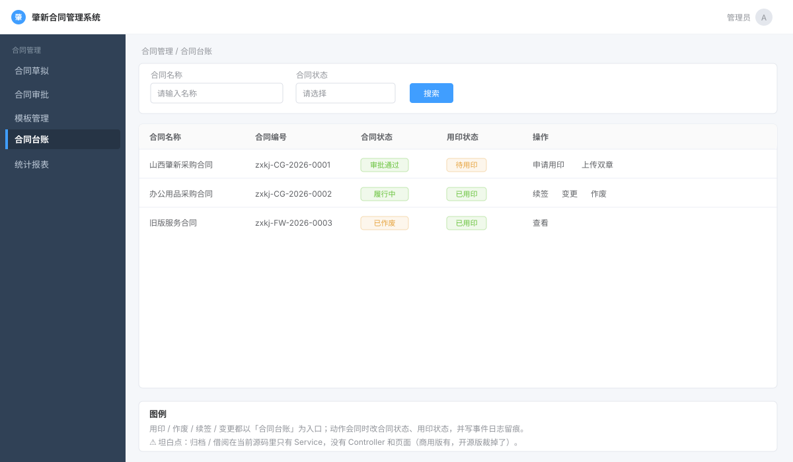

# 第 9 章 · 用印 · 作废 · 续签 · 归档——合同生命的收尾

> 本章是「一条合同完整生命周期」的最后一站。前八章讲到合同**草拟 → 审批**，本章讲合同**盖章生效 → 履行 → 到期续签 → 关闭/作废 → 归档**。
>
> 本章第一次讲透的新概念：**「历史不可变」原则**、**双章文件（FILE_TYPE_SEAL）**、**台账（ledger）与草稿表的关系**、**合同状态的终态与回退**。
>
> 阅读顺序建议：先看 §1 建立业务全景，再看 §2 理解设计取舍（**这一章的 §2 含 4 个坦白点，是全文最重要的部分**），然后从 §4 开始照着敲。

> **零基础先补概念（本章 4 个关键词）**
>
> 1. **状态机流转**：把合同想成一列只能沿轨道走的火车——停在 `draft(0)`，发车去 `audit(3)`，到终点 `done(8)`；每一步只能从「当前允许的状态」转到「下一个状态」。代码里不是引入什么框架，而是**状态枚举 + if 校验**。例：`uploadSealContract` 先判断合同是不是「审批通过 / 待签署 / 复核失败」三种可盖章状态之一，再把它推到 `fulfil(6)`（`zxcm-contract/src/main/java/com/ruoyi/contract/service/impl/ContractAuditServiceImpl.java:953-960`、`:1022-1027`）。
> 2. **双章文件**：盖了甲方章 + 乙方章的最终版合同文件。它和审批时看的「待审正文」不是同一份东西：待审稿是过程稿，双章件是法律正本。所以系统**新增**一条文件记录（`FILE_TYPE_SEAL = "2"`），而不是覆盖原文件（`zxcm-contract/src/main/java/com/ruoyi/contract/domain/bo/ContractDraftFilesBo.java:49`）。
> 3. **台账（读模型）**：台账不是一张新表，而是「把 [[D0-底座表地图#6. contract_draft 合同草稿表（04 行 253）|`contract_draft`]] 里**正式合同**按状态筛出来的一份清单」。草稿不算正式合同，所以台账默认把 `draft(0)` 排除（`zxcm-contract/src/main/java/com/ruoyi/contract/controller/ContractBookController.java:175-180`）。
> 4. **历史不可变**：合同一旦盖章生效或归档，内容就冻结。想改不能原地改，只能**作废重开 / 退回重做 / 新增版本**。最硬的一道门在在线编辑的保存回调：只有 `draft(0)`、`audit(3)` 状态允许写入，其余状态直接拒绝（`zxcm-contract/src/main/java/com/ruoyi/onlyoffice/callbacks/implementations/SaveCallback.java:74-78`）。

---

## 一、这部分是做什么的？

### 1.1 一句话定位

合同的「**收尾**」：审批通过的合同不是终点，接下来要**打印盖章（用印）→ 记录台账 → 履行 → 到期处理（续签/关闭）→ 中途可能作废 → 最终归档**。本章覆盖这条尾链上的全部功能。



> **图注**：按合同台账页面的结构画的**示意图，不是真实截图**（官方未提供该页面截图）。用印、作废、续签、变更都以台账上的合同行为入口。

### 1.2 与前面章节的衔接

```
第5章 草拟          第6章 审批          本章（第9章）
┌─────────┐        ┌─────────┐        ┌──────────────────────────┐
│ draft(0) │ ─────▶ │ audit(3) │ ─────▶ │ 用印 uploadSealContract   │
└─────────┘        └─────────┘        │  ↓ 自动置 fulfil(6)履行中  │
                                       │  ↓ 记录 effectiveTime/endTime│
                                       │  ↓ 附件类型 = FILE_TYPE_SEAL │
                                       └──────────────────────────┘
                                                  │
                  ┌───────────────────────────────┼───────────────────────────┐
                  ▼                               ▼                           ▼
            作废 cancelContract            续期 renew                关闭 closeContract
            状态 → canceled(2)            改 endTime 延后             状态 → done(8)
                                                  │
                                                  ▼
                                            归档 batchArchive
                                            archivesId 回填
```

### 1.3 合同状态全景（本章的核心对象）

合同状态枚举定义在 `zxcm-contract/src/main/java/com/ruoyi/contract/enums/ContractEnums.java:19-21` 的 `ContractStatusEnums`：

| 值 | 枚举名 | 含义（枚举显示名） | 谁把它置为这个值 |
|---|---|---|---|
| `0` | `draft` | 拟定中（草稿） | 新建合同；`backToDraft` 退回（§5.4） |
| `2` | `canceled` | 已作废 | `cancelContract`（§4.6） |
| `3` | `audit` | 审批中 | 提交审批时（第 6 章） |
| `4` | `signing` | 待签署（旧流程里叫「用印中」） | 旧接口 `applyStamp`（已废弃，§4.5） |
| `5` | `signed` | 已签署（预留态） | —— 见下方「坦白点」 |
| `6` | `fulfil` | 履行中 | `uploadSealContract`（§4.4，**真实路径**）；**存量合同**提交时也会直接置（`ContractAuditServiceImpl.java:593-596`） |
| `7` | `suspend` | 中止 | —— 见下方「坦白点」 |
| `8` | `done` | 已结束（已履行完） | `closeContract`（§4.7）；`applySign` 发现已过期也会置（`:839-840`） |

> **读表小提醒**：枚举的显示名来自 `ContractStatusEnums`（`zxcm-contract/src/main/java/com/ruoyi/contract/enums/ContractEnums.java:19-21`），是「待签署 / 已签署 / 已结束」；本章前文按业务流程口头叫「用印中 / 已用印 / 已履行完」，两者指同一个值。答辩时用枚举名更严谨。

> **坦白点（读表必看）**：`ContractStatusEnums` 声明了 8 个值，但开源版代码里**实际会被写入的只有 `draft(0)` / `canceled(2)` / `audit(3)` / `signing(4)` / `fulfil(6)` / `done(8)`**。`signed(5)` 和 `suspend(7)` 在开源版**没有任何一处 set**——`signed` 是「用印中→履行中」之间预留的过渡态，`suspend` 是「中止」态，两者都是**为企业版留的位**。看到这两个值不要以为漏读了代码，是真没实现。

### 1.4 本章涉及的三张主表 + 一张台账

| 表 | 建表位置 | 作用 | 谁读 / 谁写 |
|---|---|---|---|
| `contract_draft` | `script/sql/zxcm_init.sql:1077` | 合同主表（第 5 章已讲），本章用到其中的**收尾字段** | 全部收尾动作都写它 |
| [[D0-底座表地图#8. contract_draft_files 合同文件表（04 行 370）|`contract_draft_files`]] | `script/sql/zxcm_init.sql:1178` | 合同文件表（第 5 章已讲），本章新增 `FILE_TYPE_SEAL` 类型的双章文件 | `uploadSealContract` 写 |
| [[D0-底座表地图#26. conf_archives 档案表（04 行 230）|`conf_archives`]] | `script/sql/zxcm_init.sql:789` | 归档卷（archive）表 | 归档卷由档案管理模块维护；本章的 `batchArchiveStep2` 只把卷 id 回填到合同，`ContractBookController` 查卷名展示 |
| `contract_draft`（台账视角） | 同 `contract_draft` | **台账不是单独的表**，是 `contract_draft` 按状态过滤出来的列表 | `ContractBookController` 只读 |

**本章用到的 `contract_draft` 收尾字段（行号已核对）：**

| 字段 | 行号 | 含义 |
|---|---|---|
| `RELATED_CONTRACT_ID` | `:1081` | 关联合同 ID（续签/补充协议用） |
| `RELATED_CONTRACT_NAME` | `:1082` | 关联合同名 |
| `RELATED_CONTRACT_CODE` | `:1083` | 关联合同编号 |
| `RELATED_TYPE` | `:1084` | 关联类型：`main`主合同/`sub`子合同/`sp`补充协议 |
| `RELATED_TIME` | `:1085` | 关联时间 |
| `CONTRACT_STATUS` | `:1108` | 合同状态（上表 8 值） |
| `CONTRACT_STAMPED_STATUS` | `:1109` | 用印状态，默认 `'1'`=signing |
| `CONTRACT_REVIEW_STATUS` | `:1110` | 审核状态，默认 `'0'`（**注意这个默认值，§2 有坦白点**） |
| `CONTRACT_ARCHIVES_ID` | `:1119` | 归档卷 ID |
| `SEAL_FILES_ID` | `:1138` | 双章文件 ID（指向 `contract_draft_files`） |
| `CONTRACT_STOCK` | `:1145` | 是否**存量合同**（`"0"` 否 / `"1"` 是）。存量合同 = 系统上线前就存在、录入系统管理的历史合同，不是「入库」 |
| `CONTRACT_STAMPED_TIME` | `:1146` | 用印时间 |
| `CONTRACT_CANCEL_REMARK` | `:1147` | 作废原因 |
| `RENEWAL` | `:1153` | 是否续签 |
| `RENEWAL_TEXT` | `:1154` | 续签说明 |
| `end_time_type` | `:1159` | 期限类型（固定/无固定） |
| `renewed_status` | `:1160` | 续约状态：`"2"`已续约 / `"3"`不续约 |
| `EFFECTIVE_TIME` | 见 `zxcm-contract/src/main/java/com/ruoyi/contract/domain/ContractDraft.java:254` | 合同生效时间 |
| `END_TIME` | 见 `zxcm-contract/src/main/java/com/ruoyi/contract/domain/ContractDraft.java:260` | 合同到期时间 |

### 1.5 三个状态枚举（本章的「开关」）

除 `ContractStatusEnums` 外，本章还会用到另外三个状态枚举（都在 `ContractEnums.java`）：

**`StampStatusEnums`（`:257-258`，签署/用印状态）**
- `signing = "1"` —— 签署中（业务上就是「待用印」）
- `pass = "2"` —— 签署完成（业务上就是「用印通过」）
- `refuse = "3"` —— 拒绝签署
- `otherRefuse = "4"` —— 他人拒绝签署

**`ReviewStatusEnums`（`:200-201`，复核状态，本章也把它当「审核状态」用）**
- `doing = "4"` —— 复核中
- `fail = "5"` —— 复核失败
- `success = "6"` —— 复核通过

**`FulfilStatusEnums`（`:49-50`，履行状态）**
- `none = "0"` —— 枚举名称为空串，业务含义「未开始」
- `notEffective = "1"` —— 未生效
- `effective = "2"` —— 已生效
- `expired = "3"` —— 已截止
- `change = "4"` —— 变更中

---

## 二、站在架构师 / 开发经理角度：为什么这么设计？

> 这一章的设计取舍特别值得讲，因为**开源版的收尾功能是「残缺但故意残缺」的**——它保留了一条能跑通的主干（上传双章合同 → 履行中），把大量企业级收尾（用印申请审批流、归档写入接口）**裁剪掉了**，但留下了字段和服务方法。理解「为什么留字段却删接口」，比读懂代码本身更能体现你对架构演进的理解。

### 2.1 为什么「用印」是上传一份盖章后的文件，而不是系统里点一下就盖章？

**背景**：真实业务里，合同盖章是**物理动作**——把合同打印出来，拿到印章管理处，人工核对后用实体章（或电子章）盖上去。软件**没法替你把章盖了**。

**设计结论**：软件的职责边界是「**管理盖章前后的状态和文件**」，不是「执行盖章」。所以真实路径 `uploadSealContract`（`ContractAuditServiceImpl.java:944`）的逻辑是：

1. 你线下盖好章；
2. 你把**盖好章（双章：甲方章 + 乙方章）的 PDF/Word 上传**到系统；
3. 系统把这份文件标记为 `FILE_TYPE_SEAL`（双章文件），回填到 `sealFilesId`；
4. 系统把合同状态推进到 `fulfil(6) 履行中`，记录用印时间。

**Why（架构师视角）**：这叫「**软件系统只做它能保证的事**」。系统能保证的是「这份文件是不是最终盖章版」「盖章时间是不是记下了」「谁能看到」，它保证不了「章盖得对不对」——那是人+实体流程的职责。强行让系统"盖章"（比如用电子签章 SDK）会引入法律效力的复杂问题，不是这个系统要解决的。

**How to apply**：你面试被问「你们系统怎么实现盖章的」，标准答案是——**「盖章是线下行为，系统负责上传盖章件、记录用印时间、锁定合同状态、触发后续流程」**。不要硬编一个自己都觉得假的"电子盖章"逻辑。

### 2.2 为什么盖章后合同状态直接跳到「履行中(6)」？

审批通过是 `audit(3)`，盖章后本应有个「已用印(5)」的中间态，但开源版 `uploadSealContract` **直接置成 `fulfil(6) 履行中`**。

**Why**：因为「已用印」这个状态在业务上**没有独立价值**——合同盖完章的下一秒就开始履行了，中间没有任何需要停留的环节。`signed(5)` 这个枚举值是给**企业版**预留的（企业版可能有「用印审批流」：申请→审批→盖章→生效，那才需要 `signing(4)→signed(5)→fulfil(6)` 的完整链条）。

**How to apply**：`signed(5)`/`suspend(7)` 这些"空状态"是架构演进留下的**扩展位**。面试时可以主动指出：「我们开源版把用印简化成一步到位，但状态枚举保留了完整的 8 态设计，说明这套模型是照着企业级设计的，只是实现了子集」——这句话能体现你**看懂了设计意图而非只读了代码**。

### 2.3 为什么「作废」要区分普通作废和「存量合同作废」？

`cancelContract`（`zxcm-contract/src/main/java/com/ruoyi/contract/service/impl/ContractAuditServiceImpl.java:850`）和 `cancelStockContract`（`:878`）是两个方法：

- `cancelContract`：门槛是「状态是 `draft(0)`，**或** 用印状态是 `pass(2)`，**或** 审批状态是 `pass(2)`」——即**草稿，或已经用印/审批通过的合同**才能作废（`:854-860`）；
- `cancelStockContract`：先要求 `contractStock` **不为 `"0"`**（正常数据下就是 `"1"`，即**存量合同**），否则抛「当前合同不是存量合同」（`:883-885`）；通过门槛后，它做的事和普通作废**几乎一样**：置 `canceled(2)` + 写作废原因 + 发 `sealToCancel` 事件（`:887-896`）。

**⚠️ 先纠正一个容易望文生义的点**：这里的 `contractStock` 是「**存量合同**」（系统上线前已存在的历史合同），不是「入库/库存」。存量合同提交审批时会**跳过新工作流**、直接置为 `fulfil(6)`（`:585-596`），所以需要一个单独的作废入口来适配这类历史数据。**开源版 `cancelStockContract` 里没有库存回冲、也没有额外的库存表操作**——它只比普通作废多一道「必须是存量合同」的门槛。企业版可能会在这里补核销逻辑，但当前代码没有。

**Why**：同一个「作废」动作，作用在「走新流程的合同」和「系统接管的历史合同」上，业务前提不同。前者看审批/用印状态，后者要先确认它真的是存量合同，避免误调用。

**How to apply**：这是典型的「**同一个业务动词（作废），因对象来源不同，走不同的校验**」。你在自己的项目里设计"删除/取消"操作时，要先问：这个对象来自哪条数据链路？不同来源是否要不同的前置条件？要的话就单独一条入口，而不是在一个方法里堆 if。

### 2.4 「历史不可变」原则——本章的铁律

第 8 章末尾预告过这条原则，本章正式讲透。

**什么是「历史不可变」？** 一份合同一旦**盖章（成为履行中）或归档**，它的**内容就冻结了**。任何人不能在系统里改它的正文、改它的金额。要改？**作废它、新起一份**（或走续签/补充协议）。

**这条原则在代码里的三个体现：**

1. **`SaveCallback` 的状态门**（第 8 章 §4.5 讲过的 `SaveCallback.java:74-78`）：在线编辑保存时，只有 `draft(0)`/`audit(3)` 状态的合同允许写入。`fulfil(6)` 及以后的合同，编辑器的保存回调会被直接拒绝。
2. **附件版本不覆盖**：`uploadSealContract` 是**新增**一条 `contract_draft_files`（`FILE_TYPE_SEAL`），不是覆盖原来的正文文件。
3. **作废而非删除**：`cancelContract` 把状态置为 `canceled(2)` + 记录 `contractCancelRemark`，**记录永远留着**，不是 `DELETE FROM`。

**Why（架构师视角）**：合同是**法律证据**。法律证据一旦形成，就必须可追溯、不可篡改。如果允许改已盖章合同的正文，那这个系统的记录在法庭上就没有证明力了。所以「不可变」不是技术洁癖，是**业务合规的硬要求**。

**How to apply**：这是本章最能拿到面试分的一句话——**「合同的收尾功能全部遵循历史不可变：能作废不能删除，能新增版本不能覆盖原文件，能回退到草稿不能原地改已生效内容」**。

### 2.5 为什么「台账」不建独立表？

`ContractBookController`（合同台账）没有自己的表，它查的是 `contract_draft`，只是**换了一套过滤条件和展示字段**。

**Why**：
- 台账 = 「我要看所有**正式合同**（排除草稿）的清单」——包括审批中、待签署、履行中、已结束、已作废等；
- `contract_draft` 里已经有全部合同；
- 如果为台账单独建表，就会出现**数据双写、双份不一致**的问题（合同改了台账没改）。

**关键代码**：`ContractBookController.java:175` 的 `defaultLedgerStatus()` 定义了台账的默认状态过滤——台账**只看这 7 个状态**：`fulfil / suspend / done / signed / signing / audit / canceled`，**唯独排除 `draft(0)` 草稿**。

**How to apply**：「**同一份数据，不同视角用不同查询，而不是复制一份数据**」——这是读模型（read model）思想的朴素应用。台账是「读模型」，`contract_draft` 是「写模型」，读模型通过查询条件派生，不独立存储。

### 2.6 「续期」为什么只是改一个 `endTime`？

`renew`（`zxcm-contract/src/main/java/com/ruoyi/contract/controller/ContractAuditController.java:328`）看起来"很大"的动作，实际就是**把 `endTime` 往后延**。

**Why**：合同续期在业务上 = 「同样的合同，有效期再延 N 年」。它不产生新文件、不重新审批（如果业务规则允许的话），只是**时间字段变化**。所以系统实现就是 `endTime = 新时间`，外加一条校验（新 endTime 要 ≥ effectiveTime）。

对比之下，「**续签**」是另一回事——续签往往要**新起一份合同**（新编号、重新走流程），然后通过 `relatedContractId` 关联老合同。开源版把续签做成了「`renewal` / `renewalText` / `renewedStatus` 字段」的**记录**，没做成"自动新起合同"。

**How to apply**：区分「**续期 = 改时间**」和「**续签 = 新合同 + 关联**」，是两个不同的业务动作。面试被问续签，先说清这个区分。

---

### 2.7 坦白点（必读）——本章有 4 个「零件齐全但没装」的缺口

> 用户要求「**缺口主动写出来**」。本章是全书缺口最集中的一章，因为收尾功能在开源版里被裁剪得最狠。以下每一条都是你在答辩时**必须主动交代**的，否则被面试官发现会很被动。

**坦白点 ①：[[D0-底座表地图#23. contract_seal 用印申请表（04 行 631）|`contract_seal`]] / [[D0-底座表地图#24. contract_seal_notes 用印流水表（04 行 657）|`contract_seal_notes`]] / [[D0-底座表地图#25. contract_review 合同复核表（04 行 687）|`contract_review`]] 三张表是遗留表，没有实体类**

- `contract_seal`（用印表）建表在 `zxcm_init.sql:1429`
- `contract_seal_notes`（用印备注）`:1457`
- `contract_review`（合同审核）`:1395`

这三张表在 SQL 里**建好了**，但**整个 Java 代码里没有它们的 Entity / Mapper / Service**。只有两个「入参壳子」`ContractSealBo` / `ContractSealUploadBo`（`zxcm-contract/src/main/java/com/ruoyi/contract/domain/bo/ContractSealUploadBo.java:37`），以及 `ContractArchivesFileServiceImpl.hideContract/showContract` 里的**裸 SQL 字符串**引用到它们（`zxcm-contract/src/main/java/com/ruoyi/contract/service/impl/ContractArchivesFileServiceImpl.java:401-405`、`:441-445`）。也就是说：**表存在，但没接对象映射层**。

**怎么交代**：「用印审批流（申请→审批→记录）是企业版功能，开源版裁剪后只保留了表结构，业务逻辑没接。开源版走的是简化的『上传双章合同』路径。」

**坦白点 ②：`applyStamp` 和 `getSeal` 是 `@Deprecated` 死接口**

- `applyStamp(String contractId)` 在 `ContractAuditServiceImpl.java:904-934`（`@Deprecated` 在 `:904`，方法签名在 `:907`），逻辑是「审批通过(`audit`+`approve.pass`) → 置 `signing(4)`」——**这是旧的用印申请入口，已被 `uploadSealContract` 取代**。
- `ContractAuditController.java:255-261` 的 `getSeal` 也是 `@Deprecated`（注解在 `:255`，方法在 `:259`），**直接返回空列表**。

**怎么交代**：「这两个是重构前的接口，已经废弃但没删除。现在的用印走 `uploadSealContract`。」看到 `@Deprecated` 的代码，你要能说出「它被谁取代了」。

**坦白点 ③：归档的「写」操作全部没有 HTTP 接口**

`ContractArchivesFileServiceImpl`（`zxcm-contract/src/main/java/com/ruoyi/contract/service/impl/ContractArchivesFileServiceImpl.java:81`）里有这几个方法：

| 方法 | 行号 | 作用 |
|---|---|---|
| `queryById` | `:104` | 查归档卷 |
| `getArchiveStatusByIds` | `:184` | 查一批合同的归档状态 |
| `updateArchive` | `:257` | 改归档卷 |
| `listArchiveInfos` | `:272` | 列归档信息 |
| `updateArchiveFile` | `:348` | 更新归档文件 |
| `pageContractJoinArchives` | `:361` | 分页查合同+归档 |
| `hideContract` | `:376` | 隐藏合同（裸 SQL） |
| `showContract` | `:415` | 显示合同（裸 SQL） |
| `deleteDataListener` | `:452-453`（`@EventListener` 在 `:452`，方法在 `:453`） | 删除监听（TABLE_ARCHIVE） |
| `batchArchiveStep1` | `:467` | 批量归档第一步：筛符合条件合同 |
| `batchArchiveStep2` | `:511` | 批量归档第二步：批量回填 archivesId |

**问题**：这些方法**没有自己的 `ContractArchivesFileController`**。其中只读的 `listArchiveInfos` 被 `ContractDetailController` 间接调用（`zxcm-contract/src/main/java/com/ruoyi/contract/controller/ContractDetailController.java:181-182`），所以详情页能看到归档文件；但**所有归档写操作**（`updateArchive` / `updateArchiveFile` / `hideContract` / `showContract` / `batchArchiveStep1/2`）**都没有 HTTP 入口**，前端调不到。前端对归档只有**只读展示**：台账列表显示 `archivesName` 归档卷名（`zxcm-ui/src/views/contract/book/index.vue:251`），合同详情弹窗显示归档文件和归档任务文件（`zxcm-ui/src/views/components/BizDialog/ContractInfoDialog/index.vue:354`、`:382`、`:432`）。

**怎么交代**：「归档的批量入库逻辑（`batchArchiveStep1/2`）在 Service 层实现了，但没开放 HTTP 写接口，前端只能只读展示归档卷名和归档文件。这是开源版的功能缺口。」

**坦白点 ④：`renew` / `renewInfo` 没有前端调用方，`closeContract` 连 HTTP 入口都没有**

- `renew`（续期）、`renewInfo`（续期预览）这两个 Controller 接口**都实现了**，但**前端没有任何 .vue 调用**（`grep` 前端代码零命中）。
- `closeContract` 更彻底：它只有 Service 方法（`ContractAuditServiceImpl.java:805`），**没有对应的 Controller 接口**。另外有一个 `ContractJobService.closeContract()`（`zxcm-contract/src/main/java/com/ruoyi/contract/service/ContractJobService.java:71-89`），本意是读配置 `sys.closeContract.auto` 批量关闭到期合同，但这个方法**既没有 `@XxlJob`/`@Scheduled` 注解，仓库里也没有调用方**——自动关闭同样没接通。

**怎么交代**：「续期的后端逻辑实现了、Controller 也暴露了，但前端按钮没接；关闭合同则连 Controller 和定时任务都没接上——属于『后端先行、前端/调度没跟上』的缺口。」这比"功能没做"更值得说，因为它说明**你能分清"没实现"和"实现了没接通"**。

**⚠️ 注意 `contractReviewStatus` 默认值不一致（潜在 bug）**：`CONTRACT_REVIEW_STATUS` 字段的 DB 默认值是 `'0'`（`zxcm_init.sql:1110`），但 `ReviewStatusEnums`（`ContractEnums.java:200-201`）里**根本没有 `"0"` 这个值**（只有 doing=4/fail=5/success=6）。这意味着**新插入的合同 `reviewStatus` 会是枚举里不存在的 `"0"`**。这是一个真实的**代码/数据不一致**，面试时如果聊到"数据一致性"可以拿出来当案例。

---

## 三、需要哪些技术？

| 技术 / 概念 | 用来干什么 | 精确位置 |
|---|---|---|
| **状态机（状态枚举）** | 合同状态、用印状态、审核状态的流转 | `ContractEnums.java:19-21` / `:257-258` / `:200-201` |
| **Spring 事件发布** | 用印/作废/关闭后触发通知、状态联动 | `ContractAuditServiceImpl.java:1045-1047`（`uploadSeal`/`sealPass`/`reviewPass`） |
| **Excel 导出（EasyPOI 的 `ExcelBuilder`，底层 POI）** | 台账导出 | `zxcm-contract/src/main/java/com/ruoyi/contract/controller/ContractBookController.java:107`（`export`）、`:295`（`createExcel`）；展开见第 10 章 §4.6 |
| **MyBatis-Plus 构造查询** | 台账按状态列表过滤 | `ContractBookController.java:126`（`buildQueryWrapper`） |
| **文件类型枚举** | 区分正文/附件/双章文件 | `zxcm-contract/src/main/java/com/ruoyi/contract/domain/bo/ContractDraftFilesBo.java:49`（`FILE_TYPE_SEAL`） |
| **裸 SQL（JDBC/MyBatis 注解）** | `hideContract`/`showContract` 隐藏合同 | `ContractArchivesFileServiceImpl.java:376` / `:415` |

> **本章的技术新概念很少**——大部分技术（Spring 事件、MyBatis-Plus、Excel 导出）在前面章节已讲透。本章第一次出现需要讲透的只有 **「文件类型枚举」**（`FILE_TYPE_SEAL`，§4.2）和 **「状态终态」**（关闭 vs 作废，§4.6/§4.7）两个概念。

---

## 四、功能具体怎么实现（带着你复制）

> **本章涉及的表**（点表名直达底座表地图的字段详情）：
> [[D0-底座表地图#23. contract_seal 用印申请表（04 行 631）|`contract_seal`]]（用印申请） ｜ [[D0-底座表地图#24. contract_seal_notes 用印流水表（04 行 657）|`contract_seal_notes`]]（用印流水） ｜ [[D0-底座表地图#25. contract_review 合同复核表（04 行 687）|`contract_review`]]（双章复核） ｜ [[D0-底座表地图#26. conf_archives 档案表（04 行 230）|`conf_archives`]]（归档卷） ｜ [[D0-底座表地图#27. work_handover 工作交接表（04 行 903）|`work_handover`]]（工作交接） ｜ [[D0-底座表地图#6. contract_draft 合同草稿表（04 行 253）|`contract_draft`]]（合同主表） ｜ [[D0-底座表地图#8. contract_draft_files 合同文件表（04 行 370）|`contract_draft_files`]]（合同文件版本）


> 本章的「实现」按业务动作组织：用印 → 作废 → 续期/关闭 → 归档 → 台账。每个动作先讲**后端链路**，前端放到 §5「接口全链路」统一串。

### 4.1 需求、表设计与施工计划

**需求单（模拟）**

**需求编号** ZXCM-CONTRACT-003　**提出人** 合同管理部 / 档案室　**优先级** 中　**本期上线**

**背景**：审批通过只是「可以签了」。真正的工作在后面：打印盖章、登记台账、盯到期、中途作废、最后归档。现在这些都在线下台账里，查一份合同「盖没盖章、原件在哪」要翻柜子。

**功能需求**

| # | 功能 | 具体要求 |
|---|---|---|
| 1 | 用印 | 上传盖好章的双章文件；合同状态自动变「履行中」，记录用印时间 |
| 2 | 台账 | 按状态筛出全部合同，展示关键字段，是本章所有动作的入口 |
| 3 | 作废 | 普通作废 + 存量合同作废；要记录原因 |
| 4 | 关闭 | 履行完或提前结束，状态变「已结束」 |
| 5 | 续期 | 只改结束时间，不改合同主体 |
| 6 | 归档 | 把合同挂到某个归档卷上，回填卷 id |

**验收标准**：上传双章后状态 `6`（履行中）、`CONTRACT_STAMPED_TIME` 有值；作废后状态 `2`、原因有值；关闭后状态 `8`；归档后 `CONTRACT_ARCHIVES_ID` 指向卷；台账能按这些状态筛出来。

**本期不做 / 已知缺口**：`signed(5)`、`suspend(7)` 两个状态没有实现；本章有 4 处「零件齐全但没装」（§2.7）。

**拿到需求先做四件事**

① **给需求定性，再推架构**

| 判断维度 | 本模块的答案 | 推出的设计 |
|---|---|---|
| 数据性质 | 给已有业务单据补收尾字段 | 不新建体系，主表加列 |
| 存储 | 大部分是合同状态，只有卷要独立 | 1 张新表（归档卷） |
| 状态 | 用印/作废/关闭/续期都改合同状态 | 沿用合同的状态列 |
| 不可变 | 归档后只读 | 业务约束，不靠数据库 |

→ 架构：合同主表加收尾列 + 文件版本 + 归档卷 + 用印/复核（预留表）。

② **定存储**：只新建 1 张表（归档卷），其余靠 `contract_draft` 的收尾字段 + `contract_draft_files` 的新文件类型。

③ **定接口**：用印、作废、关闭、续期、归档、台账，见 §四。

④ **定实现边界：哪些不用写、哪些必须写、哪些是缺口**

- **框架给**：文件版本、逻辑删除、EasyPOI；
- **必须自己写**：双章上传+状态、作废/关闭/续期、归档回填；
- **已知缺口**：`signed`/`suspend` 未实现；`closeContract`/`renew` 无入口；4 处「零件齐全但没装」。

**表设计导读：一张新表，一堆新字段**

| 对象 | 类型 | 说明 |
|---|---|---|
| `contract_draft` | 已有表，**加字段** | 用印时间、双章文件 id、作废原因、关联合同、存量标记、续约状态… |
| `contract_draft_files` | 已有表，**加一种类型** | `FILE_TYPE = 2` 表示双章文件 |
| `conf_archives` | **本章唯一新建的表** | 归档卷（一个卷装多份合同） |
| 台账 | **不是表** | 是 `contract_draft` 按状态过滤出来的列表 |

**为什么收尾字段都堆在合同主表**：这些字段和合同同生命周期、查询时要一起筛（台账按状态查）。单独拆一张「合同收尾表」只会多一次 join，没有收益。

**为什么归档卷要独立一张表**：卷是**跨合同**的（一个卷装多份），和合同是 N:1；而且卷由档案管理模块维护，不是合同模块的私有数据。

**为什么台账不建表**：台账就是「合同表的另一个视图」——按状态过滤 + 挑字段展示。建物理表会带来同步问题（合同改了台账没改）。

**四个关键取舍**

| 决策 | 选择 | 代价 | 什么情况下反过来 |
|---|---|---|---|
| 收尾字段放哪 | 合同主表 | 主表更宽（已 80+ 列） | 收尾字段多到影响主表读写时 |
| 归档卷 | 独立表 + 合同回填 id | 查卷名要再查一次 | 卷信息固定、可冗余到合同 |
| 用印方式 | 上传盖章后的文件 | 依赖线下盖章 | 接电子签章时改成线上签 |
| 台账 | 视图（实时查） | 大数据量慢 | 数据量大、要离线统计时建汇总表 |

**已知缺陷 / 边界**

- **两个状态是空位**：`signed(5)`、`suspend(7)` 没有代码写入，是企业版预留；
- **台账查询要 join 多张表**，数据量大时慢（第 10 章会再优化）；
- **本章 4 处零件齐全但没装**（§2.7），照抄时别以为是自己漏了；
- **历史不可变**：归档后不允许再改合同，靠业务约束，不靠数据库。

**演示数据**：`ch09` 建了 `contract_seal` / `contract_seal_notes` / `conf_archives` / [[D0-底座表地图#27. work_handover 工作交接表（04 行 903）|`work_handover`]] 四张表，没有演示数据；用印要自己上传文件走一遍。

**对后面章节的连锁影响**

| 后面的事 | 依赖这里的什么 |
|---|---|
| 报表统计「已用印 / 已归档」 | 状态字段 + 归档卷 id |
| 到期提醒 | `END_TIME` + 状态 |
| 合同追溯 | 节点日志 + 文件版本 |

**施工计划**

> 施工单的完整任务清单见本章「任务清单」小节，可以和上面的分步顺序对照着看。

| 步骤 | 做什么 | 做完的标志 |
|---|---|---|
| 4.2 | 文件类型枚举 | 知道 `FILE_TYPE_SEAL` 是几、代表什么 |
| 4.3 | 四个用印入口 | 分清哪个是活的、哪个已废弃 |
| 4.4 | 上传双章 `uploadSealContract` | 状态变 6、用印时间有值 |
| 4.5 | 旧接口 `applyStamp` | 知道为什么别照抄 |
| 4.6 | 作废 | 状态变 2、原因写入 |
| 4.7 | 关闭 | 状态变 8 |
| 4.8 | 续期 | `END_TIME` 延后、主体不变 |
| 4.9 | 归档 | 卷 id 回填、档案模块能查到 |
| 4.10 | 台账 | 按状态能筛出合同 |
| 4.11 | 动手验证 | SQL / 断点能核对每一步 |

**表**（第 5 章已建 `contract_draft` / `contract_draft_files`，本章不重复建，只用到新字段）：

```sql
-- 归档卷表（zxcm_init.sql:789 起）
-- 关键字段：id / archives_name 卷名 / archives_code 卷号 / 创建人 / 创建时间
-- 完整 DDL 见 script/sql/zxcm_init.sql:789
```

**实体字段映射**（`ContractDraft.java`，本章用到的收尾字段）：

```java
// zxcm-contract/src/main/java/com/ruoyi/contract/domain/ContractDraft.java
private String relatedContractId;    // :65   关联合同 ID（注意：实体里是 String）
private String relatedContractName;  // :69   关联合同名
private String relatedContractCode;  // :73   关联合同编号
private String relatedType;          // :77   关联类型 main/sub/sp
// ...
private String contractStatus;       // :155  合同状态（enum 的 8 个值）
private String contractStampedStatus;// :159  用印/签署状态
private Date   contractStampedTime;  // :163  用印时间
private String contractReviewStatus; // :175  复核/审核状态
private Long   sealFilesId;          // :306  双章文件 ID
private String contractStock;        // :328  是否存量合同（0 否 / 1 是）
private String contractCancelRemark; // :336  作废原因
// ...
```

> **怎么"复制"**：你的 `zxcm-learn` 项目里，`ContractDraft` 实体应该在第 5 章就已经建好了。本章**不需要新建实体**，只需要确认上述字段存在。如果缺，按上面行号从答案册补齐。

### 4.2 【第一次讲透】文件类型枚举 `FILE_TYPE_SEAL`

**本步目标**：分清合同文件、审批附件、双章附件各是哪个类型。
**做完的标志**：能说出双章文件存在哪张表、`FILE_TYPE` 是几。

第 5 章讲 `contract_draft_files` 时提过「一个合同有多份文件」，但没展开「文件类型」。本章补上。

`ContractDraftFilesBo`（`zxcm-contract/src/main/java/com/ruoyi/contract/domain/bo/ContractDraftFilesBo.java:36`）里**实际存在**的文件类型常量是：

| 常量 | 值 | 行号 | 含义 |
|---|---|---|---|
| `FILE_TYPE_CONTRACT` | `"0"` | `:41` | 创建合同时添加的合同文件（正文/主文件） |
| `FILE_TYPE_APPROVE` | `"1"` | `:45` | 发起审批时添加的附件 |
| **`FILE_TYPE_SEAL`** | **`"2"`** | **`:49`** | **上传双章合同时添加的双章文件** |
| `FILE_TYPE_CHANGE_SEAL` | `"3"` | `:54` | 合同变更时上传的双章文件 |
| `IS_MAIN_FILE` | `"0"` | `:59` | 文件组里标记「主文件」的 `type` 值 |

> 注意：有些二手资料会写成 `FILE_TYPE_MAIN` / `FILE_TYPE_ATTACH`，但本仓库源码里**没有这两个常量**；实际就是上表的 0/1/2/3。
>
> 另外还有一套容易混的 `ContractEnums.FileTypeEnums`（`zxcm-contract/src/main/java/com/ruoyi/contract/enums/ContractEnums.java:172-173`）：`mainFile("0")` / `other("1")`。`uploadSealContract` 判断「上传文件里有没有正文」用的是它（`ContractAuditServiceImpl.java:984`），而落库时用的类型是 `ContractDraftFilesBo.FILE_TYPE_SEAL("2")`——**判断用的 type 和落库的 fileType 是两套字段**，别混。

**为什么双章文件要单独一个类型？** 因为「双章文件」和「正文」在业务上**不是同一份东西**：
- 正文是**待审/待盖的稿子**；
- 双章文件是**盖章后的法律正本**。

两者**都要留档**，且双章文件是「历史不可变」的直接产物（盖章即冻结）。所以不能覆盖正文，要**新增一条 `FILE_TYPE_SEAL = "2"` 的记录**。

**代码位置**：`zxcm-contract/src/main/java/com/ruoyi/contract/service/impl/ContractAuditServiceImpl.java:998` —— `filesBo.setFileType(ContractDraftFilesBo.FILE_TYPE_SEAL);`

### 4.3 用印相关的四个入口（先分清哪个是活的）

**本步目标**：别在废弃接口上浪费时间。
**做完的标志**：能指出真实入口是哪个、其余三个为什么不用。

| 入口 | 位置 | 状态 | 干什么 |
|---|---|---|---|
| `uploadSealContract` | `zxcm-contract/src/main/java/com/ruoyi/contract/service/impl/ContractAuditServiceImpl.java:944` | ✅ **活的，真实路径** | 上传双章合同 → 置履行中 |
| `applyStamp` | `ContractAuditServiceImpl.java:904`（方法签名在 `:907`，方法体到 `:934`） | ❌ `@Deprecated` | 旧用印申请（audit→signing） |
| `getSeal` | `ContractAuditController.java:255-261`（`@Deprecated` 在 `:255`，方法在 `:259`） | ❌ `@Deprecated` | 返回空列表 |
| `applySign` | `ContractAuditServiceImpl.java:834` | ⚠️ **只有 Service 方法**，无 Controller、无前端调用 | 续约设置（写 `renewedStatus`；已过期则置 `done`） |

**结论：只讲 `uploadSealContract`，其余三个当"历史包袱"带一句。**

### 4.4 核心实现：`uploadSealContract`（上传双章合同）

> **这一步依赖的配置**：双章文件同样落到 `application-dev.yml:4` 的 `ruoyi.profile`；上限 `application.yml:70-74` 的 80MB。

**本步目标**：上传双章文件 + 改状态 + 记时间，一次完成。
**做完的标志**：状态 6、`CONTRACT_STAMPED_TIME` 有值、文件类型为双章。

**位置**：`zxcm-contract/src/main/java/com/ruoyi/contract/service/impl/ContractAuditServiceImpl.java:944`

**入参**：`ContractSealUploadBo bo`（双章上传业务对象，含 contractId + 文件 + 生效/到期时间）

**代码骨架（只保留主干，行号就是源码行号）**：

```java
@Override                                                                    // :942
@Transactional                                                               // :943
public void uploadSealContract(ContractSealUploadBo bo) {                    // :944
    if (StringUtils.isEmpty(bo.getFileGroupsId())) {                         // :945
        throw new ServiceException("合同的文件不能为空");                     // :946
    }
    ContractDraft contract = contractDraftMapper.selectById(bo.getContractDraftId()); // :949
    if (contract == null) {                                                  // :950
        throw new ServiceException("合同不存在");                             // :951
    }
    boolean approved = ContractEnums.ContractStatusEnums.audit.getIndex().equals(contract.getContractStatus())
        && ContractEnums.ApproveStatusEnums.pass.getIndex().equals(contract.getContractApproveStatus()); // :953-954
    boolean signing = ContractEnums.ContractStatusEnums.signing.getIndex().equals(contract.getContractStatus()); // :955
    boolean reviewFailed = ContractEnums.ContractStatusEnums.signed.getIndex().equals(contract.getContractStatus())
        && ContractEnums.ReviewStatusEnums.fail.getIndex().equals(contract.getContractReviewStatus()); // :956-957
    if (!approved && !signing && !reviewFailed) {                            // :958
        throw new ServiceException("当前合同未审批通过，不能上传双章合同");     // :959
    }
    // :961-975：生效时间必填；fixed 必须有截止时间；open 把截止时间置 null；截止时间不能早于生效时间
    // :977-992：解析文件 JSON，必须找到一个 type == FileTypeEnums.mainFile("0") 的正文文件
    ContractDraftFilesBo filesBo = new ContractDraftFilesBo();               // :996
    filesBo.setFileType(ContractDraftFilesBo.FILE_TYPE_SEAL);                // :998
    contractDraftFilesService.insertByBo(filesBo);                           // :1002
    // :1005-1015：回填合同负责人（昵称查不到也不影响主流程）
    contract.setEffectiveTime(bo.getContractEffectiveTime());                // :1018
    contract.setEndTime(bo.getContractEndTime());                            // :1019
    contract.setSealFilesId(Long.valueOf(filesBo.getId()));                  // :1022
    contract.setContractStampedStatus(StampStatusEnums.pass.getIndex());     // :1023
    contract.setContractStampedTime(new Date());                             // :1024
    contract.setContractReviewStatus(ContractEnums.ReviewStatusEnums.success.getIndex()); // :1025
    contract.setContractStatus(ContractEnums.ContractStatusEnums.fulfil.getIndex());      // :1026
    contractDraftMapper.updateById(contract);                                // :1027
    // :1030-1037：把审批单的当前节点改成「履行中 / 合同负责人」
    pushNotifyUtil.sendMessage("CONTRACT_USE_SEAL_FINISH", map, "" + contract.getDrafterId()); // :1043
    applicationEventPublisher.publishEvent(new ContractEvent(this, contract.getId(), ContractEventEnum.uploadSeal));  // :1045
    applicationEventPublisher.publishEvent(new ContractEvent(this, contract.getId(), ContractEventEnum.sealPass));   // :1046
    applicationEventPublisher.publishEvent(new ContractEvent(this, contract.getId(), ContractEventEnum.reviewPass)); // :1047
}
```

**逐行读（把这段代码翻译成人话）**：

| # | 行号 | 这一行在干什么 | 为什么这么写 |
|---|---|---|---|
| 1 | `:942-943` | `@Override` + `@Transactional` | 方法在接口里有定义；事务保证「存文件 + 改合同」要么都成功、要么都回滚，不会出现「文件存了但状态没改」 |
| 2 | `:945-947` | 文件组为空直接抛异常 | **快速失败**：连文件都没有，后面的查询和落库全都不用做 |
| 3 | `:949-952` | 按 id 查合同，查不到抛异常 | 后续所有 `contract.setXxx` 都依赖这个对象，先保证它存在，避免空指针 |
| 4 | `:953-960` | 算出 `approved` / `signing` / `reviewFailed` 三个布尔，任一为真才放行 | 这是**状态门**：只允许「审批通过」「待签署」「已签署且复核失败」三种合同进来。第三种是**复核失败后的重试通道**；但开源版没有任何地方写入 `signed(5)`，所以这条分支目前实际不可达，属于为旧流程/企业版留的口子 |
| 5 | `:961-975` | 生效时间必填；固定期限必须有截止时间；无固定期限把截止时间清空；截止时间 ≥ 生效时间 | 把「时间合法」在校验层一次说清，不把脏数据写进库；`open` 合同没有到期日，所以强制置 null |
| 6 | `:977-992` | 解析上传文件 JSON，遍历找 `type == "0"` 的主文件，找不到抛异常 | 防止用户只传了附件、没有正文，导致双章件「没有主体」 |
| 7 | `:996-1002` | 新建一条 `ContractDraftFilesBo`，`fileType = FILE_TYPE_SEAL("2")`，插入文件表 | **新增而不是覆盖**：原审批正文还在，双章件是新的法律正本（历史不可变） |
| 8 | `:1005-1015` | 回填合同负责人 id；顺带查昵称 | 负责人是数据权限的过滤字段（见第 10 章 §2.3），必须落库；昵称查询失败被 try/catch 吞掉，**不能因为一个展示字段失败而回滚主流程** |
| 9 | `:1018-1019` | 把生效时间、截止时间写回合同 | 后面首页「履行中」和「即将到期」统计都依赖这两个字段 |
| 10 | `:1022-1027` | 连续 set 5 个字段：双章文件 id、用印状态、用印时间、复核状态、合同状态，最后**一次** `updateById` | 5 个字段属于同一个业务事实（盖章完成），必须**同一次 update** 落库，避免「状态说履行中、但用印时间还是空」的中间态 |
| 11 | `:1030-1037` | 改审批单的 `currentTask/currentAssignee` | 让审批页面看到合同已经走到「履行中」，保持两个模块的展示一致 |
| 12 | `:1043` | 给拟稿人发 `CONTRACT_USE_SEAL_FINISH` 站内/短信通知 | 通知是**副作用**，放在核心状态落库之后；通知失败不应该影响合同状态 |
| 13 | `:1045-1047` | 发 `uploadSeal` / `sealPass` / `reviewPass` 三个 Spring 事件 | 用事件解耦：台账、消息、审计等监听方各自处理，`uploadSealContract` 不需要知道它们是谁（事件机制见第 6 章） |

**这张「状态一次跳完」的表要记住：**

| 字段 | 盖章前 | 盖章后 |
|---|---|---|
| `contractStatus` | `audit(3)` | **`fulfil(6)`** 履行中 |
| `contractStampedStatus` | `signing(1)` | **`pass(2)`** 用印通过 |
| `contractReviewStatus` | `doing(4)` | **`success(6)`** 审核通过 |
| `sealFilesId` | null | 双章文件 ID |
| `contractStampedTime` | null | 当前时间 |

> **为什么一次跳三个状态？** 因为「上传双章合同」这一个业务动作，在业务语义上**同时**完成了三件事：用印通过、审核通过、合同生效进入履行。系统把它们**打包成一次更新**（`:1022-1027`），保证三个状态要么全变要么全不变——**这正是"事务"要保障的原子性**。

**怎么"复制"**：你的 `zxcm-learn` 里写 `uploadSealContract` 时，**关键是那一段连续 set 多个状态的 update**。校验部分（⓪①②③）可以先写简版（比如只校验状态），等主干跑通再补边界。

### 4.5 旧用印接口 `applyStamp`（了解即可，别照抄）

**本步目标**：知道它为什么被废弃。
**做完的标志**：能说出新旧两条路径的差别。

**位置**：`ContractAuditServiceImpl.java:904-934`（`@Deprecated` 在 `:904`，方法签名在 `:907`，方法体到 `:934`）

逻辑：校验「状态是 `audit(3)` 且审批通过」→ 置 `contractStatus = signing(4)`。就这么简单。**它被 `uploadSealContract` 取代了**，你不用实现它，但要知道它存在、知道它为什么死（因为它是"点一下进入用印中"的旧模型，而新模型是"上传盖章件一步到位"）。

### 4.6 作废实现（两个方法）

**本步目标**：普通作废和存量合同作废分开处理。
**做完的标志**：作废后状态 2、原因写入、记录仍在。

#### 4.6.1 `cancelContract`（普通作废）

**位置**：`ContractAuditServiceImpl.java:850`

```java
public void cancelContract(ContractDraftBo draft) {
    // ① 门槛校验（行号 854-860）：满足以下任一即可作废
    //    - contractStatus == draft(0)          （还没进流程的草稿）
    //    - contractStampedStatus == pass(2)    （已经盖过章）
    //    - contractApproveStatus == pass(2)    （审批已通过）
    //    → 即"草稿，或已经进入过实质流程的合同"才能作废
    // ② 置状态：contractStatus = canceled(2)
    // ③ 记录原因：contractCancelRemark = 用户填的作废理由
    // ④ 发布事件：sealToCancel（通知用印/台账相关方）
}
```

**为什么要"门槛校验"？** 草稿允许作废（还没产生实质流程，作废只是留个状态）；但一个**已经在审批中、却还没审批通过**的合同不能随手作废——必须先让审批流程有结果（通过）或者至少用印通过。代码用「`status != draft` 时，必须 `stampedStatus == pass` 或 `approveStatus == pass`」来表达这个意思（`:854-860`）。作废本身一定要**留痕**（记录原因 + 保留记录），而不是删行。

#### 4.6.2 `cancelStockContract`（存量合同作废）

**位置**：`ContractAuditServiceImpl.java:878`

```java
public void cancelStockContract(ContractDraftBo draft) {
    ContractDraft contract = contractDraftMapper.selectById("" + draft.getId()); // :880
    // ① 硬门槛：contractStock 不能是 "0"（正常数据下即必须为 "1"=存量合同）
    if (contract.getContractStock().equals("0")) {                              // :883
        throw new ServiceException("操作失败，当前合同不是存量合同");             // :884
    }
    // ② 置 contractStatus = canceled(2) + 写作废原因
    luw.eq(ContractDraft::getId, draft.getId())                                 // :889
        .set(ContractDraft::getContractStatus, ContractEnums.ContractStatusEnums.canceled.getIndex()) // :890
        .set(ContractDraft::getContractCancelRemark, draft.getContractCancelRemark());   // :891
    contractDraftMapper.update(null, luw);                                      // :893
    // ③ 发事件 sealToCancel
    applicationEventPublisher.publishEvent(event);                              // :896
}
```

**⚠️ 这里没有「库存回冲」**：源码从头到尾没有库存表、没有扣减/回补逻辑。它和 `cancelContract` 的差别只有一处——**多一道「必须是存量合同」的门槛**；后面的置状态、写原因、发事件完全相同。把 `contractStock` 理解成「存量合同标记」，不要理解成「仓库库存」。

**两个作废方法的区别一句话总结**：`cancelContract` 管「草稿，或已经审批/用印通过的合同」，`cancelStockContract` 管「**存量合同**（系统上线前的历史合同）」，后者只多一层来源校验，**没有额外副作用**。

### 4.7 关闭合同 `closeContract`

**本步目标**：履行完或提前结束时关闭合同。
**做完的标志**：状态变 8，台账里归到「已结束」。

**位置**：`ContractAuditServiceImpl.java:805`

```java
public void closeContract(Long contractId) {
    // ① 门槛（:808-810）：contractStatus 必须是 fulfil(6) 履行中
    //    → 只有"履行中"的合同才能被关闭
    // ② 门槛（:813-815）：endTime 不为空时必须已经过去
    //    → 合同没到期不能强制关闭；endTime 为 null（无固定期限）则放行
    // ③ 门槛（:818-820）：contractChangeStatus 不等于 "3"
    //    → 源码注释写的是"变更中不能关闭"，但比较时借用的是
    //      ContractStatusEnums.audit ("3")，读的时候别误以为在比合同状态
    // ④ 置状态：contractStatus = done(8) 已结束（:822）
    // ⑤ 发布事件：closeContract（:825-826）
}
```

**"关闭"和"作废"的区别**（面试易混）：
- **关闭**：合同**正常走完**了它的生命周期（到期了），是**正常终态**；
- **作废**：合同**没走完就被人为终止**，是**非正常终态**。

**⚠️ 注意**：`closeContract` 没有 Controller/前端入口，自动关闭任务也没接通（§2.7 坦白点 ④）。

### 4.8 续期实现

**本步目标**：只改结束时间，不动主体信息。
**做完的标志**：`END_TIME` 延后，其他字段不变。

**位置**（`zxcm-contract/src/main/java/com/ruoyi/contract/controller/ContractAuditController.java`）：
- `renewInfo`（预览）：`:302-317`（`@GetMapping` 在 `:307`，方法在 `:308`）—— 只算不改，`DateUtil.offset(endTime, YEAR, 1)` 返回「当前结束时间 + 1 年」给前端（`:309-316`）；
- `renew`（实际改）：`:322-344`（`@PostMapping` 在 `:324`，方法在 `:328`）—— 校验 `newEndTime >= effectiveTime`（`:338-340`），然后 `endTime = 新值`（`:341`）。

```java
// renewInfo：预览（不改库）
// 逻辑：取当前 endTime，加 1 年，返回给前端展示
// renew：落库
// 逻辑：校验 newEndTime >= effectiveTime → set endTime
```

**为什么要有 `renewInfo`？** 因为「+1 年」这种计算，前端算容易算错（闰年、月末），**让后端算、前端只展示**是更好的分工。这体现「**业务计算收口到后端**」的设计习惯。

**⚠️ 注意**：`renew`/`renewInfo` 无前端调用方（§2.7 坦白点 ④）。

### 4.9 归档实现

**本步目标**：把合同挂到归档卷，回填卷 id。
**做完的标志**：`CONTRACT_ARCHIVES_ID` 有值，档案模块能按卷查到。

**位置**：`zxcm-contract/src/main/java/com/ruoyi/contract/service/impl/ContractArchivesFileServiceImpl.java`

#### 4.9.1 批量归档两步走

```java
// batchArchiveStep1（:467-505）：筛符合归档条件的合同
//   条件：contractStatus ∈ {fulfil(6), suspend(7), done(8)}（:493-498）
//        且 contractArchivesId 为 null（还没归档）（:499）
//   → 返回"待归档合同列表"给前端确认（:500-504）

// batchArchiveStep2（:510-575）：批量回填归档卷
//   入参：归档卷ID + 合同ID列表
//   动作①：批量 set contractArchivesId = 归档卷ID（:537）
//          + contractArchivesTime = now（:538）
//          + contractArchivesUserId = 当前用户（:539）
//   动作②：读出这些合同的双章文件 JSON，拆出每个文件，
//          批量写入 contract_archives_file 归档文件明细（:543-573）
```

**为什么分两步？** 归档是**不可逆**的重操作（归档后合同冻结），所以设计成「**先预览再确认**」：Step1 告诉你"这些合同将被归档"（让用户核对），Step2 才真正执行。**这是所有不可逆批量操作的标准设计模式。**

> ⚠️ 注意：本仓库只在 Service 层实现了这两步，**没有对应的 HTTP 接口**（§2.7 坦白点 ③）。上面说的「返回给前端确认」是设计意图，不是当前可调用到的现状。

#### 4.9.2 隐藏/显示合同（裸 SQL 代码味）

```java
// hideContract（:376）：把合同从归档列表"隐藏"
// showContract（:415）：恢复显示
// ⚠️ 这两个方法用裸 SQL 字符串拼接，由 archive.important 配置驱动
//    代码味：字符串拼 SQL 有注入风险，且难维护
```

**怎么"复制"**：你的 `zxcm-learn` 里，归档**优先实现 Step1/Step2 的查询+回填**（这是主干）；`hideContract/showContract` 可以跳过（它是企业级的"软隐藏"）。**并且要能指出裸 SQL 拼接是个代码味**——这是加分项。

### 4.10 台账实现

**本步目标**：不建表，用合同表按状态过滤出台账。
**做完的标志**：按状态能筛出合同；关键字段展示正确。

**位置**：`zxcm-contract/src/main/java/com/ruoyi/contract/controller/ContractBookController.java`

```java
// list（:95）：台账列表（分页）
// export（:107）：台账导出 Excel
// buildQueryWrapper（:126）：构造查询条件
// defaultLedgerStatus（:175）：★ 台账的默认状态过滤（核心）
// packageData（:204）：打包返回数据（含关联的审批表单信息）
// fillFromAuditForm（:249）：从审批表单回填展示字段
// createExcel（:295）：生成 Excel
```

**核心是 `defaultLedgerStatus`（`:175`）**：

```java
// 台账默认只看这 7 个状态（排除 draft(0) 草稿）：:175-180
private List<String> defaultLedgerStatus() {
    return Arrays.asList(ContractEnums.ContractStatusEnums.fulfil.getIndex(),    // "6"
        ContractEnums.ContractStatusEnums.suspend.getIndex(),                    // "7"
        ContractEnums.ContractStatusEnums.done.getIndex(),                       // "8"
        ContractEnums.ContractStatusEnums.signed.getIndex(),                     // "5"
        ContractEnums.ContractStatusEnums.signing.getIndex(),                    // "4"
        ContractEnums.ContractStatusEnums.audit.getIndex(),                      // "3"
        ContractEnums.ContractStatusEnums.canceled.getIndex());                  // "2"
}
```

**为什么台账排除草稿？** 因为「台账」的业务定义是「**正式的合同清单**」——草稿还没成为正式合同，不属于台账。**这是"同一张表、两个视角"（§2.5）的具体体现。**

**怎么"复制"**：你的 `ContractBookController` 照抄这套「list + export + buildQueryWrapper + defaultLedgerStatus」四件套即可，这是标准的「列表+导出」Controller 模板（第 1 章已讲透的 CRUD 套路 + Excel 导出）。

### 4.11 动手验证（用 SQL / 断点把链路跑一遍）

**本步目标**：把用印 → 作废 → 续期 → 归档全走一遍。
**做完的标志**：每一步的 SQL 结果和状态值都能对上。

> 前提：本地已启动 `ruoyi-admin`（默认端口 `8080`，`ruoyi-admin/src/main/resources/application.yml:30`）；先登录系统，从浏览器 F12 → Network 任意请求里复制 `token` 请求头（格式 `Bearer xxx`，前端在 `zxcm-ui/src/utils/request.js:33` 这么拼）。准备一条 `CONTRACT_STATUS='3'` 且 `CONTRACT_APPROVE_STATUS='2'` 的合同。

**① 跑通用印：`uploadSealContract`**

```bash
curl -X POST "http://localhost:8080/contract/contractAudit/uploadSealContract" \
  -H "token: Bearer <你的 token>" \
  -H "Content-Type: application/json" \
  -d '{"contractDraftId":"<合同ID>","contractChargeId":"<负责人用户ID>","contractEffectiveTime":"2026-10-01 00:00:00","contractEndTime":"2027-09-30 00:00:00","endTimeType":"fixed","fileGroupsId":"[{\"uid\":\"<文件ID>\",\"name\":\"双章.pdf\",\"type\":\"0\"}]"}'
```

预期返回 `R.ok()`（`code=200`）。该接口要求 `contract:contractDraft:uploadStampedContract` 权限（`ContractAuditController.java:267`），没权限会直接 403。随后查库：

```sql
SELECT ID, CONTRACT_STATUS, CONTRACT_STAMPED_STATUS, CONTRACT_REVIEW_STATUS,
       SEAL_FILES_ID, EFFECTIVE_TIME, END_TIME
FROM contract_draft WHERE ID = '<合同ID>';
```

预期：`CONTRACT_STATUS='6'`、`CONTRACT_STAMPED_STATUS='2'`、`CONTRACT_REVIEW_STATUS='6'`、`SEAL_FILES_ID` 不为空，`EFFECTIVE_TIME/END_TIME` 等于入参。

```sql
SELECT ID, CONTRACT_DRAFT_ID, FILE_TYPE, MAIN_FILE_ID, MAIN_FILE_NAME
FROM contract_draft_files
WHERE CONTRACT_DRAFT_ID = '<合同ID>' ORDER BY ID DESC;
```

预期：最新一条 `FILE_TYPE='2'`（`FILE_TYPE_SEAL`），`MAIN_FILE_ID/MAIN_FILE_NAME` 是刚传的正文。

断点：`ContractAuditServiceImpl.java:953`（看三个布尔值）、`:1026`（看 5 个 set 之后的对象）、`:1027`（确认一次 update）。

想看实际 SQL，可尝试启动参数 `--logging.level.com.ruoyi.contract.mapper=debug`（能否输出取决于项目的 MyBatis 日志实现），在日志里搜关键字 `contract_draft_files`（插入）和 `update contract_draft`（状态更新）。

**② 跑通续期（后端有、前端没接）**

```bash
curl "http://localhost:8080/contract/contractAudit/renewInfo/<合同ID>" -H "token: Bearer <你的 token>"
```

预期：返回 JSON 里 `newEndTime` 是当前 `END_TIME` 加一年（`yyyy-MM-dd`）。再提交：

```bash
curl -X POST "http://localhost:8080/contract/contractAudit/renew/<合同ID>" \
  -H "token: Bearer <你的 token>" -H "Content-Type: application/json" \
  -d '{"newEndTime":"2028-09-30"}'
```

预期：`END_TIME` 变成 `2028-09-30`；如果新时间早于 `EFFECTIVE_TIME`，返回「合同截止时间不能小于合同开始时间」（`:338-340`）。注意该接口要 `contract:contractDraft:renewal` 权限，没权限会直接 403。

**③ 跑通作废**

```bash
curl -X POST "http://localhost:8080/contract/contractAudit/cancelContract" \
  -H "token: Bearer <你的 token>" -H "Content-Type: application/json" \
  -d '{"id":"<合同ID>","contractCancelRemark":"联调测试作废"}'
```

预期：`CONTRACT_STATUS='2'`，`CONTRACT_CANCEL_REMARK='联调测试作废'`。若拿一条 `draft(0)` 的合同来试，也能成功（`:854` 的第一个分支）；若合同既不是草稿、又没审批通过/用印通过，会返回「该合同不可作废」（`:858`）。

**④ 归档（没有 HTTP 入口，只能用断点/临时测试）**

在 `ContractArchivesFileServiceImpl.java:467`（Step1）和 `:511`（Step2）打断点，通过 IDE 的 Evaluate 或一个临时 JUnit 注入 `IContractArchivesFileService`，构造 `ContractBatchArchiveBo` 调 `batchArchiveStep1/2`。注意 Step1 的「合同类型」和「归属部门」至少要给一个，否则会抛「合同归属部门、合同类型至少需要选择一项」（`:473-475`）；Step2 必须给 `archiveId` 和合同 id 列表（`:512-517`）。执行后查：

```sql
SELECT ID, CONTRACT_ARCHIVES_ID, CONTRACT_ARCHIVES_TIME, CONTRACT_ARCHIVES_USER_ID
FROM contract_draft WHERE ID IN ('<合同ID1>','<合同ID2>');
```

预期：三个归档字段都不为空；再查 `SELECT * FROM contract_archives_file WHERE CONTRACT_DRAFT_ID='<合同ID>';`，预期能看到双章文件被拆成明细行（写入点在 `:573`）。

**⑤ 台账（验证草稿被排除）**

```bash
curl "http://localhost:8080/contract/book/list?pageNum=1&pageSize=10" -H "token: Bearer <你的 token>"
```

预期：`rows` 里没有 `CONTRACT_STATUS='0'` 的草稿。用管理员（全部数据权限）账号时，可以用下面的 SQL 对总数：

```sql
SELECT COUNT(*) FROM contract_draft
WHERE DEL_FLAG='0' AND CONTRACT_STATUS IN ('2','3','4','5','6','7','8');
```

断点：`ContractBookController.java:96`（看 `buildQueryWrapper` 返回的 wrapper）、`:128`（确认默认状态过滤被加进去）。

---

### 4.12 任务清单：T1~T3（施工单对照）

##### T1 · 用印申请 + 上传双章合同（A 类）★★

**做什么**：审批通过 → 线下盖章 → 把带双章的正式合同**传回系统** → 合同进入"履行中"。

> 🔴 **一句话认清开源版的"用印"**：**没有电子签章**。系统管的是「流程 + 留痕」，
> **盖章是线下做的**，系统只负责「接收盖好的文件 + 推进状态」。

**`uploadSealContract` 的真实行为**（`ContractAuditServiceImpl:942-1048`）：

```
① 校验 fileGroupsId 非空 → 否则「合同的文件不能为空」
② 查合同；状态必须是以下三者之一，否则「当前合同未审批通过，不能上传双章合同」：
     · approved      = 状态 '3'(审批中) + APPROVE_STATUS='2'(审批通过)
     · signing       = 状态 '4'(待签署)
     · reviewFailed  = 状态 '5'(已签署) + REVIEW_STATUS='5'(复核失败)
③ 生效时间必传；END_TIME_TYPE='fixed' 必须有截止时间；'open'（无固定期限）忽略截止时间
④ 双章文件里必须有一个正文（type='0'）→ 否则「必须选择一个合同作为双章正文」
⑤ 把上传的文件存成一条独立的「双章文件记录」：
     contractDraftFilesService.insertByBo(fileType = FILE_TYPE_SEAL('2'))
   → 文件表 `contract_draft_files` 新增一组，合同只需记住这组的 id（回填 `SEAL_FILES_ID`）
⑥ 回填负责人 / 生效时间 / 截止时间
⑦ 一次性推进三个状态（★ 核心）：
     CONTRACT_STAMPED_STATUS = '2'  (签署完成)
     CONTRACT_STAMPED_TIME   = now
     CONTRACT_REVIEW_STATUS  = '6'  (复核通过)
     CONTRACT_STATUS         = '6'  (履行中 / fulfil)     ← ★ 不是 '5'
⑧ 更新审批单节点为「履行中 / 合同负责人」
⑨ 发通知「用印完成」给拟稿人
⑩ 发三个事件：uploadSeal / sealPass / reviewPass   ← 事件日志由此记录
```

> 🔑 **关键理解：开源版把「用印 + 复核」合并成一步"自动完成"** ——
> 上传双章时**直接把复核也置通过**，合同一步到位进入履行中。
> 所以 **`contract_seal` / `contract_seal_notes` / `contract_review` 这三张表在主流程里根本没被写**
> —— 它们是**旧流程 / 商业版的遗留**（见坑 #3）。

**前端**：审签跟踪页 → 某条合同 → 「上传双章合同」弹窗 `uploadSealFile.vue` → `api/contract/contractAudit.js:uploadSealContract`。

✅ **验证**

```sql
SELECT ID, CONTRACT_CODE, CONTRACT_STATUS, CONTRACT_STAMPED_STATUS,
       CONTRACT_REVIEW_STATUS, SEAL_FILES_ID, CONTRACT_STAMPED_TIME, END_TIME
  FROM contract_draft WHERE ID='<合同ID>';
-- 上传双章后：CONTRACT_STATUS='6'，STAMPED_STATUS='2'，REVIEW_STATUS='6'，
--             SEAL_FILES_ID 有值，STAMPED_TIME 非空
SELECT * FROM contract_draft_files WHERE CONTRACT_DRAFT_ID='<合同ID>';   -- 应有一组 FILE_TYPE='2'
```


##### T2 · 合同作废（A 类）★

**做什么**：已签署的合同作废，**必须填原因**。

**`cancelContract` 的真实行为**（`ContractAuditServiceImpl:850-872`）：

```
① 查合同
② 状态校验：
     · 状态 = '0'(拟定中) → 直接放行
     · 否则，必须 STAMPED_STATUS='2'(已盖章) 或 APPROVE_STATUS='2'(审批通过)
       否则抛「该合同不可作废」
③ 只更新两列：
     CONTRACT_STATUS        = '2'  (已作废)
     CONTRACT_CANCEL_REMARK = 原因
   （★ 不写 CONTRACT_CANCEL）
④ 发事件 sealToCancel
```

**前端**：审签跟踪 →「盖章后的合同作废」`contractCancel.vue`(85) → `contractAudit.js:addCancelRemark`。

✅ **验证**

```sql
SELECT CONTRACT_STATUS, CONTRACT_CANCEL, CONTRACT_CANCEL_REMARK
  FROM contract_draft WHERE ID='<合同ID>';
-- CONTRACT_STATUS='2'，CANCEL_REMARK 有原因；CONTRACT_CANCEL 仍为旧值（不写）
```

> 🧠 **原理**：作废**不删除** —— 已签署合同是有法律效力的既成事实，删了就没有追溯依据。
> **「历史不可变」在 M4 里第 3 次出现**（作废不删、模板不就地改、续签不原地改）。


##### T3 · 合同续签（B 类）★★ —— 坑在「两套实现」

**做什么**：快到期 → 延长截止时间。

> ⚠️ **这是 M4 最"分裂"的地方：续签有两套实现，而且都不是完整闭环。**

**实现 A（后端，能跑）**：`ContractAuditController.renew`（`L328-344`）

```
renewInfo:  取原合同 END_TIME → +1 年 → 返回给前端预填
renew:      校验 newEndTime 非空、不早于 EFFECTIVE_TIME
            → draft.setEndTime(newEndTime); contractDraftMapper.updateById(draft)
            → 结束
```

> 🔴 **它只做一件事：改 `END_TIME`。**
> **不建新合同、不改状态、不写 `RELATED_CONTRACT_ID`、不写 `RENEWAL`。**
> 概览篇说的"新建一份合同"在这条链上**完全不存在**。
> 而且 **前端 `api/contract/contractAudit.js` 里没有 `renew` / `renewInfo` 函数** → 这两个接口**没有前端调用者**。

**实现 B（前端，语义正确但没接线）**：`createContract.vue:332` 的 `renew(row)`

```js
renew(row) {
  this.isRenew = true;
  this.form.relatedContractId = row.id;          // ← 这才是"关联原合同"
  this.form.relatedContractName = row.contractName;
  this.oldContract = row;
  this.getTemplate(...)                          // ← 走正常的"新建合同"流程，生成新合同
}
```

> 🔴 **它才是概览篇描述的语义**（新建合同 + `relatedContractId` 指向原合同）。
> **但没有任何地方调用它**（没有按钮绑定、没有父组件引用）→ **定义了却接不上**。

| 实现 | 语义 | 状态 |
|---|---|---|
| 后端 `renew` 接口 | **延长原合同** `END_TIME` | 能跑，但**前后端没接线** |
| 前端 `createContract.renew(row)` | **新建合同 + 关联原合同** | 语义对，**但没有调用者** |

> 💡 **面试怎么讲**：这是一个「**同一业务两套实现、都没打通**」的真实案例 ——
> **说明这功能在开源版是"砍到一半"的**。你可以说：「续签的完整语义是『新合同 + 关联字段』，
> 答案册里前端方法体现了这个语义，但没接上；后端的 `renew` 只做了『延期』这一半。」

✅ **验证（后端实现）**

```sql
SELECT ID, CONTRACT_CODE, END_TIME FROM contract_draft WHERE ID='<合同ID>';
-- 调 /renew 后 END_TIME 变了；CONTRACT_STATUS 不变（★ 别期待新合同）
```


### 4.13 前端页面

**整套已在项目里**（M0 整包复制）：

| 页面 | 路径 | 调的接口 |
|---|---|---|
| 审签跟踪（主页面）| `views/contract/contractAudit/index.vue`(37) + `left.vue`(61) + `auditList.vue`(1046) | `list`、`getRemarks` |
| 上传双章弹窗 | `views/contract/contractAudit/uploadSealFile.vue`(246) | **`uploadSealContract`** |
| 作废弹窗 | `views/contract/contractAudit/contractCancel.vue`(85) | **`cancelContract`**（`addCancelRemark`）|
| 追溯时间线 | `views/contract/contractAudit/trace.vue`(258) | `getRemarks` |
| 合同报表 | `views/contract/book/index.vue`(411) | `listContractBook` + `this.download('contract/book/export')` |

API 文件：`api/contract/contractAudit.js`(133)、`api/contract/book.js`(10)（已在项目内）。

> ⚠️ **两个"没接线"的信号，别以为是你的 bug**：
> - `api/contract/contractAudit.js` **没有 `renew` / `renewInfo` / `applyStamp` / `getSeal` 函数** → 后端这几个端点**没有前端调用者**
> - `createContract.vue` 的 `renew(row)` **没有调用者** → 续签的前端入口是"断的"


### 4.14 复制清单

##### 后端复制清单

**① `ContractAuditController` + `ContractAuditServiceImpl`** —— **M2 已拷**，此处供核对：

| 分组 | 关键类 |
|---|---|
| controller | `ContractAuditController`(345)（M4 端点：`uploadSealContract`/`cancelContract`/`renewInfo`/`renew`）|
| service | `ContractAuditServiceImpl`(1049)（`uploadSealContract` L942-1048、`cancelContract` L850-872）|
| domain/bo | `ContractSealUploadBo`(60)、`ContractSealBo`(145)、`ContractSaelNotesBo`(143, **拼写错误**)、`ContractStatusBo` |

**② `ContractBookController` + 报表依赖**：

| 文件 | 说明 |
|---|---|
| `controller/ContractBookController`(466) | 报表 Controller |
| `domain/bo/ContractBookBo` · `domain/vo/ContractBookVo` | 入参/出参 |
| `mapper/ContractDraftMapper.java` | ★ **报表 SQL 在这里（`bookPage`/`bookList`）**，不是 StatMapper |
| `contract/enums/ContractEnums.java` | 状态枚举 |
| **easypoi** | `zxcm-third/zxcm-excel/pom.xml:125`（`zxcm-third` 模块的依赖）|

> ⚠️ **不存在的东西别找**：`ContractSeal.java` / `ContractSealNotes.java` / `ContractReview.java` **实体类都没有**
> —— 只有 `ContractSealBo` 等 BO。概览篇的复制清单列了它们，**是错的**。

##### 前端：整套已在项目里

`views/contract/contractAudit/**`、`views/contract/book/index.vue`、`api/contract/**` —— 无需再拷。

##### ⚠️ 必改项：**大写表名（报表链必炸）+ netty 误用**

| 文件 | 问题 |
|---|---|
| `contract/mapper/ContractDraftMapper.java:169,188`（`bookPage`/`bookList`）| ★ **大写** `CONTRACT_DRAFT` / `CONTRACT_AUDIT_FORM` / `CONF_ARCHIVES` |
| `contract/mapper/ContractDraftMapper.java:71,82,98,111,127-129,144,206,211` | 大写表名（多处）|
| `contract/mapper/ContractAuditFormMapper.java:42` | 大写 `CONTRACT_AUDIT_FORM` / `CONTRACT_DRAFT` |
| `contract/mapper/ContractDraftStatMapper.java:74,272,281,290,309,318,321,325` | 大写表名 |
| `contract/mapper/ContractBorrowMapper.java:43,51` | 大写（**该表不存在，属 C 类**）|
| `conf/mapper/TContractCounterpartMapper.java:42,49` | 大写 `CONF_CONTRACT_COUNTERPART` / `SYS_USER`（M1 就应改）|
| `contract/service/impl/ContractArchivesFileServiceImpl.java:402,442` | 裸 SQL 大写 `CONTRACT_SEAL_NOTES`（C 类）|
| `contract/service/impl/ContractAuditServiceImpl.java:93` | `import io.netty.util.internal.StringUtil` → 应改 `com.ruoyi.common.utils.StringUtils`（**隐患**）|

> ⚠️ **`bookPage`/`bookList` 的大写表名是本篇最优先的必改项** —— 打开合同报表页就 500：
> `Table 'zxcm.CONTRACT_DRAFT' doesn't exist`。

##### 数据库 & 依赖

| 需要什么 | 靠什么 |
|---|---|
| 4 张表（seal / seal_notes / archives / handover）+ 工作交接菜单 | `modules/ch09-seal-archive.sql`（`contract_review` 在第 6 章）|
| `contract_borrow` / `contract_archives_file` | ❌ **不存在，T5 要你自己设计** |
| easypoi | `zxcm-third/zxcm-excel` 模块（已在工程里）|
| 事件日志 | M2 的 `ContractPointLogServiceImpl` 监听 `ContractEvent` |


### 4.15 坑

| # | 现象 | 真因 |
|---|---|---|
| 1 | 合同报表页 500 `Table 'zxcm.CONTRACT_DRAFT' doesn't exist` | **`bookPage`/`bookList` 大写表名**（8.3，本机必炸）|
| 2 | 上传双章后状态是 `'6'` 不是 `'5'` | **正常**。开源流程直接进"履行中"，概览篇写错了 |
| 3 | `contract_seal` / `contract_review` 表里没有数据 | **正常**。主流程**不写**这三张表，用印+复核被合并成一步自动完成 |
| 4 | 哪里都找不到「借阅管理」「归档管理」页面/接口 | **它本来就不存在**（C 类），不是你没找到 |
| 5 | 上传双章 403 | 权限码是 `contract:contractDraft:uploadStampedContract`，**不是 `:edit`** |
| 6 | 申请用印报「该合同不可作废」/ 状态不对 | 合同必须**审批通过**（`'3'`+`APPROVE_STATUS='2'`、`'4'`、或复核失败重传）。先走完 M2 |
| 7 | 调 `/renew` 没生成新合同 | **正常**。后端 `renew` 只改 `END_TIME`；新建合同语义在前端**没接线**的方法里 |
| 8 | `contract_archives_file` / `contract_borrow` 建表语句找不到 | **答案册里就没有**，T5 要自己设计 |
| 9 | 报表导出中文乱码 / 格式错 | easypoi 导出链路的编码问题；`ContractBookController` 手写 `CellStyle`/`Font` |
| 10 | 复用了归档 Service 的裸 SQL 后报大写表名 | `ContractArchivesFileServiceImpl:402/442` 的 `CONTRACT_SEAL_NOTES` 要改小写 |
| 11 | 调 `/renew` 直接 500（不是业务中文提示）| `renew` 里用 `draft.getEffectiveTime().getTime()` 比时间——**原合同 `EFFECTIVE_TIME` 为空时 NPE**，走不到「合同截止时间不能小于合同开始时间」那句 |
| 12 | 合同关闭 / 状态 `8`、中止 `7` 找不到入口 | `closeContract`（置 `'8'`）和 `applySign`（续约设置）**只有 Service、没有 Controller/页面**；`'7'` 中止全项目没人写 |


### 4.16 没考虑周全的地方

##### A. 「历史不可变」——M4 里第 3 次出现（★ 面试的"哲学题"）

**事实**：**作废不删（置 `'2'`）、模板不就地改（开新版本）、续签不动原合同（本应新建）** ——
三处都在说同一件事：**已经产生法律/业务效力的记录，只能追加、不能覆盖。**

**Why 重要**：这不是三个孤立的实现，是**贯穿整个系统的设计哲学**。面试时把这一条**作为系统级判断讲出来**，
比讲十个 CRUD 都有说服力。

**How to apply（面试怎么讲）**：
- **识别**：「这个系统对『已生效数据』一律**不可变**。」
- **举证**：「作废加状态位不删行、模板改内容开新版本、续签想要新合同 —— 都是这个原则。」
- **讲代价**：「**代价是数据只能长、不能减**，所以要靠**归档**和**事件日志**来管理体量。」

##### B. M4 暴露的「商业版裁剪」痕迹（★ 很值得讲）

**事实**：M4 是**裁剪最不干净**的一章 ——
`contract_borrow` / `contract_archives_file` **有 Java 无表**；`contract_seal` / `contract_review` **有表无写方**；
`getSeal` **空壳**、`renew` **半截**、`createContract.renew` **无调用者**。

**Why 重要**：说明这个开源版是**从商业版"切"出来的**，**切面没对齐**（源码切了 SQL 没切、或反过来）。
**这对求职者是有用的信息**：你要能**区分"我配错了"和"项目本身就没做"** —— 否则会白折腾半天。

**How to apply（面试怎么讲）**：
- **识别**：「我判断这是**开源版裁剪留下的**，不是环境问题 —— 因为有 Java 无表、有表无写方，是典型的裁剪不对齐。」
- **态度**：「发现后我没去硬补，而是**核对齐全套 91 张表 + 全项目 Controller 引用**，确认它真的没实现。」
- **升华**：「**读代码要能判断"这是残缺还是我漏了"** —— 靠交叉验证（表 ↔ 实体 ↔ Mapper ↔ Controller）。」

##### C. M4 特有的两个提醒

| # | 问题 | 为什么重要 |
|---|---|---|
| 1 | **先验环境连通性，再验报表** | 报表依赖 `contract_audit_form` + `conf_archives` 的多表 JOIN，**任一表没建/大写表名都会 500**，且报错在 SQL 层，不直观 |
| 2 | **`CONTRACT_STATUS='6'`（履行中）是 M4 的"新常态"** | 传双章后合同就进 `'6'`。后续作废/关闭/归档都以 `'6'` 为起点 —— **别拿 `'5'` 去找合同** |


### 4.17 可选加分项：自己补一个归档功能（M4 · T5）

> ⚠️ **答案册里没有这块的 Controller，也没有前端页面**。**时间紧就直接跳过，M4 照样算完成**（A+B 已覆盖主要闭环）。
> 想做的话，这是**整个项目里唯一"不是复制、要你自己设计"的部分**，含金量最高。**详见 [M4 概览篇 T5](../../后端/M4-用印归档报表（总览）.md#t5--c-类自己补一个归档功能可跳过的加分项)**，这里只补三个"施工级"提醒：

**① 表要你自己设计**（`contract_borrow` / `contract_archives_file` 都不存在）—— 别去脚本里找。

**② 已经给你准备好的零件**：

| 零件 | 位置 | 状态 |
|---|---|---|
| `ConfArchives.java` + Mapper + Service | `conf/` | ✅ 有 |
| `ContractArchivesFile.java` + Mapper + Service | `contract/` | ✅ 有（**Service 有 400+ 行，含批量归档**）|
| `ContractArchivesFileBo` / `ContractBatchArchiveBo` | `contract/domain/bo/` | ✅ 有（连入参都定义好了）|
| `ContractBorrow.java` + BO/VO/Service + `BorrowEnum` | `contract/` | ⚠️ Java 有，**表没有** |
| **Controller** | — | ❌ **要你写** |
| **前端页面** | — | ❌ **要你写**（成本极高，建议只做后端 + `doc.html` 验证）|

**③ 归档 Service 里有个现成的坑**：`ContractArchivesFileServiceImpl:402,442` 用**裸 SQL 更新**
`contract_seal` 和 **`CONTRACT_SEAL_NOTES`（大写！）** 以及 `contract_review`。
→ **这就是 `contract_seal_notes` / `contract_review` 表在 Java 里唯一的引用点**，而且**带大写表名 bug**。
你复用这段时**记得改成小写**。

**骨架**（照 `ConfBillRuleController` 抄，权限码用 `conf:archives:*`）：

```java
@Validated
@Api(value = "合同归档", tags = "合同归档")
@RequiredArgsConstructor
@RestController
@RequestMapping("/contract/archives")
public class ContractArchivesController extends BaseController {
    private final IContractArchivesFileService archivesService;

    @SaCheckPermission("conf:archives:list")
    @GetMapping("/list")
    public TableDataInfo<ContractArchivesFileVo> list(ContractArchivesFileBo bo, PageQuery pageQuery) {
        return archivesService.queryPageList(bo, pageQuery);
    }
    // add / edit / remove / export 同理
}
```

> **别忘了**：① 菜单要在 `sys_menu` 插一条（权限码和 Controller 一致）；② 归档动作要写
> `CONTRACT_ARCHIVES_ID` / `CONTRACT_ARCHIVES_TIME` / `CONTRACT_ARCHIVES_USER_ID` 三列 + 一条 `contract_point_log`。

---

## 五、具体到每一个接口：从前端到后端的完整生命流程

> 本章的接口大多是「**动作型**」（做一件事，不是查列表）。每个接口按「**用户看到什么 → 点击 → 前端调什么 → 后端做什么 → 返回什么 → 前端怎么反应**」串。

### 5.1 上传双章合同（用印）——本章最重要的接口

```
【前端】zxcm-ui/src/views/contract/contractAudit/auditList.vue
  用户在一个"履行中/已用印"合同的操作列点「上传盖章件」按钮
  （按钮定义在 auditList.vue:395 / :417 / :432 / :476 / :493）
       │
       ▼
【前端弹窗】zxcm-ui/src/views/contract/contractAudit/uploadSealFile.vue:229-230
  弹出上传对话框（`visible.sync` 在 :4），用户填写：生效时间、到期时间、上传双章文件；
  :230 调 uploadSealContract 提交
       │
       ▼
【前端 API】zxcm-ui/src/api/contract/contractAudit.js:127
  export function uploadSealContract(data) {
    return request({ url: '/contract/contractAudit/uploadSealContract',
                     method: 'post', data })
  }
       │
       ▼  POST /contract/contractAudit/uploadSealContract
【后端 Controller】ContractAuditController.java:266-274（`@PostMapping` 在 `:270`，方法在 `:271`）
       │  入参 ContractSealUploadBo（合同ID + 负责人 + 时间 + 文件）
       ▼
【后端 Service】ContractAuditServiceImpl.java:944  uploadSealContract
       │  ⓪ 文件非空 + 合同存在（945-952）
       │  ① 状态校验（953-960）
       │  ② 时间校验（961-975）
       │  ③ 文件校验（977-992）
       │  ④ 存 FILE_TYPE_SEAL 文件（996-1002）
       │  ⑤ 回填负责人（1005-1015）
       │  ⑥ 回填生效/到期时间（1018-1019）
       │  ⑦ 一次更新 5 个字段（3 个状态 + 文件 id + 用印时间，1022-1027）
       │  ⑧ 通知起草人 CONTRACT_USE_SEAL_FINISH（1043）
       │  ⑨ 发事件 uploadSeal/sealPass/reviewPass（1045-1047）
       ▼
【返回】R.ok()
       │
       ▼
【前端】上传弹窗关闭 → 刷新台账 → 该合同状态显示为「履行中」
```

### 5.2 作废合同

```
【前端】auditList.vue 里点「作废」
       │
       ▼
【前端弹窗】zxcm-ui/src/views/contract/contractAudit/contractCancel.vue:55-61（`show` 打开弹窗，`addCancelRemark` 提交）
  用户填写作废原因
       │
       ▼
【前端 API】zxcm-ui/src/api/contract/contractAudit.js:102  addCancelRemark
       │  （注意：方法名叫 addCancelRemark，但走后端 cancelContract）
       ▼  POST /contract/contractAudit/cancelContract
【后端 Controller】ContractAuditController.java:296  cancelContract
       ▼
【后端 Service】ContractAuditServiceImpl.java:850  cancelContract
       │  ① 门槛校验：draft OR stamped.pass OR approve.pass（854-860）
       │  ② 置 contractStatus = canceled(2)
       │  ③ 记录 contractCancelRemark
       │  ④ 发事件 sealToCancel
       ▼
【返回】R.ok() → 前端刷新，该合同显示「已作废」
```

### 5.3 续期（预览 + 提交）

```
【第一步：预览】
  前端请求 renewInfo
       ▼
【后端】ContractAuditController.java:307  renewInfo
  计算「当前 endTime + 1年」→ 返回给前端展示
       │
【第二步：确认提交】
  前端请求 renew（带新的 endTime）
       ▼
【后端】ContractAuditController.java:328  renew
  校验 newEndTime >= effectiveTime → set endTime
       ▼
【返回】R.ok()
       │
⚠️ 注意：这两个接口「后端有、前端无调用方」（§2.7 坦白点 ④）
```

### 5.4 回退到草稿（`backToDraft`——作废的"逆向"）

这是一个容易被忽略但重要的接口。

```
【前端】auditList.vue:805  点「退回草稿」
       ▼
【前端 API】zxcm-ui/src/api/contract/contractAudit.js:76  backToDraft
       ▼  POST /contract/contractAudit/backToDraft
【后端 Service】ContractAuditServiceImpl.java:785  backToDraft
       │  ① contractStatus    = draft(0)       ← 回到草稿
       │  ② approveStatus     = none           ← 审批状态清空
       │  ③ stampedStatus     = signing(1)     ← 用印状态回到待用印
       │  （行号 792-795）
       ▼
【返回】R.ok() → 合同回到可编辑的草稿态
```

**为什么需要 `backToDraft`？** 因为审批/用印过程中可能发现要改内容，但「历史不可变」不允许你原地改已提交的内容。解法：**退回草稿 → 改 → 重新提交**。这**不违反不可变原则**，因为退回后合同回到了「未定稿」态，本来就该可改。

> **面试点**：`backToDraft` 是「历史不可变」的**配套机制**——不可变不等于"错了没办法"，而是"要改就走退回重来"。这个对称设计很值得讲。

### 5.5 台账查询（只读）

```
【前端】zxcm-ui/src/views/contract/book/index.vue
  打开合同台账页
       ▼
【前端 API】GET /contract/book/list
       ▼
【后端】ContractBookController.java:95  list
       │  ① buildQueryWrapper（:126）构造条件
       │  ② defaultLedgerStatus（:175）注入默认状态过滤（排除草稿）
       │  ③ packageData（:204）打包数据
       │  ④ fillFromAuditForm（:249）回填审批表单字段
       ▼
【返回】分页列表 → 前端表格展示（含 archivesName 归档卷名，index.vue:251）
```

### 5.6 台账导出

```
【前端】台账页点「导出」
       ▼  POST /contract/book/export
【后端】ContractBookController.java:107  export
       │  → createExcel（:295）用 EasyPOI 的 ExcelBuilder（底层 POI，默认 XSSF）
       │    生成 xlsx；细节见第 10 章 §4.6
       ▼
【返回】二进制 Excel 流 → 浏览器下载
```

---

### 5.7 逐接口示例

##### `ContractAuditController`（`/contract/contractAudit`）—— 用印 / 作废 / 续签

⚠️ 这个 Controller **M2 已拷**，这里只列 M4 用到的端点：

| 方法 | URL | 权限码 | 用途 | 状态 |
|---|---|---|---|---|
| POST | `/uploadSealContract` | **`contract:contractDraft:uploadStampedContract`** | ★ **上传双章合同**（真正干活的那个）| **主流程** |
| POST | `/cancelContract` | `contract:contractDraft:stampCancel` | **合同作废** | 主流程 |
| GET | `/renewInfo/{contractId}` | `contract:contractDraft:renewal` | 续期**预览**（返回 `newEndTime`）| **B 类** |
| POST | `/renew/{contractId}` | `contract:contractDraft:renewal` | **续期**（只改 `END_TIME`）| **B 类** |
| POST | `/applyStamp` | `contract:contractDraft:add` | 发起用印 | ⚠️ **`@Deprecated`** |
| GET | `/getSeal/{id}` | `contract:contractDraft:add` | 查用印明细 | ⚠️ **`@Deprecated` + 空壳**（`return R.ok(new ArrayList<>())`）|
| GET | `/getRemarks/{id}` | `contract:contractDraft:trace` | 合同备注明细 | 主流程 |

> 🔑 **M4 的"用印"其实只有一个接口在干活：`uploadSealContract`。**
> `applyStamp` / `getSeal` 是**旧流程的遗留**，都标了 `@Deprecated` —— **新流程是「审批通过后直接传双章合同」，不再单独发起盖章**。
> 别照着 `applyStamp` 去实现"生成待盖章文件"，那是**死代码**。

##### `ContractBookController`（`/contract/book` + `/contract/contractBook`）—— 报表

```java
@RequestMapping({"/contract/book", "/contract/contractBook"})   // ← 两个前缀都认（历史改名遗留）
```

| 方法 | URL | 权限码 | 用途 |
|---|---|---|---|
| GET | `/contract/book/list` | `contract:report:list` | 报表数据（分页）|
| POST | `/contract/book/export` | `contract:report:list` | **导出 Excel** |

> ⚠️ **注意 `/list` 没有 `@SaCheckPermission`**（`ContractAuditController` 那个也没有）—— 只靠登录态。
> 而**导出、作废、上传双章都有独立权限位** —— **越危险的动作，权限越细**。

## 六、本章面试官高频问题 + 答案（企业级开发者角度）

**Q1：你们系统的合同盖章是怎么实现的？**
> 盖章是线下物理行为，系统不执行盖章。我们的实现是：线下盖好双章后，把盖章件上传到系统，系统把文件标记为「双章文件」（`FILE_TYPE_SEAL`），回填到 `sealFilesId`，同时把合同状态推进到「履行中」，记录用印时间。核心是 `uploadSealContract` 这一个接口。

**Q2：为什么盖章后要保留原正文，不覆盖？**
> 因为「历史不可变」原则。合同是法律证据，一旦盖章就冻结内容。原文（待审稿）和双章件（法律正本）是两个不同阶段的产物，都要留档，所以是**新增一条文件记录**而不是覆盖。

**Q3：合同作废是删除吗？**
> 不是。作废是**改状态**（`canceled`）+ **记原因**（`contractCancelRemark`），记录永远保留。而且区分了普通作废（`cancelContract`）和**存量合同作废**（`cancelStockContract`）——后者只多一道「必须是存量合同」的门槛，**没有库存回冲**，两者后续的置状态、写原因、发事件完全一样。

**Q4：「关闭」和「作废」有什么区别？**
> 关闭是合同**正常走完**生命周期（到期了）→ `done(8)`；作废是合同**没走完被人为终止** → `canceled(2)`。一个是正常终态，一个是非正常终态。

**Q5：合同改不了了怎么办？**
> 走 `backToDraft` 退回草稿——状态回到 `draft(0)`、审批和用印状态清空，改完重新提交。这符合不可变原则：不是原地改已生效内容，而是"退回重来"。

**Q6：为什么台账不单独建表？**
> 台账是 `contract_draft` 的一个**读视角**：按状态过滤（排除草稿，只看 fulfil/suspend/done/signed/signing/audit/canceled 这 7 个状态）。如果单独建表就会数据双写、不一致。这是读模型思想。

**Q7：一张合同表怎么同时支撑"草稿箱"和"台账"两个功能？**
> 靠状态过滤。草稿箱看 `draft(0)`，台账看 `defaultLedgerStatus()` 里的 7 个正式状态。同一份数据，不同查询条件派生不同视图。

**Q8：为什么归档要分两步（batchArchiveStep1/2）？**
> 因为归档是不可逆的重操作，设计成「先预览（Step1 筛选待归档合同给用户核对）→ 再确认（Step2 批量回填）」。这是所有不可逆批量操作的标准模式：让用户在动手前看到影响范围。

**Q9：用印时为什么要一次更新多个状态字段？**
> 因为"上传双章合同"这一个业务动作语义上同时完成了：①合同生效进入履行、②用印通过、③审核通过。三个状态必须原子地一起变（要么全变要么全不变），所以打包成一次 update，靠事务保证。
>
> **追问：那为什么不把三个状态合成一个字段？**
> 因为三者回答的是不同问题：合同状态回答「处于哪个阶段」，用印状态回答「章盖没盖」，复核状态回答「复核过没过」；权限和查询分别依赖它们，合并会把三个维度的信息压扁。证据：三个字段在表里独立存在（`script/sql/zxcm_init.sql:1108-1110`）。

**Q10：续期和续签有什么区别？**
> 续期只是**改 endTime**（同样的合同有效期延后）；续签是**新起一份合同**（新编号、重新走流程），然后通过 `relatedContractId` 关联老合同。开源版把续期做成了改时间，续签做成字段记录。

**Q11：你怎么保证已生效的合同不会被改坏？**
> 纵深防御。第一道是 `SaveCallback` 的状态门——在线编辑保存时只有 draft/audit 状态允许写入，fulfil 及以后直接拒绝（`zxcm-contract/src/main/java/com/ruoyi/onlyoffice/callbacks/implementations/SaveCallback.java:74-78`）；第二道是附件不覆盖、只新增版本；第三道是作废而非删除。

**Q12：本章这些收尾功能，哪些是完整实现的、哪些是缺的？**
> （这题直接考你的诚实度和代码审查能力）完整实现的是：上传双章合同（`uploadSealContract`）、作废（`cancelContract`/`cancelStockContract`）、台账（`ContractBookController`）、回退草稿（`backToDraft`）、续期逻辑（`renew`/`renewInfo`）。缺的是：①`contract_seal`/`contract_seal_notes`/`contract_review` 三张表没有实体层；②归档的写操作（`batchArchiveStep1/2` 等）没有 HTTP 接口，前端只读展示；③`renew`/`renewInfo` 没有前端调用方，`closeContract` 没有 Controller、自动关闭任务也没接通。这些是企业版裁剪留下的缺口。

**Q13：`applyStamp` 和 `getSeal` 为什么标了 `@Deprecated`？**
> 它们是旧用印模型的接口——"点一下进入用印中(`signing`)"。新模型 `uploadSealContract` 是"上传盖章件一步到位到履行中"，所以旧接口废弃但没删。

**Q14：`ReviewStatusEnums` 和数据库默认值有个不一致，你发现了吗？**
> 发现了。`CONTRACT_REVIEW_STATUS` 的 DB 默认值是 `'0'`，但 `ReviewStatusEnums` 里没有 `"0"` 这个值（只有 doing=4/fail=5/success=6）。新插入合同的 reviewStatus 会是枚举里不存在的 `"0"`。这是一个真实的数据/代码不一致。

**Q15：如果让你补全归档功能，你会怎么做？**
> （开放题，考设计能力）①新建 `ContractArchivesFileController`，把 `batchArchiveStep1`（筛选）、`batchArchiveStep2`（回填）暴露成 HTTP 接口；②前端加"批量归档"按钮 + 确认弹窗（因为不可逆）；③`hideContract`/`showContract` 的裸 SQL 改成 MyBatis-Plus 的安全写法或参数化 SQL，消除注入风险。

### 本章答辩卡（追问级）

| # | 追问 | 10 秒答案 | 证据 |
|---|---|---|---|
| 1 | `uploadSealContract` 为什么允许「已签署 + 复核失败」的合同再次上传？ | 代码里这是**复核失败后的重试通道**：状态门把 `signed(5)` 且 `reviewStatus=fail(5)` 作为第三种可上传情况。但坦白说，开源版没有任何地方写入 `signed(5)`，所以这个分支目前**不可达**，是留给旧流程/企业版的口子。 | `zxcm-contract/src/main/java/com/ruoyi/contract/service/impl/ContractAuditServiceImpl.java:956-959` |
| 2 | `cancelStockContract` 和 `cancelContract` 到底差在哪？ | 只多一道「必须是存量合同」的门槛：`contractStock` 为 `"0"` 就拒绝。通过后的置 `canceled(2)`、写作废原因、发 `sealToCancel` 事件完全一样，**没有库存回冲**。 | `zxcm-contract/src/main/java/com/ruoyi/contract/service/impl/ContractAuditServiceImpl.java:883-896`（存量门槛）与 `:854-871`（普通作废） |
| 3 | `batchArchiveStep2` 除了改合同，还写了什么？ | 它还会读这些合同的双章文件 JSON，把每个文件拆成一行写入 `contract_archives_file` 归档文件明细；所以归档不只是回填一个 `archivesId`。 | `zxcm-contract/src/main/java/com/ruoyi/contract/service/impl/ContractArchivesFileServiceImpl.java:543-573` |

---

## 七、为什么不选其他技术栈（选型对比）

### 7.1 为什么用「状态枚举」而不是「状态机框架（如 Spring StateMachine）」

| 方案 | 优点 | 缺点 | 本项目选择 |
|---|---|---|---|
| **枚举常量 + if 校验**（当前） | 简单、零依赖、易读 | 状态多了校验会散落各处 | ✅ 用这个 |
| Spring StateMachine | 状态流转规则集中、可视化 | 重、学习成本高、本项目状态数不多（8 个）不值得 | ❌ |
| 工作流引擎（Activiti）管状态 | 和审批流统一 | 过度设计，合同状态不是"审批流"语义 | ❌ |

**结论**：合同状态虽然多，但**流转规则简单**（大部分是"当前状态 ∈ 集合 → 置新状态"），不需要状态机的完整能力。用枚举 + 校验足够。**第 6 章的审批流用了 Activiti，但合同业务状态没用**——因为两者语义不同（一个是"流程"，一个是"业务状态"）。

### 7.2 为什么用「上传盖章件」而不是「电子签章 SDK（如 e签宝/法大大）」

| 方案 | 优点 | 缺点 | 本项目选择 |
|---|---|---|---|
| **上传盖章件**（当前） | 零集成成本、法律上就是人工盖章 | 需要线下操作 | ✅ 开源版 |
| 第三方电子签章 | 线上闭环、有法律效力（CA 证书） | 要付费、要对接、要 CA 资质 | ❌（企业版可能选） |
| 自绘电子章 | 免费 | **法律效力存疑**，基本是"造假章" | ❌ 绝对不选 |

**结论**：这是**法律合规**决定的，不是技术选型。开源版选"人工盖章+系统记录"是**诚实且合规**的做法。面试时若问"能不能做成电子签"，答"取决于是否接入有 CA 资质的第三方签章服务，自绘章没有法律效力"。

### 7.3 为什么台账用「同一张表查询」而不是「独立台账表」

| 方案 | 优点 | 缺点 | 本项目选择 |
|---|---|---|---|
| **同表 + 状态过滤**（当前） | 无数据冗余、天然一致 | 复杂过滤时查询稍重 | ✅ |
| 独立台账表 | 查询快 | **数据双写、不一致风险** | ❌ |
| 物化视图 | 查询快、自动刷新 | 依赖数据库特性、维护复杂 | ❌ |

**结论**：台账和合同是「同一实体、不同视图」，不是两个实体。独立表的唯一好处（查询快）用**索引**就能解决，而双写不一致的代价无法承受。

### 7.4 为什么作废用「逻辑状态」而不是「物理删除」

| 方案 | 优点 | 缺点 | 本项目选择 |
|---|---|---|---|
| **改状态 = canceled**（当前） | 可追溯、可审计、合规 | 需要过滤（查询要排除作废） | ✅ |
| 物理删除 `DELETE` | 干净 | **丢失法律证据**，不可追溯 | ❌ |
| 软删除 `del_flag` | 通用 | 语义弱（"删除"≠"作废"） | ❌ |

**结论**：合同作废是**业务事件**不是**数据清理**，必须留痕。用**业务状态** `canceled` 比通用的 `del_flag` 语义更精确——你能从状态看出"这是被作废的合同"，而不只是"被删的记录"。

### 7.5 为什么归档筛选用 `contractArchivesId IS NULL` 而不是单独一张"待归档表"

| 方案 | 优点 | 缺点 | 本项目选择 |
|---|---|---|---|
| **字段判空 `archivesId IS NULL`**（当前） | 无冗余、天然一致 | 语义隐含（"没归档"靠 null 推断） | ✅ |
| 独立"待归档表" | 语义显式 | 双写、不一致 | ❌ |

**结论**：归档状态就是 `contract_draft.contractArchivesId` 的一个属性——**归档了就有 ID，没归档就是 null**。不需要额外表。这也是 §2.5「同表不同视图」原则的延续。

---

## 本章小结

**你学到的**：
1. 合同生命的收尾链路：用印 → 履行 → 续期/关闭 → 作废 → 归档。
2. **「历史不可变」原则**——合同盖章/归档后内容冻结，只能作废不能删除、只能新增版本不能覆盖、要改走 `backToDraft` 退回重来。
3. **用印的真实路径** `uploadSealContract`——上传双章件，一次原子更新 5 个字段（3 个状态 + 双章文件 id + 用印时间），直接进入履行中。
4. **台账是读视角不是独立表**——`defaultLedgerStatus` 排掉草稿，只看 7 个正式状态。
5. **作废的两个方法**（普通 vs 存量合同）+ **关闭与作废的区别**（正常终态 vs 非正常终态）。
6. **本章的 4 个坦白点**：三张遗留表无实体层、旧用印接口 `@Deprecated`、归档写操作无 HTTP 入口、续期无前端调用/关闭无 Controller；以及 `reviewStatus` 默认值不一致的真实 bug。

**本课第一次讲透的新概念**：历史不可变原则、双章文件（`FILE_TYPE_SEAL`）、台账读视角、合同状态的终态与回退。

**自我检查（合上书能答出来才算过关）**：
- 说出用印的完整链路（前端按钮 → 后端 9 步 → 状态变化表）。
- 说清「历史不可变」在代码里的三个体现。
- 说清「关闭」和「作废」的区别。
- 说清台账为什么不建独立表。
- 说出本章的 4 个缺口 + reviewStatus 不一致 bug。
- 说出「续期（改时间）」和「续签（新合同+关联）」的区别。

---

## 下一章（第 10 章）预告：报表与看板

前九章讲完了一条合同的完整生命周期（从签约主体准备 → 草拟 → 审批 → 用印 → 收尾归档）。第 10 章换个视角：**从"管一条合同"切换到"看全局"**——合同总数、各状态分布、审批效率、到期预警，这些**聚合统计**怎么做。

第 10 章会讲：`DashboardController`（首页看板）怎么聚合多条 SQL；**读写分离的报表 Mapper**——为什么报表查询不塞进业务 Service 而单独写 Mapper；以及报表场景下的**性能取舍**（慢查询、缓存、预聚合）。第 10 章第一次讲透的新概念是「**报表 Mapper 与业务 Mapper 的边界**」。
