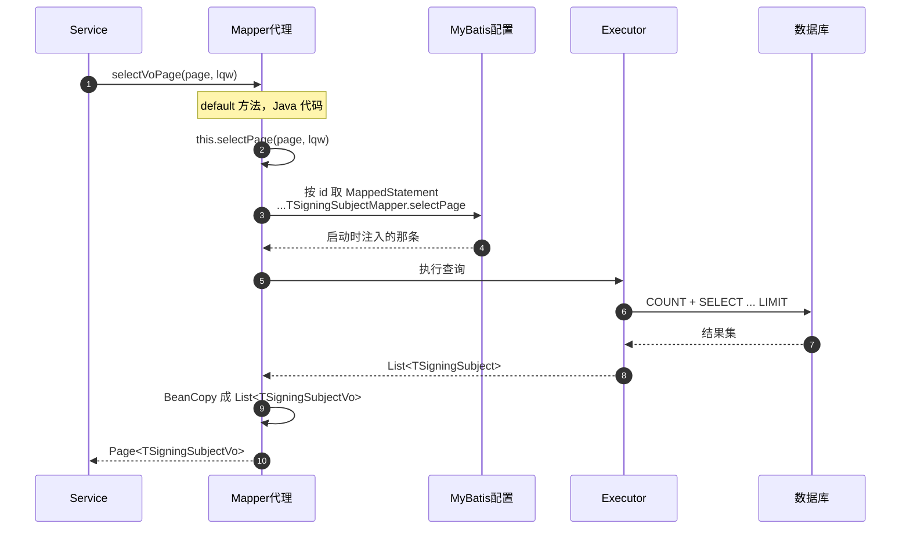

# 附录：Mapper 接口没有实现类，为什么能查数据库

> 目标：**只看这一篇**，把「Mapper 接口没有实现类，为什么能查数据库」讲透。
> 路线：MyBatis 的登记表（§1）→ JVM 与动态代理的地基（§1.3）→ MyBatis-Plus 的注入（§2）→ `BaseMapperPlus` 的封装（§3）→ 项目实例（§4）。
> 不需要提前懂反射和动态代理；没学过的 Java 语法，§1 开头有一节「读前补给」；每一层都先给结论，再拆源码。

**全文地图**

| 章节 | 回答什么问题 | 建议 |
|---|---|---|
| 0 | 全貌：启动时做什么、运行时做什么 | 先读 |
| 1 | MyBatis：接口为什么能被调用（**1.3 是 JVM + 动态代理补课**） | 必读 |
| 2 | MyBatis-Plus：`BaseMapper` 的方法和 SQL 从哪来 | 必读 |
| 3 | `BaseMapperPlus`：VO 转换与批量操作为什么这么写 | 项目里天天用 |
| 4 | 拿项目里一个 Mapper 从头走一遍 | 建议 |
| 5-8 | 排错、实验、面试、术语 | 按需查 |

> 第一次读走主线：0 → 1.1 → 1.2 → **1.3 主线（1.3.1 ~ 1.3.14）** → 1.4 → 1.5 → 1.6 → 2 → 3 → 4。
> 1.3 的 1.3.15「备查区」是 JVM 细节，第一遍可以跳过；完全不想看原理的，也可以整个跳过 1.3，先读 1.4。

---

## 0. 先看全貌：这件事分两个阶段

```
【启动阶段】只做一次
扫描 Mapper 接口
  → 解析接口上的 @Select / XML
  → MyBatis-Plus 额外把 BaseMapper 的约 20 个方法注入进来
  → 每个方法生成一条 MappedStatement（id = 接口全名.方法名）
  → 全部存进 Configuration 的 Map 里

【运行阶段】每次调用都走
Service 调 baseMapper.selectById(id)
  → 动态代理拦截
  → 按「接口全名.方法名」从 Map 里取出 MappedStatement
  → 交给 MyBatis 的 Executor
  → 拼出最终 SQL → JDBC PreparedStatement → 数据库
```

> 为什么这里用 `selectById` 而不是 `selectVoPage`？因为 `selectVoPage` 是接口里的 `default` 方法，代理会直接执行它的 Java 代码，方法内部再调 `selectPage` 才走上面这条链。详见 1.3.11 和 4.2。

| 阶段 | 关键产物 | 你要记住的一句话 |
|---|---|---|
| 启动 | `MappedStatement` 注册表 | **SQL 在启动时就准备好了**，不是运行时现拼 |
| 运行 | 动态代理 + 按 id 查表 | **接口方法只是「取 SQL 的钥匙」** |

---

## 1. 第一层：MyBatis 是怎么做到「只有接口」的

> **读前补给：本附录会反复出现的 Java 语法**
>
> 下面这些语法如果你还没学过，先扫一眼，文中用到时还会再提醒；已经会的直接跳过。
>
> | 语法 | 一句话解释 | 第一次出现在 |
> |---|---|---|
> | 泛型 `<T>` | 尖括号里填类型，表示「这套代码/这组数据装的是什么类型」；`new Page<>(…)` 的 `<>` 留空，让编译器根据左边自己推 | §1.3、§2.2 |
> | `<? extends X>` / `<?>` | 读作「X 或 X 的子类」/「任意类型」，用在参数上表示「接受某一类里的任何一种」 | §2.2 |
> | 注解 `@Xxx` | 贴在类、方法、字段上的标签，框架启动时扫描读取；Java 语言本身不执行它 | §1.3 的 `@Service` |
> | Lombok `@RequiredArgsConstructor` | 编译时自动生成构造器，把 `final` 字段当参数——Spring 靠它把依赖「塞」进来 | §1.3 开头 |
> | `final` 字段 | 只能赋值一次；配合上面的构造器使用，表示「这个依赖创建时就固定」 | 同上 |
> | `try (…) { }` | try-with-resources：代码块结束时自动关闭资源（数据库连接、语句），不用手写 `close()` | §1.1 |
> | lambda `x -> …` | 「把一段代码当参数传」的简写；`(a, b) -> { … }` 表示带两个参数的函数 | §1.3.9 |
> | 函数式接口 | 只有一个抽象方法的接口，lambda 可以直接当它的实例（如 `InvocationHandler`、`Consumer`） | §1.3.7、§3.6 |
> | `default` 方法 | 接口里带方法体、实现类可以不重写的方法（Java 8+） | §0 的注、§2.2 |
> | 反射 `Method` | 运行时拿到「方法本身」并调用它的对象；`method.invoke(obj, args)` 就是「用反射调用」 | §1.3.6 |
> | `static` | 属于类、不属于对象；用「类名.方法」调用，不需要 `new` 一个对象 | §1.3.10 |
> | `Serializable` | JDK 自带的通用接口，String、Long 等主键类型都实现了它；文中当「各种主键类型」理解即可 | §2.2 |

### 1.1 先看没有 MyBatis 时的样子

```java
Connection conn = DriverManager.getConnection(url, user, pwd);
PreparedStatement ps = conn.prepareStatement("SELECT * FROM conf_signing_subject WHERE id = ?");
ps.setString(1, id);
ResultSet rs = ps.executeQuery();
while (rs.next()) {
    // 手动把每一列 set 到对象里
}
rs.close(); ps.close(); conn.close();
```

> 语法提示：`try (…) { }` 是 try-with-resources——代码块结束时自动关闭 `Connection`、`PreparedStatement`、`ResultSet`，不用手写 `close()`。SQL 里的 `?` 是占位符，靠 `ps.setString(1, id)` 按位置填值（第 1 个 `?` 填 `id`），这样数据库只会把值当数据、不会当 SQL 代码执行。

问题：每查一次写一遍；列名和字段手动对应；连接管理重复。

### 1.2 MyBatis 的思路：把 SQL 登记起来，调用时按名字取

**启动时**，MyBatis 把每个 Mapper 方法登记成一条 **MappedStatement**：

```
id:  com.ruoyi.conf.mapper.TSigningSubjectMapper.selectById
sql: SELECT id, signing_subject_name, ... FROM conf_signing_subject WHERE id = ?
```

**运行时**，你调用接口方法，MyBatis 用一个**动态代理**接住这次调用，按 `接口全名.方法名` 去登记表里找对应的 MappedStatement，然后执行。

> 动态代理是什么、为什么接口不写实现类也能调用，下一节 1.3 从 JVM 讲起，会写 Java 就能看懂。只想先看 MyBatis 主线的话，跳过 1.3，直接读 1.4。

### 1.3 为什么「没有实现类」也能调用：从 JVM 讲到动态代理

这一节补的是全篇最重要的地基，只回答一个问题：**Service 里调 `baseMapper.selectById(id)`，方法体到底是谁写的？**

```java
@RequiredArgsConstructor
@Service
public class TSigningSubjectServiceImpl implements ITSigningSubjectService {
    private final TSigningSubjectMapper baseMapper;   // 只有接口，项目里搜不到实现类
```

> 语法提示：`@Service` 是告诉 Spring「这个类是它管理的组件」；`@RequiredArgsConstructor` 是 Lombok 的注解，编译时自动生成一个构造器，把 `final` 字段当参数。Spring 创建这个类时就用这个构造器把 `baseMapper` 塞进来——所以 Service 里没有 `new`，也 `new` 不了。

阅读约定：1.3.1 ~ 1.3.14 是一条连续主线，第一遍顺着读，会写 Java 就能看懂；**1.3.15 是 JVM 细节备查区（第一遍可跳过）**，主线里标「细节见 D1~D5」的地方，第二遍再回来看。只想先看 MyBatis 全貌的，也可以整个跳过 1.3，直接读 1.4。

#### 1.3.1 先把三个问题摆出来

把这个疑问拆开，其实是三个层层递进的问题：

| # | 问题 | 结论（先记住，后面逐条证明） | 在哪展开 |
|---|---|---|---|
| ① | 接口变量调用方法，执行的是谁的代码？ | 堆里某个**实现类对象**的代码；接口类型只在编译期决定「能调什么」 | 1.3.2 |
| ② | 同一个接口变量，换个实现类行为就变，凭什么？ | 运行时看对象的**真实类型**（动态分派，也就是多态） | 1.3.2 |
| ③ | 接口连实现类都没有，`baseMapper` 里的对象哪来的？ | MyBatis 在运行时**生成**了一个实现类（JDK 动态代理） | 1.3.4 起 |

三个问题连起来，就是本节的路线：

```
为什么接口变量能调方法（1.3.2）——前提：堆里有一个实现类对象
   └─ 但接口不能 new，对象造不出来（1.3.3）
        └─ 所以得有人写实现类
             ├─ 人写：61 个接口，写不完（1.3.4）
             └─ 机器写：万能实现类（1.3.5）
                  ├─「调的是哪个方法」运行时才知道 → 反射（1.3.6）
                  └─「类本身」运行时才生成 → 动态代理（1.3.7 ~ 1.3.9）
                       └─ 两个必须处理的坑（1.3.10、1.3.11）
                            └─ MyBatis 的真实实现（1.3.12），和 CGLIB 对比（1.3.13）
```

#### 1.3.2 一次接口调用，背后发生了什么

先看一段最简单的代码，后面反复用：

```java
interface Greeter {
    String greet(String name);
}

class ChineseGreeter implements Greeter {
    public String greet(String name) { return "Hello " + name; }
}
```

```java
Greeter g = new ChineseGreeter();
g.greet("张三");
```

三行代码，拆成三个问题看清楚。

**（1）`g` 里存的是什么？**

把方法执行想象成一张**工作台**（栈帧），上面一排**抽屉**（局部变量表），每个局部变量住一个抽屉：

```
工作台（栈帧）
├─ 0 号抽屉：args
├─ 1 号抽屉：0x00D4E5F6     ← g 的值，一个地址
└─ ...
```

基本类型的抽屉里装**值本身**（`int a = 1`，抽屉里就是 1）；引用类型的抽屉里装**地址纸条**，写着对象在堆里的位置。所以 `g` 里既没有 `"Hello 张三"`，也没有任何方法代码，只有一张指向对象的纸条。

（抽屉、槽位、`javap` 实测证据等细节，见 **D1**。）

**（2）对象里有什么？**

对象是堆上的一个**货位**，按「图纸」造出来：

```
货位：ChineseGreeter 对象
├─ 对象头
│   └─ Klass Pointer ──→ 方法区里的 ChineseGreeter 类元数据（图纸）
└─ 实例字段（本例没有）
```

这里只需要记住 **Klass Pointer**：对象头里指向「我到底是哪个类」的指针。JVM 运行时想知道一个对象的真实类型，读它就行。

（对象头的完整布局、字段怎么存，见 **D2**。）

**（3）调用时，JVM 怎么找到要执行的代码？**

编译后，`g.greet("张三")` 是一条 `invokeinterface` 指令（`javap -c` 实测）：

```
14: invokeinterface #6, 2   // InterfaceMethod Demo$Greeter.greet
```

执行分五步：

```
① 从抽屉里取出 g 里的地址纸条
② 顺着纸条找到堆里的 ChineseGreeter 对象
③ 读对象头的 Klass Pointer，得知真实类型是 ChineseGreeter
④ 去 ChineseGreeter 类元数据的方法表里，找 greet 的代码入口
⑤ 从入口开始执行字节码
```

关键点：**接口名 `Greeter` 只出现在指令的符号引用里，作用只是校验「这个对象确实实现了该接口」。真正决定执行哪段代码的，是第 ③ 步读出来的真实类型。**

方法调用一共四种指令，先认全，后面讲代理时会对上：

| 指令 | 用在哪 | 什么时候确定执行哪段代码 |
|---|---|---|
| `invokespecial` | 构造器、私有方法、`super.xxx()` | 编译期就定死（静态绑定） |
| `invokevirtual` | 普通实例方法（类） | 运行时看对象的真实类型（动态分派） |
| `invokeinterface` | 接口方法 | 运行时看对象的真实类型（动态分派） |
| `invokestatic` | `static` 方法 | 编译期定死 |

`invokevirtual` 和 `invokeinterface` 的「运行时再决定」，就是**多态**的底层。

（方法表怎么查、代码入口到底指什么，见 **D4**；这里只需记住一句：查表用的是对象的真实类型。）

**（4）左边和右边的分工**

| | 什么时候起作用 | 管什么 |
|---|---|---|
| 左边类型 `Greeter` | 编译期 | 变量**能调哪些方法**；编译器据此检查 |
| 右边 `new ChineseGreeter()` | 运行期 | 真正**执行哪个方法**；由对象头的真实类型决定 |

换成项目里的类型，道理完全一样（假设实现类比接口多了一个方法）：

```java
UserMapper m = new UserMapperImpl();

m.findName(1);                       // ✅ 编译通过：UserMapper 声明了 findName
// m.otherMethod();                  // ❌ 编译报错：UserMapper 里没有这个方法
((UserMapperImpl) m).otherMethod();  // ✅ 强转后可以：编译器现在知道真实类型
```

`otherMethod()` 一直都在对象上，只是**编译器**不让你通过接口类型去调。左边是编译期的门禁，不是运行期的执行者。

这也解释了空指针：

```java
UserMapper m = null;
m.findName(1);   // NullPointerException
```

`m` 里没有地址纸条，第 ① 步就走不下去——**变量本身不会干活，它只是引用的搬运工**。

**（5）小结**

接口变量能调用方法，前提是**堆里有一个实现了该接口的对象**。项目里的 `baseMapper` 也一样：它指向的对象一定实现了 `TSigningSubjectMapper`。

那这个对象是谁造的？

#### 1.3.3 接口为什么不能 `new`

先在语言层看：`new` 后面只能跟**类**，不能跟接口。

```java
public interface UserMapper {
    String findName(int id);
}

UserMapper m = new UserMapper();   // 编译报错：UserMapper is abstract; cannot be instantiated
```

编译器凭什么直接拒绝？因为接口的 `.class` 文件里，缺了三样东西。先看 `new` 指令本身做了什么。

```java
Greeter g = new ChineseGreeter();
```

编译后是四条指令（`javap -c` 实测）：

```
0: new           #2   // class Demo$ChineseGreeter
3: dup
4: invokespecial #3   // Method Demo$ChineseGreeter."<init>":()V
7: astore_1
```

| 指令 | 做什么 |
|---|---|
| `new` | 在堆上分配内存、字段清零、填好对象头；把新对象的**引用**压入操作数栈。此时构造器还没执行 |
| `dup` | 复制栈顶的引用：下面 `invokespecial` 要消耗一个当 `this`，复制一份留给变量 |
| `invokespecial` | 调用构造器 `<init>`，执行你写的初始化代码 |
| `astore_1` | 把剩下的那个引用存进局部变量表的抽屉（变量 `g`） |

**`new` 只负责「分配 + 清零 + 填对象头」，构造器 `<init>` 才负责「初始化」。**

（`dup` 为什么必要、构造器为什么要一路往上调 `Object`，见 **D3**。）

再看接口的 `.class` 文件（`javap -v` 实测）：

```
flags: ACC_INTERFACE, ACC_ABSTRACT

public abstract java.lang.String greet(java.lang.String);
  descriptor: (Ljava/lang/String;)Ljava/lang/String;
  // 注意：没有 Code 属性
```

三条缺失一一对上：

| 缺什么 | 后果 |
|---|---|
| **没有构造器 `<init>`** | `new` 之后必须跟 `invokespecial <init>` 完成初始化，接口没有这个入口 |
| **抽象方法没有 `Code`** | 方法只有签名，没有可执行的字节码——就算造出对象也无方法可跑 |
| **没有实例字段** | 分配内存前要知道对象多大，接口给不出这个尺寸（只能有 `public static final` 常量） |

所以三层都堵死：

- 语言层：编译器直接报错；
- 字节码层：`new` 的目标如果是接口，JVM 抛 `InstantiationError`（JVM 规范的规定）；
- 反射层（实测）：

```java
Class<?> c = Class.forName("Demo$Greeter");
c.getDeclaredConstructor();   // NoSuchMethodException
c.newInstance();              // InstantiationException
```

> 唯一的例外是 Java 8 的 `default` 方法：它有 `Code`，看起来「接口也能干活了」。但它仍然需要一个对象当 `this`，接口本身还是不能 `new`——而且它还会给代理挖坑，1.3.11 细讲。

一句话：**接口是「能力清单」，不是「可建造的房子」；`new` 只能造房子。**

#### 1.3.4 手写实现类：能用，但写不完

接口变量能调用，前提是右边有个实现类。**第一个思路：人来写。**

把 §1.1 的 JDBC 代码搬进实现类，每个方法都长这样：

```java
public class UserMapperImpl implements UserMapper {
    public String findName(int id) {
        try (Connection conn = dataSource.getConnection();
             PreparedStatement ps = conn.prepareStatement("SELECT name FROM user WHERE id = ?")) {
            ps.setInt(1, id);
            try (ResultSet rs = ps.executeQuery()) {
                return rs.next() ? rs.getString("name") : null;
            }
        } catch (SQLException e) {
            throw new RuntimeException(e);
        }
    }
}
```

项目里有 **61 个 `*Mapper.java` 接口**，每个继承 `BaseMapper` 就有约 20 个方法。手写实现类意味着 61 个实现类、上千个方法、上万行几乎一样的模板代码，而且每加一个查询都要同步改实现类。

可仔细看，这些实现类**长得都一样**，只有两处真正不同：

1. 执行哪条 SQL；
2. 参数怎么绑定、结果怎么映射。

**第二个思路就出来了：能不能只写一个「万能实现类」，把这两处不同的东西变成数据？**

#### 1.3.5 万能实现类的两个难题

```java
interface UserMapper  { String findName(int id); }
interface OrderMapper { int countByUser(int userId); }
```

一个类要同时实现所有这些接口的所有方法。写成伪代码，它大概长这样：

```java
class UniversalMapper implements UserMapper, OrderMapper, ... {   // ← 要实现哪些接口，运行时才知道
    public ??? findName(int id) { ... }
    public ??? countByUser(int userId) { ... }                     // ← 有哪些方法，运行时才知道
}
```

两个挡路的问题：

| 难题 | 解法 |
|---|---|
| 要实现哪些接口、哪些方法，**运行时才知道** | 运行时**动态生成**这个类 |
| 方法体里要知道「现在被调用的是哪个方法」 | **反射**拿到 `Method` 对象 |

#### 1.3.6 反射：把「方法」变成对象

平时调用方法是写死的：`mapper.findName(1)`。反射允许在运行时拿到方法本身：

```java
Method m = UserMapper.class.getMethod("findName", int.class);

System.out.println(m.getName());              // findName
System.out.println(m.getReturnType());        // String
System.out.println(m.getParameterTypes()[0]); // int

Object result = m.invoke(impl, 1);            // 等价于 impl.findName(1)
```

`Method` 对象上带着方法名、参数类型、返回类型。**「万能实现类」不需要提前知道方法叫什么——运行时拿到 `Method`，再看它是谁、该干什么。**

#### 1.3.7 动态代理：运行时生成实现类

反射解决了「怎么知道调的是哪个方法」，还剩「类本身从哪来」。JDK 自带 `java.lang.reflect.Proxy`，一次解决两个问题：

```java
UserMapper mapper = (UserMapper) Proxy.newProxyInstance(
    UserMapper.class.getClassLoader(),  // ① 用哪个类加载器加载生成的类
    new Class[]{UserMapper.class},      // ② 要实现的接口（可以多个）
    handler                             // ③ 所有方法调用交给谁
);
```

三个参数：

| 参数 | 含义 | 本项目对应 |
|---|---|---|
| `ClassLoader` | 生成的类由谁加载 | `mapperInterface.getClassLoader()` |
| `Class[] interfaces` | 要实现哪些接口 | `new Class[]{TSigningSubjectMapper.class}` |
| `InvocationHandler` | 调用统一入口 | `MybatisMapperProxy` |

`handler` 是 `InvocationHandler` 的实例，它只有一个方法：

```java
public interface InvocationHandler {
    Object invoke(Object proxy, Method method, Object[] args) throws Throwable;
}
```

| 参数 | 是什么 |
|---|---|
| `proxy` | 生成的代理对象本身 |
| `method` | 这次被调用的是哪个方法（反射的 `Method`） |
| `args` | 这次调用的实参；无参时是 `null` |

换句话概括 Proxy 帮你做的两件事：

1. 运行时**生成一个类**，实现你指定的所有接口——1.3.5 的「运行时才知道要实现什么」解决了；
2. 在这个类的每个方法里，把「调的是哪个方法、带什么参数」打包成 `(method, args)`，**统一交给 handler**——1.3.6 的反射在这里接上了。

handler 的返回值是 `Object`，代理类负责把它转回接口声明的类型。后面统一叫它 **handler**；真实框架里，它就是 `MapperProxy` / `MybatisMapperProxy` 的实例。

#### 1.3.8 生成的代理类到底长什么样

这不是比喻——真的生成了一个 class 文件。给 JVM 加启动参数可以把它 dump 出来（JDK 9+）：

```
java -Djdk.proxy.ProxyGenerator.saveGeneratedFiles=true Demo
```

（JDK 8 的参数名是 `sun.misc.ProxyGenerator.saveGeneratedFiles`。）

反编译 demo 生成的 `$Proxy0.class`（为了让 `default` 方法也露个面，下面的接口额外加了 `hello()`；已简化）：

```java
final class $Proxy0 extends java.lang.reflect.Proxy implements UserMapper {

    private static Method m1, m3, m4;

    public final String findName(int i) {
        return (String) super.h.invoke(this, m3, new Object[]{Integer.valueOf(i)});
    }

    public final String hello() {
        return (String) super.h.invoke(this, m4, null);
    }

    public final boolean equals(Object o) {
        return ((Boolean) super.h.invoke(this, m1, new Object[]{o})).booleanValue();
    }
}
```

三个事实：

1. `final class ... extends Proxy implements UserMapper` —— 所以它能强转成接口，也能调用接口方法；
2. **每个方法体只有一行**：把自己的 `Method`（`m3`）和参数交给 `h.invoke`；
3. 返回值前面有强制类型转换 —— handler 返回的类型和接口声明不一致就抛 `ClassCastException`。

调用链：

```
service.baseMapper.findName(1)
    → $Proxy0.findName(1)
    → handler.invoke(proxy, m3, [1])     ← 这里的 h 就是构造代理时传进去的 handler
    → 你写在 handler 里的逻辑
```

**「接口没有实现类」的秘密就在这里：方法体是有的，只是运行时才生成，而且全部转发给同一个 handler。**

#### 1.3.9 25 行 demo：把上面拼起来

```java
import java.lang.reflect.Proxy;

public class Demo {
    interface UserMapper {
        String findName(int id);   // 只有接口，没有实现类
    }

    public static void main(String[] args) {
        UserMapper mapper = (UserMapper) Proxy.newProxyInstance(
            UserMapper.class.getClassLoader(),
            new Class[]{UserMapper.class},
            (proxy, method, args1) -> {
                System.out.println("被拦截的方法：" + method.getName());
                return "张三";        // 假装查到了数据
            });

        System.out.println(mapper.findName(1));
    }
}
```

输出：

```
被拦截的方法：findName
张三
```

逐行对应：

| 代码 | 含义 |
|---|---|
| `Proxy.newProxyInstance(...)` | 返回 `Object`，必须强转成接口 |
| 第三个参数 lambda | 就是 `InvocationHandler`（函数式接口） |
| `method.getName()` | 拿到的正是 `"findName"` |
| `return "张三"` | 代理类的 `(String)` 转型接住，返回给调用方 |

> 小提示：lambda 是「匿名内部类」的简写——`(proxy, method, args1) -> {...}` 等价于「写一个实现 `InvocationHandler` 接口的类，只重写它的 `invoke` 方法」。`args1` 这个名字只是为了避免和外层 `main` 的参数 `args` 重名。

**MyBatis 做的事，就是把这个 lambda 换成一大段逻辑**：

```
拿 method → 拼出 "接口全名.方法名"
         → 去 Configuration 的 Map 里查 MappedStatement
         → 交给 Executor 执行 SQL
         → 返回结果
```

「返回张三」和「查数据库」，在代理看来是同一件事。

#### 1.3.10 坑一：Object 方法也会被拦截

`$Proxy0` 不只实现了 `findName`，还重写了 `equals`（以及 `hashCode`、`toString`）。下面是不做任何分支判断的版本（记为 naive）的实测输出：

```
[naive] toString declaring=Object isDefault=false returnType=String
toString -> fake-toString
[naive] equals   declaring=Object isDefault=false returnType=boolean
equals threw java.lang.ClassCastException: java.lang.String cannot be cast to java.lang.Boolean
```

- 调 `toString()` 时，`method.getDeclaringClass()` 是 `Object`；
- 如果 handler 一律按「查 SQL」处理，MyBatis 会拿 `toString` 去查 MappedStatement，报 `Invalid bound statement (not found): ...toString`；
- demo 里返回了 `"fake-equals"`，代理类要 `boolean`，于是 `ClassCastException`。

所以 MyBatis 和 MP 的 `invoke` 第一段判断完全一样：

```java
public Object invoke(Object proxy, Method method, Object[] args) throws Throwable {
    if (Object.class.equals(method.getDeclaringClass())) {
        return method.invoke(this, args);          // 交给 handler 自己的 Object 实现
    }
    return cachedInvoker(method).invoke(proxy, method, args, sqlSession);
}
```

> 这里是 `method.invoke(this, args)`，`this` 是 **handler 对象**，不是 `proxy`。写成 `method.invoke(proxy, args)` 会再次进入 `invoke`，无限递归直接栈溢出（写 demo 时真踩了这个坑）。

#### 1.3.11 坑二：default 方法也会被拦截

Java 8 起接口可以有带方法体的 `default` 方法。看起来「接口也能干活了」，但注意两点：接口本身仍然不能 `new`（执行时需要一个实现类对象当 `this`）；代理遇到 `default` 方法也得特殊处理。

```java
interface UserMapper {
    String findName(int id);
    default String hello() { return "real default hello"; }
}
```

代理类同样重写 `hello()`，调用照样进 handler（naive 版实测）：

```
[naive] hello declaring=UserMapper isDefault=true
hello -> fake-hello        // 接口里真正的方法体根本没执行
```

这对 MyBatis-Plus 来说必须处理：`BaseMapperPlus` 里的 `selectVoPage`、`selectVoById`、`insertBatch` 全是 `default` 方法。如果 handler 不区分，它们会被当成 SQL id 去查 → 找不到。

MP 的处理（反编译 `mybatis-plus-core` 3.5.x 的 `MybatisMapperProxy`）：

```java
private MapperMethodInvoker cachedInvoker(Method method) throws Throwable {
    try {
        return methodCache.computeIfAbsent(method, m -> {
            try {
                if (m.isDefault()) {
                    // default 方法：用 MethodHandle 执行接口里真正的方法体
                    return new DefaultMethodInvoker(
                        privateLookupInMethod == null
                            ? getMethodHandleJava8(m)
                            : getMethodHandleJava9(m));
                }
                // 抽象方法：走 SQL
                return new PlainMethodInvoker(
                    new MybatisMapperMethod(mapperInterface, m, sqlSession.getConfiguration()));
            } catch (Exception e) {
                throw new RuntimeException(e);
            }
        });
    } catch (RuntimeException re) {
        Throwable cause = re.getCause();
        throw cause == null ? re : cause;
    }
}
```

`DefaultMethodInvoker` 只做一件事：

```java
public Object invoke(Object proxy, Method method, Object[] args, SqlSession sqlSession) throws Throwable {
    return methodHandle.bindTo(proxy).invokeWithArguments(args);
}
```

`bindTo(proxy)` 相当于「在代理对象上调用这个 default 方法」，`invokeWithArguments(args)` 传实参。

（MethodHandle 是什么、为什么还要分 Java 8 / Java 9 两条路，见 **D5**。）

另外，`methodCache` 是 `ConcurrentHashMap<Method, MapperMethodInvoker>`：每个方法第一次调用判断一次，之后直接取结果，不用每次反射。

> 语法提示：`computeIfAbsent(key, 函数)` 的意思是「缓存里没有这个 key，才执行大括号里的代码算出值、存进去；已经有就跳过」——所以那段判断逻辑每个方法只执行一次。`ConcurrentHashMap` 是线程安全的 Map（多个线程同时用不会乱），Spring Web 场景下多个请求线程会同时调 Mapper，用它才安全。

这正好解释了后面 §4.4 的那张表：

```
...TSigningSubjectMapper.selectVoPage      ← default，MethodHandle 执行 Java 代码，不查 SQL
...TSigningSubjectMapper.selectPage        ← abstract，查 MappedStatement
...TSigningSubjectMapper.updateSetDateNull ← abstract，@Update 登记过，查 MappedStatement
```

> MyBatis 原生 `MapperProxy`（3.5.x）同样是这两段判断（`Object` 分支 + `m.isDefault()`），MP 只是把类名换成了 `Mybatis*`。

#### 1.3.12 回到 MyBatis：真实框架只是把 demo 写大了

| demo 里的角色 | MyBatis 原生 | MyBatis-Plus |
|---|---|---|
| `Proxy.newProxyInstance` | `MapperProxyFactory.newInstance` | `MybatisMapperProxyFactory.newInstance` |
| `InvocationHandler` | `MapperProxy` | `MybatisMapperProxy` |
| handler 里查 SQL 的逻辑 | `MapperMethod.execute` | `MybatisMapperMethod.execute` |
| 「返回张三」 | `Configuration.getMappedStatement(id)` | 同左 |

MP 的 `newInstance`（反编译，和 demo 一模一样）：

```java
protected T newInstance(MybatisMapperProxy<T> mapperProxy) {
    return (T) Proxy.newProxyInstance(
        mapperInterface.getClassLoader(),
        new Class[]{mapperInterface},
        mapperProxy);
}
```

**代理对象是谁塞进 Service 字段的？**

```java
@RequiredArgsConstructor
@Service
public class TSigningSubjectServiceImpl implements ITSigningSubjectService {
    private final TSigningSubjectMapper baseMapper;   // 声明是接口
```

完整链路（每一步都能对上项目源码或 jar）：

```
@MapperScan("${mybatis-plus.mapperPackage}")      MybatisPlusConfig.java:41
  （解析成 com.ruoyi.**.mapper，见 application.yml:209）
  → ClassPathMapperScanner 扫描包下的接口
  → 为每个接口注册一个 MapperFactoryBean 的 BeanDefinition
  → MapperFactoryBean.getObject()
       = getSqlSession().getMapper(TSigningSubjectMapper.class)
  → SqlSessionTemplate.getMapper
  → MybatisConfiguration.getMapper → MybatisMapperRegistry.getMapper
  → MybatisMapperProxyFactory.newInstance(sqlSession)
  → Proxy.newProxyInstance(...)                   ← 就是上面那一行
  → 代理对象交给 Spring，注入到 baseMapper 字段
```

> 不必被中间的术语吓到：`BeanDefinition` 只是 Spring 内部的「创建配方」，记录着「这个对象交给 `MapperFactoryBean` 的 `getObject()` 来造」。这一条链真正的主角是倒数第二行的 `Proxy.newProxyInstance`，前面全是 Spring 帮你铺的路。

所以 debug 时 `baseMapper.getClass()` 不是 `TSigningSubjectMapper`，而是 `jdk.proxy2.$Proxy132` 这种名字（JDK 8 下是 `$Proxy0` 这种）。

> 这也是 §3.3 能工作的原因：`this.getClass()` 拿到的是代理类，`GenericTypeUtils.resolveTypeArguments` 沿它的接口链 `$ProxyN → TSigningSubjectMapper → BaseMapperPlus<M, T, V>` 解析出三个泛型实参。

#### 1.3.13 JDK 动态代理 vs CGLIB

JDK 动态代理有一个硬限制：**只能代理接口**。

因为生成的类必须 `extends java.lang.reflect.Proxy`，而 Java 是单继承——已经继承了 `Proxy`，就不能再继承你的类，只能 `implements` 接口。

CGLIB 换了个思路：运行时生成目标类的**子类**，重写方法。所以它能代理普通类，但 `final` 类、`final` 方法不行。

| | JDK 动态代理 | CGLIB |
|---|---|---|
| 前提 | 目标必须实现接口 | 目标不能是 `final` |
| 生成方式 | `implements` 接口 | `extends` 目标类 |
| 拦截入口 | `InvocationHandler.invoke` | 方法拦截器 |
| 本项目的 Mapper | ✅ `@MapperScan` + JDK 代理 | |
| 本项目的 Service `@Transactional` | | ✅ `@EnableTransactionManagement(proxyTargetClass = true)` |

这回答了面试题 Q3「Mapper 为什么必须定义成接口」：MyBatis 用的是 `Proxy.newProxyInstance`，它只能基于接口生成实现类。

#### 1.3.14 一分钟自测

**JVM 地基**

1. `new` 之后为什么还要一条 `invokespecial <init>`？→ `new` 只做分配内存、字段清零、填对象头；构造器才执行初始化。（1.3.3）
2. 运行时 JVM 靠什么知道一个对象的真实类型？→ 对象头里的 Klass Pointer，指向方法区的类元数据。（1.3.2 / D2）
3. 接口为什么不能 `new`？→ 类文件带 `ACC_INTERFACE`/`ACC_ABSTRACT`，没有 `<init>`、没有实例字段，抽象方法没有 `Code`。（1.3.3）
4. `invokeinterface` 和 `invokevirtual` 的区别？→ 前者调接口方法、后者调类方法；两者都是运行时按对象真实类型动态分派。（1.3.2 / D4）

**动态代理**

5. `Proxy.newProxyInstance` 返回的是什么？→ 运行时生成的 `final class $ProxyN`，实现了目标接口。
6. 为什么所有方法都进同一个 `invoke`？→ 生成类里每个方法体都只有一行 `h.invoke(...)`。
7. `invoke(proxy, method, args)` 三个参数分别是什么？→ 代理对象、被调用的 `Method`、实参数组。
8. MyBatis 为什么要判断 `Object.class.equals(method.getDeclaringClass())`？→ `toString/equals/hashCode` 也被代理，不拦会被当 SQL id。
9. MP 为什么要判断 `method.isDefault()`？→ 接口 default 方法有真实方法体，要用 MethodHandle 执行，不能查 SQL。
10. `method.invoke(this, args)` 里的 `this` 是谁？→ handler 自己；写成 `proxy` 会无限递归。
11. 为什么 Mapper 必须是接口？→ JDK 动态代理只能 `implements` 接口，不能继承类。
12. 本项目 `baseMapper` 的真实类型是什么？→ 运行时生成的 `$ProxyN`，真正接住调用的是 `MybatisMapperProxy`。

#### 1.3.15 备查区：JVM 细节（第一遍可跳过）

> 主线只需要记结论；下面五组细节是结论背后「为什么成立」的完整证据，第二遍精读或面试前翻。
> D1 内存划分与变量存放（对应 1.3.2 的「抽屉」）· D2 对象内存布局（对应 Klass Pointer）· D3 `new` 与构造器（对应 1.3.3）· D4 方法表与分派（对应「动态分派」）· D5 MethodHandle（对应 1.3.11）

##### D1　JVM 的内存划分与变量存放

**① 你写的 `.java` 不是直接给 CPU 的**

```java
public class Demo {
    public static void main(String[] args) {
        System.out.println("hello");
    }
}
```

`javac` 把它编译成 `Demo.class`，里面是**字节码**（JVM 的指令，不是机器码），运行时由 JVM 逐条执行：

```
.java 源码
  → javac 编译
.class 字节码
  → 类加载器读进内存
JVM 里的类元数据 + 对象
  → 执行引擎逐条执行字节码
```

**② 内存先分成几块**

先认识三块，够用了：

| 区域 | 放什么 | 类比 |
|---|---|---|
| 方法区（JDK 8+ 的 HotSpot 叫「元空间」） | 类的元数据：类名、字段、方法、方法表 | 图纸柜 |
| 堆 | 对象实例 | 按图纸造出来的实物（货位） |
| 虚拟机栈 | 每个线程一个；栈帧里有局部变量表、操作数栈 | 干活的工作台 |

另有一个「程序计数器」，记录当前执行到哪条字节码，知道名字即可。

**③ 类加载：`.class` 进方法区，堆上多一个 `Class` 对象**

第一次用到某个类时，类加载器把 `.class` 读进内存：方法区里生成这个类的**元数据**（图纸），堆里生成一个 `Class` 对象，指向那份元数据。

| | 是什么 | 有几份 |
|---|---|---|
| **类** | 图纸：字段有哪些、方法有哪些、每个方法从哪条字节码开始 | 一个类只有一份 |
| **对象** | 按图纸造出来的实例，有自己的字段值 | 可以 `new` 无数个 |

`UserMapper.class` 是「描述 UserMapper 这个接口的 `Class` 对象」，**不是 UserMapper 的实例**——初学者最容易在这里混。

**④ 抽屉编号（slot）在哪看**

这不是比喻。用 `javac -g` 编译（默认编译不保留变量名），`javap -l` 能把这个表打出来（实测）：

```
LocalVariableTable:
  Start  Length  Slot  Name   Signature
      0      64     0  args   [Ljava/lang/String;
      2      62     1     a   I
      5      59     2     s   Ljava/lang/String;
     13      51     3     p   LVarDemo$Person;
```

`Slot` 就是抽屉号；`Name` 那一列来自调试信息，运行时字节码只认抽屉号。

变量名只是贴在抽屉上的**标签**，编译之后标签就撕掉了，字节码里只剩抽屉号：

```
0: iconst_1              // 把常量 1 压入操作数栈
1: istore_1              // 存入 1 号抽屉
2: ldc      #2           // String hello：把字符串对象的地址压栈
4: astore_2              // 存入 2 号抽屉
```

**证据：标签撕掉也能跑。** 同一段代码，用 `javac` 默认、`javac -g`、`javac -g:none` 编译，字节码都是 `istore_1`、`astore_2`（用抽屉号，不用名字）；只有 `-g` 时 `javap -l` 才能看到变量名。三种编译方式，程序行为完全一样。

所以「变量存在哪里」其实要分三个问题：

| 你问的是 | 答案 |
|---|---|
| 名字 `a`、`s` 在哪？ | 源码和调试信息里，运行时不需要 |
| **变量（存储位置）在哪？** | **抽屉里。局部变量的抽屉在栈帧的局部变量表** |
| 值在哪？ | 抽屉里装的东西 |

平时说「变量 a」，是把这三样混在一起说了。

**⑤ 三种变量，放在三个地方**

| 变量种类 | 代码里长什么样 | 放在哪 |
|---|---|---|
| 局部变量 | 方法里的 `int a`、`String s` | 方法工作台的**抽屉**里（栈帧的局部变量表） |
| 成员变量 | 类里的 `private int age;` | **仓库里那个对象的货位内部**（堆里对象的实例数据） |
| 静态变量 | `static int count;` | **仓库管理室**（方法区 / 类元数据） |

##### D2　对象在堆里长什么样

`new Person()` 会在仓库（堆）里占一个**货位**：

```
货位 0x00D4E5F6（示意地址）Person 对象
├─ 对象头（12 字节）
│   ├─ Mark Word（8 字节）：哈希码、GC 年龄、锁状态
│   └─ Klass Pointer（4 字节）──→ 仓库管理室：Person 类元数据
├─ 实例数据
│   ├─ int age    = 18            ← 值直接放在货位里
│   └─ String name = 0x00F7A1B2   ← 又一张地址纸条，指向另一个货位
└─ 对齐填充（补齐到 8 字节倍数）
```

注意两件事：

1. **字段值存在对象的货位里**。`p.age = 18` 编译成 `aload`（取出 p 里的地址）+ `putfield`（把 18 写进那个货位），不是写进抽屉；
2. **引用字段放的还是纸条**。`p.name = "Tom"` 里，Person 货位中 `name` 那 4 个字节，指向另一个 String 货位。

把关系画出来：

```
抽屉里的 s ──→ 货位：String 对象 "hello"

抽屉里的 p ──→ 货位：Person 对象
                  age  = 18
                  name ──→ 货位：String 对象 "Tom"
```

对象之间就是这样一层一层用地址串起来的，变量只是入口。

对象头里的 **Klass Pointer（类型指针）** 很关键：运行时 JVM 就是靠它知道「这个货位到底是哪个类的实例」。后面讲动态分派、动态代理都离不开它。

> 12 / 4 字节的对象头是开启压缩指针（64 位 JVM 默认）时的布局，示意用；不同配置下 Klass Pointer 可能是 8 字节。

##### D3　`new` 之后的构造器与 `dup`

`new` 的四条指令里，`dup` 和 `invokespecial <init>` 各有一个容易忽略的细节。

**`dup` 为什么必要**：`invokespecial` 调用构造器时，会消耗栈顶的一个引用当 `this`。为了让变量还能拿到这个对象，`new` 之后先把引用复制一份。

**构造器为什么要往上调**：实现类 `ChineseGreeter` 的构造器长这样（`javap -c` 实测）：

```
ChineseGreeter();
   0: aload_0
   1: invokespecial #1   // Method java/lang/Object."<init>":()V
   4: return
```

它第一件事是调父类 `Object` 的构造器——**构造器必须一路往上初始化**，这是 Java 的规矩。接口没有这条链，因为它根本没有构造器。

一句话回扣 1.3.3：**`new` 找得到类型、分配得了内存，但对象「活」起来要靠 `<init>`——接口恰好两样都没有。**

##### D4　方法表与分派：JVM 怎么找到代码入口

HotSpot 给每个类准备一张**方法表**（类用 vtable，接口用 itable），表里存「方法签名 → 代码入口」。调用时顺着对象头的 Klass Pointer 找到类元数据，再查方法表，拿到真正要执行的入口。

**「代码入口」是什么**

方法表里**不存代码**，只存「去哪儿执行」。每个方法编译后有一个 `Code` 属性，里面是一串字节码，按偏移编号：

```
public java.lang.String greet(java.lang.String);
  Code:
     0: new           #2   // StringBuilder
     3: dup
     4: invokespecial #3   // StringBuilder.<init>
     7: ldc           #4   // String Hello
     ...
    19: areturn
```

**入口就是偏移 `0`**：JVM 从那里开始，一条一条往下执行。所以方法表的条目可以理解成：

```
greet(String) ──→ 入口 0 ──→ [0] new ... [3] dup ...
```

- **签名**（`greet(String)`）解决「找哪一条」；
- **入口**（偏移 0）解决「从哪条指令开始执行」。

用书的目录打比方：签名是「第 3 章」，入口是「第 45 页」。查到目录条目，再翻到那一页开始读。

注意两个「入口」的区别：

| 层次 | 「入口」指什么 |
|---|---|
| 编译后的 class 文件 | 方法 `Code` 属性里字节码数组的下标 `0` |
| 运行时的 JVM | 从字节码入口映射出的执行地址（解释器入口，或 JIT 编译后的机器码入口） |

**方法代码只有一份，对象里没有**

```
方法区（一个类一份）
└─ ChineseGreeter
    └─ 方法表
        ├─ greet(String) ──→ 字节码入口
        └─ ...

堆（对象可以有很多个）
└─ ChineseGreeter 实例
    └─ 只有对象头 + 字段，没有方法代码
```

`new` 一百个对象，`greet` 的字节码也只有一份；每个对象通过对象头的 Klass Pointer 找到类元数据，再查方法表。

> 严格说，HotSpot 的方法表项存的是指向方法元数据的指针（`Method*`），字节码入口在元数据里；面试和日常理解成「签名 → 入口」就够了。

> JVM 规范只规定「必须动态分派」，vtable / itable 是 HotSpot 的具体实现，面试时说清楚这个区别会加分。

##### D5　MethodHandle：default 方法为什么能被执行

`default` 方法的方法体编译在**接口**里（`Code` 属性挂在接口的 class 文件上），代理类并没有重写它——1.3.8 的 `$Proxy0.hello()` 只是转发给 handler。要在「代理对象上」执行接口里真正的默认实现，需要一个能绑定 `this`、又能访问接口内部实现的调用入口。这正是 `java.lang.invoke.MethodHandle` 的用途。

`MethodHandle` 可以理解成「方法的、可以传递和调用的引用」：拿到它，就能在运行时把 `this` 绑到某个对象上，再传参调用。

```java
methodHandle.bindTo(proxy)                 // 把 this 绑定为代理对象
            .invokeWithArguments(args);    // 传实参调用
```

难点是**怎么拿到这个 MethodHandle**。默认实现写在接口里，Java 的访问控制不允许随便从外部拿到它，因此要先构造一个「拥有接口私有访问权限」的 `Lookup`：

- **Java 9+**：官方 API `MethodHandles.privateLookupIn(接口的类, MethodHandles.lookup())` 拿到 Lookup，再 `findSpecial` 定位默认方法——MP 的 `getMethodHandleJava9`；
- **Java 8**：没有这个 API，只能反射强开 `Lookup` 的私有构造器（取消访问检查、授予全部权限模式），再 `unreflectSpecial`——MP 的 `getMethodHandleJava8`。

这就是源码里 `privateLookupInMethod == null ? Java8 路径 : Java9 路径` 的原因：Java 9 的模块系统封死了 Java 8 的反射 hack，逼出了官方 API。

日常理解到「default 方法要用一个有接口内部访问权限的 Lookup 拿到 MethodHandle，把 `this` 绑到代理对象上执行」就够了。

> 到这里，「接口为什么能被调用」讲完了。回到 MyBatis 主线：1.4 看启动时登记的那条 MappedStatement 里到底有什么。

### 1.4 MappedStatement 里到底存了什么

可以理解成一张「SQL 说明书」：

| 内容 | 例子 |
|---|---|
| `id` | `com.ruoyi.conf.mapper.TSigningSubjectMapper.selectById` |
| SQL 文本 | `SELECT ... FROM ... WHERE id = ?` |
| 参数规则 | 一个还是多个、怎么命名 |
| 返回类型 | `TSigningSubject` 或 `List<TSigningSubject>` |
| 命令类型 | SELECT / INSERT / UPDATE / DELETE |

启动时全部放进 `Configuration.mappedStatements`（一个 Map）。

### 1.5 参数是怎么进到 SQL 里的

| 写法 | 底层发生什么 |
|---|---|
| `#{id}` | 变成 `?`，值通过 `PreparedStatement.setXxx()` 绑定 |
| `${id}` | **字符串直接拼进去**，有注入风险 |

多个参数要起名字：

```java
Page<TContractCounterpartVo> selectPagePartnerByPermission(
    Page<TContractCounterpart> page,
    @Param(Constants.WRAPPER) Wrapper<TContractCounterpart> queryWrapper);
```

`@Param` 把参数放进一个 Map，SQL 里才能用 `${ew...}` 取到。没写 `@Param` 时，MyBatis 只能按 `param1/param2` 或 `arg0/arg1` 取。

### 1.6 本项目里最小的一条完整链路

`TContractCounterpartMapper.java:80-84`：

```java
@DataPermission(...)
@Select("SELECT * FROM conf_contract_counterpart ${ew.customSqlSegment}")
Page<TContractCounterpartVo> selectPagePartnerByPermission(
    Page<TContractCounterpart> page,
    @Param(Constants.WRAPPER) Wrapper<TContractCounterpart> queryWrapper);
```

启动时 → 登记一条 MappedStatement，id 是：

```
com.ruoyi.conf.mapper.TContractCounterpartMapper.selectPagePartnerByPermission
```

运行时 → Service 调 `baseMapper.selectPagePartnerByPermission(page, lqw)` → 代理按上面的 id 找到它 → 执行。

---

## 2. 第二层：MyBatis-Plus 的 `BaseMapper<T>`

### 2.1 为什么还要 MyBatis-Plus

单表 CRUD 占了业务代码的一大半。用原生 MyBatis，每张表都要写：

```xml
<insert id="insert">...</insert>
<delete id="deleteById">...</delete>
<select id="selectById">...</select>
<update id="updateById">...</update>
```

约 20 个方法 × N 张表，纯重复。MP 的想法是：**这些 SQL 能从实体类推出来，就不该让人写**。

### 2.2 `BaseMapper<T>` 给了什么

```java
public interface BaseMapper<T> extends Mapper<T> {
    int insert(T entity);
    int deleteById(Serializable id);
    int deleteBatchIds(Collection<?> idList);
    int delete(Wrapper<T> wrapper);
    int updateById(T entity);
    int update(T entity, Wrapper<T> updateWrapper);
    T selectById(Serializable id);
    List<T> selectBatchIds(Collection<? extends Serializable> idList);
    T selectOne(Wrapper<T> queryWrapper);
    Long selectCount(Wrapper<T> queryWrapper);
    List<T> selectList(Wrapper<T> queryWrapper);
    <P extends IPage<T>> P selectPage(P page, Wrapper<T> queryWrapper);
    ...
}
```

> 语法提示：`BaseMapper<T>` 的 `T` 是「类型占位符」，`TSigningSubjectMapper` 继承时把它填成实体类，于是所有方法里的 `T` 都变成 `TSigningSubject`——`selectById` 直接返回实体对象，不用强转。`Serializable` 当「各种主键类型」理解。`<P extends IPage<T>> P` 是泛型方法：尖括号写在返回值前面，表示「这个方法自己声明了一个类型参数」，传什么分页对象进去就返回什么分页对象。

注意：**绝大多数方法是 `abstract`，没有方法体**；只有 `selectOne`、`exists` 等少数是 `default`，有 Java 代码（由代理的 MethodHandle 执行，见 1.3.11）。无论哪种，都没有一行 SQL。上面只列了常用方法，完整约 20 个。

### 2.3 SQL 是哪来的：启动时「注入」

关键入口在两个类：

```
MybatisMapperAnnotationBuilder.parse()          ← MyBatis 解析 Mapper 的入口
  └─ parserInjector()                           ← MyBatis-Plus 加的一步
       └─ AbstractSqlInjector.inspectInject()   ← 真正注入
```

`AbstractSqlInjector.inspectInject` 的关键步骤（`mybatis-plus-core` 3.5.x，为便于阅读略去了空集合判断和日志）：

```java
public void inspectInject(MapperBuilderAssistant builderAssistant, Class<?> mapperClass) {
    // ① 从 Mapper 的泛型里拿到实体类：BaseMapper<User> → User
    Class<?> modelClass = ReflectionKit.getSuperClassGenericType(mapperClass, Mapper.class, 0);

    if (modelClass != null) {
        String className = mapperClass.toString();
        Set<String> mapperRegistryCache = GlobalConfigUtils.getMapperRegistryCache(...);

        // ② 防止重复注入
        if (!mapperRegistryCache.contains(className)) {

            // ③ 解析实体注解，得到「表名、主键、列、逻辑删除字段」→ TableInfo
            TableInfo tableInfo = TableInfoHelper.initTableInfo(builderAssistant, modelClass);

            // ④ 拿到要注入的方法列表（insert / deleteById / selectById ...）
            List<AbstractMethod> methodList = this.getMethodList(mapperClass, tableInfo);

            // ⑤ 逐个注入
            methodList.forEach(m -> m.inject(builderAssistant, mapperClass, modelClass, tableInfo));
            mapperRegistryCache.add(className);
        }
    }
}
```

所以 `BaseMapper` 的方法**不是运行时反射拼 SQL**，而是启动时 `SqlInjector` 按实体元数据生成 MappedStatement。

### 2.4 `TableInfo` 从实体注解来

MP 通过下面这些注解知道「查哪张表、哪些列」：

| 注解 | 作用 |
|---|---|
| `@TableName("conf_signing_subject")` | 表名 |
| `@TableId(value = "id")` | 主键列 |
| `@TableField(...)` | 非规范命名的列、是否忽略 |
| `@TableLogic` | 逻辑删除字段 |

> 所以 `TSigningSubject` 上写了 `@TableName("conf_signing_subject")`，`selectById` 才能知道查哪张表。

### 2.5 SQL 模板：`SqlMethod` 枚举

MP 把每种方法的 SQL 写成了模板（`SqlMethod.java`）：

```java
INSERT_ONE("insert", "插入一条数据",
    "<script>\nINSERT INTO %s %s VALUES %s\n</script>"),

DELETE_BY_ID("deleteById", "根据ID 删除一条数据",
    "DELETE FROM %s WHERE %s=#{%s}"),

UPDATE_BY_ID("updateById", "根据ID 选择修改数据",
    "<script>\nUPDATE %s %s WHERE %s=#{%s} %s\n</script>"),

SELECT_BY_ID("selectById", "根据ID 查询一条数据",
    "SELECT %s FROM %s WHERE %s=#{%s} %s"),
```

`%s` 在启动时被替换成：表名、列清单、主键列、逻辑删除条件。

**逻辑删除不是插件在运行时加的**，而是 MP 启动时直接选了 `LOGIC_DELETE_BY_ID` 这套模板：

```java
LOGIC_DELETE_BY_ID("deleteById", "根据ID 逻辑删除一条数据",
    "<script>\nUPDATE %s %s WHERE %s=#{%s} %s\n</script>"),
```

所以最终 SQL 是 `UPDATE ... SET del_flag='2' WHERE id=? AND del_flag='0'`。

### 2.6 登记的 id 长什么样

`AbstractMethod.addMappedStatement` 源码：

```java
String statementName = mapperClass.getName() + DOT + id;
if (hasMappedStatement(statementName)) {
    logger.warn("[...] Has been loaded by XML or ... so ignoring this injection");
    return null;
}
```

两件事：

1. **id = 接口全名 + "." + 方法名**，例如 `com.ruoyi.conf.mapper.TSigningSubjectMapper.insert`；
2. **如果 XML 里已经定义了同名 id，MP 跳过注入**——这就是「用 XML 覆盖 BaseMapper 方法」的官方做法。

### 2.7 运行时：和原生 MyBatis 完全一样

代理对象怎么造出来、`invoke` 里怎么分派，见 1.3.12；这里只看一次 SQL 调用走到了哪：

```
baseMapper.selectById(id)
  → MybatisMapperProxy.invoke
  → MybatisMapperMethod.execute
  → sqlSession.selectOne("...TSigningSubjectMapper.selectById", id)
  → Configuration.getMappedStatement(id)     ← 启动时注入的那条
  → Executor → PreparedStatement → JDBC
```

**接口还是那个接口，只是它对应的 SQL 是 MP 提前注入的。**

### 2.8 Wrapper、分页、租户分别在哪一层

| 能力 | 发生在哪 | 说明 |
|---|---|---|
| Wrapper 条件 | **注入/解析时** | `${ew.customSqlSegment}` 把条件片段拼进 SQL |
| 分页 | **运行时拦截器** | `PaginationInnerInterceptor` 检测到 `IPage` 参数，先 count 再 limit |
| 多租户 | **运行时拦截器** | `TenantLineInnerInterceptor` 往 where 追加 `tenant_id = ?` |
| 逻辑删除 | **SQL 模板** | 启动注入时选了 `LOGIC_*` 模板 |
| 乐观锁 | **运行时拦截器** | `OptimisticLockerInnerInterceptor` 改写 update |

### 2.9 方法 ↔ 最终 SQL 对照

| 调用 | 最终 SQL（简化） |
|---|---|
| `insert(entity)` | `INSERT INTO conf_signing_subject (id, name, ...) VALUES (?, ?, ...)` |
| `selectById(id)` | `SELECT id, name, ... FROM conf_signing_subject WHERE id=? AND del_flag='0'` |
| `selectList(lqw)` | `SELECT ... FROM ... WHERE (条件) AND del_flag='0'` |
| `updateById(entity)` | `UPDATE ... SET ... WHERE id=? AND del_flag='0'` |
| `deleteBatchIds(ids)` | `UPDATE ... SET del_flag='2' WHERE id IN (?) AND del_flag='0'` |
| `selectPage(page, lqw)` | 先 `SELECT COUNT(*)`，再 `SELECT ... LIMIT ?,?` |

---

## 3. 第三层：RuoYi 的 `BaseMapperPlus<M, T, V>`

### 3.1 为什么再包一层

`BaseMapper` 的方法返回 `T`（实体）。但 Controller 通常要返回 `VO`。如果每次都写：

```java
TSigningSubject entity = baseMapper.selectById(id);
TSigningSubjectVo vo = BeanUtil.copyProperties(entity, TSigningSubjectVo.class);
```

每个 Service 都要重复。`BaseMapperPlus` 把这层收口到 Mapper：

```java
public interface BaseMapperPlus<M, T, V> extends BaseMapper<T> { ... }
```

本项目所有业务 Mapper 都这样写（`TSigningSubjectMapper.java`）：

```java
public interface TSigningSubjectMapper
    extends BaseMapperPlus<TSigningSubjectMapper, TSigningSubject, TSigningSubjectVo> {
}
```

### 3.2 三个泛型分别干什么

| 泛型 | 填什么 | 用在哪 |
|---|---|---|
| `M` | Mapper 自己 | 拼批量操作的语句 id 时要用 |
| `T` | 实体 | 查数据库返回的类型 |
| `V` | VO | 转换后的返回类型 |

`M` 为什么必须是「自己」？因为批量方法要拼出：

```
com.ruoyi.conf.mapper.TSigningSubjectMapper.insert
```

不告诉它「是哪个 Mapper」，就不知道 id 前缀。

### 3.3 运行时怎么拿到这三个类型

`BaseMapperPlus` 自己写的方法：

```java
default Class<V> currentVoClass() {
    return (Class<V>) ReflectionKit.getSuperClassGenericType(
        this.getClass(), BaseMapperPlus.class, 2);   // 2 = 第三个泛型
}
default Class<T> currentModelClass() { ... }        // 1 = 第二个
default Class<M> currentMapperClass() { ... }       // 0 = 第一个
```

> 语法提示：`Class<V>` 表示「一个『类对象』，里面装着 V 这个类的信息」——反射拿到的就是这种东西。`(Class<V>)` 前面的强转是给编译器看的（会有一个 unchecked 警告，不影响运行），运行期只是把同一个对象换个「视角」。

底层（`mybatis-plus-core` 的 `ReflectionKit.getSuperClassGenericType`）：

```java
public static Class<?> getSuperClassGenericType(Class<?> clazz, Class<?> genericIfc, int index) {
    Class<?>[] typeArguments =
        GenericTypeUtils.resolveTypeArguments(ClassUtils.getUserClass(clazz), genericIfc);
    return null == typeArguments ? null : typeArguments[index];
}
```

`this` 是 Mapper 的动态代理对象（`jdk.proxy2.$ProxyN`）。`ClassUtils.getUserClass` 只剥离 CGLIB / Javassist 代理（看它的 `isProxy`，名单里只有 `cglib.proxy.Factory`、`javassist.ProxyObject`），对 JDK 代理原样返回。

真正解析泛型的是 `GenericTypeUtils.resolveTypeArguments` → Spring `GenericTypeResolver`：它沿代理类的接口链 `$ProxyN → TSigningSubjectMapper → BaseMapperPlus<M, T, V>` 逐层找，找到 `BaseMapperPlus` 后读出三个实参。

> 所以泛型**必须写实**：写通配符或再套一层泛型类，这里会解析成 `Object`，后面 `TableInfo` / `BeanCopy` 全崩。

### 3.4 VO 转换的真相：查实体，再拷贝

`selectVoPage`（`BaseMapperPlus.java:232-241`）逐行：

> 语法提示：`<C, P extends IPage<C>>` 又是泛型方法——尖括号写在返回值前面，表示这个方法自己声明了两个类型参数：`C` 是 VO 类型、`P` 是分页类型。调用时传进去什么，编译器就从实参把类型推出来。

```java
default <C, P extends IPage<C>> P selectVoPage(IPage<T> page, Wrapper<T> wrapper, Class<C> voClass) {
    // ① 调 BaseMapper 的分页查询，拿到的是 Entity 分页对象
    IPage<T> pageData = this.selectPage(page, wrapper);

    // ② 新建一个 VO 分页对象，把分页信息抄过去
    IPage<C> voPage = new Page<>(pageData.getCurrent(), pageData.getSize(), pageData.getTotal());

    // ③ 没有数据直接返回空页
    if (CollUtil.isEmpty(pageData.getRecords())) {
        return (P) voPage;
    }

    // ④ 逐条 Entity → VO
    voPage.setRecords(BeanCopyUtils.copyList(pageData.getRecords(), voClass));
    return (P) voPage;
}
```

要点：

- **SQL 里没有 VO**：查回来的永远是实体；
- **VO 是内存里拷出来的**：按属性名对拷；
- 所以 VO 多一个 `headName` 之类 join 字段时，`selectVoPage` 拷不出来——那种要自己写 `@Select` 直接映射 VO（比如合作方的 `getListJoinSysUser`）。

### 3.5 批量操作为什么要 `SqlHelper.getSqlStatement`

`insertBatch`（`BaseMapperPlus.java:95-100`）：

```java
default boolean insertBatch(Collection<T> entityList, int batchSize) {
    String sqlStatement = SqlHelper.getSqlStatement(this.currentMapperClass(), SqlMethod.INSERT_ONE);
    return SqlHelper.executeBatch(this.currentModelClass(), log, entityList, batchSize,
        (sqlSession, entity) -> sqlSession.insert(sqlStatement, entity));
}
```

**第一行只是拼字符串**（`mybatis-plus-core` 的 `SqlHelper.getSqlStatement`）：

```java
public static String getSqlStatement(Class<?> mapper, SqlMethod sqlMethod) {
    return mapper.getName() + StringPool.DOT + sqlMethod.getMethod();
}
// com.ruoyi.conf.mapper.TSigningSubjectMapper + "." + "insert"
```

为什么要这个字符串：MyBatis 的底层 API 是

```java
sqlSession.insert(String statement, Object parameter);
```

它只认 id，不认方法引用。所以要先算出「这个 Mapper 的 insert 是哪条 SQL」。

### 3.6 `executeBatch` 到底做了什么

`SqlHelper.executeBatch`（`mybatis-plus-extension`，简化）：

```java
public static boolean executeBatch(SqlSessionFactory factory, Log log, Consumer<SqlSession> consumer) {
    boolean transaction = TransactionSynchronizationManager.isSynchronizationActive();
    SqlSession sqlSession = factory.openSession(ExecutorType.BATCH);   // ① 批处理模式
    if (!transaction) {
        log.warn("SqlSession [...] Transaction not enabled");          // ② 没事务会警告
    }
    try {
        consumer.accept(sqlSession);      // ③ 把每条数据塞进批处理
        sqlSession.commit(!transaction);  // ④ 没事务就自己提交
        return true;
    } catch (Throwable t) {
        sqlSession.rollback();
        ...
    }
}
```

> 语法提示：`Consumer<SqlSession>` 是 JDK 自带的函数式接口，意思是「一段能接收 `SqlSession`、不返回值的代码」；`consumer.accept(x)` 就是在执行这段代码。§3.5 里的 `(sqlSession, entity) -> sqlSession.insert(...)` 就是这样传进去的一段逻辑——`executeBatch` 不关心你要干什么，只负责把会话准备好、把你这段代码跑起来。`Throwable` 是异常和错误的共同父类，`catch (Throwable t)` 表示「什么都接住」。

外层还有个分片循环：

```java
int idxLimit = Math.min(batchSize, size);
for (E element : list) {
    consumer.accept(sqlSession, element);
    if (i == idxLimit) {
        sqlSession.flushStatements();     // 每 batchSize 条真正发一次
        idxLimit = Math.min(idxLimit + batchSize, size);
    }
    i++;
}
```

对比「循环单条 insert」：

| | 循环 `insert` | `insertBatch` |
|---|---|---|
| 会话 | 每次可能新会话/单独提交 | 一个 BATCH 会话 |
| 网络 | N 次往返 | 每 1000 条一次 |
| 事务 | 每条独立 | 由调用方 `@Transactional` 控制 |

> 注意：`executeBatch` 只是「批处理」，**不是事务**。Service 要自己加 `@Transactional`，否则中途失败前面的批次已提交。

### 3.7 `insertOrUpdate` 的隐藏成本

```java
default boolean insertOrUpdate(T entity) {
    Object idVal = tableInfo.getPropertyValue(entity, keyProperty);
    return idVal == null || selectById((Serializable) idVal) == null
        ? insert(entity) > 0
        : updateById(entity) > 0;
}
```

每调一次都要先 `selectById`，批量场景就是 N+1。数据量大时用 `insertOrUpdateBatch`（内部同样逐条判断）。

### 3.8 `BaseMapperPlus` 的边界

| 边界 | 说明 |
|---|---|
| VO 靠属性名对拷 | 字段名不一致就是 null，编译不报错 |
| 嵌套字段要手写 | JSON 字符串转数组、List 转换，BeanCopy 不管 |
| 批量不是事务 | 必须调用方控制 |
| `selectVoPage` 返回新 Page | 不要读传入的那个 page 的 records |
| 泛型必须具体 | 否则解析成 Object |

---

## 4. 把项目里的一个 Mapper 从头走一遍

### 4.1 Mapper 源码

`TSigningSubjectMapper.java`：

```java
public interface TSigningSubjectMapper
    extends BaseMapperPlus<TSigningSubjectMapper, TSigningSubject, TSigningSubjectVo> {

    // 自定义手写 SQL，和 BaseMapper 的方法并存
    @Update("update CONF_SIGNING_SUBJECT set BUSINESS_END_DATE=NULL WHERE ID=#{id}")
    Integer updateSetDateNull(@Param("id") String id);
}
```

它同时拥有：

- `BaseMapper` 注入的约 20 个方法（`insert` / `selectById` / `selectPage` ...）；
- `BaseMapperPlus` 的 `default` 方法（`selectVoPage` / `selectVoById` / `insertBatch` ...）；
- 自己声明的 `@Update` 方法。

### 4.2 Service 里的调用

```java
LambdaQueryWrapper<TSigningSubject> lqw = buildQueryWrapper(bo);
Page<TSigningSubjectVo> result = baseMapper.selectVoPage(pageQuery.build(), lqw);
```

执行顺序：

```
selectVoPage（default 方法，Java 代码）
  → this.selectPage(page, wrapper)            ← BaseMapper 注入的方法
    → 代理 → MappedStatement(selectPage)
    → PaginationInnerInterceptor 补 count/limit
    → JDBC
  → BeanCopyUtils.copyList(records, VO)
```

注意 `this` 是**代理对象**（就是 1.3.11 里 `bindTo(proxy)` 的那个 `proxy`），所以 `this.selectPage(...)` 会**再进一次代理的 `invoke`**，这一次才查 MappedStatement。

### 4.3 完整时序



### 4.4 为什么自定义 SQL 能和 BaseMapper 共存

因为它们只是**登记表里的不同 key**：

```
...TSigningSubjectMapper.selectVoPage   ← default 方法，不需要登记
...TSigningSubjectMapper.selectPage     ← MP 注入
...TSigningSubjectMapper.updateSetDateNull ← @Update 注解登记
```

代理按方法名找，各自找各自的。

---

## 5. 出错时怎么定位

| 报错 / 现象 | 根因 | 怎么查 |
|---|---|---|
| `Invalid bound statement (not found)` | 按 id 找不到 MappedStatement | 看接口是否被扫描、方法名/id 是否一致、XML namespace 是否对 |
| `There is no getter for property named 'ew'` | `${ew...}` 但参数没 `@Param(Constants.WRAPPER)` | 看 Mapper 方法参数注解 |
| `can not find cache of TableInfo` | 实体没 `@TableName` 或没被扫描 | 看实体注解与 `typeAliasesPackage` |
| `UnexpectedTypeException` | `@NotBlank` 用在了非字符串 | 换 `@NotNull` / `@NotEmpty` |
| VO 字段全 null | 属性名不一致 / SQL 没查该列 | 对比 VO 与实体列名 |
| 批量一部分成功 | 没加 `@Transactional` | 看日志 `Transaction not enabled` |
| 逻辑删除没生效 | 手写 `@Select` / XML 没写 `del_flag` | 检查 SQL 本身 |
| `VERSION_SHOW` 两行都是 1 | 应用层单选，无数据库约束 | 加锁/唯一索引 |

---

## 6. 五个自己动手的验证实验

**① 代理类长什么样**

```java
System.out.println(baseMapper.getClass());
// class jdk.proxy2.$Proxy132
```

想看它内部的方法体，给 JVM 加参数把生成的类 dump 到磁盘（JDK 9+）：

```
-Djdk.proxy.ProxyGenerator.saveGeneratedFiles=true
```

然后反编译 `com/sun/proxy/$ProxyN.class`，能看到每个方法体都只有一行 `h.invoke(...)`。

**② MappedStatement 到底登记了多少**

断点停在任意 Service 方法，Evaluate：

```java
baseMapper.getClass().getInterfaces()[0].getName()   // 真实接口名
```

或者注入 `SqlSessionFactory`，打印：

```java
configuration.getMappedStatements().stream()
    .map(ms -> ms.getId())
    .filter(id -> id.contains("TSigningSubjectMapper"))
    .forEach(System.out::println);
```

你会看到 `insert`、`selectById`、`selectPage`、`updateSetDateNull` 都在。

**③ 看代理拦截**

在 `MybatisMapperProxy.invoke` 或 `org.apache.ibatis.binding.MapperProxy.invoke` 打断点，任意调用都会进来。

**④ 看最终 SQL**

`application.yml:239` 的 `logImpl: StdOutImpl` 会把每条 SQL 打到控制台；或开 p6spy。

**⑤ 用 XML 覆盖注入**

在 `mapper/xxx/XxxMapper.xml` 里写同名 id：

```xml
<select id="selectById" resultType="...">select * from ... where id = #{id}</select>
```

启动日志会出现：

```
[...TSigningSubjectMapper.selectById] Has been loaded by XML or SqlProvider or Mybatis's Annotation, so ignoring this injection for [...]
```

证明注入会跳过，XML 优先。

---

## 7. 面试问答（背这一组就够）

**Q1：Mapper 是接口，没有实现类，怎么执行的？**
A：MyBatis 启动时把方法登记成 MappedStatement，运行时用 JDK 动态代理拦截调用，按 `接口全名.方法名` 找到 SQL 并交给 Executor 执行。注意 `default` 方法例外：代理用 MethodHandle 直接执行接口里的方法体，不查 MappedStatement。

**Q2：BaseMapper 的方法没有 SQL，哪来的？**
A：MP 的 `SqlInjector` 在启动时按实体元数据（`@TableName`、`@TableId`、`@TableLogic`）生成 MappedStatement 注入进 Configuration，SQL 来自 `SqlMethod` 模板。

**Q3：为什么 Mapper 必须是接口？**
A：MyBatis 用 `Proxy.newProxyInstance` 生成代理类，它只能 `implements` 接口；抽象类不是接口，没有接口列表可传。

**Q4：`#{}` 和 `${}` 区别？**
A：`#{}` 变 `?` 走预编译；`${}` 原样拼接，只用于结构（表名、排序、Wrapper 片段），不能放用户输入。

**Q5：BaseMapperPlus 三个泛型干什么？**
A：M 是 Mapper 自己（拼批量语句 id 用）、T 是实体、V 是 VO；运行时沿代理类的接口链（`$ProxyN → XxxMapper → BaseMapperPlus<M,T,V>`）解析出三个实参。

**Q6：selectVoPage 的 VO 是 SQL 查出来的吗？**
A：不是。先查实体，再在内存里按属性名 `BeanCopy` 成 VO；join 字段要自己写 `@Select` 映射。

**Q7：批量插入怎么实现的？**
A：`getSqlStatement` 拼出 `Mapper全名.insert` 的 id，`executeBatch` 开 `ExecutorType.BATCH` 会话，每 `batchSize` 条 `flushStatements` 一次。事务由调用方控制。

**Q8：逻辑删除是插件做的吗？**
A：对 `BaseMapper` 的方法是启动时选了 `LOGIC_*` 的 SQL 模板；手写 SQL 不受影响，要自己写条件。

**Q9：分页原理？**
A：`PaginationInnerInterceptor` 检测 `IPage` 参数，先查 count，再给 SQL 加方言的 limit。

**Q10：怎么覆盖 BaseMapper 的默认 SQL？**
A：在 XML 里定义同名 id，MP 检测到已存在就跳过注入，XML 生效。

---

## 8. 术语表

| 术语 | 一句话 |
|---|---|
| Klass Pointer | 对象头里的类型指针，JVM 靠它知道对象的真实类型 |
| 方法表（vtable / itable） | HotSpot 的动态分派表：方法签名 → 字节码入口 |
| `ACC_INTERFACE` | 类文件标志，表示这是接口，不能实例化 |
| 动态代理 | 运行时生成接口实现类，把调用转给 Handler |
| `InvocationHandler` | 代理的调用统一入口，所有方法都进它的 `invoke` |
| `$ProxyN` | JDK 运行时生成的代理类，实现了目标接口 |
| `default` 方法 | Java 8 起接口里带方法体的方法；代理用 MethodHandle 执行，不查 SQL |
| `MappedStatement` | 一条 SQL 的说明书：id、SQL、参数、返回类型 |
| `Configuration` | MyBatis 的全局配置，所有 MappedStatement 存在这里 |
| `SqlInjector` | MP 启动时往 Configuration 里注入 CRUD 方法的组件 |
| `TableInfo` | 实体 ↔ 表的元数据（表名、主键、列、逻辑删除字段） |
| `SqlMethod` | MP 的 SQL 模板枚举（insert / deleteById / selectById ...） |
| `Wrapper` | Java 侧拼 where 的构造器，最终变成 SQL 片段 |
| `IPage` | 分页参数/结果接口，`Page` 是它的实现 |
| `BeanCopy` | 属性名对拷，Entity → VO |
| `ExecutorType.BATCH` | MyBatis 的批处理执行器，攒够一批再发 |

---

> **一句话总记**：**启动时把 SQL 登记成 MappedStatement，运行时靠动态代理按 id 取出来执行；BaseMapper 的方法由 MP 启动时按实体元数据注入，BaseMapperPlus 只是在外面加了 VO 转换和批量，批量靠拼 statement id + BATCH 会话。**
>
> **一个例外**：`default` 方法不查表——代理用 MethodHandle 直接执行接口里的 Java 代码。`selectVoPage` 就是靠这个才跑得起来。
