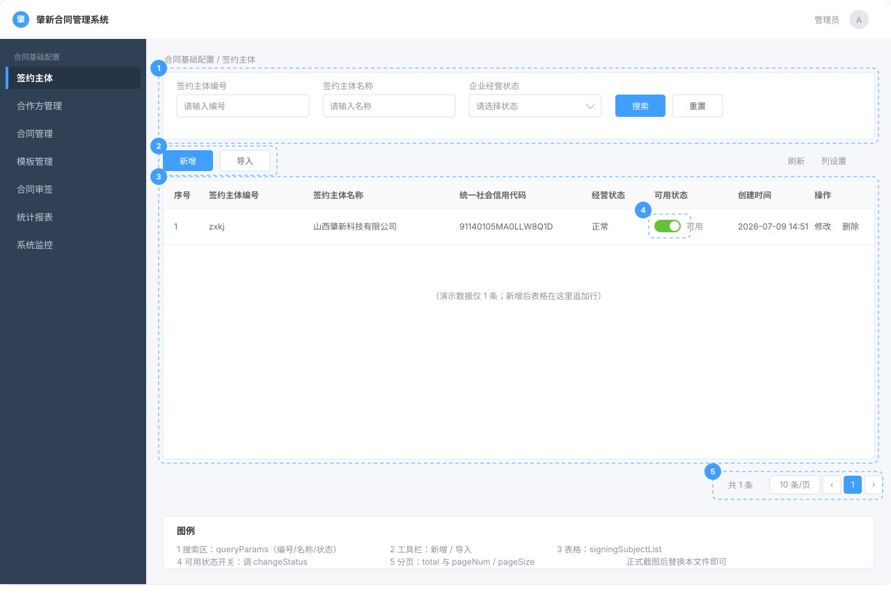
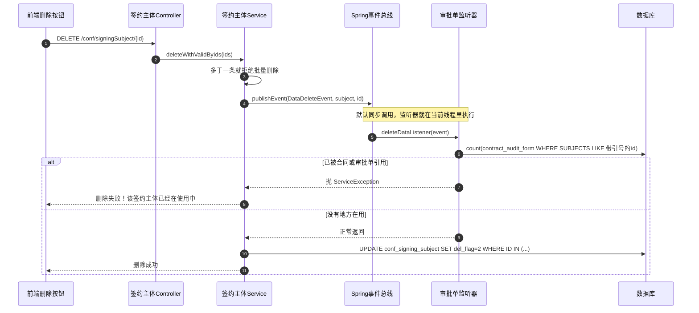

# 第 1 章 · 签约主体管理

> **这一章怎么用**：只有一条主线——**§四 施工**。从 4.2 开始，每一步都给能直接复制、能立刻运行的代码；每段代码后面紧跟「这段在干什么」和「怎么验证」。
>
> **代码往哪复制**：答案册 `E:\Develop\project\zhaoxin\zhaoxin-contract`（只读）→ 学习项目 `E:\Develop\project\zxcm-learn`：
>
> | 类型 | 复制到 |
> |---|---|
> | 后端 Java | `zxcm-learn\zxcm-contract\src\main\java\com\ruoyi\conf\...` |
> | 前端页面 | `zxcm-learn\zxcm-ui\src\views\conf\signingSubject\...` |
> | 建表 SQL | 直接在 `zxcm` 库执行 |
>
> **本章第一次讲透**：① 一个标准 CRUD 的完整施工顺序；② Sa-Token 鉴权（§4.3.5）；③ 逻辑删除、雪花 ID、JSON 字段在代码里长什么样。
>
> 为节省篇幅，代码块省略了文件头的版权注释，不影响运行。

## 零基础先补概念

- **Controller / Service / Mapper**：Controller 接请求，Service 写业务规则，Mapper 执行 SQL。
- **Entity / BO / VO**：Entity 对应表；BO 接前端参数；VO 返回前端。**入库看 Entity，收参看 BO，出参看 VO**。
- **Wrapper**：MyBatis-Plus 的查询积木，`eq` 等于、`like` 模糊、`orderByDesc` 倒序。
- **分组校验**：同一套注解，用 `groups` 区分「新增时查哪几条、修改时查哪几条」。

---

## 一、这部分是做什么的？

### 1.1 业务含义

**「签约主体」= 我方公司自己**。签一份合同，必然有两方：我方和对方。签约主体就是「我方」这个身份——比如「山西肇新科技有限公司」。

为什么要单独管理它？因为：

- 一家集团可能有好几个法人主体，签合同时要选「用哪个主体签」；
- 主体的**统一社会信用代码、法人、银行账号、联系人**这些信息，合同上要反复用到；
- 主体的**可用状态**要能开关（某主体停止使用了就不该再出现在选项里）。

所以这一章是「**基础数据维护**」——把将来要反复引用的主数据先录进去、能增删改查。

### 1.2 页面长什么样（前端）

页面在 `zxcm-ui/src/views/conf/signingSubject/index.vue`，功能就是标准后台的「**列表 + 搜索 + 新增/修改弹窗 + 删除**」：

- 顶部搜索区：按「主体编号 / 主体名称 / 企业经营状态」查找（`index.vue:13-92`）
- 中间表格：显示编号、名称、统一社会信用代码、经营状态、可用状态、创建时间（`index.vue:123-201`）
- 「新增 / 导入」按钮（`index.vue:96-115`）
- 每行的「修改 / 删除」按钮（`index.vue:184-199`）
- 「可用状态」是个开关，一拨就调接口改状态（`index.vue:169-175`）
- 新增/修改用同一个弹窗（`index.vue:213-590`），里面还嵌套了「财信息（银行）」和「联系人」两个可以动态增删的卡片列表



> **图注**：这是按 `index.vue` 的模板结构画的**示意图，不是真实截图**。图中 1~5 分别对应：1 搜索区（`queryParams`）、2 工具栏（新增/导入）、3 表格（`signingSubjectList`）、4 可用状态开关（`changeStatus`）、5 分页（`total` 与 `pageNum/pageSize`）。等有真实截图后，直接替换 `images/signing-subject-list-schematic.svg` 这个文件即可，正文不用改。

### 1.3 本章要实现哪些接口

| 接口 | 干什么 | 施工位置 |
|---|---|---|
| `GET /conf/signingSubject/list` | 分页查询列表 | §4.3 |
| `GET /conf/signingSubject/{id}` | 查单个详情 | §4.5（修改时回填） |
| `GET /conf/signingSubject/searchSubject` | **带权限的检索**（公开接口，有特殊安全逻辑） | §4.8 |
| `GET /conf/signingSubject/showList/select` | 下拉选项用的列表 | §五 速查表 |
| `POST /conf/signingSubject` | 新增 | §4.4 |
| `PUT /conf/signingSubject` | 修改 | §4.5 |
| `PUT /conf/signingSubject/changeStatus` | 改可用状态 | §4.6 |
| `DELETE /conf/signingSubject/{ids}` | 删除 | §4.7 |
| `POST /conf/signingSubject/importData` | Excel 导入 | §4.9 |

> 这一节只讲「业务和页面」；具体怎么施工，从 §四 开始。

---

## 二、站在架构师 / 开发经理角度：为什么这么设计？

### 2.1 为什么「新增」和「修改」共用一个弹窗、同一套代码

**先看两段真实代码。**

前端提交（`index.vue:793-833`）只做一次判断：

```js
if (this.form.id != null) {
  updateSigningSubject(this.form)     // 有 id → PUT
} else {
  addSigningSubject(this.form)        // 没有 id → POST
}
```

后端两个接口（`TSigningSubjectController.java:143-162`）只差三样：

```java
@PostMapping()  @Validated(AddGroup.class)  add(...)
@PutMapping()   @Validated(EditGroup.class) edit(...)
```

**新增和修改到底差在哪**：

| 维度 | 新增 | 修改 | 是否共用 |
|---|---|---|---|
| 弹窗字段 / 布局 | 全部字段 | 全部字段 | ✅ 完全一样 |
| 前端校验 `rules` | 名称、信用代码必填 | 名称、信用代码必填 | ✅ 一样 |
| 入参 | `TSigningSubjectBo`（无 id） | 同一个 BO（有 id） | ✅ 同一个类 |
| 校验分组 | `AddGroup` | `EditGroup` | ✅ 一套注解、两组规则 |
| HTTP 方法 | `POST` | `PUT` | ❌ 不同 |
| Service | `insertByBo` | `updateByBo` | ❌ 不同 |
| 成功后 | 关弹窗 + 刷新列表 | 关弹窗 + 刷新列表 | ✅ 一样 |

**为什么抽成一套**：

1. **字段和布局只有一份**：加一个字段只改一个弹窗；拆成两个的话，改一处漏一处，就会出现「新增能填、修改不能填」的 bug。
2. **前端只维护一个 `submitForm`**：不用写两套「打开弹窗 / 校验 / 提交 / 关闭」。
3. **后端只维护一个 BO**：新增/修改的字段差异用 `groups` 表达，而不是复制一个 `AddBo` / `EditBo`。
4. **维护点从 6 个降到 3 个**：两套表单、两套 rules、两个 submit → 一套表单、一套 rules、一个 submit。

**代价 / 边界**（面试可以主动说）：

- 弹窗里会出现 `if (id)` 分支，读代码要先分清当前是新增还是修改；
- 分组校验容易写错：Controller 的 `@Validated(AddGroup.class)` 和 `@Validated(EditGroup.class)` 必须对应上，写错会导致校验不生效；
- 如果两边字段差异变大（例如「修改时不允许改编号」），不能硬共用，要在 BO 上用分组或在前端做字段级控制。

**如果不共用会怎样**：

- 两个弹窗、两套 `rules`、两个提交方法；
- 加字段要改两处，两处校验容易不一致；
- 测试要覆盖两套表单，回归成本翻倍。

> **面试怎么答**：「新增和修改共用同一个表单组件和 BO，用 id 是否存在区分 POST/PUT；后端用 JSR-303 分组校验区分新增/修改的必填规则。好处是字段和布局只维护一份，代价是要注意分组写对、以及少数字段差异要用分组或前端条件控制。」

### 2.2 为什么银行信息、联系人用 JSON 字符串，不建子表

**结论**：一个主体可以有多个银行账号、多个联系人。本项目不建两张子表，而是把它们序列化成 JSON 字符串，存在**签约主体表 `conf_signing_subject`** 的两个列里：`BANK_JSON`（银行卡信息）、`CONTACTS`（联系人），类型都是 `varchar(4000)`。**一行主体 = 一条记录；多个账号、多个联系人，就是这个字段里 JSON 数组的多个元素。**

**为什么**：

1. **同生共死**：这两类数据永远跟着主体一起读、一起写，没有「单独打开一个银行账号」的场景；
2. **没有结构化查询需求**：不需要按银行账号、联系人姓名精确检索；
3. **省成本**：不建子表就少两张表、两套 CRUD、两次 join，前端也不用处理「删哪些增哪些」。

| 方案 | 好处 | 代价 |
|---|---|---|
| 建子表 | 规范、能按字段查、能做外键 | 多两张表 + join/N+1 + 前端 diff 集合 |
| **JSON 字符串（选用）** | 一张表搞定，提交/回填只做一次 stringify/parse | 不能按字段精确查、无 schema、4000 字符上限 |

**项目里怎么用**（一条链路）：

| 环节 | 代码 |
|---|---|
| 表字段 | `conf_signing_subject.BANK_JSON` / `conf_signing_subject.CONTACTS`，`varchar(4000)`（`04-biz-tables.sql:63-64`） |
| 提交 | `index.vue:801-802`：`JSON.stringify(contactsArray/bankJsonArray)` |
| 回填 | `index.vue:775-785`：`JSON.parse(contacts/bankJson)` |
| 列表 | `TSigningSubjectServiceImpl.java:83-95`：现场补默认联系人再转字符串 |

**JSON 长这样（多条，才是真实场景）**

**① 前端表单里是两个数组**，页面上可以点「添加」继续加行：

```js
form.bankJsonArray = [
  { bankName: '中国银行太原分行',     cardNo: '6217 8501 0000 1234 567' },
  { bankName: '工商银行长治路支行',   cardNo: '6222 0202 0000 9876 543' }
]

form.contactsArray = [
  { name: '张三', tel: '13698989898', email: 'zhangsan@example.com', remarks: '财务负责人' },
  { name: '李四', tel: '13800001111', email: 'lisi@example.com',     remarks: '合同对接人' }
]
```

**② 提交时各 `stringify` 成一个字符串**（注意：请求体里是**字符串**，不是数组）：

```json
{
  "signingSubjectName": "山西肇新科技有限公司",
  "bankJson": "[{\"bankName\":\"中国银行太原分行\",\"cardNo\":\"6217 8501 0000 1234 567\"},{\"bankName\":\"工商银行长治路支行\",\"cardNo\":\"6222 0202 0000 9876 543\"}]",
  "contacts": "[{\"name\":\"张三\",\"tel\":\"13698989898\",\"email\":\"zhangsan@example.com\",\"remarks\":\"财务负责人\"},{\"name\":\"李四\",\"tel\":\"13800001111\",\"email\":\"lisi@example.com\",\"remarks\":\"合同对接人\"}]"
}
```

**③ 数据库里仍然只有一行**，只是两列各装了一段 JSON 文本：

```
BANK_JSON: [{"bankName":"中国银行太原分行","cardNo":"6217 8501 0000 1234 567"},
            {"bankName":"工商银行长治路支行","cardNo":"6222 0202 0000 9876 543"}]
CONTACTS:  [{"name":"张三","tel":"13698989898","email":"zhangsan@example.com","remarks":"财务负责人"},
            {"name":"李四","tel":"13800001111","email":"lisi@example.com","remarks":"合同对接人"}]
```

**④ 回填时再 `parse` 回数组**，页面上就渲染成两张银行卡卡片、两张联系人卡片：

```js
form.bankJsonArray  = JSON.parse(row.bankJson  || '[]')
form.contactsArray  = JSON.parse(row.contacts  || '[]')
```

> **关键区别**：如果建子表，一个主体有 2 个账号就是 **2 行**；用 JSON，永远是 **1 行**，多条数据是同一列 JSON 数组里的 2 个元素。查询主体时不需要 `join`、也不会出现「主体重复多行」。
>
> 后端字段叫 `contacts`，MyBatis-Plus 驼峰转下划线映射到列 `CONTACTS`；`bankJson` → `BANK_JSON` 同理。`contactsArray` / `bankJsonArray` 是前端临时字段，不会提交。

**容量提醒**：两列都是 `varchar(4000)`。上面 2 个账号 + 2 个联系人约 300 字符；几十条没问题，上百条要提前算长度，超了会被截断/报错。

**两个要注意的点**：

- 项目里有一个 `contacts` 的 `LIKE`（`TSigningSubjectServiceImpl.java:123`），但那是**对 JSON 字符串做包含匹配**，不是按姓名/电话结构化查询；`bankJson` 完全没有查询条件。
- 列表接口的 `contacts` 会被「当前登录人」覆盖（`:83-95`），不是库里的原始值。

**代价 / 边界**：不能按联系人姓名、银行账号精确查；没有 schema 约束；4000 字符上限。出现「按联系人精确检索」「按银行账号查主体」这类需求时，再迁成子表。

> **面试怎么答**：「这两类数据永远跟着主体整体读写、没有结构化查询需求，所以用 JSON 字符串省两张表和两套 CRUD；代价是不能按字段精确查、没有 schema。将来要按联系人检索再迁子表。」

### 2.3 检索接口为什么有「最少 4 个字、最多 1 条」的限制

`searchSubject` 是半公开接口（合同起草时外部用户也要查主体）。如果谁都能批量拉走全部公司信息，就是数据泄露。所以做了权限分级：

- 有 `contract:subjectAll:search` 权限 → 正常返回；
- 没有 → 搜索词**至少 4 个字**；结果**超过 1 条**报错；**0 条也报错**。

**为什么是这三条**：

| 限制 | 防什么 | 正常用户会不会被误伤 |
|---|---|---|
| 至少 4 个字 | 防止用「公司」「科技」这种宽词批量拉 | 输入完整公司名不受影响 |
| 结果 > 1 条报错 | 防止一次拿多家 | 精确公司名通常只命中 1 家 |
| 0 条也报错 | 防止用接口探测「某公司存不存在」 | 正常搜索一般有结果 |

**代价**：用户搜一个常见词会被拒绝，体验不如普通搜索；这是「安全优先于便利」的取舍。

**另一种做法**：只返回脱敏字段（只给名称，不给信用代码、法人），但项目选择「限制结果集」——实现更简单，暴露面更小。

**具体请求长这样**：

```http
GET /conf/signingSubject/searchSubject?signingSubjectName=山西
# 无 contract:subjectAll:search 权限、名字只有 2 个字
→ {"code":500,"msg":"请最少输入4个字进行搜索"}

GET /conf/signingSubject/searchSubject?signingSubjectName=山西肇新
# 命中 1 条：正常返回
→ {"code":200,"data":{"total":1,"rows":[...]}}
```

---

### 2.4 删除为什么是逻辑删除 + 发事件

**一句话**：点「删除」不会执行 `DELETE`，而是把 `DEL_FLAG` 从 `0` 改成 `2`；改之前先广播一个「我要删这个主体」的事件，**谁在用谁抛异常拦住**。

**为什么不能物理删除**

合同和审批单里存的是主体 id：`contract_audit_form.SUBJECTS`、`contract_draft.SUBJECTS` 都是 `text`，里面是 JSON 数组。合同列表显示的名字虽然来自快照字段 `contract_draft.SUBJECT_NAMES`，但**按主体查合同、点进主体详情、做主体维度统计，仍然要靠这条主体记录**。物理删除后，这些 id 就悬空了。

| 方案 | 好处 | 代价 |
|---|---|---|
| 物理删除 `DELETE` | 表干净、查询快 | 历史单据的 id 悬空；误删不可恢复；没有审计痕迹 |
| **逻辑删除（选用）** | 可追溯、可恢复；历史引用还能解析 | 数据只增不减；每次查询都要带 `DEL_FLAG`；唯一索引要额外设计 |

**逻辑删除是靠什么自动执行的**

三处配合，缺一不可：

| 位置 | 内容 | 作用 |
|---|---|---|
| `application.yml:254`、`:256` | `logicDeleteValue: 2`、`logicNotDeleteValue: 0` | 定义「删了 / 没删」分别写什么值 |
| `TSigningSubject.java:65-66` | `@TableLogic private String delFlag;` | 指认**哪个字段**是删除标记 |
| `04-biz-tables.sql:49` | `DEL_FLAG char(1) NOT NULL DEFAULT '0' COMMENT '0 未删除 2 已删除'` | 库里的默认值和注释 |

> 两个容易踩的点：
> ① MyBatis-Plus 默认是 `0/1`，这个项目改成了 `0/2`——网上抄来的 `del_flag = 1` 在这里是**错的**；
> ② `logicDeleteValue` 只定义「值」，不定义「字段」。没有 `@TableLogic`（或全局 `logicDeleteField`）时，`deleteById` 仍然是物理 `DELETE`。

标上之后，MP 自动做三件事：

| 你调用 | 实际执行的 SQL |
|---|---|
| `selectById` / `selectList` / `selectVoPage` | `SELECT ... WHERE ... AND del_flag = '0'` |
| `deleteById` / `deleteBatchIds` | `UPDATE conf_signing_subject SET del_flag = '2' WHERE ID IN (...) AND del_flag = '0'` |
| `updateById` | `UPDATE ... WHERE ID = ? AND del_flag = '0'` |

同一条记录删除前后：

```sql
-- 删除前
SELECT ID, SIGNING_SUBJECT_NAME, DEL_FLAG FROM conf_signing_subject WHERE ID = 'xxx';
-- xxx | 山西肇新科技有限公司 | 0

-- 删除后：记录还在，只是标记变了
-- xxx | 山西肇新科技有限公司 | 2
```

**边界：只有「走 MP」的 SQL 才会自动加**

这是逻辑删除最容易出事的地方。「走 MP」指 `BaseMapper` 的方法和 `Wrapper` 条件构造器；一旦自己写 SQL，MP 就不管了。

**情况 1：BaseMapper / Wrapper（自动加）**

```java
LambdaQueryWrapper<TSigningSubject> lqw = Wrappers.lambdaQuery();
lqw.eq(TSigningSubject::getSigningSubjectCode, "zxkj");
Page<TSigningSubjectVo> result = baseMapper.selectVoPage(pageQuery.build(), lqw);
```

生成：

```sql
SELECT ... FROM conf_signing_subject
WHERE del_flag = '0'                 -- ← @TableLogic 自动加，Service 里没写
  AND signing_subject_code = 'zxkj'
ORDER BY create_time DESC
LIMIT 0, 10;
```

**情况 2：手写 `@Select` / `@Update`（不会自动加）**

第 2 章合作方的列表就是手写 SQL（`TContractCounterpartMapper.java:60-64`），注意第二个参数上的 `@Param(Constants.WRAPPER)`：

```java
@Select("SELECT * FROM conf_contract_counterpart ${ew.customSqlSegment}")
Page<TContractCounterpartVo> selectPagePartnerByPermission(
    Page<TContractCounterpart> page,
    @Param(Constants.WRAPPER) Wrapper<TContractCounterpart> queryWrapper);
```

所以 `del_flag` 必须在 Service 里自己写（`TContractCounterpartServiceImpl.java:151`）：

```java
lqw.eq(TContractCounterpart::getDelFlag, '0');
```

不写的后果：

```sql
SELECT * FROM conf_contract_counterpart
WHERE contract_counterpart_head = 100;      -- 已删除的也查出来了
```

写了之后：

```sql
SELECT * FROM conf_contract_counterpart
WHERE del_flag = '0'
  AND contract_counterpart_head = 100;
```

手写 `@Update` 同理。本项目 `TSigningSubjectMapper.java:33-35` 的 `updateSetDateNull` 是 `UPDATE ... WHERE ID = #{id}`，**不会**自动加 `del_flag = '0'`——要保证「只有未删除的才能改」，得自己补条件。

> 上面这行 `${ew.customSqlSegment}` 的语法看不懂？本节末尾「附」有完整拆解。

**情况 3：传统 XML 的 SQL（不会自动加）**

业务模块（`zxcm-contract`）全部用注解，XML 只出现在基础框架 `ruoyi-system` 里——`application.yml:211` 配了 `mapperLocations: classpath*:mapper/**/*Mapper.xml`。

XML 有两种写法，两种都不会自动加 `del_flag`。

**（1）条件写死在 XML 里**（`SysUserMapper.xml:157-160`）：

```xml
<select id="selectUserByUserName" parameterType="String" resultMap="SysUserResult">
    <include refid="selectUserVo"/>
    where u.del_flag = '0' and u.user_name = #{userName}
</select>
```

这里的 `u.del_flag = '0'` 是**人写的**。删掉它，已删除的用户就会被查出来。

**（2）XML 只写骨架，条件用 Wrapper 拼**（`SysUserMapper.xml:134-139` + `SysUserMapper.java:63`）：

```xml
<select id="selectUserList" resultMap="SysUserResult">
    select u.user_id, u.nick_name, u.user_name, u.status, u.del_flag, u.create_time
    from sys_user u
    ${ew.getCustomSqlSegment}
</select>
```

```java
List<SysUser> selectUserList(@Param(Constants.WRAPPER) Wrapper<SysUser> queryWrapper);
```

条件在 Service 里拼，`del_flag` **仍然要手写**（`SysUserServiceImpl.java:189`）：

```java
wrapper.eq("u.del_flag", UserConstants.USER_NORMAL)   // USER_NORMAL = "0"（UserConstants.java:41）
    .eq(ObjectUtil.isNotNull(user.getUserId()), "u.user_id", user.getUserId())
    .like(StringUtils.isNotBlank(user.getNickName()), "u.nick_name", user.getNickName());
```

> `${ew.getCustomSqlSegment}` 和上一段的 `${ew.customSqlSegment}` 是同一件事：MyBatis 用 OGNL 取值，属性访问和方法调用都支持。项目里 XML 习惯写前者，注解里写后者。
>
> 注意 `u.del_flag` 带别名——因为 `sys_user u` 还会 join 角色表，裸写 `del_flag` 有歧义（和情况 2 里合作方用 `a.` 是同一个原因）。

**四种写法小结**

| 写法 | `del_flag = '0'` 谁加 | 项目里的例子 |
|---|---|---|
| `BaseMapper` + `Wrapper` | **MP 自动** | `selectVoPage` |
| `@Select` + `Wrapper` | 你写 | 合作方 `selectPagePartnerByPermission` |
| XML + `Wrapper` | 你写 | 系统用户 `selectUserList` |
| XML 写死 SQL | 你写 | 系统用户 `selectUserByUserName` |

**一次删除的完整链路：先校验，再删**

Controller（`TSigningSubjectController.java:170-173`）调 Service（`TSigningSubjectServiceImpl.java:194-203`）：

```java
@Override
public Boolean deleteWithValidByIds(Collection<String> ids, Boolean isValid) {
    if (ids.size() > 1) {
        throw new ServiceException("对不起，该模块不支持批量删除");
    }

    // ① 先广播「我要删这个主体」
    DataDeleteEvent event = new DataDeleteEvent(
        this, DataDeleteEvent.TABLE_SUBJECT, "" + ids.iterator().next());
    applicationEventPublisher.publishEvent(event);

    // ② 没人拦截，才真正删（逻辑删除）
    return baseMapper.deleteBatchIds(ids) > 0;
}
```

监听方在合同模块（`ContractAuditFormServiceImpl.java:118-137`）：

```java
@EventListener
public void deleteDataListener(DataDeleteEvent event) {
    if (event.getTable().equals(DataDeleteEvent.TABLE_SUBJECT)) {
        // 在审批单的 SUBJECTS（JSON 数组）里找有没有这个主体 id
        LambdaQueryWrapper<ContractAuditForm> lqw = Wrappers.lambdaQuery();
        lqw.like(ContractAuditForm::getSubjects, "\"" + event.getId() + "\"");
        long count = this.baseMapper.selectCount(lqw);
        if (count > 0) {
            throw new ServiceException("删除失败！该签约主体已经在使用中。");
        }
    }
}
```



**为什么用事件，而不是直接调合同模块**

如果不用事件，签约主体的删除方法就得 `import` 合同模块的 Service 去查引用——**配置模块反向依赖业务模块**。以后「用印」「归档」也要校验时，还得继续往这个方法里加依赖。

用事件后：

- 发布方只知道「我发了一个删除事件」，不知道谁在听；
- 每个关心的模块自己加一个 `@EventListener`，签约主体的代码一行都不用改；
- `DataDeleteEvent.TABLE_SUBJECT`（`DataDeleteEvent.java:33`）就是路由键，监听器按它判断「这事跟我有没有关系」。

**边界（很重要）**：Spring 的 `@EventListener` **默认同步执行**，所以监听器抛异常能打断删除。一旦有人给它加 `@Async`，删除就会在校验还没跑完时继续执行——想要异步通知，必须拆成两个事件（校验事件 + 已删除通知），不能混用。

**代价 / 边界**

- 数据只增不减，需要定期归档；
- 逻辑删除后 `selectById` / `updateById` 都查不到它，「恢复」得写原生 SQL 把 `DEL_FLAG` 改回 `0`；
- 本表现在只有主键索引，没有唯一索引；将来若要加「统一社会信用代码唯一」，要连同删除标记一起设计，否则删掉的记录仍占着那个唯一值；
- 校验和删除不在同一个事务里（方法上没有 `@Transactional`），并发下存在极小窗口：刚校验通过、别人又引用了。签约主体删除频率极低，项目接受这个窗口；
- 监听器是同步的，监听方越多，删除接口越慢。

> **面试怎么答**：「主体会被合同和审批单以 id 引用，物理删除会让历史单据的 id 悬空，所以用逻辑删除——`@TableLogic` 加全局配置，把 `delete` 自动改写成 `UPDATE del_flag=2`。删除前先发一个同步的 Spring 事件，引用方在监听器里查引用数，有引用就抛异常拦截；用事件是为了让配置模块不反向依赖业务模块。代价是手写 SQL 不会自动加过滤条件，必须自己补 `del_flag`。」

**附：`${ew.customSqlSegment}` 拆解**

**一句话**：`@Select` 里只写不变的部分（哪张表、哪些列），`WHERE` / `ORDER BY` 交给 Java 侧的 `Wrapper` 生成，再用这个占位符灌进 SQL。

| 零件 | 作用 | 少了会怎样 |
|---|---|---|
| `@Select("... FROM 表")` | 固定的表名、列名 | 没有 SQL |
| `${ew.customSqlSegment}` | 把 Wrapper 里的条件变成 SQL 文字填进来 | 条件不生效，变成查全表 |
| `@Param(Constants.WRAPPER)` | 给 Wrapper 贴名字 `ew`（`Constants.WRAPPER` 的值就是 `"ew"`） | 报错 `There is no getter for property named 'ew'` |
| `Page<...>` 第一个参数 | 分页插件看到它就自动 count + `LIMIT` | 一次把全表查出来 |

**它从哪来**：`customSqlSegment` 是 MyBatis-Plus `Wrapper` 类（`com.baomidou.mybatisplus.core.conditions.Wrapper`，项目用 3.5.2）自带的方法 `getCustomSqlSegment()`。逻辑只有三句：把条件拼成字符串；**有 where 条件时补 `WHERE`**；只有排序时不补；什么都没有时返回空串。

| Wrapper 里的状态 | `${ew.customSqlSegment}` 展开为 |
|---|---|
| 什么都没加 | 空串 |
| 只加了 `orderByDesc` | ` ORDER BY create_time DESC`（没有 WHERE） |
| 加了 `like` / `eq` | ` WHERE ( 条件1 AND 条件2 ) ORDER BY ...` |

所以 `FROM 表名` 后面接条件、接排序、或者什么都不接，拼出来都是合法 SQL——这就是用 `customSqlSegment` 而不是裸 `sqlSegment` 的原因（后者不带 `WHERE`，得自己判断加不加）。

值仍然是 `?` 占位符（走 `#{}`，防注入）；`${}` 只用来拼「结构」，不能拿来拼用户输入。

**怎么亲眼看到**：dev 环境已开 SQL 打印（`application.yml:239`），启动后调一次合作方列表，控制台 `==> Preparing:` 后面就是最终 SQL；或者在 `TContractCounterpartServiceImpl.java:98` 打断点，Evaluate 里执行 `lqw.getCustomSqlSegment()`。

## 三、需要哪些技术？

| 技术 / 机制 | 解决什么问题 | 第一次出现在哪一步 |
|---|---|---|
| **Sa-Token 鉴权** | 判断「请求是谁发的、有没有权限」 | §4.3.5（第一次讲透） |
| `@SaCheckPermission` | 接口级权限校验 | §4.4（新增） |
| **JWT 风格 Token** | 登录标识放 token，用户信息放 token session | §4.3.5 |
| **逻辑删除** | 删除只改 `del_flag` | §4.2.2（Entity）、§4.7 |
| **雪花 ID** | 插入时生成全局唯一主键 | §4.2.2（Entity） |
| **Wrapper 条件构造器** | 用 Java 拼 where | §4.3.2（列表） |
| **Bean 拷贝** | Entity ↔ BO ↔ VO | §4.3.2、§4.4.3 |
| **分组校验** | 新增/修改不同规则 | §4.4.5 |
| **Spring 事件** | 删除前广播，引用方校验并拦截 | §2.4（第 6 章讲透） |
| **EasyExcel** | 导入导出 | §4.9 |
| **`v-hasPermi`** | 前端按权限隐藏按钮 | §4.3.5 |
| **公共字典** | 「经营状态」下拉项来源 | 第 4 章 |

---

## 四、功能具体怎么实现（带着你复制）

### 4.1 需求：一份「签约主体管理」需求单

> 这一节模拟真实工作：法务丢过来一张需求单，你先读懂、再拆解，最后才写代码。4.2~4.9 就是照着这张单子一步步施工。

#### 4.1.1 需求单

**需求编号** ZXCM-CONF-001　**提出人** 法务部　**优先级** 高　**本期上线**

**背景**：合同起草时要选「我方签约主体」。现在这些信息存在 Excel 里，每次签合同人工核对，经常把名称、统一社会信用代码填错。需要在系统里维护一份主体档案，起草合同时直接选。

**使用角色**

| 角色 | 能做什么 |
|---|---|
| 法务管理员 | 维护主体档案：新增、修改、启停用、删除、导入 |
| 合同经办人 | 在合同起草页搜索并选择主体（只读） |

**功能需求**

| # | 功能 | 具体要求 |
|---|---|---|
| 1 | 列表 | 显示名称、编号、信用代码、经营状态、公司类型、负责人、创建时间、可用状态；可按名称模糊 / 信用代码精确 / 经营状态 / 公司类型筛选；创建时间倒序；分页 |
| 2 | 新增 | 名称、统一社会信用代码必填；名称不能重复；营业期限可选「长期」，选长期就不填结束日期；银行信息、联系人可多条，随主体一起保存；新增后默认「可用」 |
| 3 | 修改 | 弹窗回填；名称查重时排除自己；记录「谁、什么时候、改了哪些字段」，存进备注 |
| 4 | 启停用 | 停用后，合同起草页不能再选到 |
| 5 | 删除 | 单条删除，不支持批量；已被合同 / 审批单引用的主体不许删，提示「该签约主体已经在使用中」 |
| 6 | 导入 | 下载模板，按模板批量导入 |
| 7 | 主体搜索 | 合同起草页的远程搜索框；没有全量权限的人：至少输入 4 个字，且最多返回 1 条 |

**非功能要求**

- 权限点：`conf:signingSubject:query` / `:add` / `:edit` / `:remove`；
- 删除用逻辑删除，数据要能追溯；
- 所有接口登录后才能访问。

**验收标准**

| 操作 | 预期 |
|---|---|
| 打开页面 | 有数据，创建时间倒序 |
| 新增同名主体 | 提示「当前签约主体名称已存在」 |
| 营业期限选「长期」 | 结束日期清空 |
| 修改后查备注 | 能看到「谁、什么时候、改了哪些字段」 |
| 停用后去合同起草页搜 | 搜不到 |
| 删除已被合同引用的主体 | 提示「该签约主体已经在使用中」，数据仍在 |
| 没有 `contract:subjectAll:search` 权限，只输 3 个字 | 提示「请最少输入4个字进行搜索」 |

**本期不做**：主体变更审批流、工商信息自动同步、主体合并、编号自动生成（编号手工填）、导出（代码里保留了注释掉的导出接口，`TSigningSubjectController.java:122-127`，本期不开放）。

#### 4.1.2 拿到需求，先做四件事

**① 给需求定性，先推出架构**

从零做一个模块，第一步不是找模板，而是回答五个问题：**它是什么数据、长什么形状、有没有状态、怎么读写、被谁引用**。答案会直接把架构逼出来。

| 判断维度 | 本模块的答案 | 推出的设计 |
|---|---|---|
| 数据性质 | 主数据：被合同反复引用、生命周期长 | 逻辑删除，不做物理删 |
| 数据形状 | 一个主体 + 两类一对多附属数据（银行账号、联系人） | 主表 + 附属数据方案（JSON 列） |
| 状态复杂度 | 只有「可用 / 停用」，没有审批流 | 一个 `STATUS` 字段，不需要状态机 |
| 读写特征 | 读多写少，列表按字段筛选 | 分页 + Wrapper + 按筛选列建索引 |
| 引用关系 | 被合同引用，删除会影响历史单据 | 删除前校验（事件），不能级联删 |
| 安全边界 | 全公司共用的主数据，没有「按人隔离」 | 只做功能权限，不做数据权限 |

填完这张表，架构已经出来了：

```
一张主表 conf_signing_subject
+ 标准四层：Controller / Service / Mapper / Entity·BO·VO
+ 三个横切：逻辑删除、审计字段、功能权限
+ 一个附属数据方案：银行/联系人用 JSON 列
```

②③④ 只是把这个架构落到字段、接口和边界上。

**② 定领域模型：表、字段、约束**

- **表**：一张 `conf_signing_subject`，一行一个主体；
- **字段**：按「身份 / 业务标识 / 工商 / 联系 / 扩展 / 状态 / 审计」分组（逐列理由见 4.1.3）；
- **关系**：银行、联系人是一对多，但只整体读写、不单独查，所以用 JSON 列，不建子表；
- **不变式**（业务上必须始终成立）：名称不能重复；选「长期」时结束日期必须为空；删除只改标记、不删行。

**③ 定接口契约**

资源是 `/conf/signingSubject`，7 个功能对应 7 个接口：

| 功能 | 方法 + 路径 | 权限点 |
|---|---|---|
| 列表 | `GET /list` | `conf:signingSubject:query` |
| 新增 | `POST /` | `:add` |
| 修改 | `PUT /` | `:edit` |
| 启停用 | `PUT /changeStatus` | `:edit` |
| 删除 | `DELETE /{ids}` | `:remove` |
| 主体搜索 | `GET /searchSubject` | 登录即可；函数内判断 `contract:subjectAll:search` |
| 导入 | `POST /importData` | `:edit` |

接口定完，再定三样契约细节：**入参用 BO 还是 Entity**（用 BO）、**新增和修改怎么区分校验**（分组校验）、**失败怎么表达**（抛 `ServiceException`，前端弹消息）。

**④ 定实现边界：哪些不用写、哪些必须写、哪些是缺口**

| 能力 | 谁提供 | 你怎么用 |
|---|---|---|
| 分页 | `PageQuery` + MP 分页插件 | Controller 多一个 `PageQuery` 参数 |
| 逻辑删除 | `@TableLogic` + 全局配置 | Entity 字段上加注解 |
| 雪花 ID | MP `IdentifierGenerator` | 主键用 `String`，不自己生成 |
| 创建/更新时间 | `BaseEntity` + `MetaObjectHandler` | 继承 `BaseEntity` 就行 |
| 参数校验 | `@Validated(AddGroup/EditGroup)` | BO 字段上加注解 |
| 权限 | `@SaCheckPermission` | Controller 方法上加注解 |

| 边界 | 内容 |
|---|---|
| **必须自己写** | 名称查重、长期/结束日期一致性、变更留痕、删除前引用校验 |
| **框架已经给** | 分页、逻辑删除、雪花 ID、审计字段、参数校验、权限注解 |
| **已知缺口（别当成已实现）** | `USCC` / 编号没有唯一校验；停用后搜索接口没过滤 `status`；`createBy` 被硬编码成 `admin` |

> 这一步的意义：**先判断哪些不用写**。写不完的代码，一半是重复造轮子；剩下的一半，是没分清「设计意图」和「已经实现」。

#### 4.1.3 表设计导读：这张表为什么长这样

> 写代码之前，先把「这张表为什么是这些列」想明白。面试问「你这个表怎么设计的」，考的就是这一节。

**先定位：它是主数据，不是业务单据**

系统里的数据分三类，设计原则完全不同：

| 类型 | 本项目里的例子 | 特征 | 设计原则 |
|---|---|---|---|
| **主数据** | 签约主体、合作方、合同类型 | 被反复引用、生命周期长、读多写少 | 稳定、可追溯、**不能随便物理删** |
| **业务数据** | 合同、审批单 | 一次产生、有状态流转、量大 | 引用主数据 id，必要时存快照 |
| **日志数据** | 操作日志、节点日志 | 只追加 | 独立表，不拖慢主表 |

签约主体是主数据。它的一条铁律是：**可以被停用，但不能随便消失**——因为历史合同还指着它。这句话直接决定了后面两个设计：逻辑删除、删除前发事件校验（§2.4）。

**字段分组：每一组回答一个业务问题**

| 组 | 列 | 回答什么 | 设计细节 |
|---|---|---|---|
| 身份 | `ID`、`TENANT_ID` | 这条记录是谁、属于哪个租户 | `ID` 用 `varchar(64)` 存雪花 ID（19 位数字超过 JS 安全整数，前端必须收字符串）；`TENANT_ID` 由多租户插件自动追加条件、自动填充，业务代码不写 |
| 业务标识 | `SIGNING_SUBJECT_CODE`、`SIGNING_SUBJECT_NAME`、`USCC` | 内部怎么叫、合同抬头写什么、开票用哪个码 | `CODE` **手工填**（走第 3 章编号规则的是合同，不是主数据）；`NAME`、`USCC` 都是 `NOT NULL` |
| 状态 | `STATUS`、`DEL_FLAG` | 还能不能签新合同、这条记录还要不要出现 | 两个**正交**状态：`STATUS` 0 可用 / 1 停用（业务决策，可逆）；`DEL_FLAG` 0 未删 / 2 已删（数据治理，留痕） |
| 工商信息 | `LEGAL_PERSON_NAME`、`LEGAL_PERSON_ID_CARD`、`BUSINESS_START_DATE`、`BUSINESS_END_DATE`、`FOREVER`、`REGISTERED_CAPITAL` | 主体是否合法存续、法人是谁、注册资本多少 | `FOREVER=1`（长期）时结束日期存 `NULL`，用显式字段而不是 `9999-12-31` 这种魔法值；`REGISTERED_CAPITAL` 用 `varchar`，因为它可能是「1000万元」，不参与金额计算 |
| 联系 | `TEL`、`FAX`、`AREA_CODE`、`AREA_NAME`、`ADDRESS` | 怎么联系、地址在哪 | `AREA_CODE` + `AREA_NAME` 冗余存：名称是**快照**，行政区划改名后历史合同仍显示当时的名字，也省一次 join |
| 扩展 | `BANK_JSON`、`CONTACTS` | 收付款账号、联系人（都可以多条） | `varchar(4000)` 存 JSON 字符串，理由见下面的取舍表 |
| 审计 | `CREATE_BY/TIME`、`UPDATE_BY/TIME`、`REMARKS` | 谁建的、谁改的、改了什么 | 前四列来自 `BaseEntity`，`MetaObjectHandler` 自动填；`REMARKS` 在这里被复用成变更日志（`CompareUtils` 对比新旧对象，追加 JSON 数组） |

**四个关键取舍，以及什么时候该反过来**

| 决策 | 本项目选择 | 代价 | 什么情况下反过来 |
|---|---|---|---|
| 银行/联系人 | JSON 字符串，不建子表 | 不能按账号/姓名精确查、无 schema、4000 字符上限 | 出现「按联系人手机号反查主体」这类需求 |
| 删除 | 逻辑删除（`del_flag=2`） | 数据只增不减；手写 SQL 要自己过滤 | 有归档库、且确认没有历史引用 |
| 主键 | 雪花 ID 存 `varchar` | 占空间、不可读、排序不直观 | 单库单体、ID 不对外暴露 |
| 外键 | **一张业务表都不建** | 数据库不知道引用关系，校验全靠应用层 | 强一致要求高、不做数据迁移 |
| 变更记录 | `remarks` 存 JSON | 不能按操作人/时间检索 | 合规审计要求单独查审计表 |

> 前两条的完整原理在 §2.2、§2.4；这里只强调结论：**选 JSON 是因为它是「聚合根内部的附属数据」，读写粒度一致；选逻辑删除是因为主数据会被历史单据引用。**

**三处必须知道的缺陷（面试加分项）**

1. **`USCC` 没有唯一性约束**：数据库只有主键索引，Service 的 `validEntityBeforeSave`（`TSigningSubjectServiceImpl.java:164`）只查了名称；信用代码重复不会被拦。
2. **`SIGNING_SUBJECT_CODE` 的查重代码是注释掉的**：所以业务编号也能重复。
3. **`createBy` 被硬编码成 `"admin"`**（`TSigningSubjectServiceImpl.java:138-139`）：审计字段本该由 `MetaObjectHandler` 填当前登录人，这里被覆盖了，导致「创建人」永远是 admin。

为什么会出现这种状态：逻辑删除下 `UNIQUE(USCC)` 会冲突——删掉的主体还占着那个值；正确做法是唯一索引带上删除标记，或者用删除时间戳。项目选择了应用层校验，但只做了名称。**面试被问「怎么保证主数据唯一」时，要能说出这个取舍，而不是答「数据库会管」。**

**演示数据为什么是这 1 条**

```text
CODE=zxkj, NAME=山西肇新科技有限公司, USCC=91140105MA0LLW8Q1D,
STATUS=0, DEL_FLAG=0, TENANT_ID=00000000, BANK_JSON='[]', CONTACTS='[]'
```

它不是凑数，而是让三条链路同时有东西可验：列表页有 1 行、合同起草页能搜到、前端 `JSON.parse('[]')` 不炸（**空数组也是合法 JSON**，这是 JSON 方案必须提前验的边界）。

**这张表对后面章节的连锁影响**

| 后面的事 | 依赖这张表的什么 |
|---|---|
| 合同表存 `SUBJECTS`（id 的 JSON 数组）+ `SUBJECT_NAMES`（名称快照） | 合同引用的是 `ID`；快照保证主体改名后历史合同显示不变 |
| 删除主体前要发事件校验 | 无外键 + 逻辑删除，引用关系只能由应用层查（§2.4） |
| 主体停用后起草页选不到 | `STATUS` 字段（当前 `searchSubject` 没过滤 status，是已知缺口，见 §4.6.3） |

> **面试怎么答**：「签约主体是主数据，被合同反复引用，所以用逻辑删除而不是物理删除。一对多的银行和联系人用 JSON 存，因为永远整体读写、没有按字段检索的需求；代价是不能按字段查。主键用雪花 ID 转字符串，是为了前端不丢精度。没有建外键，引用完整性靠应用层校验加删除事件。」

#### 4.1.4 施工计划：拆成 7 个动作，按「能跑」排序

| 步骤 | 动作 | 业务规则 | 做完的标志 |
|---|---|---|---|
| 4.2 | 地基：建表 + Entity + VO + BO + Mapper + 三层骨架 | —— | 项目能编译、能启动 |
| 4.3 | 动作 1：列表查询 | 逻辑删除的数据不显示 | 页面有数据 |
| 4.4 | 动作 2：新增 | 名称查重；长期营业期限清空结束日期；默认可用 | 能存进一条 |
| 4.5 | 动作 3：修改 | 名称查重排除自己；写变更记录 | 能改一条，备注里有记录 |
| 4.6 | 动作 4：启停用 | `0` 可用 / `1` 停用 | 开关能拨，刷新后保持 |
| 4.7 | 动作 5：删除 | 逻辑删除；被引用时拦截；不支持批量 | 能删一条，库里 `del_flag = 2` |
| 4.8 | 动作 6：权限检索 | 无全量权限：至少 4 个字、最多 1 条 | 合同起草页能搜到主体 |
| 4.9 | 动作 7：Excel 导入 | 复用同一套校验 | 能批量导入 |

**为什么按这个顺序**：每一步都能编译、能跑。如果按「Entity → Mapper → Service → Controller」一路写完 6 个文件再运行，中间没有任何反馈；按动作走，每完成一步就有一个页面可点。

**文件地图**（本章要动 6 个后端文件 + 2 个前端文件）

| 文件 | 层 | 职责 | 在哪一步写 |
|---|---|---|---|
| `TSigningSubject.java` | Entity | 对应 `conf_signing_subject` 表 | 4.2.2 |
| `TSigningSubjectVo.java` | VO | 返回给前端的数据 | 4.2.3 |
| `TSigningSubjectBo.java` | BO | 接前端参数（列表查询条件也用它） | 4.2.4 |
| `TSigningSubjectMapper.java` | Mapper | 数据库操作 | 4.2.5 |
| `ITSigningSubjectService.java` | Service 接口 | 定义能力 | 4.2.6 起，随动作增加 |
| `TSigningSubjectServiceImpl.java` | Service 实现 | 业务规则 | 4.2.6 起，随动作增加 |
| `TSigningSubjectController.java` | Controller | 接请求、转发 | 4.2.7 起，随动作增加 |
| `api/conf/signingSubject.js` | 前端 api | 接口地址集中定义 | 4.3.3 起 |
| `views/conf/signingSubject/index.vue` | 前端页面 | 列表 + 弹窗 + 按钮 | 4.3.3 起 |

> **为什么 BO 也在地基**：列表、新增、修改的 Controller 第一个参数都是 `TSigningSubjectBo`，没有它连第一个接口都编译不过。BO 是「前端参数的容器」，不是「新增专用」。

#### 4.1.5 一条链路先看全貌

```
用户动作            前端                        后端                        数据库
──────────────────────────────────────────────────────────────────────────────
进页面/点搜索   index.vue getList()  →  api/signingSubject.js  →  Controller.list  →  Service.queryPageList  →  conf_signing_subject
点新增          Form 弹窗 submitForm() →  addSigningSubject     →  Controller.add   →  Service.insertByBo
点修改          Form 弹窗 submitForm() →  updateSigningSubject  →  Controller.edit  →  Service.updateByBo
拨开关          el-switch            →  changeStatus            →  Controller.changeStatus → Service.updateStatus
点删除          handleDelete()       →  delSigningSubject       →  Controller.remove → Service.deleteWithValidByIds
选主体搜索      远程搜索组件          →  searchSubject           →  Controller.searchSubject → Service.queryPageList
点导入          upload.vue           →  importData              →  Controller.importData → Excel 监听器
```

后面每写一个方法，你都能在这张图上找到它的位置。

### 4.2 地基：建表 + Entity + VO + Mapper

**本步目标**：把表和领域对象建好，让项目能编译、能启动。
**做完的标志**：`mvn compile` 通过；启动后数据库里有 `conf_signing_subject` 表。

#### 4.2.1 建表

```sql
DROP TABLE IF EXISTS `conf_signing_subject`;

CREATE TABLE `conf_signing_subject`  (
  `ID` varchar(64) NOT NULL COMMENT '主键',
  `SIGNING_SUBJECT_CODE` varchar(100) NULL DEFAULT NULL COMMENT '签约主体编号',
  `SIGNING_SUBJECT_NAME` varchar(100) NOT NULL COMMENT '签约主体名称',
  `BUSINESS_STATUS` varchar(10) NULL DEFAULT NULL COMMENT '企业经营状态',
  `USCC` varchar(36) NOT NULL COMMENT '统一社会信用代码',
  `CREATE_BY` varchar(64) NULL DEFAULT NULL COMMENT '创建人',
  `CREATE_TIME` datetime(0) NULL DEFAULT NULL COMMENT '创建时间',
  `UPDATE_BY` varchar(64) NULL DEFAULT NULL COMMENT '更新者',
  `UPDATE_TIME` datetime(0) NULL DEFAULT NULL COMMENT '更新时间',
  `DEL_FLAG` char(1) NOT NULL DEFAULT '0' COMMENT '0 未删除 2 已删除',
  `REMARKS` longtext NULL COMMENT '备注',
  `TENANT_ID` varchar(64) NULL DEFAULT NULL COMMENT '租户id',
  `STATUS` char(1) NULL DEFAULT '0' COMMENT '可用状态',
  `LEGAL_PERSON_NAME` varchar(20) NULL DEFAULT NULL COMMENT '法人姓名',
  `LEGAL_PERSON_ID_CARD` varchar(50) NULL DEFAULT NULL COMMENT '法人身份证号',
  `BUSINESS_START_DATE` date NULL DEFAULT NULL COMMENT '营业期限开始日期',
  `BUSINESS_END_DATE` date NULL DEFAULT NULL COMMENT '营业期限结束日期',
  `FOREVER` smallint NULL DEFAULT NULL COMMENT '营业期限是否长期有效',
  `REGISTERED_CAPITAL` varchar(64) NULL DEFAULT NULL COMMENT '注册资本',
  `TEL` varchar(64) NULL DEFAULT NULL COMMENT '联系电话',
  `FAX` varchar(64) NULL DEFAULT NULL COMMENT '传真',
  `AREA_CODE` varchar(32) NULL DEFAULT NULL COMMENT '所属地区编码',
  `AREA_NAME` varchar(200) NULL DEFAULT NULL COMMENT '所属地区名称',
  `BANK_JSON` varchar(4000) NULL DEFAULT NULL COMMENT '银行卡信息',
  `CONTACTS` varchar(4000) NULL DEFAULT NULL COMMENT '联系人',
  `ADDRESS` varchar(200) NULL DEFAULT NULL COMMENT '详细地址',
  PRIMARY KEY (`ID`) USING BTREE
) ENGINE = InnoDB DEFAULT CHARSET = utf8mb3 COMMENT = '签约主体表';
```

**讲解**：

- `ID` 是 `varchar(64)`：雪花 ID 在插入时由 MyBatis-Plus 生成，不是自增；
- `DEL_FLAG`：逻辑删除标记；
- `BANK_JSON` / `CONTACTS`：一对多数据存 JSON 字符串（理由见 §2.2）；
- `STATUS`：`0` 可用、`1` 停用。

#### 4.2.2 Entity（完整文件）

```java
package com.ruoyi.conf.domain;

import java.util.Date;

import javax.validation.constraints.Size;

import com.baomidou.mybatisplus.annotation.TableId;
import com.baomidou.mybatisplus.annotation.TableLogic;
import com.baomidou.mybatisplus.annotation.TableName;
import com.ruoyi.common.core.domain.BaseEntity;

import lombok.Data;
import lombok.EqualsAndHashCode;

@Data
@EqualsAndHashCode(callSuper = true)
@TableName("conf_signing_subject")
public class TSigningSubject extends BaseEntity {

    private static final long serialVersionUID = 1L;

    @TableId(value = "id")
    private String id;

    private String signingSubjectCode;

    private String signingSubjectName;

    private String businessStatus;

    private String uscc;

    @TableLogic
    private String delFlag;

    private String remarks;

    private String tenantId;

    private String status = "0";

    private String legalPersonName;

    private String legalPersonIdCard;

    private Date businessStartDate;

    private Date businessEndDate;

    /** 0=非长期，1=长期 */
    private Integer forever = 0;

    private String registeredCapital;

    private String tel;

    private String fax;

    private String areaCode;

    private String areaName;

    private String address;

    @Size(min = 0, max = 4000, message = "银行信息过多，请不要填写过多的银行信息")
    private String bankJson;

    @Size(min = 0, max = 4000, message = "联系人信息过多，请不要填写过多的联系人")
    private String contacts;
}
```

**讲解**：

| 代码 | 作用 |
|---|---|
| `extends BaseEntity` | 白得 `createBy` / `createTime` / `updateBy` / `updateTime` / `params` |
| `@TableName` | 指定表名 |
| `@TableId` | 主键；全局 `ASSIGN_ID` 会在插入时生成雪花 ID |
| `@TableLogic` | 删除只改 `delFlag`，查询自动加 `del_flag='0'` |
| `@Size(max=4000)` | 与数据库字段长度对齐 |

#### 4.2.3 VO（完整文件）

```java
package com.ruoyi.conf.domain.vo;

import java.util.Date;

import com.alibaba.excel.annotation.ExcelIgnoreUnannotated;
import com.alibaba.excel.annotation.ExcelProperty;
import com.fasterxml.jackson.annotation.JsonFormat;
import com.ruoyi.common.annotation.ExcelDictFormat;
import com.ruoyi.common.convert.ExcelDictConvert;

import io.swagger.annotations.ApiModel;
import io.swagger.annotations.ApiModelProperty;
import lombok.Data;

@Data
@ApiModel("签约主体视图对象")
@ExcelIgnoreUnannotated
public class TSigningSubjectVo {

    private static final long serialVersionUID = 1L;

    @ExcelProperty(value = "主键")
    @ApiModelProperty("主键")
    private String id;

    @ExcelProperty(value = "签约主体编号")
    @ApiModelProperty("签约主体编号")
    private String signingSubjectCode;

    @ExcelProperty(value = "签约主体名称")
    @ApiModelProperty("签约主体名称")
    private String signingSubjectName;

    @ExcelProperty(value = "企业经营状态", converter = ExcelDictConvert.class)
    @ExcelDictFormat(dictType = "business_status")
    @ApiModelProperty("企业经营状态")
    private String businessStatus;

    @ExcelProperty(value = "统一社会信用代码")
    @ApiModelProperty("统一社会信用代码")
    private String uscc;

    @ExcelProperty(value = "备注")
    @ApiModelProperty("备注")
    private String remarks;

    @ExcelProperty(value = "可用状态")
    @ApiModelProperty(value = "可用状态")
    private String status;

    /** 不是数据库字段：下拉框判断是否禁用 */
    private Boolean disabled;

    @ApiModelProperty(value = "创建时间")
    @JsonFormat(timezone = "GMT+8", pattern = "yyyy-MM-dd HH:mm:ss")
    private Date createTime;

    private String legalPersonName;

    private String legalPersonIdCard;

    private String registeredCapital;

    private String tel;

    private String fax;

    private String areaCode;

    private String areaName;

    private String address;

    private String bankJson;

    private String contacts;

    @JsonFormat(pattern = "yyyy-MM-dd")
    private Date businessStartDate;

    @JsonFormat(pattern = "yyyy-MM-dd")
    private Date businessEndDate;

    private Integer forever = 0;
}
```

**为什么要 VO**：返回数据经常要加工。列表接口会现场给每条记录补「默认联系人（当前登录人）」，这个字段表里没有，只能放 VO（§4.3.2）。

#### 4.2.4 BO（完整文件）

```java
package com.ruoyi.conf.domain.bo;

import java.util.Date;

import javax.validation.constraints.NotBlank;

import com.fasterxml.jackson.annotation.JsonFormat;
import com.ruoyi.common.core.domain.BaseEntity;
import com.ruoyi.common.core.validate.AddGroup;
import com.ruoyi.common.core.validate.EditGroup;

import io.swagger.annotations.ApiModel;
import io.swagger.annotations.ApiModelProperty;
import lombok.Data;
import lombok.EqualsAndHashCode;

@Data
@EqualsAndHashCode(callSuper = true)
@ApiModel("签约主体业务对象")
public class TSigningSubjectBo extends BaseEntity {

    @ApiModelProperty(value = "主键", required = true)
    @NotBlank(message = "主键不能为空", groups = {EditGroup.class})
    private String id;

    @ApiModelProperty(value = "签约主体编号", required = true)
    private String signingSubjectCode;

    @ApiModelProperty(value = "签约主体名称", required = true)
    @NotBlank(message = "签约主体名称不能为空", groups = {AddGroup.class, EditGroup.class})
    private String signingSubjectName;

    @ApiModelProperty(value = "企业经营状态")
    private String businessStatus;

    @ApiModelProperty(value = "统一社会信用代码", required = true)
    @NotBlank(message = "统一社会信用代码不能为空", groups = {AddGroup.class, EditGroup.class})
    private String uscc;

    @ApiModelProperty(value = "备注")
    private String remarks;

    @ApiModelProperty(value = "可用状态")
    private String status;

    @ApiModelProperty(value = "法人姓名")
    private String legalPersonName;

    @ApiModelProperty(value = "法人身份证号")
    private String legalPersonIdCard;

    @ApiModelProperty(value = "长期")
    private Integer forever;

    @ApiModelProperty(value = "地图名称")
    private String areaName;

    @ApiModelProperty(value = "地区编号")
    private String areaCode;

    @ApiModelProperty(value = "传真")
    private String fax;

    @ApiModelProperty(value = "电话")
    private String tel;

    @ApiModelProperty(value = "联系人")
    private String contacts;

    @ApiModelProperty(value = "银行信息")
    private String bankJson;

    @ApiModelProperty(value = "营业期限开始时间")
    @JsonFormat(pattern = "yyyy-MM-dd")
    private Date businessStartDate;

    @ApiModelProperty(value = "营业期限结束时间")
    @JsonFormat(pattern = "yyyy-MM-dd")
    private Date businessEndDate;

    private String registeredCapital;

    private String address;
}
```

**讲解**：

- `@NotBlank(groups = {AddGroup.class, EditGroup.class})`：新增和修改都必填；
- `id` 只写 `EditGroup`：新增时没有 id，不能要求必填；
- `@JsonFormat(pattern = "yyyy-MM-dd")`：前端传 `2026-10-23`，后端自动转 `Date`。

#### 4.2.5 Mapper（完整文件）

```java
package com.ruoyi.conf.mapper;

import org.apache.ibatis.annotations.Param;
import org.apache.ibatis.annotations.Update;
import org.springframework.transaction.annotation.Transactional;

import com.ruoyi.common.core.mapper.BaseMapperPlus;
import com.ruoyi.conf.domain.TSigningSubject;
import com.ruoyi.conf.domain.vo.TSigningSubjectVo;

public interface TSigningSubjectMapper
    extends BaseMapperPlus<TSigningSubjectMapper, TSigningSubject, TSigningSubjectVo> {

    @Transactional
    @Update("update CONF_SIGNING_SUBJECT set BUSINESS_END_DATE=NULL WHERE ID=#{id}")
    Integer updateSetDateNull(@Param("id") String id);
}
```

**讲解**：继承 `BaseMapperPlus` 就白得 `selectVoPage`、`selectVoById`、`insert`、`updateById`、`deleteBatchIds`。手写 SQL 只有一条，原因在 §4.5 讲（`NOT_NULL` 策略）。

#### 4.2.6 Service 接口 + 实现骨架

**接口**（先只放 `queryById`，后续动作逐个加方法）：

```java
package com.ruoyi.conf.service;

import com.ruoyi.conf.domain.vo.TSigningSubjectVo;

public interface ITSigningSubjectService {

    /** 按 id 查详情 */
    TSigningSubjectVo queryById(String id);
}
```

**实现骨架**（完整类头 + 所有 import，后续步骤只加方法）：

```java
package com.ruoyi.conf.service.impl;

import org.springframework.beans.factory.annotation.Autowired;
import org.springframework.context.ApplicationEventPublisher;
import org.springframework.stereotype.Service;

import com.ruoyi.conf.domain.vo.TSigningSubjectVo;
import com.ruoyi.conf.mapper.TSigningSubjectMapper;
import com.ruoyi.conf.service.ITSigningSubjectService;
import com.ruoyi.system.mapper.SysUserMapper;

import lombok.RequiredArgsConstructor;

@RequiredArgsConstructor
@Service
public class TSigningSubjectServiceImpl implements ITSigningSubjectService {

    private final TSigningSubjectMapper baseMapper;

    @Autowired
    private ApplicationEventPublisher applicationEventPublisher;

    @Autowired
    private SysUserMapper sysUserMapper;

    /** 签约主体不可用 */
    private static final String DISABLED = "1";

    @Override
    public TSigningSubjectVo queryById(String id) {
        return baseMapper.selectVoById(id);
    }
}
```

**讲解**：`@RequiredArgsConstructor` + `final` = 构造器注入；`ApplicationEventPublisher` 删除时用；`SysUserMapper` 列表补「当前登录人」用。

> **关于 import**：骨架只保留当前能编译的 import。后面每加一个方法，如果 IDEA 标红，按 `Alt+Enter` 自动导入即可——文档不再逐个列 import，避免骨架一复制就一堆红。

#### 4.2.7 Controller 骨架（完整类头）

```java
package com.ruoyi.conf.controller;

import org.springframework.validation.annotation.Validated;
import org.springframework.web.bind.annotation.RequestMapping;
import org.springframework.web.bind.annotation.RestController;

import com.ruoyi.common.core.controller.BaseController;
import com.ruoyi.conf.service.ITSigningSubjectService;

import io.swagger.annotations.Api;
import lombok.RequiredArgsConstructor;

@Validated
@Api(value = "签约主体控制器", tags = {"签约主体管理"})
@RequiredArgsConstructor
@RestController
@RequestMapping("/conf/signingSubject")
public class TSigningSubjectController extends BaseController {

    private final ITSigningSubjectService iTSigningSubjectService;
}
```

#### 4.2.8 地基验证

- [ ] 表建好了；
- [ ] 项目能编译（此时只有 `queryById`，接口和实现一致）；
- [ ] 能启动、能登录（启动步骤见常用命令速查）。

### 4.3 动作 1：列表查询

**本步目标**：先把「能查到数据」打通，页面有列表。
**做完的标志**：打开页面有数据；按名称搜索、翻页都正常；逻辑删除的数据不出现。

#### 4.3.1 业务逻辑

进页面或点「搜索」→ 前端发 `queryParams` → 后端拼 where 查表 → 返回 `rows + total` → 前端渲染表格和分页。

#### 4.3.2 后端完整代码

**Service 接口**加：

```java
import com.ruoyi.common.core.domain.PageQuery;
import com.ruoyi.common.core.page.TableDataInfo;
import com.ruoyi.conf.domain.bo.TSigningSubjectBo;
import com.ruoyi.conf.domain.vo.TSigningSubjectVo;

/** 查询签约主体列表 */
TableDataInfo<TSigningSubjectVo> queryPageList(TSigningSubjectBo bo, PageQuery pageQuery);
```

**Service 实现**加：

```java
@Override
public TableDataInfo<TSigningSubjectVo> queryPageList(TSigningSubjectBo bo, PageQuery pageQuery) {
    LambdaQueryWrapper<TSigningSubject> lqw = buildQueryWrapper(bo);
    Page<TSigningSubjectVo> result = baseMapper.selectVoPage(pageQuery.build(), lqw);

    // 默认返回的联系人是当前登录人
    for (TSigningSubjectVo vo : result.getRecords()) {
        List<ContactInfo> list = new ArrayList<>();
        ContactInfo info = new ContactInfo();
        SysUser user = sysUserMapper.selectById(LoginHelper.getLoginUser().getUserId());
        info.setName(user.getNickName());
        info.setEmail(user.getEmail());
        info.setTel(user.getPhonenumber());
        info.setKey(user.getUserId().toString());
        info.setRemarks("sysUser");
        list.add(info);

        vo.setContacts(JsonUtil.getObjectToString(list));
    }
    return TableDataInfo.build(result);
}

private LambdaQueryWrapper<TSigningSubject> buildQueryWrapper(TSigningSubjectBo bo) {
    Map<String, Object> params = bo.getParams();
    LambdaQueryWrapper<TSigningSubject> lqw = Wrappers.lambdaQuery();

    lqw.eq(StringUtils.isNotBlank(bo.getSigningSubjectCode()), TSigningSubject::getSigningSubjectCode,
        bo.getSigningSubjectCode());
    lqw.like(StringUtils.isNotBlank(bo.getSigningSubjectName()), TSigningSubject::getSigningSubjectName,
        bo.getSigningSubjectName());
    lqw.eq(StringUtils.isNotBlank(bo.getBusinessStatus()), TSigningSubject::getBusinessStatus,
        bo.getBusinessStatus());
    lqw.eq(StringUtils.isNotBlank(bo.getStatus()), TSigningSubject::getStatus, bo.getStatus());
    lqw.like(StringUtils.isNotBlank(bo.getUscc()), TSigningSubject::getUscc, bo.getUscc());
    lqw.like(StringUtils.isNotBlank(bo.getContacts()), TSigningSubject::getContacts, bo.getContacts());

    lqw.orderByDesc(TSigningSubject::getCreateTime);
    return lqw;
}
```

> **这一段的两个依赖类**：`ContactInfo`（`com.ruoyi.conf.domain.vo`）和 `JsonUtil`（`com.ruoyi.conf.util`）不在框架里，要从答案册同路径复制过来，否则 import 会标红。

**Controller**加：

```java
@ApiOperation("查询签约主体列表")
@GetMapping("/list")
public TableDataInfo<TSigningSubjectVo> list(TSigningSubjectBo bo, PageQuery pageQuery) {
    return iTSigningSubjectService.queryPageList(bo, pageQuery);
}
```

#### 4.3.3 前端完整代码

**api**（`zxcm-ui/src/api/conf/signingSubject.js`）：

```js
import request from '@/utils/request'

// 查询签约主体列表
export function listSigningSubject(query) {
  return request({
    url: '/conf/signingSubject/list',
    method: 'get',
    params: query
  })
}
```

**页面**（`index.vue` 关键部分；整个文件 940 行，前端直接整文件复制答案册）：

```js
data() {
  return {
    loading: true,
    total: 0,
    signingSubjectList: [],
    queryParams: {
      pageNum: 1,
      pageSize: 10,
      signingSubjectCode: undefined,
      signingSubjectName: undefined,
      businessStatus: undefined,
      uscc: undefined,
      remarks: undefined
    }
  }
},
created() {
  this.getList()
},
methods: {
  getList() {
    this.loading = true
    listSigningSubject(this.queryParams).then((response) => {
      this.signingSubjectList = response.rows
      this.total = response.total
      this.loading = false
    })
  },
  handleQuery() {
    this.queryParams.pageNum = 1
    this.getList()
  }
}
```

```html
<JTable v-loading="loading" :data="signingSubjectList">
  <el-table-column label="签约主体编号" prop="signingSubjectCode" />
  <el-table-column label="签约主体名称" prop="signingSubjectName" />
  <el-table-column label="统一社会信用代码" prop="uscc" />
  <el-table-column label="经营状态" prop="businessStatus" />
</JTable>

<pagination
  v-show="total > 0"
  :total="total"
  :page.sync="queryParams.pageNum"
  :limit.sync="queryParams.pageSize"
  @pagination="getList"
/>
```

#### 4.3.4 逐步讲解

| 步 | 发生了什么 | 关键点 |
|---|---|---|
| 1 | `created()` 调 `getList()` | 进页面就有数据 |
| 2 | `listSigningSubject(queryParams)` | URL 只在 api 文件里出现 |
| 3 | 请求拦截器加 `token: Bearer xxx` | 后端才知道你是谁 |
| 4 | Controller 的 `list(bo, pageQuery)` | GET 参数按名字绑定到 BO |
| 5 | `buildQueryWrapper` 拼 where | 布尔值为 true 的条件才进 SQL |
| 6 | `selectVoPage` 执行 SQL 并转 VO | 分页在数据库做 |
| 7 | 循环补「默认联系人」 | 表里没有的字段放 VO |
| 8 | `TableDataInfo.build` | 包成 `rows + total` |
| 9 | 响应拦截器返回 `res.data` | 页面写 `response.rows` |
| 10 | 表格 / 分页渲染 | `prop` 对应 VO 字段名 |

#### 4.3.5 第一次讲透：你的请求是怎么被鉴权的

你在 Controller 上会看到 `@SaCheckPermission("conf:signingSubject:add")`。它背后是一整套机制，这一段读懂了，全书接口鉴权都一样。

**① 登录：拿 token**

```
前端 POST /login
  → SysLoginController.login()（SysLoginController.java:78-89）
  → SysLoginService.login(...) 校验账号密码
  → LoginHelper.loginByDevice(...) → StpUtil.login(...) 生成 token
  → 返回 { code:200, data:{ token:"..." } }
前端把 token 存进 Cookie（auth.js 的 setToken）
```

**② 每个请求自动带 token**

axios 请求拦截器（`request.js:33`）：

```js
config.headers['token'] = 'Bearer ' + getToken()
```

**③ 后端两道拦截（SaTokenConfig.java:52-80）**

1. `SaRouteInterceptor`：对 `/**` 除白名单外统一做**登录校验**——没登录直接拦；
2. `SaAnnotationInterceptor`：扫描 `@SaCheckPermission` 做**权限校验**。

**④ 权限列表从哪来**

Sa-Token 回调 `StpInterface` 实现类 `SaInterfaceImpl`：

- `getPermissionList()` → 当前用户的权限码列表；
- `getRoleList()` → 角色列表。

这些权限码在**登录时**就算好、缓存在 token session（Redis）里，不用每次查库。

**⑤ 判定**

```java
@SaCheckPermission("conf:signingSubject:add")
```

把 `"conf:signingSubject:add"` 和 ④ 的权限列表比对：有 → 放行；没有 → 抛异常，全局异常处理器转成 `R.fail`。

**三个必须记住的点**：

1. **权限码不在代码里**，存在 `sys_menu.perms` 字段；管理员在「菜单管理」配，再通过角色分配。
2. **前端 `v-hasPermi` 和后端 `@SaCheckPermission` 是两套**：前者只是把按钮从 DOM 删掉，是体验；真正的防线是后端注解。用户可以直接调接口。
3. **token 名字是 `token`**（`application.yml:103` 的 `token-name`），前缀 `Bearer`（`:119`），不是 `Authorization`。

**关于 Token 的一个细节**：本项目用的是 **JWT 风格**的 token（`SaTokenConfig.java:82-86` 的 `StpLogicJwtForStyle`），但别误解——JWT 里主要带的是**登录标识**，完整的 `LoginUser`（含权限列表、角色列表）存在 **token session（Redis）** 里。`LoginHelper.getLoginUser()` 先读 ThreadLocal，再读 `StpUtil.getTokenSession()`（`LoginHelper.java:94-100`），所以每次请求不用查库；代价是集群部署时依赖 Redis 共享会话。

**本章的接口谁有注解**：

| 接口 | 登录校验 | `@SaCheckPermission` |
|---|---|---|
| `GET /list` | ✅ | ❌（只要登录就能看） |
| `GET /{id}` | ✅ | `conf:signingSubject:query` |
| `POST /` | ✅ | `conf:signingSubject:add` |
| `PUT /` | ✅ | `conf:signingSubject:edit` |
| `PUT /changeStatus` | ✅ | `conf:signingSubject:edit` |
| `DELETE /{ids}` | ✅ | `conf:signingSubject:remove` |
| `GET /searchSubject` | ✅ | 无注解，方法体内 `StpUtil.hasPermission` |
| `GET /showList/select` | ✅ | ❌ |

#### 4.3.6 跑通验证

- [ ] 页面显示演示数据「山西肇新科技有限公司」；
- [ ] 输入名称搜索，列表变少；
- [ ] F12 Network 里 `GET /dev-api/conf/signingSubject/list?pageNum=1&pageSize=10` 返回 200；
- [ ] 响应里有 `rows`、`total`，每条 `contacts` 是 JSON 字符串。

### 4.4 动作 2：新增

**本步目标**：能新增一条主体。
**做完的标志**：保存成功；同名再存提示「当前签约主体名称已存在」；营业期限选长期后结束日期为空。

#### 4.4.1 业务逻辑

弹窗填写 → 必填校验 → 银行/联系人数组转 JSON 字符串 → 后端查重 → 插入 → 关闭弹窗刷新列表。

#### 4.4.2 后端完整代码

> **BO 已在 §4.2.4 给出**，这里直接用它接前端表单；本节只加 Service 方法和 Controller 方法。


**Service 接口**加：

```java
/** 新增 */
Boolean insertByBo(TSigningSubjectBo bo);
```

**Service 实现**加：

```java
@Override
public Boolean insertByBo(TSigningSubjectBo bo) {
    TSigningSubject add = BeanUtil.toBean(bo, TSigningSubject.class);
    if (add.getForever() == 1) {
        add.setBusinessEndDate(null);
    }
    validEntityBeforeSave(add);
    add.setCreateBy("");
    add.setUpdateBy("admin");
    boolean flag = baseMapper.insert(add) > 0;
    if (flag) {
        bo.setId(add.getId());
    }
    return flag;
}

/** 保存前的数据校验 */
private void validEntityBeforeSave(TSigningSubject entity) {
    boolean nameExist;
    if (StringUtils.isBlank(entity.getId())) {
        nameExist = baseMapper.exists(new LambdaQueryWrapper<TSigningSubject>()
            .eq(TSigningSubject::getSigningSubjectName, entity.getSigningSubjectName())
            .eq(TSigningSubject::getDelFlag, "0"));
    } else {
        nameExist = baseMapper.exists(new LambdaQueryWrapper<TSigningSubject>()
            .eq(TSigningSubject::getSigningSubjectName, entity.getSigningSubjectName())
            .eq(TSigningSubject::getDelFlag, "0")
            .ne(TSigningSubject::getId, entity.getId()));
    }
    if (nameExist) {
        throw new ServiceException("当前签约主体名称已存在");
    }
}
```

**Controller**加：

```java
@ApiOperation("新增签约主体")
@SaCheckPermission("conf:signingSubject:add")
@Log(title = "签约主体", businessType = BusinessType.INSERT)
@RepeatSubmit()
@PostMapping()
public R<Void> add(@Validated(AddGroup.class) @RequestBody TSigningSubjectBo bo) {
    return toAjax(iTSigningSubjectService.insertByBo(bo) ? 1 : 0);
}
```

#### 4.4.3 前端完整代码

**api**：

```js
// 新增签约主体
export function addSigningSubject(data) {
  return request({
    url: '/conf/signingSubject',
    method: 'post',
    data: data
  })
}
```

**提交**（`index.vue:793-833`）：

```js
submitForm() {
  this.$refs['form'].validate((valid) => {
    if (valid) {
      this.buttonLoading = true
      this.form.contacts = JSON.stringify(this.form.contactsArray)
      this.form.bankJson = JSON.stringify(this.form.bankJsonArray)

      if (this.form.id != null) {
        updateSigningSubject(this.form).then(() => {
          this.$modal.msgSuccess('修改成功')
          this.open = false
          this.getList()
        }).finally(() => {
          this.buttonLoading = false
        })
      } else {
        addSigningSubject(this.form).then(() => {
          this.$modal.msgSuccess('新增成功')
          this.open = false
          this.getList()
        }).finally(() => {
          this.buttonLoading = false
        })
      }
    }
  })
}
```

#### 4.4.4 逐步讲解

| 步 | 代码 | 讲解 |
|---|---|---|
| 1 | `$refs['form'].validate` | 前端先校验，减少无效请求 |
| 2 | `JSON.stringify(contactsArray)` | 数组 → 字符串，对应 `varchar(4000)` |
| 3 | `if (this.form.id != null)` | 同一弹窗：有 id 走修改 |
| 4 | `addSigningSubject(this.form)` | POST，参数在 body |
| 5 | `@Validated(AddGroup.class)` | 只校验新增组：名称、信用代码必填；id 不校验 |
| 6 | `BeanUtil.toBean` | BO → Entity |
| 7 | `forever == 1` | 长期就不允许有结束日期 |
| 8 | `validEntityBeforeSave` | 新增查「名称是否已存在」 |
| 9 | `insert` | 雪花 ID 自动生成 |

**分组校验怎么生效的**：BO 上 `@NotBlank(groups = {AddGroup.class, EditGroup.class})` 表示「两组都校验」；`id` 只写了 `EditGroup`，所以新增时不会要求 id。Controller 的 `@Validated(AddGroup.class)` 就是「只跑这一组」。

**两个坦白点**：

- `setCreateBy("")` / `setUpdateBy("admin")` 是硬编码，正常应该用当前登录人；
- 名称唯一性只靠代码查，数据库没加唯一索引，并发下仍可能重复。

#### 4.4.5 跑通验证

- [ ] 必填为空时不能提交；
- [ ] 新增后列表多一条；
- [ ] 同名再新增，提示「当前签约主体名称已存在」；
- [ ] 数据库 `ID` 是雪花 ID、`DEL_FLAG='0'`、`CONTACTS` 是 JSON 字符串。

### 4.5 动作 3：修改

**本步目标**：能修改，并把改动留下痕迹。
**做完的标志**：弹窗回填正确；改一个字段保存后，备注里多一条变更记录。

#### 4.5.1 业务逻辑

点「修改」→ 按 id 查详情 → JSON 字符串转数组回填 → 保存走 `PUT` → `EditGroup` 校验 → 长期时清空结束日期。

#### 4.5.2 后端完整代码

**Service 接口**加：

```java
/** 修改 */
Boolean updateByBo(TSigningSubjectBo bo);
```

**Service 实现**加：

```java
@Override
public Boolean updateByBo(TSigningSubjectBo bo) {
    TSigningSubject update = BeanUtil.toBean(bo, TSigningSubject.class);
    validEntityBeforeSave(update);

    Integer result = baseMapper.updateById(update);

    // 长期主体：updateById 不会把 null 写进库，只能手写 SQL 清空
    if (update.getForever() == 1) {
        result = baseMapper.updateSetDateNull(bo.getId());
    }
    return result > 0;
}
```

**Controller**加：

```java
@ApiOperation("修改签约主体")
@SaCheckPermission("conf:signingSubject:edit")
@Log(title = "签约主体", businessType = BusinessType.UPDATE)
@RepeatSubmit()
@PutMapping()
public R<Void> edit(@Validated(EditGroup.class) @RequestBody TSigningSubjectBo bo) {
    return toAjax(iTSigningSubjectService.updateByBo(bo) ? 1 : 0);
}
```

#### 4.5.3 前端完整代码

**api**：

```js
// 修改签约主体
export function updateSigningSubject(data) {
  return request({
    url: '/conf/signingSubject',
    method: 'put',
    data: data
  })
}
```

**回填**（`index.vue:770-791`）：

```js
handleUpdate(row) {
  this.loading = true
  this.reset()
  const id = row.id || this.ids
  getSigningSubject(id).then((response) => {
    // JSON 字符串 → 数组，卡片才能编辑
    response.data.bankJsonArray = JSON.parse(response.data.bankJson) || []
    response.data.contactsArray = JSON.parse(response.data.contacts) || []

    this.loading = false
    this.form = response.data
    this.open = true
    this.title = '修改签约主体'
  })
}
```

#### 4.5.4 逐步讲解

| 步 | 代码 | 讲解 |
|---|---|---|
| 1 | `getSigningSubject(id)` | 先查详情 |
| 2 | `JSON.parse(...)` | 字符串 → 数组，卡片才能渲染 |
| 3 | `this.form = response.data` | `v-model` 自动回填 |
| 4 | `@Validated(EditGroup.class)` | 修改时 id 必填、名称必填 |
| 5 | `validEntityBeforeSave` 的 else 分支 | 查重时 `.ne(id)` 排除自己 |
| 6 | `updateById` | 按 id 更新 |
| 7 | `forever == 1` 手写 SQL | 绕过 `NOT_NULL` 策略 |

**为什么 `updateById` 清不掉结束日期**：`application.yml:259-261` 配了 `updateStrategy: NOT_NULL`，值为 null 的字段不会进 UPDATE。只有手写 `@Update` 才能置空（Mapper 里那条 `updateSetDateNull`）。

#### 4.5.5 跑通验证

- [ ] 弹窗能回填银行/联系人；
- [ ] 改名称后列表更新；
- [ ] 改成「长期」保存后 `BUSINESS_END_DATE` 为 NULL；
- [ ] 改回非长期能正常保存。

### 4.6 动作 4：启停用

**本步目标**：列表里的开关能拨，状态能持久化。
**做完的标志**：拨动开关刷新后状态不变；列表按 `status` 筛选能过滤出可用 / 停用的主体。

#### 4.6.1 后端完整代码

**Service 接口**加：

```java
/** 修改可用状态 */
int updateStatus(TSigningSubjectBo bo);
```

**Service 实现**加：

```java
@Override
public int updateStatus(TSigningSubjectBo bo) {
    TSigningSubject update = BeanUtil.toBean(bo, TSigningSubject.class);
    return baseMapper.updateById(update);
}
```

**Controller**加：

```java
@ApiOperation("状态修改")
@SaCheckPermission("conf:signingSubject:edit")
@Log(title = "签约主体", businessType = BusinessType.UPDATE)
@PutMapping("/changeStatus")
public R<Void> changeStatus(@RequestBody TSigningSubjectBo bo) {
    return toAjax(iTSigningSubjectService.updateStatus(bo));
}
```

#### 4.6.2 前端完整代码

**api**：

```js
// 可用状态修改
export function changeStatus(id, status) {
  const data = { id, status }
  return request({
    url: '/conf/signingSubject/changeStatus',
    method: 'put',
    data: data
  })
}
```

**开关**（`index.vue:162-177`）：

```html
<el-table-column label="可用状态" prop="status" width="100">
  <template slot-scope="scope">
    <el-switch
      v-model="scope.row.status"
      active-value="0"
      inactive-value="1"
      @change="handleStatusChange(scope.row)"
    />
  </template>
</el-table-column>
```

#### 4.6.3 讲解与验证

- `active-value="0"`：开关打开对应数据库的 `'0'`（字符串）；
- BO 只带 `id + status`，其他字段为 null；`NOT_NULL` 策略保证只更新 status，不误伤其他字段；
- 验证：拨开关 → 数据库 `STATUS` 在 `0/1` 变化 → 刷新后保持。

> **当前实现的缺口**：需求写的是「停用后合同起草页选不到」，但 `searchSubject` 只按名字查——前端 `ZnTab2.vue:146` 只传了 `signingSubjectName`，没有带 `status`。要做严，要么调用方传 `status='0'`，要么后端在 `searchSubject` 里强制补这个条件。看源码时别以为已经做了。

### 4.7 动作 5：删除

**本步目标**：能删、删错了能追溯、被引用的删不掉。
**做完的标志**：删除后列表消失、库里 `del_flag = 2`；删被合同引用的主体会提示「该签约主体已经在使用中」。

#### 4.7.1 后端完整代码

**Service 接口**加：

```java
/** 校验并批量删除（实际只允许单条） */
Boolean deleteWithValidByIds(Collection<String> ids, Boolean isValid);
```

**Service 实现**加：

```java
@Override
public Boolean deleteWithValidByIds(Collection<String> ids, Boolean isValid) {
    if (ids.size() > 1) {
        throw new ServiceException("对不起，该模块不支持批量删除");
    }

    DataDeleteEvent event = new DataDeleteEvent(
        this, DataDeleteEvent.TABLE_SUBJECT, "" + ids.iterator().next());
    applicationEventPublisher.publishEvent(event);

    return baseMapper.deleteBatchIds(ids) > 0;
}
```

**Controller**加：

```java
@ApiOperation("删除签约主体")
@SaCheckPermission("conf:signingSubject:remove")
@Log(title = "签约主体", businessType = BusinessType.DELETE)
@DeleteMapping("/{ids}")
public R<Void> remove(@PathVariable String[] ids) {
    return toAjax(iTSigningSubjectService.deleteWithValidByIds(Arrays.asList(ids), true) ? 1 : 0);
}
```

#### 4.7.2 前端完整代码

**api**：

```js
// 删除签约主体
export function delSigningSubject(id) {
  return request({
    url: '/conf/signingSubject/' + id,
    method: 'delete'
  })
}
```

**页面**（`index.vue:834-851`）：

```js
handleDelete(row) {
  const ids = row.id || this.ids
  this.$modal
    .confirm('是否确认删除签约主体编号为"' + ids + '"的数据项？')
    .then(() => {
      this.loading = true
      return delSigningSubject(ids)
    })
    .then(() => {
      this.loading = false
      this.getList()
      this.$modal.msgSuccess('删除成功')
    })
    .finally(() => {
      this.loading = false
    })
}
```

#### 4.7.3 讲解与验证

- 逻辑删除：`@TableLogic` 让 `deleteBatchIds` 变成 `UPDATE ... SET del_flag='2'`；
- 只支持单条：`ids.size() > 1` 直接抛异常；
- 先发事件再删：事件默认同步，监听器抛异常会阻止删除（为什么这么设计见 §2.4）；
- 验证：数据库记录还在、`DEL_FLAG='2'`，列表里消失。

### 4.8 动作 6：权限检索

**本步目标**：给合同起草页一个「安全」的搜索接口。
**做完的标志**：无 `contract:subjectAll:search` 权限时，输 3 个字报「请最少输入4个字进行搜索」，结果多于 1 条报「请输入完整的公司名称进行检索」。

#### 4.8.1 后端完整代码

**Controller**加：

```java
@ApiOperation("签约主体检索接口，只检索我相关的主体")
@GetMapping("/searchSubject")
public TableDataInfo<TSigningSubjectVo> searchSubject(TSigningSubjectBo bo, PageQuery pageQuery) {

    TableDataInfo<TSigningSubjectVo> result =
        iTSigningSubjectService.queryPageList(bo, pageQuery);

    // 有全量检索权限：直接返回
    if (StpUtil.hasPermission("contract:subjectAll:search")) {
        return result;
    }

    // 没有权限：限制搜索词长度和结果数量
    if (StringUtils.isEmpty(bo.getSigningSubjectName())
        || bo.getSigningSubjectName().length() < 4) {
        throw new ServiceException("请最少输入4个字进行搜索");
    }
    if (result.getRows().size() > 1) {
        throw new ServiceException("请输入完整的公司名称进行检索");
    }
    if (result.getRows().size() == 0) {
        throw new ServiceException("未查询到匹配的公司信息");
    }
    return result;
}
```

> 这里的 `StringUtils` 是 `com.alibaba.excel.util.StringUtils`（Controller import 里已带），不是 ruoyi 的那个。

#### 4.8.2 前端调用点

- `zxcm-ui/src/components/ZnSignsEntity/ZnTab2.vue:146`
- `zxcm-ui/src/views/contract/contractDraft/apply.vue:1064`

都是「输入关键词 → 调 `searchSubject` → 下拉显示」。

#### 4.8.3 讲解与验证

| 步 | 代码 | 讲解 |
|---|---|---|
| 1 | `StpUtil.hasPermission` | 运行时判断，不是注解 |
| 2 | `length() < 4` | 限制搜索宽度，防止遍历 |
| 3 | `size() > 1` | 词不够精确 |
| 4 | `size() == 0` | 空结果也不返回，防探测 |

验证：admin 搜 2 个字能返回；无权限角色搜 2 个字提示「请最少输入4个字」；完整公司名精确返回 1 条。

### 4.9 动作 7：Excel 导入

**本步目标**：支持按模板批量导入。
**做完的标志**：下载模板、填一条、上传后列表里能看到；返回结果里有「导入成功 / 已存在」的逐行明细。

#### 4.9.1 后端完整代码

**Controller**加：

```java
@ApiOperation("导入主体信息")
@Log(title = "导入主体信息", businessType = BusinessType.IMPORT)
@SaCheckPermission("conf:signingSubject:edit")
@PostMapping("/importData")
public R<Void> importData(@RequestPart("file") MultipartFile file,
                          boolean updateSupport) throws Exception {
    ExcelResult<TSigningSubjectImportVo> result = ExcelUtil.importExcel(
        file.getInputStream(),
        TSigningSubjectImportVo.class,
        new SigningSubjectImportListener(updateSupport));
    return R.ok(result.getAnalysis());
}

@ApiOperation("下载导入模板")
@PostMapping("/importTemplate")
public void importTemplate(HttpServletResponse response) {
    ExcelUtil.exportExcel(new ArrayList<>(), "签约主体数据",
        TSigningSubjectImportVo.class, response);
}
```

#### 4.9.2 还需要整文件复制的三个文件

| 文件 | 答案册位置 |
|---|---|
| 导入 VO | `zxcm-contract\src\main\java\com\ruoyi\conf\domain\vo\TSigningSubjectImportVo.java` |
| 监听器 | `zxcm-contract\src\main\java\com\ruoyi\contract\listener\SigningSubjectImportListener.java` |
| 上传页 | `zxcm-ui\src\views\conf\signingSubject\upload.vue` |

#### 4.9.3 讲解与验证

| 步 | 代码 | 讲解 |
|---|---|---|
| 1 | `ExcelUtil.importExcel` | 封装 EasyExcel 读取 |
| 2 | `ImportVo.class` | 注解定义 Excel 列 |
| 3 | `SigningSubjectImportListener` | 每读一行回调一次 |
| 4 | `updateSupport` | 是否允许「已存在就更新」 |
| 5 | `getAnalysis()` | 返回成功/失败统计 |

验证：下载模板、填两行、导入成功；重复名称能返回失败原因。

### 4.10 全链路自测清单

- [ ] 每一步代码贴进去都能编译；
- [ ] 列表、新增、修改、启停用、删除都能在页面上走通；
- [ ] 权限检索的 4 个字限制能复现；
- [ ] 导入成功并返回统计；
- [ ] 数据库里逻辑删除、雪花 ID、JSON 字段都符合预期；
- [ ] 能说清「请求从按钮到数据库」的 10 跳。

---

## 五、接口速查表

> 这一节是查表用的：面试前扫一眼，或者改代码时确认「这个接口在哪」。

| # | 接口 | 方法 | 权限码 | 入参 | 返回 | 实现位置 |
|---|---|---|---|---|---|---|
| 1 | `/conf/signingSubject/list` | GET | 无（登录即可） | `TSigningSubjectBo` + `PageQuery` | `TableDataInfo<Vo>` | `Controller:84-88` |
| 2 | `/conf/signingSubject/{id}` | GET | `conf:signingSubject:query` | `id` | `R<Vo>` | `Controller:130-138` |
| 3 | `/conf/signingSubject/searchSubject` | GET | 无（方法内 `StpUtil`） | `bo` + `PageQuery` | `TableDataInfo<Vo>` | `Controller:90-116` |
| 4 | `/conf/signingSubject/showList/select` | GET | 无 | `bo` | `R<List<Vo>>` | `Controller:186-193` |
| 5 | `/conf/signingSubject` | POST | `conf:signingSubject:add` | body `Bo`（`AddGroup`） | `R<Void>` | `Controller:140-150` |
| 6 | `/conf/signingSubject` | PUT | `conf:signingSubject:edit` | body `Bo`（`EditGroup`） | `R<Void>` | `Controller:152-162` |
| 7 | `/conf/signingSubject/changeStatus` | PUT | `conf:signingSubject:edit` | body `Bo`（id + status） | `R<Void>` | `Controller:175-184` |
| 8 | `/conf/signingSubject/{ids}` | DELETE | `conf:signingSubject:remove` | `ids` | `R<Void>` | `Controller:164-173` |
| 9 | `/conf/signingSubject/importData` | POST | `conf:signingSubject:edit` | `file` + `updateSupport` | `R<Void>` | `Controller:195-204` |
| 10 | `/conf/signingSubject/importTemplate` | POST | 无 | `response` | 文件流 | `Controller:206-210` |

**统一返回结构**：

```json
{ "code": 200, "msg": "操作成功", "rows": [], "total": 0 }
```

- `code`：200 成功；401 未登录；500 业务/系统错误；
- 列表接口用 `rows + total`；其它接口用 `R`（成功/失败 + msg）。

---

## 六、面试官高频问题 + 答案（企业级视角）

**Q1：一个标准的增删改查功能，你们后端要写几个文件？各自职责？**

五件套：Controller + Service 接口 + Service 实现 + Mapper + Entity，外加 BO（入参）、VO（出参）。
**为什么这么拆**：Controller 只接请求、Service 管业务和事务、Mapper 只管 SQL，职责单一，改动隔离。（`TSigningSubjectController.java:77`、`TSigningSubjectServiceImpl.java:55`）

**Q2：新增和修改为什么共用一个 BO？怎么区分校验规则？**

用 **JSR-303 分组校验**。BO 上的 `@NotBlank(groups = {EditGroup.class})` 表示「只在修改时必填」。Controller 新增写 `@Validated(AddGroup.class)`、修改写 `@Validated(EditGroup.class)`，同一套注解跑出两组规则。（`TSigningSubjectBo.java:46`、`TSigningSubjectController.java:148/160`）

**追问：前端 `rules` 也校验了，后端为什么还要校验？** 前端校验是体验，可以被 Postman 绕过；后端 `@Validated` 才是最终防线。

**Q3：为什么返回前端的不是 Entity 而是 VO？**

因为返回数据经常要**加工或裁剪**。列表接口现场给每条数据拼了一个「默认联系人（当前登录人）」，这个字段数据库里没有，必须用 VO 装。（`TSigningSubjectServiceImpl.java:83-95`）

**Q4：Sa-Token 的 `@SaCheckPermission` 是怎么生效的？权限码从哪来？**

两个拦截器（`SaTokenConfig.java:52-80`）：一个统一做登录校验，一个扫描 `@SaCheckPermission` 做权限校验；校验时回调 `StpInterface` 实现类返回当前用户的权限列表（`SaInterfaceImpl.java:29-38`）。权限码存在 `sys_menu.perms`，通过角色分配。详见 §4.3.5。

**Q5：前端按钮权限已经隐藏了，后端还需要校验吗？**

**必须要。** 前端 `v-hasPermi` 只是把没权限的按钮从页面删掉，是体验优化；用户可以直接调接口。每个接口都必须有后端 `@SaCheckPermission`。

**Q6：检索接口为什么写「最少 4 个字、结果不能超过 1 条」？**

接口级的越权/刷数据防护。该接口是半公开的，为了防止无权限用户批量拉取主体信息，搜索词太短、结果太多、结果为空都直接拒绝，只有「精确定位到 1 家」才返回。（`TSigningSubjectController.java:94-116`，§2.3）

**Q7：删除了一个签约主体，数据库里数据还在吗？为什么？**

还在，是**逻辑删除**。`del_flag` 标了 `@TableLogic`，删除只把 `del_flag` 改成 2，查询自动加 `where del_flag='0'`。原因是主体可能已被历史合同引用，物理删除会破坏可追溯性。
**追问：逻辑删除的数据越积越多，会不会拖慢查询？** 会。当前 DDL 只有主键索引（`04-biz-tables.sql:39-67`），数据量大时应补 `(del_flag, create_time)` 联合索引。

**Q8：一个主体有多个银行账号和联系人，你们怎么存？为什么不建子表？**

存成 **JSON 字符串**（`bankJson`、`contacts`）。不建子表是因为这两类数据永远跟着主体一起读写、从不独立查询。将来有「按联系人检索」的需求，再迁移成子表。（§2.2）

**Q9：删除时发了个 `DataDeleteEvent`，这是干嘛的？**

用 **Spring 事件**通知下游解耦。主体被删可能影响其他模块，发布事件后由关心方自己监听处理，删除逻辑不需要知道「谁在关心」。（详见第 6 章）

**Q10：新增时有没有可能产生重复数据？怎么防？**

两层：① 业务层 `validEntityBeforeSave` 查重（只有名称查重，信用代码查重被注释掉了）；② 接口层 `@RepeatSubmit` 防手抖点两次。**注意业务唯一性只靠代码查，数据库没有唯一索引**——并发下仍可能重复，这是可改进点。

### 本章答辩卡（3 组追问级问答）

**卡片 1：`BeanUtil.toBean(bo, Entity.class)` 拷贝时，字段名不一致会怎样？**

> **10 秒答案**：Hutool 按属性名拷贝，名字对不上的字段不会被赋值，也不报错。所以 BO、Entity、VO 的字段名必须保持一致。
> **证据**：`TSigningSubjectServiceImpl.java:133`（`BeanUtil.toBean`）、`ruoyi-common\...\BaseMapperPlus.java:238`（转 VO）。

**卡片 2：`insertByBo` 和 `deleteWithValidByIds` 都没有 `@Transactional`，会不会有问题？**

> **10 秒答案**：新增是「先查重 SELECT、再 INSERT」，删除是「先发事件、再删数据」，都没有显式事务。单条 SQL 本身原子，但多步组合在并发下有窗口。规范做法是加事务，或用数据库唯一索引兜底。
> **证据**：`TSigningSubjectServiceImpl.java:131-145`、`:193-203`。

**卡片 3：Mapper 里为什么单独写了一条 `updateSetDateNull`？**

> **10 秒答案**：全局 `updateStrategy` 是 `NOT_NULL`，`updateById` 会跳过 null 字段，`setBusinessEndDate(null)` 不会进 SQL。要置空只能手写 `@Update`。
> **证据**：`application.yml:259-261`、`TSigningSubjectServiceImpl.java:155-157`、`TSigningSubjectMapper.java:34-35`。

---

## 七、选型对比：为什么不选其他技术栈

### 7.1 鉴权框架：为什么用 Sa-Token，不用 Spring Security / Shiro？

| 方案 | 优点 | 本项目的顾虑 |
|---|---|---|
| Spring Security | 生态强大、企业最主流 | 配置重、概念多，对后台管理系统过度设计 |
| Shiro | 轻量、老牌 | 和 Spring Boot 结合不如 Sa-Token 顺 |
| **Sa-Token（选用）** | API 极简、注解式鉴权、开箱即用 | 生态比 Spring Security 小 |

**结论**：合同系统是典型后台管理系统，要的是「登录 + 菜单权限 + 按钮权限」，Sa-Token 用最少代码搞定。有 OAuth2 授权服务器、网关鉴权这类复杂需求时，才轮到 Spring Security。

### 7.2 权限模型：为什么用 RBAC，不直接给用户配权限？

权限通过「用户 → 角色 → 菜单/按钮权限」三层关联。公司里同一岗位的人权限一样，给角色配一次，一百个同岗位用户自动生效。**RBAC 的核心价值是权限的复用和维护成本。**

### 7.3 一对多数据：为什么用 JSON 字符串，不用子表？

判断标准只有一条：**有没有独立查询需求**。没有 → JSON 最省事；有 → 建子表。本质是「别为不存在的需求过度设计」。（§2.2）

### 7.4 主键：为什么是雪花 ID 的 varchar，不是自增 int？

数据量会一直增长，且未来可能分库；自增 ID 在分库时会撞号，雪花 ID 不会。

### 7.5 防重复提交：为什么用 `@RepeatSubmit` + Redis，不在前端拦？

前端拦（点完置灰）拦不住「刷新后重发」「Postman 直接打接口」。服务端用 Redis 记录「这个用户最近 N 秒发过这个请求」，重复就拒。前端置灰只是体验，服务端防重才是安全网。

---

## 本章小结 & 下一步

- 你按 **7 个业务动作** 走完了一个标准 CRUD：列表 → 新增 → 修改 → 启停用 → 删除 → 检索 → 导入。
- 每一步都是「先地基、再动作、立刻验证」，任何一步都能编译、能跑。
- 第一次讲透的横切能力：Sa-Token 鉴权（§4.3.5）；后面章节直接复用。
- 两个值得记住的设计：一对多用 JSON 字符串（§2.2）；检索接口的「最小必要信息」防护（§2.3）。
- 两处坦白点：创建人硬编码 `admin`；唯一性只靠代码查、没加唯一索引。

**下一章（第 2 章 · 合作方管理）**：签约主体是「我方」，合作方是「对方」。合作方多了一个关键东西——**数据权限**：不是所有人都能看所有合作方，而是「你只能看你负责的、或你部门的」。第 2 章会第一次讲透 `@DataPermission`（**注意：它标在 Mapper 上，不是 Controller**）和「数据权限开关藏在 `sys_role` 角色表里」这个反直觉的设计。
